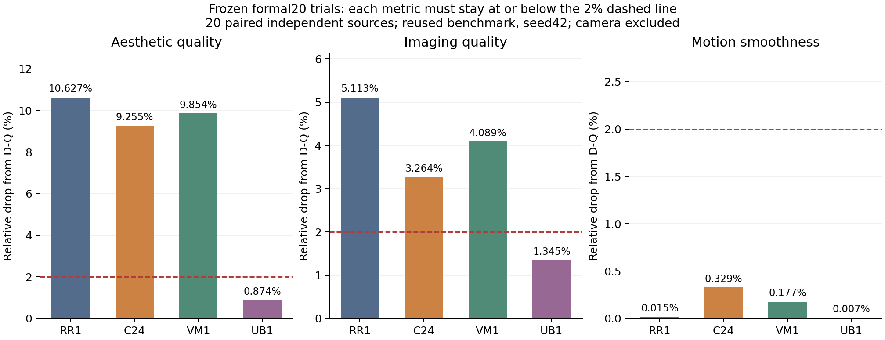

# 2026-10-21 晨间实验总览

本页汇总这一轮已完成的可复核结果与新候选进度。**UB1首次通过原正式20质量与完整FFN速度的联合工程验收。** 它是静态步间预算基线，输入动态性和方法创新未建立。所有D-Q参考都是精确四步蒸馏D模型；没有将原始O当作已测基线。

07:52 JST更新：[UB1固定步间计算预算对照](28_固定步间计算预算对照.md)以25%/50%/50%/75%的四步主计算密度维持全局50%。80个变化位置拟合、原108组参数复现及完整恒等控制均通过，三项正式质量全部通过，两臂全20驻留字节等价通过；同一张GPU0隔离预热+各三次正式重复的完整FFN总时间比 **1.546111×**。平均耗时D-Q **10177.569ms**、UB1 **6582.689ms**，样本标准差分别134.837ms/4.425ms。来源分离补充20输入现已启动。[FA2固定64轮训练](27_固定长程量化恢复预算检验.md)四项误差比0.864–0.877，未达≤0.80开发门槛，已停止全量拟合和视频。

## 四个完整视频候选

全部覆盖40块×4步，同一正式subject10+background10、seed42、20个独立来源，camera排除；每源五份指标文件名仍只计一个来源。三项官方指标各自最多相对下降2%，正式20已经复用，不能再称未触碰测试集。

| 固定实现 | Aesthetic相对下降 | Imaging相对下降 | Motion相对下降 | 三项同时通过 |
|---|---:|---:|---:|---|
| RR1：旧12输入、中心化静态支持+rank256残差 | 10.627% | 5.113% | 0.015% | 否 |
| C24：24个分离来源、总训练行数与RR超参固定 | 9.255% | 3.264% | 0.329% | 否 |
| VM1：冻结RR1，只做输出均值/方差校正 | 9.854% | 4.089% | 0.177% | 否 |
| UB1：冻结C24配方、四步主计算25%/50%/50%/75% | 0.874% | 1.345% | 0.007% | 是 |

C24的imaging数值更接近门槛，aesthetic仍有明显差距。VM1校准能量重建接近1，没有解决完整视频质量问题；这不能证明能量是唯一原因。UB1首次使三项均进入门槛；它仍是标准静态步间预算基线，不能写成输入动态稀疏创新。固定两个展示输入的[D-Q/C24/UB1逐帧对照](../reports/worker_20261020/UB1_formal_input00_comparison.jpg)与原三项官方输出均已归档。

RR1和C24都已通过全部20输入的常驻部署等价：80份四步潜变量及20个视频字节与各自参考完全一致。主FFN两个GEMM实际半宽，RR辅助两GEMM单独计数。因为质量被拒绝，没有把并发负载下的单次计时升级为正式1.5倍速结论。三份比较JSON、原始官方worker输出、来源配对表、协议与SHA在`reports/worker_20261020/`中，细节见第19、20、21章。

UB1的[联合证据索引](../reports/worker_20261020/UB1_joint_engineering_evidence_manifest.json)绑定质量、两臂全20等价、所有测速重复和资源监测。完整FFN计时包含norm/modulation、QDQ、gain/bias、两次rank256辅助GEMM、gate/residual及保守计入的全部共享准备/原始bias预取。1.546×是该完整FFN边界的实测，不是整网端到端或硬件FP4速度。个别来源仍有较大退化，原正式20已经复用；补充验证不做重新拟合或挑选超参。

## 已排除的联合重建与完成的基础工作

JR1同时更新保留通道W2并重拟合RR；固定lambda1/rank256。四个校准CV中，JR/RR为0.971、0.975、0.873、0.875，均未满足预登记的≤0.80且JR/匹配WR≤0.90双门槛，已停止，没有再消耗完整视频评测。它仅是correction-only CV，base支持使用过全部来源。

C24原始校准完成24×160个位置、每位置总6144行，约47.4GB原生张量；全部输入观测前后四步潜变量和视频一致。3840个payload SHA、采样坐标、BF16 header及48个视频的81帧/16fps均已审计。原始大张量在HF derived cache，仓库保存轻量索引和证据。

正式输出、失败试验、环境/权重/源码绑定均已整理。原始私有scheduler随机数状态问题已修正并独立验证；新旧校准种子流差异保留说明，没有宣称缺失旧缓存的逐字节复现。

## OP1与LA1局部恢复检验

OP1只替换C24残差，训练目标来自**学生实际状态上的原生局部dense D-Q FFN**。它不是dense整网教师轨迹，也不在线调用教师。原支持、主GEMM形状、gain/cast、bias、缓存及rank/lambda保持冻结。

最初手工采样批次重放未逐位通过，失败已保留。改为原始完整序列与未改动的HiF4调用后，两个控制输入各160位置的Q1/Q2/Y以及完整四步潜变量/视频均逐位通过；减少元数据写盘次数后再次完整复验通过。24个来源的实际V1/BaseY/TeacherY/StudentY已全部完成，约40.35GB；3840个文件与48个视频的独立审计通过，所有原始张量位于共享HF缓存。

首批两个来源的四步局部旧残差/主分支误差比约0.54–0.64，只作描述。完成采集后已按协议执行step2/3 block20四项校准CV，要求新原生误差全部≤旧StudentY误差的90%；实际全部未达标，停止全量拟合和正式视频。入口、恢复点与数值边界见[第23章](23_学生状态上的原生局部教师.md)。

另已登记条件备选[LA1折叠低秩量化适配小试](25_折叠低秩量化适配小试.md)：仅在OP1 CV或正式质量被拒绝后运行，固定rank32/8epochs，先通过原主分支逐位重放及四项CV。实际GPU小试已经完成，结果及数值修正见下文。

OP1四项CV新/旧误差为1.0259、1.0375、1.0283、1.0340；修正版LA1为1.0006、1.0028、0.9987、1.0013，分别未达到≤0.90/≤0.80门槛。两者均停止全量拟合/视频。LA1在训练前发现的负零参考输入错误已定位、留档并重新逐位验证，未放宽容差。更强的固定[FA1全主权重量化恢复配方](26_全主权重量化恢复小试.md)也已完成四项开发CV，误差比0.9553–0.9609，改善未达到≤0.80，因此停止全量拟合与视频。三个局部恢复试验均无正式质量或速度通过结论。
