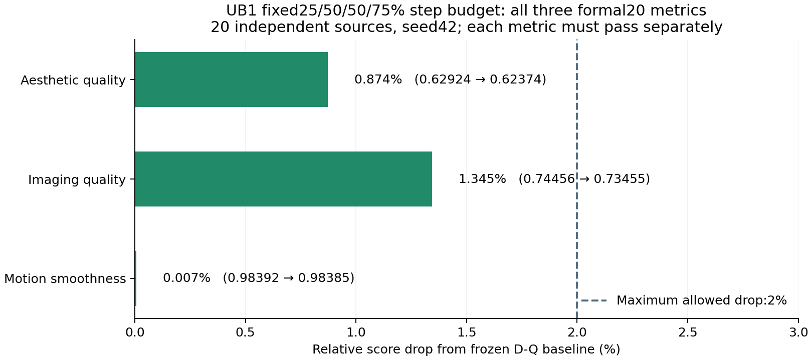
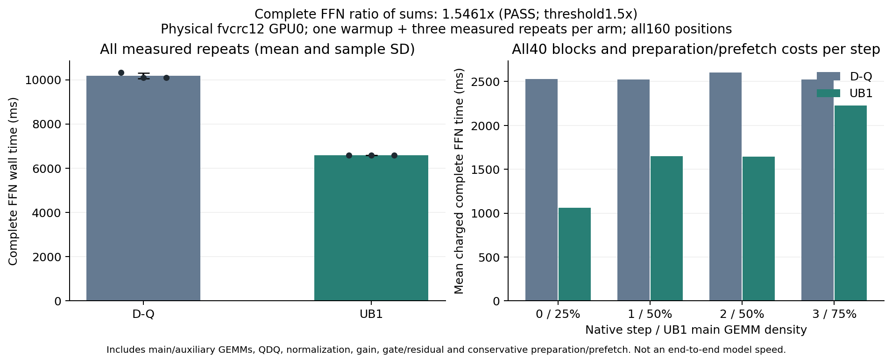

# UB1：固定步间计算预算对照

UB1测试将部分早期主FFN计算移至最后一步，保留全局50%的主GEMM计算。它是标准的静态步间预算对照，没有输入动态性或方法创新结论。协议在新宽度参数拟合与视频生成前固定，依据此前潜变量偏差随步数增长的描述性观察；该观察并不证明末步误差的因果贡献。

| 步 | 保留64通道组 | 主FFN中间宽度 | 该步主计算密度 |
|---:|---:|---:|---:|
| 0 | 54 / 216 | 3456 | 25% |
| 1 | 108 / 216 | 6912 | 50% |
| 2 | 108 / 216 | 6912 | 50% |
| 3 | 162 / 216 | 10368 | 75% |

全部40块×4步执行真实缩减的两次主GEMM。全局50%并不表示每个位置50%。rank256残差的两次辅助GEMM另行计入，norm/modulation、QDQ、gain/cast、bias和gate/residual均保留。完整计时仍要求所有位置总时间之比至少1.5；没有把主GEMM理论减量当成实际倍速。

拟合沿用C24的原24来源、每源256行、C_mean组排序、中心化gain/bias和固定rank256/lambda1残差。step1/2直接保留C24参数；仅重拟合step0/3的80个位置。训练仍使用原dense后Q2子集及每源256行FFN2代理，不能声称该训练代理的舍入与部署缩减FFN0完全相同。

## 已通过的数值控制

两个变化步骤各先在block20重拟合原108组设置，原C24的alpha、b2与全部RR原生参数SHA完全复现，然后才拟合新宽度。80个变化位置均已完成并写入HF derived cache，原始大参数没有进入Git。

新执行器在四步全108组的恒等设置下，与C24 task6/seed20261001的全部160位置、四份潜变量原始字节及视频文件SHA完全一致。实际UB1正式输出已检查320次主GEMM的真实形状与按行数加权的全局MAC密度0.5；计时比较器同时检查每个位置的宽度、行数与残差矩阵形状，不能以四个密度的简单平均掩盖实际计算差异。50项CPU数值/证据守卫测试通过。

拟合与恒等控制证据：

- [step0拟合](../reports/worker_20261020/UB1_step0_fit_RUN.json)、[step3拟合](../reports/worker_20261020/UB1_step3_fit_RUN.json)
- [完整恒等控制](../reports/worker_20261020/UB1_full160_identity_verification.json)
- [冻结部署策略](../reports/worker_20261020/UB1_policy.json)、[预登记协议](../reports/worker_20261020/step_budget_ub1_registered_protocol.json)

## 正式评估状态

2026-10-21 07:52 JST：**同一冻结UB1实现通过原正式20质量与完整FFN速度的联合工程验收。** UB1和D-Q全部20输入的常驻部署等价均通过：每臂80份潜变量和20个视频SHA与各自参考一致，见[UB1证明](../reports/worker_20261020/formal20_UB1_resident_equivalence_RUN.json)和[D-Q证明](../reports/worker_20261020/formal20_DQ_resident_equivalence_RUN.json)。正式20已多次复用，只能作为开发基准；来源分离补充正在执行。

| 官方指标 | D-Q | UB1 | 相对下降 | ≤2% |
|---|---:|---:|---:|---|
| aesthetic_quality | 0.6292352959513664 | 0.623736722767353 | 0.873850% | 通过 |
| imaging_quality | 0.7445621655546591 | 0.734549665662978 | 1.344750% | 通过 |
| motion_smoothness | 0.9839226356829479 | 0.9838501711257281 | 0.007365% | 通过 |

使用原官方worker、相同指标模型与环境，20个独立来源每源五份指标文件名，仍只计20个来源。imaging来源表按原MUSIQ值/100与官方aggregate对齐；全部门槛基于未舍入原值。见[完整比较](../reports/worker_20261020/formal20_UB1_comparison.json)、[60行来源配对](../reports/worker_20261020/formal20_UB1_paired_sources.csv)及[原始证据索引](../reports/worker_20261020/UB1_quality_evidence_manifest.json)。

独立[全20主计算审计](../reports/worker_20261020/UB1_formal20_main_compute_audit.json)逐条核对了全部3200位置的实际主/辅助GEMM形状、全局50%主MAC与执行器/父执行器源码SHA。质量比较入口也已支持冻结步间宽度，仍核对实际按行数加权的MAC；未将质量运行冒充含完整在线成本的计时。

固定展示输入0和10，帧0/20/40/60/80的[D-Q/C24/UB1对照](../reports/worker_20261020/UB1_formal_input00_comparison.jpg)可见部分纹理模糊减轻；定性截图不能替代全20输入指标。

完整20来源的末步pooled潜变量相对RMSE，C24为38.72%，UB1为42.80%；UB1的平均范数比0.9511、中心化能量比0.9110，比C24的0.9419/0.8916更接近1。潜变量误差更大与视频指标改善可以同时出现，不能以单一latent RMSE代替三项质量。见[描述性轨迹图](../reports/worker_20261020/paired_trajectory_overview.png)。

通过指20来源的聚合指标，并不意味着每个来源都下降≤2%。逐来源有5个aesthetic、7个imaging超过2%，motion为0个。固定seed20261021、10000次subject10/background10配对分层重采样的95%百分位区间，三项相对下降分别为[-0.589%,2.459%]、[0.051%,2.806%]、[-0.174%,0.195%]。这是同一开发基准的描述性波动，不替代原登记门槛或证明总体通过概率；见[逐来源波动](../reports/worker_20261020/UB1_paired_source_variability.json)。因此另固定了[来源分离补充验证](29_冻结候选的来源分离补充验证.md)，只评估冻结实现，不据新输出改参数。

另按20来源中imaging相对下降最大者，增加[输入5的事后诊断图](../reports/worker_20261020/UB1_worst_imaging_input05_comparison.jpg)。其imaging下降11.44%，个例仍有差距；这张后验图不替代原固定展示输入0/10，选择依据与来源CSV SHA另行保存。

## 后续执行与条件诊断

隔离测速已完成。物理worker GPU0、相同task6/seed20261001和数值环境，先D-Q后UB1，每臂一次预热加三次正式重复。两卡除本进程外无其他计算，监测分别262/336个资源样本，无违规；每次请求全部160位置与四份参考潜变量逐位检查通过。

| 臂 | 正式重复1/2/3，ms | 平均±样本标准差，ms |
|---|---|---|
| D-Q | 10333.253 / 10098.097 / 10101.356 | 10177.569 ± 134.837 |
| UB1 | 6577.826 / 6583.760 / 6586.480 | 6582.689 ± 4.425 |

主要判据为`30532.705840 / 19748.065632 = 1.546111×`，覆盖全部40块×4步与所有正式重复；没有挑最快重复或平均局部倍速。包含norm/modulation、原生QDQ、gain/cast/bias、RR辅助、gate/residual及保守共享准备/全部bias预取。主GEMM全局MAC为0.5，rank256辅助另为dense FFN MAC的1.85185%。

[完整时间比较](../reports/worker_20261020/UB1_complete_FFN_comparison.json)、[联合验收控制器](../reports/worker_20261020/UB1_joint_engineering_acceptance_RUN.json)和[全部证据SHA索引](../reports/worker_20261020/UB1_joint_engineering_evidence_manifest.json)均已归档。稳定执行前的一次性驻留准备分别81.066秒/177.860秒，参数GPU驻留字节56,222,842,880/57,075,548,160；这些冷启动成本单独记录，不计入已登记的稳态完整FFN边界。该结果不代表整网端到端加速、显存减半、硬件FP4或输入动态稀疏创新。

`tools/continue_candidate_acceptance.py --label UB1 --policy runs/worker_restart_20261020/ub1_step_budget_fit/UB1_policy.json`在三项质量通过后，让GPU0执行D-Q全20常驻等价，同时等待GPU1完成候选全20等价，再生成同输入候选测速参考。所有工作完成、两卡均空闲后，在GPU0依次执行D-Q和UB1的一次预热+三次计时，以全160位置总时间比较。质量、源码、部署策略SHA均一致，最终`joint_engineering_acceptance_pass=true`。

三项质量尚待结果时，还登记了TF1相同dense状态flow诊断，条件是UB1质量被拒绝。现质量通过，该诊断**未运行**；优先完成同一冻结候选的工程验收。TF1的原生BF16注入检查包含负零逐位一致性和拒绝不可精确恢复状态的测试，不能把这些CPU测试记成GPU模型结果。本轮53项数值/守卫测试通过。

## 原生scheduler核对

UB1策略冻结后，另行核对了未改动的原生scheduler源码与实际运行记录。配置的`[1000,750,500,250]`是索引；shift5后实际模型时间步为`[1000,937.5,833.333313,625]`，sigma为`[1,.9375,.833333313,.625]`。固定输入时，连续代数形式中的flow输出更新系数绝对值为`[.0625,.104166687,.208333313,.625]`，末步为首步10倍。

这是flow预测的固定输入代数系数，不是FFN输出Jacobian、终端质量敏感度或UB1的事前推导。实际step_post分别计算FP32乘加，再回写BF16潜变量；不能声称与合并delta-sigma公式逐位等价。保存的FP32潜变量是BF16值的无损提升。见[源码与实际轨迹核对](../reports/worker_20261020/native_shift5_scheduler_audit.json)。

## 为后续诊断准备的Q2回放

另有独立控制：恢复原始完整M和采样行位置，从V1经未改动的dense HiF4路径导出Q2。在原dense校准输入0/1、step2/3 block20的四个控制上，Q2和Y均与实际捕获逐位一致；全部24个学生来源×两个位置的TeacherY也逐位一致，48个派生Q2张量仅存HF缓存。OP1没有保存实际教师Q2，不能将其写成直接观测的OP1 Q2逐位核验。该步骤没有训练新模型，也没有视频/速度结论，见[回放证据](../reports/worker_20261020/dense_V2_native_replay_RUN.json)。
