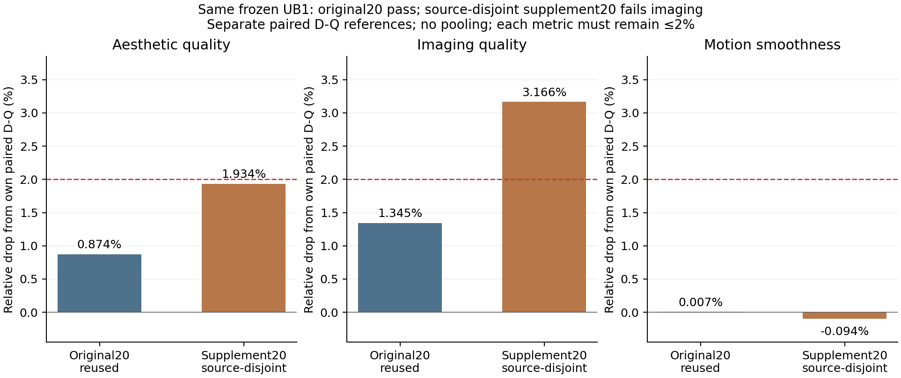

# 冻结UB1的来源分离20输入补充验证

UB1首次通过的是已经多次使用的正式20输入聚合质量门槛。为区分该基准上的改善与来源外表现，在查看任何新候选输出前，另固定20个来源，只运行一次成对D-Q/UB1评估，不重新拟合或选择超参。该补充不改写原正式验收结果。

从同一个固定版本VBench-I2V镜像的原JSON顺序，选取未用于本轮formal20/calibration24的前10个animal subject和前10个architecture background，再检查原calibration12和research0/6的实际图像SHA。发现重复或交叠即停止，不人工替换。

最终固定为subject过滤索引22–31、background过滤索引30–39；20个独立来源、20个独立图像SHA，与上述本轮输入无已知source/name/prompt或要求排除的图像SHA交叠。全部16:9 crop、seed42、camera排除。原交接全部历史实验未逐项审计，不能据此声称整个研究历史从未看过这些内容。

登记前检查过源元数据的类型和文件名，没有查看补充图像或模型输出。协议中的选择先后指固定列表脚本的执行顺序，不代表对源元数据盲态。

[协议](../reports/worker_20261020/disjoint20_registered_protocol.json)、[冻结输入](../reports/worker_20261020/disjoint20_frozen_inputs.json)、[排重与恢复证据](../reports/worker_20261020/disjoint20_input_recovery.json)及提取/生成前的源码冻结记录已保存。原图仍位于HF derived cache。

候选仍为原UB1策略SHA `d8840b9328af18c9f3d07b4570130e58467d0f45cae12d1dd13e8db89ebd7a6a`，执行器SHA `93469f2ae10407d13907c06a331d19a277b81ac84aefa78e387eab8f0b658b5c`。没有使用补充输入做支持选择、gain/bias或残差拟合。

入口`tools/continue_disjoint20.py`等待原同策略联合工程验收通过后，才让两张卡分别生成D-Q和UB1的各20条视频；若原工程验收失败，补充模型运行停止，优先解决原问题。然后两张卡分别执行相同三项官方worker，保留每来源分数，仍检查每项聚合相对下降≤2%。大视频/潜变量写入节点HF derived cache，紧凑报告位于`runs/worker_restart_20261020/disjoint20_*`，最终证据再归档。

2026-10-21 08:26 JST：两臂40条视频和三项官方指标全部完成。**来源分离补充未通过，失败项为imaging。**

| 官方指标 | 新来源D-Q | 同一冻结UB1 | 相对下降 | ≤2% |
|---|---:|---:|---:|---|
| aesthetic_quality | 0.6161511063575744 | 0.6042364969849586 | 1.933715% | 通过 |
| imaging_quality | 0.7262936826399815 | 0.7032994598577055 | 3.165968% | 未通过 |
| motion_smoothness | 0.985400286816242 | 0.9863284469527511 | -0.094191% | 通过 |

[完整比较](../reports/worker_20261020/disjoint20_UB1_comparison.json)、[60行来源配对](../reports/worker_20261020/disjoint20_UB1_paired_sources.csv)和[两臂官方原始结果及SHA](../reports/worker_20261020/disjoint20_quality_evidence_manifest.json)均已归档。三项逐项按未舍入值判断，没有平均指标或改门槛。原正式20已经复用；新20这次结果只作一次冻结模型补充检查，此后若用其反馈设计新方法，必须标为已使用来源，不能继续称未见测试。

原基准上的完整FFN速度1.546×与三项质量通过结果仍然成立；它没有解决本次新来源的imaging门槛，不能据此宣称跨来源质量已经通过。没有在补充结果后重拟合UB1支持、gain/bias或残差。

## 执行修正与保留的失败

调度器曾收到SIGTERM（退出143、根因未确认），原生生成子任务均完成，按检查点恢复。首次评分入口误沿用了只含原20个prompt的历史索引，新视频匹配数为0，aesthetic报ZeroDivisionError，未产生有效分数。两臂失败目录以`*_empty_index_failed`保留，原评分入口源码也已另存。

修正只为新固定来源构造索引：完整保留旧subject/background的维度标签和类型规则。相同生成规则可精确重建旧20条历史索引，新两臂每项均匹配全部100个视频名，见[索引控制](../reports/worker_20261020/disjoint20_index_fix_control.json)及[恢复记录](../reports/worker_20261020/disjoint20_empty_index_fix_recovery.json)。官方worker、指标模型、生成视频、候选参数和质量阈值均未改变。修正后的60项CPU测试通过，随后对原视频完成首次有效评分。

## 描述性波动与画面检查

使用与原20相同的固定source-paired分层bootstrap（subject/background各10、10000次）得到新20的imaging下降95%描述性区间1.434%–5.319%，个体来源下降中位数2.004%、最大16.784%。它不是总体成功概率或替代质量门槛，登记的点估计仍为失败，见[来源波动](../reports/worker_20261020/disjoint20_source_variability.json)。

[固定input00](../reports/worker_20261020/disjoint20_input00_comparison.jpg)、[固定input10](../reports/worker_20261020/disjoint20_input10_comparison.jpg)和[最大imaging退化input05](../reports/worker_20261020/disjoint20_input05_comparison.jpg)均使用帧0/20/40/60/80；[选择规则](../reports/worker_20261020/disjoint20_visual_selection.json)明确最差例是在评分后挑选，不能当盲选代表。在鸟群最差例中可见UB1轮廓更模糊、后续展示帧变化较小；这是该例的视觉观察，不作为整批退化原因的因果判断。
