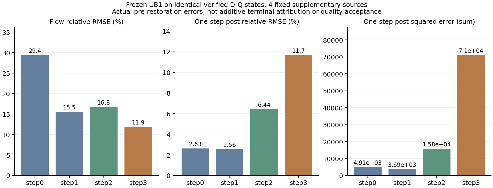

# TF2：相同D-Q状态下的原生流误差

冻结UB1在补充20的imaging下降3.166%，TF2随后登记固定索引0/5/10/15，取顺序四等分位置，不按质量或误差选择。四个来源分别来自两张animal和两张architecture图像，均不用于本次拟合。

先运行驻留D-Q，四个输入的16份潜变量和4个视频字节全部复现已有补充输出，记录每步实际输入、flow prediction和更新后latent。再运行同一冻结UB1，每步完成后先记录真实输出及误差，随后将调度器latent恢复为已验证的D-Q更新后状态。因此16次候选输入与D-Q逐位相同，且四个首步候选输出均复现原未强制UB1。全部40×4 FFN位置执行。

| 原生步 | Flow合并相对RMSE | 单步更新后合并相对RMSE | 单步更新后SSE（4来源总和） |
|---|---:|---:|---:|
| step0 | 29.4041% | 2.6326% | 4910.723644 |
| step1 | 15.5424% | 2.5564% | 3687.491138 |
| step2 | 16.7728% | 6.4403% | 15845.363991 |
| step3 | 11.9241% | 11.6769% | 71031.081307 |

误差使用FP64平方和，相对RMSE是“合并误差平方和/合并参考平方范数”的平方根，不是四个来源RMSE的均值。末步的flow相对误差最小，但真实单步更新后误差最大；这与该调度器末步更大的更新系数相容。它没有证明FFN对画质的Jacobian，也不能将四步这些误差相加当终态分解。

强制恢复包括最后一步，所以候选诊断视频的最终latent来自D-Q，这是构造结果，不能当成候选质量改善或no-op证明。所有强制视频都排除在VBench之外；这里只比较恢复之前的实际预测和更新。

本诊断触发单独登记的LR1末步残差容量小试：四来源合并的最后一步绝对post SSE为四步最大。它是已看过补充来源后的方法设计反馈，补充来源不再是未见测试；只在既有24个校准来源上拟合。后续任何改善都需要新候选的完整原生、速度和视频检查。

入口`tools/continue_supplement_teacher_flow.py`和`tools/run_supplement_teacher_flow.py`。旧TF1因原正式20质量通过而未运行；TF2另用补充失败条件，两个脚本的三个数值helper AST在替换实验标签后完全一致，旧脚本未改写。见[数值实现控制](../reports/worker_20261020/TF2_numeric_helper_AST_control.json)、[协议](../reports/worker_20261020/TF2_registered_protocol.json)、[完整控制器结果](../reports/worker_20261020/TF2_controller_RUN.json)与[两臂8份记录及SHA](../reports/worker_20261020/TF2_evidence_manifest.json)。张量位于worker HF derived cache。
