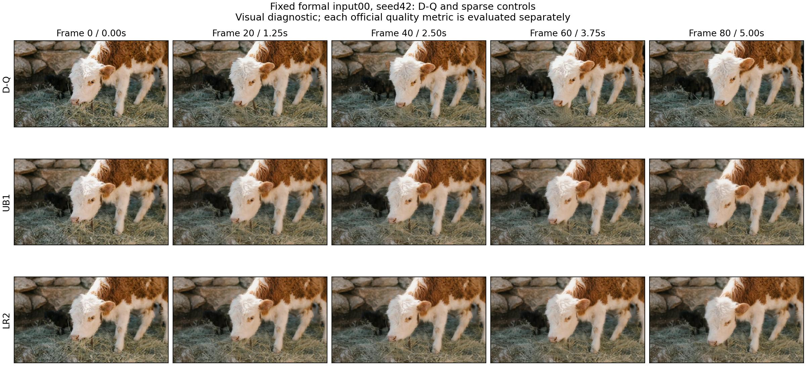

# LR2：末端十层的条件增秩检验

LR1整体失败，但block30两折同时优于匹配重拟合和原冻结R256，block10两折未过。LR2据此先固定候选边界：仅step3 block30..39采用rank512，其他150位置保持原UB1 rank256。这个边界是看过LR1后的选择，不能称全新未见发现。

在拟合候选前，另检查固定block31和block39、各两折。数据、原生完整M、lambda1、rank256/512算法和双对照≤0.95门槛沿用LR1；四项全过才拟合10个位置，有任一失败即停止本候选，不改边界或选择通过的层拼接结果。

若通过局部门槛，全24来源拟合仍只用原OP1的C24学生状态。新runtime要先在固定formal0/10、supplemental0/10复现原UB1的4潜变量和视频，才运行主动候选；主FFN真实50%计算保持不变，平均残差秩272，辅助MAC为dense FFN的1.96759%。增量成本、40条两批来源质量和完整FFN速度均须重新验证，不能继承原UB1的验收。

两批20均已成为开发反馈，后续通过也不能称新的未见泛化。原LR1失败和冻结UB1两批质量结论继续保留。

[协议](../reports/worker_20261020/LR2_registered_protocol.json)、[拟合前源码](../reports/worker_20261020/LR2_before_fit_source_freeze.json)与[64项测试](../reports/worker_20261020/LR2_preflight_64_tests.txt)已保存。入口为`tools/run_late_block_rank_pilot.py`，复用未修改的LR1原生helper，运行在worker GPU0；四项局部门槛已全部通过，随后完成全部10位置拟合和两批各20条主动视频。

## 固定额外位置的CV结果

| 块/折 | R512/匹配R256 | R512/原冻结UB1 R256 | 双门槛≤0.95 |
|---|---:|---:|---|
| block31 / 0 | 0.871380 | 0.872783 | 是 |
| block31 / 1 | 0.874413 | 0.917972 | 是 |
| block39 / 0 | 0.896588 | 0.838058 | 是 |
| block39 / 1 | 0.907099 | 0.918180 | 是 |

[完整CV](../reports/worker_20261020/LR2_native_risk_RUN.json)使用实际原生重建误差，区别于RB/HP的C-score代理。全24来源、10个位置拟合也已完成（168.199秒），[完整拟合记录](../reports/worker_20261020/LR2_full_RUN.json)保留每位置原C24逐位控制与训练误差，训练误差不作验收。新的混合秩运行层独立于冻结UB1，并增加拒绝漏报增秩形状/成本的测试，66项通过。4固定来源恒等控制随后全部通过，16个潜变量和4个视频均逐位一致。两批质量结果如下。

## 完整视频结果：补充20仍拒绝

| 来源批次 | aesthetic下降 | imaging下降 | motion下降 | 三项逐项≤2% |
|---|---:|---:|---:|---|
| 原始20 | 1.209984% | 1.271579% | 0.022552% | 是 |
| 补充20 | 1.900525% | 3.050580% | −0.081214% | 否 |

[原始20完整比较](../reports/worker_20261020/LR2_formal20_COMPARISON.json)与[补充20完整比较](../reports/worker_20261020/LR2_disjoint20_COMPARISON.json)使用同一冻结主动策略，SHA256 `c6fbc988e5514f73e5518280a5002698fd72677111e965030c43fae94e7b4293`。六个官方worker及原始逐视频输出均保留在[评分索引](../reports/worker_20261020/LR2_official_metric_evidence_manifest.json)。五个文件名副本对应同一条视频，每批仍是20个来源；两批均已参与开发，不能称未见测试。

相对冻结UB1，补充imaging下降从3.165968%减至3.050580%，仍超门槛。局部CV改善没有带来完整质量通过；按协议停止全20主动候选非驻留等价和隔离测速。[停止记录](../reports/worker_20261020/LR2_stopped_acceptance_RUN.json)明确记录未运行阶段；目录中的LR2测速源码和配置属于未执行准备，不能继承UB1的1.546×。

展示输入固定为原始0/10、补充0/10，以及此前UB1已知退化较大的补充5；[选图记录](../reports/worker_20261020/LR2_visual_selection_before_imaging_scores.json)保留时点与依据。展示不改变聚合门槛。

