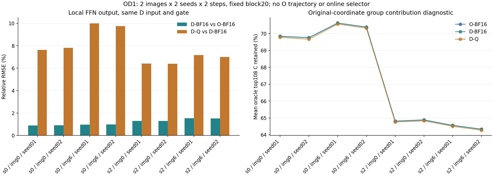

# OD1：原始O、蒸馏D与HiF4的固定输入局部对照

OD1已完成8个局部作用域的原生控制与对照：两个输入图、每图两个种子、step0高噪声/step2低噪声、固定block20、每作用域512个预定均匀采样行。8个作用域只有两个独立图像来源。这里的输入U、调制和gate均来自D-BF16轨迹；没有运行原始O整网或O自己的状态、门控与视频。

## 资产与逐位控制

原始O固定于Wan-AI/Wan2.2-I2V-A14B revision `206a9ee1b7bfaaf8f7e4d81335650533490646a3`。官方safetensors索引显示两个专家的block20均位于各自第4个分片，因此只下载两个完整分片，共19,678,119,488字节；没有下载整套114GB模型。文件放在标准HF缓存，完整LFS SHA256、所有8个张量header和shape已验证，详见[资产验证](../reports/worker_20261020/original_O_block20_assets_verified.json)。源张量实际为FP32，局部比较显式转BF16；不能因历史目录含bf16便将源精度写成BF16。

先在原始完整M几何重放D-BF16的U→Z→tanh GELU→H→Y→同D gate。全部8个作用域的Z/H/Y/b2/门控输出逐位一致，才比较O。W2布局与已观测原生stride一致，原始bias仅加一次。O、D-BF16、D-Q均在同一U上计算，D-Q使用已验证HiF4激活QDQ与冻结有效权重；不是独立的O/D轨迹比较。

## 已完成结果

| step / 专家 | D相对O门控输出相对RMSE范围 | D-Q相对D门控输出相对RMSE范围 |
|---|---:|---:|
| 0 / high | 0.8938–0.9857% | 7.6316–10.0043% |
| 2 / low | 1.2974–1.5426% | 6.3930–7.1638% |

相对RMSE各自以对应参考输出范数归一化；需要精确比较误差分量时应读取同单位SSE，不把不同分母的比值当作误差可加分解。原始FP32→BF16和蒸馏D的参数哈希并不相同，不能将小输出差异解释为权重相同。原始数值、参考能量和误差方向余弦都在[完整运行记录](../reports/worker_20261020/OD1_local_function_RUN.json)。

对各BF16作用域，按相同D gate计算原坐标系64通道组贡献C，逐行归一化后取离线oracle top108的平均保留比例。O与D的最大绝对差仅0.000016423（0.0016423个百分点）；这两个图的这些局部函数没有表现出蒸馏后贡献集中度显著增加。该表示依赖组坐标、激活和门控；不是内在稀疏性证明，也没有计入在线选组成本。不能据此否定其他图、层、状态或全模型的差异。

[注册协议](../reports/worker_20261020/OD1_registered_protocol.json)、[执行前源码](../reports/worker_20261020/OD1_before_function_source_freeze.json)、[原生算子快照](../reports/worker_20261020/OD1_native_operator_source_snapshot.json)和[证据索引](../reports/worker_20261020/OD1_evidence_manifest.json)支持复核。首次CPU测试入口因脚本模式漏加仓库根路径而在导入阶段停止；[原始失败与恢复](../reports/worker_20261020/OD1_test_runner_import_path_recovery.json)完整保留。修复只涉及测试发现路径，71项测试随后全部通过，数值源码和实验协议未改。

这些结果补上固定D输入下的O/D局部函数证据。原始O整网视频、O轨迹、同一O状态上的多层统计、硬件FP4与新的完整FFN速度均未测量。
