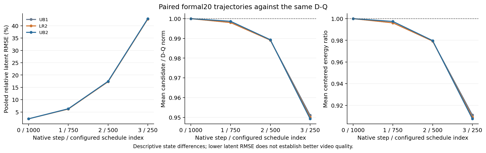
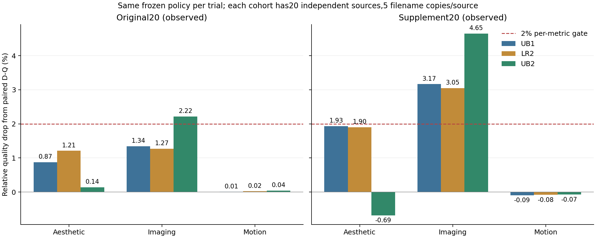

# UB2：固定总预算下恢复末步完整FFN

UB1在原20通过、补充20失败，LR2末端十层增秩也未解决补充画质下降。TF2在相同D-Q状态上观测到末步单步更新误差最大，UB2据此预先固定一个静态分配：四步主计算25%/25%/50%/100%，总主MAC仍为50%。不扫描预算，不从多个视频候选中挑最好结果；两批20都已经是开发反馈。

与UB1相比，只将step1的25个百分点计算移到step3。step0四分之一和step2二分之一的支持、gain/bias与R256参数原样复用；step1仍用原24校准来源、每来源256行、C-static中心化gain/bias与lambda1 R256配方，拟合40位置。开始前已逐位复现旧step1 block20半宽参数，随后40个四分之一宽度位置全部拟合完成。[原协议](../reports/worker_20261020/UB2_registered_protocol.json)在拟合前固定，实际拟合等待LR2完整质量拒绝后才开始。

step3采用原始完整D-Q缓存权重、smooth与D原始bias，gain恒为1，不调用残差预测器。辅助预测仅在前120位置执行，共240个GEMM，辅助MAC为dense FFN的1.388889%，需要在真实运行中按行数核验。这里没有跳过末步或将辅助开销漏出总计时。

新执行体先通过显式身份模式复现UB1：原始0/10、补充0/10的16个逐步潜变量和4个视频全部逐位一致，见[身份记录](../reports/worker_20261020/UB2_identity_RUN.json)。主动策略固定SHA256为`b2450ad26fbf1d5f1b54cebeac6852f31b108492d42ec5d70499ff22ba63999d`。

原生控制固定补充0、使用已验证TF2的四步D-Q状态。step0/2流与单步post必须逐位复现UB1；末步流与post必须逐位等于D-Q、误差严格为0。强制恢复状态后的最终视频只作诊断，不参与质量。该[原生流控制](../reports/worker_20261020/UB2_terminal_flow_RUN.json)已通过：step0/2与UB1逐位一致，step3流和post与D-Q逐位一致、两项SSE均为0。两批完整主动视频已分别在GPU0/1启动，后续使用相同官方三项指标和分批D-Q配对比较。

固定补充0的同状态控制中，减少step1计算使该步单步post误差增加，同时末步局部误差归零：

| step | 原UB1相对RMSE | UB2相对RMSE |
|---|---:|---:|
| 0 | 1.8982% | 1.8982% |
| 1 | 2.4433% | 2.8993% |
| 2 | 6.4611% | 6.4611% |
| 3 | 13.8913% | 0.0000% |

这里只比较强制使用D-Q状态的单步误差；真实UB2从前步传播的状态不同，末步完整计算不保证最终潜变量或视频等于D-Q。真实视频质量继续独立评估。

若两批逐项下降≤2%全部通过，再做两批全20主动驻留/非驻留等价；最后在固定原始0、同一GPU0上串行运行D-Q/UB1/UB2各一次预热与三次正式重复。完整FFN计时含全部160位置的norm/modulation、QDQ、主GEMM、GELU、gain/bias、实际120残差预测、gate/residual及保守计入的共享准备和bias预取。启动成本另报，不继承UB1研究输入006的1.546×。速度协议为[独立注册](../config/terminal_dense_benchmark_ub2.json)。

身份、拟合与末步原生流均已通过，两批完整质量结果随后拒绝此候选；主动全20等价与新测速按协议没有运行。本方案仍是常规静态强基线；通过也不能写成输入动态方法创新或新的未见泛化。

此外，[多类别前瞻确认集](39_多类别前瞻确认集.md)已经在任何UB2官方质量结果之前冻结；仅在观察过的开发门槛和工程检查结束后执行。原同类别来源不足的停止记录单独保留，未混同为质量实验。

## 完整真实轨迹差异

两批40条主动视频已全部完成。相同D-Q参考下，三套固定策略末步输出潜变量的合并相对RMSE如下；它描述真实传播轨迹，不是强制D-Q状态下的单步误差。

| 来源批次 | UB1 | LR2 | UB2 |
|---|---:|---:|---:|
| formal20 | 42.8001% | 42.7303% | 42.8896% |
| disjoint20 | 43.6621% | 43.5938% | 43.9294% |

末步完整算子虽然在固定相同状态上逐位恢复D-Q，真实UB2轨迹末步L2差异仍略大于UB1。因此不能把末步局部误差归零当作终端状态恢复，也不能用潜变量距离代替官方视频质量。原始CSV、全部4步汇总与[总索引](../reports/worker_20261020/observed_trajectory_audit_RUN.json)已归档；控制器首次读回遇到NFS负缓存延迟，增加有界等待后继续，数值helper和视频均未改变。

## 全部官方质量：两批画质均失败

| 来源批次 | aesthetic下降 | imaging下降 | motion下降 | 三项逐项≤2% |
|---|---:|---:|---:|---|
| 原始20 | 0.140652% | 2.217994% | 0.043736% | 否 |
| 补充20 | −0.686365% | 4.651736% | −0.073145% | 否 |

两批均为同一冻结策略，40条真实主动视频全部完成，六个官方worker全部评分完成。见[原始20](../reports/worker_20261020/UB2_formal20_COMPARISON.json)、[补充20](../reports/worker_20261020/UB2_disjoint20_COMPARISON.json)与[官方记录和小试索引](../reports/worker_20261020/UB2_NF1_closed_execution_archive_manifest.json)。美学改善没有同时改善技术画质；该固定预算转移被拒绝，不扫描其他预算或改变阈值。

[条件工程停止记录](../reports/worker_20261020/UB2_stopped_acceptance_RUN.json)和[确认集未执行记录](../reports/worker_20261020/UB2_unexecuted_confirmation_RUN.json)明确保留：没有新的主动全20非驻留等价、没有独立测速、没有新确认集视频。前文的速度配置与确认流程是执行前冻结准备，不能当已完成结果。

