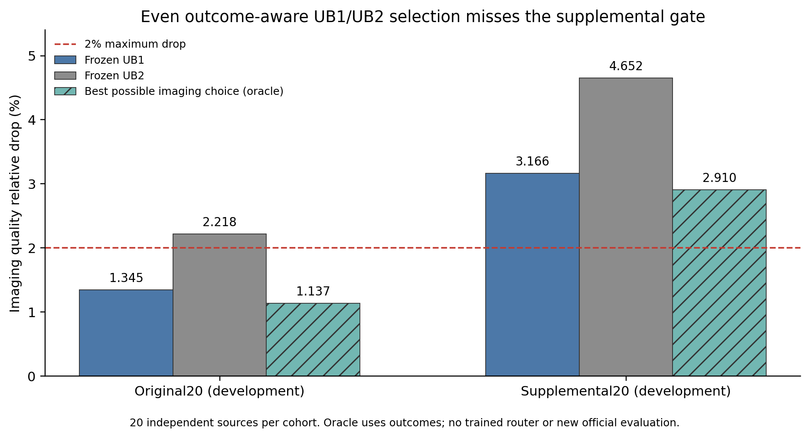

# 逐输入预算方案的质量上界与暂停

BO1已完成，受限于现有UB1/UB2两种完整视频预算方案的输入路由被拒绝。补充20来源即使事后知道每个输入的所有评分，也没有一种选择能同时满足三项相对下降≤2%。按用户要求，本轮归档上传后暂停，不启动下一条研究路线。项目尚未达到跨来源质量与输入动态方法的完整要求。

## 检验范围

两臂均为已冻结的50%主计算预算：UB1四步25%/50%/50%/75%，UB2四步25%/25%/50%/100%。每个来源只能整条视频选择一臂，三个指标必须一起使用该视频的结果。没有按指标分别挑选、dense回退、视频内拼接、混合权重或新拟合。

使用原始20和补充20两批已经用于开发的来源，每批独立subject10/background10。官方评分的五份文件名先合并到同一实际来源，MUSIQ恢复为官方聚合单位；核对四份完整比较、CSV SHA、固定策略SHA、同批D-Q协议与全部60项配对基线、来源/提示一致及聚合分数复现。两批来源互不重叠。该登记发生于原聚合结果及部分aesthetic来源行已知之后，没有将它称为未触碰实验。

每批CPU穷举全部2^20＝1,048,576种选择，最小化三项聚合相对下降的最大值；精确平局按升序来源列表对应的最小mask取值。原生模型和GPU没有运行新候选。

| 开发来源批次 | 联合oracle aesthetic下降 | 联合oracle imaging下降 | 联合oracle motion下降 | 同时达标的组合数 |
|---|---:|---:|---:|---:|
| 原始20 | 1.093% | 1.143% | 0.035% | 919,250 |
| 补充20 | 1.294% | **2.910%** | −0.088% | **0** |

这些是使用结果标签的回顾oracle估计，不是部署路由器或新的官方质量通过结论。组合数也不是成功概率。

## 不依赖穷举器的成像上界复核

另外使用50位Decimal逐来源取两臂成像评分的最大值，再对20来源等权平均。这个计算允许忽略另外两项约束，因此是任何这类二选一路由都无法超过的成像分数上界。原始/补充20的最小可能成像下降分别为1.136607%/2.909550%，与穷举器一致。

补充20即使只看成像指标也无法达到2%，所以不训练仅在这两种冻结整视频方案间选择的路由器。不将此结论扩大为其他预算、视频内动态策略或所有输入动态方法都不可行。

图中oracle仅优化成像单项，与表中联合三指标minimax oracle的目标不同；原始20因此有1.137%与1.143%的小差异，补充20两者相同。

见[事前登记](../reports/worker_20261020/BO1_registered_protocol.json)、[冻结来源与输入SHA](../reports/worker_20261020/BO1_before_oracle_source_freeze.json)、[102项CPU测试](../reports/worker_20261020/BO1_preflight_102_tests.json)、[完整穷举结果](../reports/worker_20261020/BO1_schedule_oracle_RUN.json)与[独立成像上界证书](../reports/worker_20261020/BO1_independent_imaging_certificate.json)。四个新增测试覆盖逐视频三指标耦合、与直接小规模穷举一致、2%边界与无效输入拒绝。未将oracle用于修改此前冻结候选或追溯宣布其通过。

## 暂停状态

本轮[OP3相同残差配方换状态](46_真实状态重拟合与导入延迟修正.md)、[NF2复用隐藏量输出修正](47_复用残差隐藏量的输出修正.md)及BO1均已按各自登记条件闭合，失败与未运行项完整保留。源码导入副本通过全部192项原生字节等价控制，全部102项CPU测试通过。模型、原始张量、拟合系数仍留在HF缓存，仓库仅保存代码和轻量证据。

UB1原始20质量与完整FFN1.546111×的工程结果仍成立；补充20成像下降3.165968%，项目整体没有完成跨来源验收。本轮未新增正式视频质量、完整FFN速度或驻留等价结论。按用户明确停止条件暂停后，需用户明确恢复才继续研究。
