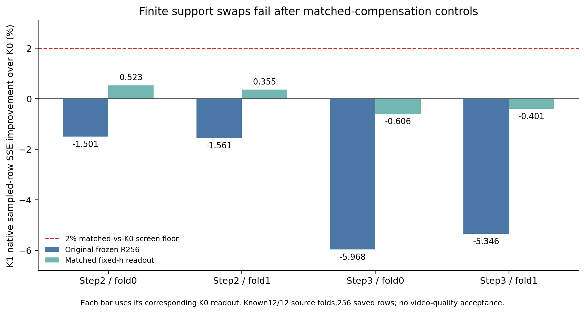

# R4补偿感知支持交换的原生筛选

按用户最新指令更新至原上游`c3f47da`后，已实际完成R4E0与R4E1，不再停留在R4推导。R4E0的48份现有原生载荷与系数绑定通过；R4E1有限支持交换的四项来源折均未通过登记门槛。step2在匹配补偿后只有0.36%–0.52%的局部改善且略逊于C对照；step3的有限池最优解是不交换。未触发全M路由、全160拟合、视频或新测速。

## 事前固定的范围与控制

位置固定为step2/3的block20，保留原始108/162个64通道组，alpha和主分支folded bias完全不变。每次最多两组等数换入/换出。24个已知OP2来源按奇偶各12训练/12验证，每边6个subject/6个background；不根据结果挑位置或扩大候选池。

新增补偿只调整原有BF16 h256之后的第二层读出和bias。两种支持都得到相同训练数据、固定特征及FP64最小范数OLS拟合机会，再把第二层参数转BF16，在完整原始M/stride上回放。SVD保留阈值为`max(rows,257)*eps64`；四折有效秩均257、条件数25.48–31.46。理想OLS投影与原生BF16执行分别报告，不把它冒充原来带ridge和近似分解的R256训练配方。

全部216组先计算训练集上的投影线性项与q≤2松上界。再按线性项预选8个换出/8个换入组，构建投影后16组Gram，评估64个单交换、784个双交换及identity，共849项；即使单交换为负也保留联合项。每折还保留相同交换数的训练C-score与一次固定种子随机交换，对所有臂分别比较冻结R256和匹配读出。没有在验证集上重新投影或拟合。

登记要求四折全部满足：K1匹配读出SSE≤K0匹配读出的0.98、≤冻结UB1的0.98、≤C匹配读出的0.99、≤随机匹配读出的0.99，并且训练代理收益为正。这个2%局部筛选下限是事前工程选择，与最终2%视频质量门槛没有换算关系。

## 原生结果

| step/fold | 训练代理最优非零交换（移出→移入） | K1匹配/K0匹配 | K1匹配/冻结UB1 | K1匹配/C匹配 | 通过 |
|---|---|---:|---:|---:|---|
| 2/0 | 8→151 | 0.994769 | 1.021839 | 1.000396 | 否 |
| 2/1 | 43→151 | 0.996446 | 1.035610 | 1.001239 | 否 |
| 3/0 | 192→174 | 1.006063 | 1.084885 | 0.999681 | 否 |
| 3/1 | 161→96 | 1.004009 | 1.083520 | 0.999823 | 否 |

step2代理训练改善约0.390%/0.498%；step3的最佳非零交换训练收益为负，包含identity时最优就是不交换。step3非零动作仅用于预先登记的数值/对照诊断，没有被称为成功候选。所有最佳非零动作都只换一组，双交换交互已经参与评估。

图中两种读出各自相对相应K0比较。使用冻结R256直接交换时，四折SSE均变差；匹配第二层后step2仅小幅改善、step3仍变差。匹配K0本身也比冻结UB1差约2.7%–7.9%；它只用了12来源且改变了正则/拟合方式，而冻结实现曾使用全部24来源，不能把差异单独归因于某个因素。结果没有证明原有补偿已经全局最优。

原始全部216组的线性松上界仍约为理想K0训练残差的6.05%–8.52%，并不紧。这里拒绝的是按线性项预选的16组有限池；没有遍历全部216组的所有联合交换，也没有统一原生数值失配界。因此不宣称所有同预算支持都不可改善。

## 数值与独立复核

从实际OP2 V1重建完整教师FFN0、GELU tanh、Smooth2/Q2与完整FFN2；全部48个输入位置的TeacherY逐位等于原始采集。UB1主分支、StudentY及拆分R256也逐位一致。这里恢复原始M/stride保证算子几何，只统计原有256行；未保存行填充不构成真实完整M数据，更没有拼成连续tile。

对K1、C、随机三动作的冻结/匹配读出共24项，分别核对原生SSE收益恒等式、以同一原生基线为锚的代理收益及R4的eta失配界。所测收益符号一致，原生与锚定代理收益的绝对差相对对应K0风险最多约0.0207%；最坏界更松，不能推广成全邻域证书。

独立CPU审计从已保存Gram重新用显式组对交叉项穷举每折全部849项，最佳与最佳非零动作均一致；48份BF16教师V2样本、16组原生读出参数完整SHA/位模式通过。四个冻结原生SSE与历史NF2实际UB1参考浮点数完全相等，24项优势/失配恒等式通过。全部108项CPU测试通过；新增六项覆盖投影冗余、训练拟合验证差分、奇异设计、单独失败但联合成功的交换、松上界与数值失配界。

各折保存行上、相对较佳固定支持的事后逐来源oracle增益仅0.00175%/0.02798%/0/0。它只描述这些已暴露样本与折内支持对，不是完整M的oracle，也不是新路由器的可预测性或泛化证据。按登记条件不启动R4E2。

## 证据与当前决定

见[事前协议](../reports/worker_20261020/R4E0_E1_registered_protocol.json)、[原生生产器冻结](../reports/worker_20261020/R4E1_before_finite_screen_source_freeze.json)、[E0原始绑定](../reports/worker_20261020/R4E0_current_operand_readiness_RUN.json)、[108项测试](../reports/worker_20261020/R4E1_preflight_108_tests.json)、[E1完整结果](../reports/worker_20261020/R4E1_finite_compensated_support_RUN.json)、[紧凑结果](../reports/worker_20261020/R4E1_summary.json)及[独立检查点/代数审计](../reports/worker_20261020/R4E1_independent_checkpoint_audit_RUN.json)。教师V2和新读出系数均在HF derived缓存，原始OP2数据、冻结UB1和旧拒绝记录未改。

R4E1这个固定小邻域已闭合为失败，不扩大q、预选池或改拟合配方来追逐已知验证结果。R4E2全M路由和R4E3最终质量/速度未触发。这里没有新增视频质量、完整FFN速度、驻留等价或输入动态创新通过结论。24来源及相同行坐标均曾参与原UB1训练，新折只隔离新增支持/读出选择，不是整管线独立验证。
