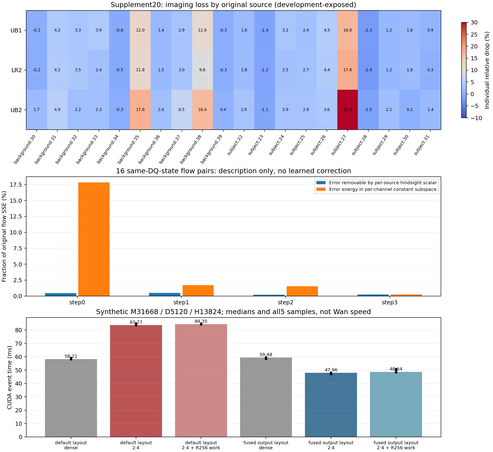

# R7：全路线复盘、误差数据与可继续的方向

基线为 `16e14265b6a8908bc9e6f3fa7fc4fb860c350fb8`。本轮按固定的 [mechanism-research 指引](https://github.com/Qesire/AutoResearcher/blob/bb34ea7be50624d47cb26de7c7c49e40882001f1/.agents/skills/mechanism-research/SKILL.md)重新阅读当前决定、历史交接、原始分数和张量，并检索论文、作者博客、官方实现与社区一手使用记录。**没有“所有方向都失败”的证据；比较准确的结论是：以单层、逐token局部重建为中心的一批具体配方失败，跨层/去噪输出目标和更合适的执行形式还没有完成验证。**

本轮有实际新工作：重算9组候选/来源集的逐来源质量；完整校验并读取TF2的32份原生张量，复现16项同状态误差，计算误差几何；完成两次单卡合成形状预检，并修复一种稀疏输出布局开销。没有运行新的Wan候选视频或训练。所有旧拒绝及原50%主MAC、完整FFN≥1.5×、三项质量各≤2%的要求保留。

证据：[数据分析](../research/20261021/failure_data_audit_R7.json)、[检索与适用性表](../research/20261021/method_search_R7.json)、[新机制差异与最小检验](../research/20261021/branch_records_R7.json)。当前模型实验资格仍由[唯一入口](../research/CURRENT_DECISION.json)管理；研究优先级不等于模型已通过准入。

## 1. 以前究竟尝试了什么

### 原交接阶段：不能漏掉，也不能混用基线

重新读取原交接 `context_20261011/04_实测记录.md`、R19/R22/R23三个位置的聚合文件及R20结果；SHA与非敏感逻辑位置保存在[历史核对](../research/20261021/historical_reconciliation_R7.json)。以下是摘要，不重新发布原始未脱敏快照。

| 旧阶段 | 实际工作及结果边界 | 本轮判断 |
|---|---|---|
| A4/A5，历史formal20 | 包含多个配置；A5(.7,.436) aesthetic下降2.402%，不满足逐项门槛；A5(.025,.025)质量较好，但完整算W1再mask | 不能说历史质量全失败，也不能把质量较好配置当50%主MAC/稀疏W1加速 |
| R3、R7、R14 | 六来源统计、160位置采集，部分位置保存更深层操作数；在线矩及仿射控制 | 是后续依据，不是独立新来源或完整候选验收 |
| R4系列、R5系列 | 结构/残差/2:4回放、token路由、proxy成本和局部native执行 | 计时边界各异，不能汇成同一完整速度 |
| R6系列、R8、R9/R10 | 部分block干预；全token影子计时，R8 task0约1.750×；有符号修正 | 影子未写入生成轨迹，不能与原视频质量拼接 |
| R11、R12、R15 | 半量token、相位、半量hidden+rank512的完整写回；R15约1.479×，两来源imaging下降45.8% | 这些具体闭环实现失败；仅有两来源开发预检 |
| R13、R16、R17、R18 | 原生响应、仿射、q128模板、粗/细支持、保留hidden的低秩W2重建 | 主要是局部数值，未闭合当前整体验收 |
| R19、R22、R23 | 静态W1 2:4、动态W2 2:4、SparseGPT式W1拟合、小参数折叠 | **2:4不是从未做过**。旧目标还区分旧teacher与dense，折叠BF16权重不能冒充HiF4码本；无新完整视频验收 |
| R20 | 六层、两组同专家去噪步对，当前gate复用与标量/逐通道仿射 | **跨步输出复用也不是新想法**。R6仅完成新OP2数据准备审计，不能称首次提出；旧局部结果不能直接迁移到当前UB1轨迹 |
| R21/R21B、R24、R26 | q64置换、两种量化次序、实际H/QDQ/平滑感知排序 | 交换性确实有反例；重排/重新量化不免费，作用域与目标必须匹配 |
| R25/R27、V5、旧AR2 | 视觉反馈、原生边界/符号/采样修复、D-Q/D-BF16自然轨迹；旧AR2超时 | 视觉不能变成因果证明；自然轨迹比较不是同输入量化因果；超时不是方法失败 |

### 当前重开阶段：按真正测量的层级归类

| 尝试 | 已观察的主要结果 | 尚不能推出什么 |
|---|---|---|
| AR1；AR2 A/E/C动态与静态 | AR2 C在两来源均4/4局部门槛通过；C/C-static风险0.614–0.810 | 没有廉价预测C或视频/速度成立的保证 |
| PR1核代理、PR2 W1-SVD、PR3输入PCA | PR1两来源0/4；PR2 Fit全0/4；PR3 rank512 Fit3/4、Validation2/4 | 不是全部输入信息都不可用，只拒绝这些廉价代理 |
| 连续64组packing；C-static gain/bias | 数值子集和原生边界控制通过，静态中心化能改善局部误差 | 不能由半个FFN packing推完整FFN加速 |
| RR1 R256；C24来源扩展 | 原formal20 imaging下降5.113%/3.264%，aesthetic下降10.627%/9.255% | 增加校准来源与线性残差确有改善，但质量未过；不能因此宣布容量极限 |
| WR1保留激活重建；JR1联合重建 | WR1四项未达0.50 base门槛；JR1四项约0.873–0.975 RR1，未达双门槛 | 局部互补性有限；都没有全模型视频结果 |
| VM1输出均值/方差匹配 | 输出能量基本恢复；原formal20 imaging仍下降4.089%、aesthetic9.854% | 正确能量不等于正确方向或视频内容 |
| OP1学生状态教师；OP2真实UB1状态、OP2A/D/R | 24来源、3840位置完整性及192位置原生回放通过；旧/新状态有明显差异 | 这些是可信数据与控制，不是候选接受；采样行曾参与旧拟合 |
| OP1重拟合、OP3同R256原生状态重拟合 | OP3八项均未胜冻结UB1；旧补偿用24来源，新折只用12，比较暴露明确 | 同状态数据本身不是保证；没有排除不同输出目标 |
| LA1量化LoRA、FA1全保留权重、FA2固定64epoch | LA1验证基本不变；FA1约0.955–0.961旧SSE；FA2约0.864–0.877，未达0.80 | FA2有12%–14%局部改善，但未运行视频；不能写成整个方法族或终端目标已被否定 |
| UB1 25/50/50/75 | 原formal20质量通过；完整FFN1.546×、50%主MAC；补充20 imaging下降3.166% | 静态工程基线成立于原基准，跨来源质量仍失败 |
| RB1/RB2四bank；HP1/HP2、NP1 | RB1小簇停止，未训练；RB2 oracle仅增0.56–0.79百分点；非线性C头不胜匹配线性 | RB1不能说成预测器训练失败；C标签不是补偿后native动作收益 |
| TF2；LR1；LR2末端十层R512 | 同状态末步更新误差最大；LR1四项2过2拒；LR2补充imaging仍下降3.051% | 最后一步敏感不代表只增加末端秩即可恢复画质 |
| OD1原O/蒸馏D固定输入 | 两图、block20八scope的贡献集中度近似 | 不支持“蒸馏普遍消灭FFN冗余”，也未做原O自身整网轨迹 |
| UB2 25/25/50/100 | 末步同输入FFN误差为零，补充imaging却下降4.652%；确认集未触发 | 无法消除前面状态偏移；没有证明所有层/步预算都失败 |
| CG1细通道；TC1连续小块支持迁移 | CG1仅一个来源过门槛；TC1四项代理门槛失败 | 有实际H的oracle不能当廉价预FFN0方法；256采样行不是连续tile |
| NF1遗漏非线性特征；NF2复用h的GELU读出 | NF1约5.7%–7.3%局部改善仍拒；NF2八项门槛全拒 | 再堆同信息非线性头没有现成证据；不排除空间邻域或下游目标 |
| BO1冻结整视频选择；R4E1补偿支持交换 | BO1两臂imaging事后oracle仍下降2.910%；R4E1四项门槛全拒，step3 identity最佳 | R4已经含单/双交换、实际UB1状态、匹配h读出，不能再包装为新方案 |
| R1–R4演绎；R6缓存准备审计 | 完整W0/半W2≤4/3理想主计算倍速；GELU半线性非普适；R6配对稀少、冷启动约束成立 | 数学有范围；旧失败、未做与逻辑未排除必须区分 |

这批重开工作真正跑到官方20来源完整质量的不同候选只有RR1、C24、VM1、UB1、LR2、UB2六种；补充20测了后三种。其余多数是局部门槛、控制或准备。**“几十个记录”不等于几十种不同机制都经过完整视频证伪。** 这些结果也不能因门槛严格而追溯改判。

## 2. 重新看数据，哪些结论最可靠

### 达标差距可量化，但不是“只差一点就随便调调”

重算所有60行配对CSV并精确核对原聚合；保持每组20个来源，5个文件副本不增加样本量。

| 候选 | 原20 aesthetic/imaging下降% | 补充20 aesthetic/imaging下降% |
|---|---|---|
| RR1 | 10.627 / 5.113 | 未运行 |
| C24 | 9.255 / 3.264 | 未运行 |
| VM1 | 9.854 / 4.089 | 未运行 |
| UB1 | 0.874 / 1.345 | 1.934 / 3.166 |
| LR2 | 1.210 / 1.272 | 1.901 / 3.051 |
| UB2 | 0.141 / 2.218 | −0.686 / 4.652 |

补充20中，UB1要回到2%门槛，需恢复当前imaging净损失的 **36.83%**。LR2实际上只恢复了 **3.64%**；两者逐来源损失相关系数 **0.9923**。继续增秩远没有形成可见的跨来源修复机制。

鸟群subject:27、background:35/38三来源占UB1净imaging损失的 **56.98%**，但subject/background两组分别仍下降2.907%/3.423%。既有重尾困难样本，也非单个异常值。不得删样本、换聚合、按事后成绩路由或针对这三条训练后冒充泛化。它们提示应为新校准设计覆盖细小轮廓/重复结构等失败形态，**这是设计假设，不是已证实的共同语义因果**。

即使逐来源事后从UB1/LR2/UB2三个现成视频中选imaging最高者，补充仍下降 **2.769%**。这把BO1的两臂有限上界扩展为这三份冻结输出的上界；没有训练新router，也没有否定新输出或视频内策略。

[输入清单重数](../research/20261021/calibration_coverage_R7.json)还确认：校准24是animal12/architecture12，补充20是同类10/10。因此不能简单把补充失败归因为“类别换了”；具体细结构复杂度或覆盖不足仍需实际检验。

10000次固定种子来源bootstrap给出UB1补充drop的描述区间约[1.400%,5.301%]。它说明20来源估计有波动，**不改变已发生的3.166%拒绝，也不代表已获得新种子或未见来源证明**。

### 原生flow误差并非整体幅值失配

CPU重新校验32个TF2载荷完整SHA、全部FP32值、形状和各张量SHA，16对输入逐位相同，原flow/post SSE逐项复现。这里只是四个已暴露来源在相同D-Q输入上的诊断；强制恢复轨迹没有新候选质量。

设d为教师flow，s为学生flow，e=s−d。事后最佳全局缩放为a*=〈s,d〉/||s||²。我们直接计算||a*s−d||²，另报e在教师方向、每通道常数子空间和三轴有限差分的能量，避免混淆不同投影。

| 步 | 逐来源事后最佳缩放后剩余flow SSE | 每通道常数误差占原SSE |
|---|---:|---:|
| 0 | 99.539% | 17.857% |
| 1 | 99.517% | 1.701% |
| 2 | 99.805% | 1.539% |
| 3 | 99.751% | 0.243% |

因此，全局flow乘一个系数没有足够误差恢复空间。这个结论不排除按层、按通道或空间相关的修正；教师方向投影与最佳学生缩放也不能互相代用，新增已知向量控制专门检查这一点。有限差分仍有明显误差，但没有由此证明错误都是高频或某种卷积必然可预测。

## 3. 查到的方法，如何用于当前问题

完整URL、阅读层级和不适用条件见[检索表](../research/20261021/method_search_R7.json)。主要取舍如下，均未声称完整复现：

| 来源/机制 | 可以借鉴 | 不能直接套用的部分 |
|---|---|---|
| [Dynamic-in-Few-Step](https://arxiv.org/html/2607.06631) | 将剪枝与少步分布目标联合，使用rollout | 不是冻结D-Q上独立FFN重建，训练与结构改变多，不能照抄倍速 |
| [PPCL](https://arxiv.org/html/2511.16156v2)、[TinyFusion](https://github.com/VainF/TinyFusion) | 连续层单元、可恢复性、超出单层校准loss的目标 | 不据此随意删Wan层；PPCL线性替代也不是所有FFN可线性化 |
| [OBS-Diff](https://github.com/Alrightlone/OBS-Diff) | 2:4权重及扩散感知Hessian的已实现基线 | 原论文步权重不能替代四步实际scheduler敏感度；Hessian/单层损失仍非终端画质 |
| [NVIDIA Ampere稀疏](https://developer.nvidia.com/blog/accelerating-inference-with-sparsity-using-ampere-and-tensorrt)、[PyTorch实现](https://docs.pytorch.org/tutorials/advanced/semi_structured_sparse.html) | 两层权重都2:4，保留完整H；实际压缩/稀疏GEMM | 理论Tensor Core吞吐不是完整FFN速度；本轮已观察默认布局反而更慢 |
| [LightX2V作者博客](https://light-ai.top/LightX2V-BLOG/posts/LightWan22-A14B/) | 分阶段目标、量化感知训练与实际kernel协同 | 新模型/NVFP4/Blackwell/稀疏attention不是当前HiF4/A100 FFN实验 |
| [SVDQuant作者博客](https://hanlab.mit.edu/blog/svdquant) | 小辅助分支必须解决共享激活读写及kernel融合 | 不能把低秩吸收量化误差当成已解决半宽FFN遗漏误差 |
| [TARDIS](https://arxiv.org/abs/2501.10054) | 全通道可折叠线性骨干与非线性修正，区别于只取GELU的一半 | LLM容许误差、预测/回退与HiF4量化边界均不同，保留为R2已有backlog |
| [DisCa](https://github.com/Tencent-Hunyuan/DisCa)、[TaylorSeer](https://arxiv.org/abs/2503.06923) | 学习历史特征演化，说明缓存也需要恢复训练 | 换Hunyuan/训练判别器或多锚点不满足本项目当前四步双专家条件 |
| [TeaCache作者实现](https://github.com/ali-vilab/TeaCache)、[AutoTarget](https://arxiv.org/html/2610.03577v1) | 区分缓存内容、solver转换和复用决策 | 不能用多步全网缓存速度证明四步FFN缓存；R20/R6证据须保留 |
| [ConvRot作者讨论](https://github.com/pytorch/ao/issues/4695)、[CentriQ摘要](https://arxiv.org/abs/2610.06260) | 提醒DiT的AdaLN/均值和旋转不与LLM完全相同 | 当前目标是保留D-Q功能；改量化基线不等于解决剪枝，摘要未完整复现 |
| [社区LoRA/模糊排查](https://www.reddit.com/r/StableDiffusion/comments/1rhg5cg/wan_22_img2vid_any_lora_you_use_produces_blurred/)、[4步参数讨论](https://www.reddit.com/r/StableDiffusion/comments/1nshjxg) | 先排查模型、LoRA、CFG、scheduler组合不一致 | 是使用经验，不能证明本项目稀疏机制；不能单独改稀疏臂步数/shift/模型来通过 |
| [MLX缓存作者的蒸馏模型记录](https://github.com/IonDen/mlx-teacache)、[LightX2V缓存文档](https://github.com/ModelTC/LightX2V/blob/main/docs/ZH_CN/source/method_tutorials/cache_source.md) | 保留零跳步和编译规避等真实归因，检查缓存是否真的触发 | 非Wan/A100结果不外推；包装器附带收益不是缓存算法收益 |

## 4. 本轮真正做出的优化：消除一种稀疏输出布局开销

[事前协议](../config/weight_2of4_shape_preflight.json)固定M31668、D5120、H13824、原HiF4 activation QDQ、tanh-GELU、bias/gate、3次warmup、5次交替测量。合成权重先作HiF4 QDQ，再在两矩阵各连续四个输入权重中保留两个；不是模型参数，不写视频、不训练，也不宣称稀疏方法的原创性。

| 同轮实现 | Dense full中位ms | 2:4中位ms | Dense/2:4 | 2:4+R256工作负载中位ms |
|---|---:|---:|---:|---:|
| 默认cuSPARSELt输出布局 | 58.208 | 83.766 | 0.695× | 84.351 |
| 仅融合输出转置 | 59.484 | 47.958 | 1.240× | 48.641 |

源码审查发现默认稀疏dispatch返回转置视图，接原生逐行QDQ需要大布局拷贝；使用已安装后端的转置epilogue后，两个输出实际stride变为[13824,1]和[5120,1]，原有 `.contiguous()` 不再复制。没有扫算法ID、稀疏率、精度或质量阈值。

跨次预检的稀疏工作负载中位耗时降低 **42.75%**；仍须使用各自同轮dense对照，不能把前后两轮的中位值当严格配对速度置信区间。线性稀疏/相同masked dense相对RMSE约1.9e−5/3.1e−5，本合成完整QDQ链输出恰好一致；不保证真实权重所有输入逐位相同。

原失败记录、原源码快照、修复前注册和全量timing均保留：[默认结果](../research/20261021/weight_2of4_shape_preflight.json)、[布局修复注册](../research/20261021/R7H1B_before_execution.json)、[修复结果](../research/20261021/weight_2of4_fused_layout_preflight.json)。这是一个实际执行形式的改进，但**仍低于1.5×，不是完整160位置FFN或视频速度**。R256臂也仅包含双GEMM和相加，不是旧补偿全部前处理。当前证据不支持立即花资源进行2:4全模型训练；需要先分解剩余耗时、证明可实现的成本余量。

按这轮dense点估计，1.5×对应约39.66ms；无R256的修复实现还需再省约8.30ms、即17.31%。这给下一项成本诊断明确目标，不是新的速度通过判据。

## 5. 现在最值得做的三件事

### 首选研究问题：修复“后面真正看见的误差”

保留UB1支持、预算和已有特征，考察连续两层或去噪输出上的联合恢复，区别在**目标与传播信息**，不是更大rank或更多旧支持候选。线性化时，终端误差含Jₗeₗ，平方损失含eₗᵀJₗᵀJₘeₘ；单独最小化每层||eₗ||²丢失方向权重与跨层项。R4已经检查的是**同层组间**相互作用，不能替代这里的**跨层传播**。

也不能只给各个独立FFN的同一MSE乘一个按步常数：在固定单位置参数、未正则化独立最小二乘下，常数不会改变最优解。需要实际的下游输出、耦合参数或方向相关的度量；否则仍是旧重拟合。

最小新检验已写成[四臂原生传播协议草案](../research/20261021/R7D1_cross_layer_transport_protocol.json)：固定step3的block30/31，在完全相同状态下比较保留UB1、仅恢复A、仅恢复B、同时恢复A/B，记录本层误差、全flow误差和交互。先检验目标错配是否确实在这两个位置影响决策，再考虑小窗口联合蒸馏。恢复dense臂只是诊断，不能冒充50%部署候选。协议为**DRAFT_NOT_RUN**，原生hook控制/完整恢复状态尚未实现，不能称已准入或已发现交互。

### 工程问题：先找出保留全H的2:4执行是否还有足够余量

本轮数值和布局已给出可复现硬件信息。下一步应是明确区分两次GEMM、QDQ、布局和额外分支的耗时，判断是否有无需改变数值边界的融合机会。不是继续扫2:4权重mask，也不是把1.24×改叫达标。仅在实现余量被证实、与历史R19/R22/R23关系写清后，才值得做真实权重native精度小试。

### 备选机制：全通道仿射骨干与非线性余项

这是R2已有的TARDIS邻近机制，不是R4失败后随手改名的新主线。它保留所有通道的可折叠部分，改变被丢弃的信息；需要先检验原生量化fold误差和余项在真实步预算下是否可压缩。不能把GELU(z)=z/2+余项当成可安全删除余项的证明。现有数据不足，维持backlog。

空间邻域的flow残差预测也与逐token h头不同，但这次没有证实可预测性，不能仅凭鸟群图像就上CNN。把它放在描述分析之后，避免再跑一轮没有区分力的小网络。

## 6. 结论和执行边界

有方向，优先级比“再扩大支持搜索/残差秩”更明确：**下游目标与跨层误差传播优先；全H稀疏执行先解决成本；线性骨干机制保留为有明确前提的备选。** 本轮修复了一个实际布局开销，也用真实保存张量排除了全局幅值校正的主要空间。

这不是新质量成功，也不是把未测方向直接批准成模型作业。当前研究已重新打开，具体失败配方继续关闭。旧两个20来源集均已暴露；未来最终验证需要新的冻结来源，不能将旧UB2未执行的确认集无条件挪用。每个新方法仍须有原生控制、同预算简单对照、完整成本和新来源三项质量。

[检查记录](../research/20261021/continuation_checks_R7.json)：完整122项CPU测试通过、零跳过、CPU阶段未初始化CUDA；三项已知向量控制和四臂交互恒等式检查通过。新旧七个未准入/关闭/草案ID均拒绝模型选择；两次GPU预检均只用一张空闲卡，未加载Wan。依赖源码、原始报告、首次探测源码和后续修复均有SHA绑定；公开元数据扫描与仓库差异检查另行执行。
