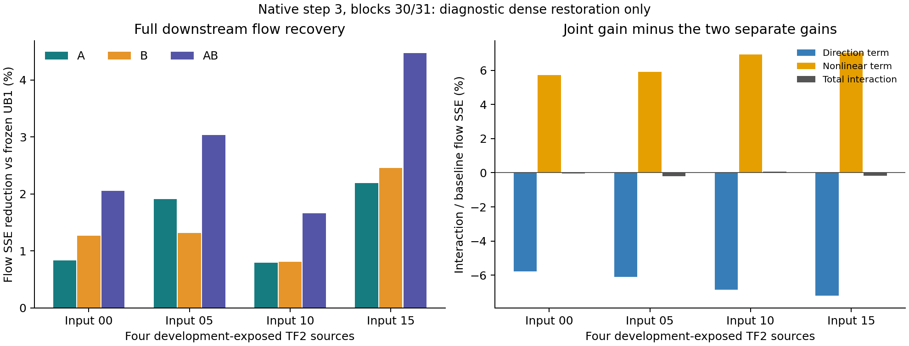

# 固定双层恢复的原生传播诊断（R7D1）

用户要求继续实际实验。本轮把R7的跨层问题落实为固定原生诊断；R4E1的有限拒绝、R4E2/E3未触发和其他已淘汰配方全部保留。现已完成全部24次原生生成与控制，结果完整保留。

## 机制与相邻失败

最近的失败是OP3独立原生局部重拟合、LR2末端十层增秩和R4E1单层支持交换。LR2补充imaging仍下降3.051%；R4E1登记的四折原生门槛均未通过。这些结果没有测量两个不同层误差经过剩余网络传播后的方向与交叉项。R7D1只检验这个缺失量，不把“尚未排除”当成恢复有效的证据，也不声称提出新方法。

实际计算为：原TF2完整图像/文本/seed42条件 → 四步原生推理，每步之间恢复相同D-Q状态 → 最后一步固定block30/31 → 原生同输入完整HiF4 FFN或冻结UB1输出 → 保留当前gate与原生残差写回 → 完整下游flow。A后的B接收A干预实际产生的输入；层间不重置状态。固定位置来自既有LR1 block30及其相邻层，属于开发信息，不进行层对搜索。

新信息是跨层下游方向与交互，不增加rank、支持池或seed。完整教师输出恢复破坏候选50%主MAC限制，**只能作因果诊断**。候选的50%主MAC、完整FFN≥1.5×、独立来源三项质量分别下降≤2%要求没有变化。

## 固定执行与控制

[登记协议](../research/20261021/R7D1_cross_layer_transport_protocol.json)限定原TF2的input00/05/10/15，先运行12条完整四步控制：4条D-Q教师恒等，4条带观察钩子的none，4条none重复。D-Q与none的四步input/flow/post必须逐位等于旧TF2；两个所选FFN的教师必须逐位等于D-Q实际输出；钩子必须保持RNG，原始权重/bias/Smooth/QDQ/GELU/精度与全M几何绑定不变。

全部控制通过后，才执行12条完整四步干预：每个来源各A、B、AB。none已包含在控制中，构成四臂。总计24次生成；使用至多两张空闲工作卡与既有环境，不采用尚未证明的末步恢复捷径。张量与诊断视频仅在HF派生缓存，预留80GiB节点空间和2GiB本轮写入额。

新工具独立于旧TF2生产脚本，旧生产代码与证据不改写。每个作业保存源码/协议/原缓存/原策略绑定；重复路径拒绝覆盖，失败保留。任何控制不通过立即停止其后续干预。修复需冻结新的尝试和来源凭据，不覆盖原失败。

## 可证伪量与后续门槛

测量各臂实际输入上的局部理想FP64 gated SSE、原生BF16 gate乘积SSE、完整flow到同输入D-Q的FP64 SSE。令e=flowNone−flowDQ，a=flowA−flowNone，b=flowB−flowNone，c=flowAB−flowNone−a−b，则交互优势为：

`ΔAB−ΔA−ΔB = −2<a,b> − 2<e+a+b,c> − ||c||²`。

用明确的已知向量验证线性方向抵消、非线性交互与重复噪声分别计算；真实结果必须通过该恒等式。比较局部误差大小与下游收益排序，以及交互项相对重复none的数值噪声。如果固定层对不存在可分辨的排序差异或交互，不提升该层对的联合恢复假设。若存在，也只支持另行登记固定窗口输出目标的小型拟合，与独立局部拟合匹配参数及成本；不能直接声称视频质量恢复或自动扩大搜索。

全部旧TF2来源、旧24校准与两批20质量输入均为开发暴露数据。本轮无训练、无独立质量验收；真正候选的训练/选择/最终来源需另外冻结。诊断视频因每步恢复D-Q状态而由构造得到D-Q轨迹，不是候选视频。

## 当前执行状态

129项CPU检查通过。12条原生控制全部逐位通过，12条干预完成；没有控制失败或重跑。本轮通过明确的固定诊断迁移登记模型控制，未解封任一旧失败路线。以[当前决定](../research/CURRENT_DECISION.json)、[路线表](../research/20261021/method_triage.json)和[当前交接](../research/20261021/HANDOFF_R7D1.md)为准。

## 并行完成的非模型耗时诊断

D-Q控制释放工作卡后，在该空卡执行一次[固定组件测量](../research/20261021/weight_2of4_component_profile.json)。同轮完整dense59.227ms、sparse47.552ms，仍仅1.24552×；两次Smooth/cast/原生HiF4 QDQ分别6.168ms、16.978ms。sparse两次GEMM分别11.258ms、10.705ms，dense17.324ms、16.632ms；完整H的GELU1.178ms，gate0.721ms，R256两GEMM与加法1.512ms。

这些独立组件计时不可直接当作完整耗时的可加分解，但明确指出全H激活处理约23ms的量级，而非只看稀疏GEMM。当前既未达到1.5×，也没有模型准确率结果；不由此启动真实2:4权重训练。后续内核工程应先验证量化/转换的逐位等价与同轮完整收益，并给优化过的dense相同实现机会。单独更换GEMM无法解决全部固定成本。

## 完整原生结果

[原始数值与凭据](../research/20261021/R7D1_results.json)保留每个来源的全部scope、载荷SHA、逐步控制与FP64交互分解。

| 输入 | 冻结UB1 flow SSE | 恢复A | 恢复B | 恢复AB | 交互优势 | 局部/下游排序不同 |
|---|---:|---:|---:|---:|---:|---|
|00|38421.408|38101.693|37932.814|37632.022|−18.923|是|
|05|51759.710|50772.535|51078.492|50190.871|−99.554|否|
|10|33609.696|33343.100|33336.817|33052.168|+18.053|是|
|15|57973.678|56704.783|56550.697|55383.820|−102.019|是|

四来源合计基线181764.493，A/B/AB分别降低1.56377%/1.57659%/3.02898%同状态flow SSE。A的局部误差在四来源均更大，但B的下游收益在三个来源更大。重复none误差为零。交互恒等式最大残差2.10e−11；总方向项−11859.538与非线性项+11657.095近乎抵消，净交互−202.443，只占基线−0.1114%。结果支持检验下游目标，**不支持声称存在大的联合恢复增益**，也不能把flow改善换算成imaging质量恢复。

另完成既有HiF4 BF16入口的单次合成预检：14组权重/输入/GELU输出逐位等价检查全部通过；dense与sparse采用同样入口，完整链路50.937/38.865ms=1.31061×，加R256 workload仅1.20378×。没有修改原模型量化算子/缓存，也没有原生模型或真实校准的快路径验证；速度仍未达到1.5×。

基于R7D1的已观察排序差异，另行登记[R7D2双增益目标对照](58_局部与下游目标的双参数原生对照.md)，不增加rank或扩大层对。本R7D1诊断已关闭为完成，不重复挑选有利来源。
