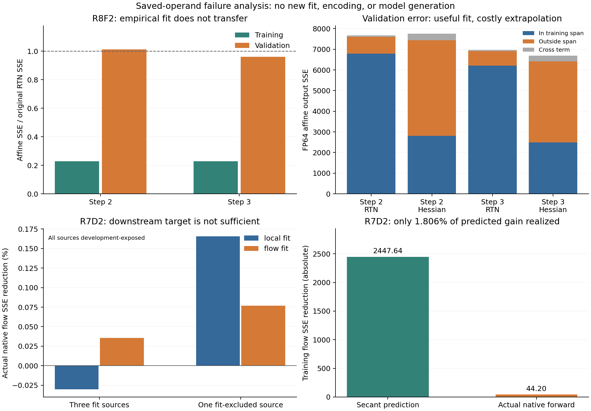

# R10：全路线失败归因、扩展检索与组合方案

**还有值得验证的方向，但现有证据不支持继续围绕支持集、残差秩、增益和阻尼做连续小幅搜索。下一阶段应比较表示形式，再把有成本可行性的表示与真实原生下游恢复目标结合。** 原验收保持：50%主MAC，包含全部辅助操作的完整FFN≥1.5×，真正新冻结来源上三项官方质量各下降≤2%。目前没有新的候选通过该联合要求。

这次把[此前全历史复盘](56_全路线复盘与下一步机制优先级_R7.md)与随后R7D1、R7D2、R8F1、R8F2放在一起分析，并实际完成两项保存张量的CPU分解：原生flow变化与拟合方向的偏差；Hessian编码误差在训练行张成空间内外的分布。没有重新拟合、编码或生成模型视频。新增检索表记录25项来源，其中19项是R7清单外的来源，6项深化此前阅读；论文、作者博客、官方/作者实现和社区经验分别标注，没有把同一论文的网页和项目页当成独立实验。

证据入口：[数值汇总及SHA](../research/20261021/failure_synthesis_R10.json)、[保存张量分解](../research/20261021/R10_saved_failure_geometry.json)、[检索表](../research/20261021/method_search_R10.json)、[五类机制的完整差异记录](../research/20261021/branch_records_R10.json)。沿用项目规定的[mechanism-research指引](https://github.com/Qesire/AutoResearcher/blob/bb34ea7be50624d47cb26de7c7c49e40882001f1/.agents/skills/mechanism-research/SKILL.md)。

后续固定合成成本对照与所选原生表示检验见[docs/62](62_广泛复盘后的学习型仿射表示检验.md)；本复盘完成时的无模型队列状态保留在[决定快照](../research/20261021/decision_snapshot_R10_review.json)，不覆盖后来的当前入口。

## 1. 所有尝试应该如何计数

不能把每次控制、回放、拟合、合成测速都算成一个经过完整视频证伪的独立方法。当前重开阶段，真正做到官方20来源完整质量的候选是RR1、C24、VM1、UB1、LR2、UB2六种；后三种另做补充20，共9项候选/来源集比较。R7D1的24次与R7D2的18次管线生成是同输入、强制恢复状态的诊断，不能新增成42条候选质量结果。

下表覆盖原交接及重开阶段的尝试群。原始指标、逐项出处和历史SHA仍见R7复盘及其[历史核对](../research/20261021/historical_reconciliation_R7.json)，本表不改变任何事前门槛或原拒绝。

| 尝试群 | 实际改变了什么 | 结果与边界 | 现在应吸取什么 |
|---|---|---|---|
| 历史A4/A5 | 动态mask、误差/质量权衡 | 有质量较好配置，但完整算W1后mask；另有aesthetic>2%的配置 | 正确画质与真实省算必须在同一实现成立 |
| 历史R3/R7/R14 | 全位置数据、在线矩与仿射控制 | 形成校准基础，并非多个新来源集 | 控制和采集不是候选接受 |
| 历史R4/R5/R6/R8/R9/R10 | 结构/残差/2:4、token路由、影子计时、符号修正 | 部分影子约1.75×，未写回视频轨迹 | 不拼接影子速度与另一实现的质量 |
| 历史R11/R12/R15 | 半token/相位/半hidden+R512闭环 | R15约1.479×，两来源imaging大幅下降 | 只减少主GEMM或恢复能量不够 |
| 历史R13/R16/R17/R18 | 原生响应、模板、支持与低秩W2读出 | 主要为局部数值 | 新低秩/合并方案要先核对旧算子，不能重新命名 |
| 历史R19/R22/R23 | 两侧2:4、二阶W1拟合、折叠小参数 | 已有先例，无当前联合验收 | 2:4/OBS不是未探索的新概念 |
| 历史R20 | 同专家跨步输出复用、当前gate、标量/通道仿射 | 局部数据，非当前UB1轨迹闭环 | 缓存不因换名字而成为新方法 |
| 历史R21/R21B/R24/R26；R25/R27/V5/旧AR2 | 置换/量化次序、H与QDQ感知、视觉反馈/原生修复；旧AR2超时 | 非交换性有反例；超时无科学否定含义 | 新权重/分组必须验证原生边界 |
| AR1/AR2 A/E/C及C-static | 不同信息下的oracle支持 | C在两来源4/4局部通过 | 有实际H的oracle不等于廉价预FFN0选择器 |
| PR1/PR2/PR3 | 核代理、W1-SVD、输入PCA预测支持信息 | 固定廉价代理未过门槛 | 不等于所有投影低秩表示失败；目标与算子不同 |
| 连续64组packing、gain/bias | 原生子集执行与静态中心化 | 工程控制通过，局部改善 | 不能由半个FFN推完整FFN速度 |
| RR1/C24 | R256修正、增加来源覆盖 | 正式20质量失败；C24确有改善 | 存在可恢复误差，但简单线性补偿未解决质量 |
| WR1/JR1 | 保留激活重建、联合读出 | 固定CV门槛失败 | Nyström/神经元合并若仍是选列+W2拟合，属于近邻 |
| VM1 | 输出均值/方差匹配 | 能量恢复，正式质量仍失败 | 能量和误差方向应分开看 |
| OP1/OP2/OP2A/D/R | 学生状态教师与实际UB1状态采集 | OP2 24来源3840位置、192原生控制通过 | 数据可信；不代表任何新候选有效 |
| OP1重拟合/OP3 | 换成学生原生状态拟合同R256 | 八项不胜冻结UB1；12来源与旧24来源暴露不同 | 换校准状态不是自动修复；同状态函数误差不等于轨迹修复 |
| LA1/FA1/FA2 | 量化LoRA、全保留权重恢复 | FA2局部改善约12%–14%，未达门槛，无视频 | 未否定真实下游目标训练；也不能据改善升级 |
| UB1 | 静态25/50/50/75步预算 | 原20、50%主MAC、完整1.546×成立；补充imaging下降3.166% | 真实强基线，跨来源质量缺口仍在 |
| RB1/RB2/HP1/HP2/NP1 | 聚类/四bank、二次/MLP/非线性C头 | RB1小簇预检停；RB2 oracle空间小；头不胜匹配线性 | 动作收益不足时，不能先加复杂router |
| TF2/LR1/LR2 | 同输入flow诊断、末端R512 | LR2补充imaging下降3.051%，质量改善有限 | 最后一步敏感不推出增加末端秩有效 |
| OD1 | 原始O/蒸馏D固定输入比较 | 两图block20贡献集中度接近 | 不支持“蒸馏已消灭全部FFN冗余” |
| UB2 | 25/25/50/100预算 | 末步同输入FFN精确，但补充imaging下降4.652% | 更早的状态误差不会因末步精确自动消失 |
| CG1/TC1/NF1/NF2 | 细通道、支持迁移、遗漏非线性/复用h读出 | 局部门槛失败，有有限改善 | 不排除空间信息，但旧随机行不能冒充相邻tile |
| BO1 | 冻结UB1/UB2整视频选择 | 事后oracle仍未达质量门槛 | 两臂router不能创造两臂之外的输出 |
| R1–R4推导、R4E1 | 代数与固定补偿支持交换 | 完整W1再半W2成本下界；GELU半线性非普适；16组q≤2四折拒绝 | 联合交换和匹配读出已经测过；不继续扩大池 |
| R6缓存准备 | 当前OP2跨步配对和冷启动 | 3908配对token；block20仅58/55对；仍未就绪 | 不启动缺少配对与正证据的缓存训练 |
| R7D1 | 两层完整教师输出的因果恢复 | 24次生成全部控制通过；3/4局部排序与下游收益相反 | 测到了目标错位；未测到足以依赖的巨大协同 |
| R7D2 | 相同R256、两增益，局部与flow目标匹配比较 | 18次生成；flow-fit开发留出不胜local-fit | 关闭该有限配方；更换目标名称不消除原生代理误差 |
| R7H1/H1B/H2/H3 | 完整H的2:4布局、成本拆分、BF16 QDQ入口 | 同轮完整链由0.695×改善至1.24×，共享优化后1.31×；加R256约1.20× | 激活处理与辅助访存成为瓶颈，仍未到1.5× |
| R8F1 | 固定0.5全支持仿射三种精度 | BF16八项通过；额外HiF4八项失败 | 只能关闭额外量化变体 |
| R8F2 | 一次固定64组Hessian编码修复 | 训练误差降77%，完整HiF4八项仍失败 | 关闭固定编码；现在有明确空间外误差证据 |
| R8D1/R9A1 | 完整总体协方差采集/原R2学习型BF16仿射草案 | **均未运行** | 不与完成实验混记；本次先完成广泛复盘 |

## 2. 新旧数据共同指向的五个障碍

### 局部误差、真实下游和最终质量是三层不同目标

R7D1在末步block30/31恢复完整教师FFN输出。局部gated误差在四来源中总是A更大，但下游B的恢复收益在3/4来源更大。AB恢复使总flow SSE下降3.029%；联合增益相对单独两项之和仅−0.1114%基线SSE。方向交叉项与非线性传播项大幅抵消，不能据此宣称跨层协同很大或任何长窗口都有效。

R7D2进一步检验真实的有限动作：同样的两个R256输出增益，保持参数数目、主MAC和来源一致。局部拟合训练FFN误差更低，但训练flow略差；flow拟合在训练flow略好，在开发留出却输给局部拟合。它既说明独立FFN loss可能错位，也说明“拟合flow”本身不是充分条件。

补充20的UB1 imaging需恢复当前净损失的36.83%才能到2%门槛；LR2只恢复约3.64%。这里的imaging缺口不能与R7D1的3.029% flow SSE相互换算。一个是最终官方质量，一个是固定状态下的数值误差。

### R7D2先在训练端就出现代理失真，不能全怪泛化

新CPU分析完整校验已保存生成与张量SHA，在三个原训练来源上逐一重算：令`p=δA·dA+δB·dB`为两条固定secant的预测flow变化，`a`为真实原生变化，`r=a−p`。检查恒等式：

`||e+a||²−||e+p||² = 2<e+p,r>+||r||²`。

flow-fit的真实/预测变化方向余弦只有**0.572–0.575**，真实变化范数为预测的**1.719–1.734倍**。因此不是一个统一缩放就能校正的轻微幅度误差。训练端预测SSE收益2447.64，实际44.20，仅兑现**1.806%**；二维Gram条件数仅2.84，不支持把问题简单归结为拟合矩阵病态。

这些张量不能将下游非线性、BF16舍入和HiF4量化分别作因果归因。合理的下一类目标需要训练中检查实际原生forward，并明确梯度估计与轨迹输入；不应只缩小ε、换界限、增加增益或位置后反复看同一开发集。

### R8F2的验证失败，可以定位到训练空间外的误差增长

原固定编码仅使用12来源×256行=3072个输入，维度5120。行数小于维度仅给出rank上限，不单独证明数据不够；实测二阶矩trace有效维度约100/108。新分析用实际训练行的QR定义投影，**只分解，不重新编码**。对验证输入`x=x内+x外`，输出误差必须保留`2<δ内,δ外>`交叉项。

| 位置 | 验证误差分量 | 原RTN SSE | Hessian SSE |
|---|---|---:|---:|
| step2/block20 | 训练行空间内 | 6790.04 | 2810.51 |
| 同上 | 空间外 | 809.36 | 4628.44 |
| 同上 | 交叉项 | 66.95 | 322.91 |
| 同上 | 总和 | 7666.35 | 7761.86 |
| step3/block20 | 训练行空间内 | 6204.84 | 2494.36 |
| 同上 | 空间外 | 705.80 | 3920.66 |
| 同上 | 交叉项 | 53.02 | 277.56 |
| 同上 | 总和 | 6963.65 | 6692.58 |

验证空间内误差下降**58.6%/59.8%**，但空间外输出误差增长**5.72/5.55倍**；对应空间外权重误差平方范数增长**5.35/5.20倍**。因此训练优化确实学到了有用方向，同时花掉了覆盖范围外的误差预算。这比“训练降77%但验证不行”更能指导下一步。

仍不知道3072行之外的同来源token能否填补这些方向，或新来源本身是主要差异；QR空间也不等于语义类别。R8D1完整总体采集只是可区分两者的未运行诊断。不能用此次归因追溯调阻尼或把更多token当已证实的修复。

### 精度路线曾被我额外收紧，必须更正失败的适用范围

重新逐句核对[原R2设计](../research/20261021/Wan_Distill_FFN_机制重构_R2_20261021.md)：它本来要求从原生Q2后值拟合每通道斜率/截距，折叠矩阵用**BF16**，同专家两步共享系数，取消R256。R8F1/F2测试的是固定0.5斜率，并额外给新矩阵/余项再次HiF4量化的更严格变体。

[范围校对及原文SHA](../research/20261021/R9_scope_reconciliation.json)证明这不是看到负结果后才发明的放宽。R8F1/F2原协议和失败结果全部保留；它们不能关闭尚未测过的原R2学习型BF16表示。另一方面，R8固定0.5 BF16通过不保证学习系数、压缩余项或最终速度也会通过。

原R2的逐神经元OLS最小化的是激活拟合，并不保证经W2/gate后的输出误差最小；后续即使执行，也必须用实际native输出检验，不能只报残差能量下降。

### 保留完整H的方案必须解决激活处理，而非只省权重乘法

H2独立组件中Q1约6.17ms、Q2约16.98ms；组件中位数不可严格相加，但已明确量级。H3使用原有BF16量化入口、dense与sparse共享优化，合成完整链为50.94/38.86ms，即1.3106×；加R256后约1.2038×。只有14项合成逐位控制，不是当前模型完整原生等价。

因此完整H的2:4或新低秩投影即使保留更多非线性，也可能先卡在QDQ、全H激活写读和额外GEMM。相反，仿射+稀疏余项能缩小非线性宽度，但要付d²骨干、BF16矩阵驻留和相减/相加。两者应该比较实际计算链，而非只比较稀疏率。

## 3. 广泛检索后，哪些机制值得结合

下表写可迁移部分和当前障碍，不混用论文间的参数量、MAC、端到端时间或质量分母。完整阅读层级见[25项检索表](../research/20261021/method_search_R10.json)。

| 方法/来源 | 可迁移的具体机制 | 对当前项目的取舍 |
|---|---|---|
| [SVDtrunc论文](https://arxiv.org/html/2609.04646v1)与[作者项目](https://vislearn.github.io/SVDtrunc/) | 保留非线性宽度、分解投影；以任务输出做重要性分析，模块KD与flow恢复；包含四步FLUX.schnell | 升为表示对照方向。论文预算是backbone参数，四步图像结果不等于50%FFN MAC或Wan三轴≤2%；项目网页非独立证据 |
| [SVD-LLM](https://arxiv.org/html/2403.07378v1)与[实现](https://github.com/AIoT-MLSys-Lab/SVD-LLM) | 数据白化后分解，顺序恢复适应上游变化 | 可作低秩比较基线；不能把经验协方差最优当总体最优；R8F2空间外风险仍适用 |
| [SlimDiff](https://arxiv.org/html/2509.21498v1) | 时步二阶矩、功能组分解；FFN选列后闭式拟合下投影 | 与WR1/JR1关系很近，换CPQR/Nyström名称不足以成为新主路线；attention结果也不自动迁移 |
| [DyDiT论文](https://arxiv.org/html/2410.03456v1)与[作者代码](https://github.com/alibaba-damo-academy/DyDiT) | 联合训练宽度和空间MLP跳过，真实gather/scatter执行 | 新信息与恢复训练有意义；不是再训一个C头。原论文长步/硬件与当前不同，动态预算须约束实际执行 |
| [Dense2MoE](https://arxiv.org/html/2510.09094v1) | 共享专家与条件容量、多阶段输出/特征蒸馏 | 不是扩大RB2四bank池；论文32卡训练与grouped GEMM有实质成本，2卡不直接复现整套 |
| [Elastic DiT](https://arxiv.org/html/2602.13993v1) | 同时学任务表现、width与block动作 | 联合预算学习可借鉴；平均软惩罚不保证每次实际50%，缓存冷启动未消失 |
| [MosaicDiff](https://arxiv.org/html/2510.11962v1) | 分阶段校准与结构OBS | 可对照统计/分配原则；不能直接将DDPM SNR公式移到当前蒸馏scheduler，更不能用它覆盖UB2失败 |
| [GPTQv2/GPTAQ的非对称校准](https://arxiv.org/html/2504.02692v1) | 学生输入匹配原模型输出，把上游偏移写进目标 | 应分清OP2同输入函数修复与独立教师轨迹修复；需要真正配对操作数 |
| [Dynamic-in-Few-Step](https://arxiv.org/html/2607.06631)、[PPCL](https://arxiv.org/html/2511.16156v2)、[TinyFusion](https://github.com/VainF/TinyFusion/blob/main/README.md) | 少步输出rollout、连续功能单元、恢复能力而非即时calibration loss | 支持研究真实恢复目标；不是R7D2双增益的正面复现，也不据此随意删层 |
| [Self Forcing作者项目](https://self-forcing.github.io/) | 在自己产生的历史上训练，监督完整生成 | 只迁移部署状态对齐的思想；自回归帧历史不是当前四步双向去噪，未提出换模型架构 |
| [TARDIS](https://arxiv.org/html/2501.10054v1) | 学习线性部分并折叠、非线性修正，讨论有限精度 | 原R2是已知算子迁移；要验证Wan原生边界，不声称新理论 |
| [HQQ作者博客](https://dropbox.github.io/hqq_blog/)与[实现](https://github.com/dropbox/hqq) | 校准偏差与权重域稳健目标的对照；backend/axis限制 | 启发报告覆盖外误差与成本。它不是HiF4等价量化器，不能替换冻结基线冒充修复 |
| [SVDQuant作者博客](https://hanlab.mit.edu/blog/svdquant)、[LightWan作者博客](https://light-ai.top/LightX2V-BLOG/posts/LightWan22-A14B/) | 辅助支路共享激活/融合；分阶段训练和原生kernel共同设计 | 低秩“量化误差”与“遗漏非线性”不同；Blackwell/NVFP4发布模型不可替代当前D-Q |
| [CoReDiT](https://arxiv.org/html/2605.14191v1) | 同步内空间相干、邻域重建、可学习schedule | 原方法主要压attention，未证明FFN可用；当前随机行不能直接构造邻域 |
| [Neuron Merging摘要](https://arxiv.org/abs/2010.13160) | 有条件的ReLU缩放吸收 | GELU/HiF4不满足同样齐次性，不能直接“合并等价” |
| [Wan时步SVDQuant-GPTQ](https://arxiv.org/html/2605.27003v1)、[Wan HiF4/MixQ投稿](https://arxiv.org/html/2606.29337v1) | 原生Wan专家/时步校准、低秩或高精度离群支路 | 都改变dense量化基线，不直接实现50%主MAC；各自质量/例外预算也不等于本项目验收 |
| [社区协方差收集实现](https://github.com/ThunderFun/ComfyUI-GPTQ-Calibration)、[Wan量化讨论](https://www.reddit.com/r/StableDiffusion/comments/1tpcm59/a_wan_22_posttraining_quant_1_model_instead_of/) | 收集统计的存储工程；提醒核对“一文件/两专家”的归因 | 作者自述尚未充分测试；社区只作线索。一个文件不消除一位专家，不继承社区速度/画质判断 |

SVDtrunc的四步FLUX.schnell表格还提示一个容易忽略的分母问题：80%参数预算时，其平均相对质量下降约1.48%，但HPS从30.85到29.48，单项下降约4.44%。因此“平均接近原模型”不能替代我们各质量轴≤2%的要求；这个例子只用于核对评价口径，不作为Wan效果外推。

## 4. 组合成怎样的优化路线

不把所有检索到的模块一次堆上去。每一步都应区分“换表示”“换目标”“换数据”，否则成功或失败都难归因。五类方案的[完整记录](../research/20261021/branch_records_R10.json)含实际算子、最近失败、反驳性预测、成本、对照和停止条件。

### 首先比较两种表示，而非继续支持微调

**A：原R2学习型BF16仿射骨干+原生非线性余项。** 从训练来源的原生Q2值拟合每通道系数，所有通道的线性贡献进入折叠骨干，有限非线性余项保留；取消原R256。预算`d²+2dK`，K896/4352/4352/7808，正好25/50/50/75%。这是原有设计的未测实例，BF16混合精度须明示；80个d×d矩阵约3.906GiB。R8精度数据提供有限数值依据，尚无压缩性或速度依据。

**B：完整H、两侧投影低秩分解。** 不删非线性通道，将有效W0/W2分别变为两次GEMM。若等rank，主MAC比为`r(d+h)/(dh)`，50%要求r≤1868.108；64对齐1856时约49.676%。保持完整H的原GELU/Q2，但要额外读写因子中间态，可能首先被H2/H3的激活成本挡住。旧PR2是预测支持信息，旧低秩W2读出也已有记录；不能称SVD为全新发明。这里比较的是新的实际FFN约束与执行链。

两者都先明确原生精度、完整链成本和操作数覆盖。B若固定形状完整链明显不到1.5×，不先计算全模型SVD；A若完整支持原生恒等误差过大，不先选余项支持。R9A1代码/协议目前仅是未运行草案，尚未从当前决定准入。

### 对一个可行表示，再比较局部目标与实际原生窗口/轨迹恢复

保持推理参数、预算、初值、训练来源和优化步数匹配，比较独立FFN目标与真实原生窗口/flow目标。这里的改动是优化目标与学生自己产生的输入，而非再加一个大头。先证明零更新native forward逐位控制、训练参数确实能影响损失、原生量化梯度估计如何工作，再确定2卡内的窗口反传和停梯度rollout预算。

可以借鉴PPCL的功能单元、Dynamic-in-Few-Step的部署输出，以及GPTQv2的上游偏移目标；不能直接声称整套DMD/fake-score训练在两卡可行。原R7D2已经表明secant代理会落空，新方案必须在训练中核对真实forward收益，不能只报代理loss。

### 把来源泛化当设计约束，不作为结果失败后的补丁

R8F2提示需报告经验空间外的误差，而不是只有训练Hessian loss。对于线性量化误差E，`tr(EHEᵀ)+λ||E||F²`直接约束未观测方向，但它数学上就是Hessian的各向同性ridge，**只改λ仍是原配方延伸，不是新机制**。不得借此重新扫R8F2参数。

只有新表示确实需要新增量化时，才值得重新评估R8D1全总体统计诊断的成本。原R2本来使用BF16骨干，所以当前没有必要为额外自加的量化约束立即跑16次统计生成。来源均衡、训练/选型/最终评估隔离，从下一项协议开始固定。

空间邻域和条件专家保留为后续机制备选。它们必须增加真实可用信息或改变可恢复动作；现有随机256行不具备邻域操作数，不能reshape成图像后训练。优先做数据准备核对，不能再次用便宜row-local头换名字启动。

## 5. 本轮闭合与下一次执行条件

R8F2两个位置编码、48项UB1/8项教师原生控制全部完成。完整HiF4八项误差/UB1为step2 **0.10298–0.12405**，step3 **0.24134–0.27171**，均超过固定0.1，只有3/8改善RTN；该固定修复关闭。[R8F2结果与归因](60_HiF4仿射矩阵的分组Hessian量化修复.md)已补齐。

复盘完成时项目持续研究、模型队列为空；随后固定合成成本比较支持优先检验原R2仿射表示，具体登记见docs/62。R8D1与R9A1均明确记为未运行，不再把“登记准备”误写成已经验证。路线入口、README、triage和交接同步，旧R4拒绝和后续阶段阻断全部保留。

下一次具体实验须先记录：它解决上述哪个障碍、与最近失败配方的实际差别、采用的原生forward/梯度或编码规则、精确成本、来源暴露、匹配控制及停止条件。先比较A/B的表示与成本，再选择一个目标清楚的实验；不自动启动q/rank/阻尼/增益搜索，也不要求用户再确认已授权的常规推进。
