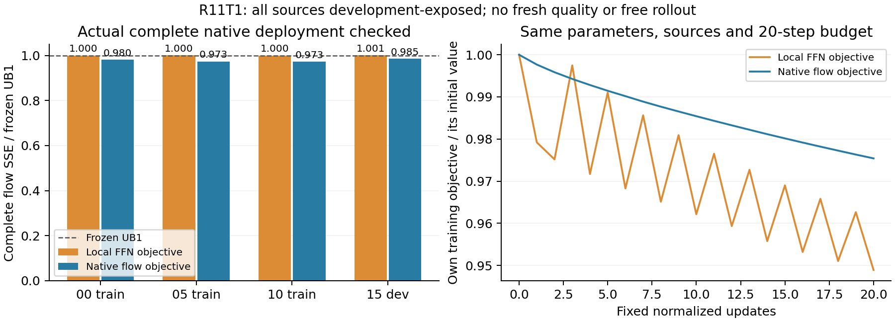

# R11T1：相同部署预算的局部与真实flow目标对照

R11G1已通过完整原生字节控制与梯度准备检查；本轮固定检验训练目标，不改变部署参数量、支持或rank。[协议](../research/20261021/R11T1_matched_objective_protocol.json)和[机制对照](../research/20261021/R11T1_mechanism_record.json)在执行前冻结。已完成六次四步原生生成及两臂各20步：真实flow臂开发误差下降1.491%，比局部臂低1.574%，仍未过预设2%UB1门槛，固定实例关闭。

同为step3/block39现有R256四组参数，主分支及其他159位置固定。训练旧TF2来源00/05/10；15作为优化开发留出，四个来源此前都已开发暴露，不能当新来源质量。局部目标使用真实学生输入的完整原生教师FFN，flow目标使用独立DQ完整步骤flow，保留UB1在该步内部累积的偏差。DQ post仅在完整步骤之间恢复，不是自由学生轨迹。

四来源完整原生捕获、teacher Q1与实际u一致性、零更新字节控制全通过后，两臂各20次完整三来源平均梯度更新；同初始化、相对全参数L2步长0.001、FP32主参数与原BF16部署转换。不搜索步长，不早停或挑checkpoint。两臂最终BF16文件和SHA都冻结后才读取开发损失。固定门槛：flow臂开发flow SSE≤0.98冻结UB1，且≤0.99局部臂。无论门槛结果如何，两臂各做一次15来源完整四步部署，要求实际flow与离线原生窗口预测逐字节一致。

六次完整四步生成、两臂各20步。大张量不超过10GiB，只入HF缓存，保持80GiB空闲底线。零新增在线参数/算子，原50%主MAC不变，但本轮没有完整160速度或官方质量验收。任何开发门槛失败关闭固定实例，不在看到结果后增加训练次数、层、rank、来源或调整阈值；通过也不自动触发自由轨迹/新来源视频。

解释时还要区分：当前完整M数据和梯度优化与历史OP3的采样行闭式重拟合不同，本轮不是OP3复算。完整数据本身不是新机制。两臂共享完整数据、参数、优化器和20步预算，因此只有相对于本轮局部臂的增益才能支持目标改变的作用；不能把共有的数据或求解变化单独算成flow目标的证据。

## 完整结果与失败范围

[结构化结果](../research/20261021/R11T1_matched_objective_results.json)保存冻结协议、源码/资产/参数/操作数及原始收据SHA。四来源的48项原生input/flow/post比较、16项完整窗口重放字节控制、4项教师Q1与实际u一致性均通过。两臂BF16参数先冻结后读取开发损失；最后两次完整原生部署的flow均与离线窗口逐字节一致。没有增加部署参数，仍只有同一位置的既有R256参数变化。

下表为完整末步flow SSE／冻结UB1，低于1表示改善；00/05/10训练，15是此前已暴露的优化开发留出。

| 来源 | 局部教师FFN目标 | 真实flow目标 |
|---|---:|---:|
| 00训练 | 1.000001 | 0.980445 |
| 05训练 | 1.000339 | 0.973489 |
| 10训练 | 0.999511 | 0.972588 |
| 15开发 | 1.000840 | 0.985088 |

局部臂自身训练损失下降5.108%，训练汇总flow误差基本不变（增加0.00090%），开发flow反而增加0.08397%。真实flow臂训练汇总flow误差下降2.45964%，开发下降1.49121%，相对局部臂开发flow降低1.57387%。第二个门槛（比局部臂至少降低1%）通过，第一个门槛（比UB1至少降低2%）未通过；没有降低阈值或追加训练来追验证。

真实flow臂在训练集上的局部教师FFN MSE约为初始值的2.185倍，却改善了完整flow。这与末层主动偏离局部教师、补偿上游学生偏差的解释一致；本轮没有单独分解每个上游误差来源，不能把这一解释升级为完整因果证明。它为R7发现的局部/下游排序不一致提供了实际梯度对照，且没有重复冻结割线近似。

训练过程也限制了结论：flow目标20次更新均下降，最后一次仍降低自身训练损失约0.0933%；局部目标只有11次更新下降，固定步长有振荡。因此这是固定20步归一化梯度方案未达到门槛，不能当作收敛最优解、R256表达能力极限或所有局部训练算法的淘汰。继续加步数、更换学习率、增加窗口/来源属于观察验证结果后的同配方延长，本轮不执行。

局部/flow两臂训练进程峰值分配显存为9.508／7.709GiB（含完整三来源操作数）。原生捕获与训练分进程，最多两卡各一作业；四份新操作数合计约8.554GiB，另有约10MiB的最终BF16参数，均只在HF缓存。80GiB空闲余量保留，环境未升级。

所有生成都在完整步骤之间恢复DQ post，诊断视频最终由DQ latent构造；两次部署核对验证的是实际flow，不能把这些视频当成新候选的自由轨迹或官方视频质量。没有新的三项官方质量、真正新来源或完整160速度接受。

第一次捕获尝试在任何transformer步骤前因调度回调关键字接口错误退出；[修复记录](../research/20261021/R11T1_execution_repair.json)保留两份失败收据与旧源码SHA。只恢复原step_index关键字，完整四步模拟回归测试通过；原协议、数据、目标、步数和阈值不变，失败记录未覆盖。

