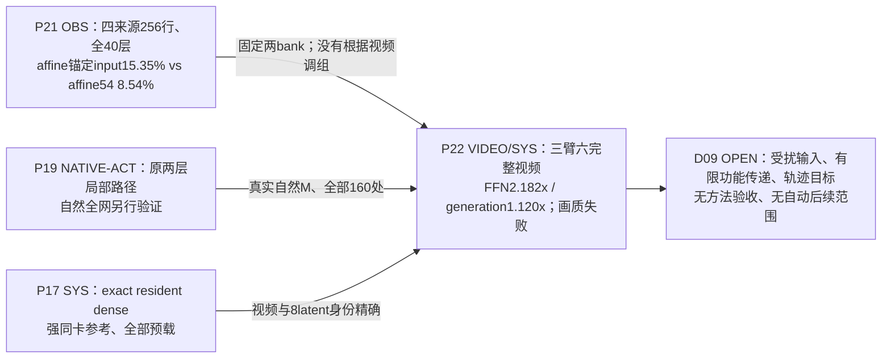

# FFNDS · 从真实源码到实验发现的可追溯计算图

> **计算图底座建立于2026-10-25；当前执行事实截至2026-10-26须结合后续原生视频报告读取。** G0–G5包含被动观察、全层函数分析与同值权重常驻；后续Affine54/Whole94已在40层×4步共160处完成原生候选替换、六条81帧视频及真实耗时测量。固定候选产生可见质量失配，尚未达到正式质量验收；图中其他虚线候选仍按各自证据标签区分。配套 [实验发现谱系总表](../research/EXPERIMENT_FINDINGS_ATLAS.md) 按机制、对照、证据等级收录历史和 E0 实验。全文的图注代号指向**实际文件**，不将假设画成原生执行事实。

## 一、对象、版本与解释规则

| 维度 | 固定对象与来源 |
| --- | --- |
| 主研究对象 | **LightX2V Wan2.2 I2V A14B 四步蒸馏 D 模型**；high/low 两套独立专家；非原始 40 步 O 模型 |
| 模型/推理源码 | [LightX2V@ed146db](https://github.com/ModelTC/LightX2V/blob/ed146db64d0b6130c669285fc1aa0b280a6a4823/lightx2v/models/networks/wan/infer/transformer_infer.py) 的 **infer_block / infer_self_attn / infer_cross_attn / infer_ffn / post_process / infer_non_blocks**；服务器恢复校验见 [上游审计](08_上游源码校对_20261020.md) |
| 实际本地代码边界 | [runtime reconstruction](../research/20261022/R12_E0_runtime_reconstruction.json) 绑定 LightX2V transformer 本地文件 SHA256 **5fa53d102aed4e2793b4d639da65a71e1e63061d9b2c35574db1b4ac2256c225**；量化适配代码见 [HiF4 distill adapter](../upstream_audit/source_deltas/HiF4_Sp/files/HiFloat4/ptq/adapters/lightx2v_wan_distill.py) |
| 硬件/数值 | 原生测量的参照是 **HiF4 activation/weight fake-QDQ + BF16 Linear**，不是 packed FP4 GEMM；另有 H20/其他格式的代码或预检不得混作同一运行体系 |
| 结构与调度 | 40 blocks；5120 hidden；13824 FFN 中间维度 = **216 × 64**；40 attention heads ×128；四步模型输入 t=[1000,937.5,833.333313,625]，sigma=[1,.9375,.833333313,.625]；high/high/low/low |
| 视频与行 | 目标输出 81 帧；latent temporal bins 为 21；在已核对形状的原生测量中 FFN token rows **M=31668**，并非 81 帧或 31668 个独立样本 |
| 研究规则 | [AutoResearcher CR](../core/OBJECT_RECONSTRUCTION.md) 的 source→tensor→算子→下游→测量、[DF](../core/DEDUCTION_FIRST.md) 的证明边界与 [PRD](../core/PROBLEM_REPRESENTATION_DISCOVERY.md) 的表示重构；仓库现行 [E0 研究纲领](../research/20261025/E0_FFN_INTRINSIC_RESEARCH_RESET_20261025.md) |

证据标签：**SRC**＝源码/固定配置；**ALG**＝有条件数学恒等式；**OBS**＝保存操作数分析；**NATIVE-OBS**＝原生完整生成的被动统计；**NATIVE-ACT**＝同前缀原生有限干预；**SYN**＝合成参考反例；**VIDEO**＝真实自由四步轨迹/配对视频；**SYS**＝原生计时；**OPEN**＝未在对应边界验证。一个结果可同时带多个标签。

## 二、图 G0：四步生成、专家切换、完整 Block 顺序

~~~mermaid
flowchart TD
  IN["G00 输入图像 / 文本、种子、初始 latent x₀"]
  SCH["G01 Shift=5 scheduler: 四个实际 (t,σ)"]
  EXP{"G02 step 0,1 → high expert；2,3 → low expert"}
  EMB["G03 patch/input embedding + time/text conditioning；计算各层调制"]
  B0["G04 block 0"]
  BR["G05 blocks 1…38；各层各有自注意力、交叉注意力、FFN"]
  B39["G06 block 39"]
  HEAD["G07 head norm + 条件调制 + head projection → flow预测"]
  STEP["G08 原生 scheduler.step_post；FP32 两次乘加→ latent dtype"]
  LOOP{"G09 还有下一去噪步？"}
  VAE["G10 VAE decode → 81帧视频 → 输出/评估"]
  IN --> SCH --> EXP --> EMB --> B0 --> BR --> B39 --> HEAD --> STEP --> LOOP
  LOOP -- "是：更新latent，换time/expert再执行40层" --> EXP
  LOOP -- "否" --> VAE
~~~

**G01–G02（SRC）**：配置索引 [1000,750,500,250] 在 shift=5 后不是模型实际收到的时间步；原始 [Wan22StepDistillScheduler](https://github.com/ModelTC/LightX2V/blob/ed146db64d0b6130c669285fc1aa0b280a6a4823/lightx2v/models/schedulers/wan/step_distill/scheduler.py) 与 [原生运行校对](../research/20261022/R12_E0_runtime_reconstruction.json) 一致。跨 1→2 步发生**专家权重切换**，不能把四步都当同一 FFN 函数。

**G07–G09（SRC/NATIVE）**：head 产生的是 flow 预测，不是 RGB；scheduler 按独立 FP32 运算依次减 σ_t·flow、非终步再加 σ_next·flow，最后转回 latent dtype。[UB1 调度器审计与原生轨迹](28_固定步间计算预算对照.md)、[R7 同状态 flow 干预](../research/20261021/R7D1_results.json) 固定了这层边界。完整视频评价见 [指标协议](77_FFNDS学术指标族与评测协议_20261023.md)，不能以本地 FFN SSE 或单个 flow SSE 替代。

### 图 G1：一个 Wan Block，保留三次不同归一化与残差旁路

~~~mermaid
flowchart TD
  R0["G11 输入 residual r，M×5120"]
  COND["G12 time embedding + 6路 modulation: shift/scale/gate_msa, shift/scale/gate_ffn"]
  N1["G13 norm1 + MSA scale/shift"]
  SA["G14 Self-Attention: Q/K/V, Q/K norm, RoPE, attention, O"]
  WA["G15 r₁ ← r + gate_msa ⊙ SA"]
  N3["G16 norm3(r₁)；text Cross-Attention Q/K/V/O"]
  WC["G17 r₂ ← r₁ + CrossAttn"]
  N2["G18 norm2(r₂) + FFN shift/scale"]
  FFN["G19 完整 FFN：Smooth1/Q1/W1/GELU/Smooth2/Q2/W2"]
  WG["G20 r₃ ← r₂ + gate_ffn ⊙ FFN"]
  NEXT["G21 下一 block.norm1(r₃) + attention/FFN；最终 head/flow"]
  R0 --> N1 --> SA --> WA --> N3 --> WC --> N2 --> FFN --> WG --> NEXT
  R0 --> WA
  WA --> WC
  WC --> WG
  COND --> N1
  COND --> WA
  COND --> N2
  COND --> WG
~~~

- **G13–G18（SRC）**：[实际 infer_block/infer_cross_attn/infer_ffn](https://github.com/ModelTC/LightX2V/blob/ed146db64d0b6130c669285fc1aa0b280a6a4823/lightx2v/models/networks/wan/infer/transformer_infer.py)：self-attention 先以 gate_msa 写回；cross-attention 读取 norm3，随后先把 cross 输出直接加到 residual **再**读取 norm2；FFN 输出在 **post_process** 用 c_gate_msa 写回。它并非单个泛化「LN→FFN→残差」节点。[C0](../research/20261023/C0_coupling_offline_results.json) 的归一化前残差/attention信息、[C1N0](../research/20261023/C1N0_native_results.json) 的实际下一 norm1 正是 G17→G20→G21 之间的辨别量。
- **条件分支（SRC）**：冻结运行配置 use_image_encoder=false，跨注意力中的独立 image-context attention 路径跳过；text context 保留。源码还包含 smooth-norm / MXFP8-fused / sensitive-dtype / seq-parallel / adapter 的其它分支，**不能将其当作本次 HiF4 观测路径已经执行**。对应 runtime 的精确分支由 [适配契约](../upstream_audit/source_deltas/HiF4_Sp/files/HiFloat4/ptq/adapters/lightx2v_wan_distill_contract.json)、[源码审计](08_上游源码校对_20261020.md) 确认。
- **G20→G21（ALG/NATIVE）**：残差直通意味着局部 LN 的径向弱响应不是整块或整段视频的零响应。[E0 原生有限组干预](../research/20261025/E0_FOLLOWTHROUGH.md) 和 [历史 C1 72 位点](97_历史结果检验_门控残差商空间_20261024.md) 已在可见下游边界检验具体动作，相关下游 SSE 均不为零。

## 三、图 G2：FFN/QDQ/GEMM 细分执行，注解关联证据

~~~mermaid
flowchart TD
  R["F00 r₂ / norm2输入，M×5120"]
  LN["F01 norm2 (eps 1e-6) + 当前步 FFN AdaLN shift/scale"]
  SM1["F02 Smooth1：float除固定scale→转BF16"]
  Q1["F03 Q1：原生 HiF4 activation QDQ；decoded BF16 q₁"]
  W1["F04 W1 Linear：13824×5120；含原生 b₁"]
  A["F05 preactivation a，M×13824"]
  GELU["F06 GELU(approximate=tanh)，M×13824"]
  SM2["F07 Smooth2：hidden/scale→BF16"]
  ROOT["F08R 64项根max / 8项与4项子组max → 三级共享scale"]
  Q2["F08 Q2：HiF4编码/解码后的 BF16 v₂"]
  W2["F09 W2 Linear：5120×13824；含原生 b₂"]
  Y["F10 FFN输出 y，M×5120"]
  G["F11 由time modulation生成的 FFN gate"]
  WB["F12 native gate乘法 + BF16/敏感精度 residual writeback"]
  NX["F13 下一block norm1→attention；后续层/head/flow"]
  R --> LN --> SM1 --> Q1 --> W1 --> A --> GELU --> SM2 --> ROOT --> Q2 --> W2 --> Y --> WB --> NX
  R --> WB
  G --> WB
  META["F14 量化尺度/码字/有效QDQ权重：离线/当前kernel内"]
  META -. "Q1/Q2 数值边界" .-> Q1
  META -. "Q1/Q2 数值边界" .-> Q2
  PANEL["F15 216个 whole64 通道组 / 有符号W2贡献"]
  Q2 -. "后验解释：需要v₂" .-> PANEL
  W2 -. "W2列向量" .-> PANEL
~~~

| 节点 | 实际发现、证据种类、定位 | 推论的精确范围 |
| --- | --- | --- |
| **F00–F01** | [C0 synthetic 相同 q/不同 residual 标度反例](../research/20261023/C0_coupling_offline_results.json) **ALG/synthetic**；[C1 native 72 site](../research/20261023/C1N0_analysis.json) **NATIVE**；[E0 径向几何](../research/20261025/E0_DISCOVERY.md) **OBS** | q 完整时决定本次 deterministic FFN 输出；但 bypass r 和下一步条件可以改变同一 q 下动作的**下游**影响。C1 的三个旧动作在 72/72 整位点均由 UB1 领先。 |
| **F02–F03** | [HiF4 adapter](../upstream_audit/source_deltas/HiF4_Sp/files/HiFloat4/ptq/adapters/wan_i2v.py) **SRC**；[E0 原生量化核对](../research/20261025/E0_DISCOVERY.md) **OBS/SRC** | 转 BF16、QDQ 与分组尺度顺序不可随意交换；E0 240 个参考例在保留 signed zero 后 BF16 位一致。量化元信息多提供幅值/范围，不能直接当功能重要性。 |
| **F04–F06** | [原生 FFN 源码](https://github.com/ModelTC/LightX2V/blob/ed146db64d0b6130c669285fc1aa0b280a6a4823/lightx2v/models/networks/wan/infer/transformer_infer.py) **SRC**；[E0 量化前后观察](../research/20261025/E0_DISCOVERY.md) **OBS**；[旧 A5/R15](04_前期探索与证据边界.md) **VIDEO/SYS** | GELU 中间维度 13824；E0 GELU 精确零占比 0–0.0617%。如果在 W1 后才决定 mask，W1 费用已经发生；历史 A5 质量较好实例也不证明 W1 省算。 |
| **F07–F08R–F08** | [E0被动观察](../research/20261025/E0_DISCOVERY.md)、[完整原HiF4闭包](../research/20261025/E0_SHARED_TILE_CLOSURE.json)、[原始Python量化参考反例](../research/20261025/E0_HIF4_COLUMN_DEPENDENCY_COUNTEREXAMPLE.json) **OBS/SRC/SYN** | Q2 后零值5.42–14.00%，不等于whole64跳算。HiF4的64→8→4共享max/scale使**组内输入与decoded输出存在跨列依赖**；25%任意W2列不等于25% W1必需输入。 |
| **F09–F11** | [E0 五组有符号贡献/联合选择](../research/20261025/E0_FOLLOWTHROUGH.md) **OBS**、[E0 组排序](../research/20261025/E0_GEOMETRY_RANKINGS.md)、[R9 signed Gram 历史](97_历史结果检验_门控残差商空间_20261024.md) | W2 value vector 的**有符号合成**决定净输出；单通道能量和组合/后续功能损失不同。E0 block0 两组按最小独立能量选，与组合 LN 最优不同 28.91%。 |
| **F11–F12** | [E0 原生有限组干预及 BF16 写回](../research/20261025/E0_FOLLOWTHROUGH.md) **NATIVE**；[C1 native full action](../research/20261023/C1N0_native_results.json) **NATIVE** | E0 两组非加性量相对加和作用能量从 FFN output 1.76–1.93% 到 residual writeback 26.64–27.87%；实数向量和不能替代原生舍入顺序。 |
| **F12–F13** | [R7D1 同前缀两层有限传递](../research/20261021/R7D1_results.json)、[C1 boundary audit](../research/20261024/C1_boundary_target_audit.json)、[R16 native+自由视频](../research/20261023/R16V0_analysis.json) **NATIVE/VIDEO** | local、nextnorm、flow、RGB 四种目标不同；R16 在四个 site 的 local SSE 比固定更好 6.13%，却在一个来源自由视频 RGB MSE 比最佳固定差 8.23%。这不是官方画质优劣的判定。 |
| **F14** | [量化适配器](../upstream_audit/source_deltas/HiF4_Sp/files/HiFloat4/ptq/adapters/lightx2v_wan_distill.py)、[不同 FP4 格式的本地增量](../upstream_audit/source_deltas/Wan2.2-I2V-A14B-W4A4/files/CODE_PATH_ANALYSIS.md)、[E0 研究重置](../research/20261025/E0_FFN_INTRINSIC_RESEARCH_RESET_20261025.md) | HiF4 / MXFP4 / NVFP4 路径和 format metadata 是不同成本/可见性的数值实现，不能把 QDQ 的组级振幅估计说成硬件 FP4 kernel 的零成本在线选择。 |
| **F15** | [早期五组](../research/20261025/E0_JOINT_AND_TEMPORAL.json) → [完整13824通道/216组](../research/20261025/E0_INTRINSIC_FULL_HIDDEN.md) → [连续M128原生向量](../research/20261025/E0_SHARED_TILE_PRE_W1.md) **OBS/NATIVE-OBS** | 旧五组仅限定早期角度；现在六个已暴露来源×32均匀位置可核对全部value向量，另有两来源完整M支持统计和三组连续M128。**完整函数重建、布局占用和真实部署是不同级别的结论**。 |

### 数学形式与原生舍入的位置

对每个 token，在**固定参数、忽略离散QDQ及有限精度**的实数表示下：

\[
r_2=r+\mathrm{gate}_{msa}\odot\mathrm{SA}(r)+\mathrm{CrossAttn}(\cdots),\quad
q=\mathrm{Modulate}(\mathrm{LN}_2(r_2),s,c)
\]
\[
a=W_1q+b_1,\quad h=\phi_{\mathrm{GELU(tanh)}}(a),\quad
y=W_2h+b_2,\quad r_3=r_2+g\odot y.
\]

**源码执行**在 q→W1 与 h→W2 之间分别插入 Smooth/QDQ，且包含 dtype 转换、bias、可能的归一化精度分支、GEMM 舍入、门控/写回舍入。因此，上述等式是正确的**连续结构表示**，并非逐位可执行复刻。[packed FFN reference](../tools/packed_ffn_reference.py) 将 F02–F09 的真实 QDQ 顺序显式编码；[UB1 执行器](../tools/ub1_row_dispatch.py) 将历史候选的 R256/gain/packing 插在额外路径，**不属于 dense 原算子**。

固定 gate 时：
\[
g\odot y=\sum_{j=1}^{13824}h_j(g\odot W_{2,:,j})+g\odot b_2,\qquad
\left\|\sum_{j\in S}\delta_j\right\|^2
=\sum_{j\in S}\|\delta_j\|^2+2\sum_{j<k}\langle\delta_j,\delta_k\rangle.
\]
这解释 F15 的联合组值和符号抵消，不需要默认 W2 投影可交换 GELU：一般 \(\phi(Ra)\ne R\phi(a)\)。同样，在连续实数可微区域，\(D_q y=W_2\mathrm{diag}(\phi'(W_1q+b_1))W_1\)，但它**不是离散 QDQ 的精确雅可比**，不能直接替代原生有限干预。

对于无仿射 LN 的连续近似，令 \(P=I-\mathbf1\mathbf1^\top/d,\ z=Px,\ s=\sqrt{\|z\|^2/d+\epsilon}\)，有
\[
J_{\mathrm{LN}}(x)\delta=
\frac{P\delta-z(z^\top P\delta)/(\|z\|^2+d\epsilon)}{s}.
\]
此处的通道均值方向严格零敏感，径向方向仅近零敏感；但 identity residual 仍保留差异，后续 attention 会改变相对方向。[E0 理想 LN 几何](../research/20261025/E0_DISCOVERY.md) 在 block0 五个组得到约 19.82% 消去能量；[配对打乱](../research/20261025/E0_RADIAL_PAIRING.md) 发现 raw 对齐错配也近似存在，不能把全部对齐解释为当前 token 的独特可省计算。[E0 native](../research/20261025/E0_FOLLOWTHROUGH.md) 证明原生有限写回与理想连续响应存在关键边界。

## 四、图 G3：实验动作、信息时点、原生工作量

~~~mermaid
flowchart LR
  Z0["D00 固定step/expert/block；residual/gate/attention已存在"] --> Z1["D01 W1前：q或廉价统计可观察"]
  Z1 --> W1["D02 主 W1（已付费）"] --> H["D03 GELU/H可观察"] --> Q2G["D03Q 组间共享scale的Q2"] --> W2["D04 主 W2（已付费）"] --> Y["D05 输出 / gate / residual"]
  HIST["D06 历史 UB1：冻结whole64 W1/W2 + R256 + bias/gain"] --> Y
  ROUTE["D07 历史 R16：pre-W1 R256幅值分派25% dense行"] --> HIST
  S0["D08 只读保存值：W1/GELU/Q2/输出、dense教师"] -. "后验 oracle/解释，不回溯本次成本" .-> H
  OUT["D09 nextnorm / nextblock / flow / VAE-video"] 
  Y --> OUT
~~~

| 信息时点/动作 | 与图的关系 | 实验结果和严格推论 |
| --- | --- | --- |
| **D00** 已有 timestep/expert/residual、attention 更新及 gate | 选择可以预先使用的 source/condition 信息 | [C0 源与合成反例](../research/20261023/C0_coupling_offline_results.json)：上游信息对本地 FFN 的充分性和对 residual bypass 后行动价值的充分性是两件事。 |
| **D01** 当前 q、norm stats | W1 前读入 q/sketch；若另做 reduce/selector 必须计时 | [norm stats helper](../tools/prew1_norm_statistics.py)：CPU 逐位返回检查≠GPU 免费读取或性能收益；[C1](../research/20261023/C1N0_analysis.json) 的观测对旧三动作 whole-site 没有改变最优结果。 |
| **D02** 已做 W1 后 | 可研究 W2 结构，但本次 W1 已发生 | 历史 [A5/R15](04_前期探索与证据边界.md) 说明「实际省 GEMM」必须有真正 sparse/packed 的 W1 形状与时间。 |
| **D03–D04** 已有 hidden/Q2 | 适用于输出重表示、部分 W2 计算、局部 oracle | [AR1/C24/PR/WR/JR 复盘](61_全路线失败归因与组合方案复盘_R10.md)、[E0 Q2 与五组面板](../research/20261025/E0_DISCOVERY.md)；有贡献统计≠可以零成本提前筛选。 |
| **D06** 原 UB1 静态步宽 + R256 | 候选添加额外两次 rank256 GEMM、QDQ、缩小的 W1/W2 及 gain/bias | [UB1 原20联合工程验收](../reports/worker_20261020/UB1_joint_engineering_acceptance_RUN.json)：静态 50% main MAC、full160 FFN 1.546111×、三项原20质量过历史门槛；[新20来源](29_冻结候选的来源分离补充验证.md) imaging 降 3.166%，不能推广其画质成功。 |
| **D07** 历史动态 dense-row 分派 | 分别做稀疏行 FFN 与 25% dense行 FFN；计入 R256/selector/packing/scatter | [R16](../research/20261023/R16V0_analysis.json) 同输入局部更好但 RGB 保真排序反转；[R17](../research/20261023/R17E0_system_timing_prefix.json) full160 FFN 1.25665×、整次生成 1.04469×，均仅旧来源/原动作。 |
| **D08** 离线 dense 真值、未来输出 | 允许机制归因/训练监督/后验 oracle，不能伪装成当前决策已有信号 | [R12 old action budget](../research/20261022/R12_D0_native_results.json)、[R14N0](../research/20261022/R14N0_native_results.json)、[C1](../research/20261023/C1N0_analysis.json)。旧动作族的 oracle 天花板**不构成所有新 FFN 省算算子的上界**。 |
| **D09** 下游与部署 | 不同目标及评价粒度 | [R7D1](../research/20261021/R7D1_results.json) 四来源中三来源局部/下游排序不合；[E0 finite](../research/20261025/E0_FOLLOWTHROUGH.md) 六来源内三来源局部/最终 flow 排序不合；[R17](../research/20261023/R17E0_system_timing_prefix.json) FFN 速度 ≠ generation wall。 |

## 五、图 G4：新实验打通“信息何时可见→函数列选择→Q2尺度依赖→真实省算”

2026-10-25 新结果对应 [完整hidden和原生tile观察](../research/20261025/E0_INTRINSIC_FULL_HIDDEN.md)、[连续token共享列与W1前观察](../research/20261025/E0_SHARED_TILE_PRE_W1.md)，分别在基准图合并后两次提交中产生。**所有图示实线是已验证的 Dense 运算或已读取数值，虚线为后验诊断/提议中的计算分支；不是一个已部署的 sparse FFN。**

### G4a. 源码执行轴与候选决策轴（同一依赖图）

~~~mermaid
flowchart TD
  T["P00 step / expert / layer / gate；本次原生 q1=Q1(Smooth1(AdaLN))"]
  W1["P01 原生 W1全宽 → preactivation a, GELU h"]
  RED["P02 原生 Q2: 64项root max → 8/4子组max → 共享scale"]
  Q2["P03 BF16 decoded q2，M×13824"]
  W2["P04 W2 BF16 GEMM + b2 → gate / residual"]
  OLD["P05 上一次同专家 q2/ungated Y；0→1或2→3"]
  DELTA["P06 后验 Δq=q2当前−q2历史（W1/Q2已经付费）"]
  SKETCH["P07 候选W1前micro16: pooled q1 → 额外小W1/GELU → value对角分数"]
  SELECT["P08 候选token块共享列 S，预测与posthoc选择分开"]
  CLOSE["P09 直接按原HiF4 Q2计算：需要 C64(S)完整组的输入才能求根尺度"]
  K1["P10 被选原生W1操作数密度ρ1；必须包含Q2依赖"]
  K2["P11 被选W2列密度ρ2"]
  COST["P12 额外观察o、packing/gather、QDQ、cache和kernel；真实FFN/整生成耗时"]
  T --> W1 --> RED --> Q2 --> W2
  Q2 --> DELTA
  OLD --> DELTA
  T -. "额外费用，非免费前置信息" .-> SKETCH
  OLD -. "只限同专家合法历史" .-> SKETCH
  SKETCH -. "尚未执行算法" .-> SELECT
  DELTA -. "仅为后验上界/标签" .-> SELECT
  SELECT -. "原格式直接求值" .-> CLOSE --> K1 --> COST
  SELECT -. "W2支持" .-> K2 --> COST
~~~

**P00–P04（SRC）**：原版FFN依次执行 Q1→W1→GELU→Smooth2/BF16→HiF4 Q2→W2；本次先后还有门控及原生 BF16 residual。P02 的共同根尺度不是图形装饰：在既定 HiF4 实现中，量化后的 \(q_{2,j}\) 依赖同一64元素分组的输入幅值，内部含8/4子组的max和scale。根尺度重算可使未修改的 \(h_j\) 得到不同的 \(q_{2,j}\)。参见 [HiF4格式原始说明](https://hifloat.gccorg.com/docs/en/hifloat4/white_paper/hifloat4_format_for_language_model_inference.html) 和 [项目固定原参考调用](../tools/check_e0_hif4_dependency.py)。

**P05–P07（OBS）**：对四步双专家，[t0,t1]仅high同一组权重，[t2,t3]仅low同一组权重；历史缓存需要额外存储/搬运，跨1→2不能直接共享W2。定义 \(q_t=Q_2(\operatorname{BF16}(\phi(a_t)/s_2))\)，\(\Delta q=q_t-q_{t-1}\)；P06只有**本次全部主W1/GELU/Q2之后**才可直接测到。P07则使用Q1后、主W1前已经存在的输入，微块16行求均值，再**额外计算**一组W1/GELU近似（约主W1 token行投影MAC的1/16），用当前gate与静态W2 value范数形成候选共享列评分；这种先行可观测不代表免付主W1算力，也未复现Q2精确舍入。

**P08–P11（SRC/ALG/OBS）**：对被选列 \(S\)，按原量化算子直接求值时的依赖闭包 \(C_{64}(S)=\bigcup_{j\in S}G_{64}(j)\)，其中 \(G_{64}(j)\) 是原始完整64输入组。若有人提出缓存/认证全组max不变，便是在构建**新量化/近似/证明机制**；不再属于“直接按原Q2计算所选列”的同一算子。原CPU Python参考的 [合成反例](../research/20261025/E0_HIF4_COLUMN_DEPENDENCY_COUNTEREXAMPLE.json) 仅修改64组内第0项7→14，其余63项保持1.25，输出64项全部改变，未改变的第8输入对应decoded值1.25→1.5。此为 **SYN：CPU原参考且未调用CUDA**，不是Wan发生率。

### G4b. 同一25%预算，四个完全不同的“稀疏”概念

| 观察及数学对象 | 当前证据/定量结果 | 实际能推出的结论 |
| --- | --- | --- |
| 单token后验value支持 \(S_r=\operatorname{topk}_j(\Delta q_{rj}^2\|g_tW_{2,:,j}\|^2)\) | [完整全hidden六来源180案例](../research/20261025/E0_INTRINSIC_FULL_HIDDEN.json)：25%单通道后验value对角的同专家创新相对SSE **2.44%–7.07%**；同通道预算按原64组能量排名为 **32.42%–54.67%** | 单通道系数创新更集中，但value对角忽略有符号交叉项，不是联合函数最优或前置selector |
| 原布局 tile occupancy \(\mathbb{1}\{\exists r\in B,j\in G:m_{rj}=1\}\) | [完整M=31668支持](../research/20261025/E0_INTRINSIC_FULL_HIDDEN.md)：两来源原生 dense 被动，12.5%逐行保留时所测 **M16/64/128×K64块100%非空** | 保留这些逐行散点集合时，原布局没有整块空闲；这是非空工作比例，不是实际CUDA计时，也不证明其他共享集合不可行 |
| 同一连续token块共享任意列 \(S_B\) | [2来源、三段连续M128](../research/20261025/E0_SHARED_TILE_PRE_W1.md)：25%列共享后，中间观测层即使用后验对角分数，SSE也38.99%–42.21%；前置micro16为42.29%–47.30% | 逐行稀疏转为共享列损失了函数表达能力；问题不只是预测器不够精确。原raster连续不等于经voxel/RoPE重排 |
| 原Q2量化依赖闭包 \(C_{64}(S_B)\) | [原量化组闭包20种来源/步/block×3块=60个M128](../research/20261025/E0_SHARED_TILE_CLOSURE.json)：在25%任意列时，全部测试触及 **216/216原64组**；12.5%时平均约99.97% | 按该原量化器直接求值，W1对Q2的输入需求与W2选列密度不同；非所有新算子的物理下界 |

创新目标在报告中按同专家当前gate定义：\(\Delta U_r=g_t\odot W_2(q_{t,r}-q_{t-1,r})\)；对集合 \(S\)：
\[
E_B(S)=\frac{\sum_{r\in B}\|g_t\odot W_2(\Delta q_r\odot1_{j\notin S})\|^2}
{\sum_{r\in B}\|\Delta U_r\|^2}.
\]
**分母是同专家创新能量，剔除了原 \(b_2\)（同专家内相同）**；不是当前完整FFN输出能量或下游视频误差。后验 value 支持本身并非原生物理执行；W2输出的 BF16 顺序也不能仅由FP64误差证明等价。

### G4c. 空间共同量—token特有量节点与层间差异

对每个连续tile \(B\)，令 \(\mu_B=|B|^{-1}\sum_r\Delta U_r\) 和 \(e_r=\Delta U_r-\mu_B\)，则精确恒等式：
\[
\sum_r\|\Delta U_r\|^2=|B|\|\mu_B\|^2+\sum_r\|e_r\|^2.
\]

| block | 同块共同创新能量占比 | 逐行后验对角SSE | 共享后验对角SSE | 前置micro16 SSE |
| ---: | ---: | ---: | ---: | ---: |
| 0 | 65.3% | 2.85% | 11.98% | 12.84% |
| 10 | 9.8% | 6.51% | 38.99% | 47.30% |
| 20 | 13.6% | 6.72% | 42.21% | 46.30% |
| 30 | 14.3% | 7.19% | 40.12% | 42.29% |
| 39 | 77.8% | 2.44% | 7.57% | 6.55% |

数值为两个**已暴露**来源×两个同专家步对的连续M128局部相对创新SSE等权平均，非跨来源质量验收。前后观测层有较大块共同创新，中间观测层以token自有变化为主。这给出 **共享更新 + 独有变化** 的构造研究方向，但尚不证明哪个分量可删除而保留背景/光照/运动质量。[原始结果](../research/20261025/E0_SHARED_TILE_PRE_W1.json)、[可复算工具](../tools/e0_shared_tile_math.py)、[保存数据图](../reports/observations_20261025/shared_tile_pre_w1.png)。

**GELU引入另一个不可交换节点（ALG/SYN）**：\(\phi(\overline a)\ne\overline{\phi(a)}\) 通常成立，因此 preactivation块均值相同不保证平均GELU不变。该真实数 tanh-GELU 满足特殊恒等式 \(\phi(a)-\phi(-a)=a\)，可以代数分解
\[
\Delta q=\underbrace{\Delta a/(2s_2)}_{\text{linear half}}+
\underbrace{\Delta(h-a/2)/s_2}_{\text{GELU remainder}}+
\underbrace{[\Delta q-\Delta h/s_2]}_{\text{Smooth/BF16/Q2 remainder}}.
\]
这三项是保存数值的**代数分解**，不是可直接省略分支；在五个观测block中线性与非线性分量经W2/gate后的cosine约 −0.64至−0.82，常有很大反向作用。任意隐藏空间旋转仍不能穿过GELU；若未来从实际W1/bias/W2证实特殊成对结构，才可能另建可执行仿射重写分支。

### G4d. 用物理操作数给候选表示设立公平账本

只在同专家第二次调用（step1和step3，共80/160个FFN）采用缓存增量；假设完整主 W1 和 W2 的 MAC 相等，则每个受影响FFN保留W1密度 \(\rho_1\)、W2密度 \(\rho_2\)，额外前置W1观察费 \(o\) 时，**全160处两次主投影的理想MAC省量**为
\[
s_\mathrm{proj}=(2-\rho_1-\rho_2-o)/4.
\]
对于本轮25% W2任意列、原Q2根scale闭包 \(\rho_1\approx1\)，micro16 \(o=1/16\)，仅省 **17.1875%理想主投影MAC**，其理想主投影加速最多约 **1.208×**。若真的开发出使 \(\rho_1=\rho_2=0.25\) 的另一算子，在同一观察费模型下省量才为 **35.9375%**。**两者都是有条件算术，不是 FFN 或 generation wall 测得加速**；未计cache、QDQ、索引、数据搬运、权重布局、kernel、注意力与VAE。

这将 [Chipmunk 动态列稀疏与token重排](https://arxiv.org/abs/2506.03275) 作为**精确机制竞争对照**，而不是只比较top-k名字：其列稀疏策略与重排/kernel实现有训练自由先例；本轮仅在未重排的原raster M128、HiF4 QDQ-BF16环境观察差异，不可借用其速度。当前最有信息量的开放问题是 **能否改变功能/依赖单位**（有符号联合组、量化尺度可认证复用、共享共模+token残差、GELU特殊条件重写），再分别验证W1/W2物理代价与下游功能；尚未选择某个已验收加速算子。**G4是在原生量化实现下的解释切面，不是必经算法路线**：当前 [E0 机制分歧审查](../research/20261025/E0_INTRINSIC_DIVERGENCE_AUDIT_20261025.md) 还保持函数基、空间组织、非线性可辨识、下游视频敏感性、可执行表示与少步蒸馏层/专家异质性六个竞争入口。可以从任何一个入口提出新的研究问题，不应由这张图规定只能做 shared-column 或 HiF4。

### G4e. 历史增量审计（截至79bc9ea）：函数基假说不等于新实验

**核查基线**：上次计算图合并为 [8df09a6](https://github.com/Qesire/FFNDS/commit/8df09a6dcb82d256a2593ef5158441f78b771ff0)。截至 [79bc9ea](https://github.com/Qesire/FFNDS/commit/79bc9eae9f2d7c694f5536a2aa860381a9c80ee4)，两者之间的26个提交新增了 [Graph-Agent节点注册表](../research/agent_protocol/GRAPH_AGENT_BINDINGS.json)、[图 ↔ Agent 协议](../research/agent_protocol/GRAPH_AGENT_COLLABORATION.md)、[静态检查器](../tools/graph_agent_bridge.py) 和一项尚未独立评议的函数基假说；这一增量**未新增完成的模型实验结果**。该审计时点最新**实测**仍为先前两轮 [完整hidden/原生M支持](../research/20261025/E0_INTRINSIC_FULL_HIDDEN.md) 和 [连续M128/原HiF4闭包](../research/20261025/E0_SHARED_TILE_PRE_W1.md)，其独立来源和评价范围见 G4b–G4d。

新提案 [E0_GRAPH_SEED_FUNCTION_BASIS_20261025](../research/method_discussion/graph_annotations/E0/E0_GRAPH_SEED_FUNCTION_BASIS_20261025.json) 的状态是 **PROPOSED / 无独立review / OPEN**。它未测得output-basis谱、可在线识别的低维基、任何W1/W2节省或新自由视频质量。下图只把假说投射到已有数值节点，**不改 F01–F13 原Dense执行实线**：

~~~mermaid
flowchart LR
  OBS["P06 同专家 Δq；原生Q2后才可知"]
  VAL["F09/F15 保存的 V=diag(g)W2 与有符号输出"]
  MEAS["G4c 已测: ΔU_B=1μᵀ+E_B 共同/独有能量"]
  HYP["P14 OPEN: token不同系数 × 共享输出函数基；无压缩/速度测量"]
  RIVAL["RIVAL: token自有输出变化本身高维"]
  PRICE["P10/P11/P12: W1/W2/QDQ/预测/访存成本待验证"]
  END["F12/F13/D09: 原生写回/下游/视频作用待验证"]
  OBS --> MEAS
  VAL --> MEAS
  MEAS -. "启发而非证明" .-> HYP
  RIVAL -. "持出来源、同成本对照" .-> HYP
  HYP -. "条件分支待实现" .-> PRICE
  HYP -. "下游无因果证据" .-> END
~~~

令 \(B\) 是连续 \(T=128\) token行，\(V_t=\operatorname{diag}(g_t)W_{2,e_t}\in\mathbb R^{5120\times13824}\)。原保存数据可作后验实数描述：
\[
\Delta U_B=\Delta Q_B V_t^\top\in\mathbb R^{T\times5120}
=\mathbf1_T\mu_B^\top+E_B,\qquad \mathbf1_T^\top E_B=0.
\]
这里历史 ungated W2 输出以当前 gate 门控；数值F16/BF16舍入不视为该FP64公式的逐位等价。

**已测量与严格推出（OBS + ALG）**：若只保留共同输出向量 \(\mathbf1\mu^\top\)，相对创新SSE恰为 \(1-\eta_B\)，其中 \(\eta_B=T\|\mu_B\|^2/\|\Delta U_B\|_F^2\)。从已报告共同能量占比推出，按同样**案例等权平均**，block0/10/20/30/39 的“仅共同更新”后验创新SSE依次为 **34.7% / 90.2% / 86.4% / 85.7% / 22.2%**。这些是既有数据的代数推论，不是额外 GPU 实验、不是最佳rank-one SVD、更不是在线可免费得到的结果。

**未测的科学假说（OPEN）**：\(\Delta U_B\approx A_BB_B^\top\)，\(A_B\in\mathbb R^{128\times k}\)，\(B_B\in\mathbb R^{5120\times k}\)。因为任意128×5120矩阵天然 \(\operatorname{rank}\le128\)，单凭“rank小于5120”不能支持有效可压缩性。真正要区分的是：当 \(k\ll128\) 时谱尾能量是否小、跨token/来源是否可复用、在W1之前如何以更低成本预测系数/基、能否真正减少W1/W2操作而不破坏GELU/Q2/残差与视频。与之竞争的解释是**中心化token变化本身高度异质**，并非原hidden列坐标选得不好。

**最小判别（尚未执行）**：复用两来源连续M128保存操作数，比较持出拟合的输出函数子空间与原共享列、逐行后验、固定基、置乱token分组在**相同数据边界、明确表示/拟合预算**下的误差；先核对是否存在跨源稳定的谱，再讨论能否取得早期便宜信息和物理算力收益。输出SVD后验低误差不能推翻原HiF4求值依赖闭包，也不能自动产生加速。[完整提案与竞争解释](../research/method_discussion/graph_annotations/E0/E0_GRAPH_SEED_FUNCTION_BASIS_20261025.json)。

**图谱身份**：本节仅为当时E13–E20实验附加 P14 / OPEN 假说边，不将P14登记为E21；后续实际新测量另见G4f。参见 [Graph-Agent协议](../research/agent_protocol/GRAPH_AGENT_COLLABORATION.md)：可用 inspect P14 / trace P06 P14 查询证据节点；独立peer review尚未发生。

### G4f. 后续函数折叠与相同视频的实际运行时证据

以下两项有[绑定精确claim SHA的独立复核](../research/method_discussion/graph_annotations/E0/independent-affine-residency-graph-review-20261026.json)。实测affine比较仅针对另一来源固定组能量支持，不能推成优于所有最优匹配删组。原生折叠执行及奇偶部因果解释继续保持OPEN；dense常驻的完整视频身份和SYS改善在已测边界下成立。

**F04/F06/F08/F09 → P10/P11/P12（ALG/OBS，非已执行替换边）**：[全层函数表示研究](../research/20261025/E0_AFFINE_FFN_DISCOVERY.md)已保存两来源每步40层的中心128/原random32向量，并在旧步对全部31668行求导数均值。旧全M共享斜率仍在中间层有明显误差；“full-M”不代表全token误差评价。另一来源校准的绝对affine＋27个原64组余项，uniform32平均输出SSE11.27%，投影MAC精确匹配的直接67组为43.13%。D×D基项恰为40/216原FFN投影组；Q2依赖、packing、矩阵存储和视频作用未由理想MAC解决。

**F06/F15 的新竞争解释（条件ALG/OPEN）**：GELU已有奇偶分解可进一步推出：输入分布关于0对称时，带截距OLS斜率恒为1/2，宽分布亦可成立。因此稳定affine不证明窄热区。独立审查给出signed组余项10v,−10v,v的净抵消反例，组能量posthoc也非联合误差oracle。半斜率＋另一来源均值截距对照尚未运行；不将该连续恒等式画作跨原生Q2/BF16的严格执行边。[原始独立论证](../research/method_discussion/discoveries/E0/independent-affine-residency-audit-20261025.md)与[图锚点记录](../research/method_discussion/graph_annotations/E0/E0_GRAPH_AFFINE_ODD_EVEN_20261025.json)保留其范围。

**P12 → D09（SYS/VIDEO身份，实际执行但不省MAC）**：[dense权重常驻研究](../research/20261025/E0_DENSE_WEIGHT_RESIDENCY.md)完成18条完整视频、72个latent哈希与18个编码文件SHA匹配原dense。单张80GB A100同卡热态75.17/75.37→50.42/50.79秒，采样物理峰值77.08GiB；所有linear/QDQ次数不变。相同原权重驻留与省略显式allocator flush减少搬运/分配，不能记为F04/F09算术减少。original/no-flush有双卡反向对照，全量常驻有同卡原版对照、无全量双卡反向重复；两图片/seed组合实际0/42、12/54。该强dense参考与冷态/显存代价应进入未来算法比较。[运行时图记录](../research/method_discussion/graph_annotations/E0/E0_GRAPH_EXACT_DENSE_RESIDENCY_20261025.json)没有新增模型任务。

孤立折叠的另一条P12证据是：未融合旧full-M导数获取约54ms，加BF16合成约4ms/应用约8ms，已超过约53ms原生after-Q1 FFN。full-M形状用128行重复构造，非自然全M/端到端数据；该结果约束现有实现，不排除离线固定斜率或融合。

## 五补充 · 图 G5：全层非线性、跨来源函数重写与实际系统加速的分流

[最新方向审查](../research/20261026/E0_POST_NATIVE_VIDEO_DIRECTION_REVIEW_20261026.md) · [全层/affine保存数据报告](../research/20261025/E0_AFFINE_FFN_DISCOVERY.md) · [同值权重常驻原生报告](../research/20261025/E0_DENSE_WEIGHT_RESIDENCY.md) · [独立数学审查](../research/method_discussion/discoveries/E0/independent-affine-residency-audit-20261025.md)。

这两批结果提供**两种独立的省时路径/计算约束**：一种在函数输出上探索如何减少主投影，另一种通过保持原始权重与运算、减少重复搬运和分配来改善系统延迟。图中的实线是已核对的原生计算或数据关联；虚线仍为未执行的函数近似。

~~~mermaid
flowchart TD
  BASE["F04/F06/F08R/F08/F09 原生FFN与GELU/Q2路径"]
  OBS["P15 OBS: 40层旧导数 full-M 均值；误差仅128/32行"]
  ALG["P18 ALG: tanh-GELU=a/2+偶分量；抵消解释OPEN"]
  AFF["P16 OBS: 他源affine＋完整64组余项；5层40案例局部误差"]
  RUN["P17 SYS: 原decoded权重全常驻；算术不变"]
  COST["P12 真实W1/W2 + QDQ/转移/内存/观测费用"]
  VIDEO["D09 四步视频质量与最终wall"]
  BASE -. "保存数据统计/本轮已测" .-> OBS
  BASE -. "非线性数学身份" .-> ALG
  OBS -. "替代解释而非必经路径" .-> AFF
  ALG -. "需实测偶分量与signed净作用" .-> AFF
  AFF -. "尚未执行packed/native替换" .-> COST
  BASE --> RUN
  RUN --> COST
  RUN --> VIDEO
  COST -. "新近似质量与速度尚待验证" .-> VIDEO
~~~

| 节点 | 证据/具体范围 | 当前可推进的问题 |
| --- | --- | --- |
| **P15** | 全40层在已暴露来源seed42/54上求旧GELU导数full-M均值，近似误差只对连续128行/随机32行报告，`0→1`输出SSE低于5%的层仅1/40、`2→3`为10/40（OBS） | 层/step/expert机制究竟何时允许廉价函数共享，而非预设全层同一切线 |
| **P16** | 他源训练的绝对affine＋27组余项在40案例uniform32的平均当前FFN输出SSE 11.27%，对照**特定固定组能量删组67组**43.13%，理想MAC匹配；未执行原生替换（OBS） | 其它联合signed函数基、静态/动态表示是否可预测且真正降低W1/W2成本 |
| **P17** | 全权重常驻单卡热态原dense75.172/75.372s→50.419/50.789s，18视频/72 latent哈希同原版，显存采样峰值77.08GiB（SYS/VIDEO identity） | 将它作为强dense和显存可行性参考；FFN/GEMM算术节约仍为**0** |
| **P18** | `φ(a)=a/2+e(a), e(-a)=e(a)`是tanh-GELU连续实数恒等式（ALG）；Wan中偶部经W2抵消解释尚未测（OPEN） | 有条件半斜率、奇偶余项、GELU热区、跨token空间因子属于**互相竞争**的函数机制 |

**科研方向不限于P15–P18**：可以由G0/G1的去噪/attention/残差消费者、空间运动、新格式、原生执行布局直接提出新的计算单位。新图节点只意味着新的可检验科学问题；不把G5视为下一位Agent必须实现的affine软件方案。原图[Graph-Agent协议](../research/agent_protocol/GRAPH_AGENT_COLLABORATION.md)仍负责图↔Agent↔独立复核的证据更新。

### G5b. 2026-10-26：输出基限制、统计增益和实际保留非线性路径

~~~mermaid
flowchart LR
  BASIS26["P20 OBS: 固定输出基表示/输入系数预测；不同校准条件须匹配"]
  NATIVE26["P19 NATIVE-ACT: 两层独立after-Q1窄路径；新BF16权重"]
  COST26["P12 局部已测；准备/全网成本另计"]
  CONSUMER26["F13 自由轨迹、残差和视频继续OPEN"]
  BASIS26 -. "不能由跨设置误差直接识别非线性必要性" .-> NATIVE26
  NATIVE26 --> COST26
  NATIVE26 -. "未回写完整模型" .-> CONSUMER26
~~~

[四项冻结检查](../research/20261026/E0_FUNCTION_RECONSTRUCTION.md)已完成；[完整标量/执行绑定](../research/20261026/E0_FUNCTION_RECONSTRUCTION.json)和[独立结果审查](../research/method_discussion/discoveries/E0/independent-function-basis-results-audit-20261026.md)保留来源、面板及聚合边界。[原图claim](../research/method_discussion/graph_annotations/E0/E0_GRAPH_FUNCTION_RECONSTRUCTION_20261026.json)中的跨设置机制归因受到独立挑战；[V2](../research/method_discussion/graph_annotations/E0/E0_GRAPH_FUNCTION_RECONSTRUCTION_20261026_V2.json)将其收紧，并要求相同四来源/256行的输入预测对照。这里没有新方法认可或阶段升级。

**F06/F08/F15（OBS/条件ALG）**：320个来源/步/层案例中，另一来源均值截距的半斜率误差84.80%，Q2OLS21.07%、高斯统计增益22.47%。连续signed输出的偶部能量/净无bias输出平均6.14、奇偶cosine−0.927，反对“偶部很小所以半线性即可”，不否定实数奇偶恒等式。Bussgang/Stein统计增益提供不同解释，但未证明实际联合高斯，剩余相关非线性仍待说明。

**P14（新OBS，通用假说仍OPEN）**：另一来源center128训练的rank64基，即使读取真实当前系数，在uniform_disjoint上的创新SSE仍72.94%；自己center的基亦62.75%。输入PCA-ridge和精确RRR分别86.44%/86.45%，其差未支持“只需换预测基”。后验表示尾部与指定输入函数类的系数误差可在未门控欧氏范数下精确分解；一般gate后不可照搬。该结果限制这一训练面板/秩/固定基，不是所有条件基的不可行证明。

**F03/F04/F06/F08/F09→P12（ALG + NATIVE-LOCAL/SYS）**：四校准来源、同expert两步256行拟合固定affine＋真实整组非线性余项，再将ridge修正吸收入新输出矩阵。五层40案例均值SSE：affine54为5.89%，同94/216理想投影MAC的直接94组重构8.47%。两层0/30、16案例实际BF16/GELU/原HiF4-Q2路径将孤立resident after-Q1计时52.69→20.77ms；原dense首160行输出SSE全0，新实现与连续式差约6.55e−6。新输出权重是拟合BF16张量，未再次HiF4量化；0持久化新权重。形状为160保存行重复到31668，非自然全M；准备、Q1、gate/residual与视频未包含。

**F12/F13/G21/D09继续OPEN**：block30误差仍约6%—18%，不能用总体均值或2.54×孤立比率推断完整视频。全部40层的四来源校准覆盖正在另一个明确范围补齐，仅采35缺失层的必要字段；已有五层、旧12/40生成回执和P14原提案不改写。实际部署仍需匹配更强resident dense、准备/存储、完整自由四步视频及真实总wall。

### G5c. 同校准全层对照与真实全模型视频：局部优势没有保住终端质量

[匹配全40层结果](../research/20261026/E0_ALL_BLOCK_RECONSTRUCTION.md)与[六条完整视频](../research/20261026/E0_RECONSTRUCTED_VIDEOS.md)继承G5b的局部构造，回应其独立校准混杂挑战。原P14、P16和P19局部证据范围保留；新图不是新的主路线规定。

**P21（OBS）**：四校准来源4/8/16/20、同expert两步共256行，持出0/12；原五层标量复现差0。affine54在320/320案例胜锚定输入ridge，305/320胜同理想MAC whole94。这个固定估计器比较排除“只因训练覆盖不同”的充分解释；不证明所有线性函数下界，不把更便宜D²线性控制当成与94/216非线性同MAC。

**P22（NATIVE-ACT/VIDEO/SYS）**：全网络原norm/modulation/GELU/gate/residual保留，真实选中W1/HiF4 Q1/Q2与新BF16读出；160pack约19.7GB，不称原checkpoint未变。两候选各四处48行full-width neutral位差0，但不冒称全模型中性等价。实际六视频总9632QDQ、9952GEMM；调用数没有减少，宽度/投影MAC确实减少。源12warm dense/whole/affine wall为50.750/45.736/45.313s，FFN边界9.707/4.880/4.449s。setup139/237/237s另计，物理峰79,594/63,870/60,796MiB。源0fresh-process内核热度不完全匹配，不混为重复统计。

**F12/F13/G21/D09（真实执行、质量未闭合）**：原型已真正返回后续原生网络，不能再说“从未做自由视频”；但whole显著重影，affine明显模糊/动作变化减弱，两者均不满足当前画质目标。81帧像素核验不等于人工全视频/官方质量验收。local SSE8.54%与FFN2.182×不能称可用质量—速度前沿。更广义函数基、时空条件算子、功能目标或post-training保持OPEN。

**新的数学对象（ALG/OPEN）**：[受扰前缀/功能后缀](../research/method_discussion/discoveries/E0/transported-function-and-trajectory-target-20261026.md)给出无需QDQ可微的混合路径望远镜恒等式，并从实际Wan调度器推导理想受扰目标 `vhat(z+delta)=v(z)+delta/h`；teacher状态仅离线可见，真实FP32舍入保留。该目标与CTEC近邻关系明确；当前失败究竟由输入偏移、方向敏感或轨迹校准不足主导仍待判别，不自动启动梯度/训练/更多视频。

## 五增补 · G5d：160处全深度真实误差归因与每视频质量契约（待执行）

**最新用户研究边界**：[新视频指标规范及全40层×四步诊断](../research/agent_protocol/VIDEO_GENERATION_METRICS_AND_FULL_DEPTH_POLICY.md)；[仅设计、未冻结/执行的配对迹线模板](../config/e0_full_depth_quality_discriminator_TEMPLATE_20261026.json)。离线Wan四步为唯一活跃场景；原型P22仍是已完成的六视频失败证据。实时场景G6**暂停**。

~~~mermaid
flowchart LR
  P22["P22 VIDEO：全160处近似执行 已有失败视频，局部质量无法外推"]
  P23["P23 OPEN：40层×4步全覆盖 teacher/student前缀，同输入 native＋连续值"]
  P24["P24 OPEN：gate/residual后 有符号跨层传播、flow/latent四步差"]
  P25["P25 POLICY：每段视频完整指标 文件/运行SHA＋全部帧＋感知/运动/时间＋成本"]
  OUT["D09：真实视频功能/用户质量目标"]
  P22 -. "提出待判别机制，不宣称完成" .-> P23
  P23 -. "同输入算法差 vs 前缀变化差" .-> P24
  P24 -. "全视频时空消费者与误差分层" .-> P25
  P25 -. "有来源质量报告才能支持结论" .-> OUT
~~~

- **P23 与 P24 均非运行结果**：完整自然模型已运行160处，但以前有限partial-native同输入审查仅block0与block30，全40层保存数据使用Dense前缀抽样，尚未形成160处**同时替换后**teacher/student的成对输入和门控写回指标。新的标量、符号/内积、跨步`δ_k`与`d_k`必须有新原生数据；不可由latent SHA或局部SSE臆测。
- **P25 是今后执行/结果准入的协议**：每条生成视频要有完整帧数、逐帧空间/颜色/时序/运动/低运动区域/结构代理和来源/视频SHA/FFN-全网wall/显存/准备成本。官方VBench-I2V/人工完整审阅未做则标NOT_RUN，**不能晋级画质通过**。保留原P22历史未测项的缺口，不篡改旧RUN。
- **科学分歧**：对同一实测学生输入`x_S`，精确分解 `f_S(x_S)-f_D(x_D)=[f_S(x_S)-f_D(x_S)]+[f_D(x_S)-f_D(x_D)]`，再在有限原生下游边界实测门控写回和跨层影响。连续向量恒等式不代表BF16逐位等价。可先遍历所有160处轻量迹线，再冻结更昂贵的跨深度/来源混合后缀测试；**不以首/末或两个Block替代全层误差发展**。

## 五增补 · 图 G6：实时流式生成的条件研究场景（全部新节点OPEN）

**附加目标而非已有运行图**：[实时生成定义、可比指标、近邻系统及独立机制](../research/20261026/E0_REALTIME_GENERATION_SCENARIO_20261026.md)；[最新双场景科研再审](../research/20261026/E0_POST_NATIVE_VIDEO_DIRECTION_REVIEW_20261026.md)。

~~~mermaid
flowchart TD
  R01["R01 OBS：P22整段81帧完成时间 ≠ 逐帧stream latency"]
  R02["R02 OPEN：TTFF / per-frame deadline / jitter / interaction响应SLO"]
  R03["R03 OPEN：causal/chunked/rolling生成器与动态历史状态"]
  R04["R04 OPEN：合法FFN历史、条件复用、提前重算和实际cost"]
  R05["R05 OPEN：跨chunk连续性、长期漂移与持续显存"]
  R01 -. "离线性能只作架构瓶颈线索" .-> R02
  R02 -. "若要实时需有增量交付语义" .-> R03
  R03 -. "依赖新的源码执行/状态图验证" .-> R04
  R04 -. "需流式质量/截止时间联合评估" .-> R05
  R03 -. "KV/latent与resident weights争用显存" .-> R05
~~~

- **R01 既有OBS**：强resident dense同卡热态完整生成50.750秒；当前affine54为45.313秒、FFN边界4.449秒，均为**整段先算完再交付**，不是首帧/连续流式吞吐。当前同结构非FFN预算约40.9秒。即便FFN免费，也不可能只靠本次结构兑现24FPS逐帧deadline。
- **R02–R05 全部OPEN**：此项目尚未重建一个真正 causal/chunked/rolling生成器，没有任何TTFF、stream FPS、p95/p99、延迟抖动、dynamic prompt响应或长流质量实测；这里的依赖箭头是研究条件关系，不是当前Wan native实线。
- **真正新机制对象**：跨chunk的FFN条件函数、信息时点与缓存有效期、末段运动/背景漂移、交互指令引发的状态失配，以及硬实时与GPU带宽/attention/KV/decoder间的资源交换。原Wan四步high/high/low/low **同专家两次**的本地复用，不自动构成跨stream chunk的历史。
- **论文对照**：[MLSys2026 StreamDiffusionV2](https://proceedings.mlsys.org/paper_files/paper/2026/hash/698cfaf72a208aef2e78bcac55b74328-Abstract-Conference.html)强调逐帧SLO/rolling cache/流水调度；[NeurIPS2025 Self Forcing](https://proceedings.nips.cc/paper_files/paper/2025/hash/f4823f831af67a3ef15e41a85434422a-Abstract-Conference.html)与[ICLR2026 Rolling Forcing](https://proceedings.iclr.cc/paper_files/paper/2026/hash/935151cc6cb5d8b6816133b75233775a-Abstract-Conference.html)说明自生成历史/多帧联合去噪的误差问题。它们的实测FPS属于各自模型/硬件，**不是本项目的实测结果**。

G6不改变既有G0–G5数学/实验身份，Graph-Agent可从R节点反推新物理机制或提出新模型结构，但**未经真实源码与运行验证前所有流式执行边保留OPEN**。E0唯一主研究及新执行授权均不因增设实时场景自动改变。

## 六、从观测到主张：不能跨越的三条逻辑线

**局部数值线**：W1/GELU/Q2 的幅度、post-Q2 零值、有符号 W2 group Gram → FFN 输出 SSE / 理想 LN 响应。量化零值多并不保证硬件 whole64 可跳过；group score 不包含组合交叉项。E0 的几何、配对和共同均值都位于这条线。

**原生功能线**：实际 BF16 QDQ/GEMM/cast → gate/residual writeback → 下一 norm1 → 后续 blocks/head → 四步 flow/latent → decode/视频质量。这条线必须有 same-prefix 有限干预或真正自由轨迹；不能让保存数据的 FP64 几何替代原生执行。[R7](../research/20261021/R7D1_results.json) 的大幅正负有限传递项相消、[E0](../research/20261025/E0_FOLLOWTHROUGH.md) 的写回非加性、[R16](../research/20261023/R16V0_analysis.json) 的局部/视频排序反转分别揭示了实际边界。

**物理成本线**：必须分别核算W1依赖闭包、W2保留列、额外前置观察W1工作及Q2重编码；只有实际省掉 W1/W2 FLOPs → kernel tile 与布局/权重准备 → selector、QDQ、gather/scatter、补偿 GEMM/内存 → full160 FFN time → complete generation wall。仅 W1/W2 MAC 下降 50% 不对应整网 2×。[UB1](28_固定步间计算预算对照.md) 和 [R17](../research/20261023/R17E0_system_timing_prefix.json) 提供两个不同计时层级的正对照。

## 七、尚未由保存证据闭合的边

| 边界 | 为什么未闭合 | 优先复用/最小判别（非执行任务） |
| --- | --- | --- |
| pre-W1 cheap information → 对**新直接无补算算子**的功能价值 | C1、R16 标签绑定旧 UB1+R256/补算动作；新E0已补充全W2及连续M128，微块前置评分有额外W1成本 | 先定义新直接算子与可见信息、真实 tile 成本，再设计同前缀动作对；旧 C1 后验标签不可拼接 |
| 原生 W2 whole64 干预 → 稳定的长程功能机制 | E0 六来源有限组干预的 BF16 写回影响复杂；与 216组、完整 I2V 指标不同 | 匹配同前缀的 writeback 强度与组方向，追踪 nextnorm、block、flow、ROI/视频 |
| 低 rank / 有符号 W2 representation → 真正减访存/提速 | 新E0已测完整M原布局全占用及共享任意列的HiF4 Q2闭包全宽；代数分解或局部误差尚不足以给出替代kernel与cache代价 | 先写变换的准确输入依赖与最小 GEMM/访存账本，再比较同成本固定控制 |
| temporal common component → 可省调用且可维持画质 | [E0 source-held-out](../research/20261025/E0_TEMPORAL_CALIBRATION.md) 的 block39 固定仿射误差4.35%，位置变化中心化误差39.25%，尚无缓存 kernel/自由视频 | 比较共同分量与去均值变化的有限功能影响；仅 block39 跨两个同专家对最多影响 2/160 FFN sites |
| 新格式 metadata / native FP4 → 选择增益 | 本次观测为 HiF4 QDQ，MXFP4/NVFP4 改变尺度、精度与 kernel 可见信息 | 先从格式实现定位 metadata何时存在、谁付观察成本，再做带 F1–F13 依赖的比较 |

## 八、复现入口与可信度

建议阅读顺序：本图 → [发现谱系总表](../research/EXPERIMENT_FINDINGS_ATLAS.md) → [28份人工排序证据](../research/EXPERIMENT_EVIDENCE_INDEX.md) → [1348项文件索引](../research/experiment_evidence/FILE_INVENTORY.json) → 对应 RUN JSON / 源码与数据哈希。**原始 JSON、图像、视频记录及协议没有被本次综合改写**。这些图是“有界的计算路径重建”，不是所有 runtime 备选 CUDA/fused 分支的端到端逐指令追踪；未由当前文件证实的原生边界仍标注为 OPEN。任何新的训练/CPU/GPU/model 试验均由 [现行状态与授权](../research/ACTIVE_RESEARCH.json) 管理。

## 九、科研 Agent × G0–G5 图的双向协作入口

**图负责真实计算路径和证据定位；Agent 负责提出与独立检验机制。** 当前 [Graph-Agent 协作协议](../research/agent_protocol/GRAPH_AGENT_COLLABORATION.md) 与 [34个关键节点的机器可读索引](../research/agent_protocol/GRAPH_AGENT_BINDINGS.json) 已覆盖 G0 四步专家、G1残差/消费者、G2 FFN/QDQ、G3信息时点、G4后验创新/共享/原量化尺度/成本。

- **从图到研究**：使用 `python tools/graph_agent_bridge.py inspect F08` 查看实际W2输入节点的信息时点与原始证据；`trace G18 P12` 看跨层次的理论/候选成本路径。该查询是**静态图索引**，并非自动执行代码或测量真实GPU时延。
- **从研究到图**：各 Agent 在 [E0图注解](../research/method_discussion/graph_annotations/E0/README.md) 中按节点/边 ID 提出原始解释或反例；关联数学、source/step/block、可观测条件、真正不同的预言。独立reviewer重新核对原始源码或证据；整合者串行将确认后的范围精确地补充本页节点解释、OPEN边和[实验发现谱系](../research/EXPERIMENT_FINDINGS_ATLAS.md)。
- **扩展科学空间**：图中的 G4 shared columns / original HiF4尺度是**已检验的一个机制切面**。更好的函数基、GELU特殊代数、时空组织、视频误差模态或不同物理实现可产生**新节点/跨层连线**。新增内容先标注 `HYPOTHESIS/OPEN`，有源/数学/原生证据再按其实际身份更新；不将虚线直接画成运行过的主Dense算子。
- **保留三个不同含义**：图标签本身不证明可用的在线观测；`q2_post`而非pre-Q2 GELU才是当前W2的真实输入；即使找到新数值低秩/稀疏作用，也必须分别评估W1、W2、QDQ、索引、缓存及后续视频功能。

源代码身份/实验授权仍以 [ACTIVE_RESEARCH.json](../research/ACTIVE_RESEARCH.json) 为准。当前讨论与图注解无自动GPU/model执行权限；新科学发现可先于算子实现成立。

## 十、六视频补评与双轨工具边界（2026-10-26）

[新增posthoc视频证据](../research/20261026/E0_EXISTING_VIDEO_QUALITY_BACKFILL.md)为P22/P25补全六条已有视频的486帧/480相邻对诊断：光流改用8bit输入，affine来源0低运动估计、来源12高逐帧变化且末窗口运动估计反高，不能统称冻结；高Laplacian也不是细节保真。四处reference模型身份字段错误单列勘误，原始报告SHA保留。官方/人工仍NOT_RUN、无质量验收。

P23/P24的[新软件账本与静态接口](../research/20261026/E0_FULL_DEPTH_TRACE_TOOLING.md)区分四FFN/四真实gate-writeback、完整M标量、有符号交叉项、完整四维状态、step_pre cast与step_post更新。原step_pre在条件BF16配置下可转换latent，旧“始终FP32”说法不成立；这是SRC条件推断，未采真实dtype。账本仅经SYN软件夹具验证，原生producer与bounded residency未实现，40.70GiB已知权重不是峰值上界。**P23/P24仍OPEN，边为conditional；视频诊断为posthoc，不是dense执行新事实。** 新GPU/模型/视频0。详见[图注解](../research/method_discussion/graph_annotations/E0/E0_GRAPH_VIDEO_QUALITY_TOOLING_20261026.json)及两份独立源码/指标复核。

## 十一、原生双轨采集接线就绪（2026-10-26，未执行）

[原生实现](../research/20261026/E0_PAIRED_NATIVE_IMPLEMENTATION.md)现已交付双scheduler、当前block buffer内四臂、原gate/residual写回、bounded dense FFN驻留、失败恢复及每视频质量报告。17项CPU软件测试和80包checksum通过，独立读源审查完成；没有新的native site/GPU/model调用。P23/P24仍OPEN，边为conditional，P25仍POLICY。3pair/6完整路径的冻结协议待单独用户授权，不新增自动任务。

BF16常数反例表明同样raw FFN差在不同residual基底会被舍入吞掉或保留；真实postgate误差不能只由g×局部FFN差推断。*SYN/ALG*不是Wan实测。观测的主/影子FFN、FP32连续比较、fullM FP64归约、传输/同步及双VAE解码均计入离线成本，不能当部署速度。详见[新图注解](../research/method_discussion/graph_annotations/E0/E0_GRAPH_PAIRED_NATIVE_IMPLEMENTATION_20261026.json)。

## 十二、P25新配对入口的严格身份/清单层（2026-10-26）

[新strict层及v2范围](../research/20261026/E0_PAIRED_NATIVE_STRICT_EVIDENCE.md)补查实际native回执两视频清单与真实dense模型digest，拒绝省略产物或配对引用。25项CPU软件测试、42份源绑定/80参数包checksum通过；无新模型/GPU，P23/P24仍OPEN。旧gate/旧六视频及勘误不改；v1从未授权/执行，v2待单独授权。代码通过不是全视频质量通过。
