# FFNDS · 从真实源码到实验发现的可追溯计算图

> **W/A与Q1/Q2类型时序补注（2026-10-28 SRC/LIT）**：原 LightX2V [量化runtime](../upstream_audit/source_deltas/HiF4_Sp/files/HiFloat4/ptq/adapters/lightx2v_wan_distill.py)的 **W1/W2权重离线静态PTQ，Q1/A1与Q2/A2激活每次调用在线量化**；Q1先于W1，Q2在W1/GELU之后。Native NVFP4/MXFP4 W4A4仍含W和A两侧的scale参与GEMM，具体格式分别为16/E4M3+global与32/E8M0；scale在producer首次产生的时点和给router读到的时点需要分别验证。HiF4 64组合法动作不直接转移到nativeFP4 group16/32。详见[同源W×A时序报告](../research/20261028/WEIGHT_ACTIVATION_STATIC_DYNAMIC_NATIVE_FP4_TIMING_AUDIT_20261028.md)与[类型机器合同](../research/agent_protocol/WEIGHT_ACTIVATION_QUANTIZATION_TIMING_CONTRACT_20261028.json)。

> **2026-10-28 Q1/Q2 格式约束补注（SRC + LIT）**：[HiF4 signed S1P2 审计](../research/20261028/HIF4_SIGNED_STORAGE_AND_QDQ_SEMANTICS_AUDIT_20261028.md)：每个4-bit S1P2 元素码字含1bit符号；8-bit unsigned E6M2 + 8/16 micro-exponent仅为幅值尺度。原生 `hifx_quant_cuda_inner` 保存符号并还原带符号数值；现行Wan fake-QDQ在F03（post-Q1）与F08（post-Q2）写出的是BF16，不是持久4bit packed码字。未来 QCFB/Q-CODE 元数据抓取必须区分格式存在与实际readable/online开销。此条是G2/G11/G12的源事实注解，不表示新增native实测或改造kernel。参见[机器合同](../research/agent_protocol/HIF4_SIGNED_FORMAT_CONTRACT_20261028.json)。

> **2026-10-27 当前研究入口：I/F/C并行。** 信息与表示、函数与动力学、计算与执行可分别产生新机制，见[统一目标](../research/RESEARCH_GOALS_AND_PARALLEL_MECHANISMS_20261027.md)。G13为F线提供[功能/结构方法学](../research/20261027/G13_FUNCTION_LOCALIZATION_METHODOLOGY.md)，G12为I线提供信息代数；下文第二十节登记本轮联合支持、Q2直接/连带作用及数值形状控制的实际结果。

> **现行跨模块合成（截至2026-10-28）**：[综合机制报告](../research/20261027/FFN_MECHANISM_LITERATURE_AND_GRAPH_SYNTHESIS.md)与[14机制组交叉索引](../research/agent_protocol/MECHANISM_GRAPH_CROSSWALK.json)映射信息、成本和证据。**当前225个节点、468条有类型边、98项主文献＋10项补充**（以 [机器主图](../research/agent_protocol/GRAPH_AGENT_BINDINGS.json)及[主索引](../research/literature/20261026/PRIMARY_LITERATURE_INDEX.json)为准）；边包含文献、条件关系和有实际RUN的原生观测；图映射本身不新增实验或部署验收。文献覆盖不代表全部全文深读。

> **执行边界（2026-10-28）**：当前研究运行以[ACTIVE](../research/ACTIVE_RESEARCH.json)的精确scope和[动态GPU调度规则](../research/agent_protocol/DYNAMIC_GPU_RESOURCE_POLICY_20261028.md)为准，**不设预先全局GPU数量上限**；历史协议中2/4张的具体预算按原冻结身份保留。M-A0全160局部学生、CAL24/B1固定池及B-H H128 pilot有真实原始证据，部署/自由视频仍待独立验收。历史章节当时的暂停描述只用于溯源；实时/流式模型实验仍暂停。

> **计算图底座建立于2026-10-25；当前执行事实截至2026-10-26须结合后续原生视频报告读取。** G0–G5包含被动观察、全层函数分析与同值权重常驻；后续Affine54/Whole94已在40层×4步共160处完成原生候选替换、六条81帧视频及真实耗时测量。固定候选产生可见质量失配，尚未达到正式质量验收；图中其他虚线候选仍按各自证据标签区分。配套 [实验发现谱系总表](../research/EXPERIMENT_FINDINGS_ATLAS.md) 按机制、对照、证据等级收录历史和 E0 实验。全文的图注代号指向**实际文件**，不将假设画成原生执行事实。

## 一、对象、版本与解释规则

| 维度 | 固定对象与来源 |
| --- | --- |
| 主研究对象 | **LightX2V Wan2.2 I2V A14B 四步蒸馏 D 模型**；high/low 两套独立专家；非原始 40 步 O 模型 |
| 模型/推理源码 | [LightX2V@ed146db](https://github.com/ModelTC/LightX2V/blob/ed146db64d0b6130c669285fc1aa0b280a6a4823/lightx2v/models/networks/wan/infer/transformer_infer.py) 的 **infer_block / infer_self_attn / infer_cross_attn / infer_ffn / post_process / infer_non_blocks**；服务器恢复校验见 [上游审计](08_上游源码校对_20261020.md) |
| 实际本地代码边界 | [runtime reconstruction](../research/20261022/R12_E0_runtime_reconstruction.json) 绑定 LightX2V transformer 本地文件 SHA256 **5fa53d102aed4e2793b4d639da65a71e1e63061d9b2c35574db1b4ac2256c225**；量化适配代码见 [HiF4 distill adapter](../upstream_audit/source_deltas/HiF4_Sp/files/HiFloat4/ptq/adapters/lightx2v_wan_distill.py) |
| 硬件/数值 | 原生测量的参照是 **HiF4 activation/weight fake-QDQ + BF16 Linear**，不是 packed FP4 GEMM；另有 H20/其他格式的代码或预检不得混作同一运行体系 |
| 结构与调度 | 40 blocks；5120 hidden；13824 FFN 中间维度 = **216 × 64**；40 attention heads ×128；四步模型输入 t=[1000,937.5,833.333313,625]，sigma=[1,.9375,.833333313,.625]；high/high/low/low |
| 视频与行 | 目标输出 81 帧；latent temporal bins 为 21；在已核对形状的原生测量中 FFN token rows **M=31668**，并非 81 帧或 31668 个独立样本 |
| 研究规则 | [AutoResearcher CR](../core/OBJECT_RECONSTRUCTION.md) 的 source→tensor→算子→下游→测量、[DF](../core/DEDUCTION_FIRST.md) 的证明边界与 [PRD](../core/PROBLEM_REPRESENTATION_DISCOVERY.md) 的表示重构；仓库现行 [E0 研究纲领](../research/20261025/E0_FFN_INTRINSIC_RESEARCH_RESET_20261025.md) |

证据标签：**SRC**＝源码/固定配置；**ALG**＝有条件数学恒等式；**OBS**＝保存操作数分析；**NATIVE-OBS**＝原生完整生成的被动统计；**NATIVE-ACT**＝同前缀原生有限干预；**SYN**＝合成参考反例；**VIDEO**＝真实自由四步轨迹/配对视频；**SYS**＝原生计时；**OPEN**＝未在对应边界验证。一个结果可同时带多个标签。

## 二、图 G0：四步生成、专家切换、完整 Block 顺序

~~~mermaid
flowchart TD
  IN["G00 输入图像 / 文本、种子、初始 latent x₀"]
  SCH["G01 Shift=5 scheduler: 四个实际 (t,σ)"]
  EXP{"G02 step 0,1 → high expert；2,3 → low expert"}
  EMB["G03 patch/input embedding + time/text conditioning；计算各层调制"]
  B0["G04 block 0"]
  BR["G05 blocks 1…38；各层各有自注意力、交叉注意力、FFN"]
  B39["G06 block 39"]
  HEAD["G07 head norm + 条件调制 + head projection → flow预测"]
  STEP["G08 原生 scheduler.step_post；FP32 两次乘加→ latent dtype"]
  LOOP{"G09 还有下一去噪步？"}
  VAE["G10 VAE decode → 81帧视频 → 输出/评估"]
  IN --> SCH --> EXP --> EMB --> B0 --> BR --> B39 --> HEAD --> STEP --> LOOP
  LOOP -- "是：更新latent，换time/expert再执行40层" --> EXP
  LOOP -- "否" --> VAE
~~~

**G01–G02（SRC）**：配置索引 [1000,750,500,250] 在 shift=5 后不是模型实际收到的时间步；原始 [Wan22StepDistillScheduler](https://github.com/ModelTC/LightX2V/blob/ed146db64d0b6130c669285fc1aa0b280a6a4823/lightx2v/models/schedulers/wan/step_distill/scheduler.py) 与 [原生运行校对](../research/20261022/R12_E0_runtime_reconstruction.json) 一致。跨 1→2 步发生**专家权重切换**，不能把四步都当同一 FFN 函数。

**G07–G09（SRC/NATIVE）**：head 产生的是 flow 预测，不是 RGB；scheduler 按独立 FP32 运算依次减 σ_t·flow、非终步再加 σ_next·flow，最后转回 latent dtype。[UB1 调度器审计与原生轨迹](28_固定步间计算预算对照.md)、[R7 同状态 flow 干预](../research/20261021/R7D1_results.json) 固定了这层边界。完整视频评价见 [指标协议](77_FFNDS学术指标族与评测协议_20261023.md)，不能以本地 FFN SSE 或单个 flow SSE 替代。

### 图 G1：一个 Wan Block，保留三次不同归一化与残差旁路

~~~mermaid
flowchart TD
  R0["G11 输入 residual r，M×5120"]
  COND["G12 time embedding + 6路 modulation: shift/scale/gate_msa, shift/scale/gate_ffn"]
  N1["G13 norm1 + MSA scale/shift"]
  SA["G14 Self-Attention: Q/K/V, Q/K norm, RoPE, attention, O"]
  WA["G15 r₁ ← r + gate_msa ⊙ SA"]
  N3["G16 norm3(r₁)；text Cross-Attention Q/K/V/O"]
  WC["G17 r₂ ← r₁ + CrossAttn"]
  N2["G18 norm2(r₂) + FFN shift/scale"]
  FFN["G19 完整 FFN：Smooth1/Q1/W1/GELU/Smooth2/Q2/W2"]
  WG["G20 r₃ ← r₂ + gate_ffn ⊙ FFN"]
  NEXT["G21 下一 block.norm1(r₃) + attention/FFN；最终 head/flow"]
  R0 --> N1 --> SA --> WA --> N3 --> WC --> N2 --> FFN --> WG --> NEXT
  R0 --> WA
  WA --> WC
  WC --> WG
  COND --> N1
  COND --> WA
  COND --> N2
  COND --> WG
~~~

- **G13–G18（SRC）**：[实际 infer_block/infer_cross_attn/infer_ffn](https://github.com/ModelTC/LightX2V/blob/ed146db64d0b6130c669285fc1aa0b280a6a4823/lightx2v/models/networks/wan/infer/transformer_infer.py)：self-attention 先以 gate_msa 写回；cross-attention 读取 norm3，随后先把 cross 输出直接加到 residual **再**读取 norm2；FFN 输出在 **post_process** 用 c_gate_msa 写回。它并非单个泛化「LN→FFN→残差」节点。[C0](../research/20261023/C0_coupling_offline_results.json) 的归一化前残差/attention信息、[C1N0](../research/20261023/C1N0_native_results.json) 的实际下一 norm1 正是 G17→G20→G21 之间的辨别量。
- **条件分支（SRC）**：冻结运行配置 use_image_encoder=false，跨注意力中的独立 image-context attention 路径跳过；text context 保留。源码还包含 smooth-norm / MXFP8-fused / sensitive-dtype / seq-parallel / adapter 的其它分支，**不能将其当作本次 HiF4 观测路径已经执行**。对应 runtime 的精确分支由 [适配契约](../upstream_audit/source_deltas/HiF4_Sp/files/HiFloat4/ptq/adapters/lightx2v_wan_distill_contract.json)、[源码审计](08_上游源码校对_20261020.md) 确认。
- **G20→G21（ALG/NATIVE）**：残差直通意味着局部 LN 的径向弱响应不是整块或整段视频的零响应。[E0 原生有限组干预](../research/20261025/E0_FOLLOWTHROUGH.md) 和 [历史 C1 72 位点](97_历史结果检验_门控残差商空间_20261024.md) 已在可见下游边界检验具体动作，相关下游 SSE 均不为零。

## 三、图 G2：FFN/QDQ/GEMM 细分执行，注解关联证据

~~~mermaid
flowchart TD
  R["F00 r₂ / norm2输入，M×5120"]
  LN["F01 norm2 (eps 1e-6) + 当前步 FFN AdaLN shift/scale"]
  SM1["F02 Smooth1：float除固定scale→转BF16"]
  Q1["F03 Q1：原生 HiF4 activation QDQ；decoded BF16 q₁"]
  W1["F04 W1 Linear：13824×5120；含原生 b₁"]
  A["F05 preactivation a，M×13824"]
  GELU["F06 GELU(approximate=tanh)，M×13824"]
  SM2["F07 Smooth2：hidden/scale→BF16"]
  ROOT["F08R 64项根max / 8项与4项子组max → 三级共享scale"]
  Q2["F08 Q2：HiF4编码/解码后的 BF16 v₂"]
  W2["F09 W2 Linear：5120×13824；含原生 b₂"]
  Y["F10 FFN输出 y，M×5120"]
  G["F11 由time modulation生成的 FFN gate"]
  WB["F12 native gate乘法 + BF16/敏感精度 residual writeback"]
  NX["F13 下一block norm1→attention；后续层/head/flow"]
  R --> LN --> SM1 --> Q1 --> W1 --> A --> GELU --> SM2 --> ROOT --> Q2 --> W2 --> Y --> WB --> NX
  R --> WB
  G --> WB
  META["F14 量化尺度/码字/有效QDQ权重：离线/当前kernel内"]
  META -. "Q1/Q2 数值边界" .-> Q1
  META -. "Q1/Q2 数值边界" .-> Q2
  PANEL["F15 216个 whole64 通道组 / 有符号W2贡献"]
  Q2 -. "后验解释：需要v₂" .-> PANEL
  W2 -. "W2列向量" .-> PANEL
~~~

| 节点 | 实际发现、证据种类、定位 | 推论的精确范围 |
| --- | --- | --- |
| **F00–F01** | [C0 synthetic 相同 q/不同 residual 标度反例](../research/20261023/C0_coupling_offline_results.json) **ALG/synthetic**；[C1 native 72 site](../research/20261023/C1N0_analysis.json) **NATIVE**；[E0 径向几何](../research/20261025/E0_DISCOVERY.md) **OBS** | q 完整时决定本次 deterministic FFN 输出；但 bypass r 和下一步条件可以改变同一 q 下动作的**下游**影响。C1 的三个旧动作在 72/72 整位点均由 UB1 领先。 |
| **F02–F03** | [HiF4 adapter](../upstream_audit/source_deltas/HiF4_Sp/files/HiFloat4/ptq/adapters/wan_i2v.py) **SRC**；[E0 原生量化核对](../research/20261025/E0_DISCOVERY.md) **OBS/SRC** | 转 BF16、QDQ 与分组尺度顺序不可随意交换；E0 240 个参考例在保留 signed zero 后 BF16 位一致。量化元信息多提供幅值/范围，不能直接当功能重要性。 |
| **F04–F06** | [原生 FFN 源码](https://github.com/ModelTC/LightX2V/blob/ed146db64d0b6130c669285fc1aa0b280a6a4823/lightx2v/models/networks/wan/infer/transformer_infer.py) **SRC**；[E0 量化前后观察](../research/20261025/E0_DISCOVERY.md) **OBS**；[旧 A5/R15](04_前期探索与证据边界.md) **VIDEO/SYS** | GELU 中间维度 13824；E0 GELU 精确零占比 0–0.0617%。如果在 W1 后才决定 mask，W1 费用已经发生；历史 A5 质量较好实例也不证明 W1 省算。 |
| **F07–F08R–F08** | [E0被动观察](../research/20261025/E0_DISCOVERY.md)、[完整原HiF4闭包](../research/20261025/E0_SHARED_TILE_CLOSURE.json)、[原始Python量化参考反例](../research/20261025/E0_HIF4_COLUMN_DEPENDENCY_COUNTEREXAMPLE.json) **OBS/SRC/SYN** | Q2 后零值5.42–14.00%，不等于whole64跳算。HiF4的64→8→4共享max/scale使**组内输入与decoded输出存在跨列依赖**；25%任意W2列不等于25% W1必需输入。 |
| **F09–F11** | [E0 五组有符号贡献/联合选择](../research/20261025/E0_FOLLOWTHROUGH.md) **OBS**、[E0 组排序](../research/20261025/E0_GEOMETRY_RANKINGS.md)、[R9 signed Gram 历史](97_历史结果检验_门控残差商空间_20261024.md) | W2 value vector 的**有符号合成**决定净输出；单通道能量和组合/后续功能损失不同。E0 block0 两组按最小独立能量选，与组合 LN 最优不同 28.91%。 |
| **F11–F12** | [E0 原生有限组干预及 BF16 写回](../research/20261025/E0_FOLLOWTHROUGH.md) **NATIVE**；[C1 native full action](../research/20261023/C1N0_native_results.json) **NATIVE** | E0 两组非加性量相对加和作用能量从 FFN output 1.76–1.93% 到 residual writeback 26.64–27.87%；实数向量和不能替代原生舍入顺序。 |
| **F12–F13** | [R7D1 同前缀两层有限传递](../research/20261021/R7D1_results.json)、[C1 boundary audit](../research/20261024/C1_boundary_target_audit.json)、[R16 native+自由视频](../research/20261023/R16V0_analysis.json) **NATIVE/VIDEO** | local、nextnorm、flow、RGB 四种目标不同；R16 在四个 site 的 local SSE 比固定更好 6.13%，却在一个来源自由视频 RGB MSE 比最佳固定差 8.23%。这不是官方画质优劣的判定。 |
| **F14** | [量化适配器](../upstream_audit/source_deltas/HiF4_Sp/files/HiFloat4/ptq/adapters/lightx2v_wan_distill.py)、[不同 FP4 格式的本地增量](../upstream_audit/source_deltas/Wan2.2-I2V-A14B-W4A4/files/CODE_PATH_ANALYSIS.md)、[E0 研究重置](../research/20261025/E0_FFN_INTRINSIC_RESEARCH_RESET_20261025.md) | HiF4 / MXFP4 / NVFP4 路径和 format metadata 是不同成本/可见性的数值实现，不能把 QDQ 的组级振幅估计说成硬件 FP4 kernel 的零成本在线选择。 |
| **F15** | [早期五组](../research/20261025/E0_JOINT_AND_TEMPORAL.json) → [完整13824通道/216组](../research/20261025/E0_INTRINSIC_FULL_HIDDEN.md) → [连续M128原生向量](../research/20261025/E0_SHARED_TILE_PRE_W1.md) **OBS/NATIVE-OBS** | 旧五组仅限定早期角度；现在六个已暴露来源×32均匀位置可核对全部value向量，另有两来源完整M支持统计和三组连续M128。**完整函数重建、布局占用和真实部署是不同级别的结论**。 |

### 数学形式与原生舍入的位置

对每个 token，在**固定参数、忽略离散QDQ及有限精度**的实数表示下：

\[
r_2=r+\mathrm{gate}_{msa}\odot\mathrm{SA}(r)+\mathrm{CrossAttn}(\cdots),\quad
q=\mathrm{Modulate}(\mathrm{LN}_2(r_2),s,c)
\]
\[
a=W_1q+b_1,\quad h=\phi_{\mathrm{GELU(tanh)}}(a),\quad
y=W_2h+b_2,\quad r_3=r_2+g\odot y.
\]

**源码执行**在 q→W1 与 h→W2 之间分别插入 Smooth/QDQ，且包含 dtype 转换、bias、可能的归一化精度分支、GEMM 舍入、门控/写回舍入。因此，上述等式是正确的**连续结构表示**，并非逐位可执行复刻。[packed FFN reference](../tools/packed_ffn_reference.py) 将 F02–F09 的真实 QDQ 顺序显式编码；[UB1 执行器](../tools/ub1_row_dispatch.py) 将历史候选的 R256/gain/packing 插在额外路径，**不属于 dense 原算子**。

固定 gate 时：
\[
g\odot y=\sum_{j=1}^{13824}h_j(g\odot W_{2,:,j})+g\odot b_2,\qquad
\left\|\sum_{j\in S}\delta_j\right\|^2
=\sum_{j\in S}\|\delta_j\|^2+2\sum_{j<k}\langle\delta_j,\delta_k\rangle.
\]
这解释 F15 的联合组值和符号抵消，不需要默认 W2 投影可交换 GELU：一般 \(\phi(Ra)\ne R\phi(a)\)。同样，在连续实数可微区域，\(D_q y=W_2\mathrm{diag}(\phi'(W_1q+b_1))W_1\)，但它**不是离散 QDQ 的精确雅可比**，不能直接替代原生有限干预。

对于无仿射 LN 的连续近似，令 \(P=I-\mathbf1\mathbf1^\top/d,\ z=Px,\ s=\sqrt{\|z\|^2/d+\epsilon}\)，有
\[
J_{\mathrm{LN}}(x)\delta=
\frac{P\delta-z(z^\top P\delta)/(\|z\|^2+d\epsilon)}{s}.
\]
此处的通道均值方向严格零敏感，径向方向仅近零敏感；但 identity residual 仍保留差异，后续 attention 会改变相对方向。[E0 理想 LN 几何](../research/20261025/E0_DISCOVERY.md) 在 block0 五个组得到约 19.82% 消去能量；[配对打乱](../research/20261025/E0_RADIAL_PAIRING.md) 发现 raw 对齐错配也近似存在，不能把全部对齐解释为当前 token 的独特可省计算。[E0 native](../research/20261025/E0_FOLLOWTHROUGH.md) 证明原生有限写回与理想连续响应存在关键边界。

## 四、图 G3：实验动作、信息时点、原生工作量

~~~mermaid
flowchart LR
  Z0["D00 固定step/expert/block；residual/gate/attention已存在"] --> Z1["D01 W1前：q或廉价统计可观察"]
  Z1 --> W1["D02 主 W1（已付费）"] --> H["D03 GELU/H可观察"] --> Q2G["D03Q 组间共享scale的Q2"] --> W2["D04 主 W2（已付费）"] --> Y["D05 输出 / gate / residual"]
  HIST["D06 历史 UB1：冻结whole64 W1/W2 + R256 + bias/gain"] --> Y
  ROUTE["D07 历史 R16：pre-W1 R256幅值分派25% dense行"] --> HIST
  S0["D08 只读保存值：W1/GELU/Q2/输出、dense教师"] -. "后验 oracle/解释，不回溯本次成本" .-> H
  OUT["D09 nextnorm / nextblock / flow / VAE-video"] 
  Y --> OUT
~~~

| 信息时点/动作 | 与图的关系 | 实验结果和严格推论 |
| --- | --- | --- |
| **D00** 已有 timestep/expert/residual、attention 更新及 gate | 选择可以预先使用的 source/condition 信息 | [C0 源与合成反例](../research/20261023/C0_coupling_offline_results.json)：上游信息对本地 FFN 的充分性和对 residual bypass 后行动价值的充分性是两件事。 |
| **D01** 当前 q、norm stats | W1 前读入 q/sketch；若另做 reduce/selector 必须计时 | [norm stats helper](../tools/prew1_norm_statistics.py)：CPU 逐位返回检查≠GPU 免费读取或性能收益；[C1](../research/20261023/C1N0_analysis.json) 的观测对旧三动作 whole-site 没有改变最优结果。 |
| **D02** 已做 W1 后 | 可研究 W2 结构，但本次 W1 已发生 | 历史 [A5/R15](04_前期探索与证据边界.md) 说明「实际省 GEMM」必须有真正 sparse/packed 的 W1 形状与时间。 |
| **D03–D04** 已有 hidden/Q2 | 适用于输出重表示、部分 W2 计算、局部 oracle | [AR1/C24/PR/WR/JR 复盘](61_全路线失败归因与组合方案复盘_R10.md)、[E0 Q2 与五组面板](../research/20261025/E0_DISCOVERY.md)；有贡献统计≠可以零成本提前筛选。 |
| **D06** 原 UB1 静态步宽 + R256 | 候选添加额外两次 rank256 GEMM、QDQ、缩小的 W1/W2 及 gain/bias | [UB1 原20联合工程验收](../reports/worker_20261020/UB1_joint_engineering_acceptance_RUN.json)：静态 50% main MAC、full160 FFN 1.546111×、三项原20质量过历史门槛；[新20来源](29_冻结候选的来源分离补充验证.md) imaging 降 3.166%，不能推广其画质成功。 |
| **D07** 历史动态 dense-row 分派 | 分别做稀疏行 FFN 与 25% dense行 FFN；计入 R256/selector/packing/scatter | [R16](../research/20261023/R16V0_analysis.json) 同输入局部更好但 RGB 保真排序反转；[R17](../research/20261023/R17E0_system_timing_prefix.json) full160 FFN 1.25665×、整次生成 1.04469×，均仅旧来源/原动作。 |
| **D08** 离线 dense 真值、未来输出 | 允许机制归因/训练监督/后验 oracle，不能伪装成当前决策已有信号 | [R12 old action budget](../research/20261022/R12_D0_native_results.json)、[R14N0](../research/20261022/R14N0_native_results.json)、[C1](../research/20261023/C1N0_analysis.json)。旧动作族的 oracle 天花板**不构成所有新 FFN 省算算子的上界**。 |
| **D09** 下游与部署 | 不同目标及评价粒度 | [R7D1](../research/20261021/R7D1_results.json) 四来源中三来源局部/下游排序不合；[E0 finite](../research/20261025/E0_FOLLOWTHROUGH.md) 六来源内三来源局部/最终 flow 排序不合；[R17](../research/20261023/R17E0_system_timing_prefix.json) FFN 速度 ≠ generation wall。 |

## 五、图 G4：新实验打通“信息何时可见→函数列选择→Q2尺度依赖→真实省算”

2026-10-25 新结果对应 [完整hidden和原生tile观察](../research/20261025/E0_INTRINSIC_FULL_HIDDEN.md)、[连续token共享列与W1前观察](../research/20261025/E0_SHARED_TILE_PRE_W1.md)，分别在基准图合并后两次提交中产生。**所有图示实线是已验证的 Dense 运算或已读取数值，虚线为后验诊断/提议中的计算分支；不是一个已部署的 sparse FFN。**

### G4a. 源码执行轴与候选决策轴（同一依赖图）

~~~mermaid
flowchart TD
  T["P00 step / expert / layer / gate；本次原生 q1=Q1(Smooth1(AdaLN))"]
  W1["P01 原生 W1全宽 → preactivation a, GELU h"]
  RED["P02 原生 Q2: 64项root max → 8/4子组max → 共享scale"]
  Q2["P03 BF16 decoded q2，M×13824"]
  W2["P04 W2 BF16 GEMM + b2 → gate / residual"]
  OLD["P05 上一次同专家 q2/ungated Y；0→1或2→3"]
  DELTA["P06 后验 Δq=q2当前−q2历史（W1/Q2已经付费）"]
  SKETCH["P07 候选W1前micro16: pooled q1 → 额外小W1/GELU → value对角分数"]
  SELECT["P08 候选token块共享列 S，预测与posthoc选择分开"]
  CLOSE["P09 直接按原HiF4 Q2计算：需要 C64(S)完整组的输入才能求根尺度"]
  K1["P10 被选原生W1操作数密度ρ1；必须包含Q2依赖"]
  K2["P11 被选W2列密度ρ2"]
  COST["P12 额外观察o、packing/gather、QDQ、cache和kernel；真实FFN/整生成耗时"]
  T --> W1 --> RED --> Q2 --> W2
  Q2 --> DELTA
  OLD --> DELTA
  T -. "额外费用，非免费前置信息" .-> SKETCH
  OLD -. "只限同专家合法历史" .-> SKETCH
  SKETCH -. "尚未执行算法" .-> SELECT
  DELTA -. "仅为后验上界/标签" .-> SELECT
  SELECT -. "原格式直接求值" .-> CLOSE --> K1 --> COST
  SELECT -. "W2支持" .-> K2 --> COST
~~~

**P00–P04（SRC）**：原版FFN依次执行 Q1→W1→GELU→Smooth2/BF16→HiF4 Q2→W2；本次先后还有门控及原生 BF16 residual。P02 的共同根尺度不是图形装饰：在既定 HiF4 实现中，量化后的 \(q_{2,j}\) 依赖同一64元素分组的输入幅值，内部含8/4子组的max和scale。根尺度重算可使未修改的 \(h_j\) 得到不同的 \(q_{2,j}\)。参见 [HiF4格式原始说明](https://hifloat.gccorg.com/docs/en/hifloat4/white_paper/hifloat4_format_for_language_model_inference.html) 和 [项目固定原参考调用](../tools/check_e0_hif4_dependency.py)。

**P05–P07（OBS）**：对四步双专家，[t0,t1]仅high同一组权重，[t2,t3]仅low同一组权重；历史缓存需要额外存储/搬运，跨1→2不能直接共享W2。定义 \(q_t=Q_2(\operatorname{BF16}(\phi(a_t)/s_2))\)，\(\Delta q=q_t-q_{t-1}\)；P06只有**本次全部主W1/GELU/Q2之后**才可直接测到。P07则使用Q1后、主W1前已经存在的输入，微块16行求均值，再**额外计算**一组W1/GELU近似（约主W1 token行投影MAC的1/16），用当前gate与静态W2 value范数形成候选共享列评分；这种先行可观测不代表免付主W1算力，也未复现Q2精确舍入。

**P08–P11（SRC/ALG/OBS）**：对被选列 \(S\)，按原量化算子直接求值时的依赖闭包 \(C_{64}(S)=\bigcup_{j\in S}G_{64}(j)\)，其中 \(G_{64}(j)\) 是原始完整64输入组。若有人提出缓存/认证全组max不变，便是在构建**新量化/近似/证明机制**；不再属于“直接按原Q2计算所选列”的同一算子。原CPU Python参考的 [合成反例](../research/20261025/E0_HIF4_COLUMN_DEPENDENCY_COUNTEREXAMPLE.json) 仅修改64组内第0项7→14，其余63项保持1.25，输出64项全部改变，未改变的第8输入对应decoded值1.25→1.5。此为 **SYN：CPU原参考且未调用CUDA**，不是Wan发生率。

### G4b. 同一25%预算，四个完全不同的“稀疏”概念

| 观察及数学对象 | 当前证据/定量结果 | 实际能推出的结论 |
| --- | --- | --- |
| 单token后验value支持 \(S_r=\operatorname{topk}_j(\Delta q_{rj}^2\|g_tW_{2,:,j}\|^2)\) | [完整全hidden六来源180案例](../research/20261025/E0_INTRINSIC_FULL_HIDDEN.json)：25%单通道后验value对角的同专家创新相对SSE **2.44%–7.07%**；同通道预算按原64组能量排名为 **32.42%–54.67%** | 单通道系数创新更集中，但value对角忽略有符号交叉项，不是联合函数最优或前置selector |
| 原布局 tile occupancy \(\mathbb{1}\{\exists r\in B,j\in G:m_{rj}=1\}\) | [完整M=31668支持](../research/20261025/E0_INTRINSIC_FULL_HIDDEN.md)：两来源原生 dense 被动，12.5%逐行保留时所测 **M16/64/128×K64块100%非空** | 保留这些逐行散点集合时，原布局没有整块空闲；这是非空工作比例，不是实际CUDA计时，也不证明其他共享集合不可行 |
| 同一连续token块共享任意列 \(S_B\) | [2来源、三段连续M128](../research/20261025/E0_SHARED_TILE_PRE_W1.md)：25%列共享后，中间观测层即使用后验对角分数，SSE也38.99%–42.21%；前置micro16为42.29%–47.30% | 逐行稀疏转为共享列损失了函数表达能力；问题不只是预测器不够精确。原raster连续不等于经voxel/RoPE重排 |
| 原Q2量化依赖闭包 \(C_{64}(S_B)\) | [原量化组闭包20种来源/步/block×3块=60个M128](../research/20261025/E0_SHARED_TILE_CLOSURE.json)：在25%任意列时，全部测试触及 **216/216原64组**；12.5%时平均约99.97% | 按该原量化器直接求值，W1对Q2的输入需求与W2选列密度不同；非所有新算子的物理下界 |

创新目标在报告中按同专家当前gate定义：\(\Delta U_r=g_t\odot W_2(q_{t,r}-q_{t-1,r})\)；对集合 \(S\)：
\[
E_B(S)=\frac{\sum_{r\in B}\|g_t\odot W_2(\Delta q_r\odot1_{j\notin S})\|^2}
{\sum_{r\in B}\|\Delta U_r\|^2}.
\]
**分母是同专家创新能量，剔除了原 \(b_2\)（同专家内相同）**；不是当前完整FFN输出能量或下游视频误差。后验 value 支持本身并非原生物理执行；W2输出的 BF16 顺序也不能仅由FP64误差证明等价。

### G4c. 空间共同量—token特有量节点与层间差异

对每个连续tile \(B\)，令 \(\mu_B=|B|^{-1}\sum_r\Delta U_r\) 和 \(e_r=\Delta U_r-\mu_B\)，则精确恒等式：
\[
\sum_r\|\Delta U_r\|^2=|B|\|\mu_B\|^2+\sum_r\|e_r\|^2.
\]

| block | 同块共同创新能量占比 | 逐行后验对角SSE | 共享后验对角SSE | 前置micro16 SSE |
| ---: | ---: | ---: | ---: | ---: |
| 0 | 65.3% | 2.85% | 11.98% | 12.84% |
| 10 | 9.8% | 6.51% | 38.99% | 47.30% |
| 20 | 13.6% | 6.72% | 42.21% | 46.30% |
| 30 | 14.3% | 7.19% | 40.12% | 42.29% |
| 39 | 77.8% | 2.44% | 7.57% | 6.55% |

数值为两个**已暴露**来源×两个同专家步对的连续M128局部相对创新SSE等权平均，非跨来源质量验收。前后观测层有较大块共同创新，中间观测层以token自有变化为主。这给出 **共享更新 + 独有变化** 的构造研究方向，但尚不证明哪个分量可删除而保留背景/光照/运动质量。[原始结果](../research/20261025/E0_SHARED_TILE_PRE_W1.json)、[可复算工具](../tools/e0_shared_tile_math.py)、[保存数据图](../reports/observations_20261025/shared_tile_pre_w1.png)。

**GELU引入另一个不可交换节点（ALG/SYN）**：\(\phi(\overline a)\ne\overline{\phi(a)}\) 通常成立，因此 preactivation块均值相同不保证平均GELU不变。该真实数 tanh-GELU 满足特殊恒等式 \(\phi(a)-\phi(-a)=a\)，可以代数分解
\[
\Delta q=\underbrace{\Delta a/(2s_2)}_{\text{linear half}}+
\underbrace{\Delta(h-a/2)/s_2}_{\text{GELU remainder}}+
\underbrace{[\Delta q-\Delta h/s_2]}_{\text{Smooth/BF16/Q2 remainder}}.
\]
这三项是保存数值的**代数分解**，不是可直接省略分支；在五个观测block中线性与非线性分量经W2/gate后的cosine约 −0.64至−0.82，常有很大反向作用。任意隐藏空间旋转仍不能穿过GELU；若未来从实际W1/bias/W2证实特殊成对结构，才可能另建可执行仿射重写分支。

### G4d. 用物理操作数给候选表示设立公平账本

只在同专家第二次调用（step1和step3，共80/160个FFN）采用缓存增量；假设完整主 W1 和 W2 的 MAC 相等，则每个受影响FFN保留W1密度 \(\rho_1\)、W2密度 \(\rho_2\)，额外前置W1观察费 \(o\) 时，**全160处两次主投影的理想MAC省量**为
\[
s_\mathrm{proj}=(2-\rho_1-\rho_2-o)/4.
\]
对于本轮25% W2任意列、原Q2根scale闭包 \(\rho_1\approx1\)，micro16 \(o=1/16\)，仅省 **17.1875%理想主投影MAC**，其理想主投影加速最多约 **1.208×**。若真的开发出使 \(\rho_1=\rho_2=0.25\) 的另一算子，在同一观察费模型下省量才为 **35.9375%**。**两者都是有条件算术，不是 FFN 或 generation wall 测得加速**；未计cache、QDQ、索引、数据搬运、权重布局、kernel、注意力与VAE。

这将 [Chipmunk 动态列稀疏与token重排](https://arxiv.org/abs/2506.03275) 作为**精确机制竞争对照**，而不是只比较top-k名字：其列稀疏策略与重排/kernel实现有训练自由先例；本轮仅在未重排的原raster M128、HiF4 QDQ-BF16环境观察差异，不可借用其速度。当前最有信息量的开放问题是 **能否改变功能/依赖单位**（有符号联合组、量化尺度可认证复用、共享共模+token残差、GELU特殊条件重写），再分别验证W1/W2物理代价与下游功能；尚未选择某个已验收加速算子。**G4是在原生量化实现下的解释切面，不是必经算法路线**：当前 [E0 机制分歧审查](../research/20261025/E0_INTRINSIC_DIVERGENCE_AUDIT_20261025.md) 还保持函数基、空间组织、非线性可辨识、下游视频敏感性、可执行表示与少步蒸馏层/专家异质性六个竞争入口。可以从任何一个入口提出新的研究问题，不应由这张图规定只能做 shared-column 或 HiF4。

### G4e. 历史增量审计（截至79bc9ea）：函数基假说不等于新实验

**核查基线**：上次计算图合并为 [8df09a6](https://github.com/Qesire/FFNDS/commit/8df09a6dcb82d256a2593ef5158441f78b771ff0)。截至 [79bc9ea](https://github.com/Qesire/FFNDS/commit/79bc9eae9f2d7c694f5536a2aa860381a9c80ee4)，两者之间的26个提交新增了 [Graph-Agent节点注册表](../research/agent_protocol/GRAPH_AGENT_BINDINGS.json)、[图 ↔ Agent 协议](../research/agent_protocol/GRAPH_AGENT_COLLABORATION.md)、[静态检查器](../tools/graph_agent_bridge.py) 和一项尚未独立评议的函数基假说；这一增量**未新增完成的模型实验结果**。该审计时点最新**实测**仍为先前两轮 [完整hidden/原生M支持](../research/20261025/E0_INTRINSIC_FULL_HIDDEN.md) 和 [连续M128/原HiF4闭包](../research/20261025/E0_SHARED_TILE_PRE_W1.md)，其独立来源和评价范围见 G4b–G4d。

新提案 [E0_GRAPH_SEED_FUNCTION_BASIS_20261025](../research/method_discussion/graph_annotations/E0/E0_GRAPH_SEED_FUNCTION_BASIS_20261025.json) 的状态是 **PROPOSED / 无独立review / OPEN**。它未测得output-basis谱、可在线识别的低维基、任何W1/W2节省或新自由视频质量。下图只把假说投射到已有数值节点，**不改 F01–F13 原Dense执行实线**：

~~~mermaid
flowchart LR
  OBS["P06 同专家 Δq；原生Q2后才可知"]
  VAL["F09/F15 保存的 V=diag(g)W2 与有符号输出"]
  MEAS["G4c 已测: ΔU_B=1μᵀ+E_B 共同/独有能量"]
  HYP["P14 OPEN: token不同系数 × 共享输出函数基；无压缩/速度测量"]
  RIVAL["RIVAL: token自有输出变化本身高维"]
  PRICE["P10/P11/P12: W1/W2/QDQ/预测/访存成本待验证"]
  END["F12/F13/D09: 原生写回/下游/视频作用待验证"]
  OBS --> MEAS
  VAL --> MEAS
  MEAS -. "启发而非证明" .-> HYP
  RIVAL -. "持出来源、同成本对照" .-> HYP
  HYP -. "条件分支待实现" .-> PRICE
  HYP -. "下游无因果证据" .-> END
~~~

令 \(B\) 是连续 \(T=128\) token行，\(V_t=\operatorname{diag}(g_t)W_{2,e_t}\in\mathbb R^{5120\times13824}\)。原保存数据可作后验实数描述：
\[
\Delta U_B=\Delta Q_B V_t^\top\in\mathbb R^{T\times5120}
=\mathbf1_T\mu_B^\top+E_B,\qquad \mathbf1_T^\top E_B=0.
\]
这里历史 ungated W2 输出以当前 gate 门控；数值F16/BF16舍入不视为该FP64公式的逐位等价。

**已测量与严格推出（OBS + ALG）**：若只保留共同输出向量 \(\mathbf1\mu^\top\)，相对创新SSE恰为 \(1-\eta_B\)，其中 \(\eta_B=T\|\mu_B\|^2/\|\Delta U_B\|_F^2\)。从已报告共同能量占比推出，按同样**案例等权平均**，block0/10/20/30/39 的“仅共同更新”后验创新SSE依次为 **34.7% / 90.2% / 86.4% / 85.7% / 22.2%**。这些是既有数据的代数推论，不是额外 GPU 实验、不是最佳rank-one SVD、更不是在线可免费得到的结果。

**未测的科学假说（OPEN）**：\(\Delta U_B\approx A_BB_B^\top\)，\(A_B\in\mathbb R^{128\times k}\)，\(B_B\in\mathbb R^{5120\times k}\)。因为任意128×5120矩阵天然 \(\operatorname{rank}\le128\)，单凭“rank小于5120”不能支持有效可压缩性。真正要区分的是：当 \(k\ll128\) 时谱尾能量是否小、跨token/来源是否可复用、在W1之前如何以更低成本预测系数/基、能否真正减少W1/W2操作而不破坏GELU/Q2/残差与视频。与之竞争的解释是**中心化token变化本身高度异质**，并非原hidden列坐标选得不好。

**最小判别（尚未执行）**：复用两来源连续M128保存操作数，比较持出拟合的输出函数子空间与原共享列、逐行后验、固定基、置乱token分组在**相同数据边界、明确表示/拟合预算**下的误差；先核对是否存在跨源稳定的谱，再讨论能否取得早期便宜信息和物理算力收益。输出SVD后验低误差不能推翻原HiF4求值依赖闭包，也不能自动产生加速。[完整提案与竞争解释](../research/method_discussion/graph_annotations/E0/E0_GRAPH_SEED_FUNCTION_BASIS_20261025.json)。

**图谱身份**：本节仅为当时E13–E20实验附加 P14 / OPEN 假说边，不将P14登记为E21；后续实际新测量另见G4f。参见 [Graph-Agent协议](../research/agent_protocol/GRAPH_AGENT_COLLABORATION.md)：可用 inspect P14 / trace P06 P14 查询证据节点；独立peer review尚未发生。

### G4f. 后续函数折叠与相同视频的实际运行时证据

以下两项有[绑定精确claim SHA的独立复核](../research/method_discussion/graph_annotations/E0/independent-affine-residency-graph-review-20261026.json)。实测affine比较仅针对另一来源固定组能量支持，不能推成优于所有最优匹配删组。原生折叠执行及奇偶部因果解释继续保持OPEN；dense常驻的完整视频身份和SYS改善在已测边界下成立。

**F04/F06/F08/F09 → P10/P11/P12（ALG/OBS，非已执行替换边）**：[全层函数表示研究](../research/20261025/E0_AFFINE_FFN_DISCOVERY.md)已保存两来源每步40层的中心128/原random32向量，并在旧步对全部31668行求导数均值。旧全M共享斜率仍在中间层有明显误差；“full-M”不代表全token误差评价。另一来源校准的绝对affine＋27个原64组余项，uniform32平均输出SSE11.27%，投影MAC精确匹配的直接67组为43.13%。D×D基项恰为40/216原FFN投影组；Q2依赖、packing、矩阵存储和视频作用未由理想MAC解决。

**F06/F15 的新竞争解释（条件ALG/OPEN）**：GELU已有奇偶分解可进一步推出：输入分布关于0对称时，带截距OLS斜率恒为1/2，宽分布亦可成立。因此稳定affine不证明窄热区。独立审查给出signed组余项10v,−10v,v的净抵消反例，组能量posthoc也非联合误差oracle。半斜率＋另一来源均值截距对照尚未运行；不将该连续恒等式画作跨原生Q2/BF16的严格执行边。[原始独立论证](../research/method_discussion/discoveries/E0/independent-affine-residency-audit-20261025.md)与[图锚点记录](../research/method_discussion/graph_annotations/E0/E0_GRAPH_AFFINE_ODD_EVEN_20261025.json)保留其范围。

**P12 → D09（SYS/VIDEO身份，实际执行但不省MAC）**：[dense权重常驻研究](../research/20261025/E0_DENSE_WEIGHT_RESIDENCY.md)完成18条完整视频、72个latent哈希与18个编码文件SHA匹配原dense。单张80GB A100同卡热态75.17/75.37→50.42/50.79秒，采样物理峰值77.08GiB；所有linear/QDQ次数不变。相同原权重驻留与省略显式allocator flush减少搬运/分配，不能记为F04/F09算术减少。original/no-flush有双卡反向对照，全量常驻有同卡原版对照、无全量双卡反向重复；两图片/seed组合实际0/42、12/54。该强dense参考与冷态/显存代价应进入未来算法比较。[运行时图记录](../research/method_discussion/graph_annotations/E0/E0_GRAPH_EXACT_DENSE_RESIDENCY_20261025.json)没有新增模型任务。

孤立折叠的另一条P12证据是：未融合旧full-M导数获取约54ms，加BF16合成约4ms/应用约8ms，已超过约53ms原生after-Q1 FFN。full-M形状用128行重复构造，非自然全M/端到端数据；该结果约束现有实现，不排除离线固定斜率或融合。

## 五补充 · 图 G5：全层非线性、跨来源函数重写与实际系统加速的分流

[最新方向审查](../research/20261026/E0_POST_NATIVE_VIDEO_DIRECTION_REVIEW_20261026.md) · [全层/affine保存数据报告](../research/20261025/E0_AFFINE_FFN_DISCOVERY.md) · [同值权重常驻原生报告](../research/20261025/E0_DENSE_WEIGHT_RESIDENCY.md) · [独立数学审查](../research/method_discussion/discoveries/E0/independent-affine-residency-audit-20261025.md)。

这两批结果提供**两种独立的省时路径/计算约束**：一种在函数输出上探索如何减少主投影，另一种通过保持原始权重与运算、减少重复搬运和分配来改善系统延迟。图中的实线是已核对的原生计算或数据关联；虚线仍为未执行的函数近似。

~~~mermaid
flowchart TD
  BASE["F04/F06/F08R/F08/F09 原生FFN与GELU/Q2路径"]
  OBS["P15 OBS: 40层旧导数 full-M 均值；误差仅128/32行"]
  ALG["P18 ALG: tanh-GELU=a/2+偶分量；抵消解释OPEN"]
  AFF["P16 OBS: 他源affine＋完整64组余项；5层40案例局部误差"]
  RUN["P17 SYS: 原decoded权重全常驻；算术不变"]
  COST["P12 真实W1/W2 + QDQ/转移/内存/观测费用"]
  VIDEO["D09 四步视频质量与最终wall"]
  BASE -. "保存数据统计/本轮已测" .-> OBS
  BASE -. "非线性数学身份" .-> ALG
  OBS -. "替代解释而非必经路径" .-> AFF
  ALG -. "需实测偶分量与signed净作用" .-> AFF
  AFF -. "尚未执行packed/native替换" .-> COST
  BASE --> RUN
  RUN --> COST
  RUN --> VIDEO
  COST -. "新近似质量与速度尚待验证" .-> VIDEO
~~~

| 节点 | 证据/具体范围 | 当前可推进的问题 |
| --- | --- | --- |
| **P15** | 全40层在已暴露来源seed42/54上求旧GELU导数full-M均值，近似误差只对连续128行/随机32行报告，`0→1`输出SSE低于5%的层仅1/40、`2→3`为10/40（OBS） | 层/step/expert机制究竟何时允许廉价函数共享，而非预设全层同一切线 |
| **P16** | 他源训练的绝对affine＋27组余项在40案例uniform32的平均当前FFN输出SSE 11.27%，对照**特定固定组能量删组67组**43.13%，理想MAC匹配；未执行原生替换（OBS） | 其它联合signed函数基、静态/动态表示是否可预测且真正降低W1/W2成本 |
| **P17** | 全权重常驻单卡热态原dense75.172/75.372s→50.419/50.789s，18视频/72 latent哈希同原版，显存采样峰值77.08GiB（SYS/VIDEO identity） | 将它作为强dense和显存可行性参考；FFN/GEMM算术节约仍为**0** |
| **P18** | `φ(a)=a/2+e(a), e(-a)=e(a)`是tanh-GELU连续实数恒等式（ALG）；Wan中偶部经W2抵消解释尚未测（OPEN） | 有条件半斜率、奇偶余项、GELU热区、跨token空间因子属于**互相竞争**的函数机制 |

**科研方向不限于P15–P18**：可以由G0/G1的去噪/attention/残差消费者、空间运动、新格式、原生执行布局直接提出新的计算单位。新图节点只意味着新的可检验科学问题；不把G5视为下一位Agent必须实现的affine软件方案。原图[Graph-Agent协议](../research/agent_protocol/GRAPH_AGENT_COLLABORATION.md)仍负责图↔Agent↔独立复核的证据更新。

### G5b. 2026-10-26：输出基限制、统计增益和实际保留非线性路径

~~~mermaid
flowchart LR
  BASIS26["P20 OBS: 固定输出基表示/输入系数预测；不同校准条件须匹配"]
  NATIVE26["P19 NATIVE-ACT: 两层独立after-Q1窄路径；新BF16权重"]
  COST26["P12 局部已测；准备/全网成本另计"]
  CONSUMER26["F13 自由轨迹、残差和视频继续OPEN"]
  BASIS26 -. "不能由跨设置误差直接识别非线性必要性" .-> NATIVE26
  NATIVE26 --> COST26
  NATIVE26 -. "未回写完整模型" .-> CONSUMER26
~~~

[四项冻结检查](../research/20261026/E0_FUNCTION_RECONSTRUCTION.md)已完成；[完整标量/执行绑定](../research/20261026/E0_FUNCTION_RECONSTRUCTION.json)和[独立结果审查](../research/method_discussion/discoveries/E0/independent-function-basis-results-audit-20261026.md)保留来源、面板及聚合边界。[原图claim](../research/method_discussion/graph_annotations/E0/E0_GRAPH_FUNCTION_RECONSTRUCTION_20261026.json)中的跨设置机制归因受到独立挑战；[V2](../research/method_discussion/graph_annotations/E0/E0_GRAPH_FUNCTION_RECONSTRUCTION_20261026_V2.json)将其收紧，并要求相同四来源/256行的输入预测对照。这里没有新方法认可或阶段升级。

**F06/F08/F15（OBS/条件ALG）**：320个来源/步/层案例中，另一来源均值截距的半斜率误差84.80%，Q2OLS21.07%、高斯统计增益22.47%。连续signed输出的偶部能量/净无bias输出平均6.14、奇偶cosine−0.927，反对“偶部很小所以半线性即可”，不否定实数奇偶恒等式。Bussgang/Stein统计增益提供不同解释，但未证明实际联合高斯，剩余相关非线性仍待说明。

**P14（新OBS，通用假说仍OPEN）**：另一来源center128训练的rank64基，即使读取真实当前系数，在uniform_disjoint上的创新SSE仍72.94%；自己center的基亦62.75%。输入PCA-ridge和精确RRR分别86.44%/86.45%，其差未支持“只需换预测基”。后验表示尾部与指定输入函数类的系数误差可在未门控欧氏范数下精确分解；一般gate后不可照搬。该结果限制这一训练面板/秩/固定基，不是所有条件基的不可行证明。

**F03/F04/F06/F08/F09→P12（ALG + NATIVE-LOCAL/SYS）**：四校准来源、同expert两步256行拟合固定affine＋真实整组非线性余项，再将ridge修正吸收入新输出矩阵。五层40案例均值SSE：affine54为5.89%，同94/216理想投影MAC的直接94组重构8.47%。两层0/30、16案例实际BF16/GELU/原HiF4-Q2路径将孤立resident after-Q1计时52.69→20.77ms；原dense首160行输出SSE全0，新实现与连续式差约6.55e−6。新输出权重是拟合BF16张量，未再次HiF4量化；0持久化新权重。形状为160保存行重复到31668，非自然全M；准备、Q1、gate/residual与视频未包含。

**F12/F13/G21/D09继续OPEN**：block30误差仍约6%—18%，不能用总体均值或2.54×孤立比率推断完整视频。全部40层的四来源校准覆盖正在另一个明确范围补齐，仅采35缺失层的必要字段；已有五层、旧12/40生成回执和P14原提案不改写。实际部署仍需匹配更强resident dense、准备/存储、完整自由四步视频及真实总wall。

### G5c. 同校准全层对照与真实全模型视频：局部优势没有保住终端质量

[匹配全40层结果](../research/20261026/E0_ALL_BLOCK_RECONSTRUCTION.md)与[六条完整视频](../research/20261026/E0_RECONSTRUCTED_VIDEOS.md)继承G5b的局部构造，回应其独立校准混杂挑战。原P14、P16和P19局部证据范围保留；新图不是新的主路线规定。

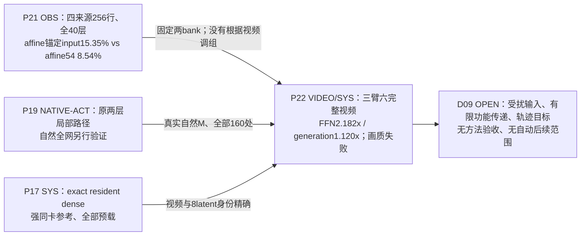

**P21（OBS）**：四校准来源4/8/16/20、同expert两步共256行，持出0/12；原五层标量复现差0。affine54在320/320案例胜锚定输入ridge，305/320胜同理想MAC whole94。这个固定估计器比较排除“只因训练覆盖不同”的充分解释；不证明所有线性函数下界，不把更便宜D²线性控制当成与94/216非线性同MAC。

**P22（NATIVE-ACT/VIDEO/SYS）**：全网络原norm/modulation/GELU/gate/residual保留，真实选中W1/HiF4 Q1/Q2与新BF16读出；160pack约19.7GB，不称原checkpoint未变。两候选各四处48行full-width neutral位差0，但不冒称全模型中性等价。实际六视频总9632QDQ、9952GEMM；调用数没有减少，宽度/投影MAC确实减少。源12warm dense/whole/affine wall为50.750/45.736/45.313s，FFN边界9.707/4.880/4.449s。setup139/237/237s另计，物理峰79,594/63,870/60,796MiB。源0fresh-process内核热度不完全匹配，不混为重复统计。

**F12/F13/G21/D09（真实执行、质量未闭合）**：原型已真正返回后续原生网络，不能再说“从未做自由视频”；但whole显著重影，affine明显模糊/动作变化减弱，两者均不满足当前画质目标。81帧像素核验不等于人工全视频/官方质量验收。local SSE8.54%与FFN2.182×不能称可用质量—速度前沿。更广义函数基、时空条件算子、功能目标或post-training保持OPEN。

**新的数学对象（ALG/OPEN）**：[受扰前缀/功能后缀](../research/method_discussion/discoveries/E0/transported-function-and-trajectory-target-20261026.md)给出无需QDQ可微的混合路径望远镜恒等式，并从实际Wan调度器推导理想受扰目标 `vhat(z+delta)=v(z)+delta/h`；teacher状态仅离线可见，真实FP32舍入保留。该目标与CTEC近邻关系明确；当前失败究竟由输入偏移、方向敏感或轨迹校准不足主导仍待判别，不自动启动梯度/训练/更多视频。

## 五增补 · G5d：160处全深度双轨原生测量与每视频质量证据

**当前研究边界**：[质量与全层协议](../research/agent_protocol/VIDEO_GENERATION_METRICS_AND_FULL_DEPTH_POLICY.md)及[已执行v3双轨结果](../research/20261026/E0_PAIRED_FULL_DEPTH_RESULTS.md)。早期迹线模板仅保存设计来源；两来源320 site已保存真实四臂、写回与step状态。P22为已有六视频失配，G6流式研究按用户要求暂停。

~~~mermaid
flowchart LR
  P22["P22 VIDEO：全160处近似执行 已有失败视频，局部质量无法外推"]
  P23["P23 NATIVE-OBS：两来源320处 teacher/student四臂同输入FFN"]
  P24["P24 NATIVE-OBS／OPEN-CAUSE： 实际writeback、flow/latent符号差"]
  P25["P25 POLICY：每段视频完整指标 文件/运行SHA＋全部帧＋感知/运动/时间＋成本"]
  OUT["D09：真实视频功能/用户质量目标"]
  P22 -. "全视频异常驱动双轨观测" .-> P23
  P23 -. "同输入算法差 vs 前缀变化差" .-> P24
  P24 -. "全视频时空消费者与误差分层" .-> P25
  P25 -. "有来源质量报告才能支持结论" .-> OUT
~~~

- **P23/P24已有真实测量**：[v3完整结果](../research/20261026/E0_PAIRED_FULL_DEPTH_RESULTS.md)提供来源0/12各160处的teacher/student FFN四臂与真实writeback、四步flow/latent账本，均已保存与核验。318/320处Student输入raw operator平方误差较Teacher输入小（其余两处相等），但跨步latent差增大。**完整dense在Student latent上`v_D(z_S)`也已另行实测**，见E40；仍OPEN的是最早误差创建、有限受控后缀与完整视频功能的因果作用。
- **P25 是今后执行/结果准入的协议**：每条生成视频要有完整帧数、逐帧空间/颜色/时序/运动/低运动区域/结构代理和来源/视频SHA/FFN-全网wall/显存/准备成本。官方VBench-I2V/人工完整审阅未做则标NOT_RUN，**不能晋级画质通过**。保留原P22历史未测项的缺口，不篡改旧RUN。
- **科学分歧**：对同一实测学生输入`x_S`，精确分解 `f_S(x_S)-f_D(x_D)=[f_S(x_S)-f_D(x_S)]+[f_D(x_S)-f_D(x_D)]`，再在有限原生下游边界实测门控写回和跨层影响。连续向量恒等式不代表BF16逐位等价。可先遍历所有160处轻量迹线，再冻结更昂贵的跨深度/来源混合后缀测试；**不以首/末或两个Block替代全层误差发展**。

### G5e. UB1 原形状路径与匹配恢复的有界证据

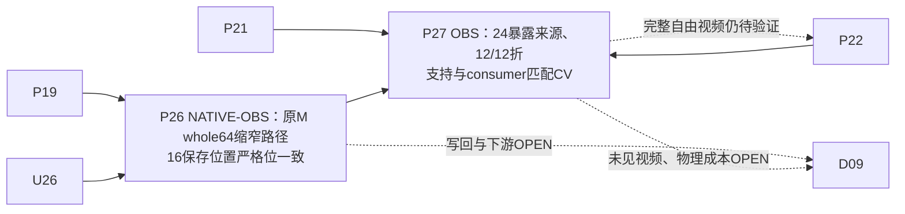

**P26（NATIVE-OBS）**：[UB1原M路径复核](../research/20261027/UB1_NATIVE_CONSISTENCY_RESULTS_20261027.md)在2条已暴露来源、16位置、160保存行复现原M的 W1/GELU/Q2 与同R256 gate路径位一致；M160在step1–3出现形状差。未知行填零，未做残差写回或视频。

**P27（OBS）**：[匹配恢复及独立审阅](../research/20261027/UB1_MATCHED_RECOVERY_RESULTS_20261027.md)在24个已暴露来源、两折及4个嵌套位置比较训练折支持和scalar/ridge consumer；ridge总体有利但step0/block39两折反向。独立来源、原M速度与完整视频均OPEN；下一native bank目前仅准备，未作为完成证据。[来源泛化审计](../research/20261027/UB1_SOURCE_GENERALIZATION_AUDIT_20261027.md)保留历史20+20来源尾部、实际baseline和方法匹配。

### G5f. 固定消费者训练与实际算子形状

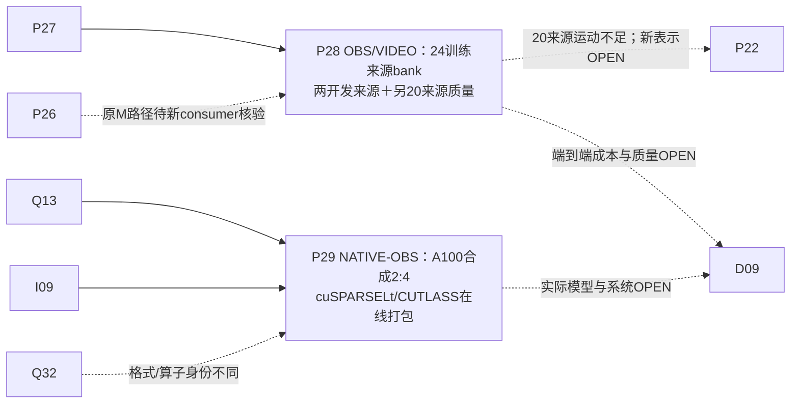

**P28（OBS）**：[固定R256 consumer bank](../research/20261027/UB1_FIXED_RR_CONSUMER_BANK_RESULTS_20261027.md)在24已暴露训练来源、160嵌套位置、保存M256的gate-only相对SSE由0.05551降至0.009434，160次consumer拟合与15360次BF16预测linear；这是训练内结果，尚无held-out质量或速度结论。[两开发来源六视频](../research/20261027/UB1_FIXED_RR_CONSUMER_VIDEO_RESULTS_20261027.md)及[八轴官方函数](../research/20261027/UB1_CONSUMER_OFFICIAL_QUALITY_RESULTS_20261027.md)已完成，质量混合；camera motion及正式确认未完成。[保存latent几何](../research/20261027/UB1_CONSUMER_LATENT_GEOMETRY_RESULTS_20261027.md)给出两个来源的signed观察，不建立视频因果。 另一次[20来源原生配对](../research/20261027/UB1_CONSUMER_DISJOINT20_NATIVE_RESULTS_20261027.md)完成40条主视频、160位置/条及真实噪声字节配对，另3次隔离失败生成保留扣账；[八维质量](../research/20261027/UB1_CONSUMER_DISJOINT20_QUALITY_RESULTS_20261027.md)显示imaging相对Dense均值−1.38%，连续RAFT−83.28%、dynamic6/20→0/20。旧两来源局部恢复未推广到本20来源；[20来源state几何](../research/20261027/UB1_DISJOINT20_LATENT_INCREMENT_RESULTS_20261027.md)不是原flow反推。

**P29（NATIVE-OBS，合成算子）**：[A100激活2:4探针](../research/20261027/E0_ACTIVATION24_SPMM_PROBE_RESULTS_20261027.json)对两种原Wan形状测到默认cuSPARSELt预压缩慢于dense（19.4→29.2ms、18.9→27.5ms），在线选择/压缩约148/346ms；数值对照是masked结果，非模型视频质量。该2:4激活结构与原HiF4 whole64尺度闭包不同，也不等于RT-Lynx作者内核；[后端算法与布局](../research/20261027/E0_ACTIVATION24_BACKEND_LAYOUT_RESULTS_20261027.md)进一步测得部分预打包设置较dense快，但未含在线选择压缩和未知搜索kernel成本；结果限定实际库、设备、布局和形状，不关闭其他稀疏算子机制。 [C3在线分项](../research/20261027/E0_ACTIVATION24_ONLINE_COMPONENTS_RESULTS_20261027.md)把stable等价选择降至0.463/1.151ms，但cuSPARSELt压缩仍8.441/22.445ms；[C4同次双后端](../research/20261027/E0_ACTIVATION24_CUTLASS_BACKEND_RESULTS_20261027.md)的CUTLASS通用压缩为10.358/27.292ms，两后端完整在线均慢于各自同次dense。[C5直接打包](../research/20261027/E0_ACTIVATION24_FUSED_CUTLASS_RESULTS_20261027.md)已将选择与packed值/metadata生产融合为0.643/1.537ms，真实GPU小例和全shape逐字节核对通过；完整在线15.684/15.867ms对同次dense16.247/15.982ms，只有3.5%/0.7%中位数余量。五次顺序重复仍有抖动，这是合成算子观察；新的限制是稀疏乘法本体余量，尚无完整FFN或视频收益。

## 五增补 · 图 G6：实时流式生成的条件研究场景（全部新节点OPEN）

**状态更新（2026-10-27）**：此前用户暂停实时场景的记录保留为历史。用户现明确恢复独立的实时视频**文献和计算图**研究，新的外部G10 LIT图见本文第十二节；所有原生流式执行/实验仍受ACTIVE的暂停约束。

**附加目标而非已有运行图**：[实时生成定义、可比指标、近邻系统及独立机制](../research/20261026/E0_REALTIME_GENERATION_SCENARIO_20261026.md)；[最新双场景科研再审](../research/20261026/E0_POST_NATIVE_VIDEO_DIRECTION_REVIEW_20261026.md)。

~~~mermaid
flowchart TD
  R01["R01 OBS：P22整段81帧完成时间 ≠ 逐帧stream latency"]
  R02["R02 OPEN：TTFF / per-frame deadline / jitter / interaction响应SLO"]
  R03["R03 OPEN：causal/chunked/rolling生成器与动态历史状态"]
  R04["R04 OPEN：合法FFN历史、条件复用、提前重算和实际cost"]
  R05["R05 OPEN：跨chunk连续性、长期漂移与持续显存"]
  R01 -. "离线性能只作架构瓶颈线索" .-> R02
  R02 -. "若要实时需有增量交付语义" .-> R03
  R03 -. "依赖新的源码执行/状态图验证" .-> R04
  R04 -. "需流式质量/截止时间联合评估" .-> R05
  R03 -. "KV/latent与resident weights争用显存" .-> R05
~~~

- **R01 既有OBS**：强resident dense同卡热态完整生成50.750秒；当前affine54为45.313秒、FFN边界4.449秒，均为**整段先算完再交付**，不是首帧/连续流式吞吐。当前同结构非FFN预算约40.9秒。即便FFN免费，也不可能只靠本次结构兑现24FPS逐帧deadline。
- **R02–R05 全部OPEN**：此项目尚未重建一个真正 causal/chunked/rolling生成器，没有任何TTFF、stream FPS、p95/p99、延迟抖动、dynamic prompt响应或长流质量实测；这里的依赖箭头是研究条件关系，不是当前Wan native实线。
- **真正新机制对象**：跨chunk的FFN条件函数、信息时点与缓存有效期、末段运动/背景漂移、交互指令引发的状态失配，以及硬实时与GPU带宽/attention/KV/decoder间的资源交换。原Wan四步high/high/low/low **同专家两次**的本地复用，不自动构成跨stream chunk的历史。
- **论文对照**：[MLSys2026 StreamDiffusionV2](https://proceedings.mlsys.org/paper_files/paper/2026/hash/698cfaf72a208aef2e78bcac55b74328-Abstract-Conference.html)强调逐帧SLO/rolling cache/流水调度；[NeurIPS2025 Self Forcing](https://proceedings.nips.cc/paper_files/paper/2025/hash/f4823f831af67a3ef15e41a85434422a-Abstract-Conference.html)与[ICLR2026 Rolling Forcing](https://proceedings.iclr.cc/paper_files/paper/2026/hash/935151cc6cb5d8b6816133b75233775a-Abstract-Conference.html)说明自生成历史/多帧联合去噪的误差问题。它们的实测FPS属于各自模型/硬件，**不是本项目的实测结果**。

G6不改变既有G0–G5数学/实验身份，Graph-Agent可从R节点反推新物理机制或提出新模型结构，但**未经真实源码与运行验证前所有流式执行边保留OPEN**。E0唯一主研究及新执行授权均不因增设实时场景自动改变。

## 六、从观测到主张：不能跨越的三条逻辑线

**局部数值线**：W1/GELU/Q2 的幅度、post-Q2 零值、有符号 W2 group Gram → FFN 输出 SSE / 理想 LN 响应。量化零值多并不保证硬件 whole64 可跳过；group score 不包含组合交叉项。E0 的几何、配对和共同均值都位于这条线。

**原生功能线**：实际 BF16 QDQ/GEMM/cast → gate/residual writeback → 下一 norm1 → 后续 blocks/head → 四步 flow/latent → decode/视频质量。这条线必须有 same-prefix 有限干预或真正自由轨迹；不能让保存数据的 FP64 几何替代原生执行。[R7](../research/20261021/R7D1_results.json) 的大幅正负有限传递项相消、[E0](../research/20261025/E0_FOLLOWTHROUGH.md) 的写回非加性、[R16](../research/20261023/R16V0_analysis.json) 的局部/视频排序反转分别揭示了实际边界。

**物理成本线**：必须分别核算W1依赖闭包、W2保留列、额外前置观察W1工作及Q2重编码；只有实际省掉 W1/W2 FLOPs → kernel tile 与布局/权重准备 → selector、QDQ、gather/scatter、补偿 GEMM/内存 → full160 FFN time → complete generation wall。仅 W1/W2 MAC 下降 50% 不对应整网 2×。[UB1](28_固定步间计算预算对照.md) 和 [R17](../research/20261023/R17E0_system_timing_prefix.json) 提供两个不同计时层级的正对照。

## 七、尚未由保存证据闭合的边

| 边界 | 为什么未闭合 | 优先复用/最小判别（非执行任务） |
| --- | --- | --- |
| pre-W1 cheap information → 对**新直接无补算算子**的功能价值 | C1、R16 标签绑定旧 UB1+R256/补算动作；新E0已补充全W2及连续M128，微块前置评分有额外W1成本 | 先定义新直接算子与可见信息、真实 tile 成本，再设计同前缀动作对；旧 C1 后验标签不可拼接 |
| 原生 W2 whole64 干预 → 稳定的长程功能机制 | E0 六来源有限组干预的 BF16 写回影响复杂；与 216组、完整 I2V 指标不同 | 匹配同前缀的 writeback 强度与组方向，追踪 nextnorm、block、flow、ROI/视频 |
| 低 rank / 有符号 W2 representation → 真正减访存/提速 | 新E0已测完整M原布局全占用及共享任意列的HiF4 Q2闭包全宽；代数分解或局部误差尚不足以给出替代kernel与cache代价 | 先写变换的准确输入依赖与最小 GEMM/访存账本，再比较同成本固定控制 |
| temporal common component → 可省调用且可维持画质 | [E0 source-held-out](../research/20261025/E0_TEMPORAL_CALIBRATION.md) 的 block39 固定仿射误差4.35%，位置变化中心化误差39.25%，尚无缓存 kernel/自由视频 | 比较共同分量与去均值变化的有限功能影响；仅 block39 跨两个同专家对最多影响 2/160 FFN sites |
| 新格式 metadata / native FP4 → 选择增益 | 本次观测为 HiF4 QDQ，MXFP4/NVFP4 改变尺度、精度与 kernel 可见信息 | 先从格式实现定位 metadata何时存在、谁付观察成本，再做带 F1–F13 依赖的比较 |

## 八、复现入口与可信度

建议阅读顺序：本图 → [发现谱系总表](../research/EXPERIMENT_FINDINGS_ATLAS.md) → [28份人工排序证据](../research/EXPERIMENT_EVIDENCE_INDEX.md) → [1348项文件索引](../research/experiment_evidence/FILE_INVENTORY.json) → 对应 RUN JSON / 源码与数据哈希。**原始 JSON、图像、视频记录及协议没有被本次综合改写**。这些图是“有界的计算路径重建”，不是所有 runtime 备选 CUDA/fused 分支的端到端逐指令追踪；未由当前文件证实的原生边界仍标注为 OPEN。任何新的训练/CPU/GPU/model 试验均由 [现行状态与授权](../research/ACTIVE_RESEARCH.json) 管理。

## 九、科研 Agent × G0–G5 图的双向协作入口

**图负责真实计算路径和证据定位；Agent 负责提出与独立检验机制。** 当前 [Graph-Agent 协作协议](../research/agent_protocol/GRAPH_AGENT_COLLABORATION.md) 与 [34个关键节点的机器可读索引](../research/agent_protocol/GRAPH_AGENT_BINDINGS.json) 已覆盖 G0 四步专家、G1残差/消费者、G2 FFN/QDQ、G3信息时点、G4后验创新/共享/原量化尺度/成本。

- **从图到研究**：使用 `python tools/graph_agent_bridge.py inspect F08` 查看实际W2输入节点的信息时点与原始证据；`trace G18 P12` 看跨层次的理论/候选成本路径。该查询是**静态图索引**，并非自动执行代码或测量真实GPU时延。
- **从研究到图**：各 Agent 在 [E0图注解](../research/method_discussion/graph_annotations/E0/README.md) 中按节点/边 ID 提出原始解释或反例；关联数学、source/step/block、可观测条件、真正不同的预言。独立reviewer重新核对原始源码或证据；整合者串行将确认后的范围精确地补充本页节点解释、OPEN边和[实验发现谱系](../research/EXPERIMENT_FINDINGS_ATLAS.md)。
- **扩展科学空间**：图中的 G4 shared columns / original HiF4尺度是**已检验的一个机制切面**。更好的函数基、GELU特殊代数、时空组织、视频误差模态或不同物理实现可产生**新节点/跨层连线**。新增内容先标注 `HYPOTHESIS/OPEN`，有源/数学/原生证据再按其实际身份更新；不将虚线直接画成运行过的主Dense算子。
- **保留三个不同含义**：图标签本身不证明可用的在线观测；`q2_post`而非pre-Q2 GELU才是当前W2的真实输入；即使找到新数值低秩/稀疏作用，也必须分别评估W1、W2、QDQ、索引、缓存及后续视频功能。

源代码身份/实验授权仍以 [ACTIVE_RESEARCH.json](../research/ACTIVE_RESEARCH.json) 为准。当前讨论与图注解无自动GPU/model执行权限；新科学发现可先于算子实现成立。

## 十、原生执行与全深度传播：已完成的证据链（2026-10-26）

**P22 · 完整生成质量（VIDEO/POSTHOC）**：[六视频原生实验](../research/20261026/E0_RECONSTRUCTED_VIDEOS.md)在40层×4步全部160处部署Affine54/Whole94，并保存真实时间与视频；[486帧/480帧间补评](../research/20261026/E0_EXISTING_VIDEO_QUALITY_BACKFILL.md)记录修正的光流、时序和细节proxy。Affine54局部误差改善及真实FFN加速与完整视频失配并存。正式VBench、语义背景和人工全片验收按原证据标为NOT_RUN。

**P23 · 两轨真实同输入函数（NATIVE-OBS）**：初始[数值/账本设计](../research/20261026/E0_FULL_DEPTH_TRACE_TOOLING.md)与[采集器实现](../research/20261026/E0_PAIRED_NATIVE_IMPLEMENTATION.md)现已被[v3实际全层数据](../research/20261026/E0_PAIRED_FULL_DEPTH_RESULTS.md)覆盖：来源0/12 × 40层 × 4步，共320个原生配对site。每个site有同输入FFN四臂、raw算子差与相同gate下的实际writeback四臂。**318/320处Student前缀的raw绝对算子平方误差更小，另2处相等。** 这项观察区分了“局部近似误差沿Student前缀普遍增大”的预测；对完整下游视频功能仍要单独推断。

**P24 · 四步状态及有符号传播（NATIVE-OBS / OPEN-CAUSE）**：两个来源的post-Q1输入幅度和方向发生变化；Student/Dense完整flow差在后三步与已有latent偏移反向：来源0的cos约−0.8703/−0.9050/−0.9418，来源12约−0.7901/−0.8008/−0.8849。两来源更新后latent差持续增大。真实scheduler有限精度误差单列，向量重组闭合；这些相关观察仍允许直接近似flow失真和原dense在偏移状态的响应两类竞争解释。后续[整步v1原生结果](../research/20261026/E0_WHOLE_FLOW_COUNTERFACTUAL_RESULTS.md)已实测完整**dense**的`v_D(z_S)`，把`v_S(z_S)-v_D(z_D)`分成算子作用与dense状态响应；其固定范围与临时继续授权登记于ACTIVE。

**P24的新判别坐标（ALG／conditional）**：[整步映射准备与保存数据followthrough](../research/20261026/E0_WHOLE_FLOW_COUNTERFACTUAL_PREPARATION.md)用`P=δ−h[vD(zS)−vD(zD)]`和候选净注入区分相同总流差的竞争解释，另以原生shadow step_post保存BF16整步恒等分解。实际native writeback也有318小/2等/0大；radial-only理想反馈在来源12的step1仍有555.174下界，大于输入474.421。随后固定v1已执行：六个非零偏移的dense原生整步增益3.63–7.72；候选cross在来源0为负、来源12为正，净效应均正。候选先前创建偏移与后续dense响应分开，增益不相乘。16通道偏置与两个全局方向的数值oracle仍留60.20%–71.14%理想SSE；P24新增有限NATIVE-OBS，因果/视频作用OPEN。**P14的独立表示（条件ALG／OPEN）**：[共享投影的向量值神经元曲线](../research/method_discussion/discoveries/E0/independent-signed-neuron-curve-coordinates-20261026.md)将非线性与signed W2联合表示；近共线差分与Q2闭包可反驳其廉价压缩条件。

**P25 · 软件/证据与实际运行分层**：v2先完成两条逐字节相同的DD视频，但在后处理历史路径拼接处失败，因此该次未保存的详细trace仍计0；[修复记录](../research/20261026/E0_PAIRED_V2_FAILURE_AND_RECOVERY.md)解释路径问题和保存顺序。之后单卡串行v3完成四视频、320 site、全部16个历史latent指纹一致，严格身份与核心全帧门禁通过，物理峰值75.01GiB。观察wall与shadow、FP32诊断、两轨执行费用属于**诊断采集成本**，与候选部署延迟分开记账。正式画质验收仍待官方与人工证据。

**计算图的解释规则**：已实测native边按原生记录标注，独立假说和因果关系维持OPEN；以上结果是两个已暴露来源的四步状态轨迹，不是320条独立视频。实时G6保持独立暂停场景。现行研究入口与授权：[ACTIVE_RESEARCH.json](../research/ACTIVE_RESEARCH.json)；权威科学解释：[统一机制审查](../research/20261026/E0_POST_NATIVE_VIDEO_DIRECTION_REVIEW_20261026.md)。

### 2026-10-27 · 六来源复验与输入联合信息

**P23/P24（NATIVE-OBS，有限作用域）**：[六来源/960nested sites](../research/20261026/E0_SIX_SOURCE_DIRECTIONAL_RESULTS.md)完成新增4个已暴露校准来源。943处Student同输入operator误差更小，6等、11大；18个后续完整dense有限能量增益>1。source16step2在实际Student状态下候选N+cross为−946.8824，next28669.7879小于dense单步P29616.6703；偏移仍比上一步增大。频带DC/动态低频有相反signed结构，保留posthoc语义；它们不定位可省的FFN功能。全局cross符号/总SSE不单独排序运动、亮度与细节。新增8视频均81帧核心指标及严格身份通过，官方/人工质量NOT_RUN。

**F04/F06/F08/F09→P14（saved-panel OBS / conditional）**：[四个保存panel](../research/20261026/E0_EVEN_RESIDUAL_MEAN_CPU_RESULTS.md)显示真实W1输出边际矩可较好描述FFN均值，但pre-W1对角方差只保留约53–57%投影总方差。均值是集合功能坐标，非逐token/full-MDC或视频保护。[联合token草图推导](../research/method_discussion/discoveries/E0/conditional-joint-moment-sketch-mechanism-20261027.md)可在支付输入归约和W1U后估计投影联合方差；新边为conditional，未执行该草图数值实验。共享函数、便宜信息、真实token创新与完整生成之间的联系仍OPEN。

**P23/P24最新跨源/seed复验（2026-10-27，NATIVE-OBS）**：[四项目新身份/六轨迹](../research/20261026/E0_FRESH_FOUR_SOURCE_SIX_PAIR_RESULTS.md)已完成960site、12视频、24额外dense完整flow。source425同图片/提示词/算子在seed42为后三步cross全负，seed54全正；source437step2/3净N+cross<0而整条轨迹仍偏离。连同六暴露来源，共10身份/12source×seed轨迹/1920nested sites。所有新视频具有核心逐帧/strict身份报告，官方/人工NOT_RUN。语义功能、便宜可用信息和真实FFN省算仍OPEN；用户要求本轮结束上传后暂停，当前资源已释放、执行暂停。

## 十一、图 G7：外部原论文机制在原生 Wan 图上的分支（2026-10-27）

**LIT = 已发表/预印本或作者源码；OPEN = 未在当前Wan适配或执行。** 四组图节点只记录论文方法与本地SRC路径的**对应位置**，不得解释成G0–G5的native执行实线。数学方程、源码版本、证据分级和开放差异见[原文与计算图逐边映射](../research/literature/20261026/PRIMARY_PAPER_GRAPH_MAPPING_20261027.md)。

~~~mermaid
flowchart LR
  K01["K01 LIT Dynamic-in-Few-Step：训练期step mask"] --> K02["K02 LIT step-specific compact submodel"] --> K03["K03 LIT 输出rollout/生成效果"]
  K04["K04 LIT FIS：选择latent frame子集"] --> K05["K05 LIT 部分frame block运算与attention依赖"] --> K06["K06 LIT 跨层交错frame更新"]
  K07["K07 LIT Mobile DiT：训练block/head/FFN mask"] --> K08["K08 LIT compact W1-GELU-W2"] --> K09["K09 LIT KD特征对齐及独立tiled GEMM"]
  K10["K10 LIT NerVE：pre-GELU协方差"] --> K11["K11 LIT post-GELU特征谱"] --> K12["K12 LIT SE/PR/EEE/JS非方向性统计"]
~~~

| 外部方法 | 原生锚点 | 改变计算什么 | 何处不能直接迁移 |
|---|---|---|---|
| K01–K03 Dynamic-in-Few-Step | G02, G04–G08, F04/F09 | step对应结构/模型容量 | 训练后MoM不等于现有high/low专家 |
| K04–K06 FIS-DiT | G04–G06, G17/G21, F04/F09 | M维：latent-frame×block覆盖 | RoPE/self-attn上下文和残差scatter未确认 |
| K07–K09 Mobile Video DiT | G04,G14,F04→F06→F08R→F09 | H维：训练后FFN width并压缩稠密W1/W2；独立tile IO | 当前HiF4量化组与论文手机训练架构不同 |
| K10–K12 NerVE | F04/F06/F08 | pre/post GELU协方差/特征值 | 无特征向量或视频因果方向，且非在线跳算 |

图G7不会把外部研究的LIT边升级成SRC、NATIVE-ACT、VIDEO或SYS；只有本项目真实原生执行和独立RUN可改变这个身份。

### G7 一手原论文公式补充（2026-10-27）

[Dynamic-in-Few-Step与FIS-DiT原始v1 PDF逐公式](../research/literature/20261026/PRIMARY_METHOD_EQUATION_AUDIT_20261027.md)现已核实；以此取代G7初稿的仅摘要/二手方法身份。Dynamic-in-Few-Step真实门控作用于每step的block/head/FFN-channel，FFN在按权重L2 norm排序后使用**C=8的hidden channel groups**；Eq.3 STE、Eq.4–5联合DMD/稀疏训练、Eq.6最终step→初始step渐进训练、§4.3 union权重表与index部署，均为训练后结构。原Wan HiF4 Q2的64→8→4 group不能简单复用这种重排。

FIS-DiT原文Eq.7–9：K04选anchors → K05在这些frames上做模块计算 → K06对非anchor **线性插值**恢复所有frames。Eq.10给两个相邻anchors的插值权重；Eq.11–12轮换anchors并保留首尾帧；Eq.13–15只在middle stable blocks/非尾steps启用。非anchor位置确实被近似重建，v1报告Wan2.2插值帧的**feature-magnitude-map相对误差平均9.8%**；这不是RGB误差也不是数学等价。论文Wan2.2四步实验是**T2V**，本项目为I2V。FIS后续v2尚未审计，当前定理与方法绑定v1版本。

G7四个外部论文分支仍是LIT；独立native计算图G0–G5保持不变。所有理论/公式关联必须附源版本与形状，不能无证据升级NATIVE-OBS/NATIVE-ACT/VIDEO。

## 十二、图 G8：一手研究中的 FFN、MoE、主/残差与跨步更新计算（2026-10-27）

**证据边界**：G8 为外部原始研究的 LIT 分支，进入 G0–G5 的所有连接都是**对应关系或尚未验证的 Wan 迁移问题**，不是本模型实际插入的新算子。精确原文版本、方程、形状、训练成本与竞争机制见 [G8 四组方法审查](../research/literature/20261027/G8_FOUR_METHOD_PRIMARY_GRAPH_AUDIT.md)，源分级见 [机器审查账本](../research/literature/20261027/G8_FOUR_METHOD_SOURCE_LEDGER.json)。当前新GPU范围被用户明确暂停。

~~~mermaid
flowchart LR
 K13["K13 LIT RT-Lynx：选择当前W1或W2 GEMM的输入"] --> K14["K14 LIT N:M online packing+稀疏GEMM"] --> K15["K15 LIT norm/LoRA补偿后的输出"]
 K16["K16 LIT Dense2MoE：Taylor初始拆分+shared专家KD"] --> K17["K17 LIT shared FFN + TopK normal experts按token路由"] --> K18["K18 LIT 连续group中选择相邻κ个blocks"]
 K18 --> K19["K19 LIT output/block/group蒸馏与load balance"]
 K20["K20 LIT SVDCache：参考prompt离线SVD右基"] --> K21["K21 LIT full refresh feature投影于cached V"] --> K22["K22 LIT principal EMA；residual历史复用"] --> K23["K23 LIT 跳过step时合成供下游的feature"]
 K24["K24 LIT Chipmunk：同权重历史postactivation/输出缓存"] --> K25["K25 LIT blockmean(x)→缩小W1→TopK索引"] --> K26["K26 LIT column-sparse MM1→activation delta"] --> K27["K27 LIT column-sparse W2 scatter-add历史输出"]
~~~

| 分支 | 映射原生计算图 | 在原论文中真正改变的计算 | 尚未核实的迁移条件 |
| --- | --- | --- | --- |
| **K13–K15 RT-Lynx** | F03→F04 或 F08→F09 →F12；F08R共享量化树 | **本step的输入N:M→sparse TensorCore GEMM**，含作者描述的补偿 | 先完成W1再压缩W2无法节省W1；LoRA与norm补偿的官方PDF方法尚未核实；实际HiF4 QDQ与2:4兼容需测 |
| **K16–K19 Dense2MoE** | G18、F04/F06/F09及G04–G06 | 经多阶段训练的shared+normal FFN和按token TopK；随后按**连续κ个block**的MoB窗选择 | 与Wan整模型高低专家不是一个expert粒度；dispatch、router、训练和后续视频均不同 |
| **K20–K23 SVD-Cache** | G02、F13/G21、step历史和下游 | **refresh时full feature→cached右基投影→principal EMA及residual reuse→未来skip step的feature输出** | 不能将后验feature分解当W1前免费评分；跨high/low权重变化与四步可复用时点未知 |
| **K24–K27 Chipmunk** | G02、D01、F04→F06→F08R/F08→F09→F12 | **同expert历史系数delta**，在线blockmean+fc1选列、column sparse两GEMM及scatter-add | 缩小W1仍要计价；Q2 shared scale和真实F12写回不能自动保持，源码mask缓存复用>=10step条件不支持直接四步外推 |

**图谱原则**：原生 G0–G5 的LIT边不能被读成验证边。论文使用局部/输出KD或SVD能量是各自结构机制的工具，不是本项目应重新建立的统一SSE目标。G7 (K01–K12)与G8 (K13–K27)是可独立延伸的比较坐标。

## 十三、图 G9：历史预测、条件执行树与全网功能迁移（2026-10-27）

**一手文献/源码分析：** [G9 三机制逐公式、代码与竞争性预测](../research/literature/20261027/G9_CONDITIONAL_EXECUTION_TRAJECTORY_AND_FUNCTION_REALLOCATION.md)，[分级证据账本](../research/literature/20261027/G9_METHOD_SOURCE_LEDGER.json)。G9 K28–K37 是外部论文 **LIT** 比较路径；G0–G5 源码实线与截至当前暂停的原生结果维持原证据身份。新增内容也进入 [机器索引](../research/agent_protocol/GRAPH_AGENT_BINDINGS.json)及 [54项文献索引](../research/literature/20261026/PRIMARY_LITERATURE_INDEX.json)。

~~~mermaid
flowchart LR
 K28["K28 LIT L²P: 全量DiT的真实历史feature"] --> K29["K29 LIT 学习50step下三角权重"]
 K29 --> K30["K30 LIT full/cache; 真实/预测输出写回历史"] --> K31["K31 LIT scheduler与闭环latent"]
 K32["K32 LIT FFF: 已训练树节点logit"] --> K33["K33 LIT hard sign逐层选路径"] --> K34["K34 LIT path GELU×signed value合成"] --> K35["K35 LIT post-GELU与path自修剪对照"]
 K36["K36 LIT 修改FFN结构并共同训练"] --> K37["K37 LIT attention↔FFN功能重分工; 摘要级"]
 K30 -. "与G8 SVD主残差缓存机制竞争" .-> K22
 K33 -. "与G8 shared+TopK专家粒度竞争" .-> K17
 K31 -. "Wan的流/状态反馈：OPEN" .-> D09
 K34 -. "Wan QDQ / e5 / BF16：OPEN" .-> F12
 K37 -. "attention的职责由训练改变：OPEN" .-> G17
~~~

| 论文节点与层级 | 真实计算/定义 | 已确认文献证据 | 对原生 Wan 的新判别 |
|---|---|---|---|
| **K28–K31 L²P** | 全量Transformer输出 \(f_t\) 的有限历史 \(\hat f_{t+1}=\sum_{j\le t}W_{tj}f_j\)；full step更新真实缓存，skip step递归缓存预测结果 | **CVPR作者摘要＋FLUX原始实现**： `predictor/train.py` 使用50×50权重/下三角掩码和MSE；`src/flux/model.py` 显式full steps；`learnable_utils` 的FFT虽执行却**未参与当前预测权重读取** | 四步两段不同专家，固定历史信息量远少于50步；候选判别需在Student状态及完整scheduler反馈中进行，完整FFN缓存不等于删W2列 |
| **K32–K35 FFF** | 每节点 \(z=x^\top w^{in}+b\)，\(\mathrm{sgn}(z)\) 决定唯一路径，\(\sum_{\rm path}\mathrm{GELU}(z) w^{out}\) 合成输出 | **arXiv原始v1 §3 Eq1–3、§5、§7 表4–5**：模型经训练/微调；post-GELU版本改变梯度/路径负载；作者给出A100层级基准但§8指出部署局限 | 新结构训练出的根叶路径是否比原生冻结W1/Q2可实现更低物理计算；旧原布局tile全占用不构成学习新结构的下界 |
| **K36–K37 Sparsity Moves Computation** | 训练中减少 FFN 容量并让 attention/其他模块共适配 | **arXiv作者摘要级**；报告小Transformer和冻结随机路由对照，完整方法/PDF尚未核查 | 动态稀疏的“可以通过训练保持能力”与冻结Wan稠密FFN的“当场无损跳算”分属不同研究命题 |

**函数层面的统一表示：** 对当前冻结 Wan FFN 的已测目标 \(F_{\theta}(q)\)，L²P 研究时间历史 \(\{F_\theta(q_{t'<t})\}\) 对函数输出的可预测性（且作者实际预测**整网输出**）；FFF 研究替代参数 \(\phi\) 下的条件计算函数 \(F_\phi^{tree}(q)\)；共适配研究所有层参数共同变化时的函数 \(V_{\phi}(z)\)。仅当比较问题额外明确“冻结权重、同输入、同下游消费者”时，这些函数才落在同一实验对照上。

**最小机制问题**：三种机制各有独立反证——L²P的历史维度在四步/换expert中可能不足；FFF的学习树与原生QDQ函数可能有较大蒸馏差距且GPU行路由碎片化；共适配的收益在冻结模型上可能不存在。优先复用已冻结的整步流差与多来源传播证据寻找区分量，**当前暂停范围内只进行文献、源码、数学整理，不新启模型实验**。

## 十四、图 G10：独立实时视频生成计算线与 FFN 多时标函数研究（2026-10-27）

**当前状态**：用户于2026-10-27明确恢复实时生成的**论文、机制与计算图研究**。此举与2026-10-26曾暂停G6场景相容：当前恢复的是research/discovery，**GPU/模型/真实生成执行继续暂停**。这条路径与既有Wan整段I2V G0–G5平行，而非已实现的新原生推理图。来源：[14篇原始论文/技术报告及源码机制审查](../research/literature/20261027/REALTIME_VIDEO_ARCHITECTURES_AND_FFN_METHOD_AUDIT.md)，[分级源码账本](../research/literature/20261027/REALTIME_VIDEO_SOURCE_LEDGER.json)。文献G10 S01–S18及S21–S25标 **LIT**；本项目的S19、S20标 **OPEN**，待未来授权后判别。

~~~mermaid
flowchart TD
 S01["S01 LIT 普通双向视频 teacher"] --> S02["S02 LIT 转因果AR学生"]
 S02 --> S03["S03 LIT few-step DMD/LoRA"]
 S04["S04 LIT 训练期自身历史rollout"] --> S05["S05 LIT KV滚动窗口+sink"]
 S03 --> S06["S06 LIT 新chunk/latent及时间条件"]
 S05 --> S07["S07 LIT Causal Attention读取历史"]
 S06 --> S07
 S07 --> S08["S08 LIT 当前chunk FFN"]
 S08 --> S09["S09 LIT flow/scheduler提交新chunk"]
 S09 --> S05
 S09 --> S10["S10 LIT streaming VAE decode"]
 S10 --> S11["S11 LIT TTFF/帧deadline/p99"]
 S12["S12 LIT StreamDiffusionV2流水线/SLO scheduler"] --> S11
 S12 --> S07
 S06 --> S13["S13 LIT SCD：每帧一次因果encoder"]
 S13 --> S14["S14 LIT SCD：每step小型renderer"]
 S14 --> S09
 S15["S15 LIT LongLive2 NVFP4 W4A4 GEMM"] --> S08
 S16["S16 LIT LongLive2 NVFP4历史KV"] --> S05
 S17["S17 LIT 场景/提示词变化与KV recache"] --> S05
 S18["S18 LIT FAST-AR：历史KV压缩+稀疏attention"] --> S07
 S05 -. "历史是预测信息，并非原冻结FFN新增输入" .-> S19["S19 OPEN FFN历史值重用与功能漂移"]
 S08 -. "短chunk与kernel代价" .-> S20["S20 OPEN FFN microbatch/roofline与deadline"]
 S19 -. "可能改变未来flow轨迹" .-> S09
 S20 -. "必须同时满足实时目标" .-> S11
~~~

### 图 G10 与原计算图的实际对应关系

| G10 子图 | 原始论文或源码中验证的计算性质 | 对当前Wan源码的比较连接 |
|---|---|---|
| **S01–S04 训练形成因果少步模型** | CausVid: 双向teacher→causal student→4step；Self Forcing: on-policy rollout；Rolling Forcing: 多帧联合去噪；Runway2026报道类似off/on-policy训练顺序 | G02/G04–G09原先仍然是一整段四步 high/high/low/low 双专家；结构相似不能直接称同一模型 |
| **S05–S09 per-chunk因果图** | 只对新chunk及选定历史KV执行attention，当前chunk FFN和flow写回；历史KV来自先前已提交latent，部分模型在滚动窗口里联合去噪 | 真实Wan G17→G18→F04/GELU/Q2/F09→F12→G21是原全片，不共享这个缓存规则。S08到F04/F09边仅“算子位置类比” |
| **S10–S12 streaming服务图** | StreamDiffusionV2在线 VAE/rollKV/TTL与跨GPU流水线、SLO batching；对“24FPS”另核TTFF、抖动、deadline和网络 | G6 R01只是81帧生成总时延，非逐帧输出 |
| **S13–S14 计算职能分离** | SCD一次/frame的因果temporal encoder与每step的framewise renderer；早层step近不变、深层跨帧attention较稀疏是作者原模型观察 | 提出 FFN的历史相关功能和细节渲染是否可分；**尚未观察**当前Wan的F04/F09同样分工 |
| **S15–S18 实际物理kernel/历史竞争者** | LongLive2以Wan2.2-TI2V-5B做NVFP4 W4A4 GEMM/KV-cache、可选异步VAE；FAST-AR优化 KV+attention；LongLive1的scene/prompt recache | 现有HiF4 QDQ64→8→4组树与NVFP4 16-element FP8 scale属于不同系统；低位密集、KV与memory预算是稀疏kernel的真正竞争选择 |
| **S19–S20 研究开放边** | 历史reuse预测误差经FFN→gate→flow→未来KV；短chunk kernel效率不能从large-M整段FFN推得 | 可用旧P23/P24原生有符号下游传播作为**判别设计的参考**；旧原生证据不是流式RUN |

### 两个重要数学坐标

1. **调度次数与FFN实际工作**。固定层数L、宽度D/H和本chunk token数M_c时，常规FFN单step投影约 \(2LM_cDH\) MAC；若每chunk做K个denoise，主FFN需求约 \(2KLM_cDH\)。一个“once-per-frame encoder + K-step renderer”模型改为 \(C_{\mathrm{encoder}} + K C_{\mathrm{renderer}}\)，其中两个网络的L/D/H均可能不同。**减少denoising次数/分离网络功能**与**删冻结W1/W2列**是不同的计算操作。
2. **带历史与gate的真实FFN函数**。原Wan固定 \(f_\theta(q)=W_2Q_2(\mathrm{GELU}(W_1Q_1(q)+b_1))+b_2\)；条件于当前完整q和同一权重θ，历史KV并不增加 \(f_\theta(q)\) 的确定性输入。历史只经causal attention改变当前q，或用作**有误差**的输出预测器。要声称本轮减少F04/F09真实费用，必须证明预测/提取历史的信息账本、QDQ数值边界、gate与BF16写回、future-chunk反馈、真实kernel及SLO改善。

### 下一轮独立FFN假说（S19/S20、OPEN）

- **时间职能划分**：能否从新模型原生preFFN/postQ2/gate观察找出只需按scene或frame频率更新的有符号函数，与每denoise细节修正函数区分？最强替代解释是相似性由attention而非FFN引起。用同一q时点记录信号与后续function-value对照即可先区分。
- **缓存有效边界**：静止/持续运动/scene cut/prompt switch 下“同一FFN函数”的缓存是否稳定？旧视频光照和背景抖动是重要失败类比，滚动历史可能放大这种差异。基于相同模型/同样输入的有限响应与自生成历史对照是未来设计，而非今天已得到新结果。
- **小batch FFN物理优先级**：新的M_c短块可能转为读取权重及启动成本主导；需要与LongLive2真实NVFP4密集、训练后缩宽/低rank、N:M现有kernel、真实稀疏 dispatch 同卡同布局比较。数学小MAC数不能保证更低TTFF或p99。

**证据身份结论**：G10新增25节点（S01–S18及S21–S25 LIT，S19–S20 OPEN）；与G7–G9已有37个文献K节点对应的本轮论文索引合计68项，真实E0原生结果、GPU暂停及视频质量认可状态均未更改。

### G10最新扩展（2026-10-27）：逐帧少步、外部状态、动作/视听控制

~~~mermaid
flowchart LR
 S02["S02 因果训练的AR教师/学生"] --> S21["S21 LIT CF++：相邻teacher ODE一步causal CD"] --> S22["S22 LIT 逐帧1–2步student"]
 S22 --> S06["S06 当前帧/短chunk"]
 S23["S23 LIT EdenLive：外部视觉proxy编码布局/运动"] --> S24["S24 LIT 4step chunkAR + LightX2V/5090"] --> S06
 S23 -. "OPEN 外观/运动FFN方向" .-> S19["S19 旧FFN历史缓存适用性"]
 S25["S25 LIT Astronex/Helix：动作/相机/音视频条件"] --> S17["S17 prompt/scene/历史失效"]
 S25 --> S11["S11 TTFF/响应延迟/视听质量"]
~~~

- **S21–S22** [Causal Forcing++ v4原方法](https://arxiv.org/html/2605.15141v4)：causal teacher的相邻时点 consistency distillation → 逐帧1–2步；训练方程目标是因果条件流映射，不能误作原Wan的单独FFN加速证据。低step和低M导致分段kernel及未来历史反馈改变。
- **S23–S24** [EdenLive作者技术页](https://www.tripo3d.ai/research/edenlive) / [原始仓库](https://github.com/VAST-AI-Research/EdenLive)：以Wan2.2-TI2V-5B或Wan2.1-I2V-14B为底座，引入视觉proxy对布局/运动条件化，四步chunkAR，LightX2V低位内核、CUDA Graph、LightTAE；官方宣称5B在RTX5090约24.7FPS *inference throughput*，独立TTFF/p99仍未核实。与原A14B的HiF4-QDQ非同一个模型/数值系统。
- **S25** [Helix World](https://noiz.ai/lp/blog/meet-helix-world) / [Astronex-World报告](https://arxiv.org/abs/2609.20034)：每chunk可变动作、相机/提示词及视听同步；影响FFN之前的attention/condition信息，构成scene切换时的缓存有效期判别，不能把输入动作低维直接当FFN功能低维。

**新的可证伪功能表示（OPEN）**：有真实外部proxy运动参考 \(m\) 和appearance控制 \(a\) 时，考察 \(U(g,q,a,m)\) 对两类条件扰动的**有符号下游作用** \(J_a\Delta a\) vs \(J_m\Delta m\)，并追踪跨chunk的 residual/head/flow/visual consistency。注意导数只代表光滑近似；当前HiF4 QDQ须以有限差分native动作另行确认，今天只建立数学及来源边。此图对应原 F01/F06/F08R/F09/F12，及G10 S19/S20。

## 十五、图 G11：量化编码可用的符号与量级 → FFN有符号函数 → 真正省算（2026-10-27）

**研究身份**：本轮新增G11 Q01–Q18，皆为**SPEC/ALG/LIT/OBS/SRC或OPEN**的计算/证据节点，不是修改了原 G0–G5 FFN推理实现。核心证明和一手方法深读：[G11：FP4量化编码的信息价格与可预测结构](../research/literature/20261027/G11_QUANTIZED_SIGN_MAGNITUDE_INFORMATION_AND_FFN_FUNCTION.md)，[来源/阅读级别账本](../research/literature/20261027/G11_QUANTIZATION_SOURCE_LEDGER.json)。用户的正面研究命题：**若量化编码在W1之前携带了足够便宜、能预测原 FFN真实需要计算哪些函数的有符号信息，就可能复用它改变FFN实际计算。** 工作流先验证数据、价值与价格，再决定函数表示/物理执行；保持AutoResearcher机制发散，Q01–Q18不是算法边界。

~~~mermaid
flowchart TD
 Q01["Q01 SPEC 权重FP4码/正尺度，可离线保存"] --> Q04["Q04 ALG block histogram/符号/尺度（不对齐）"]
 G18["G18 SRC preQ1 norm2+AdaLN"] --> Q02["Q02 SRC 当前q"] --> Q03["Q03 SPEC Q1动态量化后码/尺度"]
 Q03 --> Q04
 Q01 --> Q05["Q05 ALG 对齐权重×输入码符号/幅值桶（读取付费）"]
 Q03 --> Q05
 Q04 --> Q06["Q06 ALG 带区间的W1内积符号证书"]
 Q05 --> Q06
 Q06 --> Q07["Q07 ALG tanh-GELU大小上界"]
 Q04 --> Q08["Q08 OPEN 有成本的统计bit-sketch/lowbit proxy"]
 Q05 --> Q08
 Q08 --> Q09["Q09 OPEN 预测gate×W2下游有符号函数"]
 Q07 --> Q09
 F04["F04 SRC 原生W1 GEMM"] --> Q10["Q10 SRC 完整W1/GELU（后验标签）"]
 Q10 -. "offline oracle only" .-> Q09
 Q10 --> Q11["Q11 OBS/SRC 原HiF4 Q2 64→8→4共享依赖"]
 Q11 --> Q12["Q12 SRC F09 W2+e5 Gate/BF16写回"]
 Q09 --> Q13["Q13 OPEN 合法共享skip/tile及完整wall成本"]
 Q11 -. "Q2 group闭包" .-> Q13
 Q13 -. "预测若成立且价格划算才执行" .-> Q12
 Q14["Q14 LIT native packed MXFP4/NVFP4密集GEMM"] --> Q13
 Q15["Q15 LIT Prox INT4代理＋只对入选原精度计算"] --> Q08
 Q16["Q16 LIT Spark training＋statistical topk"] --> Q08
 Q17["Q17 LIT SpQt zigzag量化布局＋稀疏GEMV"] --> Q13
 Q18["Q18 LIT SQ-DM时步稀疏/CodeGEMM码本内积"] --> Q13
~~~

### 四层“先验”的价与可信度

| 层级 | 确定了什么 | 不能从中推出什么 | 哪个真实FFN边界前可取得 |
|---|---|---|---|
| **重量化码及尺度**（Q01），当前Q1激活码（Q03） | 每元素的量化符号/档位，部分block尺度统计 | W1点积净符号、GELU系数、功能必需性 | 当前输入需做完G18/Q1，原BF16-HiF4 QDQ不假设packed codes免费存在 |
| **未对齐block摘要**（Q04） | 块大致量级、每类码字/正负数量 | 输入和W1权重之间的相同坐标对应关系。相同幅值/sign histogram可能得相反点积 | 可在W1前摘要，但获取当前input仍要付费 |
| **对齐码字产品**（Q05/Q06） | 单项乘积符号，保守 \(z_j\in[L,U]\)；大margin可证明点积符号（对正确重建数值） | 仍有pair访问、位运算或sign-dot累加代价；有符号W1不等于省W2功能 | F04 W1前，但真正从码/权重相乘读取时 |
| **有符号函数预测/认证**（Q07/Q09） | GELU最坏区间或门控后净贡献/时空规则性预测 | 若未覆盖原Q2 group尺度和实际内核，无法自动跳过F04/F09；局部SSE不能证明视频质量 | 依有效低费信息源决定 |

**最小数学反例**：固定W1行w=(+1,-1)；两个输入x=(+1,-1)与(-1,+1)的符号/幅值**直方图相同**，实际内积分别+2与-2。需要对齐符号相关性、足够大的正负margin或者受约束的真实数据分布，才能让预判有意义。

**有符号区间证书**：若 \(p_i=\mathrm{sign}(w_ix_i)\)，且每项 \(|w_ix_i|\in[a_i,b_i]\)，则 \(z_j\) 的下界含正项的 \(\sum a_i\) 与负项的 \(-\sum b_i\)，上界含正项的 \(\sum b_i\) 与负项的 \(-\sum a_i\)。对tanh-GELU用连续区间的函数幅值上界；对实际HiF4 Q2和BF16须继续传播舍入、scale以及64依赖组。保证符号不是保证“可以跳神经元”，后者需下游有符号W2 residual作用界/真实视频功能。

**已知重要实测边**：[原HiF4单输入7→14导致原组64输出全变](../research/20261025/E0_HIF4_COLUMN_DEPENDENCY_COUNTEREXAMPLE.json)；[全M后验12.5%、25%、50%选择在M16×K64及更大均触发100%真实group布局](../research/20261025/E0_SHARED_TILE_PRE_W1.md)。因此需要先找**可由W1前信息预测、且能形成真实空块/功能重构的结构**，不能把后验排序优异误作能直接用低位算子加速。

**强竞争先例**：L69 Prox（SwiGLU INT4先验代理+原精度入选投影，§4.2显式付费）、L70 Spark（trained统计top-k）、L71 SpQt（量化sparse GEMV存储重排）、L72 SQ-DM（时间敏感量化稀疏加速器）、L73 CodeGEMM（码本索引查表内积）。格式参考OCP MXFP4和NVIDIA TE NVFP4，当前Wan的HiF4-QDQ是不同数值/访问协议，勿假设能对其无改动读取NVFP4 packed code。

**G10实时生成桥接**：短chunk的M与K往往比整段小，增加Q05/Q08读取代价或额外launch可能损失首帧p99；原生NVFP4 Tensor Core已经提供非常强的dense比较器。量化编码在短chunk下做skip或代码本重写是否受益，取决于真实weight residency、Q1在线量化、信息取得费、合法Q2以及质量与deadline，同样保持OPEN。

本轮 G11 **18节点与36条有类型连边**同步登记在 [GRAPH_AGENT_BINDINGS.json](../research/agent_protocol/GRAPH_AGENT_BINDINGS.json)，全图122节点、219条边；论文索引73项。原生模型实验仍暂停。

### G11 原文深化：5篇逐算子源码/数学 + SharQ 最强近缘视频FP4（2026-10-27）

**P0 SharQ Wan FFN静态迁移（2026-10-30）：** [固定源码清单](../research/literature/20261029/P0_SHARQ_WAN_FFN_SOURCE_MANIFEST_20261030.json)与[双GEMM原生算子设计](../research/method_discussion/discoveries/E0/p0-sharq-sm120-wan-ffn-two-gemm-native-design-20261030.md)明确在线完整激活amax、4:8 pair选择和残差pack的开销；每个FFN两投影各含sparse与dense GEMM，需相同权重scale的dense FP4强对照。作者sm120a是默认目标，但RTX PRO6000实际编译与数值未验证。当前只有SRC/LIT，未执行本地SharQ kernel。

**权威一手详解**：[Prox / Spark / SpQt / SQ-DM / CodeGEMM的Eq、实测、源码及竞争判别](../research/literature/20261027/G11_FIVE_PRIMARY_PAPERS_EQUATIONS_CODE_AND_COUNTERFACTUALS.md)；[SharQ原式、官方NVFP4双GEMM实现、Wan T2V视频证据](../research/literature/20261027/G11_SHARQ_FP4_VIDEO_SOURCE_AND_FUNCTION_AUDIT.md)；[来源等级及代码blob](../research/literature/20261027/G11_QUANTIZATION_SOURCE_LEDGER.json)。原G0–G5 native同一函数不变。下列Q19–Q33全为 **LIT**，标为**文献方法及真实公开源码**，不是FFNDS已运行候选；原来的Q08/Q09/Q13仍**OPEN**。

~~~mermaid
flowchart TD
 Q15["Q15 LIT Prox INT4 proxy"] --> Q19["Q19 LIT paid input-sparse proxy up/gate"] --> Q20["Q20 LIT original selected SwiGLU GEMVs"]
 Q16["Q16 LIT Spark trained selector"] --> Q21["Q21 LIT K1 partial input learned prediction"] --> Q22["Q22 LIT Gaussian mean/std approximate topk"]
 Q17["Q17 LIT SpQt quant layout"] --> Q23["Q23 LIT offline zigzag Q4_K re-pack"] --> Q24["Q24 LIT Apple Metal sparse decode GEMV; prefill dense"]
 Q18["Q18 LIT SQ-DM & codebooks"] --> Q25["Q25 LIT EDM U-Net SiLU→ReLU finetune/UINT4"] --> Q26["Q26 LIT custom DPE/SPE + time-step sparse detector"]
 Q18 --> Q27["Q27 LIT CodeGEMM vector additive-code Psumbook"] --> Q28["Q28 LIT B=T=1 fast CUDA GEMV"]
 Q27 --> Q29["Q29 LIT multi-token codegemm_dequant + torch.matmul"]
 Q03["Q03 FP4 current activation after online Q1"] --> Q30["Q30 LIT SharQ online 4:8 pair-topk sparse FP4"]
 Q30 --> Q31["Q31 LIT R=x-DQ(Q(sparse input))"] --> Q32["Q32 LIT sparse GEMM + dense GEMM residual"] --> Q33["Q33 LIT T2V 4×RTX5090, paired quality and timing"]
 Q20 -. "signed original W2/videoflow未证明" .-> Q09["Q09 OPEN 有符号函数先验"]
 Q22 -. "训练后统计topk" .-> Q09
 Q24 -. "prefill满token支持" .-> Q13["Q13 OPEN 实际empty tile/gate residual"]
 Q29 -. "多token未走Psum kernel" .-> Q13
 Q32 -. "两路均执行且需不同scale" .-> Q13
~~~

| 核心近邻（相关索引） | 当前最准的算子边与计算代价 | 对原Wan和实时chunk的研究启示 |
|---|---|---|
| Prox（L69/Q19–20） | 两个INT4 proxy GEMV选择，再按原权重计算selected SwiGLU三个GEMV，Eq \(2\alpha(1-s_1)+3(1-s_2)\) | proxy≠免费FP4 sign；不能将LLM gate SiLU和原Wan tanh-GELU/HiF4 group混用 |
| Spark（L70/Q21–22） | 从头训练K1/K2/V，选择近Gaussian mean/std阈值；2rDff+2(d−r)k+2dk | 训练创造的有用统计路由与冻结的code元数据不同，若用作轻后训须单记训练与完整视频作用 |
| SpQt（L71/Q23–24） | TEAL输出threshold、zigzag Q4_K、index gather和Metal GEMV；**多token prefill走dense** | 当前M≈31668，后验K64空tile不足；短chunk/单vector需区别kernel调度 |
| SQ-DM（L72/Q25–26） | EDM U-Net SiLU→ReLU并微调后可用UINT4/严格零；每diffusion-step检测channel给专用模拟SPE/DPE | 通过训练制造可执行稀疏性是另一条路线；6.91×属STONNE自定义硬件，不是Wan GPU |
| CodeGEMM（L73/Q27–29） | weight vector码本Psumbook; 官方CodeGEMMLinear的tokens=1走CUDA LUT GEMV，**多token解码完整weight后torch.matmul** | 码本直接重写计算，强于只预测mask，但源码已证未提供多token快路 |
| SharQ（L74/Q30–33） | runtime magnitude 4:8按pair选稀疏主激活，再以 R=x−DQ(Q(sparse)) 生成**dense FP4补偿**，执行两路GEMM；weight payload同一份、scale不同 | 近缘Wan2.2 **T2V**/4RTX5090，SharQ单独1.23×(480P)/1.11×(720P) vs FP16，联合Sage才1.58×；LLM大M prefill比dense NVFP4慢11.2%，须比完整成本 |

**最关键的内生FFN科学分歧**：
1. 量化编码的sign/scale/离散幅值 **SPEC** 成立；W1的signed dot需要对齐 pair 值以及正负相消后的margin，读取成本可能接近低位dense GEMM。Prox与SharQ表明“根据当前activation幅值建立selector”已经是强先例。
2. 单个proxy排序、top-k精度、zero率或quant主路径稀疏都无法自动证明 **F08R HiF4 64→8→4** 原尺度可局部重算、F09/W2门控的有符号净函数可删，或者全40层四步视频质量保留。SharQ直接以dense residual恢复被丢功能，因此尤其适合作为“需要保留剩余功能多少”的对照。
3. 将量化bit/码本视为**计算表示**而不仅是mask来源是第三种候选科学解释（CodeGEMM）；需兼顾完整M、当前step与专家、原生packed FP4 Tensor Core强基线；Spark/SQ-DM提供**训练创造条件结构**的另一条等价目的、不同代价的路径。
4. 在实时场景里真正瓶颈可能转成小M权重加载/launch/p99；在fullM Wan里多token sparse或Psum加速未自动从单vector扩展。所有图外部速度都属于作者自己的benchmark及硬件。

**源级纠偏**：CodeGEMM原官方release并非多token native Psumbook；SharQ真FP4当前核心发布是NVFP4+Blackwell，HiF4在其QLinearLayer公开文件中为SHARQ_HIF4_SIM仿真路径；两者的video模型/原Wan HiF4 QDQ/FP4尺度不能按论文标题混为同一协议。G11此轮新增15 detail节点Q19–Q33、35个关系；全图137节点/254关系、论文74项；原实验执行状态依旧PAUSED。

## 十六、图 G12：量化码符号分布 → 配对未知时的紧证书 → FFN有符号功能及执行成本（2026-10-27）

> 2026-10-27新独立数学线，由用户提出的“量化表示本来就包含粗幅值和符号，是否能在计算前利用”继续推导。完整[原理论证与竞争对照](../research/literature/20261027/G12_SIGNED_QUANT_CODE_INFORMATION_CERTIFICATES_AND_EXECUTION.md)及[逐论文/源码等级账本](../research/literature/20261027/G12_SOURCE_LEDGER.json)。这是**SPEC / ALG / LIT / OPEN**索引，非原生模型RUN；G0–G5原Wan SRC、HiF4 QDQ 64→8→4依赖及所有视频质量证据保持不变。新增16节点I01–I16、33条有类型边，文献L75–L79。

~~~mermaid
flowchart TD
 Q01["Q01 原weight量化code+scale"] --> I01["I01 SPEC 离线weight signed histogram"]
 Q03["Q03 本次Q1后active code+scale"] --> I02["I02 SPEC 在线input signed histogram"]
 I01 --> I03["I03 ALG 按共同K尺度区间划组"]
 I02 --> I03
 I03 --> I04["I04 ALG 重排不等式 [L,U] 最紧pair-agnostic区间"]
 I04 --> I05["I05 ALG 仅揭露部分同坐标pair逐步收紧"]
 I04 --> I06["I06 ALG tanh-GELU非单调负尾区间上界"]
 I05 --> I06
 I06 --> I07["I07 OBS 原HiF4 Q2整个64组共享scale"]
 I07 --> I08["I08 OPEN gate×W2有符号下游功能"]
 I04 --> I09["I09 ALG histogram元数据/计算vs原生FP4 Tensor Core"]
 I05 --> I09
 I09 --> Q13["Q13 OPEN 真实合法skip与核时间"]
 I01 --> I10["I10 ALG FP4幅值阶跃bitplanes/符号内积"]
 I02 --> I10
 I10 --> I11["I11 LIT BiQGEMM / LUT-GEMM 量化码查表"]
 I11 --> I12["I12 LIT 原LUT-GEMM单vector fast / 多token cuBLAS fallback"]
 I10 --> I13["I13 LIT XNOR-Net二值sign粗投影"]
 I13 --> I14["I14 LIT MatMul信息率失真MSE理论"]
 I15["I15 LIT MACKO static sparse half GEMV/压缩索引"] --> I16["I16 OPEN 实时short-chunk vs Wan full-M"]
 I12 --> I16
 I16 --> I09
 I08 --> F12["F12 SRC e5-gated BF16 residual"]
~~~

### 严格界的数学来源，不把经典定理当成新颖性

量化重建W1的每一行 \(\sum_i s_{w,i}s_{x,i}c_{w,i}c_{x,i}+b\)。先按两个operand在K方向的scale恒定分组G，scale乘积正。将G内两侧signed码数值分别**升序**排列，经典重排不等式给出：

\[
\boxed{
L_G=s_ws_x\sum_{i=1}^{B}c_{w,(i)}c_{x,(B+1-i)}
\le z_G \le
U_G=s_ws_x\sum_{i=1}^{B}c_{w,(i)}c_{x,(i)}.
}
\]

这在**两个signed code multiset已知、而same-coordinate pair完全未知**的所有排列中分别能达到，故是该信息层级下的最紧普适区间。若 \(L>0\) 或 \(U<0\) 可认证**数学重建FP4点积**符号（实机舍入仍需扩界），但如果 \(w=(1,-1)\)、两个输入只有匹配次序反转，直方图仍完全相同而点积分别±2，则区间[-2,2]不会无根据给出错误符号。揭示少量真实pair可从multiset移除并用实际值替代，产生单调收紧证书；全配对读取时回到近乎普通量化点积信息价格。

**从证书到功能有两次非自动跨越**：tanh-GELU负侧不是单调函数，\(\sup|\mathrm{GELU}(z)|\)须对区间内部求；此后原HiF4 Q2的动态64→8→4共同尺度能改变未选列量化结果；最后只有经 **g⊙W2** 与跨层/step/视频功能影响预算，才能讨论真实跳算质量，且观察下游方向若要在线使用也须付费。

**与现有实验关系**：先前完整 \(M\approx31668\)、D5120、H13824、postQ2独立top-k在M16×K64上100%占用，直接约束按当前组布局跳算。但新证书的意义不是再用后验元素TopK，而是研究**有哪些提前可读的量化分布/有符号组合可认证更合适的函数组**。仅仅对所有M×H×(D/B)组做一次证书评估是巨大负担；B32时代入原尺寸约70.04 billion组查询/FFN（非硬件测时），weight signed histogram朴素表示也可能占FP4重量级75%的额外字节；这提醒研究应该先找降低候选数、跨token共享信息或编码域复用的机制。

### 原始强近邻与新源码纠偏

| 文献、节点 | 原文/源码已核对象 | 科学作用 |
|---|---|---|
| SC2020 BiQGEMM（L75/I11） | 官方摘要＋原ICLR2024引用；binary coding有限模式LUT | code域计算并非尚未发现；原文完整算法未核 |
| ICLR2024 LUT-GEMM（L76/I11–I12） | 原18页Paper §3（PDF截图第4页），8码长256 LUT；官方kernel \`n==1\`走nqmv，\`n>1\`**解量化+cuBLAS** | 又一份独立source证明公开lookup加速主要是单向量LLM decode |
| ECCV2016 XNOR-Net（L77/I13） | 二值输入/weight，XNOR+popcount sign projection | sign-only粗投影有明确先例，但不是原FP4有符号功能认证 |
| IEEE TIT2026 Optimal Quantization（L78/I14） | 官方摘要级，矩阵积率–失真下界、nested lattice、Gaussian相变 | 优化均方内积误差不等于有符号决策margin或Wan长期视频质量 |
| ICML2026 MACKO（L79/I15–I16） | 官方论文摘要＋实际half compressed values、4bit coordinate deltas、warp prefix CUDA SpMV；2080/3090/4090 GEMV | 改造物理存储/访存使既有非结构稀疏可执行；不等于视频大M FP4 kernel |

与G11对应，**Prox**是有成本的前置代理，**SharQ**在线幅值稀疏后仍有dense残差，**CodeGEMM/LUT-GEMM**重写编码域运算而在实际公开多token实现中存在dense fallback。**G12的开放贡献不是宣称又发明了一种LUT，而是严格刻画“哪些signed计算信息不需要pair读也可获得、如何逐级支付访问成本、何时真有足够的函数证据减少原Wan计算”。** 实际如何以kernel竞争力执行、何种功能可跳、质量是否可接受均未测。

**实验权限**：仅数学、原文、官方源码和静态计算图更新，原ACTIVE的全部原生CPU/GPU/模型/视频实验暂停保持不变。

## 十七、G0–G12 跨机制图：信息何时存在、能省什么计算、何处证明功能

**本节是同一批稳定节点之间的机制对照/开放依赖，新增26条有类型的跨域关系；没有新增原生 Wan 块或暗示新算法已经跑通。** 一手论文与本项目真实执行的区别见[综合报告](../research/20261027/FFN_MECHANISM_LITERATURE_AND_GRAPH_SYNTHESIS.md)，12类完整的home/source/comparison节点、关联论文ID、读取代价与证伪点见[交叉索引](../research/agent_protocol/MECHANISM_GRAPH_CROSSWALK.json)。本权威图的SRC边由真实LightX2V配置决定，LIT/ALG/OPEN的比较边只承载研究假说。

### 图 GΣ-A · 原FFN的已付费、未付费信息和有符号功能边界

~~~mermaid
flowchart TD
 G18["G18 SRC norm2+FFN调制"] --> F02["F02 SRC Smooth1"] --> F03["F03 SRC Q1输出BF16"] --> F04["F04 SRC W1 GEMM"] --> F06["F06 SRC tanh-GELU"] --> F08R["F08R SRC HiF4 Q2 64→8→4共享尺度"] --> F09["F09 SRC W2"] --> F12["F12 NATIVE BF16 gate+residual"] --> F13["F13 下游flow/视频"]
 Q01["Q01 SPEC weight codes"] --> I01["I01 signed weight histogram"]
 F03 -. "合法当前输入编码时点；fake-QDQ非packed核" .-> I02["I02 signed input histogram"]
 I01 --> I03["I03 按共同尺度分组"]
 I02 --> I03
 I03 --> I04["I04 ALG 单行紧重排区间"]
 I04 --> I05["I05 ALG 付费配对精读"]
 I04 --> I06["I06 GELU区间上下界"]
 I05 --> I06
 I06 -. "必须考虑原Q2整个group" .-> F08R
 I06 -. "需额外联合函数信息" .-> I08["I08 OPEN signed gate×W2"]
 I08 -. "要验证合法可跳算" .-> Q13["Q13 OPEN 实际跳块+wall"]
 Q13 -. "真实输出仍必须一致/质量可接受" .-> F12
 F13 -. "既有原生四步视频功能证据" .-> P24["P24 native signed下游传播"]
~~~

**G12证明的精确层级**：单个固定W1行、每个交集组内正scale为常量、两侧signed码字多重集合已读时，重排不等式给出该行所有配对排列下最紧点积区间。**各W1行共享同一输入排列**，不能把各行最紧的区间积误称gate×W2向量联合可行集最紧。负侧GELU不能只用区间端点估最大绝对值；Q2 dynamic max/尺度、BF16写回和跨四步自由视频另需合法函数及真实测量。文档已核原fullM观测：M≈31668、D5120、H13824、B32，全量逐组证书有约70.04 billion次组查询/FFN，只是估算信息读取次数，非测得latency。

### 图 GΣ-B · 六种不同原理如何对照同一 FFN 目标

~~~mermaid
flowchart LR
 W["原Wan当前q/weight/condition"] --> A["A OPEN 低成本signed函数证书与统计预测 Q09/I08"]
 W --> B["B LIT/ALG 量化code直接重构计算 I10/I12/Q27"]
 W --> C["C LIT 规则稀疏与packed FP4核 K14/Q32/Q14"]
 W --> D["D LIT 历史/step/frame分层复用 K05/K22/K30"]
 W --> E["E LIT 训练形成条件结构 K01/K17/K33/Q21"]
 W --> F["F LIT 实时causal模型/short chunk/SLO S08/S20"]
 A -. "可能改变省W1/W2区域；尚无RUN" .-> V["真实gate×W2功能＋全40×4视频质量 P24/P25/D09"]
 B -. "多token实现与原生packed基线" .-> V
 C -. "完整GEMM/quant/wall包括dense residual" .-> V
 D -. "历史合法性与student前缀" .-> V
 E -. "训练和部署改了函数/权重" .-> V
 F -. "TTFF/p99与长时视频/音画" .-> V
~~~

| 机制竞争 | 强原论文/已核真实作者源码 | 什么条件才可传递到当前 Wan |
| --- | --- | --- |
| 额外量化代理 → 选中精算 | **Prox** L69；Spark L70为训练所得router而非已存位信息 | 原W1前真实便宜决策，保证HiF4 Q2闭包、同expert及signed downstream |
| packed稀疏与补偿 | **SharQ** L74原NVFP4 sparse+**dense FP4 residual**双GEMM；SpQt L71 Metal single-GEMV | 与原HiF4-QDQ/SM120真实算子区分，按完整两路、在线pack、M/K tile、视频质量计价 |
| codes LUT/psum | **LUT-GEMM** L76与**CodeGEMM** L73公开源均只对**单向量**提供LUT/Psum快路，多token退回解quant权重+dense | 大M或真实stream chunk必须新增可竞争的多行code kernel，不能由GEMV论文报告外推 |
| step/历史预测 | SVD-Cache L39、Chipmunk L09、L²P L52，DIFS L34/FIS-DiT L35 | 完整4step high/high/low/low及旧Student前缀偏移，帧行数和权重/scale身份严格对齐 |
| 训练创造功能分工 | Dense2MoE L10、FFF L53、SCD L60、SQ-DM L72 | 需把后训练参数/视频训练预算与冻结原Wan的内生功能发现明确拆开 |
| 流式与实时kernel | CausVid/LongLive2/EdenLive L55/L61/L66、S20 OPEN | 必须更换/改训因果时间依赖；即使稳态FPS高，TTFF/p99/交互与视频不能从总时延推出 |

**“同一问题最小判别”**：按[机制交叉索引](../research/agent_protocol/MECHANISM_GRAPH_CROSSWALK.json)所登记的Q1信息获取时点、Q2元数据及proxy/缓存价、Q3精确省略的算子，先与同format原生dense BF16/FP4路径和完整视频指标对齐。G0–G5的源码/原生证据不因添加外部LIT、数学ALG或开放OPEN对照边发生变更。研究任务仍只开放文献、源码阅读、数学和图的一致性分析；原生模型实验继续暂停。

## 十八、G13：有意义的输出函数及其实际计算承担结构

**新的科学主轴：从真实视频行为和FFN写回中发现有意义的输出函数，再寻找正常前向中承担这些函数的实际计算结构。** G11/G12的code/sign/scale可为定位后的结构提供后续的观察信息和计算表示。G13功能识别的完整数学/证据/方法见[研究文档](../research/20261027/G13_FUNCTION_DISCOVERY_AND_COMPUTATIONAL_STRUCTURE_LOCALIZATION.md)，行为/函数/结构三种不同对象的可检索档案见[注册表](../research/agent_protocol/FUNCTION_STRUCTURE_RESEARCH_OBJECTS.json)，[来源等级](../research/literature/20261027/G13_FUNCTION_CAUSAL_LOCALIZATION_SOURCE_LEDGER.json)包含L80–L85。U01–U18 共18个研究节点、41条类型化条件关系，汇集已有SRC/VIDEO/NATIVE-OBS与新G13的OPEN函数/结构问题；原G0–G5、已有视频及RUN完整保留。本轮的模型因果干预新增数为0。

### 图 G13-A：从视频行为与无标签响应发现输出函数

~~~mermaid
flowchart TD
 U01["U01 VIDEO: 已有完整视频时序/背景/光照失配"] --> U05["U05 OPEN: 行为对象（运动/背景/无标签）"]
 U02["U02 NATIVE-OBS: 源/seed有符号P/N/cross变化"] --> U05
 U03["U03 NATIVE-OBS: 全dense有限状态响应 P 与N分离"] --> U05
 U05 --> U06["U06 OPEN: 无标签signed共变/不变量/条件关系"]
 U06 --> U07["U07 ALG: 上下文限定的候选输出函数族"]
 U17["U17 LIT: JMLR causal abstraction"] --> U07
 U18["U18 LIT: 图像DiT时间SAE概念提取"] --> U06
 U15["U15 LIT: videoDiT IMAP时空运动定位"] --> U05
 U16["U16 LIT: video encoder TopK-SAE时序不稳反例"] --> U13["U13 OPEN: 函数的跨时间/step/expert持续性"]
 U07 --> U08["U08 OPEN: 原生有限图干预 + necessity/sufficiency"]
 U09["U09 LIT: patching假象、metric/corruption敏感"] --> U08
 U08 --> U11["U11 OPEN: 联合gate×W2有符号功能身份"]
 U08 --> U12["U12 OPEN: attention/深层残差补偿"]
 U11 --> U13
 U13 --> U14["U14 OPEN: 功能对应的真实W1/Q2/W2/跨step算子及物理粒度"]
 U12 --> U14
~~~

### 图 G13-B：实际功能生产依赖（与G0–G5一致）

~~~mermaid
flowchart LR
 G18["G18 SRC norm2/AdaLN条件"] --> F03["F03 SRC Q1输入"] --> F04["F04 SRC W1"] --> F06["F06 SRC GELU"] --> F08R["F08R SRC HiF4 Q2组尺度"] --> F09["F09 SRC W2"] --> F12["F12 gated BF16 residual"] --> G21["G21 真实后续block/flow"]
 F12 --> U04["U04 SRC 原FFN gated output"]
 F03 --> U10["U10 SRC 共享输入、多W1行、Q2组依赖"]
 F08R --> U10
 F09 --> U11["U11 OPEN joint signed functions"]
 U10 --> U11
 F12 --> U11
 G21 --> U12["U12 OPEN 多层attention功能补偿"]
 U04 --> U07["U07 ALG 输出函数候选"]
 U07 --> U08["U08 OPEN 有效干预"]
 U11 --> U14["U14 OPEN 定位后结构优化"]
 U12 --> U14
 U14 -. "确定结构后再选观察手段" .-> Q09["Q09 OPEN 低位有符号预测"]
 U14 -. "如相适应再研究严格信息证书" .-> I04["I04 ALG code直方图区间"]
 U14 -. "要求真实kernel/画质" .-> Q13["Q13 OPEN 真实省算"]
~~~

**函数研究的三个证据层级**：
- **FUNCTIONAL-OBS**：用已有source×seed、video/flow及FFN写回的相关响应发现值得解释的有标签或无标签功能。
- **FUNCTIONAL-CAUSAL**：在同一合法source/state/step图边定义有限干预与normal-forward对照，核对必要性、充分性、其它路径补偿和完整下游行为，定位条件性的真实作用。
- **FUNCTIONAL-IMPLEMENTABLE**：进一步将承担功能的真实结构关联到合法HiF4 Q2闭包、W1/W2物理执行与完整视频质量和实际成本。这三个层级可以各自贡献新的科学认识。

**已有证据的结构启示**：来源425同prompt不同seed后三步 P/N cross符号翻转，尽管局部误差位置计数一致；频带内外的cross可以反号；Affine54获得真实FFN省时，却在完整视频的背景、光照和时序上出现质量失配。它们共同提出新问题：**哪些条件性的联合有符号FFN输出功能参与生成行为，又由何种跨W1/Q2/W2与后缀路径维护？** 当前正从这些现象构建候选函数地图。

**计算结构定位**：共享输入q、多个W1行、HiF4整组尺度、W2有符号向量合成、跨层attention/残差与四步状态共同构成候选的功能承担结构。神经元幅值、谱、SAE概念、后验SSE及tile占用提供**不同观察坐标**；联合正常前向依赖和限定状态的干预证据能够将它们组织为功能计算解释。正常使用的路径与干预触发的备用通路是两个可判别的机制。

**研究路线**：[G13函数与结构](../research/20261027/G13_FUNCTION_DISCOVERY_AND_COMPUTATIONAL_STRUCTURE_LOCALIZATION.md) → [原生跨seed P/N现象](../research/20261026/E0_FRESH_FOUR_SOURCE_SIX_PAIR_RESULTS.md) → 本文G0–G5真实执行及视频证据 → G7–G12的不同计算/学习先例 → 已定位结构的信息和物理内核经济性。当前以论文、源码、数学和已存证据研究为主，新模型执行继续暂停。

## 十九、G13：作用边界 O/D/Q/P 与真实函数的承担来源

[详细方法学](../research/20261027/G13_FUNCTION_LOCALIZATION_METHODOLOGY.md) · [机器可读 C01–C03](../research/agent_protocol/FUNCTION_LOCALIZATION_METHOD_CARDS.json) · [L86–L89原文方法](../research/literature/20261027/G13_FUNCTION_CAUSAL_LOCALIZATION_SOURCE_LEDGER.json)。

这组新增的 U19–U24 共6个节点和17条有类型关系，将G13由“发现功能是什么”推进到“通过哪些原生边界区分其真实计算承担者”。其中 **O写回函数作用、D固定post-Q2直接贡献、Q真实pre-Q2闭包、P自由后缀与witness冻结** 是四个互补的研究切面，数学节点分别保存严格的直接/连带差项与交互分解。

~~~mermaid
flowchart TD
  U07["U07 ALG 上下文限定的候选功能"] --> U19["U19 OPEN O: gate与BF16写回作用边界"]
  F12["F12 SRC 原Wan门控BF16残差"] --> U19
  U19 --> U20["U20 ALG D: 固定post-Q2 W2有符号直接列贡献"]
  F09["F09 SRC 原Wan W2"] --> U20
  F08R["F08R SRC 原HiF4 Q2 group64尺度"] --> U21["U21 ALG Q: 重算Smooth2/HiF4 Q2的合法pre-Q2干预"]
  U20 --> U23["U23 ALG D vs Q: 目标残余与补集scale/code连带差项"]
  U21 --> U23
  U23 --> U11["U11 OPEN 有意义的联合signed函数"]
  U19 --> U22["U22 OPEN P: 自由后缀和witness/sham固定"]
  U22 --> U12["U12 OPEN 后续attention/层/step补偿"]
  U19 --> U24["U24 ALG J_u,J_receiver,J_behavior 三层非加性"]
  U22 --> U24
  U24 --> U08["U08 OPEN 正常执行结构的条件因果定位"]
  U23 --> U14["U14 OPEN 与实际W1/Q2/W2执行单位连接"]
~~~

**严格数值对照**：固定原始\(a\)与\(e_5,W_2\)，设\(a_{\mathrm{post},S}=0\)、其它坐标不变；真实pre-Q2动作产生\(a'=Q_2(\mathrm{Smooth2}(I_S(h)))\)。在同一实数线性W2切面，
\[
\delta u_{\mathrm{pre}}
=\underbrace{-\mathrm{diag}(e_5)W_{2,S}a_S}_{\delta u_{\mathrm{post}}}
+\underbrace{\mathrm{diag}(e_5)W_2\left[\mathbf1_S\odot a'
+\mathbf1_{\bar S}\odot(a'-a)\right]}_{\text{目标自身残余 + 补集尺度/平滑/量化连带影响}}.
\]
此恒等式为ALG，Q2真实group和BF16重算需用原native实现。一个组既可能贡献自身W2输出，也可能通过尺度间接影响其它组或其它通道。

**非加性定位**：对同一个base定义两项动作\(A,C\)，比较\(J_u,J_{\rm receiver},J_b=X_{11}-X_{10}-X_{01}+X_{00}\)。\(J_b\neq0\)可以来自后缀或读出非线性，即使\(J_u=0\)。因此要在**第一个真实出现非加性的图边**定位机制，而不是从行为分数直接猜测W1神经元相互作用。

三张定位卡的原始设计如下；C02现有局部执行状态见U25–U27，C01/C03与后缀行为判别仍OPEN：
- **C01** 来源425跨seed的signed P/N差异：写回方向vs后缀运输。
- **C02** 候选群体的直接W2 signed输出vsHiF4共享尺度调节。
- **C03** 背景照明的FFN时空协调作用vs已有latent state/attention/解码器变化。

这些卡首先服务源码、保存证据和数学定位；各后续执行范围由当前ACTIVE登记；保存行D/Q的完成不等于完整O/P后缀已执行。外部L86–L89分别启发双向patch/AND-OR、六轴faithfulness、WISE群体+witness和AtP*梯度漏检；论文的LLM任务身份与原Wan的源计算分开记录。

## 二十、I/F/C新判别：共享输入、量化连带作用与原矩阵形状

**I线的正结构**：同一输入排列使W1多行具有联合约束。`{b+WPx}`的精确凸包是`b+W Perm(x)`；固定signed方向可先合并为`p=Wᵀc`再重排。604个整数排列核对该结构。实际有序Q1可读后，离线`p`还给出在线`pᵀx`的精确强比较器；非线性斜率或方向逐token改变时，形成`p`的成本仍需重计。[数学及有限结果](../research/20261027/E0_SHARED_PERMUTATION_FUNCTIONAL_RESULTS.md)。

~~~mermaid
flowchart LR
 I03["I03 ALG 合法共同尺度交集"] --> I17["I17 ALG 共享排列联合域/凸包及signed支持"]
 I17 --> I18["I18 ALG 固定方向精确投影及适应成本"]
 I17 -. "conditional: tanh-GELU/Q2 OPEN" .-> I08["I08 OPEN 实际有符号函数"]
 I18 --> I09["I09 ALG 实际信息及物理价格"]
~~~

**F/C线的正现象**：组108的最大坐标动作同时改变直接W2项和Q2补集，八个面板的固定门控补集/直接范数为13.36%–23.63%。M160重放另有约0.292%的W2基线差；原M31668/原row位置控制使6,553,600个保存BF16输出全部逐字节一致。[D/Q局部结果](../research/20261027/E0_Q2_DIRECT_COLLATERAL_RESULTS.md)与[原M形状控制](../research/20261027/E0_W2_SHAPE_CONTROL_RESULTS.md)分别保留各自精度、矩阵形状和原始RUN。M160的Q2 noop只证明数值相等，正负零字节身份未检查；原记录不覆盖修改。

~~~mermaid
flowchart LR
 U20["U20 ALG 固定post-Q2 D"] --> U25["U25 NATIVE-OBS 八面板D/Q局部signed分解"]
 U21["U21 ALG pre-Q2合法Q"] --> U25
 U23["U23 ALG 直接/补集分解"] --> U25
 U25 --> U26["U26 NATIVE-OBS 原M W2恢复全部保存字节"]
 U26 --> U27["U27 NATIVE-OBS 原M D/Q与strict bit基线"]
 U27 -. "conditional: receiver/suffix OPEN" .-> U22["U22 OPEN 后缀功能"]
~~~

以上为两个已暴露来源内的嵌套保存行，未知行以零填充仅用于逐行独立算子。与原状态相同的完整FFN、BF16残差、attention后缀、完整视频功能及速度收益仍各需对应证据。独立审阅见[联合域与强比较器](../research/method_discussion/discoveries/E0/independent-shared-permutation-functional-bound-review-20261027.md)和[Q2/W2真实结果](../research/method_discussion/discoveries/E0/independent-q2-direct-collateral-results-audit-20261027.md)。

**原M D/Q完成结果**：[U27](../research/20261027/E0_Q2_DIRECT_COLLATERAL_FULL_SHAPE_RESULTS.md)的八次Q2 noop和W2基线全部通过int16位模式检查，24项门控FP32分量统计与M160完全相同；真实原M BF16 W2有限差另行记录在gate之前。一次32 QDQ/56 BF16 W2范围已退出并释放单张GPU；这组观察没有执行后缀或生成视频。

## 二十一、G14 · 逐论文着眼点、算子作用和验证问题（索引92项 + 补充校准10项）

**图谱身份：LIT/STATIC。** G14是放在原生G0–G13计算图之上的**文献解释层**；每条论文虚线是“关注这个计算边界”，并不表示该论文算子已经运行在当前Wan的HiF4/QDQ路径上。严格个体来源、原文阅读深度、执行动作、可见信息、差异判别均保存在[机器可查G14逐论文登记](../research/agent_protocol/PAPER_METHOD_FOCUS_GRAPH.json)，通过 `python tools/graph_agent_bridge.py paper L34` 或 `focus T06` 检索。已有14机制族保留为第二种比较视角，G14则保证主索引92项**每一项**有准确锚点（含那些尚未入机制族的研究）。

### G14-A 原始Wan计算与论文着眼点的总坐标

~~~mermaid
flowchart LR
  T01["T01 来源/提示词与校准数据选择"] -. "研究映射" .-> D01["D01 原生计算图锚点"]
  T02["T02 四步时间/双专家与噪声条件"] -. "研究映射" .-> G02["G02 原生计算图锚点"]
  T03["T03 归一化/AdaLN与Q1输入"] -. "研究映射" .-> F03["F03 原生计算图锚点"]
  T04["T04 W1投影和通道选择"] -. "研究映射" .-> F04["F04 原生计算图锚点"]
  T05["T05 GELU激活与隐藏表示"] -. "研究映射" .-> F06["F06 原生计算图锚点"]
  T06["T06 HiF4 Q2/低位编码"] -. "研究映射" .-> F08R["F08R 原生计算图锚点"]
  T07["T07 W2有符号读出与通道组"] -. "研究映射" .-> F09["F09 原生计算图锚点"]
  T08["T08 e5门控、残差写回"] -. "研究映射" .-> F12["F12 原生计算图锚点"]
  T09["T09 下游Flow/状态误差累积"] -. "研究映射" .-> F13["F13 原生计算图锚点"]
  T10["T10 空间Token/Frame与Attention"] -. "研究映射" .-> G17["G17 原生计算图锚点"]
  T11["T11 跨步/跨帧缓存及AR历史"] -. "研究映射" .-> G02["G02 原生计算图锚点"]
  T12["T12 视频行为与完整评价"] -. "研究映射" .-> D09["D09 原生计算图锚点"]
  T13["T13 稀疏/低位内核与物理成本"] -. "研究映射" .-> P12["P12 原生计算图锚点"]
  T14["T14 架构/宽度/路由与训练"] -. "研究映射" .-> G21["G21 原生计算图锚点"]
  T15["T15 功能定位、解释与因果证据"] -. "研究映射" .-> U08["U08 原生计算图锚点"]
  T16["T16 校准拟合、重建与数值目标"] -. "研究映射" .-> P20["P20 原生计算图锚点"]
~~~

| G14坐标 | 对应原生Wan边界 | 重要区分 |
|---|---|---|
| T01 来源/提示词与校准数据选择 | D01 | 作者观察对象/改变计算的动作和当前Wan的实际实现分开 |
| T02 四步时间/双专家与噪声条件 | G02 | 作者观察对象/改变计算的动作和当前Wan的实际实现分开 |
| T03 归一化/AdaLN与Q1输入 | F03 | 作者观察对象/改变计算的动作和当前Wan的实际实现分开 |
| T04 W1投影和通道选择 | F04 | 作者观察对象/改变计算的动作和当前Wan的实际实现分开 |
| T05 GELU激活与隐藏表示 | F06 | 作者观察对象/改变计算的动作和当前Wan的实际实现分开 |
| T06 HiF4 Q2/低位编码 | F08R | 作者观察对象/改变计算的动作和当前Wan的实际实现分开 |
| T07 W2有符号读出与通道组 | F09 | 作者观察对象/改变计算的动作和当前Wan的实际实现分开 |
| T08 e5门控、残差写回 | F12 | 作者观察对象/改变计算的动作和当前Wan的实际实现分开 |
| T09 下游Flow/状态误差累积 | F13 | 作者观察对象/改变计算的动作和当前Wan的实际实现分开 |
| T10 空间Token/Frame与Attention | G17 | 作者观察对象/改变计算的动作和当前Wan的实际实现分开 |
| T11 跨步/跨帧缓存及AR历史 | G02 | 作者观察对象/改变计算的动作和当前Wan的实际实现分开 |
| T12 视频行为与完整评价 | D09 | 作者观察对象/改变计算的动作和当前Wan的实际实现分开 |
| T13 稀疏/低位内核与物理成本 | P12 | 作者观察对象/改变计算的动作和当前Wan的实际实现分开 |
| T14 架构/宽度/路由与训练 | G21 | 作者观察对象/改变计算的动作和当前Wan的实际实现分开 |
| T15 功能定位、解释与因果证据 | U08 | 作者观察对象/改变计算的动作和当前Wan的实际实现分开 |
| T16 校准拟合、重建与数值目标 | P20 | 作者观察对象/改变计算的动作和当前Wan的实际实现分开 |

### G14-ffn_function · FFN功能、可解释性与传统稀疏（20项）

~~~mermaid
flowchart LR
  T01["T01 来源/提示词与校准数据选择"]
  T02["T02 四步时间/双专家与噪声条件"]
  T04["T04 W1投影和通道选择"]
  T05["T05 GELU激活与隐藏表示"]
  T07["T07 W2有符号读出与通道组"]
  T08["T08 e5门控、残差写回"]
  T09["T09 下游Flow/状态误差累积"]
  T10["T10 空间Token/Frame与Attentio"]
  T12["T12 视频行为与完整评价"]
  T13["T13 稀疏/低位内核与物理成本"]
  T14["T14 架构/宽度/路由与训练"]
  T15["T15 功能定位、解释与因果证据"]
  T16["T16 校准拟合、重建与数值目标"]
  L01["L01 Transformer FFNs Are Key-Value Memories"]
  L01 -. "关注/作用" .-> T04
  L01 -. "关注/作用" .-> T07
  L02["L02 Toy Models of Superposition"]
  L02 -. "关注/作用" .-> T05
  L02 -. "关注/作用" .-> T07
  L02 -. "关注/作用" .-> T15
  L03["L03 Sparsing Law: Towards LLMs with Greater Activat"]
  L03 -. "关注/作用" .-> T05
  L03 -. "关注/作用" .-> T13
  L03 -. "关注/作用" .-> T14
  L04["L04 FLAP: Fluctuation-Based Adaptive Structured Pru"]
  L04 -. "关注/作用" .-> T01
  L04 -. "关注/作用" .-> T07
  L04 -. "关注/作用" .-> T16
  L05["L05 Wanda: A Simple and Effective Pruning Approach"]
  L05 -. "关注/作用" .-> T01
  L05 -. "关注/作用" .-> T04
  L05 -. "关注/作用" .-> T16
  L06["L06 SliceGPT: Compress LLMs by Deleting Rows and Co"]
  L06 -. "关注/作用" .-> T04
  L06 -. "关注/作用" .-> T07
  L06 -. "关注/作用" .-> T08
  L06 -. "关注/作用" .-> T09
  L06 -. "关注/作用" .-> T14
  L07["L07 Universal Properties of Activation Sparsity in "]
  L07 -. "关注/作用" .-> T01
  L07 -. "关注/作用" .-> T05
  L50["L50 NerVE: Nonlinear Eigenspectrum Dynamics in LLM "]
  L50 -. "关注/作用" .-> T05
  L50 -. "关注/作用" .-> T16
  L53["L53 Dynamic sparsity in tree-structured feed-forwar"]
  L53 -. "关注/作用" .-> T04
  L53 -. "关注/作用" .-> T05
  L53 -. "关注/作用" .-> T14
  L54["L54 Sparsity Moves Computation: How FFN Architectur"]
  L54 -. "关注/作用" .-> T04
  L54 -. "关注/作用" .-> T10
  L54 -. "关注/作用" .-> T14
  L80["L80 Causal Abstraction: A Theoretical Foundation fo"]
  L80 -. "关注/作用" .-> T12
  L80 -. "关注/作用" .-> T15
  L81["L81 Towards Best Practices of Activation Patching i"]
  L81 -. "关注/作用" .-> T01
  L81 -. "关注/作用" .-> T15
  L82["L82 Is This the Subspace You Are Looking for? An In"]
  L82 -. "关注/作用" .-> T08
  L82 -. "关注/作用" .-> T15
  L83["L83 TIDE: Temporal-Aware Sparse Autoencoders for In"]
  L83 -. "关注/作用" .-> T02
  L83 -. "关注/作用" .-> T15
  L84["L84 I'm a Map! Interpretable Motion-Attentive Maps:"]
  L84 -. "关注/作用" .-> T10
  L84 -. "关注/作用" .-> T12
  L84 -. "关注/作用" .-> T15
  L85["L85 Interpreting Video Representations with Spatio-"]
  L85 -. "关注/作用" .-> T12
  L85 -. "关注/作用" .-> T15
  L86["L86 How to use and interpret activation patching"]
  L86 -. "关注/作用" .-> T08
  L86 -. "关注/作用" .-> T15
  L87["L87 Transformer Circuit Faithfulness Metrics Are No"]
  L87 -. "关注/作用" .-> T12
  L87 -. "关注/作用" .-> T15
  L88["L88 Slaying the Hydra: Interaction-Aware Circuit Di"]
  L88 -. "关注/作用" .-> T09
  L88 -. "关注/作用" .-> T15
  L89["L89 AtP*: An efficient and scalable method for loca"]
  L89 -. "关注/作用" .-> T01
  L89 -. "关注/作用" .-> T15
~~~

| 论文/一手出处 | 观察与方法（作者自身） | 决策信息何时可见 / 实际动作 | 映射/FFNDS可证伪问题 | 阅读深度 |
|---|---|---|---|---|
| [L01 Transformer FFNs Are Key-Value Memories](https://aclanthology.org/2021.emnlp-main.446/) | W1 modes induce feature activation; W2 sums learned value vectors | post-W1 for inference；conceptual interpretation | T04, T07：Video FFN value vectors may be features in superposition rather than one neuron/semantic role | `OFFICIAL_ABSTRACT` |
| [L02 Toy Models of Superposition](https://transformer-circuits.pub/2022/toy_model/index.html) | Sparse features can superpose in non-neuron-aligned coordinates | offline model analysis；representation analysis | T05, T07, T15：Do not assume individual Wan GELU neurons equal independent scene features | `AUTHOR_TECHNICAL_BODY` |
| [L03 Sparsing Law: Towards LLMs with Greater Activation Sparsity](https://proceedings.mlr.press/v267/luo25i.html) | Sparsity robustness depends on task and training architecture | post-activation and evaluation；sparse inference on adapted LLM | T05, T13, T14：CETT/PPL quality and ReLU/SiLU trends do not transfer unmodified to Wan tanh-GELU | `OFFICIAL_ABSTRACT` |
| [L04 FLAP: Fluctuation-Based Adaptive Structured Pruning](https://ojs.aaai.org/index.php/AAAI/article/view/28960) | Recoverable feature fluctuation, structured selection and mean compensation | offline calibration；static slim matrices plus bias | T01, T07, T16：Selected original nonlinear columns + fitted residual readout is close to known FLAP/regression principles | `OFFICIAL_ABSTRACT` |
| [L05 Wanda: A Simple and Effective Pruning Approach](https://proceedings.iclr.cc/paper_files/paper/2024/hash/14c856c7a41297804de4c4890e846b25-Abstract-Conference.html) | Weight magnitude multiplied by observed input activation selects sparse weights | offline calibration；weight sparse | T01, T04, T16：Weight-activation score is not guaranteed functional necessity or GPU speed in four-step I2V | `OFFICIAL_ABSTRACT` |
| [L06 SliceGPT: Compress LLMs by Deleting Rows and Columns](https://proceedings.iclr.cc/paper_files/paper/2024/hash/316648eb8b4ffb6010f531b07848c300-Abstract-Conference.html) | Square orthogonal residual-coordinate invariance preserves RMS norm before slicing; LayerNorm mean and affine maps are fused into adjacent linear operations. Rectangular deletion then approximates the signal and can change its normalizer. | offline norm fusion, calibration PCA and weight slicing; online residual coordinate maps；smaller dense matrices plus paid residual coordinate transformations | T04, T07, T08, T09, T14：Full square rotation preserves norm; current rectangular headspan output projection does not. Test fixed step normalization bias versus state-dependent norm completion while retaining Wan gate, nativeBF16 and original shift/bias. | `PRIMARY_SEC3_1_TO3_4_EQ2_THEOREM1_EQ9_SELECTED_AUTHOR_NORM_CODE_RECHECK_20261028` |
| [L07 Universal Properties of Activation Sparsity in Modern LLMs](https://proceedings.iclr.cc/paper_files/paper/2026/hash/ec3c79dc0c2b85532cfd1012a4aaa923-Abstract-Conference.html) | Model scale and architecture affect FFN sparsity robustness | postactivation evaluation；adaptive FFN sparse | T01, T05：Diffusion LLM with masked tokens is not a video DiT | `OFFICIAL_ABSTRACT` |
| [L50 NerVE: Nonlinear Eigenspectrum Dynamics in LLM Feed-Forward Networks](https://arxiv.org/abs/2603.06922) | GELU and other FFN nonlinearities reinject variance across eigendirections; spectral entropy and effective dimension shift | pre/post-GELU observed activations；scientific diagnostic, not acceleration kernel | T05, T16：Actual FFN nonlinearity changes function rank; cov-spectrum is diagnostic, not feature causality or an online sparse decision | `OFFICIAL_ARXIV_AND_AUTHOR_CODE` |
| [L53 Dynamic sparsity in tree-structured feed-forward layers at scale](https://arxiv.org/pdf/2604.08565) | Trained tree node logits, hard path and GELU signed output; path auto-pruning | at serial token tree traversal；selected path node matvec/conditional sparse output vs dense GEMMs | T04, T05, T14：Frozen-Wan dense weights do not inherit newly trained route structure; test route fragmentation and QDQ | `ORIGINAL_ARXIV_V1_EQ1_3_SEC5_SEC7_READ` |
| [L54 Sparsity Moves Computation: How FFN Architecture Reshapes Attention in Small Transformers](https://arxiv.org/abs/2605.09403) | Author abstract claims trained sparse FFN alters computation learned by attention; random route control | architecture/training rather than inference mask；coadapted full-network role shift, not frozen W1 pruning | T04, T10, T14：Compare joint adaptation with frozen Wan FFN intervention; do not claim observed Wan attention relocation | `AUTHOR_ARXIV_ABSTRACT_ONLY` |
| [L80 Causal Abstraction: A Theoretical Foundation for Mechanistic Interpretability](https://www.jmlr.org/papers/v26/23-0058.html) | Low-level to high-level causal abstraction, intervention and graded faithfulness, distributed feature identity | offline scientific feature/function localization, not live FFN route；none yet; methodology for localization and evidence qualification | T12, T15：Requires calibrated definition of video behavior and actual Wan path; not directly an FFN detector | `OFFICIAL_JMLR_ABSTRACT_AND_FULL_PAPER_METADATA_ONLY` |
| [L81 Towards Best Practices of Activation Patching in Language Models: Metrics and Methods](https://proceedings.iclr.cc/paper_files/paper/2024/hash/06a52a54c8ee03cd86771136bc91eb1f-Abstract-Conference.html) | Patching localization changes with corruption choice and scoring metric | offline scientific feature/function localization, not live FFN route；none yet; methodology for localization and evidence qualification | T01, T15：Model domain LLM, Wan causal intervention has yet to be tested | `OFFICIAL_ICLR_ABSTRACT_METHOD_WARNING_ONLY` |
| [L82 Is This the Subspace You Are Looking for? An Interpretability Illusion for Subspace Activation Patching](https://proceedings.iclr.cc/paper_files/paper/2024/hash/70b8505ac79e3e131756f793cd80eb8d-Abstract-Conference.html) | Subspace patch effect may activate dormant parallel path unconnected to normal computation | offline scientific feature/function localization, not live FFN route；none yet; methodology for localization and evidence qualification | T08, T15：Needed to distinguish induced steering behavior from original Wan function-carrying path | `OFFICIAL_ICLR_ABSTRACT_METHOD_AND_COUNTEREXAMPLE_ONLY` |
| [L83 TIDE: Temporal-Aware Sparse Autoencoders for Interpretable Diffusion Transformers in Image Generation](https://ojs.aaai.org/index.php/AAAI/article/view/37006) | Timestep-aware SAE captures conceptual hierarchy and enabling image DiT steering | offline scientific feature/function localization, not live FFN route；none yet; methodology for localization and evidence qualification | T02, T15：Image DiT features and SAE training not native Wan I2V function necessity | `OFFICIAL_AAAI_ABSTRACT_ONLY` |
| [L84 I'm a Map! Interpretable Motion-Attentive Maps: Spatio-Temporally Localizing Concepts in Video Diffusion Transformers](https://openaccess.thecvf.com/content/CVPR2026/html/Jun_Im_a_Map_Interpretable_Motion-Attentive_Maps_Spatio-Temporally_Localizing_Concepts_in_CVPR_2026_paper.html) | GramCol and IMAP maps localize when/where motion concepts influence video DiT, gradient-free, training-free | offline scientific feature/function localization, not live FFN route；none yet; methodology for localization and evidence qualification | T10, T12, T15：Per-frame concept saliency is not a causal W1/W2 functional circuit or acceleration proof | `OFFICIAL_CVPR_ABSTRACT_ONLY` |
| [L85 Interpreting Video Representations with Spatio-Temporal Sparse Autoencoders](https://arxiv.org/abs/2604.03919) | Hard TopK video encoder SAE features can lose temporal autocorrelation; contrastive temporal objective restores temporal integrity | offline scientific feature/function localization, not live FFN route；none yet; methodology for localization and evidence qualification | T12, T15：DINOv2/VideoMAE encoder features, not diffusion video generator original FFN | `AUTHOR_ARXIV_ABSTRACT_AND_REPO_README_SUMMARY_ONLY` |
| [L86 How to use and interpret activation patching](https://arxiv.org/html/2404.15255v1) | Noising/denoising directions, AND/OR backup behavior, corruption and metric selection, component and path interpretation | offline component/structure scientific localization; future valid FFN interventions after authorization；none: scientific method not a native Wan efficiency result | T08, T15：Dual N/R effects and context-dependent grouped circuit probes on native Wan; no LLM result imported as numerical outcome | `ORIGINAL_ARXIV_HTML_V1_METHOD_SECTIONS_2_TO_4_AND_AND_OR_EXAMPLES_VERIFIED_20261027` |
| [L87 Transformer Circuit Faithfulness Metrics Are Not Robust](https://arxiv.org/html/2407.08734v1) | Node/edge/circuit granularity, baseline value, token location, ablation direction and set selection form full intervention identity | offline component/structure scientific localization; future valid FFN interventions after authorization；none: scientific method not a native Wan efficiency result | T12, T15：Record every G13 intervention's edge/baseline/token/expert/direction/set; avoid overcomparing scores from mismatched interventions | `ORIGINAL_ARXIV_HTML_V1_TABLE1_AND_SECTIONS_3_TO_6_VERIFIED_20261027` |
| [L88 Slaying the Hydra: Interaction-Aware Circuit Discovery in Language Models](https://arxiv.org/html/2610.04017v1) | Witness integrated set effects expose context-dependent group/backup behavior; differentiable set inclusion distribution discovers circuit rankings | offline component/structure scientific localization; future valid FFN interventions after authorization；none: scientific method not a native Wan efficiency result | T09, T15：Use group/witness scientific causal hypotheses in Wan, keeping trained LLM ranking separate from proposed video function | `ORIGINAL_ARXIV_HTML_V1_ABSTRACT_SECTION_2_EQ5_AND_SECTION_3_JUNTALEARNER_VERIFIED_20261027` |
| [L89 AtP*: An efficient and scalable method for localizing LLM behaviour to components](https://arxiv.org/html/2403.00745v1) | Fast gradient approximation for causal intervention prefilter, QK softmax sensitivity, direct-indirect cancellation, explicit false-negative diagnostics | offline component/structure scientific localization; future valid FFN interventions after authorization；none: scientific method not a native Wan efficiency result | T01, T15：An offline prefilter for G13 functions; native Wan QDQ threshold and BF16 finite actions must be measured directly | `ORIGINAL_ARXIV_HTML_V1_METHOD_3_1_3_2_FALSE_NEGATIVE_AND_DIAGNOSTIC_VERIFIED_20261027` |

### G14-direct_dit_ffn · 直接涉及DiT FFN/激活的最强方法（6项）

~~~mermaid
flowchart LR
  T04["T04 W1投影和通道选择"]
  T05["T05 GELU激活与隐藏表示"]
  T07["T07 W2有符号读出与通道组"]
  T09["T09 下游Flow/状态误差累积"]
  T11["T11 跨步/跨帧缓存及AR历史"]
  T13["T13 稀疏/低位内核与物理成本"]
  T14["T14 架构/宽度/路由与训练"]
  T16["T16 校准拟合、重建与数值目标"]
  L08["L08 RT-Lynx: Putting GEMM Sparsity in the Right Pla"]
  L08 -. "关注/作用" .-> T04
  L08 -. "关注/作用" .-> T13
  L09["L09 Chipmunk: Dynamic Column-Sparse Deltas"]
  L09 -. "关注/作用" .-> T04
  L09 -. "关注/作用" .-> T07
  L09 -. "关注/作用" .-> T11
  L10["L10 Dense2MoE: Restructuring DiT to MoE"]
  L10 -. "关注/作用" .-> T04
  L10 -. "关注/作用" .-> T14
  L10 -. "关注/作用" .-> T16
  L11["L11 OBS-Diff: Accurate One-Shot Pruning for Diffusi"]
  L11 -. "关注/作用" .-> T14
  L11 -. "关注/作用" .-> T16
  L12["L12 Activation Concentration: Column-Level Output S"]
  L12 -. "关注/作用" .-> T05
  L12 -. "关注/作用" .-> T07
  L12 -. "关注/作用" .-> T13
  L13["L13 TinyFusion: Diffusion Transformers Learned Shal"]
  L13 -. "关注/作用" .-> T09
  L13 -. "关注/作用" .-> T14
~~~

| 论文/一手出处 | 观察与方法（作者自身） | 决策信息何时可见 / 实际动作 | 映射/FFNDS可证伪问题 | 阅读深度 |
|---|---|---|---|---|
| [L08 RT-Lynx](https://proceedings.mlr.press/v306/cong26a.html) | Activation 2:4 Top2＋norm compensation；完整方案另训rank64 LoRA | current input before sparse preparation；sparse GEMM＋完整方案的dense低秩支路 | T04, T13 / K13–15：[原文/消融及ALG复核](../research/literature/20261029/L08_RT_LYNX_PRIMARY_METHOD_AUDIT_20261030.md)；无LoRA消融独立，H20 image DiT≠Wan；代码归约轴与真实Wan视频仍待核。 | `ORIGINAL_PMLR_METHOD_EQ4_5_ALGORITHM1_TABLE2_APPENDIX_F5_READ_AUTHOR_CODE_NOT_VERIFIED` |
| [L09 Chipmunk: Dynamic Column-Sparse Deltas](https://arxiv.org/abs/2506.03275) | Sparse inter-step change of MLP and attention scaled value vectors; voxel reorder | same-expert old MLP cache + current blockmean→fc1 predictor + sparse mm1/delta and W2 scatter-add；column sparse delta GEMM and cache | T04, T07, T11：Original MLP implementation computes blockmean-W1 to choose mask and uses a separate >=10-step mask-cache reuse condition. Original Wan2.1 long-step performance is not four-step Wan2.2 evidence. | `AUTHOR_TECHNICAL_BODY` |
| [L10 Dense2MoE: Restructuring DiT to MoE](https://openaccess.thecvf.com/content/ICCV2025/html/Zheng_Dense2MoE_Restructuring_Diffusion_Transformer_to_MoE_for_Efficient_Text-to-Image_Generation_ICCV_2025_paper.html) | Preserves total FFN capacity while selecting activated experts and blocks | offline Taylor split + expert distill; token runtime shared/topK normal; AdaLN conditioned contiguous MoB block selection；subset of FFN experts and blocks | T04, T14, T16：MoB selects contiguous κ blocks in group; token MoE router and distillation learned from FLUX T2I, not existing Wan high-low denoisers; deployment dispatch and HiF4 scale costs not measured. | `PRIMARY_ARXIV_V1_FULL_METHOD_EQ1_TO_10_AND_FIG4_TABLE3_5_REVIEWED__AUTHOR_CODE_UNVERIFIED` |
| [L11 OBS-Diff: Accurate One-Shot Pruning for Diffusion](https://arxiv.org/abs/2510.06751) | Timestep-aware Hessian motivated by accumulation; supports FFN neurons and N:M | offline timestep calibrated；structured and N:M pruning | T14, T16：Hessian/time weighting is its mechanism-derived tool, not a universal semantic objective | `OFFICIAL_ABSTRACT` |
| [L12 Activation Concentration](https://arxiv.org/html/2606.00567v2) | Full-token cold-column classification; simulator layout | post-GELU full mask；systolic/GDDR6 simulation | T05, T07, T13 / F09：[原文与ALG复核](../research/literature/20261029/L12_ACTIVATION_CONCENTRATION_PRIMARY_AUDIT_20261030.md)，Wan采样冷列仅full-M上界；严格热集合增长与精确Jaccard=1不相容。 | `ORIGINAL_V2_SECTIONS_2_TO_6_READ_AUTHOR_CODE_NOT_VERIFIED` |
| [L13 TinyFusion: Diffusion Transformers Learned Shallow](https://openaccess.thecvf.com/content/CVPR2025/html/Fang_TinyFusion_Diffusion_Transformers_Learned_Shallow_CVPR_2025_paper.html) | Immediate low calibration loss fails to predict after-finetuning recovery; learns recoverability | offline learnable masking；reduce full blocks | T09, T14：Motivates function/quality targets before SSE; does not demonstrate training-free FFN sparsity | `PRIMARY_PAPER_PASSAGE` |

### G14-step_cache · 跨步冗余、动态缓存与少步（10项）

~~~mermaid
flowchart LR
  T09["T09 下游Flow/状态误差累积"]
  T10["T10 空间Token/Frame与Attentio"]
  T11["T11 跨步/跨帧缓存及AR历史"]
  T14["T14 架构/宽度/路由与训练"]
  T16["T16 校准拟合、重建与数值目标"]
  L14["L14 TeaCache: Timestep Embedding Tells Its Time to "]
  L14 -. "关注/作用" .-> T09
  L14 -. "关注/作用" .-> T11
  L15["L15 AdaCache: Adaptive Caching for Video DiTs"]
  L15 -. "关注/作用" .-> T10
  L15 -. "关注/作用" .-> T11
  L16["L16 Accelerating DiTs with Token-wise Feature Cachi"]
  L16 -. "关注/作用" .-> T10
  L16 -. "关注/作用" .-> T11
  L17["L17 ProfilingDiT: Model Reveals What to Cache"]
  L17 -. "关注/作用" .-> T11
  L17 -. "关注/作用" .-> T14
  L18["L18 FasterCache: Training-Free Video Diffusion Acce"]
  L18 -. "关注/作用" .-> T10
  L18 -. "关注/作用" .-> T11
  L19["L19 DiffSparse: Learned Token Sparsity for DiT"]
  L19 -. "关注/作用" .-> T10
  L19 -. "关注/作用" .-> T14
  L19 -. "关注/作用" .-> T16
  L20["L20 BWCache: Block-Wise Caching for Video DiT"]
  L20 -. "关注/作用" .-> T11
  L20 -. "关注/作用" .-> T14
  L21["L21 HyCa: Let Features Decide Their Own Solvers"]
  L21 -. "关注/作用" .-> T09
  L21 -. "关注/作用" .-> T11
  L22["L22 MosaicDiff: Structural Pruning Reflecting Pretr"]
  L22 -. "关注/作用" .-> T14
  L22 -. "关注/作用" .-> T16
  L52["L52 Beyond Fixed Formulas: Data-Driven Linear Predi"]
  L52 -. "关注/作用" .-> T09
  L52 -. "关注/作用" .-> T11
  L52 -. "关注/作用" .-> T16
~~~

| 论文/一手出处 | 观察与方法（作者自身） | 决策信息何时可见 / 实际动作 | 映射/FFNDS可证伪问题 | 阅读深度 |
|---|---|---|---|---|
| [L14 TeaCache: Timestep Embedding Tells Its Time to Cache](https://openaccess.thecvf.com/content/CVPR2025/html/Liu_Timestep_Embedding_Tells_Its_Time_to_Cache_for_Video_Diffusion_CVPR_2025_paper.html) | Cheap timestep-modulated input difference predicts expensive output difference | input + time before full forward；timestep output cache | T09, T11：Wan only four steps, expert switch and CFG false require conditional validation | `OFFICIAL_ABSTRACT` |
| [L15 AdaCache: Adaptive Caching for Video DiTs](https://openaccess.thecvf.com/content/ICCV2025/html/Kahatapitiya_Adaptive_Caching_for_Faster_Video_Generation_with_Diffusion_Transformers_ICCV_2025_paper.html) | Content and motion heterogeneity guide cache budgets | movement and previous state；adaptive caching | T10, T11：Static appearing background does not establish FFN dispensability or no flicker | `OFFICIAL_ABSTRACT` |
| [L16 Accelerating DiTs with Token-wise Feature Caching (ToCa)](https://proceedings.iclr.cc/paper_files/paper/2025/hash/bbe024e0517fe12ac3a8d388b19ff9fe-Abstract-Conference.html) | Some tokens much more sensitive to caching; cache granularity varies by layer | previous step + tokens；token cache | T10, T11：Compare old light/background failures and true FFN-level rather than token-only control | `OFFICIAL_ABSTRACT` |
| [L17 ProfilingDiT: Model Reveals What to Cache](https://openaccess.thecvf.com/content/ICCV2025/html/Ma_Model_Reveals_What_to_Cache_Profiling-Based_Feature_Reuse_for_Video_ICCV_2025_paper.html) | Foreground/background oriented block functions and step variation | offline profile + previous step；block-feature selective cache | T11, T14：FFNDS background lighting failures contradict simplistic background=unimportant rule | `OFFICIAL_ABSTRACT` |
| [L18 FasterCache: Training-Free Video Diffusion Acceleration](https://proceedings.iclr.cc/paper_files/paper/2025/hash/518046d86bbc41a0707727c38301ad8e-Abstract-Conference.html) | Naive adjacent feature reuse loses subtle changes; CFG branch redundancy exploited | previous state / both CFG branches；feature cache and CFG cache | T10, T11：Current distilled Wan has CFG disabled so only non-CFG parts transfer | `OFFICIAL_ABSTRACT` |
| [L19 DiffSparse: Learned Token Sparsity for DiT](https://proceedings.iclr.cc/paper_files/paper/2026/hash/5e66b9f710a8e38351da690f3806cba9-Abstract-Conference.html) | Learn layer-wise sparsity with end-to-end optimizer for few-step caches | trained offline per-step/per-layer cost allocation; online token priority plus cached layer features；token and layer sparsity | T10, T14, T16：Wan2.1-1.3B T2V experiment was 25 steps; 4-step was FLUX.1-schnell T2I; neither is four-step Wan2.2 I2V FFN neuron sparsity. | `OFFICIAL_ICLR_FULL_METHOD_EXPERIMENT_AND_APPENDIX_REVIEWED__AUTHOR_RUNTIME_CODE_UNVERIFIED` |
| [L20 BWCache: Block-Wise Caching for Video DiT](https://proceedings.iclr.cc/paper_files/paper/2026/hash/ac8ec9b4d94c03f0af8c4fe3d5fad4fd-Abstract-Conference.html) | Observed U-shaped block variation prompts block cache trigger | previous block state；block-wise cache | T11, T14：Four-step expert schedule may not exhibit multi-step U-shape | `OFFICIAL_ABSTRACT` |
| [L21 HyCa: Let Features Decide Their Own Solvers](https://proceedings.iclr.cc/paper_files/paper/2026/hash/666dd0d92a64396e753c691db93493d4-Abstract-Conference.html) | Feature dimensions show heterogeneous dynamical evolution resembling mixture of ODEs | step history；dimension-wise hybrid cache | T09, T11：Time interpolation limited by only four steps and expert changes | `OFFICIAL_ABSTRACT` |
| [L22 MosaicDiff: Structural Pruning Reflecting Pretraining Dynamics](https://openaccess.thecvf.com/content/ICCV2025/html/Guo_MosaicDiff_Training-free_Structural_Pruning_for_Diffusion_Model_Acceleration_Reflecting_Pretraining_ICCV_2025_paper.html) | Pretraining phase learning dynamics informs stage-aware sparse models | offline stage calibration；multiple stage-dependent sparse networks | T14, T16：Pretraining stages and denoising stages cannot be conflated without source review | `OFFICIAL_ABSTRACT` |
| [L52 Beyond Fixed Formulas: Data-Driven Linear Predictor for Efficient Diffusion Models](https://openaccess.thecvf.com/content/CVPR2026/html/Shen_Beyond_Fixed_Formulas_Data-Driven_Linear_Predictor_for_Efficient_Diffusion_Models_CVPR_2026_paper.html) | Tiny causal lower-triangular coefficients predict full DiT output features from history | full/cache step after earlier true/predicted outputs exist；whole-step skip plus history/FFT/IO and refresh costs | T09, T11, T16：Contrast 50step output trajectory vs 4step high/high/low/low and Student state feedback | `AUTHOR_CVPR_ABSTRACT_AND_FLUX_CODE_METHOD_CHECKED` |

### G14-attention_analogy · Attention近邻的发现范式与边界（9项）

~~~mermaid
flowchart LR
  T01["T01 来源/提示词与校准数据选择"]
  T06["T06 HiF4 Q2/低位编码"]
  T10["T10 空间Token/Frame与Attentio"]
  T13["T13 稀疏/低位内核与物理成本"]
  T14["T14 架构/宽度/路由与训练"]
  T16["T16 校准拟合、重建与数值目标"]
  L23["L23 Sparse VideoGen: Spatial–Temporal Sparse Video "]
  L23 -. "关注/作用" .-> T10
  L23 -. "关注/作用" .-> T13
  L24["L24 Sparse-vDiT: Sparse Attention for Video DiT"]
  L24 -. "关注/作用" .-> T10
  L24 -. "关注/作用" .-> T13
  L25["L25 SVOO: Attention Sparsity Is Input-Stable"]
  L25 -. "关注/作用" .-> T01
  L25 -. "关注/作用" .-> T10
  L26["L26 DFSAttn: Dynamic Fine-Grained Sparse Attention"]
  L26 -. "关注/作用" .-> T10
  L26 -. "关注/作用" .-> T13
  L27["L27 SLA: Sparse-Linear Attention for DiT"]
  L27 -. "关注/作用" .-> T10
  L27 -. "关注/作用" .-> T13
  L28["L28 QuantSparse: Video DiT Quantization and Attenti"]
  L28 -. "关注/作用" .-> T06
  L28 -. "关注/作用" .-> T10
  L41["L41 BLADE: Block-Sparse Attention Meets Step Distil"]
  L41 -. "关注/作用" .-> T10
  L41 -. "关注/作用" .-> T16
  L42["L42 Veda: Scalable Video Diffusion via Distilled Sp"]
  L42 -. "关注/作用" .-> T10
  L42 -. "关注/作用" .-> T16
  L48["L48 Attention Surgery: An Efficient Recipe to Linea"]
  L48 -. "关注/作用" .-> T10
  L48 -. "关注/作用" .-> T14
~~~

| 论文/一手出处 | 观察与方法（作者自身） | 决策信息何时可见 / 实际动作 | 映射/FFNDS可证伪问题 | 阅读深度 |
|---|---|---|---|---|
| [L23 Sparse VideoGen: Spatial–Temporal Sparse Video Attention](https://proceedings.mlr.press/v267/xi25c.html) | Spatial/temporal attention head motifs and online classification | attention online profile；tensor layout plus sparse kernel | T10, T13：Attention patterns not FFN masks; borrow discovery→cheap classifier→kernel process | `OFFICIAL_ABSTRACT` |
| [L24 Sparse-vDiT: Sparse Attention for Video DiT](https://ojs.aaai.org/index.php/AAAI/article/view/37287) | Attention head topology has partial input stability and layer specificity | offline pattern selection；native attention kernel | T10, T13：Do not equate attention pattern stability with GELU output stability | `OFFICIAL_ABSTRACT` |
| [L25 SVOO: Attention Sparsity Is Input-Stable](https://proceedings.mlr.press/v306/luo26a.html) | Offline per-layer sparsity plus online QK co-clustering | layer profile then online QK；sparse attention blocks | T01, T10：QK interaction has no direct W1/GELU counterpart | `OFFICIAL_ABSTRACT` |
| [L26 DFSAttn: Dynamic Fine-Grained Sparse Attention](https://proceedings.mlr.press/v306/hu26p.html) | Fine dynamic sparsity may defeat coarse block recall despite low attention density | online query-key；fine-grained sparse blocks | T10, T13：Conflicting layer stability conditions must be measured in Wan FFN separately | `OFFICIAL_ABSTRACT` |
| [L27 SLA: Sparse-Linear Attention for DiT](https://proceedings.iclr.cc/paper_files/paper/2026/hash/df77cca99e2785eafb5b2416d688ae24-Abstract-Conference.html) | High-rank sparse critical weights and low-rank marginal attention differ | attention weights；fused sparse+linear GPU kernel | T10, T13：Suggests heterogeneous solvers but not proven FFN basis decomposition | `OFFICIAL_ABSTRACT` |
| [L28 QuantSparse: Video DiT Quantization and Attention Sparsification](https://proceedings.iclr.cc/paper_files/paper/2026/hash/94359ca6e248af69b8b6854668ae9782-Abstract-Conference.html) | Quantization+attention sparsity interact; multi-scale distillation and second-order residual | calibrated attention state；quant+sparse attention | T06, T10：Attention quantization effects and HiF4 FFN Q2 dependencies are not interchangeable | `OFFICIAL_ABSTRACT` |
| [L41 BLADE: Block-Sparse Attention Meets Step Distillation for Efficient Video Generation](https://proceedings.iclr.cc/paper_files/paper/2026/hash/5bcb807ae43ad0851a6ba6162a866404-Abstract-Conference.html) | Content-aware adaptive block sparse attention integrated during step distillation | trained content-aware attention mask；attention block skip + fewer steps | T10, T16：Strong joint optimization precedent on Wan1.3B but attention is not FFN; speed relative to 50-step cannot be cited as extra per-step gain | `OFFICIAL_ICLR_ABSTRACT` |
| [L42 Veda: Scalable Video Diffusion via Distilled Sparse Attention](https://proceedings.mlr.press/v306/han26y.html) | Attention quality governed by matched full-attention tile geometry; tile scoring/head-aware tiling and sparse tile kernel | offline mask distillation and online tile selection；actual tile-skip attention kernel | T10, T16：Tile shape→quality observation is an analog, not evidence FFN Fourier modes define valuable compute | `OFFICIAL_ICML_ABSTRACT` |
| [L48 Attention Surgery: An Efficient Recipe to Linearize Your Video Diffusion Transformer](https://openaccess.thecvf.com/content/CVPR2026/html/Ghafoorian_Attention_Surgery_An_Efficient_Recipe_to_Linearize_Your_Video_Diffusion_CVPR_2026_paper.html) | Hybrid linear+softmax attention with layer rate selected by physical cost and lightweight distillation | offline calibrated attention routing；less-than-quadratic and hybrid attention kernels | T10, T14：Shows functional decomposition into distinct operators, not proof FFN GELU splits analogously | `OFFICIAL_CVPR_ABSTRACT` |

### G14-evaluation_hardware · 视频功能评测与低位硬件（15项）

~~~mermaid
flowchart LR
  T02["T02 四步时间/双专家与噪声条件"]
  T03["T03 归一化/AdaLN与Q1输入"]
  T04["T04 W1投影和通道选择"]
  T05["T05 GELU激活与隐藏表示"]
  T06["T06 HiF4 Q2/低位编码"]
  T07["T07 W2有符号读出与通道组"]
  T08["T08 e5门控、残差写回"]
  T09["T09 下游Flow/状态误差累积"]
  T11["T11 跨步/跨帧缓存及AR历史"]
  T12["T12 视频行为与完整评价"]
  T13["T13 稀疏/低位内核与物理成本"]
  T16["T16 校准拟合、重建与数值目标"]
  L29["L29 VBench: Comprehensive Video Generation Benchmar"]
  L29 -. "关注/作用" .-> T09
  L29 -. "关注/作用" .-> T12
  L30["L30 VMBench: Perception-Aligned Motion Generation B"]
  L30 -. "关注/作用" .-> T12
  L31["L31 NVIDIA NVFP4 Official Format and Scaling"]
  L31 -. "关注/作用" .-> T06
  L31 -. "关注/作用" .-> T13
  L61["L61 LongLive-2.0: An NVFP4 Parallel Infrastructure "]
  L61 -. "关注/作用" .-> T06
  L61 -. "关注/作用" .-> T11
  L61 -. "关注/作用" .-> T13
  L69["L69 Prox: Training-Free FFN Activation Sparsity via"]
  L69 -. "关注/作用" .-> T03
  L69 -. "关注/作用" .-> T04
  L69 -. "关注/作用" .-> T13
  L70["L70 Spark Transformer: Reactivating Sparsity in Tra"]
  L70 -. "关注/作用" .-> T03
  L70 -. "关注/作用" .-> T04
  L70 -. "关注/作用" .-> T13
  L71["L71 Enabling Dynamic Sparsity in Quantized LLM Infe"]
  L71 -. "关注/作用" .-> T06
  L71 -. "关注/作用" .-> T13
  L72["L72 SQ-DM: Accelerating Diffusion Models with Aggre"]
  L72 -. "关注/作用" .-> T02
  L72 -. "关注/作用" .-> T05
  L72 -. "关注/作用" .-> T06
  L73["L73 CodeGEMM: A Codebook-Centric Approach to Effici"]
  L73 -. "关注/作用" .-> T06
  L73 -. "关注/作用" .-> T13
  L74["L74 SharQ: Bridging Activation Sparsity and FP4 Qua"]
  L74 -. "关注/作用" .-> T06
  L74 -. "关注/作用" .-> T08
  L74 -. "关注/作用" .-> T13
  L75["L75 BiQGEMM: Matrix Multiplication with Lookup Tabl"]
  L75 -. "关注/作用" .-> T06
  L75 -. "关注/作用" .-> T13
  L76["L76 LUT-GEMM: Quantized Matrix Multiplication based"]
  L76 -. "关注/作用" .-> T06
  L76 -. "关注/作用" .-> T13
  L77["L77 XNOR-Net: ImageNet Classification Using Binary "]
  L77 -. "关注/作用" .-> T06
  L77 -. "关注/作用" .-> T13
  L78["L78 Optimal Quantization for Matrix Multiplication"]
  L78 -. "关注/作用" .-> T06
  L78 -. "关注/作用" .-> T13
  L78 -. "关注/作用" .-> T16
  L79["L79 MACKO: Sparse Matrix-Vector Multiplication for "]
  L79 -. "关注/作用" .-> T07
  L79 -. "关注/作用" .-> T13
~~~

| 论文/一手出处 | 观察与方法（作者自身） | 决策信息何时可见 / 实际动作 | 映射/FFNDS可证伪问题 | 阅读深度 |
|---|---|---|---|---|
| [L29 VBench: Comprehensive Video Generation Benchmark](https://openaccess.thecvf.com/content/CVPR2024/html/Huang_VBench_Comprehensive_Benchmark_Suite_for_Video_Generative_Models_CVPR_2024_paper.html) | Separates subject/background consistency, flicker, motion and dynamic degree | completed video；quality evaluation | T09, T12：Keep functional quality components separate from global proxy/SSE | `OFFICIAL_ABSTRACT` |
| [L30 VMBench: Perception-Aligned Motion Generation Benchmark](https://openaccess.thecvf.com/content/ICCV2025/html/Ling_VMBench_A_Benchmark_for_Perception-Aligned_Video_Motion_Generation_ICCV_2025_paper.html) | Motion quality must be aligned with perceptual dimensions | completed video；perceptual motion metrics | T12：Farneback proxy alone cannot support real motion fidelity acceptance | `OFFICIAL_ABSTRACT` |
| [L31 NVIDIA NVFP4 Official Format and Scaling](https://docs.nvidia.com/deeplearning/transformer-engine/features/low_precision_training/nvfp4/nvfp4.html) | E2M1 with E4M3 block and FP32 global scales; packed layouts change real cost | packed operand；FP4 Tensor Core GEMM | T06, T13：FFNDS successful synthetic CUTLASS primitive is not a Wan kernel or arithmetic reduction | `OFFICIAL_SPEC_BODY` |
| [L61 LongLive-2.0: An NVFP4 Parallel Infrastructure for Long Video Generation](https://arxiv.org/abs/2605.18739) | Wan2.2 TI2V5B trained causal AR + two-step LoRA + W4A4 NVFP4 native linear and cache | chunk of 8 latent frames, streaming KV and optional asynchronous VAE；packed lowprecision GEMM, FP4 KV, chunk decoder overlap | T06, T11, T13：Real hardware low-bit FFN control vs expensive irregular sparse dispatch; not Wan A14B D-Q | `ORIGINAL_ARXIV_HTML_EQUATIONS_AND_AUTHOR_CODE_READ` |
| [L69 Prox: Training-Free FFN Activation Sparsity via Approximate Intermediate-Channel Salience in LLMs](https://arxiv.org/pdf/2607.27591) | lightweight input sparse and INT4 proxy up+gate, exact selected up gate down | online pre-full GEMV after paid proxy；two proxy projections plus three selected original projections | T03, T04, T13：Same-stage cost FP16-proxy A1 worse at fixed budget; do not treat masks as available from weight sign for free. | `ORIGINAL_ARXIV_2607.27591v1_SEC3_4_5_A1_A3_AUTHOR_PAPER_VERIFIED` |
| [L70 Spark Transformer: Reactivating Sparsity in Transformer FFN and Attention](https://proceedings.neurips.cc/paper_files/paper/2025/hash/220d26c7fb478c2a397bd3fef0fe1d6f-Abstract-Conference.html) | reallocation of trained small predictor and statistical topk | online trained score；FFN activation subset and attention sparse tokens | T03, T04, T13：Theorem Gaussian iid pertains to approximate active count, not truthful signed FFN function; new trained architecture, not frozen model. | `NEURIPS_2025_AUTHOR_FULL_36_PAGE_PDF_EQ2_EQ4_EQ9_EQ12_SEC4_APP_C_D_VERIFIED` |
| [L71 Enabling Dynamic Sparsity in Quantized LLM Inference](https://arxiv.org/pdf/2511.04477) | zigzag quantized weight layout and sparse index GEMV kernel | before GEMV sparse indices；layout co-designed sparse GEMV skipping | T06, T13：Author explicitly selects dense path for prefill/multi-token; no native multi-token FFN sparse GEMM established. | `ARXIV_2511.04477v1_FULL_METHOD_SEC3_4_5_6_TABLE2_TABLE3_VERIFIED` |
| [L72 SQ-DM: Accelerating Diffusion Models with Aggressive Quantization and Temporal Sparsity](https://arxiv.org/abs/2501.15448) | aggressive 4bit and timestep aware sparse detection | step dependent；custom mixed dense sparse accelerator | T02, T05, T06：Activation model altered via finetuning (<10% pretraining time), custom hardware simulation. NOT frozen video DiT; not a natural metadata mask. | `ORIGINAL_AR5IV_AUTHOR_FULL_HTML_2501.15448_SECIII_IV_TABLEI_II_FIGURES_TEXT_VERIFIED__PDF_OVERSIZE` |
| [L73 CodeGEMM: A Codebook-Centric Approach to Efficient GEMM in Quantized LLMs](https://proceedings.neurips.cc/paper_files/paper/2025/hash/3151e460c41ba67dc55412861184ef35-Abstract-Conference.html) | precomputed centroid-input inner products Psumbook code indexed gather | runtime centroid precompute then lookups；codebook GEMM replacement | T06, T13：Actual released CodeGEMMLinear only if tokens==1 calls LUT/Psum CUDA; otherwise dequant entire weights then torch.matmul. No multi-token Psum GEMM route in inspected code. | `NEURIPS_2025_AUTHOR_FULL_ARXIV_2512.17970v1_SEC2_3_4_EQ2_3_AND_AUTHOR_PYTHON_CUDA_BLOBS_READ` |
| [L74 SharQ: Bridging Activation Sparsity and FP4 Quantization for LLM Inference](https://arxiv.org/html/2606.26587) | online outlier N:M sparse FP4 backbone and dense FP4 residual to correct mask and quantization error | current actual input at online fused preparation；sparse FP4 GEMM PLUS dense FP4 residual GEMM, two scale views shared weight payload | T06, T08, T13：T2V not I2V; dual GEMM not skipping full functional work; native NVFP4 vs HIF4_SIM; SharQ only 1.23x/1.11x FP16 480p/720p, 1.58x+SageAttention | `ORIGINAL_ARXIV_V1_METHOD_EQ6_13_TABLE3_4_5_FIG4_AND_AUTHOR_SOURCE_INSPECTED` |
| [L75 BiQGEMM: Matrix Multiplication with Lookup Table For Binary-Coding-Based Quantized DNNs](https://sc20.supercomputing.org/proceedings/tech_paper/tech_paper_pages/pap601.html) | binary coded low-bit weight lookup repeated partial sums | after weight encoding and current activation encoding；original official abstract plus succeeding LUT-GEMM citation | T06, T13：LUT computational reformulation not intrinsic gate-W2 skip | `PRIMARY_OFFICIAL_CONFERENCE_ABSTRACT_AND_ICLR_SUCCESSOR_REFERENCE` |
| [L76 LUT-GEMM: Quantized Matrix Multiplication based on LUTs for Efficient Inference in Large-Scale Generative Language Models](https://proceedings.iclr.cc/paper_files/paper/2024/file/a4f98ce85f440ee269b0df57b4368719-Paper-Conference.pdf) | BCQ weight binary pattern 8-coordinate precomputed sign-dot LUT 256 entries | after weight encoding and current activation encoding；original ICLR PDF method and author kernels.cu and mv_fp16.hpp; m>1 dequant+cuBLAS | T06, T13：weight-only A16 GEMV does not show fullM W4A4 video native speed | `ORIGINAL_PDF_P3_SCREENSHOT_AND_AUTHOR_CODE_2_BLOBS` |
| [L77 XNOR-Net: ImageNet Classification Using Binary Convolutional Neural Networks](https://arxiv.org/abs/1603.05279) | binary sign approximation XNOR popcount and positive scale | after weight encoding and current activation encoding；original paper abstract and described binary sign dot | T06, T13：one-bit approximation not accurate FP4 block signed margin | `ORIGINAL_ARXIV_AUTHOR_ABSTRACT_AND_BINARY_ALGEBRA` |
| [L78 Optimal Quantization for Matrix Multiplication](https://doi.org/10.1109/TIT.2025.3649596) | rate-distortion lower bounds for matrix product and nested lattice approximate quantization | offline coding theory；official IEEE abstract only and arxiv author abstract | T06, T13, T16：product MSE-optimal quantization does not certify FFN sign or downstream video function | `OFFICIAL_TIT_AUTHOR_ABSTRACT_NOT_FULL_PROOF` |
| [L79 MACKO: Sparse Matrix-Vector Multiplication for Low Sparsity](https://proceedings.mlr.press/v306/macko26a.html) | compressed sparse FP16 half values and 4bit index deltas for bandwidth-efficient GPU GEMV | after weight encoding and current activation encoding；PMLR abstract and author CUDA kernels.cuh/readme; 2080/3090/4090 results | T07, T13：already weight-sparse FP16 GEMV not FP4 W4A4 video fullM; H100 tuning author pending | `OFFICIAL_PMLR_AND_AUTHOR_CUDA_KERNEL_READ` |

### G14-surveys · 交叉检索用综述入口（2项）

~~~mermaid
flowchart LR
  T01["T01 来源/提示词与校准数据选择"]
  T13["T13 稀疏/低位内核与物理成本"]
  T14["T14 架构/宽度/路由与训练"]
  L32["L32 Efficient Video Diffusion Models: Advancements "]
  L32 -. "关注/作用" .-> T01
  L32 -. "关注/作用" .-> T14
  L33["L33 Efficient Diffusion Models: A Survey"]
  L33 -. "关注/作用" .-> T13
  L33 -. "关注/作用" .-> T14
~~~

| 论文/一手出处 | 观察与方法（作者自身） | 决策信息何时可见 / 实际动作 | 映射/FFNDS可证伪问题 | 阅读深度 |
|---|---|---|---|---|
| [L32 Efficient Video Diffusion Models: Advancements and Challenges](https://xie-lab-ml.github.io/efficient-video-diffusion-model-survey/) | Classifies distillation, attention, compression, and cache/trajectory approaches | research index；survey only | T01, T14：Use only as citation discovery; cite original experiments for claims | `AUTHOR_SURVEY_BODY` |
| [L33 Efficient Diffusion Models: A Survey](https://arxiv.org/abs/2502.06805) | Algorithm/systems/framework compression and acceleration taxonomy | research index；survey only | T13, T14：Secondary map not independent evidence for every included result | `OFFICIAL_ABSTRACT` |

### G14-architecture_joint · 联合步数/结构剪枝与路由（少步视频）（9项）

~~~mermaid
flowchart LR
  T02["T02 四步时间/双专家与噪声条件"]
  T04["T04 W1投影和通道选择"]
  T10["T10 空间Token/Frame与Attentio"]
  T11["T11 跨步/跨帧缓存及AR历史"]
  T12["T12 视频行为与完整评价"]
  T13["T13 稀疏/低位内核与物理成本"]
  T14["T14 架构/宽度/路由与训练"]
  T16["T16 校准拟合、重建与数值目标"]
  L34["L34 Dynamic-in-Few-Step: Unifying Dynamic Computati"]
  L34 -. "关注/作用" .-> T02
  L34 -. "关注/作用" .-> T14
  L34 -. "关注/作用" .-> T16
  L36["L36 PARE: Pruning and Adaptive Routing for Efficien"]
  L36 -. "关注/作用" .-> T10
  L36 -. "关注/作用" .-> T14
  L36 -. "关注/作用" .-> T16
  L37["L37 Taming Diffusion Transformer for Efficient Mobi"]
  L37 -. "关注/作用" .-> T04
  L37 -. "关注/作用" .-> T14
  L37 -. "关注/作用" .-> T16
  L38["L38 FastLightGen: Fast and Light Video Generation w"]
  L38 -. "关注/作用" .-> T02
  L38 -. "关注/作用" .-> T14
  L38 -. "关注/作用" .-> T16
  L43["L43 Pluggable Pruning with Contiguous Layer Distill"]
  L43 -. "关注/作用" .-> T14
  L43 -. "关注/作用" .-> T16
  L44["L44 Neodragon: Mobile Video Generation Using Diffus"]
  L44 -. "关注/作用" .-> T13
  L44 -. "关注/作用" .-> T14
  L46["L46 Transition Matching Distillation for Fast Video"]
  L46 -. "关注/作用" .-> T02
  L46 -. "关注/作用" .-> T14
  L51["L51 CineMobile: On-Device I2V Diffusion for Cinemat"]
  L51 -. "关注/作用" .-> T10
  L51 -. "关注/作用" .-> T12
  L51 -. "关注/作用" .-> T14
  L60["L60 Causality in Video Diffusers is Separable from "]
  L60 -. "关注/作用" .-> T10
  L60 -. "关注/作用" .-> T11
  L60 -. "关注/作用" .-> T14
~~~

| 论文/一手出处 | 观察与方法（作者自身） | 决策信息何时可见 / 实际动作 | 映射/FFNDS可证伪问题 | 阅读深度 |
|---|---|---|---|---|
| [L34 Dynamic-in-Few-Step: Unifying Dynamic Computation and Few-Step Distillation for Efficient Video Generation](https://arxiv.org/abs/2607.06631) | Joint stage-specific structured sparsification and few-step distillation yielding Mixture-of-Models with progressive training and output rollout | offline schedule and trained step-specific submodels；stage-structured FFN/block/model compute + specialized engine | T02, T14, T16：Closest four-step large Wan structural competitor; 24% per-step FLOP reduction, 1.2x extra wall are author numbers; does not identify intrinsic FFN neuron role | `PRIMARY_ARXIV_V1_FULL_METHOD_EQUATIONS_SECTION3_TO_5_AND_APPENDIX_A_REVIEWED` |
| [L36 PARE: Pruning and Adaptive Routing for Efficient Video Generation](https://arxiv.org/abs/2605.27336) | Motion-aware attention-head width pruning plus learned per-step/content-conditioned block router | router consumes timestep and visual content；pruned attention width and dynamically skipped blocks | T10, T14, T16：Strong adaptive-depth competitor on I2V Wan; attention head widths not FFN channels; routing training/nontrivial overhead | `OFFICIAL_ARXIV_ABSTRACT` |
| [L37 Taming Diffusion Transformer for Efficient Mobile Video Generation in Seconds](https://arxiv.org/abs/2507.13343) | KD-guided tri-level block/head/FFN-channel sensitivity pruning with adversarial 4-step distillation and compressed VAE | offline training/learned sensitivity；physically smaller FFN width and blocks | T04, T14, T16：The closest true FFN-channel structural pruning baseline, but multi-part mobile speed cannot be attributed to FFN alone | `OFFICIAL_ARXIV_AND_AUTHOR_PROJECT` |
| [L38 FastLightGen: Fast and Light Video Generation with Fewer Steps and Parameters](https://arxiv.org/abs/2603.01685) | Rank non-critical blocks, probabilistic dynamic pruning then joint size-step distribution distillation | offline measured layer saliency；block-depth pruning and fewer denoise steps | T02, T14, T16：4-step/30% pruning includes block+step changes; do not infer F1 FFN selective neuron redundancy | `OFFICIAL_CVPR_PAPER_SEARCH_EXCERPT_AND_ARXIV` |
| [L43 Pluggable Pruning with Contiguous Layer Distillation (PPCL)](https://openaccess.thecvf.com/content/CVPR2026/html/Ma_Pluggable_Pruning_with_Contiguous_Layer_Distillation_for_Diffusion_Transformers_CVPR_2026_paper.html) | Find contiguous redundant layers via linear probing; teacher/student alternating distillation for depth and width in one phase | offline structure search；width and contiguous depth physical pruning | T14, T16：Requires trained recovery and mostly images, not original Wan FFN sparse conditional functions | `OFFICIAL_CVPR_ABSTRACT` |
| [L44 Neodragon: Mobile Video Generation Using Diffusion Transformer](https://proceedings.iclr.cc/paper_files/paper/2026/hash/426fc72e404c4dfafc1edd62f4971dc2-Abstract-Conference.html) | Block pruning plus text encoder/VAE compression and extended DMD step distillation | offline trained network and sampler；whole-block cut + step count, compressed VAE | T13, T14：Mobile full pipeline can hide FFN-specific cost and temporal texture impact | `OFFICIAL_ICLR_ABSTRACT_AND_GITHUB_AVAILABLE` |
| [L46 Transition Matching Distillation for Fast Video Generation](https://openaccess.thecvf.com/content/CVPR2026/html/Nie_Transition_Matching_Distillation_for_Fast_Video_Generation_CVPR_2026_paper.html) | Decompose backbone early semantic extractor and final flow head with inner rollout; distribution matching of transitions | offline teacher/student training；less repeated backbone, conditional flow head | T02, T14：Functional layer roles and suffix dependencies are relevant but this is architecture/step repurposing, not FFN neuron sparsity | `OFFICIAL_CVPR_ABSTRACT` |
| [L51 CineMobile: On-Device I2V Diffusion for Cinematic Camera Motion](https://arxiv.org/abs/2607.03803) | Distillation-guided structured depth pruning, four-step DMD+RL and mixed W4A16/FP8 precision | offline trained camera-motion-conditioned student；pruned blocks, four-step sampler and 4bit FFN weights | T10, T12, T14：FFN W4 weight precision is not W4A4 and not FFN arithmetic sparsity; author system-level 40x not isolate FFN | `OFFICIAL_ARXIV_ABSTRACT_AND_PUBLIC_PREPRINT_SECTION` |
| [L60 Causality in Video Diffusers is Separable from Denoising](https://openaccess.thecvf.com/content/CVPR2026/html/Bai_Causality_in_Video_Diffusers_is_Separable_from_Denoising_CVPR_2026_paper.html) | once per frame causal context encoder then multiple framewise rendering steps | causal past once and current frame for denoise；separate temporal cross-frame reasoning from per-frame denoising cost | T10, T11, T14：Potential FFN temporal versus rendering role; requires same-q/gate finite function test | `AUTHOR_ORIGINAL_CODE_SCD_BLOCK_READ` |

### G14-frame_token_step · 帧级/token级时空分配、缓存与代价（18项）

~~~mermaid
flowchart LR
  T07["T07 W2有符号读出与通道组"]
  T09["T09 下游Flow/状态误差累积"]
  T10["T10 空间Token/Frame与Attentio"]
  T11["T11 跨步/跨帧缓存及AR历史"]
  T12["T12 视频行为与完整评价"]
  T13["T13 稀疏/低位内核与物理成本"]
  T14["T14 架构/宽度/路由与训练"]
  T16["T16 校准拟合、重建与数值目标"]
  L35["L35 FIS-DiT: Breaking the Few-Step Video Inference "]
  L35 -. "关注/作用" .-> T09
  L35 -. "关注/作用" .-> T10
  L35 -. "关注/作用" .-> T11
  L39["L39 Forecast the Principal, Stabilize the Residual "]
  L39 -. "关注/作用" .-> T09
  L39 -. "关注/作用" .-> T11
  L39 -. "关注/作用" .-> T16
  L40["L40 ProCache: Constraint-Aware Feature Caching with"]
  L40 -. "关注/作用" .-> T09
  L40 -. "关注/作用" .-> T11
  L45["L45 Test-time Sparsity for Extreme Fast Action Diff"]
  L45 -. "关注/作用" .-> T10
  L45 -. "关注/作用" .-> T11
  L47["L47 Adaptive Video Distillation: Mitigating Oversat"]
  L47 -. "关注/作用" .-> T11
  L47 -. "关注/作用" .-> T12
  L47 -. "关注/作用" .-> T16
  L49["L49 SPRINT: Sparse–Dense Residual Fusion for Effici"]
  L49 -. "关注/作用" .-> T07
  L49 -. "关注/作用" .-> T09
  L55["L55 CausVid: From Slow Bidirectional to Fast Autore"]
  L55 -. "关注/作用" .-> T09
  L55 -. "关注/作用" .-> T10
  L55 -. "关注/作用" .-> T11
  L56["L56 Self Forcing: Bridging the Train-Test Gap in Au"]
  L56 -. "关注/作用" .-> T11
  L56 -. "关注/作用" .-> T16
  L57["L57 Rolling Forcing: Autoregressive Long Video Diff"]
  L57 -. "关注/作用" .-> T10
  L57 -. "关注/作用" .-> T11
  L58["L58 LongLive: Real-time Interactive Long Video Gene"]
  L58 -. "关注/作用" .-> T11
  L58 -. "关注/作用" .-> T12
  L59["L59 StreamDiffusionV2: A Streaming System for Dynam"]
  L59 -. "关注/作用" .-> T11
  L59 -. "关注/作用" .-> T12
  L59 -. "关注/作用" .-> T13
  L62["L62 MotionStream: Real-Time Video Generation with I"]
  L62 -. "关注/作用" .-> T11
  L62 -. "关注/作用" .-> T12
  L63["L63 StreamDiT: Real-Time Streaming Text-to-Video Ge"]
  L63 -. "关注/作用" .-> T10
  L63 -. "关注/作用" .-> T11
  L64["L64 FAST-AR: Fast Autoregressive Video Diffusion an"]
  L64 -. "关注/作用" .-> T10
  L64 -. "关注/作用" .-> T11
  L64 -. "关注/作用" .-> T13
  L65["L65 Causal Forcing++: Scalable Few-Step Autoregress"]
  L65 -. "关注/作用" .-> T11
  L65 -. "关注/作用" .-> T12
  L65 -. "关注/作用" .-> T16
  L66["L66 EdenLive: Real-Time Generative Rendering from A"]
  L66 -. "关注/作用" .-> T11
  L66 -. "关注/作用" .-> T12
  L66 -. "关注/作用" .-> T14
  L67["L67 Helix World: A Real-Time Audio-Visual World Mod"]
  L67 -. "关注/作用" .-> T11
  L67 -. "关注/作用" .-> T12
  L67 -. "关注/作用" .-> T14
  L68["L68 Astronex-World 1.0: Real-Time Interactive World"]
  L68 -. "关注/作用" .-> T11
  L68 -. "关注/作用" .-> T12
~~~

| 论文/一手出处 | 观察与方法（作者自身） | 决策信息何时可见 / 实际动作 | 映射/FFNDS可证伪问题 | 阅读深度 |
|---|---|---|---|---|
| [L35 FIS-DiT: Breaking the Few-Step Video Inference Barrier via Training-Free Frame Interleaved Sparsity](https://arxiv.org/abs/2605.11869) | Interleaves latent frame subsets across model hierarchy; refreshes all frame positions across blocks despite partial-frame execution | spatial-temporal frame indices and layer schedule, not step-history delta；partial-frame block computation | T09, T10, T11：Feature-norm map interpolated-frame error ~9.8% on Wan2.2 v1; Gather/Module/interpolation and block/step gate are not exact full-frame computation; Wan2.2 experiment T2V not I2V. | `PRIMARY_ARXIV_V1_FULL_METHOD_EQUATIONS_SECTION3_2_TO_4_1_REVIEWED__V2_NOT_VERIFIED` |
| [L39 Forecast the Principal, Stabilize the Residual (SVD-Cache)](https://openaccess.thecvf.com/content/CVPR2026/html/Chen_Forecast_the_Principal_Stabilize_the_Residual_Subspace-Aware_Feature_Caching_for_CVPR_2026_paper.html) | Principal subspace smooth and predictable but low-energy residual temporally oscillatory; EMA principal, cache residual | offline reference-prompt SVD basis; on full-step refresh project full feature F, EMA predict rank-k and reuse residual for skipped future steps；feature subspace forecasting/reuse | T09, T11, T16：Original SVD decomposes block feature, not FFN error Fourier bands; low-energy residual is reused rather than discarded; requires same-layer/expert history and full refresh. | `PRIMARY_ARXIV_V1_METHOD_EQUATIONS_4_TO_11_FIG2_REVIEWED__AUTHOR_CODE_UNVERIFIED` |
| [L40 ProCache: Constraint-Aware Feature Caching with Selective Computation for DiT](https://ojs.aaai.org/index.php/AAAI/article/view/39069) | Offline constrained heterogeneous cache schedule plus selective computation in important deep blocks/tokens | offline sampling, cached state and token salience；block/token selective recomputation | T09, T11：Deep-block restoration not FFN function selectivity; near competitor to function-dependent compute schedule | `OFFICIAL_AAAI_ABSTRACT` |
| [L45 Test-time Sparsity for Extreme Fast Action Diffusion](https://openaccess.thecvf.com/content/CVPR2026/html/Ji_Test-time_Sparsity_for_Extreme_Fast_Action_Diffusion_CVPR_2026_paper.html) | Runtime predictor for prunable residual compute with reused previous step and rollout features; parallel overlap to amortize selector cost | shared cheap encoder and multi-timescale cache；sparse residual action + asynchronous scheduling | T10, T11：Strong information-timing and predictor-cost neighbor, but action policy data/costs not Wan video quality | `OFFICIAL_CVPR_ABSTRACT_AND_CODE_LINK` |
| [L47 Adaptive Video Distillation: Mitigating Oversaturation and Temporal Collapse](https://adaptive-video-distillation.github.io/) | Adaptive regression and explicit temporal regularization to prevent few-step low-dynamic quality | training-time full-video motion signals；few-step generator learned dynamics | T11, T12, T16：Provides explicit quality failure mode competing with FFN local error explanation; no direct sparse FFN mechanism | `AUTHOR_PROJECT_ABSTRACT` |
| [L49 SPRINT: Sparse–Dense Residual Fusion for Efficient DiT](https://proceedings.iclr.cc/paper_files/paper/2026/hash/e7b28b1eb786547e1b452a0f38eac877-Abstract-Conference.html) | Shallow dense detail plus deep sparse tokens fused by residual; train sparse then restore full tokens; PDG inference | during training with selected token subset；sparse deep blocks and residual fusion | T07, T09：Training-time token structure and inference guidance differ from Wan sparse FFN; motivates preserving context via dense/sparse paths | `OFFICIAL_ICLR_ABSTRACT_AND_AUTHOR_CODE` |
| [L55 CausVid: From Slow Bidirectional to Fast Autoregressive Video Diffusion Models](https://openaccess.thecvf.com/content/CVPR2025/html/Yin_From_Slow_Bidirectional_to_Fast_Autoregressive_Video_Diffusion_Models_CVPR_2025_paper.html) | bidirectional video teacher -> 4step causal autoregressive student | causal history after earlier frames；temporal chunk compute with cached KV and few denoise steps | T09, T10, T11：Architecture/teacher effects, not frozen Wan FFN mask | `OFFICIAL_CVPR_ABSTRACT_AND_AUTHOR_REPOSITORY` |
| [L56 Self Forcing: Bridging the Train-Test Gap in Autoregressive Video Diffusion](https://proceedings.neurips.cc/paper_files/paper/2025/hash/f4823f831af67a3ef15e41a85434422a-Abstract-Conference.html) | train with student-generated KV rollouts, video-level loss and truncation | training time and inference rolled history；cache current generated sequence and full causal model per frame | T11, T16：Student-prefix drift across stream may exceed four-step movie effects | `OFFICIAL_NEURIPS_ABSTRACT` |
| [L57 Rolling Forcing: Autoregressive Long Video Diffusion in Real Time](https://proceedings.iclr.cc/paper_files/paper/2026/hash/935151cc6cb5d8b6816133b75233775a-Abstract-Conference.html) | multiple frames jointly denoised with progressive noise and attention sinks | current rolling window across multiple frames；bounded attention window with joint denoising | T10, T11：No assumption of strictly single-frame streaming; FFN temporal group value | `OFFICIAL_ICLR_ABSTRACT_AND_REPOSITORY_PRESENT` |
| [L58 LongLive: Real-time Interactive Long Video Generation](https://proceedings.iclr.cc/paper_files/paper/2026/hash/91a1610c6ed9e02d33f826b46f472b92-Abstract-Conference.html) | frame-level causal AR, frame sink, KV-recache during dynamic prompts and long tuning | current frame/chunk and prompt version；sustained streaming KV and prompt-conditioning | T11, T12：Measure FFN cache validity across prompt/scene changes rather than just spatial temporal coherence | `OFFICIAL_ICLR_ABSTRACT_AUTHOR_PROJECT_REPOSITORY` |
| [L59 StreamDiffusionV2: A Streaming System for Dynamic and Interactive Video Generation](https://proceedings.mlsys.org/paper_files/paper/2026/hash/698cfaf72a208aef2e78bcac55b74328-Abstract-Conference.html) | rolling KV with causal DiT, StreamVAE and motion-aware scheduler, multi-GPU SLO pipeline | live input frame arrival and deadline；denoising step and layer pipeline stream batches | T11, T12, T13：SLO and chunk microbatch change FFN physical kernel priorities | `AUTHOR_PROJECT_METHOD_AND_CODE_READ` |
| [L62 MotionStream: Real-Time Video Generation with Interactive Motion Controls](https://proceedings.iclr.cc/paper_files/paper/2026/hash/0cece806cd3d1dfad4a893f016ad3d7d-Abstract-Conference.html) | motion conditioned T2V teacher -> self forcing causal AR and rolling history | interactive camera/body motion input；rolling temporal sparse attention/cache | T11, T12：Dynamic motion changes invalidate static FFN influence predictor | `OFFICIAL_ICLR_ABSTRACT` |
| [L63 StreamDiT: Real-Time Streaming Text-to-Video Generation](https://openaccess.thecvf.com/content/CVPR2026/html/Kodaira_StreamDiT_Real-Time_Streaming_Text-to-Video_Generation_CVPR_2026_paper.html) | buffer partition and streaming multi-step distillation | chunk within multi-frame stream buffer；partitioned online denoising with reduced NFE | T10, T11：Step count and chunk scheduling affect FFN recomputation rate | `OFFICIAL_CVPR_ABSTRACT_ONLY` |
| [L64 FAST-AR: Fast Autoregressive Video Diffusion and World Models with Temporal Cache Compression and Sparse Attention](https://proceedings.mlr.press/v306/samuel26a.html) | TempCache and ANN sparse attention for AR video/world models | rolling cached KV and prompt relevance；compress attention KV/time budget, not FFN directly | T10, T11, T13：After attention reduction, FFN may dominate; compare FFN microbatch kernel | `OFFICIAL_PMLR_ABSTRACT_ONLY` |
| [L65 Causal Forcing++: Scalable Few-Step Autoregressive Diffusion Distillation for Real-Time Interactive Video Generation](https://arxiv.org/html/2605.15141v4) | AR-conditional consistency map initialization from one online adjacent teacher ODE step then onpolicy asymDMD | offline few-step training followed by frame-wise 1-2 step generation；training target alignment and fewer framewise denoise steps | T11, T12, T16：Important mechanism is timesteps and teacher causality, not direct frozen Wan W1 sparsity | `ORIGINAL_ARXIV_V4_HTML_METHOD_SEC2_3_READ` |
| [L66 EdenLive: Real-Time Generative Rendering from Any Visual Reference](https://www.tripo3d.ai/research/edenlive) | external world-layout and motion reference -> four step chunkAR reference-conditioned appearance renderer | live reference chunk preceding render；streaming reference encode + native LightX2V FFN/QDQ kernels and LightTAE | T11, T12, T14：Separate motion/appearance conditions, kernel FPS not full p99; nearest LightX2V hardware cousin | `AUTHOR_OCT2026_METHOD_AND_REPOSITORY_READ` |
| [L67 Helix World: A Real-Time Audio-Visual World Model](https://noiz.ai/lp/blog/meet-helix-world) | camera/action-conditioned video and spatial stereo audio streams with audio-video temporal sync | per chunk generated audio/video and incoming keyboard actions；streaming multimodal decode and conditional causal generation | T11, T12, T14：FPS and 1.3s control response differ; examine FFN role in multimodal timing | `AUTHOR_OCT2026_TECHNICAL_PAGE_AND_CODE_REPO` |
| [L68 Astronex-World 1.0: Real-Time Interactive World Model Foundation](https://arxiv.org/abs/2609.20034) | action modulates each transformer layer; camera PRoPE; block-causal attention history and fewstep | per layer actions and frame-aligned camera trajectory；chunk autoregressive denoise + KV cache | T11, T12：Additional explicit low-dimensional action signal can vary every FFN condition | `ORIGINAL_ARXIV_REPORT_INTRO_READ` |

### G14-supplemental_calibration · 校准研究补充（10项）

~~~mermaid
flowchart LR
  T01["T01 来源/提示词与校准数据选择"]
  T02["T02 四步时间/双专家与噪声条件"]
  T04["T04 W1投影和通道选择"]
  T06["T06 HiF4 Q2/低位编码"]
  T10["T10 空间Token/Frame与Attentio"]
  T12["T12 视频行为与完整评价"]
  T13["T13 稀疏/低位内核与物理成本"]
  T16["T16 校准拟合、重建与数值目标"]
  C01["C01 SparseGPT: Massive Language Models Can Be Accur"]
  C01 -. "关注/作用" .-> T01
  C01 -. "关注/作用" .-> T04
  C01 -. "关注/作用" .-> T16
  C02["C02 Q-Diffusion: Quantizing Diffusion Models"]
  C02 -. "关注/作用" .-> T02
  C02 -. "关注/作用" .-> T06
  C02 -. "关注/作用" .-> T16
  C03["C03 APQ-DM: Towards Accurate Post-training Quantiza"]
  C03 -. "关注/作用" .-> T02
  C03 -. "关注/作用" .-> T06
  C03 -. "关注/作用" .-> T16
  C04["C04 ViDiT-Q: Efficient and Accurate Quantization of"]
  C04 -. "关注/作用" .-> T02
  C04 -. "关注/作用" .-> T06
  C04 -. "关注/作用" .-> T13
  C05["C05 S²Q-VDiT: Accurate Quantized Video Diffusion Tr"]
  C05 -. "关注/作用" .-> T01
  C05 -. "关注/作用" .-> T10
  C05 -. "关注/作用" .-> T16
  C06["C06 SVDQuant: Absorbing Outliers by Low-Rank Compon"]
  C06 -. "关注/作用" .-> T06
  C06 -. "关注/作用" .-> T13
  C06 -. "关注/作用" .-> T16
  C07["C07 Q-VDiT: Towards Accurate Quantization and Disti"]
  C07 -. "关注/作用" .-> T06
  C07 -. "关注/作用" .-> T10
  C07 -. "关注/作用" .-> T12
  C07 -. "关注/作用" .-> T16
  C08["C08 Beyond Uniformity: Sample and Frequency Meta We"]
  C08 -. "关注/作用" .-> T01
  C08 -. "关注/作用" .-> T02
  C08 -. "关注/作用" .-> T12
  C08 -. "关注/作用" .-> T16
  C09["C09 Gradient-Aligned Calibration for Post-Training "]
  C09 -. "关注/作用" .-> T02
  C09 -. "关注/作用" .-> T16
  C10["C10 S²Q-VDiT+: Multi-Resolution Sampling and Struct"]
  C10 -. "关注/作用" .-> T01
  C10 -. "关注/作用" .-> T02
  C10 -. "关注/作用" .-> T06
  C10 -. "关注/作用" .-> T10
~~~

| 论文/一手出处 | 观察与方法（作者自身） | 决策信息何时可见 / 实际动作 | 映射/FFNDS可证伪问题 | 阅读深度 |
|---|---|---|---|---|
| [C01 SparseGPT: Massive Language Models Can Be Accurately Pruned in One-Shot](https://arxiv.org/abs/2301.00774) | Hessian-aware layerwise one-shot pruning; source quantity selected by calibration size ablation | offline calibration；structured/unstructured weight pruning | T01, T04, T16：128 language sequences are not video source clusters; compare source-size and token-density separately | `PRIMARY_APPENDIX_ABLATION_REVIEWED` |
| [C02 Q-Diffusion: Quantizing Diffusion Models](https://openaccess.thecvf.com/content/ICCV2023/html/Li_Q-Diffusion_Quantizing_Diffusion_Models_ICCV_2023_paper.html) | Denoising timestep coverage and specialized quantization calibration | offline timestep-stratified capture；quantizer and activation statistics | T02, T06, T16：4-step expert-conditioned Wan states require exact step-specific distribution | `PRIMARY_METHOD_REVIEWED` |
| [C03 APQ-DM: Towards Accurate Post-training Quantization for Diffusion Models](https://openaccess.thecvf.com/content/CVPR2024/html/Wang_Towards_Accurate_Post-training_Quantization_for_Diffusion_Models_CVPR_2024_paper.html) | Informative timestep selection and distribution-aware timestep quantization functions | offline calibrated timestep selection；timestep-aware quantization calibration | T02, T06, T16：Image timestep selection must be tested on actual four-step Wan source states | `OFFICIAL_CVPR_ABSTRACT` |
| [C04 ViDiT-Q: Efficient and Accurate Quantization of Diffusion Transformers for Image and Video Generation](https://proceedings.iclr.cc/paper_files/paper/2025/hash/a4a1ee071ce0fe63b83bce507c9dc4d7-Abstract-Conference.html) | Per-channel and timestep-specific activation behavior affects quantization; real kernel execution | native full-precision forward capture；quantizer and mixed precision GEMM | T02, T06, T13：Native Wan HiF4 Q2 differs from author architectures and bit formats | `OFFICIAL_ABSTRACT_AND_AUTHOR_ACTIVATION_HOOK_CODE` |
| [C05 S²Q-VDiT: Accurate Quantized Video Diffusion Transformer with Salient Data and Sparse Token Distillation](https://papers.neurips.cc/paper_files/paper/2025/hash/31ed129feae64a7e44a15b148c15558d-Abstract-Conference.html) | Hessian-aware salient calibration data and attention-guided sparse token distillation mitigate high video calibration variance | offline data choice and token-weighted calibration；salient source selection and sparse distillation | T01, T10, T16：Estimate informative calibration sources and motion sensitivity; native FFN group selection differs | `OFFICIAL_NEURIPS_ABSTRACT` |
| [C06 SVDQuant: Absorbing Outliers by Low-Rank Component for 4-Bit Diffusion Models](https://proceedings.iclr.cc/paper_files/paper/2025/hash/f34f0630c33be15b8c89426bb8056798-Abstract-Conference.html) | Shift activation outliers into weights then absorb with low-rank branch | offline calibration and weight transformation；low-rank outlier branch plus low-bit GEMM | T06, T13, T16：Compare with R256 native rank residual including its extra GEMM cost | `OFFICIAL_ICLR_ABSTRACT` |
| [C07 Q-VDiT: Towards Accurate Quantization and Distillation of Video-Generation Diffusion Transformers](https://proceedings.mlr.press/v267/feng25q.html) | Token-aware quantization error correction and temporal maintenance distillation | offline post-training quantization/distillation；TQE token-feature correction and TMD temporal objective | T06, T10, T12, T16：Spatiotemporal maintenance and FFN R256 residual have different estimands | `OFFICIAL_ICML_ABSTRACT` |
| [C08 Beyond Uniformity: Sample and Frequency Meta Weighting for Post-Training Quantization of Diffusion Models](https://proceedings.iclr.cc/paper_files/paper/2026/hash/58e5f95c8c4789af382ab48b4cbc6d9d-Abstract-Conference.html) | Joint calibration sample weighting and timestep-aware frequency objective | offline meta weighting over samples/timesteps；sample-frequency weighted quantization objective | T01, T02, T12, T16：Compare temporal-frequency objective against source diversity and native motion in Wan | `OFFICIAL_ICLR_ABSTRACT` |
| [C09 Gradient-Aligned Calibration for Post-Training Quantization of Diffusion Models](https://arxiv.org/abs/2602.01289) | Gradient alignment across timesteps determines calibration sample weighting | offline quantization optimization；gradient-aware calibration weights | T02, T16：Gradient agreement is a distinct estimator from signed FFN group output importance | `AUTHOR_ARXIV_ABSTRACT` |
| [C10 S²Q-VDiT+: Multi-Resolution Sampling and Structural Distillation](https://pubmed.ncbi.nlm.nih.gov/42579580/) | Multi-resolution denoising-prior calibration and structure-aware distillation | offline multi-resolution timestep-conditioned capture；multi-resolution quantizer and distillation | T01, T02, T06, T10：One-resolution FFNDS must bind native grid and resolution to each reused calibration asset | `OFFICIAL_JOURNAL_ABSTRACT` |

#### S2时空对应与跨去噪步缓存补充（LIT）

~~~mermaid
flowchart LR
  T02["T02 四步时间/双专家"]
  T09["T09 下游Flow/状态误差"]
  T10["T10 空间Token/Frame与Attention"]
  T11["T11 跨步/跨帧缓存"]
  T12["T12 视频行为与完整评价"]
  C11["C11 TokenFlow"]
  C11 -. "关注/作用" .-> T10
  C11 -. "关注/作用" .-> T12
  C12["C12 FlowVid"]
  C12 -. "关注/作用" .-> T10
  C12 -. "关注/作用" .-> T12
  C13["C13 OmniCache"]
  C13 -. "关注/作用" .-> T02
  C13 -. "关注/作用" .-> T09
  C13 -. "关注/作用" .-> T11
~~~

| 一手来源 | 真实动作及可用信息 | 本地映射与核查深度 |
|---|---|---|
| [C11 TokenFlow](https://arxiv.org/abs/2307.10373) | 已知原视频的帧间特征对应传播编辑结果 | T10/G17、T12/D09；论文摘要和作者pivotal/attention部分源码，非完整实现审计。 |
| [C12 FlowVid](https://openaccess.thecvf.com/content/CVPR2024/papers/Liang_FlowVid_Taming_Imperfect_Optical_Flows_for_Consistent_Video-to-Video_Synthesis_CVPR_2024_paper.pdf) | 对输入视频以flow warp和遮挡提示训练视频编辑 | T10/G17、T12/D09；论文方法/训练部分，作者仓库仅README，执行代码未核。 |
| [C13 OmniCache](https://openaccess.thecvf.com/content/ICCV2025/papers/Chu_OmniCache_A_Trajectory-Oriented_Global_Perspective_on_Training-Free_Cache_Reuse_for_ICCV_2025_paper.pdf) | 利用采样轨迹选择跨去噪步缓存并估计误差 | T02/G02、T09/F13、T11/G02；论文§3.2.3、§3.3及Eq6–8，作者执行代码未核。 |

详见[独立source ledger](../research/method_discussion/discoveries/E0/s2-theory-subagent-s2_theory_design_independent-20261029.md)；映射为 LIT 作用，既有原生节点与运行证据不改变。

**查询与演进规则**：把原论文新读到的公式或实现动作更新在主索引/对应原文台账，再同步G14 paper链接与Mermaid，执行`graph_agent_bridge.py validate`和文献完整性测试。论文定位依**信息进入时刻（offline/current/post-W1/post-Q2/历史）× 实际行动（观察/选取/训练/缓存/压缩/低位内核）× 真实消费者**进行；新的学术机制可继续加入任何G14节点而不被当前候选方法队列限制。旧原生G0–G13节点与证据保持原身份。

### G14-propagation · 局部目标、后缀传播与rank分配（3项）

~~~mermaid
flowchart LR
  C14["C14 PulseQuant"]
  C14 -. "关注/作用" .-> T02
  C14 -. "关注/作用" .-> T06
  C14 -. "关注/作用" .-> T09
  C14 -. "关注/作用" .-> T16
  C15["C15 AccuQuant"]
  C15 -. "关注/作用" .-> T02
  C15 -. "关注/作用" .-> T09
  C15 -. "关注/作用" .-> T16
  C16["C16 LEMS / KFAC-SVD"]
  C16 -. "关注/作用" .-> T07
  C16 -. "关注/作用" .-> T09
  C16 -. "关注/作用" .-> T14
  C16 -. "关注/作用" .-> T16
~~~

[原文与源码台账](../research/literature/20261029/S2_PROPAGATION_CALIBRATION_SOURCE_LEDGER_20261029.json)保留公式、版本和实际作者代码深度；[机制比较](../research/literature/20261029/S2_PROPAGATION_CALIBRATION_PRIMARY_REVIEW_20261029.md)区分Dense脉冲后缀、Student自由后缀与多步拟合。C14代码仅部分核读，C15/C16代码未核；全部为LIT映射，未在本地执行作者方法。

### G14-wholeFFN · 整体FFN折叠、二次残差与隐藏组（3项）

~~~mermaid
flowchart LR
  C17["C17 TARDIS"]
  C17 -. "关注/作用" .-> T04
  C17 -. "关注/作用" .-> T05
  C17 -. "关注/作用" .-> T07
  C17 -. "关注/作用" .-> T13
  C17 -. "关注/作用" .-> T16
  C18["C18 Linear FFN / PolyLinear"]
  C18 -. "关注/作用" .-> T04
  C18 -. "关注/作用" .-> T05
  C18 -. "关注/作用" .-> T07
  C18 -. "关注/作用" .-> T09
  C18 -. "关注/作用" .-> T16
  C19["C19 Neuron Merging"]
  C19 -. "关注/作用" .-> T04
  C19 -. "关注/作用" .-> T05
  C19 -. "关注/作用" .-> T07
  C19 -. "关注/作用" .-> T16
~~~

[来源台账](../research/literature/20261029/S2_WHOLE_FFN_REPRESENTATION_SOURCE_LEDGER_20261029.json)与[独立原文、代码及反例审阅](../research/literature/20261029/S2_WHOLE_FFN_REPRESENTATION_PRIMARY_REVIEW_20261029.md)保留原文、精确代码版本和证据深度。C17 作者代码未定位；C18 当前作者代码不假称论文时快照；C19 部分代码核读。三项为 LIT 映射，历史报告中既有先例记录保留，未在本地执行作者方法。

### G14-P0 · Chipmunk 作者路径与 TEAL 训练自由激活稀疏

~~~mermaid
flowchart LR
  C20["C20 TEAL"]
  C20 -. "关注/作用" .-> T03
  C20 -. "关注/作用" .-> T04
  C20 -. "关注/作用" .-> T05
  C20 -. "关注/作用" .-> T07
  C20 -. "关注/作用" .-> T13
  C20 -. "关注/作用" .-> T16
~~~

| 一手来源 | 动作及信息时点 | 本地 anchor 与边界 |
|---|---|---|
| [C20 TEAL](https://arxiv.org/abs/2408.14690v3) | 离线激活分布估计阈值；当前输入幅值低于阈值时，decode sparse GEMV 选择性加载权重通道；可选块级贪心分配。 | T03/F03、T04/F04、T05/F06、T07/F09、T13/P12、T16/P20；作者 FP16 单 token GEMV 对多 token 走 dense matmul，不是 Wan BF16 大 M 物理稀疏证据。 |
| [L09 Chipmunk](https://arxiv.org/abs/2506.03275v1) | 跨步缓存和动态列稀疏 delta，当前块均值 W1 支付选择代价。 | T04/F04、T07/F09、T11/G02；论文 D.1 的 Wan2.1 实验仅 attention 稀疏；源码 Wan MLP 未接入、FLUX 实际接入 MLP 但计数器有静态反例，作者构建仅 sm_90a。 |

[原文和源码台账](../research/literature/20261029/P0_CHIPMUNK_TEAL_PRIMARY_SOURCE_LEDGER_20261029.json)记录实际阅读范围、作者 commit、原文及源码 SHA；[Chipmunk 自审](../research/experiment_reviews/B1_CHIPMUNK_FLUX_MLP_ONLY_AUTHOR_MECHANISM_20261029/v1_author.md)与 [TEAL 独立评审](../research/experiment_reviews/E0_TEAL_AUTHOR_FP16_KERNEL_PROBE_20261029/INDEPENDENT_REVIEW_V1.md)均不构成执行批准。C20 论文映射仍为 LIT/SRC；[TEAL作者FP16单token有限核](../research/20261029/TEAL_AUTHOR_FP16_KERNEL_PROBE_RESULTS_20261029.md)另有独立复审后真实EXIT0及closed验证。该外部作者核锚点不是Wan F09原生执行；完整LLM和Wan适配未复现。带观测器eager计时未见优势，但不是作者benchmark，不能判定作者性能失败。

独立复审后，[TEAL 作者风格有限 GEMV 测量](../research/20261029/TEAL_AUTHOR_BENCHMARK_PROBE_RESULTS_20261029.md)实际 EXIT0 并通过 closed：在单一 A100 FP16 单向量输入上，51.12% 零比例对应 sparse / dense q50 0.055296 / 0.102400 ms；其 q20–q80 是单次运行内分位，并非置信区间。这是两个水平的受限适配，先前 eager 结果与之包含 harness、cache、观测和同步等共同差异，不能将变化归因单一因素。G14 连边仍为 LIT；本地作者核测量与完整 LLM、Wan 或系统性能主张分开。

L09 作者选择器新增 SRC 深读：前1024分数采样分位阈值、阈值并列及额外随机接受后按256对齐，非全通道精确top30%；输入位与线程决定随机状态、atomic次序不保证固定。padding多余写入有潜在越界的静态风险，尚无实际越界观测；A100安全移植须明确修补与随机语义，并独立计付选择开销。原文/源码位置与[下一判别设计](../research/method_discussion/discoveries/E0/p0-chipmunk-paid-proxy-equal-count-diagnostic-20261029.md)见台账，G14边仍为LIT。

C20 [tokenizer字节桥SRC设计](../research/method_discussion/discoveries/E0/p0-teal-llama3-tokenizer-byte-bridge-design-20261029.md)仅推导公开HF词表到原tiktoken字节的候选转换；原官方LFS SHA及长度须实际双重匹配，当前没有执行转换或模型。

C20 [完整LLM源码及可行性](../research/method_discussion/discoveries/E0/p0-teal-author-full-llm-feasibility-20261029.md)：gpt-fast多token无mask dense fallback，HF质量路径后半prefill mask；作者Alpaca示例校准/评测前缀重叠，与论文WikiText验证方案不同。官方Llama3/Llama2本次访问配置和tokenizer实际403；完整LLM尚无本地复现。此新增SRC不改变G14连边的LIT身份。

[Chipmunk A100 选择性差分单组受控移植](../research/20261029/CHIPMUNK_A100_SELECTED_DELTA_PROBE_RESULTS_20261029.md)实际 EXIT0 并通过 closed：一个非 raster 128 行 teacher 组中，固定前4096通道的 gate×Y 相对当前 M128 Dense 的误差为 0.346155，相对同选集独立参考为 0.001513；全选相对当前 Dense 为 0.002986。该本地观测单独关联 K26/K27，L09/G14 连边仍为 LIT；作者 proxy 和 Hopper 实现、完整 M 及视频未在该范围复现。

独立复核后，[Chipmunk 付费均值代理与等 K 对照](../research/20261029/CHIPMUNK_PAID_PROXY_EQUAL_K_RESULTS_20261029.md)实际 EXIT0 并闭环：同一非 raster teacher 组实际 K=5120，安全适配代理的 gate×Y 相对当前 M128 Dense 误差为 0.279554，三个同组随机集为 0.309026–0.320663。代理的同选集独立参考误差为 0.001582；三个随机 seed 不是独立 source。该局部结果关联 K25，保留 G14 的 LIT 连边；安全 RNG/padding 不冒称作者 CUDA，完整 M、系统速度与视频质量另需证据。

### G14-B 从相同算子反查不同论文：对照的是“动作、数据和后果”

| 固定原生阶段 | 代表论文（作者研究对象） | 实际采取的互不等价方法 | FFNDS 的判别对象 |
|---|---|---|---|
| T04→F04 原W1 | L05 Wanda、L69 Prox、L34 DIFS、L53 FFF | 权重×激活离线重要性；INT4有付费proxy再回原值；经过蒸馏学习step mask；训练新树结构仅算root→leaf路径 | 同一FFN外观下的静态选择、在线付费选择、训练后函数替代具有不同代价和可用信息 |
| T06→F08R 原HiF4 Q2 | L31 NVFP4规范、L71量化稀疏核、L74 SharQ、C04 ViDiT-Q、C06 SVDQuant | 量化编码/组scale；输入稀疏数据布局；两路FP4稀疏+稠密残差；DiT时步通道敏感量化；低秩吸收异常值 | 需保持原64→8→4共享scale闭包与gate写回；作者不同量化格式和物理kernel不得当同一比较器 |
| T11→G02 历史/时间 | L14 TeaCache、L39 SVDCache、L52 L²P、L09 Chipmunk、L57 Rolling Forcing | 门控缓存；主/残差特征预测；学习step历史线性预测；基于历史输出的列稀疏delta；自回归rolling历史 | 4步跨high/low双专家、状态真实性与缓存更新成本决定可迁移性 |
| T16→P20 校准估计 | L04 FLAP、L05 Wanda、C01 SparseGPT、C02 Q-Diffusion、C05 S²Q-VDiT、C08频率元加权 | 波动/均值补偿；激活幅度；Hessian式重建；全时间步采样；显著性加权；样本×频率目标 | C-support、gain-bias、rank256、视频行为是不同estimand，需来源级与原生QDQ一致性判断 |
| T15→U08 功能因果 | L80 Causal Abstraction、L81/L86 activation patching、L87 faithfulness、L88 Hydra、L89 AtP* | 高/低层干预可交换；patch选择；faithfulness指标稳健性；证人/备份路径交互；梯度近似筛查 | 区分正常前向承担者、patch激活的旁路及自由视频后缀产生的非加性 |
| T12→D09 视频质量 | L29 VBench、L30 VMBench、C07 Q-VDiT、C10 S²Q-VDiT+ | 多维视频质量、运动感知评分、时空保真蒸馏及多分辨率校准 | 原生完整视频source级动态幅值、运动可观测性、采样分辨率/类别覆盖分轴证据 |

每一个T节点在机器接口`focus Txx`中会返回**同一计算位置所有文献及逐篇方法、数据时点、阅读等级与迁移问题**。允许同一论文映射多个T节点，但它们是同一篇论文的不同方法边界而非多个独立实验。此图是文献解释与方法比较层，实际源码/原生测量仍在G0–G13。

### 2026-10-28 · 可恢复紧凑FFN与条件敏感度

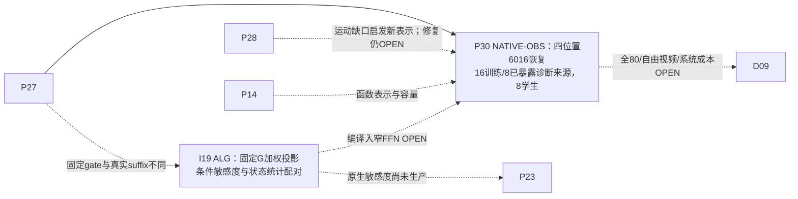

**P30（NATIVE-OBS）**：[6016四位置恢复](../research/20261028/COMPACT6016_RECOVERY_PILOT_RESULTS_20261028.md)在原post-Q1、学生自身GELU/Smooth2/HiF4 Q2、两矩FP32 rank32适配并离线折叠BF16边界下，完成两初始化各128更新。8个旧诊断来源的四位置energy94最终gate误差为2.349/1.061/2.546/2.045%，random94为3.212/1.463/3.649/2.348%；8份学生均序列化并逐字节回读。变动与均值误差分别记录，不能将随机保存行的变化称视频运动。完整80函数、专家双step共享、自由视频与真实成本是后续新范围。

**I19（ALG）**：[固定度量与条件配对证明](../research/method_discussion/discoveries/E0/conditional-sensitivity-pairing-and-balanced-projection-20261028.md)给出SPD G下的最优幂等投影与精确两来源反例。真实后缀敏感度若随state/source变化，分别平均G与C可以失去决定方向的配对；所构造反例有100倍差距。当前CAL24四位置gate在source间逐字节相同，因此该证明不否定原gate-only consumer，也未证明Wan存在低能高敏方向。

### G14 · 2026-10-28敏感坐标原论文扩展（L90–L92）

原89项主索引扩展到92项，另有10项校准文献；新增条目均为原论文方法阅读，作者代码未审，未执行这些外部方法的Wan实验。

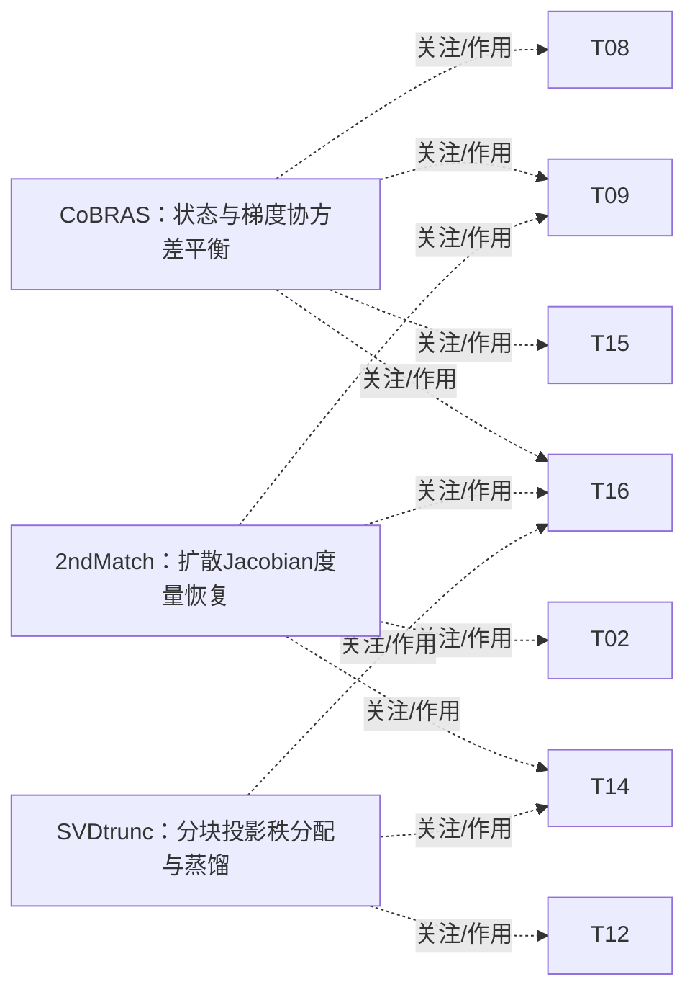

| 论文 | 真实动作 / 信息时点 | Wan判别与阅读身份 |
|---|---|---|
| [L90 Model Reduction for Nonlinear Systems by Balanced Truncation of State and Gradient Covariance](https://arxiv.org/html/2207.14387v4) | Offline state/adjoint-gradient snapshot sampling, cross-covariance SVD and reduced model construction; no native Wan operator executed. Offline after sampling trajectory states and adjoint responses, before reduced model deployment. | Bound assumes conditional Gaussian conditions and particular marginal covariances; averaged state/gradient covariance is not an exact same-source gate-conditioned joint suffix objective. Test paired versus shuffled responses and native finite perturbations. `PRIMARY_ARXIV_V4_METHOD_SECTIONS_2_3_AND_SELECTED_RESULTS_READ_CODE_NOT_REVIEWED_20261028` |
| [L91 2ndMatch: Finetuning Pruned Diffusion Models via Second-Order Jacobian Matching](https://arxiv.org/html/2506.05398v2) | Train a pruned student with noise prediction, teacher output distillation and projected Jacobian-metric matching; teacher and derivative work are paid offline. During post-pruning finetuning on noisy inputs and selected diffusion timesteps. | J^T J is a second-order metric, not a Hessian; stepwise metric matching is not an exact multi-step suffix Jacobian, and the image-diffusion evidence does not establish four-step Wan video or HiF4 behavior. `PRIMARY_ARXIV_V2_METHOD_SECTION_4_AND_SELECTED_EXPERIMENTS_READ_CODE_NOT_REVIEWED_20261028` |
| [L92 Importance-Aware Low-Rank Distillation of Diffusion Transformers](https://arxiv.org/html/2609.04646v1) | Offline probe generated images, construct truncated-SVD projection factors, allocate block ranks and finetune; compare training-free and trained models. Offline block probing and rank allocation before optional recovery finetuning and inference. | CMMD ranks image-distribution degradation after one-block compression, not a paired local gate-conditioned sensitivity matrix; image-model parameter savings do not establish HiF4 FFN full-video latency or quality. `PRIMARY_ARXIV_V1_METHOD_SECTION_3_AND_SELECTED_EXPERIMENTS_ABLATIONS_READ_CODE_NOT_REVIEWED_20261028` |

### U28 · 末层门控、head与归一化通路

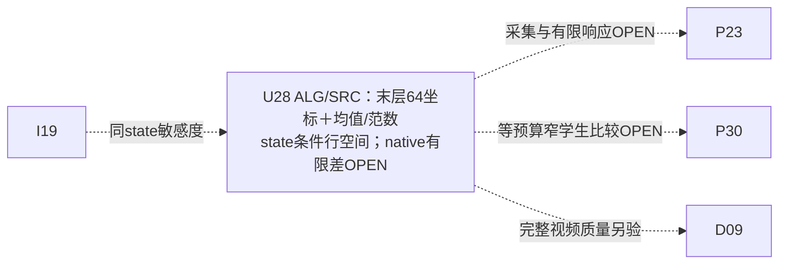

[U28方法快照](../research/20261027/B_GATE_SUFFIX_SENSITIVE_COORDINATES_METHOD_SNAPSHOT.md)证明固定条件的连续末层有限响应身份；真实两个head的64×5120 BF16形状已读header。head线性零响应可经LayerNorm范数改变有限flow；已有v2推导表明同一固定head输出亦可由64个中心化线性投影和1个中心方差（65量）表示，原64个未中心化投影＋mean＋norm²的66量坐标仍合法。**二者都不证明在线FFN已省算，也不构成全source共享低维基**。BF16 neutral replay、有限幅度及可部署代价仍待原生判别。

## G14-C · 论文先验正式约束当前三条新函数路线（2026-10-28 v2）

**知识身份**：这是G14已索引论文到现有计算图节点的**方法推导视图**，并非额外计入205个原生节点/424条原始证据边的新NATIVE事实。权威关系和已完成研究范围保存在[五操作机器交叉索引v2](../research/agent_protocol/METHOD_OPERATION_CROSSWALK.json)中（12条REQUIRES/CONSTRAINS/COMPETES_WITH/PREDICTS_DIFFERENTLY边），完整方法在[现行整合方案](../research/20261027/COMPACT_FFN_REPRESENTATION_THREE_METHOD_PROPOSAL_20261027.md)。原论文的LIT结论与M-A0已运行NATIVE局部pilot分别持有不同证据身份。

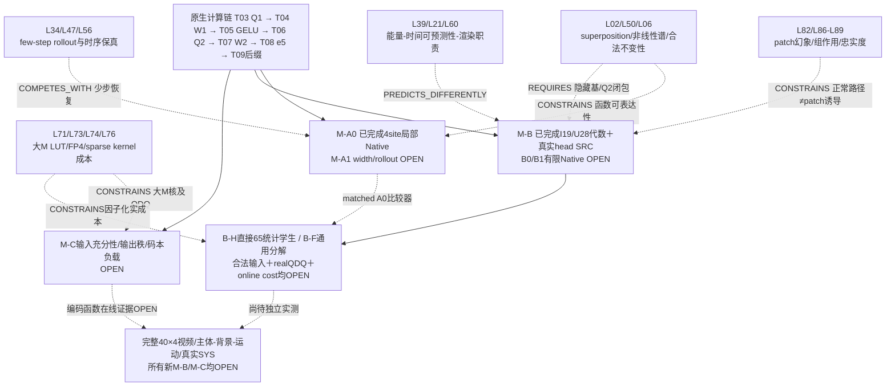

**已可使用的算术结论**：末层固定head连续读出为 $F(u)=q/\sqrt{v+\epsilon}+W_{head}shift+b$，其中$q=T P_0u\in\mathbb R^{64}$、$v=\|P_0u\|^2/D$。这是一个**65中间统计的充分表示**，不能从中直接推出无需计算完整FFN：$u=r+D_g\Phi c$时仍要计算$c$、$B^\top r$等付费量，且BF16舍入与真实quantization需独立对照。G14关系指向上述CONSTRAINS/REQUIRES/COMPETES_WITH节点，**首次模型执行的下一项仍是B0中性同状态捕获准备**。

**成熟原生证据入口**：[A0/P30局部恢复](../research/20261028/COMPACT6016_RECOVERY_PILOT_RESULTS_20261028.md)在四站点同rank32/相同预算下有本地NATIVE结果，Energy94局部heldout SSE为1.06%–2.55%，并没有完整四步生成质量；[B方法v2](../research/20261027/B_GATE_SUFFIX_SENSITIVE_COORDINATES_METHOD_SNAPSHOT.md)提供U28代数、未来B0/B1 producer与双函数构造；[G14反向审计](../research/20261028/G14_PRIOR_CONSTRAINT_AUDIT_FOR_NEW_FFN_METHODS.md)是上述论文约束的原始分析来源。

### G14 · QCFB命题审计：FANG及排列先例（2026-10-28）

[严格推导](../research/20261028/QCFB_QSTAGE_PROPOSITION_AUDIT_AND_DERIVATION_20261028.md)补全条件矩一致性、跨行读出和动作观测条件；[原文ledger](../research/literature/20261028/QCFB_PRIMARY_METHOD_AUDIT.json)升级L28/QuantSparse与L42/Veda的阅读深度，新增L93/L94。现有原生节点/边不变；主论文94项＋补充10项。以下均为LIT作用映射。

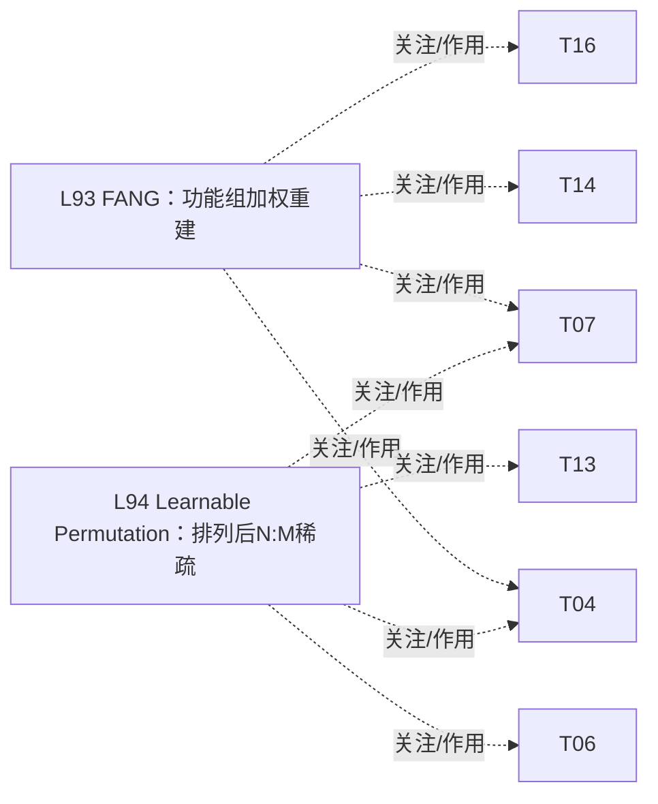

QCFB的条件负交叉项须超过同动作预算的静态联合、独立能量与廉价预测器基线；论文分组/排列/量化稀疏/tile执行先例不构成本地成功。新增候选仍无Wan质量或系统收益证明。

## 二十三、B0/B1原生续作与A0中层恢复（2026-10-28）

[B0/B1原生结果](../research/20261028/B_TERMINAL_NATIVE_CAPTURE_AND_FINITE_RESPONSE_RESULTS_20261028.md)将v2中的原生OPEN落实为4个完整Dense flow和72次同状态显式head/LN诊断。较大归一化方向扰动下，有限统计公式误差约1.2%–1.3%，一阶约24.5%；小响应的离散数值界保留INCONCLUSIVE。旧U28数学与历史失败保持原身份，新增观测见U29/U30。

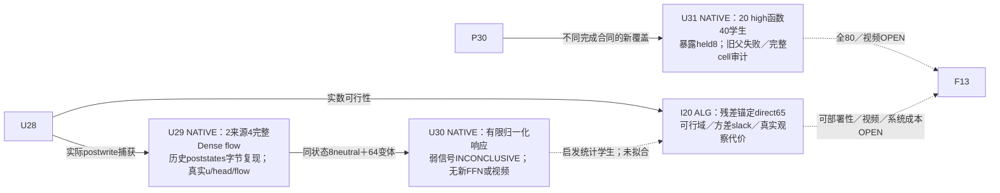

[直接65量构造](../research/method_discussion/discoveries/E0/bh-residual-anchored-direct65-construction-20261028.md)与[独立证明](../research/method_discussion/discoveries/E0/b-head-direct65-feasibility-independent-20261028.md)明确实数可行域、非空centered kernel前提、BF16反例和残差投影的真实代价。[A0部分40学生](../research/20261028/COMPACT6016_PARTIAL40_RECOVERY_RESULTS_20261028.md)揭示中层局部误差明显高于四站点pilot；旧FAILED父运行不被可复用完整cell改写。后续完整覆盖及配对判别见下节；G14当前为98主＋10补充，文献比较不算新NATIVE运行。

### CAL24原生对齐、有限配对判别与全80恢复

[三项实际结果](../research/20261028/B_CAL24_SOURCE_PAIRED_DISCRIMINATION_RESULTS_20261028.md)给出24来源96个原步的字节对齐、共享16维/rank4/18候选池的实际CPU比较，以及B0四case的原M几何选中行中性重放。配对、打乱、按step独立marginal、PCA和head-only均选同一PCA；测到的径向分量占主要误差，直接预测方差成为下一项判别。CPU M256与原GPU head存在数值差异，不能从中推出原生量化噪声界。

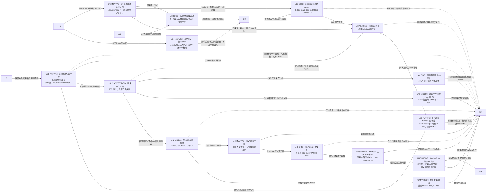

[全80函数恢复](../research/20261028/COMPACT6016_FULL80_RECOVERY_RESULTS_20261028.md)完成40旧＋54旧失败范围内完整cell＋66新cell，metadata assembler实际exit0；另有独立实际exit0的160 export／1920 tensor原始字节审计。metadata标签保留`METADATA_COMPLETE_TENSOR_LOAD_PENDING`，表示部署加载仍需其自身核验。原始失败父范围和未知旧exit不改写；80个嵌套位置不当作80个独立来源。当前原始图为225节点/468关系，六视频已实际完成，正式质量和公平系统速度仍须各自证据。

[A0六视频v2](../research/20261028/COMPACT6016_SIX_VIDEO_NATIVE_RESULTS_20261028.md)实际exit0：两历史暴露来源、shared seed42、Dense/energy/random共6条，960个原生FFN，两个candidate各完整部署80个6016函数并使用自身Q2；两条Dense四步post及视频字节均与历史一致。观测FFN边界约2×，顺序预热和观测开销使其不构成SYS验收；正式质量已测失配，人工全片待验。v1首block前失败保留原身份。

[B-H实际训练](../research/20261028/BH_DIRECT65_H128_PREDICTABILITY_RESULTS_20261028.md)以合法V1、已付费residual摘要和step完成两expert各256次Adam更新，held8来源各自全部改善。该证据是GPU M256保存状态可预测性；两个末层函数覆盖2/80。随后[同head对比](../research/20261028/BH_A0_MATCHED_TERMINAL_HEAD_RESULTS_20261028.md)完成96原M selected-row neutral和192个A0原诊断SHA匹配；暴露held8高／低expert中A0 energy分别0.000609／0.000661，B-H为0.003958／0.003615，B-H对两A0比较器均0/8胜。训练目标与参数不同，完整视频和系统速度待验。

[B-F固定特征输出空间](../research/20261028/BF_FROZEN6016_TERMINAL_RESULTS_20261028.md)实际exit0：两末层函数、两固定rank512基底、1024次额外Adam；历史held8 head误差较A0约改善3–4%。教师输出投影oracle较学生预测低45–98倍，区分了表示空间与系数预测问题；两个基底的最终差别较小，不能据此主张继续增rank。逻辑MAC为A0的0.59255，未测实际系统速度或完整视频。本scope为迁移前冻结的HiF4数值诊断，后续新主实验使用原始BF16。

[现有六视频完整质量](../research/20261028/COMPACT6016_CONSUMER_QUALITY_RESULTS_20261028.md)实际exit0，6视频全部新评分、8原版维度、240次RAFT；两暴露来源的6016候选连续运动幅值仅Dense约14–23%，成像评分显著下降。高smoothness与相同False动态binary不足以保住运动。[保存状态分析](../research/20261028/COMPACT6016_TRAJECTORY_DRIFT_RESULTS_20261028.md)显示同向累计差异；[非均匀Euler步长核对](../research/method_discussion/discoveries/E0/raw-bf16-local-state-objective-discriminator-20261028.md)给出简单偏差累积的竞争解释，不能将自由轨迹差单独归为反馈不稳定。

[原始BF16两视频](../research/20261028/ORIGINAL_BF16_TWO_VIDEO_RESULTS_20261028.md)实际exit0，raw high/low master、0QDQ、8flow/320FFN、20状态、903源码及完整raw payload CPU SHA核验；新旧输入噪声匹配，post输出保留新数值身份。正式质量与公平系统速度OPEN，下一项原BF16交叉状态判别仍须自己的冻结scope。

### G14 · 量化元信息何时可见、如何消费（2026-10-28）

[时点/操作推导](../research/20261028/QMETA_OBSERVATION_TIMING_AND_EFFICIENT_USE_20261028.md)及[原文与源码ledger](../research/literature/20261028/QMETA_TIMING_PRIMARY_AUDIT_20261028.json)新增L95–L98，深化L14、复核L69/L74。当前98主＋10补充，共108篇；原生节点与执行结果不变。下列边为LIT研究映射。

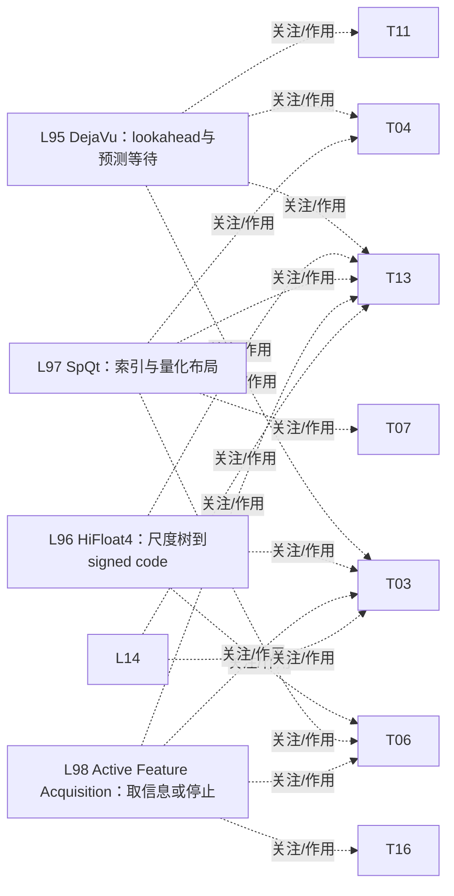

现行Q1内部尺度未独立导出；已完成Q2的信息主要影响剩余W2或未来调用，Q2内部尺度生成后还存在条件性的剩余编码省算窗口。源级可用、HBM可读与低成本可消费分开。候选为Q1生产时有序signed摘要→有限合法动作风险差→必要时补观察；跨CTA归约、tiling、cast与source级行为仍需实测。

[原始BF16 12flow](../research/20261028/ORIGINAL_BF16_LOW39_FOUR_CORNER_RESULTS_20261028.md)、[两视频官方轴](../research/20261028/ORIGINAL_BF16_TWO_VIDEO_QUALITY_RESULTS_20261028.md)与[保存行范数转移](../research/20261028/ORIGINAL_BF16_SAVED_NORM_ROWS_RESULTS_20261028.md)均实际exit0。U43保持完整W1，只压缩末层W2；小线性读出误差与大径向项共存。U45给出固定步级偏差的跨两个暴露来源代理证据，原生gain已由U46执行，泛化与完整视频仍OPEN；不把代理改善变为完整视频/SYS结论。

[L06原文与作者norm代码深化](../research/literature/20261028/SLICEGPT_NORMALIZATION_AND_TRUNCATION_RECHECK_20261028.json)区分完整正交旋转的范数不变性与截断后的范数缺失；该LIT比较约束U43/U45后续范数补全，不替代原生校正证据。

[固定范数原生迁移](../research/20261028/ORIGINAL_BF16_FIXED_NORM_TRANSFER_RESULTS_20261028.md)实际exit0：source0两个κ转向source12，八个完整flow与四个字节neutral、320FFN；同状态和own-state显著改善。单末层结果推动跨深度raw校准，不当作全80函数/完整视频或SYS验收。

[原始BF16全深度 corpus](../research/20261029/ORIGINAL_BF16_FULL_DEPTH_CORPUS_RESULTS_20261029.md)完成六校准＋两开发图像簇的全部160位置，1280包／80状态的独立实际字节审计exit0。480项固定step/block gate／shift／scale SHA在8来源间一致，支持预固定的调制坐标；保留历史曝光、teacher状态与原生失败身份，不把数据覆盖当视频／SYS验收。

**2026-10-29 · TEAL Wan局部OBS**：[全160 teacher-state CPU对照](../research/20261029/TEAL_WAN_ALL160_CPU_LOCAL_RESULTS_20261029.md)复用六校准/两开发来源，25%门限来源等权SSE0.005771，等k随机0.113019；50%门限0.057950。绑定F09的post-GELU W2输入与G14C20/T07/T13，属于局部CPU贡献证据；完整学生视频、运动及真实稀疏系统成本仍独立验证。

2026-10-30 C20 单独原生锚点：[四来源TEAL全160视频V3](../research/20261029/TEAL_WAN_ALL160_VIDEO_V3_NATIVE_RESULTS_20261029.md)20视频真实EXIT0/闭合、完整Dense W2；[四来源连续RAFT、八轴及81帧AI接触表](../research/20261029/TEAL_WAN_ALL160_FOUR_SOURCE_QUALITY_RESULTS_20261029.md)均真实EXIT0/闭合，四个已暴露开发来源各一seed，25/50阈值来源等权配对RAFT流比1.16952/1.37647，各轴响应不同；50臂可见动作与彩色元素变化、25臂较接近，非正式质量验收，也没有物理W2省算。[原Llama3公开资产](../research/20261029/TEAL_LLAMA3_PUBLIC_ASSET_ACQUISITION_RESULTS_20261029.md)13文件16,069,766,580字节获取及独立复验已EXIT0/闭合，四权重分片与官方公开LFS元数据匹配，官方端点403保留；原作者完整LLM尚未运行。G14论文边继续属于LIT作用映射。

**2026-10-30 F09/Q30–Q33 原生后续**：[SharQ Wan V2](../research/20261029/SHARQ_WAN_FFN_NATIVE_V2_RESULTS_20261030.md)实际240次FFN/16组合EXIT0闭合；单源两状态，M31668重复32真行。对sameW Dense32的gate后L2改善约23%、整FFN时间增加约39%。这是算子/形状诊断，完整160位置自由视频及系统成本仍待独立范围。

**2026-10-30 F09 原生集成失败证据**：[SharQ全160 V6](../research/20261030/SHARQ_WAN_ALL160_V6_CACHE_NEUTRAL_FAILURE_20261030.md)两路各有完整首BF16视频，第二缓存BF16在80个W pack后flow0非有限、实际EXIT1；候选未调用。作者裸默认流与当前compute流存在SRC依赖缺口，其非有限因果仍OPEN；需新有限stream对照，旧scope与源码冻结。

**2026-10-30 F09/Q30–Q33 新V2全深度原生证据**：[两源8条视频及独立核验](../research/20261030/SHARQ_WAN_ALL160_VIDEO_V2_NATIVE_RESULTS_20261030.md)均actual EXIT0，全4步×40层，20状态对/2视频字节neutral；same-master Dense32/SharQ用各自GELU后Q2，保留fullK dense residual及原prefetch。FFN CUDA观察约5.9/4.16/5.7s，非公平SYS；完整质量pending。

2026-10-30 G2/F09质量闭环：[SharQ全160双来源八轴与独立RAFT](../research/20261030/SHARQ_WAN_ALL160_VIDEO_V2_QUALITY_RESULTS_20261030.md)六scope及各VERIFY均actual EXIT0；逐来源/轴收益分歧，FFN事件SharQ约5.74s、same-W Dense32约4.16s，未达部署验收。[AI全帧接触表](../research/20261030/SHARQ_WAN_V2_AI_VISUAL_REVIEW_20261030.md)覆盖486帧，保持已暴露双source/单seed及非人工播放身份。

2026-10-30 G2/F09后续判别：[Chipmunk保存h](../research/20261030/CHIPMUNK_SAVED_H_DISCRIMINATION_RESULTS_20261030.md)单组FP64等K遗漏投影能量对比已CPU EXIT0；[RT-Lynx启发BF16合法2:4](../research/20261030/RTLYNX_WAN_BF16_2TO4_PAIR_RESULTS_20261030.md)60次完整FFN、40次稀疏W2已GPU EXIT0，当前norm移植误差降低但完整FFN变慢。[P4 V2](../research/20261030/CHIPMUNK_P4_CAUSAL_PROXY_V2_RESULTS_20261030.md)四个局部配对及[两来源真实full-M采集](../research/20261030/CHIPMUNK_WAN_FULLM_RASTER_RESULTS_20261030.md)均actual EXIT0闭合：P4门后误差相对mean均改善约5%–13%，真实31668行资产带raster坐标；20状态对/2视频对中性。前者是128个nonraster teacher行的局部诊断，后者是被动采集；完整候选视频/SYS仍独立验证。

2026-10-30 G2/F09真实规模付费选择器：[四个full-M原生对照](../research/20261030/CHIPMUNK_FULLM_CAUSAL_PROXY_RESULTS_20261030.md)actual EXIT0并闭合，M31668、两source各两expert；P64比P4四组误差均低，来源等权0.3295，付费事后full-RMS为0.3112而非输出最优。当前完整在线Triton177–255ms对Dense约35ms；原采集与本机Dense replay误差另列，不把局部收益变成VIDEO/SYS。下一项同mask packed BF16 GEMM须独审登记并实付选择/packing/cache/全部FFN成本。

2026-10-30 G2/F09物理执行与动作单元：[same-mask packed BF16](../research/20261030/CHIPMUNK_FULLM_PACKED_NATIVE_RESULTS_20261030.md)四CPU/四GPU actual EXIT0，五臂数值对Triton差为0、完整在线23–24ms对Dense35–39ms，局部速度余量；[同K后验分组](../research/20261030/CHIPMUNK_RASTER_GROUP_ORACLE_RESULTS_20261030.md)四GPU actual EXIT0，raster四组门后误差比global低8.26%–10.90%且优于random。fullΔ重建误差是本数值路径基线而非全体候选严格下界；两来源block20 teacher事实不替代全160学生自由视频/系统结论。

2026-10-30 G2/F09已付信息复用：[因果signed补偿](../research/20261030/CHIPMUNK_SIGNED_COMPLEMENT_RESULTS_20261030.md)四CPU/四GPU actual EXIT0，RMS选通道和signed mean来自同一次M64 W1/GELU，S外均值经付费W2 GEMV广播；baseline/signed/事后fullmean等权误差0.329515/0.314917/0.313327，多约1ms、一组略恶化。实际DC/AC显示本block20高噪声偏移更显著，但不推全层/全视频或自适应选择的无偏保证。全160自由生成继续独立验收。

2026-10-30 G2/F09全深度工程边界：[global-P64 V7两源](../research/20261030/CHIPMUNK_GLOBAL_P64_V7_FAILURE_20261030.md)均实际EXIT1；各原Dense/hook Dense两视频及10状态对/一视频对字节中性，cache Dense在latent_step2后触及76GiB累计reserved门限，候选未入。触门reserved峰值UNKNOWN，采样物理峰值不能补此缺口。allocator未用段与活动集短峰是待区分解释，新V2固定清理/内存观测方案需独审登记，原失败及源码保持原身份。

2026-10-30 G2/F09真实全深度P64：[V2双来源八视频及独立VERIFY](../research/20261030/CHIPMUNK_GLOBAL_P64_V2_ALL160_VIDEO_RESULTS_20261030.md)均实际EXIT0；每源完整4步×40层，原Dense/hook/cache三对照20状态对/两视频对字节中性、候选80处实际packed动作及80处Dense缓存。两native same-mask控制相对L2/maxabs均0；累计reserved峰64.57GiB且未重置。含observer固定顺序的FFN平均6.45→5.80s、生成47.19→45.52s是观察而非公平SYS；原Dense/候选八轴、连续运动及视觉验收另行登记。
