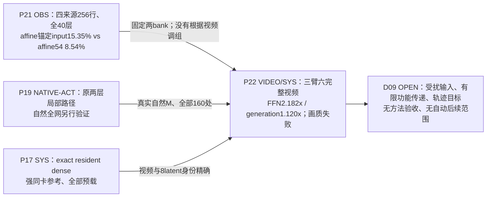

# FFNDS · 从真实源码到实验发现的可追溯计算图

> **2026-10-27 当前科学先决问题（G13）**：先定位“哪些输出函数在具体状态和视频行为中有意义”，随后辨认“正常原生前向中，哪些计算子图承担这些功能”，再讨论量化编码、代理、LUT、稀疏核与时空复用。详见[G13科学定义/原生现象/方法学](../research/20261027/G13_FUNCTION_DISCOVERY_AND_COMPUTATIONAL_STRUCTURE_LOCALIZATION.md)和[功能–结构候选分开登记](../research/agent_protocol/FUNCTION_STRUCTURE_RESEARCH_OBJECTS.json)。G13是研究辨识图，并非新运行的因果归因或算法实现。

> **现行跨模块合成（2026-10-27）**：阅读入口为[FFN本征、量化与实时生成的综合机制报告](../research/20261027/FFN_MECHANISM_LITERATURE_AND_GRAPH_SYNTHESIS.md)，可程序化的12机制组及信息/成本/证据映射见[MECHANISM_GRAPH_CROSSWALK.json](../research/agent_protocol/MECHANISM_GRAPH_CROSSWALK.json)。原生可执行部分仍为 G0–G5，G6为历史假设场景，G7–G12为**外部 LIT、数学 ALG/SPEC 与待证 OPEN 的研究叠加图**，并非已替换原Wan。当前171个节点、354条有类型边、85项论文索引；它们是检索覆盖，不代表每篇原文均全文深读。实验仍暂停，原始结果以各RUN/证据文件为准。

> **计算图底座建立于2026-10-25；当前执行事实截至2026-10-26须结合后续原生视频报告读取。** G0–G5包含被动观察、全层函数分析与同值权重常驻；后续Affine54/Whole94已在40层×4步共160处完成原生候选替换、六条81帧视频及真实耗时测量。固定候选产生可见质量失配，尚未达到正式质量验收；图中其他虚线候选仍按各自证据标签区分。配套 [实验发现谱系总表](../research/EXPERIMENT_FINDINGS_ATLAS.md) 按机制、对照、证据等级收录历史和 E0 实验。全文的图注代号指向**实际文件**，不将假设画成原生执行事实。

## 一、对象、版本与解释规则

| 维度 | 固定对象与来源 |
| --- | --- |
| 主研究对象 | **LightX2V Wan2.2 I2V A14B 四步蒸馏 D 模型**；high/low 两套独立专家；非原始 40 步 O 模型 |
| 模型/推理源码 | [LightX2V@ed146db](https://github.com/ModelTC/LightX2V/blob/ed146db64d0b6130c669285fc1aa0b280a6a4823/lightx2v/models/networks/wan/infer/transformer_infer.py) 的 **infer_block / infer_self_attn / infer_cross_attn / infer_ffn / post_process / infer_non_blocks**；服务器恢复校验见 [上游审计](08_上游源码校对_20261020.md) |
| 实际本地代码边界 | [runtime reconstruction](../research/20261022/R12_E0_runtime_reconstruction.json) 绑定 LightX2V transformer 本地文件 SHA256 **5fa53d102aed4e2793b4d639da65a71e1e63061d9b2c35574db1b4ac2256c225**；量化适配代码见 [HiF4 distill adapter](../upstream_audit/source_deltas/HiF4_Sp/files/HiFloat4/ptq/adapters/lightx2v_wan_distill.py) |
| 硬件/数值 | 原生测量的参照是 **HiF4 activation/weight fake-QDQ + BF16 Linear**，不是 packed FP4 GEMM；另有 H20/其他格式的代码或预检不得混作同一运行体系 |
| 结构与调度 | 40 blocks；5120 hidden；13824 FFN 中间维度 = **216 × 64**；40 attention heads ×128；四步模型输入 t=[1000,937.5,833.333313,625]，sigma=[1,.9375,.833333313,.625]；high/high/low/low |
| 视频与行 | 目标输出 81 帧；latent temporal bins 为 21；在已核对形状的原生测量中 FFN token rows **M=31668**，并非 81 帧或 31668 个独立样本 |
| 研究规则 | [AutoResearcher CR](../core/OBJECT_RECONSTRUCTION.md) 的 source→tensor→算子→下游→测量、[DF](../core/DEDUCTION_FIRST.md) 的证明边界与 [PRD](../core/PROBLEM_REPRESENTATION_DISCOVERY.md) 的表示重构；仓库现行 [E0 研究纲领](../research/20261025/E0_FFN_INTRINSIC_RESEARCH_RESET_20261025.md) |

证据标签：**SRC**＝源码/固定配置；**ALG**＝有条件数学恒等式；**OBS**＝保存操作数分析；**NATIVE-OBS**＝原生完整生成的被动统计；**NATIVE-ACT**＝同前缀原生有限干预；**SYN**＝合成参考反例；**VIDEO**＝真实自由四步轨迹/配对视频；**SYS**＝原生计时；**OPEN**＝未在对应边界验证。一个结果可同时带多个标签。

## 二、图 G0：四步生成、专家切换、完整 Block 顺序

~~~mermaid
flowchart TD
  IN["G00 输入图像 / 文本、种子、初始 latent x₀"]
  SCH["G01 Shift=5 scheduler: 四个实际 (t,σ)"]
  EXP{"G02 step 0,1 → high expert；2,3 → low expert"}
  EMB["G03 patch/input embedding + time/text conditioning；计算各层调制"]
  B0["G04 block 0"]
  BR["G05 blocks 1…38；各层各有自注意力、交叉注意力、FFN"]
  B39["G06 block 39"]
  HEAD["G07 head norm + 条件调制 + head projection → flow预测"]
  STEP["G08 原生 scheduler.step_post；FP32 两次乘加→ latent dtype"]
  LOOP{"G09 还有下一去噪步？"}
  VAE["G10 VAE decode → 81帧视频 → 输出/评估"]
  IN --> SCH --> EXP --> EMB --> B0 --> BR --> B39 --> HEAD --> STEP --> LOOP
  LOOP -- "是：更新latent，换time/expert再执行40层" --> EXP
  LOOP -- "否" --> VAE
~~~

**G01–G02（SRC）**：配置索引 [1000,750,500,250] 在 shift=5 后不是模型实际收到的时间步；原始 [Wan22StepDistillScheduler](https://github.com/ModelTC/LightX2V/blob/ed146db64d0b6130c669285fc1aa0b280a6a4823/lightx2v/models/schedulers/wan/step_distill/scheduler.py) 与 [原生运行校对](../research/20261022/R12_E0_runtime_reconstruction.json) 一致。跨 1→2 步发生**专家权重切换**，不能把四步都当同一 FFN 函数。

**G07–G09（SRC/NATIVE）**：head 产生的是 flow 预测，不是 RGB；scheduler 按独立 FP32 运算依次减 σ_t·flow、非终步再加 σ_next·flow，最后转回 latent dtype。[UB1 调度器审计与原生轨迹](28_固定步间计算预算对照.md)、[R7 同状态 flow 干预](../research/20261021/R7D1_results.json) 固定了这层边界。完整视频评价见 [指标协议](77_FFNDS学术指标族与评测协议_20261023.md)，不能以本地 FFN SSE 或单个 flow SSE 替代。

### 图 G1：一个 Wan Block，保留三次不同归一化与残差旁路

~~~mermaid
flowchart TD
  R0["G11 输入 residual r，M×5120"]
  COND["G12 time embedding + 6路 modulation: shift/scale/gate_msa, shift/scale/gate_ffn"]
  N1["G13 norm1 + MSA scale/shift"]
  SA["G14 Self-Attention: Q/K/V, Q/K norm, RoPE, attention, O"]
  WA["G15 r₁ ← r + gate_msa ⊙ SA"]
  N3["G16 norm3(r₁)；text Cross-Attention Q/K/V/O"]
  WC["G17 r₂ ← r₁ + CrossAttn"]
  N2["G18 norm2(r₂) + FFN shift/scale"]
  FFN["G19 完整 FFN：Smooth1/Q1/W1/GELU/Smooth2/Q2/W2"]
  WG["G20 r₃ ← r₂ + gate_ffn ⊙ FFN"]
  NEXT["G21 下一 block.norm1(r₃) + attention/FFN；最终 head/flow"]
  R0 --> N1 --> SA --> WA --> N3 --> WC --> N2 --> FFN --> WG --> NEXT
  R0 --> WA
  WA --> WC
  WC --> WG
  COND --> N1
  COND --> WA
  COND --> N2
  COND --> WG
~~~

- **G13–G18（SRC）**：[实际 infer_block/infer_cross_attn/infer_ffn](https://github.com/ModelTC/LightX2V/blob/ed146db64d0b6130c669285fc1aa0b280a6a4823/lightx2v/models/networks/wan/infer/transformer_infer.py)：self-attention 先以 gate_msa 写回；cross-attention 读取 norm3，随后先把 cross 输出直接加到 residual **再**读取 norm2；FFN 输出在 **post_process** 用 c_gate_msa 写回。它并非单个泛化「LN→FFN→残差」节点。[C0](../research/20261023/C0_coupling_offline_results.json) 的归一化前残差/attention信息、[C1N0](../research/20261023/C1N0_native_results.json) 的实际下一 norm1 正是 G17→G20→G21 之间的辨别量。
- **条件分支（SRC）**：冻结运行配置 use_image_encoder=false，跨注意力中的独立 image-context attention 路径跳过；text context 保留。源码还包含 smooth-norm / MXFP8-fused / sensitive-dtype / seq-parallel / adapter 的其它分支，**不能将其当作本次 HiF4 观测路径已经执行**。对应 runtime 的精确分支由 [适配契约](../upstream_audit/source_deltas/HiF4_Sp/files/HiFloat4/ptq/adapters/lightx2v_wan_distill_contract.json)、[源码审计](08_上游源码校对_20261020.md) 确认。
- **G20→G21（ALG/NATIVE）**：残差直通意味着局部 LN 的径向弱响应不是整块或整段视频的零响应。[E0 原生有限组干预](../research/20261025/E0_FOLLOWTHROUGH.md) 和 [历史 C1 72 位点](97_历史结果检验_门控残差商空间_20261024.md) 已在可见下游边界检验具体动作，相关下游 SSE 均不为零。

## 三、图 G2：FFN/QDQ/GEMM 细分执行，注解关联证据

~~~mermaid
flowchart TD
  R["F00 r₂ / norm2输入，M×5120"]
  LN["F01 norm2 (eps 1e-6) + 当前步 FFN AdaLN shift/scale"]
  SM1["F02 Smooth1：float除固定scale→转BF16"]
  Q1["F03 Q1：原生 HiF4 activation QDQ；decoded BF16 q₁"]
  W1["F04 W1 Linear：13824×5120；含原生 b₁"]
  A["F05 preactivation a，M×13824"]
  GELU["F06 GELU(approximate=tanh)，M×13824"]
  SM2["F07 Smooth2：hidden/scale→BF16"]
  ROOT["F08R 64项根max / 8项与4项子组max → 三级共享scale"]
  Q2["F08 Q2：HiF4编码/解码后的 BF16 v₂"]
  W2["F09 W2 Linear：5120×13824；含原生 b₂"]
  Y["F10 FFN输出 y，M×5120"]
  G["F11 由time modulation生成的 FFN gate"]
  WB["F12 native gate乘法 + BF16/敏感精度 residual writeback"]
  NX["F13 下一block norm1→attention；后续层/head/flow"]
  R --> LN --> SM1 --> Q1 --> W1 --> A --> GELU --> SM2 --> ROOT --> Q2 --> W2 --> Y --> WB --> NX
  R --> WB
  G --> WB
  META["F14 量化尺度/码字/有效QDQ权重：离线/当前kernel内"]
  META -. "Q1/Q2 数值边界" .-> Q1
  META -. "Q1/Q2 数值边界" .-> Q2
  PANEL["F15 216个 whole64 通道组 / 有符号W2贡献"]
  Q2 -. "后验解释：需要v₂" .-> PANEL
  W2 -. "W2列向量" .-> PANEL
~~~

| 节点 | 实际发现、证据种类、定位 | 推论的精确范围 |
| --- | --- | --- |
| **F00–F01** | [C0 synthetic 相同 q/不同 residual 标度反例](../research/20261023/C0_coupling_offline_results.json) **ALG/synthetic**；[C1 native 72 site](../research/20261023/C1N0_analysis.json) **NATIVE**；[E0 径向几何](../research/20261025/E0_DISCOVERY.md) **OBS** | q 完整时决定本次 deterministic FFN 输出；但 bypass r 和下一步条件可以改变同一 q 下动作的**下游**影响。C1 的三个旧动作在 72/72 整位点均由 UB1 领先。 |
| **F02–F03** | [HiF4 adapter](../upstream_audit/source_deltas/HiF4_Sp/files/HiFloat4/ptq/adapters/wan_i2v.py) **SRC**；[E0 原生量化核对](../research/20261025/E0_DISCOVERY.md) **OBS/SRC** | 转 BF16、QDQ 与分组尺度顺序不可随意交换；E0 240 个参考例在保留 signed zero 后 BF16 位一致。量化元信息多提供幅值/范围，不能直接当功能重要性。 |
| **F04–F06** | [原生 FFN 源码](https://github.com/ModelTC/LightX2V/blob/ed146db64d0b6130c669285fc1aa0b280a6a4823/lightx2v/models/networks/wan/infer/transformer_infer.py) **SRC**；[E0 量化前后观察](../research/20261025/E0_DISCOVERY.md) **OBS**；[旧 A5/R15](04_前期探索与证据边界.md) **VIDEO/SYS** | GELU 中间维度 13824；E0 GELU 精确零占比 0–0.0617%。如果在 W1 后才决定 mask，W1 费用已经发生；历史 A5 质量较好实例也不证明 W1 省算。 |
| **F07–F08R–F08** | [E0被动观察](../research/20261025/E0_DISCOVERY.md)、[完整原HiF4闭包](../research/20261025/E0_SHARED_TILE_CLOSURE.json)、[原始Python量化参考反例](../research/20261025/E0_HIF4_COLUMN_DEPENDENCY_COUNTEREXAMPLE.json) **OBS/SRC/SYN** | Q2 后零值5.42–14.00%，不等于whole64跳算。HiF4的64→8→4共享max/scale使**组内输入与decoded输出存在跨列依赖**；25%任意W2列不等于25% W1必需输入。 |
| **F09–F11** | [E0 五组有符号贡献/联合选择](../research/20261025/E0_FOLLOWTHROUGH.md) **OBS**、[E0 组排序](../research/20261025/E0_GEOMETRY_RANKINGS.md)、[R9 signed Gram 历史](97_历史结果检验_门控残差商空间_20261024.md) | W2 value vector 的**有符号合成**决定净输出；单通道能量和组合/后续功能损失不同。E0 block0 两组按最小独立能量选，与组合 LN 最优不同 28.91%。 |
| **F11–F12** | [E0 原生有限组干预及 BF16 写回](../research/20261025/E0_FOLLOWTHROUGH.md) **NATIVE**；[C1 native full action](../research/20261023/C1N0_native_results.json) **NATIVE** | E0 两组非加性量相对加和作用能量从 FFN output 1.76–1.93% 到 residual writeback 26.64–27.87%；实数向量和不能替代原生舍入顺序。 |
| **F12–F13** | [R7D1 同前缀两层有限传递](../research/20261021/R7D1_results.json)、[C1 boundary audit](../research/20261024/C1_boundary_target_audit.json)、[R16 native+自由视频](../research/20261023/R16V0_analysis.json) **NATIVE/VIDEO** | local、nextnorm、flow、RGB 四种目标不同；R16 在四个 site 的 local SSE 比固定更好 6.13%，却在一个来源自由视频 RGB MSE 比最佳固定差 8.23%。这不是官方画质优劣的判定。 |
| **F14** | [量化适配器](../upstream_audit/source_deltas/HiF4_Sp/files/HiFloat4/ptq/adapters/lightx2v_wan_distill.py)、[不同 FP4 格式的本地增量](../upstream_audit/source_deltas/Wan2.2-I2V-A14B-W4A4/files/CODE_PATH_ANALYSIS.md)、[E0 研究重置](../research/20261025/E0_FFN_INTRINSIC_RESEARCH_RESET_20261025.md) | HiF4 / MXFP4 / NVFP4 路径和 format metadata 是不同成本/可见性的数值实现，不能把 QDQ 的组级振幅估计说成硬件 FP4 kernel 的零成本在线选择。 |
| **F15** | [早期五组](../research/20261025/E0_JOINT_AND_TEMPORAL.json) → [完整13824通道/216组](../research/20261025/E0_INTRINSIC_FULL_HIDDEN.md) → [连续M128原生向量](../research/20261025/E0_SHARED_TILE_PRE_W1.md) **OBS/NATIVE-OBS** | 旧五组仅限定早期角度；现在六个已暴露来源×32均匀位置可核对全部value向量，另有两来源完整M支持统计和三组连续M128。**完整函数重建、布局占用和真实部署是不同级别的结论**。 |

### 数学形式与原生舍入的位置

对每个 token，在**固定参数、忽略离散QDQ及有限精度**的实数表示下：

\[
r_2=r+\mathrm{gate}_{msa}\odot\mathrm{SA}(r)+\mathrm{CrossAttn}(\cdots),\quad
q=\mathrm{Modulate}(\mathrm{LN}_2(r_2),s,c)
\]
\[
a=W_1q+b_1,\quad h=\phi_{\mathrm{GELU(tanh)}}(a),\quad
y=W_2h+b_2,\quad r_3=r_2+g\odot y.
\]

**源码执行**在 q→W1 与 h→W2 之间分别插入 Smooth/QDQ，且包含 dtype 转换、bias、可能的归一化精度分支、GEMM 舍入、门控/写回舍入。因此，上述等式是正确的**连续结构表示**，并非逐位可执行复刻。[packed FFN reference](../tools/packed_ffn_reference.py) 将 F02–F09 的真实 QDQ 顺序显式编码；[UB1 执行器](../tools/ub1_row_dispatch.py) 将历史候选的 R256/gain/packing 插在额外路径，**不属于 dense 原算子**。

固定 gate 时：
\[
g\odot y=\sum_{j=1}^{13824}h_j(g\odot W_{2,:,j})+g\odot b_2,\qquad
\left\|\sum_{j\in S}\delta_j\right\|^2
=\sum_{j\in S}\|\delta_j\|^2+2\sum_{j<k}\langle\delta_j,\delta_k\rangle.
\]
这解释 F15 的联合组值和符号抵消，不需要默认 W2 投影可交换 GELU：一般 \(\phi(Ra)\ne R\phi(a)\)。同样，在连续实数可微区域，\(D_q y=W_2\mathrm{diag}(\phi'(W_1q+b_1))W_1\)，但它**不是离散 QDQ 的精确雅可比**，不能直接替代原生有限干预。

对于无仿射 LN 的连续近似，令 \(P=I-\mathbf1\mathbf1^\top/d,\ z=Px,\ s=\sqrt{\|z\|^2/d+\epsilon}\)，有
\[
J_{\mathrm{LN}}(x)\delta=
\frac{P\delta-z(z^\top P\delta)/(\|z\|^2+d\epsilon)}{s}.
\]
此处的通道均值方向严格零敏感，径向方向仅近零敏感；但 identity residual 仍保留差异，后续 attention 会改变相对方向。[E0 理想 LN 几何](../research/20261025/E0_DISCOVERY.md) 在 block0 五个组得到约 19.82% 消去能量；[配对打乱](../research/20261025/E0_RADIAL_PAIRING.md) 发现 raw 对齐错配也近似存在，不能把全部对齐解释为当前 token 的独特可省计算。[E0 native](../research/20261025/E0_FOLLOWTHROUGH.md) 证明原生有限写回与理想连续响应存在关键边界。

## 四、图 G3：实验动作、信息时点、原生工作量

~~~mermaid
flowchart LR
  Z0["D00 固定step/expert/block；residual/gate/attention已存在"] --> Z1["D01 W1前：q或廉价统计可观察"]
  Z1 --> W1["D02 主 W1（已付费）"] --> H["D03 GELU/H可观察"] --> Q2G["D03Q 组间共享scale的Q2"] --> W2["D04 主 W2（已付费）"] --> Y["D05 输出 / gate / residual"]
  HIST["D06 历史 UB1：冻结whole64 W1/W2 + R256 + bias/gain"] --> Y
  ROUTE["D07 历史 R16：pre-W1 R256幅值分派25% dense行"] --> HIST
  S0["D08 只读保存值：W1/GELU/Q2/输出、dense教师"] -. "后验 oracle/解释，不回溯本次成本" .-> H
  OUT["D09 nextnorm / nextblock / flow / VAE-video"] 
  Y --> OUT
~~~

| 信息时点/动作 | 与图的关系 | 实验结果和严格推论 |
| --- | --- | --- |
| **D00** 已有 timestep/expert/residual、attention 更新及 gate | 选择可以预先使用的 source/condition 信息 | [C0 源与合成反例](../research/20261023/C0_coupling_offline_results.json)：上游信息对本地 FFN 的充分性和对 residual bypass 后行动价值的充分性是两件事。 |
| **D01** 当前 q、norm stats | W1 前读入 q/sketch；若另做 reduce/selector 必须计时 | [norm stats helper](../tools/prew1_norm_statistics.py)：CPU 逐位返回检查≠GPU 免费读取或性能收益；[C1](../research/20261023/C1N0_analysis.json) 的观测对旧三动作 whole-site 没有改变最优结果。 |
| **D02** 已做 W1 后 | 可研究 W2 结构，但本次 W1 已发生 | 历史 [A5/R15](04_前期探索与证据边界.md) 说明「实际省 GEMM」必须有真正 sparse/packed 的 W1 形状与时间。 |
| **D03–D04** 已有 hidden/Q2 | 适用于输出重表示、部分 W2 计算、局部 oracle | [AR1/C24/PR/WR/JR 复盘](61_全路线失败归因与组合方案复盘_R10.md)、[E0 Q2 与五组面板](../research/20261025/E0_DISCOVERY.md)；有贡献统计≠可以零成本提前筛选。 |
| **D06** 原 UB1 静态步宽 + R256 | 候选添加额外两次 rank256 GEMM、QDQ、缩小的 W1/W2 及 gain/bias | [UB1 原20联合工程验收](../reports/worker_20261020/UB1_joint_engineering_acceptance_RUN.json)：静态 50% main MAC、full160 FFN 1.546111×、三项原20质量过历史门槛；[新20来源](29_冻结候选的来源分离补充验证.md) imaging 降 3.166%，不能推广其画质成功。 |
| **D07** 历史动态 dense-row 分派 | 分别做稀疏行 FFN 与 25% dense行 FFN；计入 R256/selector/packing/scatter | [R16](../research/20261023/R16V0_analysis.json) 同输入局部更好但 RGB 保真排序反转；[R17](../research/20261023/R17E0_system_timing_prefix.json) full160 FFN 1.25665×、整次生成 1.04469×，均仅旧来源/原动作。 |
| **D08** 离线 dense 真值、未来输出 | 允许机制归因/训练监督/后验 oracle，不能伪装成当前决策已有信号 | [R12 old action budget](../research/20261022/R12_D0_native_results.json)、[R14N0](../research/20261022/R14N0_native_results.json)、[C1](../research/20261023/C1N0_analysis.json)。旧动作族的 oracle 天花板**不构成所有新 FFN 省算算子的上界**。 |
| **D09** 下游与部署 | 不同目标及评价粒度 | [R7D1](../research/20261021/R7D1_results.json) 四来源中三来源局部/下游排序不合；[E0 finite](../research/20261025/E0_FOLLOWTHROUGH.md) 六来源内三来源局部/最终 flow 排序不合；[R17](../research/20261023/R17E0_system_timing_prefix.json) FFN 速度 ≠ generation wall。 |

## 五、图 G4：新实验打通“信息何时可见→函数列选择→Q2尺度依赖→真实省算”

2026-10-25 新结果对应 [完整hidden和原生tile观察](../research/20261025/E0_INTRINSIC_FULL_HIDDEN.md)、[连续token共享列与W1前观察](../research/20261025/E0_SHARED_TILE_PRE_W1.md)，分别在基准图合并后两次提交中产生。**所有图示实线是已验证的 Dense 运算或已读取数值，虚线为后验诊断/提议中的计算分支；不是一个已部署的 sparse FFN。**

### G4a. 源码执行轴与候选决策轴（同一依赖图）

~~~mermaid
flowchart TD
  T["P00 step / expert / layer / gate；本次原生 q1=Q1(Smooth1(AdaLN))"]
  W1["P01 原生 W1全宽 → preactivation a, GELU h"]
  RED["P02 原生 Q2: 64项root max → 8/4子组max → 共享scale"]
  Q2["P03 BF16 decoded q2，M×13824"]
  W2["P04 W2 BF16 GEMM + b2 → gate / residual"]
  OLD["P05 上一次同专家 q2/ungated Y；0→1或2→3"]
  DELTA["P06 后验 Δq=q2当前−q2历史（W1/Q2已经付费）"]
  SKETCH["P07 候选W1前micro16: pooled q1 → 额外小W1/GELU → value对角分数"]
  SELECT["P08 候选token块共享列 S，预测与posthoc选择分开"]
  CLOSE["P09 直接按原HiF4 Q2计算：需要 C64(S)完整组的输入才能求根尺度"]
  K1["P10 被选原生W1操作数密度ρ1；必须包含Q2依赖"]
  K2["P11 被选W2列密度ρ2"]
  COST["P12 额外观察o、packing/gather、QDQ、cache和kernel；真实FFN/整生成耗时"]
  T --> W1 --> RED --> Q2 --> W2
  Q2 --> DELTA
  OLD --> DELTA
  T -. "额外费用，非免费前置信息" .-> SKETCH
  OLD -. "只限同专家合法历史" .-> SKETCH
  SKETCH -. "尚未执行算法" .-> SELECT
  DELTA -. "仅为后验上界/标签" .-> SELECT
  SELECT -. "原格式直接求值" .-> CLOSE --> K1 --> COST
  SELECT -. "W2支持" .-> K2 --> COST
~~~

**P00–P04（SRC）**：原版FFN依次执行 Q1→W1→GELU→Smooth2/BF16→HiF4 Q2→W2；本次先后还有门控及原生 BF16 residual。P02 的共同根尺度不是图形装饰：在既定 HiF4 实现中，量化后的 \(q_{2,j}\) 依赖同一64元素分组的输入幅值，内部含8/4子组的max和scale。根尺度重算可使未修改的 \(h_j\) 得到不同的 \(q_{2,j}\)。参见 [HiF4格式原始说明](https://hifloat.gccorg.com/docs/en/hifloat4/white_paper/hifloat4_format_for_language_model_inference.html) 和 [项目固定原参考调用](../tools/check_e0_hif4_dependency.py)。

**P05–P07（OBS）**：对四步双专家，[t0,t1]仅high同一组权重，[t2,t3]仅low同一组权重；历史缓存需要额外存储/搬运，跨1→2不能直接共享W2。定义 \(q_t=Q_2(\operatorname{BF16}(\phi(a_t)/s_2))\)，\(\Delta q=q_t-q_{t-1}\)；P06只有**本次全部主W1/GELU/Q2之后**才可直接测到。P07则使用Q1后、主W1前已经存在的输入，微块16行求均值，再**额外计算**一组W1/GELU近似（约主W1 token行投影MAC的1/16），用当前gate与静态W2 value范数形成候选共享列评分；这种先行可观测不代表免付主W1算力，也未复现Q2精确舍入。

**P08–P11（SRC/ALG/OBS）**：对被选列 \(S\)，按原量化算子直接求值时的依赖闭包 \(C_{64}(S)=\bigcup_{j\in S}G_{64}(j)\)，其中 \(G_{64}(j)\) 是原始完整64输入组。若有人提出缓存/认证全组max不变，便是在构建**新量化/近似/证明机制**；不再属于“直接按原Q2计算所选列”的同一算子。原CPU Python参考的 [合成反例](../research/20261025/E0_HIF4_COLUMN_DEPENDENCY_COUNTEREXAMPLE.json) 仅修改64组内第0项7→14，其余63项保持1.25，输出64项全部改变，未改变的第8输入对应decoded值1.25→1.5。此为 **SYN：CPU原参考且未调用CUDA**，不是Wan发生率。

### G4b. 同一25%预算，四个完全不同的“稀疏”概念

| 观察及数学对象 | 当前证据/定量结果 | 实际能推出的结论 |
| --- | --- | --- |
| 单token后验value支持 \(S_r=\operatorname{topk}_j(\Delta q_{rj}^2\|g_tW_{2,:,j}\|^2)\) | [完整全hidden六来源180案例](../research/20261025/E0_INTRINSIC_FULL_HIDDEN.json)：25%单通道后验value对角的同专家创新相对SSE **2.44%–7.07%**；同通道预算按原64组能量排名为 **32.42%–54.67%** | 单通道系数创新更集中，但value对角忽略有符号交叉项，不是联合函数最优或前置selector |
| 原布局 tile occupancy \(\mathbb{1}\{\exists r\in B,j\in G:m_{rj}=1\}\) | [完整M=31668支持](../research/20261025/E0_INTRINSIC_FULL_HIDDEN.md)：两来源原生 dense 被动，12.5%逐行保留时所测 **M16/64/128×K64块100%非空** | 保留这些逐行散点集合时，原布局没有整块空闲；这是非空工作比例，不是实际CUDA计时，也不证明其他共享集合不可行 |
| 同一连续token块共享任意列 \(S_B\) | [2来源、三段连续M128](../research/20261025/E0_SHARED_TILE_PRE_W1.md)：25%列共享后，中间观测层即使用后验对角分数，SSE也38.99%–42.21%；前置micro16为42.29%–47.30% | 逐行稀疏转为共享列损失了函数表达能力；问题不只是预测器不够精确。原raster连续不等于经voxel/RoPE重排 |
| 原Q2量化依赖闭包 \(C_{64}(S_B)\) | [原量化组闭包20种来源/步/block×3块=60个M128](../research/20261025/E0_SHARED_TILE_CLOSURE.json)：在25%任意列时，全部测试触及 **216/216原64组**；12.5%时平均约99.97% | 按该原量化器直接求值，W1对Q2的输入需求与W2选列密度不同；非所有新算子的物理下界 |

创新目标在报告中按同专家当前gate定义：\(\Delta U_r=g_t\odot W_2(q_{t,r}-q_{t-1,r})\)；对集合 \(S\)：
\[
E_B(S)=\frac{\sum_{r\in B}\|g_t\odot W_2(\Delta q_r\odot1_{j\notin S})\|^2}
{\sum_{r\in B}\|\Delta U_r\|^2}.
\]
**分母是同专家创新能量，剔除了原 \(b_2\)（同专家内相同）**；不是当前完整FFN输出能量或下游视频误差。后验 value 支持本身并非原生物理执行；W2输出的 BF16 顺序也不能仅由FP64误差证明等价。

### G4c. 空间共同量—token特有量节点与层间差异

对每个连续tile \(B\)，令 \(\mu_B=|B|^{-1}\sum_r\Delta U_r\) 和 \(e_r=\Delta U_r-\mu_B\)，则精确恒等式：
\[
\sum_r\|\Delta U_r\|^2=|B|\|\mu_B\|^2+\sum_r\|e_r\|^2.
\]

| block | 同块共同创新能量占比 | 逐行后验对角SSE | 共享后验对角SSE | 前置micro16 SSE |
| ---: | ---: | ---: | ---: | ---: |
| 0 | 65.3% | 2.85% | 11.98% | 12.84% |
| 10 | 9.8% | 6.51% | 38.99% | 47.30% |
| 20 | 13.6% | 6.72% | 42.21% | 46.30% |
| 30 | 14.3% | 7.19% | 40.12% | 42.29% |
| 39 | 77.8% | 2.44% | 7.57% | 6.55% |

数值为两个**已暴露**来源×两个同专家步对的连续M128局部相对创新SSE等权平均，非跨来源质量验收。前后观测层有较大块共同创新，中间观测层以token自有变化为主。这给出 **共享更新 + 独有变化** 的构造研究方向，但尚不证明哪个分量可删除而保留背景/光照/运动质量。[原始结果](../research/20261025/E0_SHARED_TILE_PRE_W1.json)、[可复算工具](../tools/e0_shared_tile_math.py)、[保存数据图](../reports/observations_20261025/shared_tile_pre_w1.png)。

**GELU引入另一个不可交换节点（ALG/SYN）**：\(\phi(\overline a)\ne\overline{\phi(a)}\) 通常成立，因此 preactivation块均值相同不保证平均GELU不变。该真实数 tanh-GELU 满足特殊恒等式 \(\phi(a)-\phi(-a)=a\)，可以代数分解
\[
\Delta q=\underbrace{\Delta a/(2s_2)}_{\text{linear half}}+
\underbrace{\Delta(h-a/2)/s_2}_{\text{GELU remainder}}+
\underbrace{[\Delta q-\Delta h/s_2]}_{\text{Smooth/BF16/Q2 remainder}}.
\]
这三项是保存数值的**代数分解**，不是可直接省略分支；在五个观测block中线性与非线性分量经W2/gate后的cosine约 −0.64至−0.82，常有很大反向作用。任意隐藏空间旋转仍不能穿过GELU；若未来从实际W1/bias/W2证实特殊成对结构，才可能另建可执行仿射重写分支。

### G4d. 用物理操作数给候选表示设立公平账本

只在同专家第二次调用（step1和step3，共80/160个FFN）采用缓存增量；假设完整主 W1 和 W2 的 MAC 相等，则每个受影响FFN保留W1密度 \(\rho_1\)、W2密度 \(\rho_2\)，额外前置W1观察费 \(o\) 时，**全160处两次主投影的理想MAC省量**为
\[
s_\mathrm{proj}=(2-\rho_1-\rho_2-o)/4.
\]
对于本轮25% W2任意列、原Q2根scale闭包 \(\rho_1\approx1\)，micro16 \(o=1/16\)，仅省 **17.1875%理想主投影MAC**，其理想主投影加速最多约 **1.208×**。若真的开发出使 \(\rho_1=\rho_2=0.25\) 的另一算子，在同一观察费模型下省量才为 **35.9375%**。**两者都是有条件算术，不是 FFN 或 generation wall 测得加速**；未计cache、QDQ、索引、数据搬运、权重布局、kernel、注意力与VAE。

这将 [Chipmunk 动态列稀疏与token重排](https://arxiv.org/abs/2506.03275) 作为**精确机制竞争对照**，而不是只比较top-k名字：其列稀疏策略与重排/kernel实现有训练自由先例；本轮仅在未重排的原raster M128、HiF4 QDQ-BF16环境观察差异，不可借用其速度。当前最有信息量的开放问题是 **能否改变功能/依赖单位**（有符号联合组、量化尺度可认证复用、共享共模+token残差、GELU特殊条件重写），再分别验证W1/W2物理代价与下游功能；尚未选择某个已验收加速算子。**G4是在原生量化实现下的解释切面，不是必经算法路线**：当前 [E0 机制分歧审查](../research/20261025/E0_INTRINSIC_DIVERGENCE_AUDIT_20261025.md) 还保持函数基、空间组织、非线性可辨识、下游视频敏感性、可执行表示与少步蒸馏层/专家异质性六个竞争入口。可以从任何一个入口提出新的研究问题，不应由这张图规定只能做 shared-column 或 HiF4。

### G4e. 历史增量审计（截至79bc9ea）：函数基假说不等于新实验

**核查基线**：上次计算图合并为 [8df09a6](https://github.com/Qesire/FFNDS/commit/8df09a6dcb82d256a2593ef5158441f78b771ff0)。截至 [79bc9ea](https://github.com/Qesire/FFNDS/commit/79bc9eae9f2d7c694f5536a2aa860381a9c80ee4)，两者之间的26个提交新增了 [Graph-Agent节点注册表](../research/agent_protocol/GRAPH_AGENT_BINDINGS.json)、[图 ↔ Agent 协议](../research/agent_protocol/GRAPH_AGENT_COLLABORATION.md)、[静态检查器](../tools/graph_agent_bridge.py) 和一项尚未独立评议的函数基假说；这一增量**未新增完成的模型实验结果**。该审计时点最新**实测**仍为先前两轮 [完整hidden/原生M支持](../research/20261025/E0_INTRINSIC_FULL_HIDDEN.md) 和 [连续M128/原HiF4闭包](../research/20261025/E0_SHARED_TILE_PRE_W1.md)，其独立来源和评价范围见 G4b–G4d。

新提案 [E0_GRAPH_SEED_FUNCTION_BASIS_20261025](../research/method_discussion/graph_annotations/E0/E0_GRAPH_SEED_FUNCTION_BASIS_20261025.json) 的状态是 **PROPOSED / 无独立review / OPEN**。它未测得output-basis谱、可在线识别的低维基、任何W1/W2节省或新自由视频质量。下图只把假说投射到已有数值节点，**不改 F01–F13 原Dense执行实线**：

~~~mermaid
flowchart LR
  OBS["P06 同专家 Δq；原生Q2后才可知"]
  VAL["F09/F15 保存的 V=diag(g)W2 与有符号输出"]
  MEAS["G4c 已测: ΔU_B=1μᵀ+E_B 共同/独有能量"]
  HYP["P14 OPEN: token不同系数 × 共享输出函数基；无压缩/速度测量"]
  RIVAL["RIVAL: token自有输出变化本身高维"]
  PRICE["P10/P11/P12: W1/W2/QDQ/预测/访存成本待验证"]
  END["F12/F13/D09: 原生写回/下游/视频作用待验证"]
  OBS --> MEAS
  VAL --> MEAS
  MEAS -. "启发而非证明" .-> HYP
  RIVAL -. "持出来源、同成本对照" .-> HYP
  HYP -. "条件分支待实现" .-> PRICE
  HYP -. "下游无因果证据" .-> END
~~~

令 \(B\) 是连续 \(T=128\) token行，\(V_t=\operatorname{diag}(g_t)W_{2,e_t}\in\mathbb R^{5120\times13824}\)。原保存数据可作后验实数描述：
\[
\Delta U_B=\Delta Q_B V_t^\top\in\mathbb R^{T\times5120}
=\mathbf1_T\mu_B^\top+E_B,\qquad \mathbf1_T^\top E_B=0.
\]
这里历史 ungated W2 输出以当前 gate 门控；数值F16/BF16舍入不视为该FP64公式的逐位等价。

**已测量与严格推出（OBS + ALG）**：若只保留共同输出向量 \(\mathbf1\mu^\top\)，相对创新SSE恰为 \(1-\eta_B\)，其中 \(\eta_B=T\|\mu_B\|^2/\|\Delta U_B\|_F^2\)。从已报告共同能量占比推出，按同样**案例等权平均**，block0/10/20/30/39 的“仅共同更新”后验创新SSE依次为 **34.7% / 90.2% / 86.4% / 85.7% / 22.2%**。这些是既有数据的代数推论，不是额外 GPU 实验、不是最佳rank-one SVD、更不是在线可免费得到的结果。

**未测的科学假说（OPEN）**：\(\Delta U_B\approx A_BB_B^\top\)，\(A_B\in\mathbb R^{128\times k}\)，\(B_B\in\mathbb R^{5120\times k}\)。因为任意128×5120矩阵天然 \(\operatorname{rank}\le128\)，单凭“rank小于5120”不能支持有效可压缩性。真正要区分的是：当 \(k\ll128\) 时谱尾能量是否小、跨token/来源是否可复用、在W1之前如何以更低成本预测系数/基、能否真正减少W1/W2操作而不破坏GELU/Q2/残差与视频。与之竞争的解释是**中心化token变化本身高度异质**，并非原hidden列坐标选得不好。

**最小判别（尚未执行）**：复用两来源连续M128保存操作数，比较持出拟合的输出函数子空间与原共享列、逐行后验、固定基、置乱token分组在**相同数据边界、明确表示/拟合预算**下的误差；先核对是否存在跨源稳定的谱，再讨论能否取得早期便宜信息和物理算力收益。输出SVD后验低误差不能推翻原HiF4求值依赖闭包，也不能自动产生加速。[完整提案与竞争解释](../research/method_discussion/graph_annotations/E0/E0_GRAPH_SEED_FUNCTION_BASIS_20261025.json)。

**图谱身份**：本节仅为当时E13–E20实验附加 P14 / OPEN 假说边，不将P14登记为E21；后续实际新测量另见G4f。参见 [Graph-Agent协议](../research/agent_protocol/GRAPH_AGENT_COLLABORATION.md)：可用 inspect P14 / trace P06 P14 查询证据节点；独立peer review尚未发生。

### G4f. 后续函数折叠与相同视频的实际运行时证据

以下两项有[绑定精确claim SHA的独立复核](../research/method_discussion/graph_annotations/E0/independent-affine-residency-graph-review-20261026.json)。实测affine比较仅针对另一来源固定组能量支持，不能推成优于所有最优匹配删组。原生折叠执行及奇偶部因果解释继续保持OPEN；dense常驻的完整视频身份和SYS改善在已测边界下成立。

**F04/F06/F08/F09 → P10/P11/P12（ALG/OBS，非已执行替换边）**：[全层函数表示研究](../research/20261025/E0_AFFINE_FFN_DISCOVERY.md)已保存两来源每步40层的中心128/原random32向量，并在旧步对全部31668行求导数均值。旧全M共享斜率仍在中间层有明显误差；“full-M”不代表全token误差评价。另一来源校准的绝对affine＋27个原64组余项，uniform32平均输出SSE11.27%，投影MAC精确匹配的直接67组为43.13%。D×D基项恰为40/216原FFN投影组；Q2依赖、packing、矩阵存储和视频作用未由理想MAC解决。

**F06/F15 的新竞争解释（条件ALG/OPEN）**：GELU已有奇偶分解可进一步推出：输入分布关于0对称时，带截距OLS斜率恒为1/2，宽分布亦可成立。因此稳定affine不证明窄热区。独立审查给出signed组余项10v,−10v,v的净抵消反例，组能量posthoc也非联合误差oracle。半斜率＋另一来源均值截距对照尚未运行；不将该连续恒等式画作跨原生Q2/BF16的严格执行边。[原始独立论证](../research/method_discussion/discoveries/E0/independent-affine-residency-audit-20261025.md)与[图锚点记录](../research/method_discussion/graph_annotations/E0/E0_GRAPH_AFFINE_ODD_EVEN_20261025.json)保留其范围。

**P12 → D09（SYS/VIDEO身份，实际执行但不省MAC）**：[dense权重常驻研究](../research/20261025/E0_DENSE_WEIGHT_RESIDENCY.md)完成18条完整视频、72个latent哈希与18个编码文件SHA匹配原dense。单张80GB A100同卡热态75.17/75.37→50.42/50.79秒，采样物理峰值77.08GiB；所有linear/QDQ次数不变。相同原权重驻留与省略显式allocator flush减少搬运/分配，不能记为F04/F09算术减少。original/no-flush有双卡反向对照，全量常驻有同卡原版对照、无全量双卡反向重复；两图片/seed组合实际0/42、12/54。该强dense参考与冷态/显存代价应进入未来算法比较。[运行时图记录](../research/method_discussion/graph_annotations/E0/E0_GRAPH_EXACT_DENSE_RESIDENCY_20261025.json)没有新增模型任务。

孤立折叠的另一条P12证据是：未融合旧full-M导数获取约54ms，加BF16合成约4ms/应用约8ms，已超过约53ms原生after-Q1 FFN。full-M形状用128行重复构造，非自然全M/端到端数据；该结果约束现有实现，不排除离线固定斜率或融合。

## 五补充 · 图 G5：全层非线性、跨来源函数重写与实际系统加速的分流

[最新方向审查](../research/20261026/E0_POST_NATIVE_VIDEO_DIRECTION_REVIEW_20261026.md) · [全层/affine保存数据报告](../research/20261025/E0_AFFINE_FFN_DISCOVERY.md) · [同值权重常驻原生报告](../research/20261025/E0_DENSE_WEIGHT_RESIDENCY.md) · [独立数学审查](../research/method_discussion/discoveries/E0/independent-affine-residency-audit-20261025.md)。

这两批结果提供**两种独立的省时路径/计算约束**：一种在函数输出上探索如何减少主投影，另一种通过保持原始权重与运算、减少重复搬运和分配来改善系统延迟。图中的实线是已核对的原生计算或数据关联；虚线仍为未执行的函数近似。

~~~mermaid
flowchart TD
  BASE["F04/F06/F08R/F08/F09 原生FFN与GELU/Q2路径"]
  OBS["P15 OBS: 40层旧导数 full-M 均值；误差仅128/32行"]
  ALG["P18 ALG: tanh-GELU=a/2+偶分量；抵消解释OPEN"]
  AFF["P16 OBS: 他源affine＋完整64组余项；5层40案例局部误差"]
  RUN["P17 SYS: 原decoded权重全常驻；算术不变"]
  COST["P12 真实W1/W2 + QDQ/转移/内存/观测费用"]
  VIDEO["D09 四步视频质量与最终wall"]
  BASE -. "保存数据统计/本轮已测" .-> OBS
  BASE -. "非线性数学身份" .-> ALG
  OBS -. "替代解释而非必经路径" .-> AFF
  ALG -. "需实测偶分量与signed净作用" .-> AFF
  AFF -. "尚未执行packed/native替换" .-> COST
  BASE --> RUN
  RUN --> COST
  RUN --> VIDEO
  COST -. "新近似质量与速度尚待验证" .-> VIDEO
~~~

| 节点 | 证据/具体范围 | 当前可推进的问题 |
| --- | --- | --- |
| **P15** | 全40层在已暴露来源seed42/54上求旧GELU导数full-M均值，近似误差只对连续128行/随机32行报告，`0→1`输出SSE低于5%的层仅1/40、`2→3`为10/40（OBS） | 层/step/expert机制究竟何时允许廉价函数共享，而非预设全层同一切线 |
| **P16** | 他源训练的绝对affine＋27组余项在40案例uniform32的平均当前FFN输出SSE 11.27%，对照**特定固定组能量删组67组**43.13%，理想MAC匹配；未执行原生替换（OBS） | 其它联合signed函数基、静态/动态表示是否可预测且真正降低W1/W2成本 |
| **P17** | 全权重常驻单卡热态原dense75.172/75.372s→50.419/50.789s，18视频/72 latent哈希同原版，显存采样峰值77.08GiB（SYS/VIDEO identity） | 将它作为强dense和显存可行性参考；FFN/GEMM算术节约仍为**0** |
| **P18** | `φ(a)=a/2+e(a), e(-a)=e(a)`是tanh-GELU连续实数恒等式（ALG）；Wan中偶部经W2抵消解释尚未测（OPEN） | 有条件半斜率、奇偶余项、GELU热区、跨token空间因子属于**互相竞争**的函数机制 |

**科研方向不限于P15–P18**：可以由G0/G1的去噪/attention/残差消费者、空间运动、新格式、原生执行布局直接提出新的计算单位。新图节点只意味着新的可检验科学问题；不把G5视为下一位Agent必须实现的affine软件方案。原图[Graph-Agent协议](../research/agent_protocol/GRAPH_AGENT_COLLABORATION.md)仍负责图↔Agent↔独立复核的证据更新。

### G5b. 2026-10-26：输出基限制、统计增益和实际保留非线性路径

~~~mermaid
flowchart LR
  BASIS26["P20 OBS: 固定输出基表示/输入系数预测；不同校准条件须匹配"]
  NATIVE26["P19 NATIVE-ACT: 两层独立after-Q1窄路径；新BF16权重"]
  COST26["P12 局部已测；准备/全网成本另计"]
  CONSUMER26["F13 自由轨迹、残差和视频继续OPEN"]
  BASIS26 -. "不能由跨设置误差直接识别非线性必要性" .-> NATIVE26
  NATIVE26 --> COST26
  NATIVE26 -. "未回写完整模型" .-> CONSUMER26
~~~

[四项冻结检查](../research/20261026/E0_FUNCTION_RECONSTRUCTION.md)已完成；[完整标量/执行绑定](../research/20261026/E0_FUNCTION_RECONSTRUCTION.json)和[独立结果审查](../research/method_discussion/discoveries/E0/independent-function-basis-results-audit-20261026.md)保留来源、面板及聚合边界。[原图claim](../research/method_discussion/graph_annotations/E0/E0_GRAPH_FUNCTION_RECONSTRUCTION_20261026.json)中的跨设置机制归因受到独立挑战；[V2](../research/method_discussion/graph_annotations/E0/E0_GRAPH_FUNCTION_RECONSTRUCTION_20261026_V2.json)将其收紧，并要求相同四来源/256行的输入预测对照。这里没有新方法认可或阶段升级。

**F06/F08/F15（OBS/条件ALG）**：320个来源/步/层案例中，另一来源均值截距的半斜率误差84.80%，Q2OLS21.07%、高斯统计增益22.47%。连续signed输出的偶部能量/净无bias输出平均6.14、奇偶cosine−0.927，反对“偶部很小所以半线性即可”，不否定实数奇偶恒等式。Bussgang/Stein统计增益提供不同解释，但未证明实际联合高斯，剩余相关非线性仍待说明。

**P14（新OBS，通用假说仍OPEN）**：另一来源center128训练的rank64基，即使读取真实当前系数，在uniform_disjoint上的创新SSE仍72.94%；自己center的基亦62.75%。输入PCA-ridge和精确RRR分别86.44%/86.45%，其差未支持“只需换预测基”。后验表示尾部与指定输入函数类的系数误差可在未门控欧氏范数下精确分解；一般gate后不可照搬。该结果限制这一训练面板/秩/固定基，不是所有条件基的不可行证明。

**F03/F04/F06/F08/F09→P12（ALG + NATIVE-LOCAL/SYS）**：四校准来源、同expert两步256行拟合固定affine＋真实整组非线性余项，再将ridge修正吸收入新输出矩阵。五层40案例均值SSE：affine54为5.89%，同94/216理想投影MAC的直接94组重构8.47%。两层0/30、16案例实际BF16/GELU/原HiF4-Q2路径将孤立resident after-Q1计时52.69→20.77ms；原dense首160行输出SSE全0，新实现与连续式差约6.55e−6。新输出权重是拟合BF16张量，未再次HiF4量化；0持久化新权重。形状为160保存行重复到31668，非自然全M；准备、Q1、gate/residual与视频未包含。

**F12/F13/G21/D09继续OPEN**：block30误差仍约6%—18%，不能用总体均值或2.54×孤立比率推断完整视频。全部40层的四来源校准覆盖正在另一个明确范围补齐，仅采35缺失层的必要字段；已有五层、旧12/40生成回执和P14原提案不改写。实际部署仍需匹配更强resident dense、准备/存储、完整自由四步视频及真实总wall。

### G5c. 同校准全层对照与真实全模型视频：局部优势没有保住终端质量

[匹配全40层结果](../research/20261026/E0_ALL_BLOCK_RECONSTRUCTION.md)与[六条完整视频](../research/20261026/E0_RECONSTRUCTED_VIDEOS.md)继承G5b的局部构造，回应其独立校准混杂挑战。原P14、P16和P19局部证据范围保留；新图不是新的主路线规定。

**P21（OBS）**：四校准来源4/8/16/20、同expert两步共256行，持出0/12；原五层标量复现差0。affine54在320/320案例胜锚定输入ridge，305/320胜同理想MAC whole94。这个固定估计器比较排除“只因训练覆盖不同”的充分解释；不证明所有线性函数下界，不把更便宜D²线性控制当成与94/216非线性同MAC。

**P22（NATIVE-ACT/VIDEO/SYS）**：全网络原norm/modulation/GELU/gate/residual保留，真实选中W1/HiF4 Q1/Q2与新BF16读出；160pack约19.7GB，不称原checkpoint未变。两候选各四处48行full-width neutral位差0，但不冒称全模型中性等价。实际六视频总9632QDQ、9952GEMM；调用数没有减少，宽度/投影MAC确实减少。源12warm dense/whole/affine wall为50.750/45.736/45.313s，FFN边界9.707/4.880/4.449s。setup139/237/237s另计，物理峰79,594/63,870/60,796MiB。源0fresh-process内核热度不完全匹配，不混为重复统计。

**F12/F13/G21/D09（真实执行、质量未闭合）**：原型已真正返回后续原生网络，不能再说“从未做自由视频”；但whole显著重影，affine明显模糊/动作变化减弱，两者均不满足当前画质目标。81帧像素核验不等于人工全视频/官方质量验收。local SSE8.54%与FFN2.182×不能称可用质量—速度前沿。更广义函数基、时空条件算子、功能目标或post-training保持OPEN。

**新的数学对象（ALG/OPEN）**：[受扰前缀/功能后缀](../research/method_discussion/discoveries/E0/transported-function-and-trajectory-target-20261026.md)给出无需QDQ可微的混合路径望远镜恒等式，并从实际Wan调度器推导理想受扰目标 `vhat(z+delta)=v(z)+delta/h`；teacher状态仅离线可见，真实FP32舍入保留。该目标与CTEC近邻关系明确；当前失败究竟由输入偏移、方向敏感或轨迹校准不足主导仍待判别，不自动启动梯度/训练/更多视频。

## 五增补 · G5d：160处全深度双轨原生测量与每视频质量证据

**当前研究边界**：[质量与全层协议](../research/agent_protocol/VIDEO_GENERATION_METRICS_AND_FULL_DEPTH_POLICY.md)及[已执行v3双轨结果](../research/20261026/E0_PAIRED_FULL_DEPTH_RESULTS.md)。早期迹线模板仅保存设计来源；两来源320 site已保存真实四臂、写回与step状态。P22为已有六视频失配，G6流式研究按用户要求暂停。

~~~mermaid
flowchart LR
  P22["P22 VIDEO：全160处近似执行 已有失败视频，局部质量无法外推"]
  P23["P23 NATIVE-OBS：两来源320处 teacher/student四臂同输入FFN"]
  P24["P24 NATIVE-OBS／OPEN-CAUSE： 实际writeback、flow/latent符号差"]
  P25["P25 POLICY：每段视频完整指标 文件/运行SHA＋全部帧＋感知/运动/时间＋成本"]
  OUT["D09：真实视频功能/用户质量目标"]
  P22 -. "全视频异常驱动双轨观测" .-> P23
  P23 -. "同输入算法差 vs 前缀变化差" .-> P24
  P24 -. "全视频时空消费者与误差分层" .-> P25
  P25 -. "有来源质量报告才能支持结论" .-> OUT
~~~

- **P23/P24已有真实测量**：[v3完整结果](../research/20261026/E0_PAIRED_FULL_DEPTH_RESULTS.md)提供来源0/12各160处的teacher/student FFN四臂与真实writeback、四步flow/latent账本，均已保存与核验。318/320处Student输入raw operator平方误差较Teacher输入小（其余两处相等），但跨步latent差增大。**完整dense在Student latent上`v_D(z_S)`也已另行实测**，见E40；仍OPEN的是最早误差创建、有限受控后缀与完整视频功能的因果作用。
- **P25 是今后执行/结果准入的协议**：每条生成视频要有完整帧数、逐帧空间/颜色/时序/运动/低运动区域/结构代理和来源/视频SHA/FFN-全网wall/显存/准备成本。官方VBench-I2V/人工完整审阅未做则标NOT_RUN，**不能晋级画质通过**。保留原P22历史未测项的缺口，不篡改旧RUN。
- **科学分歧**：对同一实测学生输入`x_S`，精确分解 `f_S(x_S)-f_D(x_D)=[f_S(x_S)-f_D(x_S)]+[f_D(x_S)-f_D(x_D)]`，再在有限原生下游边界实测门控写回和跨层影响。连续向量恒等式不代表BF16逐位等价。可先遍历所有160处轻量迹线，再冻结更昂贵的跨深度/来源混合后缀测试；**不以首/末或两个Block替代全层误差发展**。

## 五增补 · 图 G6：实时流式生成的条件研究场景（全部新节点OPEN）

**状态更新（2026-10-27）**：此前用户暂停实时场景的记录保留为历史。用户现明确恢复独立的实时视频**文献和计算图**研究，新的外部G10 LIT图见本文第十二节；所有原生流式执行/实验仍受ACTIVE的暂停约束。

**附加目标而非已有运行图**：[实时生成定义、可比指标、近邻系统及独立机制](../research/20261026/E0_REALTIME_GENERATION_SCENARIO_20261026.md)；[最新双场景科研再审](../research/20261026/E0_POST_NATIVE_VIDEO_DIRECTION_REVIEW_20261026.md)。

~~~mermaid
flowchart TD
  R01["R01 OBS：P22整段81帧完成时间 ≠ 逐帧stream latency"]
  R02["R02 OPEN：TTFF / per-frame deadline / jitter / interaction响应SLO"]
  R03["R03 OPEN：causal/chunked/rolling生成器与动态历史状态"]
  R04["R04 OPEN：合法FFN历史、条件复用、提前重算和实际cost"]
  R05["R05 OPEN：跨chunk连续性、长期漂移与持续显存"]
  R01 -. "离线性能只作架构瓶颈线索" .-> R02
  R02 -. "若要实时需有增量交付语义" .-> R03
  R03 -. "依赖新的源码执行/状态图验证" .-> R04
  R04 -. "需流式质量/截止时间联合评估" .-> R05
  R03 -. "KV/latent与resident weights争用显存" .-> R05
~~~

- **R01 既有OBS**：强resident dense同卡热态完整生成50.750秒；当前affine54为45.313秒、FFN边界4.449秒，均为**整段先算完再交付**，不是首帧/连续流式吞吐。当前同结构非FFN预算约40.9秒。即便FFN免费，也不可能只靠本次结构兑现24FPS逐帧deadline。
- **R02–R05 全部OPEN**：此项目尚未重建一个真正 causal/chunked/rolling生成器，没有任何TTFF、stream FPS、p95/p99、延迟抖动、dynamic prompt响应或长流质量实测；这里的依赖箭头是研究条件关系，不是当前Wan native实线。
- **真正新机制对象**：跨chunk的FFN条件函数、信息时点与缓存有效期、末段运动/背景漂移、交互指令引发的状态失配，以及硬实时与GPU带宽/attention/KV/decoder间的资源交换。原Wan四步high/high/low/low **同专家两次**的本地复用，不自动构成跨stream chunk的历史。
- **论文对照**：[MLSys2026 StreamDiffusionV2](https://proceedings.mlsys.org/paper_files/paper/2026/hash/698cfaf72a208aef2e78bcac55b74328-Abstract-Conference.html)强调逐帧SLO/rolling cache/流水调度；[NeurIPS2025 Self Forcing](https://proceedings.nips.cc/paper_files/paper/2025/hash/f4823f831af67a3ef15e41a85434422a-Abstract-Conference.html)与[ICLR2026 Rolling Forcing](https://proceedings.iclr.cc/paper_files/paper/2026/hash/935151cc6cb5d8b6816133b75233775a-Abstract-Conference.html)说明自生成历史/多帧联合去噪的误差问题。它们的实测FPS属于各自模型/硬件，**不是本项目的实测结果**。

G6不改变既有G0–G5数学/实验身份，Graph-Agent可从R节点反推新物理机制或提出新模型结构，但**未经真实源码与运行验证前所有流式执行边保留OPEN**。E0唯一主研究及新执行授权均不因增设实时场景自动改变。

## 六、从观测到主张：不能跨越的三条逻辑线

**局部数值线**：W1/GELU/Q2 的幅度、post-Q2 零值、有符号 W2 group Gram → FFN 输出 SSE / 理想 LN 响应。量化零值多并不保证硬件 whole64 可跳过；group score 不包含组合交叉项。E0 的几何、配对和共同均值都位于这条线。

**原生功能线**：实际 BF16 QDQ/GEMM/cast → gate/residual writeback → 下一 norm1 → 后续 blocks/head → 四步 flow/latent → decode/视频质量。这条线必须有 same-prefix 有限干预或真正自由轨迹；不能让保存数据的 FP64 几何替代原生执行。[R7](../research/20261021/R7D1_results.json) 的大幅正负有限传递项相消、[E0](../research/20261025/E0_FOLLOWTHROUGH.md) 的写回非加性、[R16](../research/20261023/R16V0_analysis.json) 的局部/视频排序反转分别揭示了实际边界。

**物理成本线**：必须分别核算W1依赖闭包、W2保留列、额外前置观察W1工作及Q2重编码；只有实际省掉 W1/W2 FLOPs → kernel tile 与布局/权重准备 → selector、QDQ、gather/scatter、补偿 GEMM/内存 → full160 FFN time → complete generation wall。仅 W1/W2 MAC 下降 50% 不对应整网 2×。[UB1](28_固定步间计算预算对照.md) 和 [R17](../research/20261023/R17E0_system_timing_prefix.json) 提供两个不同计时层级的正对照。

## 七、尚未由保存证据闭合的边

| 边界 | 为什么未闭合 | 优先复用/最小判别（非执行任务） |
| --- | --- | --- |
| pre-W1 cheap information → 对**新直接无补算算子**的功能价值 | C1、R16 标签绑定旧 UB1+R256/补算动作；新E0已补充全W2及连续M128，微块前置评分有额外W1成本 | 先定义新直接算子与可见信息、真实 tile 成本，再设计同前缀动作对；旧 C1 后验标签不可拼接 |
| 原生 W2 whole64 干预 → 稳定的长程功能机制 | E0 六来源有限组干预的 BF16 写回影响复杂；与 216组、完整 I2V 指标不同 | 匹配同前缀的 writeback 强度与组方向，追踪 nextnorm、block、flow、ROI/视频 |
| 低 rank / 有符号 W2 representation → 真正减访存/提速 | 新E0已测完整M原布局全占用及共享任意列的HiF4 Q2闭包全宽；代数分解或局部误差尚不足以给出替代kernel与cache代价 | 先写变换的准确输入依赖与最小 GEMM/访存账本，再比较同成本固定控制 |
| temporal common component → 可省调用且可维持画质 | [E0 source-held-out](../research/20261025/E0_TEMPORAL_CALIBRATION.md) 的 block39 固定仿射误差4.35%，位置变化中心化误差39.25%，尚无缓存 kernel/自由视频 | 比较共同分量与去均值变化的有限功能影响；仅 block39 跨两个同专家对最多影响 2/160 FFN sites |
| 新格式 metadata / native FP4 → 选择增益 | 本次观测为 HiF4 QDQ，MXFP4/NVFP4 改变尺度、精度与 kernel 可见信息 | 先从格式实现定位 metadata何时存在、谁付观察成本，再做带 F1–F13 依赖的比较 |

## 八、复现入口与可信度

建议阅读顺序：本图 → [发现谱系总表](../research/EXPERIMENT_FINDINGS_ATLAS.md) → [28份人工排序证据](../research/EXPERIMENT_EVIDENCE_INDEX.md) → [1348项文件索引](../research/experiment_evidence/FILE_INVENTORY.json) → 对应 RUN JSON / 源码与数据哈希。**原始 JSON、图像、视频记录及协议没有被本次综合改写**。这些图是“有界的计算路径重建”，不是所有 runtime 备选 CUDA/fused 分支的端到端逐指令追踪；未由当前文件证实的原生边界仍标注为 OPEN。任何新的训练/CPU/GPU/model 试验均由 [现行状态与授权](../research/ACTIVE_RESEARCH.json) 管理。

## 九、科研 Agent × G0–G5 图的双向协作入口

**图负责真实计算路径和证据定位；Agent 负责提出与独立检验机制。** 当前 [Graph-Agent 协作协议](../research/agent_protocol/GRAPH_AGENT_COLLABORATION.md) 与 [34个关键节点的机器可读索引](../research/agent_protocol/GRAPH_AGENT_BINDINGS.json) 已覆盖 G0 四步专家、G1残差/消费者、G2 FFN/QDQ、G3信息时点、G4后验创新/共享/原量化尺度/成本。

- **从图到研究**：使用 `python tools/graph_agent_bridge.py inspect F08` 查看实际W2输入节点的信息时点与原始证据；`trace G18 P12` 看跨层次的理论/候选成本路径。该查询是**静态图索引**，并非自动执行代码或测量真实GPU时延。
- **从研究到图**：各 Agent 在 [E0图注解](../research/method_discussion/graph_annotations/E0/README.md) 中按节点/边 ID 提出原始解释或反例；关联数学、source/step/block、可观测条件、真正不同的预言。独立reviewer重新核对原始源码或证据；整合者串行将确认后的范围精确地补充本页节点解释、OPEN边和[实验发现谱系](../research/EXPERIMENT_FINDINGS_ATLAS.md)。
- **扩展科学空间**：图中的 G4 shared columns / original HiF4尺度是**已检验的一个机制切面**。更好的函数基、GELU特殊代数、时空组织、视频误差模态或不同物理实现可产生**新节点/跨层连线**。新增内容先标注 `HYPOTHESIS/OPEN`，有源/数学/原生证据再按其实际身份更新；不将虚线直接画成运行过的主Dense算子。
- **保留三个不同含义**：图标签本身不证明可用的在线观测；`q2_post`而非pre-Q2 GELU才是当前W2的真实输入；即使找到新数值低秩/稀疏作用，也必须分别评估W1、W2、QDQ、索引、缓存及后续视频功能。

源代码身份/实验授权仍以 [ACTIVE_RESEARCH.json](../research/ACTIVE_RESEARCH.json) 为准。当前讨论与图注解无自动GPU/model执行权限；新科学发现可先于算子实现成立。

## 十、原生执行与全深度传播：已完成的证据链（2026-10-26）

**P22 · 完整生成质量（VIDEO/POSTHOC）**：[六视频原生实验](../research/20261026/E0_RECONSTRUCTED_VIDEOS.md)在40层×4步全部160处部署Affine54/Whole94，并保存真实时间与视频；[486帧/480帧间补评](../research/20261026/E0_EXISTING_VIDEO_QUALITY_BACKFILL.md)记录修正的光流、时序和细节proxy。Affine54局部误差改善及真实FFN加速与完整视频失配并存。正式VBench、语义背景和人工全片验收按原证据标为NOT_RUN。

**P23 · 两轨真实同输入函数（NATIVE-OBS）**：初始[数值/账本设计](../research/20261026/E0_FULL_DEPTH_TRACE_TOOLING.md)与[采集器实现](../research/20261026/E0_PAIRED_NATIVE_IMPLEMENTATION.md)现已被[v3实际全层数据](../research/20261026/E0_PAIRED_FULL_DEPTH_RESULTS.md)覆盖：来源0/12 × 40层 × 4步，共320个原生配对site。每个site有同输入FFN四臂、raw算子差与相同gate下的实际writeback四臂。**318/320处Student前缀的raw绝对算子平方误差更小，另2处相等。** 这项观察区分了“局部近似误差沿Student前缀普遍增大”的预测；对完整下游视频功能仍要单独推断。

**P24 · 四步状态及有符号传播（NATIVE-OBS / OPEN-CAUSE）**：两个来源的post-Q1输入幅度和方向发生变化；Student/Dense完整flow差在后三步与已有latent偏移反向：来源0的cos约−0.8703/−0.9050/−0.9418，来源12约−0.7901/−0.8008/−0.8849。两来源更新后latent差持续增大。真实scheduler有限精度误差单列，向量重组闭合；这些相关观察仍允许直接近似flow失真和原dense在偏移状态的响应两类竞争解释。后续[整步v1原生结果](../research/20261026/E0_WHOLE_FLOW_COUNTERFACTUAL_RESULTS.md)已实测完整**dense**的`v_D(z_S)`，把`v_S(z_S)-v_D(z_D)`分成算子作用与dense状态响应；其固定范围与临时继续授权登记于ACTIVE。

**P24的新判别坐标（ALG／conditional）**：[整步映射准备与保存数据followthrough](../research/20261026/E0_WHOLE_FLOW_COUNTERFACTUAL_PREPARATION.md)用`P=δ−h[vD(zS)−vD(zD)]`和候选净注入区分相同总流差的竞争解释，另以原生shadow step_post保存BF16整步恒等分解。实际native writeback也有318小/2等/0大；radial-only理想反馈在来源12的step1仍有555.174下界，大于输入474.421。随后固定v1已执行：六个非零偏移的dense原生整步增益3.63–7.72；候选cross在来源0为负、来源12为正，净效应均正。候选先前创建偏移与后续dense响应分开，增益不相乘。16通道偏置与两个全局方向的数值oracle仍留60.20%–71.14%理想SSE；P24新增有限NATIVE-OBS，因果/视频作用OPEN。**P14的独立表示（条件ALG／OPEN）**：[共享投影的向量值神经元曲线](../research/method_discussion/discoveries/E0/independent-signed-neuron-curve-coordinates-20261026.md)将非线性与signed W2联合表示；近共线差分与Q2闭包可反驳其廉价压缩条件。

**P25 · 软件/证据与实际运行分层**：v2先完成两条逐字节相同的DD视频，但在后处理历史路径拼接处失败，因此该次未保存的详细trace仍计0；[修复记录](../research/20261026/E0_PAIRED_V2_FAILURE_AND_RECOVERY.md)解释路径问题和保存顺序。之后单卡串行v3完成四视频、320 site、全部16个历史latent指纹一致，严格身份与核心全帧门禁通过，物理峰值75.01GiB。观察wall与shadow、FP32诊断、两轨执行费用属于**诊断采集成本**，与候选部署延迟分开记账。正式画质验收仍待官方与人工证据。

**计算图的解释规则**：已实测native边按原生记录标注，独立假说和因果关系维持OPEN；以上结果是两个已暴露来源的四步状态轨迹，不是320条独立视频。实时G6保持独立暂停场景。现行研究入口与授权：[ACTIVE_RESEARCH.json](../research/ACTIVE_RESEARCH.json)；权威科学解释：[统一机制审查](../research/20261026/E0_POST_NATIVE_VIDEO_DIRECTION_REVIEW_20261026.md)。

### 2026-10-27 · 六来源复验与输入联合信息

**P23/P24（NATIVE-OBS，有限作用域）**：[六来源/960nested sites](../research/20261026/E0_SIX_SOURCE_DIRECTIONAL_RESULTS.md)完成新增4个已暴露校准来源。943处Student同输入operator误差更小，6等、11大；18个后续完整dense有限能量增益>1。source16step2在实际Student状态下候选N+cross为−946.8824，next28669.7879小于dense单步P29616.6703；偏移仍比上一步增大。频带DC/动态低频有相反signed结构，保留posthoc语义；它们不定位可省的FFN功能。全局cross符号/总SSE不单独排序运动、亮度与细节。新增8视频均81帧核心指标及严格身份通过，官方/人工质量NOT_RUN。

**F04/F06/F08/F09→P14（saved-panel OBS / conditional）**：[四个保存panel](../research/20261026/E0_EVEN_RESIDUAL_MEAN_CPU_RESULTS.md)显示真实W1输出边际矩可较好描述FFN均值，但pre-W1对角方差只保留约53–57%投影总方差。均值是集合功能坐标，非逐token/full-MDC或视频保护。[联合token草图推导](../research/method_discussion/discoveries/E0/conditional-joint-moment-sketch-mechanism-20261027.md)可在支付输入归约和W1U后估计投影联合方差；新边为conditional，未执行该草图数值实验。共享函数、便宜信息、真实token创新与完整生成之间的联系仍OPEN。

**P23/P24最新跨源/seed复验（2026-10-27，NATIVE-OBS）**：[四项目新身份/六轨迹](../research/20261026/E0_FRESH_FOUR_SOURCE_SIX_PAIR_RESULTS.md)已完成960site、12视频、24额外dense完整flow。source425同图片/提示词/算子在seed42为后三步cross全负，seed54全正；source437step2/3净N+cross<0而整条轨迹仍偏离。连同六暴露来源，共10身份/12source×seed轨迹/1920nested sites。所有新视频具有核心逐帧/strict身份报告，官方/人工NOT_RUN。语义功能、便宜可用信息和真实FFN省算仍OPEN；用户要求本轮结束上传后暂停，当前资源已释放、执行暂停。

## 十一、图 G7：外部原论文机制在原生 Wan 图上的分支（2026-10-27）

**LIT = 已发表/预印本或作者源码；OPEN = 未在当前Wan适配或执行。** 四组图节点只记录论文方法与本地SRC路径的**对应位置**，不得解释成G0–G5的native执行实线。数学方程、源码版本、证据分级和开放差异见[原文与计算图逐边映射](../research/literature/20261026/PRIMARY_PAPER_GRAPH_MAPPING_20261027.md)。

~~~mermaid
flowchart LR
  K01["K01 LIT Dynamic-in-Few-Step：训练期step mask"] --> K02["K02 LIT step-specific compact submodel"] --> K03["K03 LIT 输出rollout/生成效果"]
  K04["K04 LIT FIS：选择latent frame子集"] --> K05["K05 LIT 部分frame block运算与attention依赖"] --> K06["K06 LIT 跨层交错frame更新"]
  K07["K07 LIT Mobile DiT：训练block/head/FFN mask"] --> K08["K08 LIT compact W1-GELU-W2"] --> K09["K09 LIT KD特征对齐及独立tiled GEMM"]
  K10["K10 LIT NerVE：pre-GELU协方差"] --> K11["K11 LIT post-GELU特征谱"] --> K12["K12 LIT SE/PR/EEE/JS非方向性统计"]
~~~

| 外部方法 | 原生锚点 | 改变计算什么 | 何处不能直接迁移 |
|---|---|---|---|
| K01–K03 Dynamic-in-Few-Step | G02, G04–G08, F04/F09 | step对应结构/模型容量 | 训练后MoM不等于现有high/low专家 |
| K04–K06 FIS-DiT | G04–G06, G17/G21, F04/F09 | M维：latent-frame×block覆盖 | RoPE/self-attn上下文和残差scatter未确认 |
| K07–K09 Mobile Video DiT | G04,G14,F04→F06→F08R→F09 | H维：训练后FFN width并压缩稠密W1/W2；独立tile IO | 当前HiF4量化组与论文手机训练架构不同 |
| K10–K12 NerVE | F04/F06/F08 | pre/post GELU协方差/特征值 | 无特征向量或视频因果方向，且非在线跳算 |

图G7不会把外部研究的LIT边升级成SRC、NATIVE-ACT、VIDEO或SYS；只有本项目真实原生执行和独立RUN可改变这个身份。

### G7 一手原论文公式补充（2026-10-27）

[Dynamic-in-Few-Step与FIS-DiT原始v1 PDF逐公式](../research/literature/20261026/PRIMARY_METHOD_EQUATION_AUDIT_20261027.md)现已核实；以此取代G7初稿的仅摘要/二手方法身份。Dynamic-in-Few-Step真实门控作用于每step的block/head/FFN-channel，FFN在按权重L2 norm排序后使用**C=8的hidden channel groups**；Eq.3 STE、Eq.4–5联合DMD/稀疏训练、Eq.6最终step→初始step渐进训练、§4.3 union权重表与index部署，均为训练后结构。原Wan HiF4 Q2的64→8→4 group不能简单复用这种重排。

FIS-DiT原文Eq.7–9：K04选anchors → K05在这些frames上做模块计算 → K06对非anchor **线性插值**恢复所有frames。Eq.10给两个相邻anchors的插值权重；Eq.11–12轮换anchors并保留首尾帧；Eq.13–15只在middle stable blocks/非尾steps启用。非anchor位置确实被近似重建，v1报告Wan2.2插值帧的**feature-magnitude-map相对误差平均9.8%**；这不是RGB误差也不是数学等价。论文Wan2.2四步实验是**T2V**，本项目为I2V。FIS后续v2尚未审计，当前定理与方法绑定v1版本。

G7四个外部论文分支仍是LIT；独立native计算图G0–G5保持不变。所有理论/公式关联必须附源版本与形状，不能无证据升级NATIVE-OBS/NATIVE-ACT/VIDEO。

## 十二、图 G8：一手研究中的 FFN、MoE、主/残差与跨步更新计算（2026-10-27）

**证据边界**：G8 为外部原始研究的 LIT 分支，进入 G0–G5 的所有连接都是**对应关系或尚未验证的 Wan 迁移问题**，不是本模型实际插入的新算子。精确原文版本、方程、形状、训练成本与竞争机制见 [G8 四组方法审查](../research/literature/20261027/G8_FOUR_METHOD_PRIMARY_GRAPH_AUDIT.md)，源分级见 [机器审查账本](../research/literature/20261027/G8_FOUR_METHOD_SOURCE_LEDGER.json)。当前新GPU范围被用户明确暂停。

~~~mermaid
flowchart LR
 K13["K13 LIT RT-Lynx：选择当前W1或W2 GEMM的输入"] --> K14["K14 LIT N:M online packing+稀疏GEMM"] --> K15["K15 LIT norm/LoRA补偿后的输出"]
 K16["K16 LIT Dense2MoE：Taylor初始拆分+shared专家KD"] --> K17["K17 LIT shared FFN + TopK normal experts按token路由"] --> K18["K18 LIT 连续group中选择相邻κ个blocks"]
 K18 --> K19["K19 LIT output/block/group蒸馏与load balance"]
 K20["K20 LIT SVDCache：参考prompt离线SVD右基"] --> K21["K21 LIT full refresh feature投影于cached V"] --> K22["K22 LIT principal EMA；residual历史复用"] --> K23["K23 LIT 跳过step时合成供下游的feature"]
 K24["K24 LIT Chipmunk：同权重历史postactivation/输出缓存"] --> K25["K25 LIT blockmean(x)→缩小W1→TopK索引"] --> K26["K26 LIT column-sparse MM1→activation delta"] --> K27["K27 LIT column-sparse W2 scatter-add历史输出"]
~~~

| 分支 | 映射原生计算图 | 在原论文中真正改变的计算 | 尚未核实的迁移条件 |
| --- | --- | --- | --- |
| **K13–K15 RT-Lynx** | F03→F04 或 F08→F09 →F12；F08R共享量化树 | **本step的输入N:M→sparse TensorCore GEMM**，含作者描述的补偿 | 先完成W1再压缩W2无法节省W1；LoRA与norm补偿的官方PDF方法尚未核实；实际HiF4 QDQ与2:4兼容需测 |
| **K16–K19 Dense2MoE** | G18、F04/F06/F09及G04–G06 | 经多阶段训练的shared+normal FFN和按token TopK；随后按**连续κ个block**的MoB窗选择 | 与Wan整模型高低专家不是一个expert粒度；dispatch、router、训练和后续视频均不同 |
| **K20–K23 SVD-Cache** | G02、F13/G21、step历史和下游 | **refresh时full feature→cached右基投影→principal EMA及residual reuse→未来skip step的feature输出** | 不能将后验feature分解当W1前免费评分；跨high/low权重变化与四步可复用时点未知 |
| **K24–K27 Chipmunk** | G02、D01、F04→F06→F08R/F08→F09→F12 | **同expert历史系数delta**，在线blockmean+fc1选列、column sparse两GEMM及scatter-add | 缩小W1仍要计价；Q2 shared scale和真实F12写回不能自动保持，源码mask缓存复用>=10step条件不支持直接四步外推 |

**图谱原则**：原生 G0–G5 的LIT边不能被读成验证边。论文使用局部/输出KD或SVD能量是各自结构机制的工具，不是本项目应重新建立的统一SSE目标。G7 (K01–K12)与G8 (K13–K27)是可独立延伸的比较坐标。

## 十三、图 G9：历史预测、条件执行树与全网功能迁移（2026-10-27）

**一手文献/源码分析：** [G9 三机制逐公式、代码与竞争性预测](../research/literature/20261027/G9_CONDITIONAL_EXECUTION_TRAJECTORY_AND_FUNCTION_REALLOCATION.md)，[分级证据账本](../research/literature/20261027/G9_METHOD_SOURCE_LEDGER.json)。G9 K28–K37 是外部论文 **LIT** 比较路径；G0–G5 源码实线与截至当前暂停的原生结果维持原证据身份。新增内容也进入 [机器索引](../research/agent_protocol/GRAPH_AGENT_BINDINGS.json)及 [54项文献索引](../research/literature/20261026/PRIMARY_LITERATURE_INDEX.json)。

~~~mermaid
flowchart LR
 K28["K28 LIT L²P: 全量DiT的真实历史feature"] --> K29["K29 LIT 学习50step下三角权重"]
 K29 --> K30["K30 LIT full/cache; 真实/预测输出写回历史"] --> K31["K31 LIT scheduler与闭环latent"]
 K32["K32 LIT FFF: 已训练树节点logit"] --> K33["K33 LIT hard sign逐层选路径"] --> K34["K34 LIT path GELU×signed value合成"] --> K35["K35 LIT post-GELU与path自修剪对照"]
 K36["K36 LIT 修改FFN结构并共同训练"] --> K37["K37 LIT attention↔FFN功能重分工; 摘要级"]
 K30 -. "与G8 SVD主残差缓存机制竞争" .-> K22
 K33 -. "与G8 shared+TopK专家粒度竞争" .-> K17
 K31 -. "Wan的流/状态反馈：OPEN" .-> D09
 K34 -. "Wan QDQ / e5 / BF16：OPEN" .-> F12
 K37 -. "attention的职责由训练改变：OPEN" .-> G17
~~~

| 论文节点与层级 | 真实计算/定义 | 已确认文献证据 | 对原生 Wan 的新判别 |
|---|---|---|---|
| **K28–K31 L²P** | 全量Transformer输出 \(f_t\) 的有限历史 \(\hat f_{t+1}=\sum_{j\le t}W_{tj}f_j\)；full step更新真实缓存，skip step递归缓存预测结果 | **CVPR作者摘要＋FLUX原始实现**： `predictor/train.py` 使用50×50权重/下三角掩码和MSE；`src/flux/model.py` 显式full steps；`learnable_utils` 的FFT虽执行却**未参与当前预测权重读取** | 四步两段不同专家，固定历史信息量远少于50步；候选判别需在Student状态及完整scheduler反馈中进行，完整FFN缓存不等于删W2列 |
| **K32–K35 FFF** | 每节点 \(z=x^\top w^{in}+b\)，\(\mathrm{sgn}(z)\) 决定唯一路径，\(\sum_{\rm path}\mathrm{GELU}(z) w^{out}\) 合成输出 | **arXiv原始v1 §3 Eq1–3、§5、§7 表4–5**：模型经训练/微调；post-GELU版本改变梯度/路径负载；作者给出A100层级基准但§8指出部署局限 | 新结构训练出的根叶路径是否比原生冻结W1/Q2可实现更低物理计算；旧原布局tile全占用不构成学习新结构的下界 |
| **K36–K37 Sparsity Moves Computation** | 训练中减少 FFN 容量并让 attention/其他模块共适配 | **arXiv作者摘要级**；报告小Transformer和冻结随机路由对照，完整方法/PDF尚未核查 | 动态稀疏的“可以通过训练保持能力”与冻结Wan稠密FFN的“当场无损跳算”分属不同研究命题 |

**函数层面的统一表示：** 对当前冻结 Wan FFN 的已测目标 \(F_{\theta}(q)\)，L²P 研究时间历史 \(\{F_\theta(q_{t'<t})\}\) 对函数输出的可预测性（且作者实际预测**整网输出**）；FFF 研究替代参数 \(\phi\) 下的条件计算函数 \(F_\phi^{tree}(q)\)；共适配研究所有层参数共同变化时的函数 \(V_{\phi}(z)\)。仅当比较问题额外明确“冻结权重、同输入、同下游消费者”时，这些函数才落在同一实验对照上。

**最小机制问题**：三种机制各有独立反证——L²P的历史维度在四步/换expert中可能不足；FFF的学习树与原生QDQ函数可能有较大蒸馏差距且GPU行路由碎片化；共适配的收益在冻结模型上可能不存在。优先复用已冻结的整步流差与多来源传播证据寻找区分量，**当前暂停范围内只进行文献、源码、数学整理，不新启模型实验**。

## 十四、图 G10：独立实时视频生成计算线与 FFN 多时标函数研究（2026-10-27）

**当前状态**：用户于2026-10-27明确恢复实时生成的**论文、机制与计算图研究**。此举与2026-10-26曾暂停G6场景相容：当前恢复的是research/discovery，**GPU/模型/真实生成执行继续暂停**。这条路径与既有Wan整段I2V G0–G5平行，而非已实现的新原生推理图。来源：[14篇原始论文/技术报告及源码机制审查](../research/literature/20261027/REALTIME_VIDEO_ARCHITECTURES_AND_FFN_METHOD_AUDIT.md)，[分级源码账本](../research/literature/20261027/REALTIME_VIDEO_SOURCE_LEDGER.json)。文献G10 S01–S18及S21–S25标 **LIT**；本项目的S19、S20标 **OPEN**，待未来授权后判别。

~~~mermaid
flowchart TD
 S01["S01 LIT 普通双向视频 teacher"] --> S02["S02 LIT 转因果AR学生"]
 S02 --> S03["S03 LIT few-step DMD/LoRA"]
 S04["S04 LIT 训练期自身历史rollout"] --> S05["S05 LIT KV滚动窗口+sink"]
 S03 --> S06["S06 LIT 新chunk/latent及时间条件"]
 S05 --> S07["S07 LIT Causal Attention读取历史"]
 S06 --> S07
 S07 --> S08["S08 LIT 当前chunk FFN"]
 S08 --> S09["S09 LIT flow/scheduler提交新chunk"]
 S09 --> S05
 S09 --> S10["S10 LIT streaming VAE decode"]
 S10 --> S11["S11 LIT TTFF/帧deadline/p99"]
 S12["S12 LIT StreamDiffusionV2流水线/SLO scheduler"] --> S11
 S12 --> S07
 S06 --> S13["S13 LIT SCD：每帧一次因果encoder"]
 S13 --> S14["S14 LIT SCD：每step小型renderer"]
 S14 --> S09
 S15["S15 LIT LongLive2 NVFP4 W4A4 GEMM"] --> S08
 S16["S16 LIT LongLive2 NVFP4历史KV"] --> S05
 S17["S17 LIT 场景/提示词变化与KV recache"] --> S05
 S18["S18 LIT FAST-AR：历史KV压缩+稀疏attention"] --> S07
 S05 -. "历史是预测信息，并非原冻结FFN新增输入" .-> S19["S19 OPEN FFN历史值重用与功能漂移"]
 S08 -. "短chunk与kernel代价" .-> S20["S20 OPEN FFN microbatch/roofline与deadline"]
 S19 -. "可能改变未来flow轨迹" .-> S09
 S20 -. "必须同时满足实时目标" .-> S11
~~~

### 图 G10 与原计算图的实际对应关系

| G10 子图 | 原始论文或源码中验证的计算性质 | 对当前Wan源码的比较连接 |
|---|---|---|
| **S01–S04 训练形成因果少步模型** | CausVid: 双向teacher→causal student→4step；Self Forcing: on-policy rollout；Rolling Forcing: 多帧联合去噪；Runway2026报道类似off/on-policy训练顺序 | G02/G04–G09原先仍然是一整段四步 high/high/low/low 双专家；结构相似不能直接称同一模型 |
| **S05–S09 per-chunk因果图** | 只对新chunk及选定历史KV执行attention，当前chunk FFN和flow写回；历史KV来自先前已提交latent，部分模型在滚动窗口里联合去噪 | 真实Wan G17→G18→F04/GELU/Q2/F09→F12→G21是原全片，不共享这个缓存规则。S08到F04/F09边仅“算子位置类比” |
| **S10–S12 streaming服务图** | StreamDiffusionV2在线 VAE/rollKV/TTL与跨GPU流水线、SLO batching；对“24FPS”另核TTFF、抖动、deadline和网络 | G6 R01只是81帧生成总时延，非逐帧输出 |
| **S13–S14 计算职能分离** | SCD一次/frame的因果temporal encoder与每step的framewise renderer；早层step近不变、深层跨帧attention较稀疏是作者原模型观察 | 提出 FFN的历史相关功能和细节渲染是否可分；**尚未观察**当前Wan的F04/F09同样分工 |
| **S15–S18 实际物理kernel/历史竞争者** | LongLive2以Wan2.2-TI2V-5B做NVFP4 W4A4 GEMM/KV-cache、可选异步VAE；FAST-AR优化 KV+attention；LongLive1的scene/prompt recache | 现有HiF4 QDQ64→8→4组树与NVFP4 16-element FP8 scale属于不同系统；低位密集、KV与memory预算是稀疏kernel的真正竞争选择 |
| **S19–S20 研究开放边** | 历史reuse预测误差经FFN→gate→flow→未来KV；短chunk kernel效率不能从large-M整段FFN推得 | 可用旧P23/P24原生有符号下游传播作为**判别设计的参考**；旧原生证据不是流式RUN |

### 两个重要数学坐标

1. **调度次数与FFN实际工作**。固定层数L、宽度D/H和本chunk token数M_c时，常规FFN单step投影约 \(2LM_cDH\) MAC；若每chunk做K个denoise，主FFN需求约 \(2KLM_cDH\)。一个“once-per-frame encoder + K-step renderer”模型改为 \(C_{\mathrm{encoder}} + K C_{\mathrm{renderer}}\)，其中两个网络的L/D/H均可能不同。**减少denoising次数/分离网络功能**与**删冻结W1/W2列**是不同的计算操作。
2. **带历史与gate的真实FFN函数**。原Wan固定 \(f_\theta(q)=W_2Q_2(\mathrm{GELU}(W_1Q_1(q)+b_1))+b_2\)；条件于当前完整q和同一权重θ，历史KV并不增加 \(f_\theta(q)\) 的确定性输入。历史只经causal attention改变当前q，或用作**有误差**的输出预测器。要声称本轮减少F04/F09真实费用，必须证明预测/提取历史的信息账本、QDQ数值边界、gate与BF16写回、future-chunk反馈、真实kernel及SLO改善。

### 下一轮独立FFN假说（S19/S20、OPEN）

- **时间职能划分**：能否从新模型原生preFFN/postQ2/gate观察找出只需按scene或frame频率更新的有符号函数，与每denoise细节修正函数区分？最强替代解释是相似性由attention而非FFN引起。用同一q时点记录信号与后续function-value对照即可先区分。
- **缓存有效边界**：静止/持续运动/scene cut/prompt switch 下“同一FFN函数”的缓存是否稳定？旧视频光照和背景抖动是重要失败类比，滚动历史可能放大这种差异。基于相同模型/同样输入的有限响应与自生成历史对照是未来设计，而非今天已得到新结果。
- **小batch FFN物理优先级**：新的M_c短块可能转为读取权重及启动成本主导；需要与LongLive2真实NVFP4密集、训练后缩宽/低rank、N:M现有kernel、真实稀疏 dispatch 同卡同布局比较。数学小MAC数不能保证更低TTFF或p99。

**证据身份结论**：G10新增25节点（S01–S18及S21–S25 LIT，S19–S20 OPEN）；与G7–G9已有37个文献K节点对应的本轮论文索引合计68项，真实E0原生结果、GPU暂停及视频质量认可状态均未更改。

### G10最新扩展（2026-10-27）：逐帧少步、外部状态、动作/视听控制

~~~mermaid
flowchart LR
 S02["S02 因果训练的AR教师/学生"] --> S21["S21 LIT CF++：相邻teacher ODE一步causal CD"] --> S22["S22 LIT 逐帧1–2步student"]
 S22 --> S06["S06 当前帧/短chunk"]
 S23["S23 LIT EdenLive：外部视觉proxy编码布局/运动"] --> S24["S24 LIT 4step chunkAR + LightX2V/5090"] --> S06
 S23 -. "OPEN 外观/运动FFN方向" .-> S19["S19 旧FFN历史缓存适用性"]
 S25["S25 LIT Astronex/Helix：动作/相机/音视频条件"] --> S17["S17 prompt/scene/历史失效"]
 S25 --> S11["S11 TTFF/响应延迟/视听质量"]
~~~

- **S21–S22** [Causal Forcing++ v4原方法](https://arxiv.org/html/2605.15141v4)：causal teacher的相邻时点 consistency distillation → 逐帧1–2步；训练方程目标是因果条件流映射，不能误作原Wan的单独FFN加速证据。低step和低M导致分段kernel及未来历史反馈改变。
- **S23–S24** [EdenLive作者技术页](https://www.tripo3d.ai/research/edenlive) / [原始仓库](https://github.com/VAST-AI-Research/EdenLive)：以Wan2.2-TI2V-5B或Wan2.1-I2V-14B为底座，引入视觉proxy对布局/运动条件化，四步chunkAR，LightX2V低位内核、CUDA Graph、LightTAE；官方宣称5B在RTX5090约24.7FPS *inference throughput*，独立TTFF/p99仍未核实。与原A14B的HiF4-QDQ非同一个模型/数值系统。
- **S25** [Helix World](https://noiz.ai/lp/blog/meet-helix-world) / [Astronex-World报告](https://arxiv.org/abs/2609.20034)：每chunk可变动作、相机/提示词及视听同步；影响FFN之前的attention/condition信息，构成scene切换时的缓存有效期判别，不能把输入动作低维直接当FFN功能低维。

**新的可证伪功能表示（OPEN）**：有真实外部proxy运动参考 \(m\) 和appearance控制 \(a\) 时，考察 \(U(g,q,a,m)\) 对两类条件扰动的**有符号下游作用** \(J_a\Delta a\) vs \(J_m\Delta m\)，并追踪跨chunk的 residual/head/flow/visual consistency。注意导数只代表光滑近似；当前HiF4 QDQ须以有限差分native动作另行确认，今天只建立数学及来源边。此图对应原 F01/F06/F08R/F09/F12，及G10 S19/S20。

## 十五、图 G11：量化编码可用的符号与量级 → FFN有符号函数 → 真正省算（2026-10-27）

**研究身份**：本轮新增G11 Q01–Q18，皆为**SPEC/ALG/LIT/OBS/SRC或OPEN**的计算/证据节点，不是修改了原 G0–G5 FFN推理实现。核心证明和一手方法深读：[G11：FP4量化编码的信息价格与可预测结构](../research/literature/20261027/G11_QUANTIZED_SIGN_MAGNITUDE_INFORMATION_AND_FFN_FUNCTION.md)，[来源/阅读级别账本](../research/literature/20261027/G11_QUANTIZATION_SOURCE_LEDGER.json)。用户的正面研究命题：**若量化编码在W1之前携带了足够便宜、能预测原 FFN真实需要计算哪些函数的有符号信息，就可能复用它改变FFN实际计算。** 工作流先验证数据、价值与价格，再决定函数表示/物理执行；保持AutoResearcher机制发散，Q01–Q18不是算法边界。

~~~mermaid
flowchart TD
 Q01["Q01 SPEC 权重FP4码/正尺度，可离线保存"] --> Q04["Q04 ALG block histogram/符号/尺度（不对齐）"]
 G18["G18 SRC preQ1 norm2+AdaLN"] --> Q02["Q02 SRC 当前q"] --> Q03["Q03 SPEC Q1动态量化后码/尺度"]
 Q03 --> Q04
 Q01 --> Q05["Q05 ALG 对齐权重×输入码符号/幅值桶（读取付费）"]
 Q03 --> Q05
 Q04 --> Q06["Q06 ALG 带区间的W1内积符号证书"]
 Q05 --> Q06
 Q06 --> Q07["Q07 ALG tanh-GELU大小上界"]
 Q04 --> Q08["Q08 OPEN 有成本的统计bit-sketch/lowbit proxy"]
 Q05 --> Q08
 Q08 --> Q09["Q09 OPEN 预测gate×W2下游有符号函数"]
 Q07 --> Q09
 F04["F04 SRC 原生W1 GEMM"] --> Q10["Q10 SRC 完整W1/GELU（后验标签）"]
 Q10 -. "offline oracle only" .-> Q09
 Q10 --> Q11["Q11 OBS/SRC 原HiF4 Q2 64→8→4共享依赖"]
 Q11 --> Q12["Q12 SRC F09 W2+e5 Gate/BF16写回"]
 Q09 --> Q13["Q13 OPEN 合法共享skip/tile及完整wall成本"]
 Q11 -. "Q2 group闭包" .-> Q13
 Q13 -. "预测若成立且价格划算才执行" .-> Q12
 Q14["Q14 LIT native packed MXFP4/NVFP4密集GEMM"] --> Q13
 Q15["Q15 LIT Prox INT4代理＋只对入选原精度计算"] --> Q08
 Q16["Q16 LIT Spark training＋statistical topk"] --> Q08
 Q17["Q17 LIT SpQt zigzag量化布局＋稀疏GEMV"] --> Q13
 Q18["Q18 LIT SQ-DM时步稀疏/CodeGEMM码本内积"] --> Q13
~~~

### 四层“先验”的价与可信度

| 层级 | 确定了什么 | 不能从中推出什么 | 哪个真实FFN边界前可取得 |
|---|---|---|---|
| **重量化码及尺度**（Q01），当前Q1激活码（Q03） | 每元素的量化符号/档位，部分block尺度统计 | W1点积净符号、GELU系数、功能必需性 | 当前输入需做完G18/Q1，原BF16-HiF4 QDQ不假设packed codes免费存在 |
| **未对齐block摘要**（Q04） | 块大致量级、每类码字/正负数量 | 输入和W1权重之间的相同坐标对应关系。相同幅值/sign histogram可能得相反点积 | 可在W1前摘要，但获取当前input仍要付费 |
| **对齐码字产品**（Q05/Q06） | 单项乘积符号，保守 \(z_j\in[L,U]\)；大margin可证明点积符号（对正确重建数值） | 仍有pair访问、位运算或sign-dot累加代价；有符号W1不等于省W2功能 | F04 W1前，但真正从码/权重相乘读取时 |
| **有符号函数预测/认证**（Q07/Q09） | GELU最坏区间或门控后净贡献/时空规则性预测 | 若未覆盖原Q2 group尺度和实际内核，无法自动跳过F04/F09；局部SSE不能证明视频质量 | 依有效低费信息源决定 |

**最小数学反例**：固定W1行w=(+1,-1)；两个输入x=(+1,-1)与(-1,+1)的符号/幅值**直方图相同**，实际内积分别+2与-2。需要对齐符号相关性、足够大的正负margin或者受约束的真实数据分布，才能让预判有意义。

**有符号区间证书**：若 \(p_i=\mathrm{sign}(w_ix_i)\)，且每项 \(|w_ix_i|\in[a_i,b_i]\)，则 \(z_j\) 的下界含正项的 \(\sum a_i\) 与负项的 \(-\sum b_i\)，上界含正项的 \(\sum b_i\) 与负项的 \(-\sum a_i\)。对tanh-GELU用连续区间的函数幅值上界；对实际HiF4 Q2和BF16须继续传播舍入、scale以及64依赖组。保证符号不是保证“可以跳神经元”，后者需下游有符号W2 residual作用界/真实视频功能。

**已知重要实测边**：[原HiF4单输入7→14导致原组64输出全变](../research/20261025/E0_HIF4_COLUMN_DEPENDENCY_COUNTEREXAMPLE.json)；[全M后验12.5%、25%、50%选择在M16×K64及更大均触发100%真实group布局](../research/20261025/E0_SHARED_TILE_PRE_W1.md)。因此需要先找**可由W1前信息预测、且能形成真实空块/功能重构的结构**，不能把后验排序优异误作能直接用低位算子加速。

**强竞争先例**：L69 Prox（SwiGLU INT4先验代理+原精度入选投影，§4.2显式付费）、L70 Spark（trained统计top-k）、L71 SpQt（量化sparse GEMV存储重排）、L72 SQ-DM（时间敏感量化稀疏加速器）、L73 CodeGEMM（码本索引查表内积）。格式参考OCP MXFP4和NVIDIA TE NVFP4，当前Wan的HiF4-QDQ是不同数值/访问协议，勿假设能对其无改动读取NVFP4 packed code。

**G10实时生成桥接**：短chunk的M与K往往比整段小，增加Q05/Q08读取代价或额外launch可能损失首帧p99；原生NVFP4 Tensor Core已经提供非常强的dense比较器。量化编码在短chunk下做skip或代码本重写是否受益，取决于真实weight residency、Q1在线量化、信息取得费、合法Q2以及质量与deadline，同样保持OPEN。

本轮 G11 **18节点与36条有类型连边**同步登记在 [GRAPH_AGENT_BINDINGS.json](../research/agent_protocol/GRAPH_AGENT_BINDINGS.json)，全图122节点、219条边；论文索引73项。原生模型实验仍暂停。

### G11 原文深化：5篇逐算子源码/数学 + SharQ 最强近缘视频FP4（2026-10-27）

**权威一手详解**：[Prox / Spark / SpQt / SQ-DM / CodeGEMM的Eq、实测、源码及竞争判别](../research/literature/20261027/G11_FIVE_PRIMARY_PAPERS_EQUATIONS_CODE_AND_COUNTERFACTUALS.md)；[SharQ原式、官方NVFP4双GEMM实现、Wan T2V视频证据](../research/literature/20261027/G11_SHARQ_FP4_VIDEO_SOURCE_AND_FUNCTION_AUDIT.md)；[来源等级及代码blob](../research/literature/20261027/G11_QUANTIZATION_SOURCE_LEDGER.json)。原G0–G5 native同一函数不变。下列Q19–Q33全为 **LIT**，标为**文献方法及真实公开源码**，不是FFNDS已运行候选；原来的Q08/Q09/Q13仍**OPEN**。

~~~mermaid
flowchart TD
 Q15["Q15 LIT Prox INT4 proxy"] --> Q19["Q19 LIT paid input-sparse proxy up/gate"] --> Q20["Q20 LIT original selected SwiGLU GEMVs"]
 Q16["Q16 LIT Spark trained selector"] --> Q21["Q21 LIT K1 partial input learned prediction"] --> Q22["Q22 LIT Gaussian mean/std approximate topk"]
 Q17["Q17 LIT SpQt quant layout"] --> Q23["Q23 LIT offline zigzag Q4_K re-pack"] --> Q24["Q24 LIT Apple Metal sparse decode GEMV; prefill dense"]
 Q18["Q18 LIT SQ-DM & codebooks"] --> Q25["Q25 LIT EDM U-Net SiLU→ReLU finetune/UINT4"] --> Q26["Q26 LIT custom DPE/SPE + time-step sparse detector"]
 Q18 --> Q27["Q27 LIT CodeGEMM vector additive-code Psumbook"] --> Q28["Q28 LIT B=T=1 fast CUDA GEMV"]
 Q27 --> Q29["Q29 LIT multi-token codegemm_dequant + torch.matmul"]
 Q03["Q03 FP4 current activation after online Q1"] --> Q30["Q30 LIT SharQ online 4:8 pair-topk sparse FP4"]
 Q30 --> Q31["Q31 LIT R=x-DQ(Q(sparse input))"] --> Q32["Q32 LIT sparse GEMM + dense GEMM residual"] --> Q33["Q33 LIT T2V 4×RTX5090, paired quality and timing"]
 Q20 -. "signed original W2/videoflow未证明" .-> Q09["Q09 OPEN 有符号函数先验"]
 Q22 -. "训练后统计topk" .-> Q09
 Q24 -. "prefill满token支持" .-> Q13["Q13 OPEN 实际empty tile/gate residual"]
 Q29 -. "多token未走Psum kernel" .-> Q13
 Q32 -. "两路均执行且需不同scale" .-> Q13
~~~

| 核心近邻（相关索引） | 当前最准的算子边与计算代价 | 对原Wan和实时chunk的研究启示 |
|---|---|---|
| Prox（L69/Q19–20） | 两个INT4 proxy GEMV选择，再按原权重计算selected SwiGLU三个GEMV，Eq \(2\alpha(1-s_1)+3(1-s_2)\) | proxy≠免费FP4 sign；不能将LLM gate SiLU和原Wan tanh-GELU/HiF4 group混用 |
| Spark（L70/Q21–22） | 从头训练K1/K2/V，选择近Gaussian mean/std阈值；2rDff+2(d−r)k+2dk | 训练创造的有用统计路由与冻结的code元数据不同，若用作轻后训须单记训练与完整视频作用 |
| SpQt（L71/Q23–24） | TEAL输出threshold、zigzag Q4_K、index gather和Metal GEMV；**多token prefill走dense** | 当前M≈31668，后验K64空tile不足；短chunk/单vector需区别kernel调度 |
| SQ-DM（L72/Q25–26） | EDM U-Net SiLU→ReLU并微调后可用UINT4/严格零；每diffusion-step检测channel给专用模拟SPE/DPE | 通过训练制造可执行稀疏性是另一条路线；6.91×属STONNE自定义硬件，不是Wan GPU |
| CodeGEMM（L73/Q27–29） | weight vector码本Psumbook; 官方CodeGEMMLinear的tokens=1走CUDA LUT GEMV，**多token解码完整weight后torch.matmul** | 码本直接重写计算，强于只预测mask，但源码已证未提供多token快路 |
| SharQ（L74/Q30–33） | runtime magnitude 4:8按pair选稀疏主激活，再以 R=x−DQ(Q(sparse)) 生成**dense FP4补偿**，执行两路GEMM；weight payload同一份、scale不同 | 近缘Wan2.2 **T2V**/4RTX5090，SharQ单独1.23×(480P)/1.11×(720P) vs FP16，联合Sage才1.58×；LLM大M prefill比dense NVFP4慢11.2%，须比完整成本 |

**最关键的内生FFN科学分歧**：
1. 量化编码的sign/scale/离散幅值 **SPEC** 成立；W1的signed dot需要对齐 pair 值以及正负相消后的margin，读取成本可能接近低位dense GEMM。Prox与SharQ表明“根据当前activation幅值建立selector”已经是强先例。
2. 单个proxy排序、top-k精度、zero率或quant主路径稀疏都无法自动证明 **F08R HiF4 64→8→4** 原尺度可局部重算、F09/W2门控的有符号净函数可删，或者全40层四步视频质量保留。SharQ直接以dense residual恢复被丢功能，因此尤其适合作为“需要保留剩余功能多少”的对照。
3. 将量化bit/码本视为**计算表示**而不仅是mask来源是第三种候选科学解释（CodeGEMM）；需兼顾完整M、当前step与专家、原生packed FP4 Tensor Core强基线；Spark/SQ-DM提供**训练创造条件结构**的另一条等价目的、不同代价的路径。
4. 在实时场景里真正瓶颈可能转成小M权重加载/launch/p99；在fullM Wan里多token sparse或Psum加速未自动从单vector扩展。所有图外部速度都属于作者自己的benchmark及硬件。

**源级纠偏**：CodeGEMM原官方release并非多token native Psumbook；SharQ真FP4当前核心发布是NVFP4+Blackwell，HiF4在其QLinearLayer公开文件中为SHARQ_HIF4_SIM仿真路径；两者的video模型/原Wan HiF4 QDQ/FP4尺度不能按论文标题混为同一协议。G11此轮新增15 detail节点Q19–Q33、35个关系；全图137节点/254关系、论文74项；原实验执行状态依旧PAUSED。

## 十六、图 G12：量化码符号分布 → 配对未知时的紧证书 → FFN有符号功能及执行成本（2026-10-27）

> 2026-10-27新独立数学线，由用户提出的“量化表示本来就包含粗幅值和符号，是否能在计算前利用”继续推导。完整[原理论证与竞争对照](../research/literature/20261027/G12_SIGNED_QUANT_CODE_INFORMATION_CERTIFICATES_AND_EXECUTION.md)及[逐论文/源码等级账本](../research/literature/20261027/G12_SOURCE_LEDGER.json)。这是**SPEC / ALG / LIT / OPEN**索引，非原生模型RUN；G0–G5原Wan SRC、HiF4 QDQ 64→8→4依赖及所有视频质量证据保持不变。新增16节点I01–I16、33条有类型边，文献L75–L79。

~~~mermaid
flowchart TD
 Q01["Q01 原weight量化code+scale"] --> I01["I01 SPEC 离线weight signed histogram"]
 Q03["Q03 本次Q1后active code+scale"] --> I02["I02 SPEC 在线input signed histogram"]
 I01 --> I03["I03 ALG 按共同K尺度区间划组"]
 I02 --> I03
 I03 --> I04["I04 ALG 重排不等式 [L,U] 最紧pair-agnostic区间"]
 I04 --> I05["I05 ALG 仅揭露部分同坐标pair逐步收紧"]
 I04 --> I06["I06 ALG tanh-GELU非单调负尾区间上界"]
 I05 --> I06
 I06 --> I07["I07 OBS 原HiF4 Q2整个64组共享scale"]
 I07 --> I08["I08 OPEN gate×W2有符号下游功能"]
 I04 --> I09["I09 ALG histogram元数据/计算vs原生FP4 Tensor Core"]
 I05 --> I09
 I09 --> Q13["Q13 OPEN 真实合法skip与核时间"]
 I01 --> I10["I10 ALG FP4幅值阶跃bitplanes/符号内积"]
 I02 --> I10
 I10 --> I11["I11 LIT BiQGEMM / LUT-GEMM 量化码查表"]
 I11 --> I12["I12 LIT 原LUT-GEMM单vector fast / 多token cuBLAS fallback"]
 I10 --> I13["I13 LIT XNOR-Net二值sign粗投影"]
 I13 --> I14["I14 LIT MatMul信息率失真MSE理论"]
 I15["I15 LIT MACKO static sparse half GEMV/压缩索引"] --> I16["I16 OPEN 实时short-chunk vs Wan full-M"]
 I12 --> I16
 I16 --> I09
 I08 --> F12["F12 SRC e5-gated BF16 residual"]
~~~

### 严格界的数学来源，不把经典定理当成新颖性

量化重建W1的每一行 \(\sum_i s_{w,i}s_{x,i}c_{w,i}c_{x,i}+b\)。先按两个operand在K方向的scale恒定分组G，scale乘积正。将G内两侧signed码数值分别**升序**排列，经典重排不等式给出：

\[
\boxed{
L_G=s_ws_x\sum_{i=1}^{B}c_{w,(i)}c_{x,(B+1-i)}
\le z_G \le
U_G=s_ws_x\sum_{i=1}^{B}c_{w,(i)}c_{x,(i)}.
}
\]

这在**两个signed code multiset已知、而same-coordinate pair完全未知**的所有排列中分别能达到，故是该信息层级下的最紧普适区间。若 \(L>0\) 或 \(U<0\) 可认证**数学重建FP4点积**符号（实机舍入仍需扩界），但如果 \(w=(1,-1)\)、两个输入只有匹配次序反转，直方图仍完全相同而点积分别±2，则区间[-2,2]不会无根据给出错误符号。揭示少量真实pair可从multiset移除并用实际值替代，产生单调收紧证书；全配对读取时回到近乎普通量化点积信息价格。

**从证书到功能有两次非自动跨越**：tanh-GELU负侧不是单调函数，\(\sup|\mathrm{GELU}(z)|\)须对区间内部求；此后原HiF4 Q2的动态64→8→4共同尺度能改变未选列量化结果；最后只有经 **g⊙W2** 与跨层/step/视频功能影响预算，才能讨论真实跳算质量，且观察下游方向若要在线使用也须付费。

**与现有实验关系**：先前完整 \(M\approx31668\)、D5120、H13824、postQ2独立top-k在M16×K64上100%占用，直接约束按当前组布局跳算。但新证书的意义不是再用后验元素TopK，而是研究**有哪些提前可读的量化分布/有符号组合可认证更合适的函数组**。仅仅对所有M×H×(D/B)组做一次证书评估是巨大负担；B32时代入原尺寸约70.04 billion组查询/FFN（非硬件测时），weight signed histogram朴素表示也可能占FP4重量级75%的额外字节；这提醒研究应该先找降低候选数、跨token共享信息或编码域复用的机制。

### 原始强近邻与新源码纠偏

| 文献、节点 | 原文/源码已核对象 | 科学作用 |
|---|---|---|
| SC2020 BiQGEMM（L75/I11） | 官方摘要＋原ICLR2024引用；binary coding有限模式LUT | code域计算并非尚未发现；原文完整算法未核 |
| ICLR2024 LUT-GEMM（L76/I11–I12） | 原18页Paper §3（PDF截图第4页），8码长256 LUT；官方kernel \`n==1\`走nqmv，\`n>1\`**解量化+cuBLAS** | 又一份独立source证明公开lookup加速主要是单向量LLM decode |
| ECCV2016 XNOR-Net（L77/I13） | 二值输入/weight，XNOR+popcount sign projection | sign-only粗投影有明确先例，但不是原FP4有符号功能认证 |
| IEEE TIT2026 Optimal Quantization（L78/I14） | 官方摘要级，矩阵积率–失真下界、nested lattice、Gaussian相变 | 优化均方内积误差不等于有符号决策margin或Wan长期视频质量 |
| ICML2026 MACKO（L79/I15–I16） | 官方论文摘要＋实际half compressed values、4bit coordinate deltas、warp prefix CUDA SpMV；2080/3090/4090 GEMV | 改造物理存储/访存使既有非结构稀疏可执行；不等于视频大M FP4 kernel |

与G11对应，**Prox**是有成本的前置代理，**SharQ**在线幅值稀疏后仍有dense残差，**CodeGEMM/LUT-GEMM**重写编码域运算而在实际公开多token实现中存在dense fallback。**G12的开放贡献不是宣称又发明了一种LUT，而是严格刻画“哪些signed计算信息不需要pair读也可获得、如何逐级支付访问成本、何时真有足够的函数证据减少原Wan计算”。** 实际如何以kernel竞争力执行、何种功能可跳、质量是否可接受均未测。

**实验权限**：仅数学、原文、官方源码和静态计算图更新，原ACTIVE的全部原生CPU/GPU/模型/视频实验暂停保持不变。

## 十七、G0–G12 跨机制图：信息何时存在、能省什么计算、何处证明功能

**本节是同一批稳定节点之间的机制对照/开放依赖，新增26条有类型的跨域关系；没有新增原生 Wan 块或暗示新算法已经跑通。** 一手论文与本项目真实执行的区别见[综合报告](../research/20261027/FFN_MECHANISM_LITERATURE_AND_GRAPH_SYNTHESIS.md)，12类完整的home/source/comparison节点、关联论文ID、读取代价与证伪点见[交叉索引](../research/agent_protocol/MECHANISM_GRAPH_CROSSWALK.json)。本权威图的SRC边由真实LightX2V配置决定，LIT/ALG/OPEN的比较边只承载研究假说。

### 图 GΣ-A · 原FFN的已付费、未付费信息和有符号功能边界

~~~mermaid
flowchart TD
 G18["G18 SRC norm2+FFN调制"] --> F02["F02 SRC Smooth1"] --> F03["F03 SRC Q1输出BF16"] --> F04["F04 SRC W1 GEMM"] --> F06["F06 SRC tanh-GELU"] --> F08R["F08R SRC HiF4 Q2 64→8→4共享尺度"] --> F09["F09 SRC W2"] --> F12["F12 NATIVE BF16 gate+residual"] --> F13["F13 下游flow/视频"]
 Q01["Q01 SPEC weight codes"] --> I01["I01 signed weight histogram"]
 F03 -. "合法当前输入编码时点；fake-QDQ非packed核" .-> I02["I02 signed input histogram"]
 I01 --> I03["I03 按共同尺度分组"]
 I02 --> I03
 I03 --> I04["I04 ALG 单行紧重排区间"]
 I04 --> I05["I05 ALG 付费配对精读"]
 I04 --> I06["I06 GELU区间上下界"]
 I05 --> I06
 I06 -. "必须考虑原Q2整个group" .-> F08R
 I06 -. "需额外联合函数信息" .-> I08["I08 OPEN signed gate×W2"]
 I08 -. "要验证合法可跳算" .-> Q13["Q13 OPEN 实际跳块+wall"]
 Q13 -. "真实输出仍必须一致/质量可接受" .-> F12
 F13 -. "既有原生四步视频功能证据" .-> P24["P24 native signed下游传播"]
~~~

**G12证明的精确层级**：单个固定W1行、每个交集组内正scale为常量、两侧signed码字多重集合已读时，重排不等式给出该行所有配对排列下最紧点积区间。**各W1行共享同一输入排列**，不能把各行最紧的区间积误称gate×W2向量联合可行集最紧。负侧GELU不能只用区间端点估最大绝对值；Q2 dynamic max/尺度、BF16写回和跨四步自由视频另需合法函数及真实测量。文档已核原fullM观测：M≈31668、D5120、H13824、B32，全量逐组证书有约70.04 billion次组查询/FFN，只是估算信息读取次数，非测得latency。

### 图 GΣ-B · 六种不同原理如何对照同一 FFN 目标

~~~mermaid
flowchart LR
 W["原Wan当前q/weight/condition"] --> A["A OPEN 低成本signed函数证书与统计预测 Q09/I08"]
 W --> B["B LIT/ALG 量化code直接重构计算 I10/I12/Q27"]
 W --> C["C LIT 规则稀疏与packed FP4核 K14/Q32/Q14"]
 W --> D["D LIT 历史/step/frame分层复用 K05/K22/K30"]
 W --> E["E LIT 训练形成条件结构 K01/K17/K33/Q21"]
 W --> F["F LIT 实时causal模型/short chunk/SLO S08/S20"]
 A -. "可能改变省W1/W2区域；尚无RUN" .-> V["真实gate×W2功能＋全40×4视频质量 P24/P25/D09"]
 B -. "多token实现与原生packed基线" .-> V
 C -. "完整GEMM/quant/wall包括dense residual" .-> V
 D -. "历史合法性与student前缀" .-> V
 E -. "训练和部署改了函数/权重" .-> V
 F -. "TTFF/p99与长时视频/音画" .-> V
~~~

| 机制竞争 | 强原论文/已核真实作者源码 | 什么条件才可传递到当前 Wan |
| --- | --- | --- |
| 额外量化代理 → 选中精算 | **Prox** L69；Spark L70为训练所得router而非已存位信息 | 原W1前真实便宜决策，保证HiF4 Q2闭包、同expert及signed downstream |
| packed稀疏与补偿 | **SharQ** L74原NVFP4 sparse+**dense FP4 residual**双GEMM；SpQt L71 Metal single-GEMV | 与原HiF4-QDQ/SM120真实算子区分，按完整两路、在线pack、M/K tile、视频质量计价 |
| codes LUT/psum | **LUT-GEMM** L76与**CodeGEMM** L73公开源均只对**单向量**提供LUT/Psum快路，多token退回解quant权重+dense | 大M或真实stream chunk必须新增可竞争的多行code kernel，不能由GEMV论文报告外推 |
| step/历史预测 | SVD-Cache L39、Chipmunk L09、L²P L52，DIFS L34/FIS-DiT L35 | 完整4step high/high/low/low及旧Student前缀偏移，帧行数和权重/scale身份严格对齐 |
| 训练创造功能分工 | Dense2MoE L10、FFF L53、SCD L60、SQ-DM L72 | 需把后训练参数/视频训练预算与冻结原Wan的内生功能发现明确拆开 |
| 流式与实时kernel | CausVid/LongLive2/EdenLive L55/L61/L66、S20 OPEN | 必须更换/改训因果时间依赖；即使稳态FPS高，TTFF/p99/交互与视频不能从总时延推出 |

**“同一问题最小判别”**：按[机制交叉索引](../research/agent_protocol/MECHANISM_GRAPH_CROSSWALK.json)所登记的Q1信息获取时点、Q2元数据及proxy/缓存价、Q3精确省略的算子，先与同format原生dense BF16/FP4路径和完整视频指标对齐。G0–G5的源码/原生证据不因添加外部LIT、数学ALG或开放OPEN对照边发生变更。研究任务仍只开放文献、源码阅读、数学和图的一致性分析；原生模型实验继续暂停。

## 十八、G13：先定位有意义的输出函数与其承担的真实计算结构

用户对当前研究顺序的修正：G11/G12的code/sign/scale属于**可能的后续观察信息和执行表示**。在尚未找到行为功能与实际计算结构以前，它不是研究的起点。G13功能识别的完整数学/证据/方法见[研究文档](../research/20261027/G13_FUNCTION_DISCOVERY_AND_COMPUTATIONAL_STRUCTURE_LOCALIZATION.md)，行为/函数/结构三种不同对象的可检索档案见[注册表](../research/agent_protocol/FUNCTION_STRUCTURE_RESEARCH_OBJECTS.json)，[来源等级](../research/literature/20261027/G13_FUNCTION_CAUSAL_LOCALIZATION_SOURCE_LEDGER.json)包含L80–L85。以下新 U01–U18 共18节点、41条类型化条件/研究关系，**0新原生干预**；旧G0–G5执行源码、已存视频和RUN保持不变。

### 图 G13-A：从行为现象出发，而不是从mask或者量化格式出发

~~~mermaid
flowchart TD
 U01["U01 VIDEO: 已有完整视频时序/背景/光照失配"] --> U05["U05 OPEN: 行为对象（运动/背景/无标签）"]
 U02["U02 NATIVE-OBS: 源/seed有符号P/N/cross变化"] --> U05
 U03["U03 NATIVE-OBS: 全dense有限状态响应 P 与N分离"] --> U05
 U05 --> U06["U06 OPEN: 无标签signed共变/不变量/条件关系"]
 U06 --> U07["U07 ALG: 上下文限定的候选输出函数族"]
 U17["U17 LIT: JMLR causal abstraction"] --> U07
 U18["U18 LIT: 图像DiT时间SAE概念提取"] --> U06
 U15["U15 LIT: videoDiT IMAP时空运动定位"] --> U05
 U16["U16 LIT: video encoder TopK-SAE时序不稳反例"] --> U13["U13 OPEN: 函数的跨时间/step/expert持续性"]
 U07 --> U08["U08 OPEN: 原生有限图干预 + necessity/sufficiency"]
 U09["U09 LIT: patching假象、metric/corruption敏感"] --> U08
 U08 --> U11["U11 OPEN: 联合gate×W2有符号功能身份"]
 U08 --> U12["U12 OPEN: attention/深层残差补偿"]
 U11 --> U13
 U13 --> U14["U14 OPEN: 功能对应的真实W1/Q2/W2/跨step算子及物理粒度"]
 U12 --> U14
~~~

### 图 G13-B：实际功能生产依赖（与G0–G5一致）

~~~mermaid
flowchart LR
 G18["G18 SRC norm2/AdaLN条件"] --> F03["F03 SRC Q1输入"] --> F04["F04 SRC W1"] --> F06["F06 SRC GELU"] --> F08R["F08R SRC HiF4 Q2组尺度"] --> F09["F09 SRC W2"] --> F12["F12 gated BF16 residual"] --> G21["G21 真实后续block/flow"]
 F12 --> U04["U04 SRC 原FFN gated output"]
 F03 --> U10["U10 SRC 共享输入、多W1行、Q2组依赖"]
 F08R --> U10
 F09 --> U11["U11 OPEN joint signed functions"]
 U10 --> U11
 F12 --> U11
 G21 --> U12["U12 OPEN 多层attention功能补偿"]
 U04 --> U07["U07 ALG 输出函数候选"]
 U07 --> U08["U08 OPEN 有效干预"]
 U11 --> U14["U14 OPEN 定位后结构优化"]
 U12 --> U14
 U14 -. "确定结构后再选观察手段" .-> Q09["Q09 OPEN 低位有符号预测"]
 U14 -. "如相适应再研究严格信息证书" .-> I04["I04 ALG code直方图区间"]
 U14 -. "要求真实kernel/画质" .-> Q13["Q13 OPEN 真实省算"]
~~~

**功能的三个证据等级**：
- **FUNCTIONAL-OBS** 已有原生视频/flow/FFN观察支持“某种条件性函数效应值得解释”，可能尚未拥有component-level识别。
- **FUNCTIONAL-CAUSAL** 只有在同一合法source/state/step/路径上有独立的necessity、sufficiency、有限干预、真实下游flow/video对照，才能把作用归因到确定计算子图。本轮没有新G13原生干预。
- **FUNCTIONAL-IMPLEMENTABLE** 是已定位结构在真实HiF4/GEMM/吞吐/视频约束下真正可减小计算的额外结论；有意义和有物理加速价值可以不等价。

**旧证据驱动的实际开放问题**：来源425同prompt不同seed后三步 P/N cross符号翻转，然而同输入局部误差计数一致；不同source频带与全域cross能反号；Affine54有原生FFN省时但视频背景/光照/时序功能劣化。这些事实提示**重要输出函数需要定义条件、联合有符号效应、完整状态递推和视频行为**，它们尚不能归因于某组W1或Q2神经元。

**结构身份**：一个重要功能可能由多个W1行共享的q、原HiF4 group64尺度、W2正负向量抵消、跨层attention/残差补偿和四步history共同承担；单一神经元|h|、单一频谱、SAE概念、后验SSE或可跳tile占用均不能单独定义这种功能。最先要找的是**在正常前向中**承担功能的计算路径，不是仅凭patch成功激活的备用通路或已选格式的最优mask。

**阅读顺序**：[G13函数与结构](../research/20261027/G13_FUNCTION_DISCOVERY_AND_COMPUTATIONAL_STRUCTURE_LOCALIZATION.md) → [Native P/N历史现象](../research/20261026/E0_FRESH_FOUR_SOURCE_SIX_PAIR_RESULTS.md) → [已有G0–G5源码路径与视频证据] → [G7–G12提供的不同结构先例] → 其后才进入可用信息和物理核。研究仍不执行新模型/视频。
