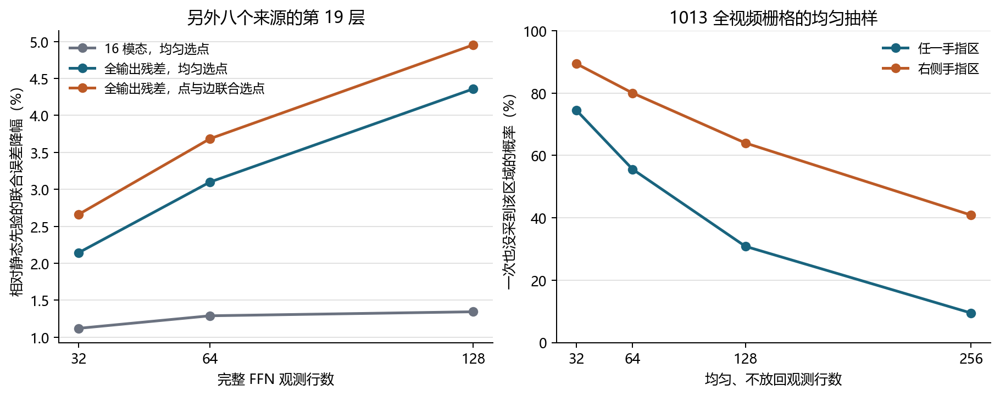

# FFNDS 的观测预算、全输出恢复与跨步跨层实验

2026-11-20 · Wan2.2 四步 HHLL，原生 BF16 教师轨迹 · Operator Tensor Analysis

**64 是历史对照预算。选择多少行取决于要从这些行识别哪一个算子，以及关键位置是否进入观察集。** 在第 19 层，只拟合 16 个谱增益时，32 行已取得大部分收益。允许真实探针修正全部 5120 个输出方向后，64 到 128 行仍有可复现收益。同一预算下，选择能解释更多点与边的位置，也能改善留出恢复。跨步和跨层观测需要另算它们对当前残差的增量信息。

## 1. 64 行分别在拟合什么

令 $i$ 是时空 token，$h$ 是 FFN 隐通道，$c$ 是输出通道。$\Delta H_{ih}$ 为同一位置从锚点到命中的原生 GELU 响应变化，$B_{hc}$ 为第二投影。历史 Global-P64 用 64 行估计各隐藏通道的 $\operatorname{mean}_{i\in P}\Delta H_{ih}^2$，选出最大的 5120 条通道，在全视频共享这个支撑。这个选择精确最小化采样行上被舍弃的隐藏通道平方和。经过 $B$ 写回后的误差还含 $\langle B_h,B_k\rangle$ 所引入的交叉项，两位置写入的相对变化还依赖 $\Delta H_i-\Delta H_j$。全 80 在线读出的 64 行则观测完整 FFN 输出。实验配平了观测行数，两种观测的内容、计算量和估计对象各异。[历史实现与成本](https://github.com/Qesire/FFNDS/blob/22d60b645e070ed528b3b435ec0cbe4b26467108/research/20261118/READOUT_COST_COHERENCE_REASSESSMENT.md)

对 Dense 的真实写入增量 $T_i=F(u_{1i})-F(u_{0i})$，令 $E_i=\widehat T_i-T_i$。留出图的有向关联矩阵为 $D$，长度为 $n$ 的点集及 $m_e$ 条边定义

$$
A=\begin{bmatrix}I/\sqrt n\\ D/\sqrt{m_e}\end{bmatrix},\qquad
J=\|AE\|_F^2 .
$$

一行 $DT$ 含两个位置、两个时刻的四个真实端点。沿边同时计算共模 $(T_i+T_j)/\sqrt2$ 与差模 $(T_j-T_i)/\sqrt2$，保存教师与误差的有符号 $2\times2$ 交叉矩阵，以及投影到两个教师模式后剩余的差模能量。使用真实 hit gate $G$ 后，另报 $G(\widehat T_j-\widehat T_i)$ 相对 $G(T_j-T_i)$ 的夹角和有符号投影系数，后者理想值为 1。不同指标分别保留，能够识别角度改善、幅度进一步收缩的情形。

原生网格为 $21\times29\times52=31{,}668$ 个 token。层 19 的每个来源有 512 个归档位置。主预算试验将它们按 token ID 的固定哈希分成两个 256 行集合，交换观测池和评分集；留出图只在评分集中建同帧近邻边。每个预算都在相同评分位置比较。训练固定用 0032、0304、0456；探索用 0392、0800、1013。另取清单上其余八个 DEV 来源 0056、0176、0886、0947、0950、1040、1084、1109 检验冻结的构造。全为 seed 42。对应专家、折、种子、边和同一视频里的帧均为重复测量。三个来源和追加八个来源分开报告。跨步、跨层的主实验沿用原协议的 64 个分层探针和 448 行评分，其原始 $J$ 只在相同协议内比较。

## 2. 保持读出不变，只改变观测行数

冻结读出为 $Y_b+(Q\operatorname{diag}g)V$，$V\in\mathbb R^{16\times5120}$ 行正交，$Q\in\mathbb R^{N\times16}$。对第 $a$ 个模式，令 $r_a=(Y_P-Y_{b,P})v_a^\top$，$M=A_P^\top A_P$。点边联合观测给出的最小二乘系数是 $g_a^*=q_a^\top M r_a/(q_a^\top Mq_a)$。能否识别它取决于分母的能量及其集中度。一个位置提供完整输出向量，因而也不能由 16 个参数直接推出必须观察 64 行。旧法使用 $1+\tfrac12(g_a^*-1)$。

| 每次命中的完整观测行数 | 8 | 16 | 32 | 64 | 96 | 128 | 256 |
|---|---:|---:|---:|---:|---:|---:|---:|
| 旧半收缩，相对静态先验的 $J$ 降幅 % | 0.745 | 0.929 | 1.007 | 1.038 | 1.038 | 1.037 | 1.026 |
| 直接用观测估计，相同指标 % | 0.121 | 0.818 | 1.143 | 1.258 | 1.297 | 1.311 | 1.338 |

以上在原三源、两专家、两折、均匀与配对两布局、四种子等权。8 行且不收缩时，有 34/96 个配置比静态先验差；32 行起本组为 0。事后让评分标签参与拟合同一组 16 个增益，平均降幅也只有 1.411%。这个面板内诊断直接测出了提高观测数后还剩多少可由旧算子表达的误差。64 行无收缩将门控边角降低 0.322°，但门控投影由 0.71415 降至 0.70986，残存的运动写入幅度偏差依然明显。

## 3. 用少量完整观测估计剩余的 5120 维写入

先用相同 $p$ 行按点边目标估计 16 个增益，得到 $\widehat Y_D$。在已经选择的 2560 个隐藏通道上，取当前廉价可算的非线性割线特征 $x_{ih}=(\Delta H_{ih}-\beta_h\Delta z_{ih})/s_h$。本构造的 $\beta_h,s_h$ 仅用三份 CAL 的原生精度端点估计。定义 $K_{ij}=x_i^\top x_j/2560$。探针上仍存在整条 5120 维剩余写入 $R_P=Y_P-\widehat Y_{D,P}$。在最终 BF16 舍入前使用

$$
\boxed{\widehat Y_i=\widehat Y_{D,i}
+\tfrac12 K_{iP}(K_{PP}+I)^{-1}R_P .}
$$

权重矩阵只混合位置。同一组权重把每条完整探针残差写到所有输出通道，故修正可以进入原来 16 个输出方向的正交补。目标边 $(i,j)$ 上获得的增量为 $\tfrac12(K_{jP}-K_{iP})(K_{PP}+I)^{-1}R_P$。两个位置的廉价特征若不能区分，核项对这条边就没有区分能力。第一阶段按点与边约束主要方向；第二阶段以单位岭、固定半幅传播完整剩余。直接用核修正静态先验、残差标签置乱、只调一个正交补幅度均作对照。单位岭核解来自标准的核线性回归；这里的特征、点边目标、写回顺序和效果由实验确定。[核回归推导](https://gaussianprocess.org/gpml/chapters/RW2.pdf)

**以下各列以相同行数、相同真实探针、相同 BF16 写回的无收缩对角读出为对照。** 八个追加来源，每源两个专家，先对两折配对，再等权汇总。均匀布局使用冻结种子 1120。

| 行数 | $J$ 变化 | 门控边角变化 | 门控有符号投影变化 | 差模正交余能变化 | $J$ 改善的来源×专家 |
|---:|---:|---:|---:|---:|---:|
| 32 | −1.033% | −0.173° | +0.0016 | −0.00159 | 16/16 |
| 64 | −1.832% | −0.302° | +0.0031 | −0.00292 | 16/16 |
| 128 | −3.054% | −0.507° | +0.0053 | −0.00496 | 16/16 |

64 行时，16/16 组的 $J$、夹角、有符号投影三个指标分别均改善。点项下降 2.146%，四端点边项下降 1.669%，共模与差模联合投影矩阵的对角增益分别增加 0.00487、0.00321。每个来源先合并两个专家后，$J$ 的降幅为 0.984%–2.648%。在原三源，0392 的高／低专家分别下降 0.79%／1.97%，1013 下降 0.84%／0.82%，0800 下降 2.89%／1.91%。这里改善的是留出 FFN 写入。

三个对照说明增益来自哪里。

- 拿掉第一阶段，只用点核修正静态先验，八源 64 行的 $J$ 比对角读出低 0.927%，门控边角却增加 0.022°、正交差模能量增加 0.00329。保留先验的方向校准，再传播其剩余，三项可以同时改善。将真实剩余随机错配到同批位置后，正确配对在 16/16 组胜出，平均 $J$ 低 2.060%。
- 只增加一个自由度，调节基础写入在 $V$ 正交补内的幅度，也有收益。追加八源的 64 行结果中，门控投影由 0.72111 恢复到 0.72913，但差模正交余能从 0.20105 升到 0.20588。强制探针边的聚合有符号幅值为 1，留出投影达到 0.96366，同时 $J$ 比静态先验高 26.223%。振幅、方向和非目标写入必须一起看。
- 在相同 64 坐标，用历史 Global-P64 的隐藏增量 RMS 选 5120 通道，重放其支撑规则。完整剩余读出的 $J$ 在追加八源的 15/16 组更低，0056 的 high19 高 10.36%。这次重建使用面板抽样和相应行数的 GEMM；历史视频运行的完整序列、原始坐标和计算成本应单独对照。

## 4. 同样 64 行应该看哪里

可以在读取任何新的完整 FFN 输出之前，用廉价特征和目标图选择观测。设候选池上的条件矩阵初始为 $C=K$，选了位置 $j$ 后更新 $C\gets C-C_{:j}C_{j:}/(1+C_{jj})$。点与边剩余方差的迹 $\operatorname{tr}(ACA^\top)$ 因此减少 $\|AC_{:j}\|_2^2/(1+C_{jj})$。按这个值逐次选取一行。这里把特征核当作剩余相关性的代理；最优性只针对每一步的这个代理准则。

在追加八源，给相同的全输出读出选择 64 行，这种选点比均匀选点再降 $J$ **0.606%**，16/16 组改善，门控角平均降低 0.073°；有符号投影在 8/16 组增加。只把均匀点凑成同帧近邻，在原三源的 8 行预算能把平均可用观察边从 1.21 增至 4.04，到 32 行旧对角读出的两种布局已很接近。候选池为 256 行；全序列应用时需明确候选池大小和筛选成本。

**对关键位置，实际覆盖比平均误差更能说明 64 的局限。** 将已有 Dense 视频的局部点轨迹用于回顾性定位。首帧矩形随其中至少三个仍可见角点的中位位移平移，映到 $832\times464$ 图像上的名义 token 中心 $(16x+8,16y+8)$，取视频帧 $4t$ 作时标。这是中心覆盖代理，VAE 的时空感受野跨越多个像素和帧。历史 fixed64 使用仓库里按原选点函数重建的 ID。

| 来源／区域 | 可定位的格点数／31,668 | 历史 64 行命中 | 均匀 64 行全漏概率 | 48 个全局点＋16 个成对点的命中数 |
|---|---:|---:|---:|---:|
| 1013 左侧手指 | 179 | 1 | 69.5% | 7 |
| 1013 右侧手指 | 110 | 0 | 80.0% | 6 |
| 1013 两手合并 | 289 | 1 | 55.6% | 13 |
| 1013 口部与烟斗 | 192 | 0 | 67.7% | 0 |
| 0392 靠垫 | 207 | 2 | 65.7% | 7 |
| 0392 书架 | 228 | 0 | 62.9% | 6 |

漏采概率精确按 $\binom{N-M}{p}/\binom Np$ 计算，条件是给定上述可定位集合、全网格均匀不放回。最后一列是另外执行的几何对照。每源保留 48 个全局位置，同时在两个首帧指定区域、四个潜时间片各取一对水平相邻点。1013 在两手留下六条**两端均落在跟踪区域**的空间边；口部没有获得配额。0392 的靠垫、书架分别只有 14、13 个时间片能定位，尚不足以判定整个后半程。几何对照没有这些新增行的真实 FFN 标签。主试验中，1013 的原生 P512 面板在可定位的两手区域合计只有 3 行，两折留出图的手部内部边都是 0 条。面板均值无法验证指尖闪烁消失。[历史固定探针坐标重建](https://github.com/Qesire/FFNDS/blob/22d60b645e070ed528b3b435ec0cbe4b26467108/reports/20261118/observed_secant_ffn_operator/analysis/PROBE_GEOMETRY_RECONSTRUCTION.json)

## 5. 跨步与跨层的真实信号能补多少

**跨去噪步。** 同源、同 seed、同一组 512 个 token，high 第 0→1 步获得观测，low 第 2→3 步有新锚点。在三个 CAL 来源学习早步到晚步的映射，两个专家各有自己的谱基。早期 64 行加晚期 0／16／64 行合计支付 64／80／128 个完整行求值。早期和晚期同坐标仍是两次不同的 FFN 输入。

对联合归一化后堆叠的低噪残差 $R$，若早步只保留 $X=AQ_H$，晚步只允许输出到固定 $V_L$，任意 $16\times16$ 在线矩阵最多可消去 $\|P_XR P_{V_L}\|_F^2/\|R\|_F^2$。这是用查询真值计算的、舍入前的样本内表达上界。在 0392／0800／1013 分别只有 0.266%／0.224%／0.198%；扣除当前 $Q_L$ 可任意拟合的部分，历史独有份额为 0.180%／0.140%／0.119%。实测在晚步已有 64 行时，0392 的 $J$ 从 703.856 变为 703.865，其余两源变化也小于 0.01。

将输出放宽到 5120 维，同一早步特征的面板内上界升至 5.08%–5.37%。实际做 CAL3→DEV11 的全维岭回归后，正确早步位置在 11/11 来源优于同帧错位；未经收缩的映射也在 11/11 来源增加了相对当前读出的 $J$。三折留一 CAL 估计的幅度只有 0.03882。晚步已有 64 行时，一个更有效的先验是使用三 CAL 的晚步平均增益，11 源 $J$ 平均下降 0.982 个原始单位，但有符号幅值略向零收缩。在这个先验上再叠加弱历史项，平均仅降 0.00669 个原始单位，角度只在 6/11 来源改善。后一个基线比较是查看主试验结果后的复核。历史中确有空间对应信息，当前跨专家估计器兑现的量很小。

固定 high 与 low 两次命中总观测数为 128，只改变分配。原三源直接估计对角读出，$(32,96)/(64,64)/(96,32)$ 的站点等权相对 $J$ 降幅依次为 1.205%／1.258%／1.235%。按原始能量合并则为 1.140%／1.248%／1.267%。终端画面对两个注入点的敏感度决定哪种加权有意义。两处隐层损失之和不能识别该敏感度。旧的真实四臂 P64 视频在另外两个来源也观测到 high 与 low 动作的非加性交互。[历史四臂视频结果](https://github.com/Qesire/FFNDS/blob/22d60b645e070ed528b3b435ec0cbe4b26467108/research/20261030/CHIPMUNK_P64_FACTORIAL_QUALITY_RESULTS_20261030.md)

**跨网络深度。** 从同一归档取回第 4 层的 24 份真实端点，与第 19 层逐源逐步核对 token、坐标、时间和 SHA。三份 CAL 学习从第 4 层 $\Delta Y_4$ 到第 19 层静态剩余的全输出岭映射；用当前层已可见的 $\Delta U_{19}$ 核传播。比较 4 层 64 行、19 层 64 行、两层各 32 行，另有早层标签错位及当前层留一调幅对照。此比较的“观测”沿用归档原生完整前向捕获的教师行，区别于主预算扫描按所选行数直接重算的 BF16 观测。

早层预测与 19 层真实剩余在探针上的余弦仅 0.0054–0.0349。直接转移早层 64 行使六组 $J$ 上升 2.12%–3.76%，边角增加 0.24°–0.61°。当前 32 行已知后再加早层 32 行，经当前探针留一调幅，六组相对静态基线的边际变化仅 −0.0044 至 +0.0059 个百分点，与错位对照接近。相反，把当前层完整实测残差沿 $\Delta U_{19}$ 延拓，在同预算对角基线上允许全输出修正，三源六组的平均相对 $J$ 随 16／32／64／128／256 行变化为 +1.864%／−0.025%／−1.418%／−2.900%／−4.718%。小预算下扩大写入空间会增加方差。此证据限于第 4→19 层，同一路径中的邻层或经真实下游传播后的误差方向仍待检验。

## 6. 计算预算与完整生成的判据

对 $d=5120,m=13824,K=2560,r=16,N=31668$，同一命中的完整探针约 $2pdm$ MAC；32／64／128 行分别约 4.53／9.06／18.12 G。显式 16 模态约 $Nr(K+2d)=6.49$ G。完整剩余的核交叉乘和全输出写回另约 $Np(K+d)$，32／64／128 行分别约 7.78／15.57／31.13 G。实际实现还需计算小 Gram、解小系统、选点、激活标准化与访存。锚点选中通道的预激活要能复用或缓存，以避免额外重算；写回可按 token 分块。这里的 MAC 是相同基础算子之外的主项，未测部署延迟。

由此也可作跨预算实测比较。追加八源中，**32 行完整剩余读出相对 128 行对角读出**，所有 16 个来源×专家的平均配对 $J$ 均下降，合计下降 0.808%，门控角下降 0.120°、有符号投影增加 0.00124。两者额外主项约为 18.80 G 和 24.60 G MAC。相同 64 行比较时，完整剩余读出付出的计算比对角读出高。既有面板支持把 32 行作为节省计算的候选、64 和 128 作为增加恢复能力的候选；资源选择还取决于实测时延以及视频上的关键区域。

用于下一次完整 D4 比较的三个干预可以分清收益来自何处。先以 0392、1013 同源同初噪，对角 64、完整剩余 32、完整剩余 64 使用相同全局观察规则，比较表示与预算；再给完整剩余 64 改为 48 个全局点加 16 个首帧区域成对点，比较关键位置覆盖。在两个来源均捕获相同的层、步及独立关键位置评分边。优先对照历史 P64 及 Dense 视频，保留 0392 起段共同位移、中后段遮挡后重显与相对次序，1013 的手指、口部和稳定背景分别报告沿轨迹对齐的相邻帧外观差、位移方向与可见率。不同干预下比较同帧、同位置的交叉矩和穿过各步、各层后的带符号误差；后段对应不足时列出覆盖数。本轮新生成视频数为 0，当前还无法判断哪一个预算能消除这两种视频失真。

复算包包括全部新脚本、逐来源结果、方向矩阵、探针 ID 或可重建的选点规则、图表、绑定与 SHA 清单。原始权重及学校归档的大张量按绑定另取。[下载复算包](REPLAY.zip)

