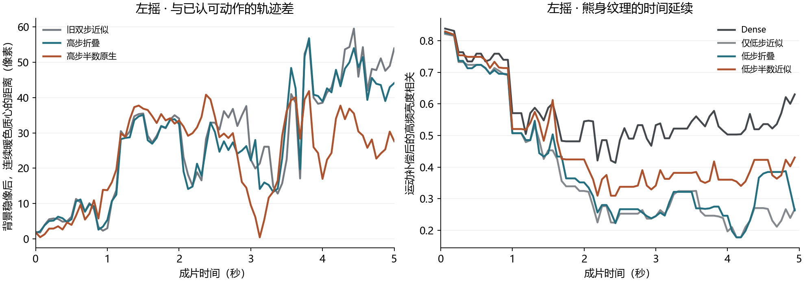

# 0951 高低噪声步的改进实测

**本轮最值得审查的是保留原生高步、把低步近似缩到 20 层。** 左摇相对 low_only，两种纹理相关都升高，闪烁降低，粗动作的四帧位移方向余弦为 0.980。它实际少占一半锚槽。低步全折叠的微小指标收益已经由用户判为观感基本持平；20 层版本是另一个构造，其人眼判定仍待补入。左摇低步 40 层与 20 层双路视频（本地归档） · 原提示双路视频（本地归档）

**用户对左摇动作的判定**　原生高步、近似低步的版本（low_only）动作正确、没有可见抖动，主要损失在纹理。恢复高步一半层为原生后，抖动减轻，但动作仍然不同。高步全层折叠与旧双步锚点版在用户看来基本一样差。这三条判断分别用于评价动作、抖动、纹理。本轮独立校准只使用 0032、0304、0456，成片测试均为同一张 0951 图、种子 42。[预先设定的实验与审片记录](实验设计与审片口径.md) · 左摇动作四路视频（本地归档）

## 高噪声步的两种尝试

第一种方案给高噪声专家的 40 层各自离线拟合一项非线性割线剩余，再折进已有两块 BF16 权重。在线保留原 64 个探针、80 列读出和相同的乘法形状。第二种在步 1 的奇数层恢复原生 FFN，偶数层使用相同折叠权重。两者在步 3 都沿用旧锚点读出。动作四路中，右上是旧双步近似，左下是高步全折叠，右下是高步半数原生，左上是用户认可的 low_only。[折叠实现与真实数据核对](折叠编译核对.md)

| 左摇版本 | 相对 low_only 的粗轨迹差 P90（px） | 四帧位移方向余弦 | 暖色主体占画面 | 熊身纹理相关 | 追踪块相关 | 补偿后亮度闪烁 |
|---|---:|---:|---:|---:|---:|---:|
| low_only | 0.0 | 1.000 | 13.57% | 0.314 | 0.346 | 10.56 |
| 旧双步近似 | 48.9 | 0.474 | 7.08% | 0.141 | 0.312 | 12.52 |
| 高步全折叠 | 47.8 | 0.455 | 8.49% | 0.162 | 0.307 | 12.27 |
| 高步半数原生 | 37.3 | 0.447 | 11.51% | 0.269 | 0.335 | 10.40 |

粗轨迹来自去除背景运动后的连续暖色质心。四帧位移方向余弦描述运动方向随时刻的匹配；P90 是逐时刻质心距离的第 90 百分位。半数原生使主体占比和大幅位置偏差更接近参照，位移方向余弦仍很低。高步全折叠在右摇也没有一致收益，稠密纹理相关从旧版的 0.229 降至 0.166，独立追踪块从 0.322 微升至 0.329。右摇使用同图另一条提示，尚无人眼判定。[连续暖色位置和方向的逐组结果](evaluation/各臂连续暖色运动.md) · 右摇三路视频（本地归档）

**高步半数原生究竟改了什么，可以直接在潜变量中分解。** 在同一步，令 \(e=z_{\rm old}-z_{\rm lowonly}\)，\(u=z_{\rm new}-z_{\rm lowonly}\)。对于潜时间差算子 \(A\)，先将 \(Au\) 投影到旧误差方向 \(Ae\)，再度量正交分量。以 \(\|Ae\|\) 归一化，步 2（两臂共同执行的原生更新）后的结果如下。

| 左摇的高步方案 | 沿旧时间差误差的投影系数 | 正交分量比例 | 总时间差误差比 | 逐潜帧空间均值的误差比 |
|---|---:|---:|---:|---:|
| 高步全折叠 | 0.982 | 0.178 | 0.998 | 0.927 |
| 高步半数原生 | 0.734 | 0.673 | 0.996 | 0.666 |

半数原生减少了沿原误差方向的分量，但也产生了相当大的正交分量。于是逐帧平均状态明显更接近动作参照，时间差误差的总范数却几乎没动。这解释了为何单看误差总量会漏掉两种成片之间的变化。上述投影发生在潜变量空间，具体哪一方向对应抖动，仍需视频给出判断。[分步有符号传递与正交分量](stage_directions.json)

## 在保留原生高步的条件下修复纹理

**用户审片结果**　左摇双路中，左边的 low_only 与右边只替换末步折叠权重的版本，肉眼看基本一致。本轮将其记为“目视基本持平”，不把下述小幅指标差计作实际画质胜出。

首先只替换低步残差基底。相对 low_only，原提示与左摇的前三步预测和步后潜变量均逐字节相同。左摇的粗运动方向余弦为 0.993，轨迹 P90 差 1.98 px。稠密纹理相关从 0.314 到 0.335，追踪块从 0.346 到 0.362，亮度闪烁从 10.56 到 10.36。原提示没有同样一致的改善，三项从 0.630、0.700、7.87 变为 0.631、0.696、7.97。这个改法可以检验一次小幅末步调整是否肉眼可辨。左摇仅低步与低步折叠双路视频（本地归档） · 原提示同步视频（本地归档）

另一种做法同时改变计算路径和实际驻留。高步 40 层全部原生，低步 20 个偶数层继续使用原锚点，20 个奇数层直接用原生 FFN。全过程的 160 次逐层调用有 120 次直接原生、20 次建立锚点、20 次使用锚点；实际只分配 20 层槽。两条正式片的前三步预测和潜变量均与 low_only 完全一致。

| 提示 | 版本 | 熊身纹理相关 ↑ | 独立追踪块相关 ↑ | 亮度闪烁 ↓ | 相对 low_only 的轨迹 P90 差 | 四帧方向余弦 |
|---|---|---:|---:|---:|---:|---:|
| 左摇 | low_only | 0.314 | 0.346 | 10.56 | 0 | 1.000 |
| 左摇 | 仅低步 20 层近似 | 0.418 | 0.381 | 9.69 | 4.35 px | 0.980 |
| 左摇 | Dense | 0.548 | 0.494 | 8.48 | 6.41 px | 0.957 |
| 原提示 | low_only | 0.630 | 0.700 | 7.87 | 0 | 1.000 |
| 原提示 | 仅低步 20 层近似 | 0.674 | 0.707 | 7.71 | 2.08 px | 0.984 |

左摇中，这一构造回收了 low_only 到 Dense 的稠密纹理相关差距约 45%、块相关差距约 24%。从逐时刻曲线看，第二秒以后尤其便于比较毛绒。用户已认可的动作参照仍为 low_only；粗轨迹接近不能代替对动作细节的核查。左摇四路纹理视频（本地归档） · [实片与完整数表](evaluation/视频与指标.md)

## 测量误差与成本口径

首轮预热与历史片的初始噪声、所有去噪预测和步后潜变量全部一致，但 MP4 解码像素不同。两个文件的 x264 参数显示，编码线程分别为 6 和 12，前瞻线程分别为 1 和 2。未留存编码前原始 RGB，无法从这一对文件唯一归因。该对照的熊身纹理相关相差 0.020，按最大暖色连通区估计的轨迹 P90 差达到 59.54 px。随后在评估新增候选前，用平滑暖色权重替换最大组件选择，使同潜变量两片的 P90 差降到 2.79 px，四帧运动方向余弦为 0.986。它仍是粗运动代理，不能裁决细小肢体动作。这个编码对照的差值只描述这一对片，不能当成其他候选的显著性阈值。本轮正式运行恢复原 4 核配置，并用同机重新生成的父版本作对照。[编码与原片比较](attempt1/编码复核.json) · [动作估计的正负对照](evaluation/连续暖色动作复核.md) · [父版本复现记录](parent_checks.json)

两个专家全 80 层的离线编译实耗 266.00 秒，后续进程复用并核验同一组结果耗时 14.04 秒。全套新权重包共 5.86 GiB，实验中在线只驻留一个版本的权重。左摇主批同机单次整片耗时分别为旧双步 40.56 秒、高步全折叠 43.42 秒、高步半数原生 41.41 秒、low_only 41.68 秒、仅低步折叠 42.27 秒。五臂均沿用完整驻留，待推理时 GPU 已分配 43.55 GiB，生成峰值均为 47.57 GiB。同形折叠在本例没有测出整片提速；同一主批中的 H20 也仍持有全部锚槽。[主批原始回执](arms.json)

20 层版本直接复用原权重，无需上述新增折叠校准。在独立进程中，锚点槽由完整版本的 30.20 GiB 降到 15.10 GiB，生成峰值从 47.57 GiB 降到 26.52 GiB。独立 Dense 峰值为 9.44 GiB。左摇同一张 A100 各测一次，Dense 与 20 层版的整片墙钟分别为 49.432、45.411 秒；其中四步 GPU 事件合计分别为 31.415、30.998 秒，只相差 0.417 秒。原提示 20 层版的四步事件为 31.097 秒，整片墙钟却达到 66.568 秒。目前能确认显存节约，整片速度仍需同机交错重复测量。全程三个作业耗用 76 次去噪调用，其中有 8 条新构造视频。首轮预热的编码差、主批旧槽未释放后的独立进程补测，都已计入成本。[驻留、计时与复算](驻留与复算.md) · [独立进程运行回执](compact_job_result.json)
