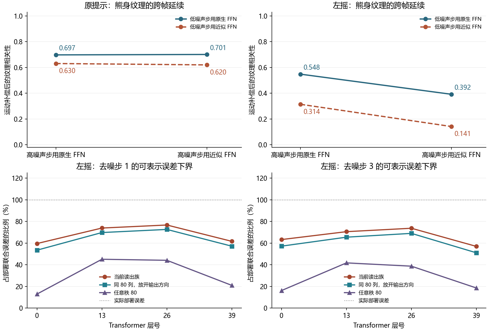

# 0951 左摇时，哪一步改变了轮廓，哪一步丢了纹理？

在同一张熊图、同一种子 42 上，左摇的四路真实生成给出了两个可分辨的结果。**高噪声步使用锚点近似时，熊身在画面中的占比变小，轮廓法向运动的波动明显加大。低噪声步使用近似时，即使前三步的状态和 Dense 完全相同，熊身纹理的跨帧延续仍然变差。** 两步合用时，主体的运动补偿闪烁最强。四路背景的累计横移只相差约 2 像素。当前读出在固定预算下也有实测改进余地，其中有一项可以离线折进已有权重。下面分别说明视频、同输入算子和计算成本能支持多强的判断。

## 四路视频与判别量

**用户审片记录（2026-11-21）**　0951 左摇的仅低噪声步近似版动作正确，没有可见抖动，画面损失体现在纹理。结合双步近似片上的运动异常，用户将本例的主要运动问题定位在高噪声近似。后续把仅低噪声步近似片作为已认可的运动参照，单独检查熊身运动、轮廓和毛绒延续。表中仅低噪声组的边界统计略高于 Dense，这个数值差没有对应到本次人眼观察中的抖动。

原提示为 *A teddy bear is climbing over a wooden fence*，另一组追加 *camera pans left*。每个提示的四路共享初始噪声、调度、网络参数、解码器和输出规格。四个去噪步从 0 起数。步 0、2 均用原生 FFN；对步 1（高噪声）和步 3（低噪声），分别让全部 40 层使用原生或保留锚点的近似。仅高噪声近似与双步近似的前三步、仅低噪声近似与 Dense 的前三步，逐步预测和步后潜变量指纹分别一致。两条重新采集的双步近似轨迹也复现了归档片的四步状态与解码像素。[预先确定的比较](判别约定.md) · [轨迹指纹核对](runtime/prefix_validation.json) · [运行记录](runtime/RESULT.json)

两条同步片均为 81 帧、16 fps，四格从左上起为 **Dense、仅高噪声步近似、仅低噪声步近似、高低两步均近似**。可先纵看左列，检查同一早期轨迹经末步近似后毛绒纹理的变化；再横看上排，检查保留同一原生末步时，熊身大小和边界运动的差异。四格保留每路原始分辨率，逐帧核对时间戳与各路源片。左摇四路视频（本地归档） · 原提示四路视频（本地归档） · [素材校验](factorial/四路素材校验.json)

| 条件 | 近似步 | 熊身纹理相关 ↑ | 追踪块纹理相关 ↑ | 补偿后亮度闪烁 ↓ | 边界法向加速度 ↓ | 暖色熊身面积 % | 背景横移 px |
|---|---|---:|---:|---:|---:|---:|---:|
| 原提示 | Dense | 0.697 | 0.724 | 7.35 | 1.19 | 9.99 | −22.1 |
| 原提示 | 仅高 | 0.701 | 0.678 | 8.02 | 0.95 | 9.11 | −25.5 |
| 原提示 | 仅低 | 0.630 | 0.700 | 7.87 | 1.14 | 9.72 | −22.2 |
| 原提示 | 高＋低 | 0.620 | 0.620 | 9.02 | 1.08 | 8.90 | −26.3 |
| 左摇 | Dense | 0.548 | 0.494 | 8.48 | 1.78 | 14.85 | +195.3 |
| 左摇 | 仅高 | 0.392 | 0.387 | 10.42 | 3.67 | 7.97 | +197.0 |
| 左摇 | 仅低 | 0.314 | 0.346 | 10.56 | 1.94 | 13.57 | +195.9 |
| 左摇 | 高＋低 | 0.141 | 0.312 | 12.52 | 3.46 | 7.08 | +197.2 |

熊身用暖色色区定位，面积为占全帧的百分比。第一种纹理相关测量当前高频亮度与前后两帧经稠密双向光流补偿后高频亮度均值的相关性。第二种在低频影像上追踪局部块，再给高频块 ±2 像素的额外配准余量。其已知刚性平移对照为 1.000，插入独立高频扰动后为 0.528。闪烁是补偿后的亮度二阶差绝对值的一半，使用 0–255 灰度尺度。边界量是在扣除背景运动后，沿局部亮度梯度法向的像素位移二阶差，每帧取第 75 百分位，再对时刻取中位。它也会响应真实非匀速运动。背景横移是每帧外圈特征估计的画面位移之和，向右为正。画质优劣保留给人眼核查。[四路原数与效应](factorial/析因结果.json) · [跟踪正负对照](patches/controls.json) · [指标实现](../../work/vbench_scale24/diagnose0951.py)

**高噪声步主要改变了这里测到的轮廓运动和前景尺度。** 左摇仅高与 Dense 比较，边界量增加 1.89，暖色面积由 14.85% 降到 7.97%。在末步已用近似的条件下，高噪声近似仍使边界量增加 1.53。仅低与 Dense 比较，边界量只增加 0.16。于是把高步恢复原生，可以让左摇的边界量从双近似的 3.46 回到 1.94，却仍留下明显的纹理缺口。大的姿态和尺度变化也会改变算法能追到的熊身像素，不能将整个边界差换算成同一物理表面上的抖动。

**低噪声步对左摇的纹理有单独可见的作用。** 同一 Dense 前缀下，仅改变末步就使纹理相关下降 0.234，追踪块相关下降 0.148，闪烁增加 2.08。改用相同的高噪声近似前缀，末步近似又使三项分别变化 −0.250、−0.074、+2.10。双步近似相对 Dense 的稠密纹理相关下降 0.406，二因素交互项为 −0.016；闪烁增加 4.04，交互项为 +0.03。这两个测量在该条件下接近相加。追踪块相关的交互为 +0.074，各格子可跟踪区域也有变化，不能把相加推广到所有读数。原提示下，稠密纹理相关的双步降幅只有 0.078，仅高时两种追踪器甚至对微小差异给出不同符号。[四路析因分解](factorial/析因结果.json)

**左摇中后段的差异持续存在。** 将 79 个可测中心帧依时间分成 27、26、26 帧，双步近似的纹理相关中位数依次为 0.465、0.117、0.054，Dense 为 0.727、0.488、0.540。后两个区间各 26 个时刻均为双近似低于 Dense。与此同时，双近似可作双向稠密追踪的熊身内部像素中位占比由前段的 91% 降至末段的 59%，Dense 末段约 89%。可见表面与追踪难度都随轨迹改变；这 79 个时刻来自同一条片。[左摇 Dense 逐帧值](../FFNDS_anchor_scale24/camera7/diagnosis/pan_left_dense.json) · [左摇双步逐帧值](../FFNDS_anchor_scale24/camera7/diagnosis/pan_left_candidate.json)

再只比较**同一时刻、暖色主体面积之比不超过 1.15、有效跟踪率相差不超过 5 个百分点**的帧。原生高噪声前缀下有 49 对，末步近似使其中 48 对的纹理相关下降，中位差 −0.130。高噪声近似前缀下有 23 对，22 对下降，中位差 −0.080。放宽匹配条件并限定在各自的早、中、晚段，两组在三个时段的差值也都为负。这削弱了「晚步评分低完全来自面积较小或跟踪覆盖率较低」的解释。两者都是生成后的代理量，第二组能严格匹配的时刻尤其少。[匹配方法、逐帧记录与敏感性](factorial/左摇尺度与跟踪率匹配.md)

## 误差沿哪条计算路径进入视频？

设位置 \(p=(t,y,x)\)，其中 \(t\) 是潜视频时间，\(s\) 是去噪步，\(\ell\) 是层号，\(c\) 是输出通道。固定一次候选调用的实际输入 \(U\)，定义门后误差 \(r_{p c}=g_c[\widehat F(U)_{p c}-F(U)_{p c}]\)，参考变化为 \(f_{p c}=g_c[F(U)_{p c}-F(U_0)_{p c}]\)，其中 \(U_0\) 是该位置缓存的锚点输入。每个专家、层与命中步均使用自身的目标和门。对点或有向差分算子 \(A\)，比较相对误差 \(\|Ar\|/\|Af\|\)、有符号投影 \(1+\langle Ar,Af\rangle/\|Af\|^2\) 及方向余弦。差分保留正负，先作差再统计，可揭示逐点范数掩盖的相邻写入失配。联合算子等权计入留出点、同潜帧相邻格差和下一潜帧同格差。

**较早的误差可以沿原生网络放大。** 记 \(e_{\rm in}\) 为经过步 1 后仅高与仅低两臂的潜变量之差，\(e_{\rm out}\) 为共同经过原生步 2 后的差。步 2 用同一更新函数处理两个不同输入。令 \(e_{\rm out}=a e_{\rm in}+b\)，\(\langle b,e_{\rm in}\rangle=0\)，可分别测出保留和转向其他方向的误差。左摇的潜变量 RMS 从 0.03018 增至 0.08072，增益 2.675，\(a=2.137\)，\(\|b\|/\|e_{\rm in}\|=1.609\)。原提示从 0.02603 到 0.06666，增益 2.561。取潜时间差后，左摇的输入差已较原提示大约 29%，两者随后分别放大 2.882 和 2.866 倍。这说明左摇在进入共同原生步以前就已有较大的时间结构差异。这两个有限割线只刻画实际走过的方向；各层因果权重和全局雅可比范数仍不可由此识别。[潜变量传递与正交分量](runtime/ablation.json)

**同输入复算把后期缺口定位到了部分结构。** 两个提示在步 1、3 各取第 0、13、26、39 层，用实际候选输入重新执行原生 FFN。共享 725 个非探针位置。低噪声步中，熊身内部门后相对误差从原提示 0.293 升至左摇 0.364，绝对 RMS 从 0.0263 升至 0.0362；高噪声步对应的相对误差为 0.293、0.284。合并两步的八站中位数，色区边界逐点误差为 0.305、0.288。局部轮廓逐点误差没有随着左摇普遍升高。每个提示的颜色区域是通过图像网格对应的代理，层位与区域均为有目的抽样。[同输入逐层对照](runtime/同输入门后误差.md)

对能匹配到相邻潜帧同一运动区域的边，再作一次方向检查。步 3 在这些边上的投影增益从原提示 0.838 降至左摇 0.808，相对 RMS 从 0.383 升至 0.423。两提示分别只有 215、102 条双端实测的可配准边，其中目标移到不同网格的仅 32、37 条。投影增益低于 1 表示延拓的变化沿真实差分方向欠幅；余下误差还含正交分量。整体证据支持“较早改变运动轨迹、较晚难以维持纹理的时间差分”并存。目前观测尚不足以把某层的误差单独归为熊身闪烁的来源。[方向统计与独立运动匹配](联合误差分解.json) · [实际可用运动边](可观测运动边.json)

## 相同预算下，当前方法还能改善多少？

当前 P64 在每个命中层对 31,668 个时空位置取 64 行完整 FFN 观测，用含点值与同帧邻边的度量共同估计 16 个指定方向的增益和 64 个核截面的校正；非探针位置使用半幅核校正，探针位置回填完整响应。原提示与左摇各有 4 个探针直接落入暖色核心，左摇边界反多命中 1 个。固定 64 点预算、用同一事后候选池复算时，替换为一次均匀布局，左摇点、空间差和时间差的 RMS 只降低 1.57%、0.62%、0.47%。这说明原位置还有改进余地，也说明换点在本次面板上只回收了小部分差分误差。[探针的时空覆盖](geometry/探针覆盖与局部不稳定.md) · [更换布局的真实标签对照](geometry/同输入更换探针.md)

令 \(E=(F(U)-B)G\) 为扣除已有基底 \(B\) 后的真门控剩余，\(D=[Q,K_{:P}]\) 是 16 个状态响应和 64 个探针核截面组成的 80 列设计。左摇同一批三联的中心点和空间、时间邻边上，逐站把**实际部署联合误差定为 100%**，再对四层等权汇总。允许拟合时读取全部评分真值，可得到三种逐级放宽的样本内下界。

| 可选系数或空间 | 高噪声步剩余误差 | 低噪声步剩余误差 |
|---|---:|---:|
| 保留 16 个指定输出方向，最优化原读出族全部系数 | 67.96% | 66.13% |
| 保留同一组 80 列，放开其输出通道方向 | 63.25% | 60.67% |
| 允许为该评分面板重新选取任意秩 80 表示 | 30.75% | 28.77% |

第一行通过消去核列空间、在其正交补上求解 16 个增益得到；第二行投影到 \(AD\) 的列空间；第三行由 \(AE\) 的奇异值平方尾和得到。最后两行之间的距离表明，即使宽度同为 80，廉价特征张成什么空间也很重要。所有下界均允许看到评分真值，因此不能直接视为生成可兑现的收益。现实地只用 64 个标签、将原估计换成此次测试的自由岭回归，左摇高、低两步联合误差反升 10.36%、11.85%；只调整末端核幅度，即使事后选得最好，也最多回收 2.47%、1.34%。[下界公式、精度与逐站求解](0951真实站点最优性.md)

**已有正例是丰富离线基底。** 用同一张图的原提示真值学习状态割线的静态剩余映射 \(\Phi W\)，随后在左摇沿用真实 64 探针、原增益和核读出。第 1、3 步的门后点／空间差／时间差联合误差分别降 4.24%、4.43%，8 个站点全部改善；时间差角度分别减小 0.396°、0.376°，时间差有符号投影分别增加 0.0029、0.0032。左摇分组评分的 365 个位置与原提示校准的 371 个位置有 11 个坐标重合。新基底在此为连续精度回放。另在历史第 19 层把相同类型修正实际折入 BF16 的基底矩阵和选中隐通道的第二投影，11 个测试来源均改善，门后点和空间差联合能量平均降 1.246%，匹配功率的同帧置乱反而变差。两次实验的来源、评分算子和精度各异。[同图跨提示回放](0951真实站点最优性.md) · [历史 BF16 折叠与反对照](最优性审计.md)

## 计算成本和下一种构造的取舍

24 个来源既有单 A100 配对测得，完整保留锚点版整片均值 39.470 秒，Dense 为 40.059 秒，速比 1.0149，逐位置锚点槽占 30.20 GiB。按阶段看，包含建锚与使用锚点的高噪声两步，配对节约时间中位数 0.291 秒，低噪声两步为 0.296 秒。因此单独恢复一个阶段的原生 FFN 会拿回一部分局部质量，也会放弃该阶段的时间收益。本次单步干预沿用相同驻留和准备过程；四条单步片在该作业各用 38.79–39.01 秒，其差异不足以判定两种单步部署的速度。[正式整片计时](../FFNDS_anchor_scale24/计时与等价性.md) · [分阶段计时复算](factorial/析因结果.json) · 干预作业日志（本地归档）

值得优先推进的是**按专家和层离线学习可折叠的剩余映射，在线保持原 64 探针与两块乘法形状**。折叠满足实数线性恒等式，BF16 舍入、冷启动和实际墙钟仍需逐项核验。校准应来自与最终审片分开的多张图，包含有、无横移的轨迹。拟合时可单列空间边、同格潜时间边和有双端观测的运动对齐边；高噪声层的候选用前景轨迹和边界运动评价，低噪声层用同一早期前缀下的纹理延续和闪烁评价。整片必须同时报告背景位移和可跟踪覆盖率，以识别靠减小运动或改变主体大小获得的表面改善。

在数学上，若要逼近终端目标，可令 \(T_i\) 为从站点 \(i=(s,\ell)\) 的门后写入到终端可测特征的局部线性传递，误差近似为 \(\sum_i T_i r_i\)。其能量包含带符号的交叉项 \(\langle T_i r_i,T_j r_j\rangle\)。本次四路视频直接测得两阶段对**最终统计量**的有限干预效应；这些标量差分不足以辨识每层的 \(T_i\) 或全部交叉项。离线基底的实测改进已构成当前设计在局部目标上并非最优的反例。新基底能否在同等墙钟下减少人眼可见闪烁，仍需独立图像的生产精度生成检验。原生 Dense 在这里是可复现的干预参照，提示遵循和观感由审片确定。

