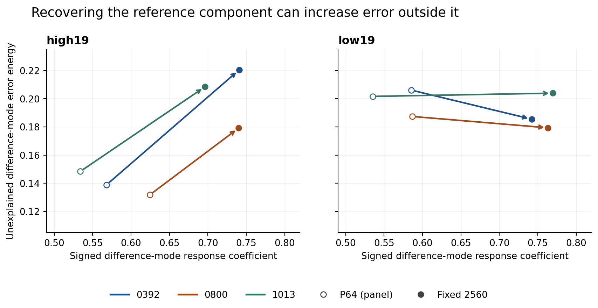

# FFNDS 自由实验：共同运动、相对运动与原生通道的联合误差

## 要回答的问题

在相近计算量下，改变 FFN 的表示或改变精确计算的位置，能否恢复 Dense 在困难位置的响应方向和区域关系？本轮重读了 FFNDS 的全 80 位点开发结果，分析了已有的真实 81 帧视频，并在同一批真实 Wan2.2 输入、权重和教师输出上运行了新构造。新增完整视频为 0 条。现有证据支持改造算子，视频端的优劣仍有待同初噪自由生成。

0392 的观察是 P64 开头能跟上运动，后段仍发生全局解离；1013 的 R03 续包第 21 场中，A、B 的细微动作部位都闪烁。此前曾出现 ICC 同输入局部 MSE 最低、完整视频的主体一致性与画质反而大幅下降的结果。这两段视频各有明确的判别对象。判断 0392 要跟踪共同运动和区域间的相对位置。判断 1013 要让每一解码帧都参与，分开部位的位移误差与对齐之后的外观变化。[严格复现实验](https://github.com/Qesire/FFNDS/blob/22d60b6/reports/20261117/ffnds_strict_reproduction/README.md) · [已发布的 DEV3 实验](https://github.com/Qesire/FFNDS/blob/22d60b6/reports/20261119/state_coupled_secant_ffn_operator/README.md)

## 同一观测上的联合统计

在 FFN 回放中，$t_i$ 表示第 $i$ 个位置的 Dense 命中输出减锚点输出，再乘本次命中的原生 gate。$e_i$ 为候选减 Dense，使用同一 gate。在视频轨迹中，$t_i$ 换为某一区域相对起始帧的二维位移，$e_i$ 换为候选与 Dense 在同一可见特征集上的位移差。对一对有定向的位置 $i,j$，取 $t_+=(t_i+t_j)/\sqrt2$、$t_-=(t_j-t_i)/\sqrt2$，误差也作同样变换。原始两端可以从这两项完整恢复。

令 $D_a^2=\sum_e\|t_{e,a}\|^2$，$a,b\in\{+,-\}$。把每种模态除以自己的 $D_a$，记标准化后的目标、误差为 $T_a,E_a$。在比较方法之前固定边与权重。保留三个矩阵

$$
G_{ab}=\langle T_a,T_b\rangle_F,\qquad H_{ab}=\langle T_a,E_b\rangle_F,\qquad C_{ab}=\langle E_a,E_b\rangle_F.
$$

$H_{--}<0$ 表示净误差沿 Dense 相对运动的反方向；$C_{+-}$ 记录共同误差和相对误差是否同向出现。$M=I+G^{-1}H$ 是候选响应在这两个标准化 Dense 模态上的联合投影系数；对角应接近 1，非对角应接近 0。$C-H^\top G^{-1}H$ 保留两个 Dense 模态共同解释不了的误差。三者都是同一样本上的未中心化矩，保留系统偏移；独立的统计单位是来源，边数、帧数和 token 数只描述覆盖。视频区域的原始位移另存带符号的像素值。隐层中，横向边统一向右、纵向边向下，互为最近邻的边去重，另存两个方向的分表；方向角与逐边投影的补充表则沿用原先的 448 条有向边。

### 0392 的运动分配与区域轨迹

从原先的 RAFT 窗口重建逐像素流幅过量 $S=\mathbb E[(\|f\|-\|f_D\|)_+]$ 和不足 $L=\mathbb E[(\|f_D\|-\|f\|)_+]$。两者以 px/两帧计。P64 在 48–64 帧的全网格均值 2.438，Dense 为 2.476，看起来接近；分开后 $S=0.321,L=0.359$。到 64–80 帧，P64 为 1.099，Dense 为 2.152，$S=0.032,L=1.084$。前一个时窗中空间上的正负差相互抵消，末窗主要是缺失运动。全片表里流幅最高 5% 像素的均值使用另一种归约。[原始窗口](https://github.com/Qesire/FFNDS/blob/22d60b6/reports/20261119/state_coupled_secant_ffn_operator/output/FIRST_RAFT_WINDOWS.json)

本轮从 Dense 首帧固定前景靠垫图案与上方书架两个区域，各取 48 个角点。以原图 832×464 像素为单位，首窗 0–16 帧均达到共同可见门槛。P64 的平均有符号轨迹误差在靠垫为 $(−1.200,+0.482)$，在书架为 $(−1.150,+0.668)$。单看两区相对位移误差的平均长度只有 0.23 px，却遗漏了两区一起向左偏的部分。该窗 P64 的共同/相对误差二阶矩对角为 4.856、0.046 px²；线性 48 为 1.427、0.023 px²。首窗 Dense 两区本来的相对位移较小，此结果只描述这两个区域。

后两窗首先失去可靠对应。沿首帧持续跟踪，48–64 与 64–80 帧均有 0/17 帧同时达到每区三个共见点。另在第 64 帧重建，Dense 能重新识别靠垫 27 点、书架 24 点，跨 Dense、P64、R32 和线性 48 的共同点仅 1 个、0 个。晚窗这对区域的长期位移误差记为缺测。跟踪失败可能来自重影、遮挡、纹理或生成偏移，单凭丢点无从给这些原因分配责任。解离的观察来自连续视频。

### 1013 的位移、外观与交替

仅根据 Dense 画面选定吹管者左右手指、嘴和管口、左侧壁画。对已被评过的续包 21，保留 A/B 标识。对每个视频独立做逐帧双向 LK，取共同可见轨迹，比较起点校正后的二维位移。对齐每条轨迹上的 9×9 灰度块，计算候选与 Dense 的相邻帧灰度增量之差；记录有符号均值、绝对偏差、相邻增量的滞后一相关与奇偶对比。这样相同的固定亮度偏差会抵消，交替变亮变暗会保留。原盲评没有给出逐像素标注，这些部位是按 Dense 画面确定的复测范围。

| 手指，共同可见 | A | B |
|---|---:|---:|
| 相对 Dense 的平均有符号位移 $(x,y)$，px，右下为正 | $(+0.526,-4.598)$ | $(+0.638,-4.648)$ |
| 位移误差平均长度，px | 4.974 | 5.052 |
| 对齐后灰度增量误差，有符号 / 平均绝对值，0–255 | +0.010 / 11.285 | +0.027 / 11.223 |
| 相邻增量误差的滞后一相关 | +0.172 | +0.194 |

两臂的手指均向上偏。沿各自轨迹对齐之后，手指的外观变化仍偏离 Dense，绝对偏差高于嘴和管口的 5.089 / 5.149，以及壁画的 6.976 / 7.014。正负偏差汇总后接近零。同一批手部点上，Dense 相对首帧的平均位移长度为 9.073 px，A/B 为 4.772 / 4.770 px。按各区 Dense 自身的灰度增量归一后，手部的绝对偏差为 1.470 / 1.462，口部为 1.427 / 1.444。手部同时出现行程不足及外观误差，区域间的原始灰度偏差还受到本来动作强弱的影响。两臂的手部汇总没有显示稳定、同相的隔帧明暗翻转，间歇、异相或局部闪烁仍可产生所见结果。手指 57 个首帧角点，80 次转移中 2,363/4,560 次可用，五窗覆盖约 88%、62%、53%、39%、16%。末窗特别容易只剩好跟踪的角点。本次没有给 A/B 判定胜者。

进一步把同一点同一帧的 $(dx,dy,da)$ 放进同一张矩阵，$da$ 是 9×9 对齐块的有符号灰度增量残差的空间均值。双手共同可见点的中心化相关 $r(dx,da),r(dy,da)$，A 为 $(-0.035,+0.019)$，B 为 $(-0.058,+0.016)$。位移和明暗增量的幅值同时超过各自四分之三分位的比例为 7.11%、8.04%，相应边际比例乘积约 6.26%。同点相邻时刻三个分量的相关依次为 A 的 $(0.960,0.967,0.172)$ 和 B 的 $(0.963,0.967,0.194)$。可见样本中位移持续性强，灰度变化更快，二者的同帧有符号线性关联弱。遮挡、轨迹选择、块内明暗相消及共同的 Dense 参照限制其解释。三个变量的未中心化二阶矩、滞后矩、按窗和分区结果均在数据包。

## 原生 FFN：究竟恢复了幅度还是方向

使用 high19、low19 原生 $d=5120,m=13824$ 的 Wan FFN 权重，0032、0304、0456 三源拟合参数；0392、0800、1013 三源仅用于评估，seed 42。每个命中有 512 行真实端点，分层选 64 行作对照臂的观测，保留 448 行。下面的 P64 和 R32 使用本面板的探针和可见范围；完整视频的原生探针与全域支持另有协议。

固定支撑候选在所有隐藏通道拟合 $\beta_h=\sum\Delta z_h\Delta h_h/\sum(\Delta z_h)^2$。初始版本按三源校准残差的门控输出能量逐通道选出 $K=2560$ 个通道。$W_1$ 为隐藏×输入，$W_2$ 为输出×隐藏，行向量约定下实际输出为

$$
\widehat Y_1=Y_0+(U_1-U_0)A_{\bar K}+\Delta H_K W_{2,:,K}^\top,\quad
A_{\bar K}=W_1^\top\operatorname{diag}(\beta\,1_{\bar K})W_2^\top.
$$

它给每个位置保留相同的原生非线性通道，其余通道沿校准斜率共同传播。预先冻结支撑后，锚点可存 $U_0,Y_0,H_{0,K}$。命中主要矩阵 MAC 为 $Nd^2+2NdK$，等于 $K=5120$ 的 P64 选中通道主项；P64 的观测、缓存、两者的精度与访存另计。混合精度回放使用 BF16 折叠矩阵和增量、FP32 选列输出乘法与合并后 BF16 写回，未测生产延迟。恒等式有 FP32 对照，面板重新计算的 Dense 给出了小的数值底噪。

| 真实位点和来源 | 固定支撑 / P64 的差模方向角中位数，度 | 固定支撑 / P64 的联合差模投影 $M_{--}$ |
|---|---:|---:|
| high19，0392 | 35.36 / 35.58 | 0.741 / 0.568 |
| high19，0800 | 32.06 / 31.39 | 0.740 / 0.624 |
| high19，1013 | 35.49 / 37.30 | 0.696 / 0.534 |
| low19，0392 | 30.43 / 37.97 | 0.742 / 0.585 |
| low19，0800 | 30.29 / 37.71 | 0.763 / 0.587 |
| low19，1013 | 31.76 / 41.53 | 0.769 / 0.535 |

六组差模的正确方向分量都回升，low19 的方向角也一致改善。high19 的 0392 方向角几乎持平，0800 角度反而增大。在 1013 high19 的「起点差高、输入增量差低」格，固定支撑 / P64 的角度为 38.315° / 38.341°，逐边投影中位数为 0.595 / 0.518。这个格内改善的部分主要是沿正确方向的幅度。三条 low19 记录在由三条 CAL 来源定义的同一格均为空。

对 0392 high19 的 309 条定向去重边，P64 和固定支撑的联合投影矩阵分别为

$$
M_P=\begin{pmatrix}0.613&0.006\\-0.001&0.568\end{pmatrix},\qquad
M_K=\begin{pmatrix}0.853&0.015\\-0.006&0.741\end{pmatrix}.
$$

两种模态的幅度回升；交叉项没有同步归零。完整记录按右向边、下向边和每个来源分别给出 $G,H,C$、未解释误差矩和端点误差相关。该测量定位到原生 gate 后的有限写入，不能把一个隐层邻边直接解释成视频中两物体的轨迹。

**原来的残差范数把两种相反的变化加在了一起。** high19 三源上，固定支撑回收了更多沿 Dense 差模的变化，但对共同、相对两个教师模态同时投影后，差模剩余误差能量分别由 0.139、0.132、0.148 上升到 0.220、0.179、0.208。low19 上，0392 和 0800 的剩余能量降低，1013 从 0.202 微升到 0.204。图中横轴越接近 1，沿 Dense 差模的响应越完整；纵轴越低，两个教师模态解释不了的差模误差越少。空心点为 P64 面板对照，实心点为固定 2560 通道。

## 直接按联合误差选通道

上一节的初始 $K$ 按通道分别排序。遗漏通道 $h$ 的门控输出贡献为 $v_h$ 时，真实剩余 $R=\sum_{h\notin K}v_h$ 的能量含 $2\sum_{h<k}\langle v_h,v_k\rangle$。当前 $R$ 中某个通道与其他通道同向叠加，还是已受其他通道抵消，会改变保留它的收益。这里做了一次保持 $\beta$、通道数、输出方向和在线路径均相同的比较。

用三条 CAL 来源按源等权拟合。对每源，在同一批同帧定向去重边上，共模和差模各以自己的 Dense 总能量归一。目标 $J$ 包括共模剩余能量、差模剩余能量，以及差模剩余在**每条边自身的 Dense 差模方向**上的投影平方，系数均取 1。将这一加权内积记为 $\langle\cdot,\cdot\rangle_J$。在拟合阶段取 $R=\text{Dense}-\text{候选}$，加入一个通道 $v_h$ 的真实边际收益为 $2\langle R,v_h\rangle_J-\|v_h\|_J^2$，移出已选通道的代价为 $2\langle R,v_h\rangle_J+\|v_h\|_J^2$。按该量提出 64 入、64 出，用完整输出重新计算交换后的联合目标。两个专家均在校准集第一次尝试时接受这一次交换。两组 DEV 输入均在支撑冻结之后读取。报告的有符号偏差统一用「候选减 Dense」。此项是 TF32 关闭的 FP32 结构回放，与上一节保留真实 BF16 舍入的表各有自己的参照。

| 三条 DEV 来源等权，各自与交换前比较 | high19 | low19 |
|---|---:|---:|
| 联合目标 $J$ | 0.54818 → 0.54109 | 0.55620 → 0.54718 |
| 差模真实残差能量 / 遗漏通道各自能量之和 | 1.32271 → 1.29789 | 1.19903 → 1.17888 |
| 沿 Dense 差模的预测尺度，理想值 1 | 0.72591 → 0.72290 | 0.75846 → 0.76106 |
| 沿逐边 Dense 差模方向的归一化投影误差平方 | 0.08881 → 0.08967 | 0.06564 → 0.06407 |

六个「专家×源」的共模、差模相对误差都下降。交换前真实差模误差能量分别比逐通道独立估计高约 32.3%、19.9%；交换降低了这一比值。还有一个直接反例：只移出原初始支撑中的一个通道，high19 和 low19 的校准目标就分别降低了 0.000274 和 0.000212。该通道自身能量足以入选，它与其余通道的联合贡献却使当前目标变差；正式比较仍保持 2560 个通道。high19 的总目标改善时，沿参考方向的投影尺度却离 1 更远，因此不能说两个专家都恢复了更多正确运动。该处最值得继续研究的是有代价的方向权衡：例如将「共模不退化、差模投影不再衰减」作为单列约束，与降低正交残余的构造分别比较。一次交换足以给出对逐通道排序的反例，并未证明此支撑最优。

## 同预算的其他构造

- **按位置分配完整 FFN。** 每 448 行允许 57 行走 Dense，普通行重算 1280 个通道。路由只读取当前及锚点输入的五个统计量，在三条 CAL 上拟合并冻结；和随机选相同行数、知道真实误差的事后选点相比较。完整行与近似行互斥，若先执行近似再补全，57 行的预算不成立。相较每行 2560 通道的静态候选，low19 在 0392、0800、1013 的邻边相对误差依次由 0.502、0.483、0.508 降到 0.493、0.463、0.476；high19 三源分别由 0.538、0.493、0.548 上升到 0.547、0.497、0.555。高误差行只用来诊断路由，和有视觉意义的关键部位需要分别识别。
- **R32 加 64 个有符号增益。** 原生 GELU 特征与其 $W_2$ 方向绑定，同一组 64 行估计每通道一个系数。高低两专家、三源、两折共 12 格，留出边范数均小幅降低；高低专家的平均相对降幅约 0.85% / 0.91%。同样的 64 列特征和正则强度，改为自由拟合 5120 维输出，门控残差反而全数上升。同一视频的折共享来源。该实验支持受约束读出的辨识性。
- **精确保留 GELU 奇部。** 从 $\phi(z)=z/2+e(z)$ 构造全域 $1/2$ 斜率，仅重算 2560 个偶部残差通道。全通道恒等式闭合，但同预算在六组真实端点的门控增量误差均高于原生 P64 式构造。以实际工作区间校准斜率可改变这一结果。
- **按区域选隐藏通道。** 合成异质输入上，分区能提高远离分界处的拟合，也能在真实变化很小时制造很大的跨界差。真实输入上固定四象限、共享一半通道的策略表现混合。在 30 段已生成视频上还做了固定小块的反事实拼接，前半段选方法，1013 后半段的绝对亮度误差比同样规则选出的单臂上升 4.2%。这种拼接读取 Dense，只描述区域间收益能否迁移。

## 完整视频比较

最能分清联合拟合是否改善生成的配对实验，是保留同一个折叠算子、相同宽度和在线计算，只改变离线通道支撑。初始逐通道选择与一次联合交换各生成 0392、1013 两源，共 4 条、16 NFE；保持 seed 42、初噪、四步 HHLL 和 80 个位点一致。历史 Dense、P64、R32 可复用哈希一致的原片。新参数需要从现有三 CAL 来源为 80 位点构建 240 组端点对应的部署产物，并校验命中写回及关闭替换时的路径。按专家分配精确行可作为独立干预，单独核算。该设计针对已暴露的 DEV3，泛化效果须在新来源验证。

0392 按窗报告共同/相对位移误差矩、可见率、遮挡与重显，保留 Dense 本有的双影、动作和交叠次序。1013 在全部相邻帧记录部位轨迹和对齐后外观的一阶差，按手指、口部、稳定背景拆分。完整同步盲评登记出错区域与帧段；可见率不足的窗口保留空值。新算子的隐层统计、旧视频上的定位结果、以及日后新视频的观感，对应三项证据。
