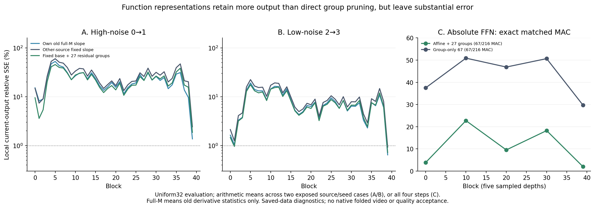

# E0：FFN 线性基项保留了什么，非线性余项还缺什么

**把 FFN 改写为“全输入线性基项＋完整64组非线性余项”，在严格相同投影 MAC 预算下，比已测的跨来源固定组能量删组保留更多函数。** 两来源、五层、全部四步的40案例中，另一来源校准的 affine＋27组，其 uniform32 输出相对 SSE 平均 **11.27%**，匹配 group-only67 为 **43.13%**。这是表示层面的积极结果；中间层仍有显著误差，也尚无 native 替换视频。

同时，旧状态导数的共享切线已扩展到**全部40层**：全M导数统计没有消除中间层误差。孤立计时还发现，当前未融合的旧导数获取约54ms，足以吃掉折叠投影的算术收益。因此下一项需要解释非线性余项与 W2 的净作用，不能只继续调同一种斜率、topk 或依靠 Block39。

[验证数据及全部逐案例结果](E0_AFFINE_FFN_DISCOVERY.json) · [前期384连续行切线](E0_SHARED_TANGENT.md) · [独立审查与反例](../method_discussion/discoveries/E0/independent-affine-residency-audit-20261025.md) · [可保留原视频的更强 dense runtime](E0_DENSE_WEIGHT_RESIDENCY.md)

## 原生数据现已覆盖哪些层和位置

两次新增 dense 四步采集覆盖每来源 **4步×40层**，保存原生 post-Q1、W1 preactivation `z`、GELU、post-Q2、FFN输出和gate。误差分别在原 raster 中心连续128行与原随机32行评价；面板可能重合，不能算额外独立样本。steps0/2 另对全部 **31668行**流式求旧 tanh-GELU 导数均值，每来源80次，合计160次。

**“full-M tangent”只指斜率统计的行覆盖，误差评价仍是128/32行，不能写成整层全token输出误差。** source0 seed42、source12 seed54，沿用原 canonical 输入，而非同 seed 两新场景。两视频/8 latent与原版一致；旧五层40位置的五字段原random32、与此前连续采集重合的所有保存行也逐值一致。原生张量约5.3GB，保存在HF derived cache；[完整字段/身份记录](E0_ALL_BLOCK_TANGENT_OBSERVATIONS.json)已具备，不需再采同一批字段。

四个新增保存数据范围分别为160个全层共享切线、160个跨来源线性增量＋整组余项、40个绝对affine、8个孤立原生计时案例。各自协议、源码SHA、严格操作计数在验证JSON；除孤立计时的64次原生 after-Q1 FFN/Q2 外，无额外原生QDQ、训练或权重分解。连续预测保留 BF16/原Q2 标签作为目标，不声称连续矩阵计算原生逐位等价。

## 1. 全层切线：不是只有样本均值估计不准

令真实 post-Q1 输入为 x，`a=W1 x+b1`，Smooth2 向量为 s2。原生 Q2 后系数记 q。共享旧导数更新为

\[
\widehat{\Delta U}=G_tW_2\operatorname{diag}(\bar\phi'(a_{old})/s_2)W_1(x_t-x_{old}).
\]

两次专家内合法更新是0→1及2→3。当前W1标签不用作预测输入；实际从 post-Q1 差值重投影。完整M、center128共享、逐token旧导数和读取当前标签的center128最小二乘斜率分别比较。后者只最小化hidden拟合，不是输出净误差的最优下界。

全M旧斜率在 uniform32 上，按每层两来源均值统计：

| 专家内更新 | 输出SSE＜1%的层 | 输出SSE＜5%的层 | 解释 |
|---|---:|---:|---|
| 高噪声0→1 | 0/40 | 1/40 | 共享切线在大多数层仍不够准确 |
| 低噪声2→3 | 1/40 | 10/40 | Block39较好，尚不足覆盖模型 |

阈值只为描述局部误差，不是视频质量门槛。全部160案例的全M斜率 current-output SSE 为 **0.455%–189.63%**；均值不能遮住大误差。原生增量连续重建SSE最大2.22e−4、W1差值重建最大1.03e−4，量级远小于多数近似误差，但仍不能忽略原生舍入。前期连续384行中，移除Q2后逐token切线在四个首/中层仍有35%–88%创新SSE，说明有限变化曲率本身已重要。

## 2. 改变表示：固定线性增量＋完整组余项

对任意固定 κ，令 `da=W1 dx`，有连续系数恒等式

\[
G_tW_2\Delta q=G_tW_2\operatorname{diag}(\kappa/s_2)W_1\Delta x
 +\sum_{g=1}^{216}G_tW_{2,g}\left[\Delta q_g-(\kappa/s_2)_g\odot da_g\right].
\]

这是完整求和的代数恒等式；只保留部分余项才是近似。κ取**另一来源旧 full-M 均值**，支持也只取同一训练来源random32，不使用当前测试来源标签。calibration自身以训练来源κ算余项，避免训练标签暗含测试来源κ。独立审查逐条确认该时序。

uniform32平均输出SSE（每专家80案例）：

| 表示 | 0→1高噪声 | 2→3低噪声 |
|---|---:|---:|
| 固定线性基项 | 27.66% | 9.42% |
| 基项＋27固定组余项 | 22.21% | 7.75% |
| 基项＋54固定组余项 | 17.75% | 6.31% |
| 直接54固定组创新 | 37.03% | 13.31% |
| 另一来源标量＋输出均值affine | 37.30% | 15.32% |

若不免费缓存旧hidden，选中组需重算旧/当前W1、再做一次W2。基项＋27组理想投影比 `D/(2H)+1.5×27/216=0.372685`，直接54组为 `1.5×54/216=0.375`，是近乎匹配的对照。该比较说明“线性基项＋余项”比只保留大组更有价值，同时也显示当前固定余项远非足够准确。没有实现packed native action，不应把理想MAC转换成实际速度。

## 3. 不用旧状态的绝对 affine：最近机制是 TARDIS

在另一来源random32上，以连续preactivation a 拟合实际q：`q≈κ⊙a+β`。于是

\[
\hat U=G(Ax+B),\quad A=W_2\operatorname{diag}(\kappa)W_1,
\quad B=W_2(\kappa\odot b_1+\beta)+b_2.
\]

加原组余项 `GW2,g(q_g−κ_g a_g−β_g)` 可逐步恢复完整函数。另有GELU/Smooth2斜率、实际Q2均值截距控制。其斜率/截距/固定组支持均来自另一来源，未对目标来源调参；当前标签组排序单独标记posthoc，非部署选择器。

**D=80×64、H=216×64，一个D×D基项的投影MAC恰好等于40个原FFN组。** 因而affine＋27组与直接67组、affine＋54与直接94组预算分别精确匹配。这里比较的是投影量，未计路由/Q2依赖/packing/额外矩阵常驻。没有实际合成或保存这40案例的A。

下表为uniform32，每层8个source×step案例均值：

| Block | affine基项 | affine＋27固定组 | affine＋54固定组 | 匹配直接67组 | 匹配直接94组 |
|---|---:|---:|---:|---:|---:|
| 0 | 5.78% | 3.82% | 2.57% | 37.48% | 23.29% |
| 10 | 27.00% | 22.73% | 18.60% | 50.88% | 36.67% |
| 20 | 11.61% | 9.54% | 7.72% | 46.87% | 32.09% |
| 30 | 21.88% | 18.24% | 14.95% | 50.66% | 36.52% |
| 39 | 2.76% | 2.01% | 1.49% | 29.74% | 17.15% |

center128上对应affine＋27均值12.49%，直接67组43.64%；uniform32为11.27%对43.13%。GELU_OLS与Q2_OLS斜率两版结果接近（uniform32＋27为11.30%与11.27%），当前困难不全由Q2解释。五个跨深度层已经暴露中间层瓶颈，本轮未把这个相同绝对近似扩成更多模型运行。

[TARDIS v1 §3、§5](https://arxiv.org/html/2501.10054v1) 已做逐单元热区线性拟合、D×D常量折叠、压缩W1预测越界并删去近似/加入原值修正。它是这项表示的最近原机制。这里测试四步Wan/HiF4实际系数和whole64组修正，没有重现其热区搜索、量化预测器、kernel或整体质量，不能宣称该基本折叠构造是新发明。

## 4. 物理核对：少MAC不足以抵消昂贵的观察

8个孤立案例覆盖两来源、Block30/39、两专家更新；原生 after-Q1 W1–GELU–Smooth2–Q2–W2/gate 对照真实BF16合成A与应用。误差用实际128行；full-M形状计时把这128行重复到31668行，**不是自然full-M或端到端计时**。每项2次warmup、5次同步wall重复，FP32合成禁TF32。

所测原生FFN约52.5–53.4ms，FP32合成A约39.4ms、BF16约4.0–4.1ms，BF16应用约7.7–8.6ms。单看BF16合成＋应用很小，但当前未融合全M旧导数求取另需约54.4ms；三者和为原生的 **1.26–1.28倍**。即便一个同专家A只合成一次，只有下一次调用可以摊销，不能把观察当免费。

这是当前Python/Torch重复行实现的成本，不是所有融合、抽样或固定斜率的下界。原生128行vs原完整M标签本身有9e−6至1.65e−4相对SSE，显示shape改变会有数值差异。BF16/FP32折叠实际误差接近，因此仅提高A合成精度不能解决上述函数误差。

## 5. 独立挑战打开的方向：奇偶分解与有符号余项

审查从 [GELU 原论文§2](https://arxiv.org/html/1606.08415v5) 重建tanh版本：

\[
\phi(a)=\tfrac12a+e(a),\quad
e(a)=\tfrac12a\tanh[\sqrt{2/\pi}(a+0.044715a^3)],\quad e(-a)=e(a).
\]

故实数公式中 `φ(a)−φ(−a)=a`。带截距OLS斜率为

\[
\kappa=\tfrac12+\frac{\operatorname{Cov}(a,e(a))}{\operatorname{Var}(a)}.
\]

若a的分布关于0对称，后项为0，**宽分布/强非线性也能得到稳定半斜率**。这与“单元仅处于窄线性热区”给出不同预测；共享斜率更好不自动支持后者。再如两个单元a/−a、值向量v/−v，非线性可完全抵消而净输出严格线性。该反例不要求Wan实际成对，也不能穿越原生Q2与BF16舍入。

因此有内容的下一判别是：固定半斜率（GELU/Smooth2系数为`1/(2s2)`）＋另一来源实际q均值截距，与当前逐通道OLS、旧full-M导数公平比较；分开测 `Δe` 的hidden能量与 `GW2 S2⁻¹Δe` 的净能量。它可区分内置奇偶结构/方向抵消与局部热区，而不是再增加一个任意threshold。本轮尚未运行此控制，不登记为候选成功。

独立审查也给出组选择反例：余项`10v,−10v,v`的总和为v，纠正最小第三组可使余项为0，纠正最大第一组反而留下−9v。故组能量的posthoc排名不是净输出误差oracle，增加组也不保证单调改善。下一表示需要研究signed Gram交叉项，而非把更多后验分数当最终答案。

## 文献怎样改变判断，下一次实际比较什么

本轮根Agent实际读取TARDIS v1热区/常量折叠/预测器/修正，Increment-Calibrated Caching v1 §3.3–3.4的输入增量与低秩校准（[原文](https://arxiv.org/html/2505.05829v1)），TaylorSeer v1 §3.2历史输出差分（[原文](https://arxiv.org/html/2503.06923v1)），Chipmunk官方module/ops/MM1/MM2固定提交及原论文/作者推导（来源SHA见[上一报告](E0_SHARED_TILE_PRE_W1.md)）。没有运行这些完整系统，没有把作者结果移作Wan结果。半斜率反例来自独立审查，根Agent随后复读GELU原始公式核对其条件。

这些来源把路线从“增加状态依赖性”改成了三个可区分的问题：固定函数基项能否解释多数变化；动态非线性余项是否必须逐token求值；观察与物理执行能否偿付。当前数据支持第一个问题的局部积极结果，尚未解决后两个。新的模型范围前应先用已有保存字段判别奇偶余项与signed组合；真实速度比较同时保留[全权重常驻dense参考](E0_DENSE_WEIGHT_RESIDENCY.md)，不能靠原反复搬运的慢参考夸大算法收益。独立记录已归档，未伪造正式PEER_SUPPORTED/方法选择或阶段晋升。
