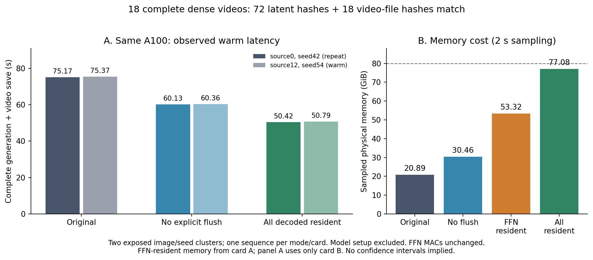

# E0：相同完整视频的运行时改善

**同一张 80GB A100 上，热态完整四步生成由 75.17/75.37 秒降至 50.42/50.79 秒，分别为 1.491×/1.484×，wall time 减少约 33%。** 18 次完整生成的 72 个 scheduler latent SHA 和 18 个实际编码视频文件 SHA 全部匹配历史 dense。它通过保留解码权重和内存池实现，所有 FFN/attention 算术不变；这是可复用的系统改善，也为下一轮 FFN 算法建立更强的 dense 对照。

代价明确：全部解码量化线性权重常驻 **56,203,673,600 bytes（52.34GiB）**，所测物理显存峰值 **78,932MiB（77.08GiB）**。该配置已在单张 A100 80GB 上完成，不能直接搬到更小显存或更大分辨率。没有减少 FFN MAC，也没有把它登记成新的 FFN 科研算法或提升 E0 阶段。

[逐项验证数据](E0_DENSE_WEIGHT_RESIDENCY.json) · [分析器](../../tools/analyze_e0_dense_residency.py) · [独立源码/数学审查](../method_discussion/discoveries/E0/independent-affine-residency-audit-20261025.md)

## 从原生源码定位耗时

冻结的原生 `HIF4CacheRuntime._weight` 按 `(expert, block_index, device, dtype)` 保留一个 block。切 block 时清空引用并显式执行 `torch.cuda.empty_cache()`，随后把相同 `weight_qdq` 通过 `.to(device,dtype,non_blocking=False).contiguous()` 搬到 GPU。每视频 160 个 block 调用，1600 次线性权重请求。

本轮用实例级 context manager 比较四个策略，未修改 vendor 源码：

| 策略 | 实际改变 | 额外保留的解码权重 |
|---|---|---:|
| original | 委托原 `_weight` | 0 |
| block_no_flush | 相同单块 key/转移/cast，省去显式 empty_cache | 0 |
| ffn_resident_no_flush | 上述策略＋两专家全部 FFN 原 BF16 张量常驻 | 21.09GiB |
| all_resident_no_flush | 两专家 attention/FFN 全部解码量化线性权重常驻 | 52.34GiB |

后两者的 key 是 `(expert, block-qualified module_name, device, dtype)`，因此不会把不同层/专家混用。只缓存原 `.to(...).contiguous()` 的结果，未生成新权重。缓存使用期间必须保持 runtime、record 和权重不可变；退出 context 后恢复原 bound method 并释放保留引用。

[PyTorch 2.10 官方 allocator 说明](https://docs.pytorch.org/docs/2.10/notes/cuda.html#memory-management)区分活张量与空闲内存池：缓存分配可减少分配时的同步，`empty_cache()` 释放空闲池而非活张量。该原理与同卡对照的收益方向相符。本轮没有测 allocator 内部逐项 trace，没有切换 cudaMallocAsync，也没有记录实际 allocator backend；不能将 `_weight` 主机 wall 全部解释为纯 PCIe 传输时间。此前还读取了 [NVIDIA allocator 原始技术说明](https://developer.nvidia.com/blog/using-cuda-stream-ordered-memory-allocator-part-1/)，仅用于机制解释，未重现其示例。

## 原始时间与显存：保留冷态和反向配对

每个 RUN 是独立进程内 `[source0 首次, source0 重复, source12 热态]` 三视频序列。source0 实际 **seed42**，source12 实际 **seed54**，均来自已有 canonical 输入（base seed＋source index）。两图片/seed 组合都是已暴露来源；18 次技术对照不是 18 个独立场景。

| 匿名卡 / 策略 | source0 首次秒 | source0 重复秒 | source12 热态秒 | 采样物理峰值 GiB |
|---|---:|---:|---:|---:|
| A / original | 80.174 | 75.297 | 85.364 | 20.89 |
| A / block_no_flush（反向对照） | 62.080 | 60.011 | 60.383 | 30.46 |
| A / FFN resident | 60.200 | 57.388 | 57.446 | 53.32 |
| B / original（反向对照） | 84.323 | 75.172 | 75.372 | 20.89 |
| B / block_no_flush | 65.346 | 60.126 | 60.359 | 30.46 |
| B / all resident | 57.068 | 50.419 | 50.789 | 77.08 |

匿名 A/B 是同一私有 worker 的两张不同物理卡，启动回执与 raw 资源记录对应关系已核查；公开数据只保留匿名标签和回执 SHA。original 与 no-flush 的放置及顺序反转，支持 **两张卡上去 flush 都有约 1.25× 的 source0 热态改善**。卡 A 的 original/source12 为 85.36 秒，是完整保留的较慢样本；不拿它作为 1.49× 标题的分母。

all resident 与 original 的标题比较全部取 **卡 B 同来源同 phase**。full-resident 与 FFN-resident 没有各自的双卡反向重复；不能把二者差值定量归因给“多常驻 attention”的净效果，也没有足够重复给生产速度置信区间。

隔离检查只要求被分配卡没有外来进程。同worker其它卡可以有作业，本项目最多两个模型进程并行，共享CPU/PCIe负载未锁定。因此这里报告实测配置与改善方向，不把跨RUN差值全部归因给单一物理耗时项。实测环境为Torch2.10.0+cu128、CUDA12.8、A100 80GB PCIe；未切换模型/权重或allocator配置。



## 操作数、搬运与 FFN 边界分别扣账

所有视频均为 **1600 次 linear、1600 次 activation QDQ、0 cache misses**。原生 Q1/Q2、F.linear、bias、gate 和 residual 没有更改。

| 策略 | 首次 / 后续视频权重转移次数 | source0 热态 `_weight` 主机 wall 秒 | source0 热态 native FFN 边界秒 |
|---|---:|---:|---:|
| 卡 B original | 1600 / 1600 | 33.77 | 12.57 |
| 卡 B block_no_flush | 1600 / 1600 | 20.07 | 12.31 |
| 卡 A FFN resident | 1440 / 1280 | 13.58 | 9.28 |
| 卡 B all resident | 800 / 0 | 0.0094 | 9.71 |

首视频在同专家后一次调用已经复用部分权重；热态跨视频再无需重复搬运常驻权重。卡 A FFN 热态只消除 FFN 的320次转移，attention 仍有1280次。全部常驻的热态1600次请求都是保留张量命中。

表中 native FFN 使用 CUDA events 覆盖 `infer_ffn`：attention 输出加 residual、norm2/AdaLN、Q1、W1、GELU、Q2、W2；不含之后的 gate/residual writeback。它不是纯两次 GEMM 时间。events 只在完整生成同步后读取，不逐 FFN 强制同步。主机 `_weight` 计时包含可能的等待，不能直接与事件值相减分解纯计算。

完整 wall 边界是 `pipe.generate(...)` 至其返回后的 `torch.cuda.synchronize()`，**含共同轨迹哈希和视频编码/保存**。资产校验、Python 导入、模型/流水线构造和模型下载在边界外。首次是新进程第一次生成，含库/算子及保留缓存填充成本，不等于从下载开始的完整服务冷启动。物理显存每2秒采样，包含 allocator reserved；表中峰值不声称连续上界或精确活张量字节数。

全量常驻开始前用两份 original raw 的实际峰值、全部源解码权重字节和2GiB安全量检查容量，合计80,780,197,888 bytes，小于设备报告84,974,239,744 bytes。固定54GiB权重限额在每次新转移前检查。更高分辨率等新输入应重新做容量预算，不能由本结果推得普适余量。

## 可复用入口与后续研究含义

实现为 [FFN/单块策略](../../tools/ffnds_weight_residency.py) 和 [全权重策略](../../tools/ffnds_all_weight_residency.py)。在原生 runtime/hooks/pipeline 已正常建立后，使用同一 context 包住连续生成：

```python
from ffnds_all_weight_residency import AllWeightResidency

with AllWeightResidency(runtime, 'all_resident_no_flush',
                        max_retained_bytes=54 * (1 << 30)) as residency:
    # Existing pipe.generate calls with the same immutable runtime/weights.
    pipe.generate(**generation_arguments)
    stats = residency.snapshot()
```

此 helper 不负责创建环境、分配GPU或判定整条pipeline显存余量；已执行的独立 driver 包含这些固定检查。原始比较驱动为 [9视频主范围](../../config/e0_dense_weight_residency_20261025.json)、[6视频同卡反向对照](../../config/e0_dense_residency_crossover_20261025.json)和[3视频全部常驻](../../config/e0_all_weight_residency_20261025.json)。原有 vendor/cache/preparation 证据保持不变。CPU验证覆盖原值/层专家隔离、计数、退出恢复与限额。

**项目推进得到的实际改变：** 后续声称 FFN 算法速度收益时，应明确原始低显存策略与这个强 dense 参考，不能只与反复 flush/搬运的弱参考比较。研究主线仍是减少必要计算并保留完整视频功能；[本轮全部40层与 affine 结果](E0_AFFINE_FFN_DISCOVERY.md)解释目前表示路线的剩余瓶颈。这18次范围已完成，无待运行作业，用户最多4张空闲卡的上限下实际峰值2张。
