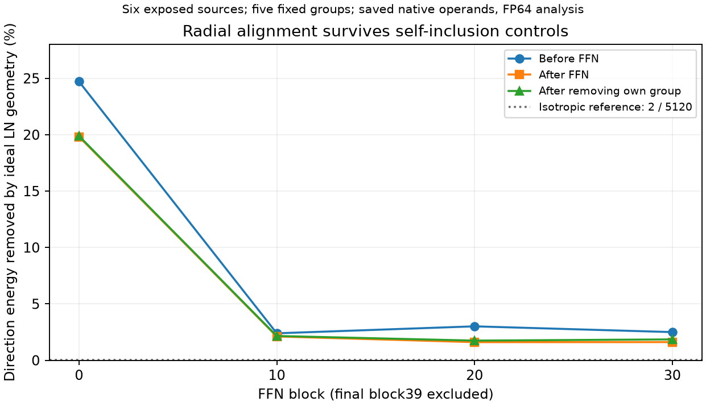
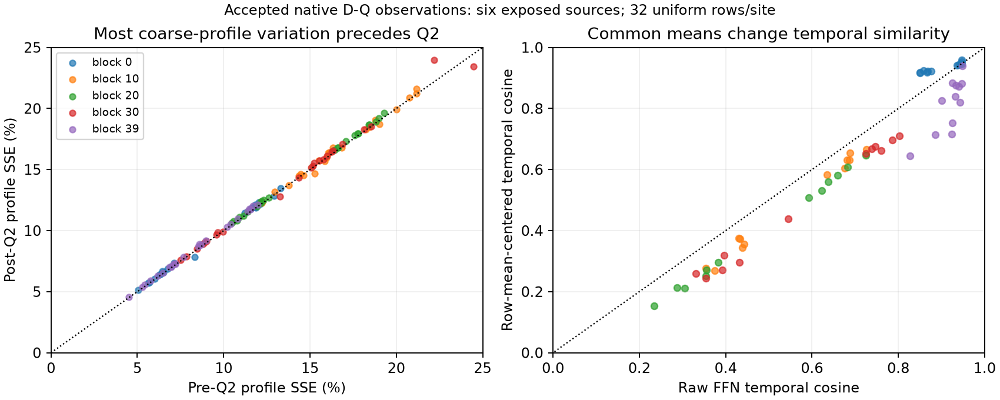

# E0 发现：FFN 组输出与残差有方向对齐，粗轮廓差异主要在量化前形成

**六个发现来源已完成 12 次原始 dense D-Q 四步生成。** 每个来源 plain/observed 的四步 latent 哈希和视频 SHA 完全一致；六个 plain 视频也分别与历史 CAL24 视频 SHA 一致。新采集覆盖 120 个 FFN 位置，每位置有 32 个均匀采样坐标及额外邻接坐标，保存了 Q1/Q2 前后、GELU、gate、残差和固定 W2 面板。最多同时使用两张空闲 A100，新增 HF 输出约 1.54 GB。

**最有价值的新结构是首个 block 的残差方向对齐。** 保存操作数的理想 epsilon-LayerNorm 分析中，五个固定组输出平均有 **19.82%** 的方向能量被均值/径向投影消去，主要是径向部分。写回前状态上为 **24.71%**，从写回后状态扣掉该组自身贡献后仍为 **19.88%**。因此，单纯的写回自相关不足以解释它。这是保存张量上的 FP64 几何观察，**没有执行删组动作，也没有新的原生加速或视频质量结论**。

## 数据和复核入口

| 证据 | 内容和边界 |
| --- | --- |
| [原生采集及配对](E0_NATIVE_OBSERVATIONS.json) | 六来源、12 次生成、120 个位置，源码/协议/载荷 SHA、原始调用次数和视频身份 |
| [残差方向几何](E0_RESIDUAL_GEOMETRY.json) | 96 个非末层位置 × 五个固定组 = 480 个案例；原生保存操作数上的理想 FP64 LN 分析 |
| [同坐标跨步观察](E0_TEMPORAL_STRUCTURE.json) | 90 对，其中60对同专家、30对跨专家；不是物体追踪或缓存执行 |
| [旧 CAL24 张量重读](E0_CAL24_STRUCTURE.json) | 120 个旧位置、30,720 行、1.48 GB 载荷逐一校验；与新采集不是两批独立来源 |

独立单位是 **6 个已暴露来源**，不是12条独立质量视频或120个场景。固定 CAL24 索引 `[0,4,8,12,16,20]` 实际为 **3 主体、3 背景、0 相机类**。[冻结扩展协议](../../config/e0_observation_replication_20261025.json)的问题描述误写为各2个；原协议字节及索引保留，实际分类以输入 manifest 为准，不作相机类泛化。它与旧 C1 的六个 r17_fresh23 来源也不是同一批。

采集基础复用准备提交 [6bf6d12](https://github.com/Qesire/FFNDS/commit/6bf6d12)。本次完成实际 A100 验收、张量重读、量化参考核对及新几何分析；软件合同测试不是科学结果。

## 计算和信息流

| 边界 | 原生数值语义 | 信息何时存在 |
| --- | --- | --- |
| cross-attention → residual | 5120维；attention 增量先做原地加法 | 新采集保存加法前 residual、attention 增量和 FFN 前 residual |
| norm2/AdaLN → Smooth1 → Q1 | FP32 除 Smooth 后转回输入 dtype，再 HiF4 QDQ；5120维 | 4/8/64 层级状态在 kernel 内临时产生，接口只返回 decoded tensor |
| W1 → GELU(tanh) | 5120→13824，原始 bias、BF16 linear | 新采集保留 z/GELU/pre-Q2；旧 CAL24 也确实有 post-Q2 的 V2 |
| Smooth2 → Q2 → W2 | 13824→5120；QDQ 后回到原 dtype | 完整原顺序64组可分离；固定五个 W2 面板绑定原始缓存 |
| gate/residual → 下一 block norm1 | 门控输出写回；residual 同时绕过归一化继续传播 | 有真实写回前后向量，没有真实 nextnorm/flow 干预标签 |

实际路径是 **A100 HiF4 QDQ → BF16 GEMM**，不是 packed FP4 硬件测速。四步专家为 high/high/low/low。源入口：[adapter](../../upstream_audit/source_deltas/HiF4_Sp/files/HiFloat4/ptq/adapters/wan_i2v.py)、[CUDA hierarchy](../../upstream_audit/source_deltas/HiF4_Sp/files/HiFloat4/hif4_gpu/quant_cy/base/cusrc/hifxg_quant_cuda.cu)、[原始绑定](../20261023/C0_coupling_offline_results.json)。norm1、epsilon、消费者源码 SHA 也保存在几何结果中。几何分析排除 block39，因为它没有下一 block norm1。

## 一、残差对齐存在于写回前，主要不是通道均值

记保存的 post-Q2 操作数为 `v`，gate 为 `g`，固定组的 decoded 贡献为

\[
\delta_h=\operatorname{diag}(g)W_{2,h}v_h.
\]

这是 FP64 面板分解，不是原生稀疏 FFN 重跑。对于保存的 residual `x`，设 `d=5120`、`P=I−11ᵀ/d`、`z=Px`、`ε=10⁻⁶`。理想 LN 的导数为

\[
J_{LN}(x)\delta=\frac{T_x\delta}{\sqrt{\|z\|^2/d+\epsilon}},\quad
T_x\delta=P\delta-z\frac{z^TP\delta}{\|z\|^2+d\epsilon}.
\]

这也揭示了与已有角度重要性方法的联系。`ε=0` 且两个中心化向量非零时，有严格恒等式：

\[
\|LN_0(x-\delta)-LN_0(x)\|^2
=2d\,[1-\cos(Px,P(x-\delta))].
\]

因此，理想 LN 响应与中心化角度是同一基础几何的不同表示；本轮不把这个投影解释为新重要性准则。当前实际 epsilon 保留在计算中，未将近似恒等式当作 BF16 精确等价。

下表为每组、每位置采样行合计的 `1−||Tδ||²/||δ||²`，再对四步、五组及六来源平均。它不是完整视频误差或算力节省率。

| block | FFN 前状态 | 真实写回后状态 | decoded leave-one-group-out 状态 |
| --- | ---: | ---: | ---: |
| 0 | 24.71% | 19.82% | 19.88% |
| 10 | 2.39% | 2.11% | 2.15% |
| 20 | 3.01% | 1.61% | 1.75% |
| 30 | 2.50% | 1.61% | 1.85% |

block0 六来源分别为 **18.58%–22.54%**；加入真实 rstd 权重后，均值为 **19.56%**。通道均值单独只解释 **0.0226%**，主要作用来自径向对齐。独立各向同性方向的理论消去量级约 `2/5120=0.0391%`；这只是几何参照，不是竞争算法或显著性检验。

保存状态上，FP64 理想 LN 的有限 `x−δ` 响应与切向响应也接近：480例的相对响应 SSE 最大约 **0.0283%**。这只核对局部数学近似，不验证 BF16 舍入、实际删组 GEMM、后续 residual/attention 或自由视频。

**竞争解释：**

- 功能结构：组输出与已有 residual 方向相关，本地幅度不能充分描述归一化后影响。FFN 前仍有对齐、leave-one-out 变化小，支持这一限定观察。
- 纯写回自相关：对齐只因该组自身加入 residual。两个对照削弱了此解释，但还不能确定具体学习机理。
- 仍开放的强反解释：径向衰减只是下一次 LN 的短程边界现象，residual 旁路和后续计算可能恢复或放大差异。因此它不是已证的全网络零空间。

这补上了[旧商空间审查](../20261024/gated_residual_quotient_historical_audit.json)缺少 signed residual/group operands 的部分证据；旧动作闭合、G6种子的未提升状态不变。

## 二、Q2 制造零值，却只小幅改变粗组轮廓

新均匀样本中，GELU 精确零值比例为 **0%–0.0617%**，post-Q2 为 **5.42%–14.00%**。Q2 新置零元素在量化前只占 **0.0569%–0.2863%** 操作数能量；完整 Q2 量化相对 SSE 为 **0.664%–1.029%**。零值能量不是全部舍入误差，也不是 W2/视频功能影响。

对组能量 `E_rg=Σ_{j∈g}v_rj²`，使用明确的样本内幅度模型 `Ê_rg=T_r p̄_g`，其中 `T_r=Σ_gE_rg`、`p̄_g=mean_r(E_rg/T_r)`。pre-Q2 已有明显轮廓差异；Q2 对该指标的增量，逐来源平均仅 **0.08–0.19 个百分点**。粗二阶指标仍可能漏掉码字边界、方向及有符号 W2 放大。

平均值之外保留了两个例外：source8/block30 在 step2 为 **−1.03 个百分点**，step3 为 **+1.79 个百分点**。[逐行留一审查](E0_PROFILE_OUTLIERS.json)发现两者均由同一采样行1981、latent坐标 `[1,9,5]` 主导；只在诊断中去掉该行后，增量分别为 **+0.058、+0.098 个百分点**。原始数据没有剔除该行；高杠杆也可能对应真实局部结构，不能当作无效点。这进一步说明平均轮廓指标不能替代局部功能影响。

**全零64组的缺失主要是格式性质。** CUDA 中令 `m` 为组 amax、`s` 为有效共享尺度、`r=BF16(1/s)`、`p=m·r`。最大值所在叶子的乘数 `e` 在 `p<2 / 2≤p<4 / p≥4` 时分别为 `1/2/4`，无符号码为 `min(7,floor(4p/e+0.5))`；正常有限范围内整组全零只在 `p<1/8`。正常尺度约 `m/7` 会保留最大值；最小尺度 `s=2⁻⁴⁸` 分支才有 `m<2⁻⁵¹` 的全零可能。新均匀面板最小组 amax 为 `0.020508`，远离该分支。旧张量的663万个非零组不能当成663万条独立 Wan 机制证据。

## 三、高跨步相似度需要拆开共同均值

60个同专家、同坐标对中，block39 的 raw FFN Frobenius cosine 平均 **0.919**，去掉跨行均值后为 **0.814**；共同均值贡献约 **79.28%** 跨步内积。去掉原始 `b2` 的影响很小，不能只用显式输出 bias 解释。block0 则由 **0.903 升至 0.934**，说明均值和变化部分的作用随位置不同。

这里跨行共同均值是 **5120维向量**，不同于 LN 消去的“每行通道常量”。cosine 不是误差容限、缓存命中率或视频安全性；30个跨专家对单独保留。

## 数值核对、文献和唯一下一项观察

原始 Python HiF4 参考与实际 Q1/Q2 在 **240例中所有数值一致**，但有 **5,730个正零/负零位差异**，均对应负零输入。Python `sign` 丢掉该符号，CUDA 从位模式取符号。只在分析参考中保留输入符号后，240例 BF16 位全部一致。原始 CUDA/Python 文件未改；这也不是直接导出 GPU 内部 scale。

[HiFloat4 原始论文](https://hifloat.gccorg.com/docs/en/hifloat4/white_paper/hifloat4_format_for_language_model_inference.html)提供层级格式背景，分布结论来自实际 Wan 操作数。[SmoothQuant](https://proceedings.mlr.press/v202/xiao23c.html)说明幅度分配依赖表示，不把幅度变成功能重要性。[AutoTarget](https://arxiv.org/html/2610.03577v1)研究少步 solver 输出缓存对象；本轮内部 FFN 分解与其不是同一方法，不能借用其质量或加速结果。

### 按最新仓库规范补充的跨领域核对

检索日期 **2026-10-25**；实际使用 Web Search、arXiv HTML/PDF、ACL 官方论文和 GitHub 作者源码。入口随观测扩展：`HiFloat4 hierarchical quantization`、`LayerNorm geometric radial derivative residual`、`feed-forward key-value memories`、`high-norm vision tokens/register neurons`、`ShortGPT block influence`、`few-step solver-aware caching`。从 Brody 回溯 Ba，并追到 Gupta 的几何解释；从 ViT registers 追到2025机制干预及2026功能分析。主张只采用直接检查的原论文/代码，不采用搜索索引的性能转述。

| 最接近的来源与实际读取范围 | 与本轮的关系、由此改变的解释 |
| --- | --- |
| [Ba et al., Layer Normalization, 2016](https://arxiv.org/pdf/1607.06450)；[Brody et al., 2023](https://aclanthology.org/2023.findings-acl.895.pdf)；[Gupta et al., 几何解释 preprint, §2](https://arxiv.org/html/2409.12951) | **共有数学组件。** 去通道均值、投影与球面缩放均有先例；Wan 中径向能量占比和写回前/leave-out 对照才是本批实际观测。Gupta 的语言模型通道均值现象不能直接外推到 Wan。 |
| [ShortGPT, §3.1–3.2](https://arxiv.org/html/2403.03853v3)及作者 [metrics.py](https://github.com/icip-cas/ShortGPT/blob/main/shortgpt/metrics.py)、[校准/删层实现](https://github.com/icip-cas/ShortGPT/blob/main/shortgpt/shortgpt.py) | **共有角度重要性原理、不同对象和动作。** 其 BI 为层输入/输出 cosine 的函数，经校准做静态整层删除。本轮是量化 Wan 的五个组贡献及真实 residual 状态的描述性分解。后续应加中心化角度/BI 类强对照；本轮依赖 post-Q2 的量不是廉价前置选择器。 |
| [Geva et al., 2021, §5.1–5.2](https://aclanthology.org/2021.emnlp-main.446.pdf) | **可迁移的组合解释。** FFN 输出作为多个 value 方向的加权合成已有先例，不能把单组能量直接等同作用。其语言模型 ReLU/词表证据与本轮 GELU/HiF4 视频不同，不能迁移稀疏率或质量结论。 |
| [Jiang et al., 2025, §3.1–3.2/Algorithm1](https://arxiv.org/html/2506.08010v1)及[作者仓库说明](https://github.com/nickjiang2378/test-time-registers)；沿其引用检索 Darcet 的 registers 工作 | **高杠杆行的强反解释。** ViT 中少数神经元可因果控制高范数 token；异常位置可能承担全局计算，而非坏样本。因此保留 source8 的整行及全部例外。没有在 Wan 上验证 register 机制。 |
| 前向追踪 [Varma et al., 2026-10-02 preprint, §3–4](https://arxiv.org/html/2610.03698v1) | **邻近机制，未独立复现。** 其 DINOv2 SAE 特征消融区分 register/outlier 功能，说明只看范数不足；这不是 Wan 四步原生 FFN 动作或视频证据，本轮未训练 SAE。 |

覆盖边界：这是问题驱动的多轮检索，不是穷尽查重。EACL2026 的 Gupta 最终版出版元数据已查，29MB PDF 受抓取大小限制；上述核心方程核对的是可读 arXiv HTML，不将两版本全部实验视为逐项核过。没有读取的论文/实现不计为已验证先例，也没有由文献替本批数据作加速背书。

**唯一下一项区分观察：** 同一原生前缀下，比较局部 gated 输出误差接近、残差径向占比不同的有限组动作，加入中心化角度/BI 类对照，核对真实 nextnorm 和后续 flow。若差异仅停留在下一次 LN，该结构不能指导全视频省算；若持续预测后续有符号动作差异，才值得讨论新的计算单位及真实成本。当前数据没有这些 native finite labels，本轮不选择算子或启动该后续任务。

本轮完成 E0 发现档案，阶段仍为 E0。历史暂停回执、协议及旧结果保留；当前授权、完成范围和结果入口以 [ACTIVE_RESEARCH.json](../ACTIVE_RESEARCH.json) 为准。
