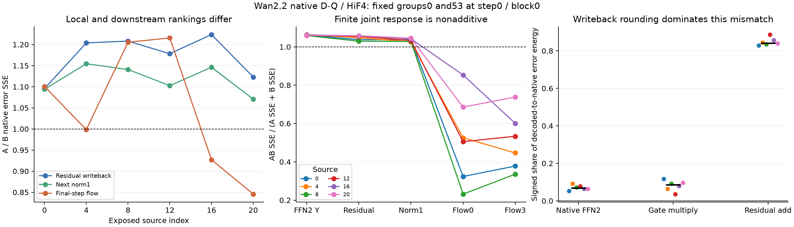

# E0 · 从单组几何到组合、跨步和原生传播

**六来源、30条完整四步原生主诊断，以及两个来源、10条视频的跨节点技术复核全部完成。最直接的新结果是：理想连续方向与真正干预之间，BF16 残差写回本身就是重要的非线性边界。** 固定两组的非加性比 `||c||²/||a+b||²` 在 FFN2 输出为1.76%–1.93%，到原生残差写回已为26.64%–27.87%；这里的分母是两个单组作用之和的能量，不是模型状态总能量或视频质量。后续 flow 的组合作用更不能由单组分数相加预测。跨节点210项哈希对照全部一致。阶段仍为 E0，没有选定加速方法。

## 一、多组不是单组分数的简单相加

对同一位置的五个固定64组，令 `δ_h=diag(g) W2_h v_h`，共同变化为 `Δ_S=Σ_{h∈S}δ_h`。精确实数关系为

`||Δ_S||²=Σ_h||δ_h||²+2Σ_{h<k}〈δ_h,δ_k〉`。

因此，“把最小的两个/三个单组分数相加”与“选择共同变化最小的组合”是不同问题。LN 切向响应也有对应的投影 Gram；有限 LN 还包含非线性。此次枚举的是五个已保存组中的10个二组组合和10个三组组合，不是全部216组的候选族。

[保存操作数结果](E0_JOINT_AND_TEMPORAL.json)覆盖六来源、96个非末层位置和每位置32个均匀坐标。block0 的主要现象是**同向叠加**：7680个原始组对中5947个内积为正，投影后6941个为正。去掉径向部分后，“负变正”1154个，“正变负”160个，不能预设 LN 总会增强抵消。

| block0 对照 | 选择与组合有限 LN 最优不同 | 额外理想 LN 误差 |
| --- | ---: | ---: |
| 两个最小单组能量之和 | 28.91% | 3.24% |
| 两个最小单组有限 LN 之和 | 18.36% | 1.75% |
| 三个最小单组能量之和 | 30.99% | 3.43% |
| 三个最小单组有限 LN 之和 | 27.34% | 4.23% |

单组有限 LN 比能量更精细，也不保证组合选择更好：三组时在这批样本中反而更差。对**整个组合**计算角度仍几乎解释全部有限 LN 排序，所以本轮没有引入新的局部评分准则。

竞争解释从“有没有抵消”改为“共享方向会强化叠加，还是特定组合有真实负交叉项”。枚举结果只支持这五个固定面板的描述，不是算法可部署性或大比例省算的证明。

## 二、高 cosine 不代表跨步可以直接复用

按当前步 gate 定义 `A=g_t⊙Y_(t−1)`、`B=g_t⊙Y_t`，直接复用误差为 `||A−B||²/||B||²`。记 `r=||A||/||B||`，则

`relative_SSE=r²+1−2r cos(A,B)`。

角度接近1仍允许明显的尺度漂移。以下只汇总0→1和2→3的60个**同专家**配对；1→2的30个跨专家配对保留在 JSON 中，未混入。

| block | 当前 gate 加权 cosine 均值 | 直接复用相对 SSE 均值 | 事后最优单标量相对 SSE 均值 | 事后修正当前跨行均值后的相对 SSE 均值 |
| --- | ---: | ---: | ---: | ---: |
| 0 | 0.951 | 0.141 | 0.095 | 0.068 |
| 10 | 0.728 | 0.521 | 0.454 | 0.452 |
| 20 | 0.822 | 0.321 | 0.313 | 0.266 |
| 30 | 0.713 | 0.501 | 0.452 | 0.407 |
| 39 | **0.963** | **0.373** | **0.072** | **0.056** |

这些是“各配对相对 SSE 的均值”，不是池化能量比或 RMSE；分母为当前 gate 加权完整 FFN 输出能量，包含原始 bias。标量和当前均值修正使用了当前目标，是事后表征对照，不能作为在线复用策略。相同 latent 坐标也不是物体追踪。

末层的高相关性主要暴露了幅度/共同分量漂移，而非证明可直接替换。中间层即使事后修正也保留较大相对误差，说明仅改一个幅度并不能解释全部差异；这些比例均不能换算为视频质量损失。

另有一个四步执行约束：每个专家只有两次调用。**若规则严格要求同专家的两个历史增量，且切专家时重置历史，则四步里没有一个可供它决定跳过的新步骤。** 这不排除单历史、固定校准或跨专家预测，但不能直接搬用长轨迹的双历史缓存规则。

## 三、径向“对归一化不可见”为什么不是残差被删掉

将一个实际 pre-norm 读写边界写作 `B(x)=x+f(LN(x))`。在理想实数、ε=0、`c>0` 的条件下：

`LN(cx)=LN(x)`，但 `B(cx)−B(x)=(c−1)x`。

扰动仍沿 identity 路径保留。加上 attention 增量后，原来沿 x 的方向通常不再沿新状态 `x+f(LN(x))`；下一次归一化又能读到它。这里改变的是“整个残差读写”这个解释单位，不能用下一次 LN 单独的衰减推导全网络零效应。

更具体地，令 `u=f(LN(x))`、`z=x+u`，且 z 非常量。理想 ε=0 时 `J_LN(z)z=0`，所以

`J_LN(z)x=−J_LN(z)u`。

这意味着沿旧状态 x 的径向扰动，在下一次读 z 时，其一阶可见性由分支增量 u 的切向部分决定。它给出与“永久径向零空间”不同的预言：即使完全没有量化，分支若改变方向，旧径向差异仍会被后一次归一化读出；若 u 与 x 仅差尺度/常量偏移，则这个理想一阶项为零。实际 ε、BF16 和有限动作另有边界，当前固定删组并不是专门构造的纯径向对照。

实际 Wan 源码对应 `infer_self_attn` 读取 norm1，`infer_cross_attn` 先门控写回 self-attention、再读取 norm3，`infer_ffn` 再加 cross-attention 并读取 norm2。源码入口及 SHA 见原始 [E0 几何结果](E0_RESIDUAL_GEOMETRY.json)。上述等式是条件数学，不是 BF16 轨迹等价；此次原生诊断保持原始写回和归一化，以区分代数方向、舍入和后续传播。

## 四、固定原生诊断的范围

原始六个已暴露 CAL24 来源，每个分别执行 dense、A、B、AB、dense_repeat 五条完整自由四步轨迹。只在 step0/block0 的原始 Q2 后，将固定完整组0、53分别或共同置零；W1/W2 仍执行完整 dense GEMM，gate、bias、残差、norm和后续所有层保持原始实现。

[首批两来源协议](../../config/e0_finite_group_diagnostic_20261025.json)与[其余四来源的固定复核协议](../../config/e0_finite_group_replication_20261025.json)分别冻结；四来源扩展在首批完整五臂结果分析前确定，组和位置未调参，不宣称盲法或新来源留出。主诊断共30次完整生成。

首批数值分析后另登记[跨节点技术复核](../../config/e0_finite_cross_worker_20261025.json)，在另一节点对来源0、4原样重复五臂，增加10次生成，检查整条轨迹及实际局部张量的位身份。这是**事后技术重复**，不增加独立来源数量。三个协议合计上限40次完整生成、同时最多四张空闲 A100；训练、分解、官方质量模型和独立 FFN/归一化调用均为0。原始源码、协议、HF 模型/量化缓存绑定和失败原件保留。

组0/53是已有面板中的固定两个组。本实验检查组合和传播，**不是幅度精确匹配的角度因果实验，也不测稀疏 kernel 的速度**。联合组预算不同于两个单组，四臂差分用于相互作用分解，不用于宣称等预算优胜。

### 4.1 主诊断的真实控制和结果

[原生结果 JSON](E0_FINITE_GROUP_DIAGNOSTIC.json)已完成六来源、30条完整自由轨迹的校验：每个来源的 dense 和 dense_repeat 均与历史四步 latent/视频身份一致；所有动作的 step0 输入、当前 FFN prefix、未置零 Q2 和 gate 完全相同。每条轨迹都是1600次原始 linear、1600次原始 QDQ、1600次权重搬运、0 cache miss；两个投影仍为完整 GEMM，没有独立 FFN/归一化调用。

下表比较同一来源中两个等组宽动作 A、B 的**实际原生 SSE**。比值大于1表示 A 变化更大；每一列只在相同边界比较，不跨不同维度直接比较 SSE 大小。

| 来源 | residual A/B | nextnorm A/B | 最后一步 flow A/B | 最后一步 flow 的 AB/(A+B) |
| --- | ---: | ---: | ---: | ---: |
| 0 | 1.096 | 1.094 | 1.101 | 0.378 |
| 4 | 1.204 | 1.154 | 0.998 | 0.447 |
| 8 | 1.208 | 1.141 | 1.206 | 0.336 |
| 12 | 1.178 | 1.103 | 1.216 | 0.534 |
| 16 | 1.224 | 1.146 | 0.927 | 0.601 |
| 20 | 1.123 | 1.071 | 0.846 | 0.739 |

六例中三例的局部/最终 flow 排序翻转；这是六个已暴露来源的描述，不是总体发生率估计。原生写回的 AB/(A+B) 为1.030–1.058，而末步 flow 为0.336–0.739。它并不保证 AB 比任一单组都小：来源16、20的 AB 解码 RGB MSE 也比两个单组都大。

对每个来源的 dense/A/B/AB 视频完整解码81帧，并保存逐帧 RGB MSE；dense_repeat 视频与 dense 的文件 SHA 相同，帧内容由字节身份控制覆盖。来源0的 A/B/AB 平均 RGB MSE 为0.008107/0.007399/0.006153；来源16为0.009475/0.010462/0.011369。**这些是与 dense D-Q 的像素差异，不是语义/感知质量接受，也不是速度收益。** 全部六来源及逐帧值保存在结果 JSON；原始视频位于 HF 派生缓存。

以末步各自的 dense 状态能量归一化，18个来源/动作的 flow 相对 SSE 为0.6525%–4.7288%，最终 latent 相对 SSE 为0.7054%–14.5134%。这给出了实际变化的尺度，也说明前述非加性百分比不能解释成视频变化百分比。它们均为平方误差比，不是 RMSE；同一个 seed 的技术重复不增加场景数。

### 4.2 先发生在 BF16 写回，再经过下游传播

对真实保存的原生 FFN 输出 `Y_S`、原始 gate `g` 和同一 pre-FFN residual `x`，当前源路径正是

`x_S = R_b(x + R_b(g⊙Y_S))`，其中 `R_b` 为 BF16 舍入。

六来源 × 五臂 × 每臂32个固定坐标，以上两个 BF16 操作**逐值重建全部采样写回**。令实际作用 `D_S=x_dense−x_S`，decoded 连续面板作用为 `δ_S`，则差距可固定分解为

`D_S−δ_S = [g⊙(Y_dense−Y_S)−δ_S] + [R_b(g⊙Y_dense)−R_b(g⊙Y_S)−g⊙(Y_dense−Y_S)] + [D_S−R_b(g⊙Y_dense)+R_b(g⊙Y_S)]`。

三项分别是原生 FFN2 输出相对连续面板的差距、gate 乘法舍入、residual 加法舍入。第一项不再细分 GEMM 累积与输出 cast，因为没有保存原生 FP32 accumulator。

18个来源/动作案例中，连续面板对实际写回方向的相对预测 SSE 为 **15.72%–46.00%**，中位36.60%。按固定分解的有符号内积份额 `〈e_i,Σe〉/||Σe||²`，residual 加法项占 **79.21%–92.87%**，中位84.59%；该份额含交叉项，可以为负，不是三个独立误差能量的比例相加。

理想 LN 若仍使用连续面板，其原生响应预测相对 SSE 为20.91%–56.26%。改用**真实原生写回状态**计算理想 LN 后，仍差9.33%–39.36%；再将 LN 输出转回 BF16，则该差距最大降至 **4.04e−5（0.00404%）**。理想 LN 后转 BF16 与实际 norm1 输出的逐值匹配率至少99.9927%。因此，本地失配的大部分能用具体的舍入边界重建，无须假设新的归一化方向。

这些重建使用了各个动作的真实 FFN 输出，是**事后机理诊断**，不是廉价前置预测器。当前面板删除也没有达到“完整原生写回状态不变”。

### 4.3 联合作用更小，不等于两个线性方向相消

令某一完整 flow 边界的 `a=F_A−F_dense`、`b=F_B−F_dense`、`c=F_AB−F_dense−a−b`，有严格四臂恒等式：

`E_AB−E_A−E_B = 2〈a,b〉 + 2〈a+b,c〉 + ||c||²`。

六个来源的末步 `〈a,b〉` **全部为正**，线性项本来增加误差；是有限非加性项使总相互作用变负。因此，把这轮现象叫作“两个线性 FFN 组在输出相互抵消”是错误解释。末步 `||c||²/||a+b||²` 为40.28%–88.90%。当前数据定位了本地 BF16 边界，并测到更远的非线性响应，尚未单独分离后续 HiF4 阈值变化、attention 非线性及其耦合。

选中位置的 Q2 编码在各臂完全相同，mask 在 Q2 **之后**才施加；因此，当前位置的共享 FP4 scale 改动也不能解释这里的本地非加性。后续层接收的输入已经改变，仍可能跨越其他量化边界。

### 4.4 条件结构：状态等价与方向零空间是不同对象

在固定 prefix 下，只有当 `R_b(x_i+u_i')=R_b(x_i+u_i)` 对全部坐标成立，两个动作才落入相同的实际写回状态；若其余执行状态/RNG 一致且后续确定，则后续完整轨迹也相同。这是**条件状态等价**，与“某个连续方向在下一次理想 LN 的径向投影中消失”不同。

这提供了一个有用的问题重写：研究有限动作跨越哪些真实舍入单元，而不只研究向量范数或切空间。它不是新算子，也没有证明这种等价在可省算的动作中常见；计算当前重建仍需实际动作输出。此前的径向几何证据保留在其范围内，不能升级为全网络零空间。

### 4.5 当前尝试的完成边界

| 当前核查 | 状态及得到的限定答案 |
| --- | --- |
| HiF4/QDQ、GELU、粗轮廓及异常行 | 原始六来源档案已完成；格式/幅度现象不冒充因果功能价值 |
| 单组径向几何和已有角度对照 | 已完成；角度几乎解释理想 LN 排序，无新增局部分数主张 |
| 多组 signed Gram 和有限 LN | 已完成五组内二/三组枚举；独立单组分数不可直接相加 |
| 同坐标跨步复用与尺度/均值对照 | 已完成；高 cosine 与低复用误差不等价，四步专家历史有限 |
| 六来源真实写回、nextnorm、四步 flow/latent/视频 | 30次生成及完整载荷/帧解码已完成；局部排序不足以代表最终变化 |
| 第二节点的原样数值复核 | 10次生成完成；210项张量/视频哈希一致；不增加独立来源，也不代替独立同行评议 |

本轮不重启历史关闭配方，也不把这些现象提升为已通过质量/速度要求的候选。仍值得区分的问题是：**在真实写回差距匹配后，后续量化边界与连续 attention/残差传播分别决定多少有限动作差异？** 这需要不同的受控证据，本轮没有默认为下一项模型作业。

### 4.6 跨节点复现、资源和最新问题清单

[完整技术复核](E0_CROSS_WORKER_REPRODUCTION.json)在第二台同型号 A100/同驱动节点原样重跑来源0、4的五臂。每来源检查60项四步 input/flow/post 张量哈希、15项完整局部张量哈希、25项 prefix 哈希及5项视频 SHA，共210项全部一致；被比较视频和轨迹文件本身也通过各自原始 SHA 校验。这支持当前固定数值现象可跨这两个节点复现，不代表跨 GPU 架构结论。

本批共40次完整生成，0失败、0重试、0训练/分解/官方评分/独立 FFN/独立归一化调用。用户上限为**同时四张空闲卡**；实际分批使用两台节点的四张不同 A100，同时峰值两张。结束后两台节点的八个本批作业全部退出、四张已使用卡均无计算进程，待运行作业为0。新增原始 HF 派生结果为4,019,336,478字节，展示用派生媒体另存；原模型/量化缓存只做同字节镜像并经93项完整 SHA 校验，没有下载或生成新权重。模型、视频和私有运维材料不进入 Git。

对最新 `main@5d3b721` 的[科学问题清单](E0_GAPS_REMEDIATION_REQUIREMENTS.md)：本轮补充了 GAP-E0-01 的角度比较、旁路条件式和实际舍入机制，以及 GAP-E0-03 的固定动作下游标签。它**没有**完成局部幅度匹配、径向比例不同的因果对照，也没有新来源终端质量/物理省算验证。GAP-E0-02 的不同作者独立机制重建仍为 `PENDING_REVIEW`；本作者的保存数据复算及跨节点重复不构成独立同行支持。相机类别、原生临时 scale/code、高杠杆 token 的因果作用等开放问题保留；不将“本批尝试完成”写成“所有 E0 科学问题已解决”。

复核入口为[几何排序](../../tools/analyze_e0_geometry_rankings.py)、[组合/跨步分析](../../tools/analyze_e0_joint_and_temporal.py)、[冻结原生驱动](../../tools/run_e0_finite_group_diagnostic.py)、[原生分析](../../tools/analyze_e0_finite_group_diagnostic.py)和[跨节点核验](../../tools/verify_e0_cross_worker.py)。七项局部数学/记账测试通过；研究路由与公开元数据另做静态核查。原生驱动/协议哈希和执行快照保留，不能将静态检查计作新的模型运行。

## 文献如何约束本轮解释

2026-10-25 使用 Web Search、arXiv/PMLR 原文和作者源码，沿组交叉项→OBS/SparseGPT→扩散轨迹加权，以及缓存误差→积分步长→少步专家历史两条路径多轮检索。主要读到的方法级证据：

- [SparseGPT 原文](https://proceedings.mlr.press/v202/frantar23a/frantar23a.pdf)及[作者实现](https://raw.githubusercontent.com/IST-DASLab/sparsegpt/master/sparsegpt.py)：局部重建利用输入 Gram、OBS 式补偿及分块更新。本轮使用的是输出组方向 Gram，不执行权重补偿；共有二次型原理，不是同一完整方法。
- [OBS-Diff，§3–4](https://arxiv.org/html/2510.06751v3)及[作者入口](https://raw.githubusercontent.com/Alrightlone/OBS-Diff/main/main.py)：跨时间加权的重建矩阵与模块分包属于已有机制；其整层/权重剪枝及参数补偿不等于本轮固定激活组的有限干预。作者入口也提供多种时间权重选项，不能把某个权重当作 Wan 四步已证规律。
- [ERTACache，§3.2–3.3及附录](https://arxiv.org/html/2508.21091v2)：把缓存输出误差与积分步长作用分开，并用离线校准和修正。其长轨迹的时间修正不能由本轮内部 FFN cosine 直接推出；本轮保持原始四步 scheduler，没有修改积分轨迹定义。
- [Xiong et al., 2020，Table1](https://proceedings.mlr.press/v119/xiong20b/xiong20b.pdf)：pre-norm 和 residual 读写是已知结构。这里的条件等式解释为何必须观察完整传播，不作为新架构或新颖性结论。
- 发现数值边界后补查 `BF16 residual accumulator`、`fp32_residual_connection` 和 quantization/pruning rounding。[NVIDIA Megatron 配置](https://github.com/NVIDIA/Megatron-LM/blob/main/megatron/core/transformer/transformer_config.py)及[原始 residual-add 实现](https://raw.githubusercontent.com/NVIDIA/Megatron-LM/main/megatron/core/fusions/fused_bias_dropout.py)已有 FP32 residual 选项及加法前的 dtype 对齐；“提高残差精度”不是新原理。本轮没有改变 Wan 的既定 dtype。
- 原作者 [The Lost Accumulator / StreamBack 博客](https://f14-bertolotti.github.io/posts/21-07-26-lost-accumulator/index.html)也给出有价值的负面先例：其 Llama 风格1B/100B-token训练中，FP32 residual 虽改变数值误差，却未带来一致的验证损失/基准收益。这是作者自报的相邻实验，未独立复现；它提醒我们不能把舍入差异直接说成质量退化或 FP32 方案收益，也不能外推否定 Wan 的有限干预现象。

覆盖限制：没有实现/复现上述完整剪枝或缓存方法，没有将它们的加速和质量数字移植到本项目；ERTACache官方实现尚未核对。Transformer Circuits 框架原文超过抓取大小限制，该条仅作为检索线索，未列为本轮已读全文；残差等式直接依赖 Xiong Table1 和 Wan 源码。SparseGPT 的 OpenReview 地址触发验证页，改读 PMLR 官方 PDF。原始论文支撑机制定位，本项目数字来自保存操作数或本轮原生结果，二者证据级别分开。
