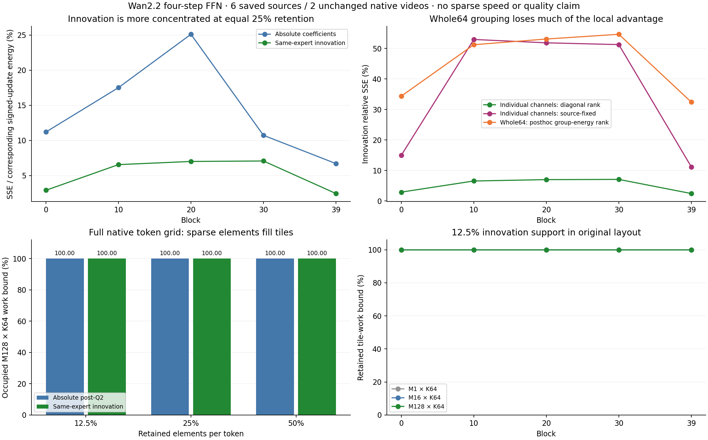

# E0 · 变化量的通道集中很强，但原布局的计算块仍然全满

**本轮获得了一个明确的机制分离：同专家 FFN 变化量可以由少量单通道较好重建，但这些通道分散在几乎所有原始64通道块中。** 在六来源的完整13824维系数上，保留25%通道时，五个被观察 block 的变化量相对 SSE 为2.44%–7.07%（按单元 value 对角能量排名）；同样保留3456通道、按连续64组的实际组能量排名，误差为32.42%–54.67%。后者是一个事后排名对照，不是全部组组合的最优值。

随后两次原生被动生成覆盖完整31668位置：在所测五个 block、四步中，即使每行只保留12.5%的系数，原有 `M16/64/128 × K64` 支持块仍全部非空；同专家变化量也是如此。两条视频、八个逐步 latent 哈希和40处采样 FFN 输出哈希全部与历史 dense 对照一致。**这是机制与支持布局的结果，尚未执行稀疏模型，也没有新增质量或速度达标结论。**



## 一、按最新版任务推进了什么

基准为 `main@61a4566` 的[FFN 第一任务](E0_FFN_FIRST_TASK_20261025.md)、[本征研究纲领](E0_FFN_INTRINSIC_RESEARCH_RESET_20261025.md)与[K1–K5 缺口](E0_FFN_KNOWLEDGE_GAPS_AND_DISCRIMINATORS_20261025.md)。当前用户明确指示“同步最新，然后继续推进，不要害怕用gpu”。据此分别冻结了：

- [保存数据 GPU 方案](../../config/e0_intrinsic_saved_gpu_20261025.json)：六个已暴露来源、五个 block、四步，共120个绝对输出案例与60个同专家变化案例；从五个面板扩展到全部216个完整64组。
- [原生被动方案](../../config/e0_intrinsic_native_support_20261025.json)：source0（主体）与source12（背景），各一次未改动 dense 四步生成，测量完整 token 维的支持与布局。

第二项在第一项结果产生后、任何新模型生成开始前，加入 post-Q2 变化量支持字段。先前未执行的准备版 SHA 留在方案的 `prior_unexecuted_plan_sha256`，原件保存在忽略的操作目录；这不是事后改写已执行方案。阶段保持 E0，未提升算子候选，旧12/40次实验及暂停回执均保持原样。

实际只使用一张已空闲的 A100 80GB，三个任务依次运行，未触及其余占用卡。沿用已有 HF 模型缓存和原环境，零模型下载、零新权重、零训练；结束后该卡无计算进程。新增 HF 输出6,338,864字节。

## 二、真实可观测字段：完整 hidden 与采样位置要分开

原始[被动采集](E0_NATIVE_OBSERVATIONS.json)包含六来源×四步×五个 block=120处。每处保存48个位置（32个按来源哈希选出的随机均匀位置，另有邻接样本），本轮定量重建只用前述32个均匀位置。

| 数学对象 / 实际字段 | 保存形状 | 本轮如何使用及已付成本 |
| --- | --- | --- |
| norm2/AdaLN 后、Smooth1 前输入 `modulated_input` | `[48,5120]` | FFN 前信息；不把它误当 W1 输出 |
| Smooth1/Q1 前后 `q1_pre/q1_post` | `[48,5120]` | 确认实际 W1 输入边界；未训练预测器 |
| preactivation a，即采集器命名的 `z` | `[48,13824]` | **所有 hidden 通道都已保存**，不是仅五组 |
| 原始 GELU 后、Smooth2 前 `gelu` | `[48,13824]` | W1/GELU 已付成本；新原生支持还覆盖完整 M |
| Smooth2/Q2 前后 `q2_pre/q2_post` | `[48,13824]` | 实际 W2 系数 q；与原始 GELU 幅值不等价 |
| 原始 `gate`、`b2` | `[1,5120]`、`[5120]` | 本批 gate 每处对位置共享，随来源/步/层变化；保留原始 bias |
| `ffn_output`、`residual_pre_ffn/post_ffn` | `[48,5120]` | 原生数值参考；不是稀疏动作的下游标签 |
| 旧 `W2_panel` | `[5120,320]` | 五个64组，继续作为逐字节身份交叉检查 |
| 本轮读取的完整 W2 | `[5120,13824]` | 从已校验原缓存10个 expert/block shard 读取，所有旧面板精确匹配；按实际 BF16 cast 后转 FP64 分析 |
| 原生完整 GELU、post-Q2、同专家 Δq 支持 | `[31668,13824]` 的全覆盖统计 | 流式观察，不把32个随机位置当成相邻 GPU tile；不保存这些巨大矩阵为新文件 |

W1、GELU、Smooth/Q2、W2、gate/residual 的顺序亲自对照当前 adapter `HIF4CacheRuntime.apply` 与 Wan `infer_ffn/post_process`；原源码和新 driver SHA 均绑定在方案中。完整 W1 也存在于原 shard，但本轮没有搜索其 key-pair 或执行分解。没有假定每个 hidden 坐标就是独立语义 feature。

## 三、重建的数学对象与竞争解释

固定当前 gate，令 `v_j=g⊙W2[:,j]`、`d_j=q_j v_j`，线性净更新为 `u=Σ_j d_j`；完整 gated FFN 输出还包含 `g⊙b2`。对保留集合 S，分析的误差是

`E(S)=||Σ_(j∉S) d_j||² / ||Σ_j d_j||²`。

**表内分母排除了 bias**，误差对应保留原 bias 时的线性更新差。单元对角能量 `q_j²||v_j||²` 没有包含交叉项：

`||Σ_jd_j||² = Σ_j||d_j||² + 2Σ_(j<k)〈d_j,d_k〉`。

同专家变化量使用 `q_t−q_(t−1)`，在**当前 gate**下重建 `g_t⊙W2(q_t−q_(t−1))`。这对应对旧的 ungated 输出缓存重施当前 gate；不是假定 gate 不变，也不是将两个专家的 W2 当成同一个。原始同专家 b2 的一致性逐案检查。

三个不同机制有不同预言：

1. **系数集中即可解释函数：** 按 `|q|` 选少量单元就接近 value-aware 选择；固定来源无关坐标也应较好。
2. **value 范数与有符号组合重要：** 相同系数质量可有不同净误差；单元对角最优不保证多单元净误差更小。
3. **创新集中但支持分散：** Δq 的局部重建好于 q，然而逐行支持并不形成共享的空列/块。需要改变执行表示，不能把元素保留率直接换成加速。

GPU 分析用 FP64 和原生 cast 后的完整权重，未改变模型参数。完整重建相对原保存原生 gated FFN 输出的 SSE 中位数为`2.799e−6`，最大`4.559e−6`；它验证了字段/权重关系，不使任意稀疏动作与原生 BF16 写回等价。

## 四、全部通道上的实际结果

三个保留率固定为12.5%/25%/50%，神经元与64组的通道数严格相等。例如25%=3456神经元=54个64组。固定参考只从同 step/block 的另外五来源构造，先按每个来源自己的总对角/组能量归一化再平均；整来源留出，但仍是已暴露样本，不是新质量测试。

以下为各案例相对 SSE 的等权均值，不是 pooled-energy ratio。每 block 的绝对案例24个、变化案例12个；六来源才是聚类单位。

| block | 绝对输出：单元 value 对角排名 | 同专家变化：单元 value 对角排名 | 同专家变化：来源固定单元 | 同专家变化：实际64组能量排名 |
| --- | ---: | ---: | ---: | ---: |
| 0 | 11.200% | **2.906%** | 14.996% | 34.392% |
| 10 | 17.513% | **6.557%** | 52.970% | 51.247% |
| 20 | 25.109% | **7.007%** | 51.864% | 53.111% |
| 30 | 10.728% | **7.074%** | 51.285% | 54.665% |
| 39 | 6.704% | **2.440%** | 11.192% | 32.424% |

**得到的正结果是可变系数比绝对系数更集中，而非一个已可部署的路由器。** 当前 Δq 需要本次完整 W1/GELU/Q2 已计算，value 对角需要完整 W2 与当前 gate；实际组能量更是执行全部对应投影后的后验信息。固定参考不是所有固定集合的全局最优；组能量排名也不是对所有组组合的联合 oracle。

value 对角排名不是普遍更好的净函数选择：25%保留率下，它在24/120个绝对案例、14/60个变化案例中比纯系数排名更差。具体例子是source16、step1、block39，绝对输出误差从系数排名的5.350%增为对角排名的9.153%。这提供真实的有符号组合反例，不能用“给系数乘一个 W2 范数”就关闭函数结构问题。

净更新能量与单元对角总和之比，在block0/39的绝对案例均值为43.37/67.38，变化量为14.56/38.49。这些地方有强**构造性叠加**，不应预设全 FFN 主要靠相消。聚合组 Gram 的负交叉对比例则随层/模式变化；全部指标与来源、step 分层见[结果 JSON](E0_INTRINSIC_FULL_HIDDEN.json)。这里的“聚合组对”是先跨32位置求内积，不能当每行组对的概率。

## 五、原生完整 M：元素集中没有变成原布局空块

两条生成各观察20处 FFN；同专家变化覆盖step0→1、2→3，每条10处。原生 q 按实际 BF16 cast 保存前一步于 CPU，后一步逐128行计算 FP32 差；只在所测五个 block 缓存，峰值约4.38GB CPU RAM，并在同专家配对结束后释放。绝对与变化量分别在自己的原始坐标下排名，没有修改返回给 W2 的输入。

对行块 B 与原始64通道组 G，定义支持占用 `I_BG=1{B×G 内至少一个保留的非零系数}`。报告实际行数加权的 dense-tile 工作上界比例

`χ_T = Σ_B |B|·64·Σ_G I_BG /(M·H)`。

这不是 cuBLAS 的实测 skip 或运行时间；它检验保持这些逐行支持时，原轴对齐块能否整块跳过。末尾不足T行的 block 按真实行数计账。

| 对象 / 每行保留 | 完整M列并集 | M1×K64 占用工作 | M16×K64 | M64×K64 | M128×K64 |
| --- | ---: | ---: | ---: | ---: | ---: |
| 原始 post-Q2，12.5% | 99.4405% | 99.9034% | 100% | 100% | 100% |
| 原始 post-Q2，25% | 99.8658% | 99.9950% | 100% | 100% | 100% |
| 原始 post-Q2，50% | 99.9904% | 100% | 100% | 100% | 100% |
| 同专家 Δq，12.5% | 99.9805% | 99.9699% | 100% | 100% | 100% |
| 同专家 Δq，25% | 100% | 99.9998% | 100% | 100% | 100% |
| 同专家 Δq，50% | 100% | 100% | 100% | 100% | 100% |

表中100%不仅是均值：两个来源的每一处所测M16/64/128案例均为100%。原始 GELU 支持给出相同的整块非空结论。完整M的原生 Q2 零率范围6.115%–13.441%，也没有使这些块变空。

这是对**指定逐行支持与原64布局**的结论。它没有排除：为一个 token 块联合选择另一组任意列、tile packing、改变可接受近似、重组织时空位置或条件函数表示。逐行最好的集合之并集很大，并不证明另一个共享集合的净误差也一定大。

## 六、原始论文和作者实现怎样改变了下一问

2026-10-25 实时 Web Search 沿 key-value FFN → diffusion sparse delta → activation concentration/真实GEMM → 非线性特殊恒等式展开，并回读原文公式、伪代码及相邻反例。

| 原始来源与亲自阅读位置 | 与本轮的关系 / 实质差别 |
| --- | --- |
| [Geva 2021 原论文](https://aclanthology.org/2021.emnlp-main.446.pdf)，§2 的 memory coefficients / weighted values | 已有的系数—value分解原语。本文没有把语言模型中的语义解释直接赋给 Wan 坐标。 |
| [Chipmunk v1](https://arxiv.org/html/2506.03275v1)，§3.3.2、Algorithms5–7、AppendixB.4；[作者理论篇](https://sandyresearch.github.io/chipmunk-part-II/) | 变化量和列稀疏是最近先例；它通过 token块均值在 W1 前选择共享任意列，再重算所选 W1/W2，并有 packing/缓存实现。本轮是已知真实Δq的后验重建，不是复现该 selector。算式以Algorithm6的`a=act_fn(pre+b); delta=a-a_cache`为准；不能把非线性移过差分。原文主要50步/H100，当前是四步双专家/A100/QDQ-BF16。 |
| [Activation Concentration v2](https://arxiv.org/html/2606.00567v2)，§3.1–3.5、§4.1–4.3 | 其 full-M hot-column 观测与本轮物理问题紧邻；该文用阈值/层校准及 systolic/Ramulator 仿真，本轮用固定逐行保留率、实际 Wan 完整M与连续行块。不能移用其模拟速度或阈值质量结论。 |
| [NVIDIA GEMM guide](https://docs.nvidia.com/deeplearning/performance/dl-performance-matrix-multiplication/index.html)，§2.3、§3.1–3.2 | 大小、tile效率、并行度和wave影响实际速度；非空统计只是一个必要布局诊断，不是稀疏kernel计时。 |
| [SVD-Cache v1](https://arxiv.org/html/2601.07396v1)，§3.2–3.5 | 用特征空间的固定参考 basis 与 EMA 预测主分量、复用残差；区别于单元系数创新和 W2 组选择。本轮没有做SVD或执行该方法。CVPR页面未取得，实际阅读的是arXiv原文。 |
| [MagCache v1](https://arxiv.org/html/2506.09045v1)，§3.2–3.3 | 范数规律控制整段 residual 缓存；不能由范数/高cosine代替本轮逐单元创新、净输出和实际布局的区分。官方 Wan2.2 源码核对沿用[上轮记录](E0_TEMPORAL_CALIBRATION.md)。 |
| [Faris / Kanikona 作者研究博客，2026-09-08](https://www.kanikona.com/blog/weight-identifiable-antipodal-gelu-populations-mediate-compensating-responses-in-pythia)，§2.1–2.2 | 给出另一种本征表示入口：同时满足 read/write/bias 反向关系的GELU群体可近似线性。作者在Pythia研究，本轮未重现其统计或在Wan找到对应群体。此项属于作者原始博客与条件数学，不是已审稿的Wan证据。 |

最近先例支持的建设性问题是：**能否为一个 token 块选取函数上足够好的共享列，而不是完整保留每行独立最优集合？** 当前结果不能以“满tile”排除这个问题，也不能靠重新命名 sparse delta 获得新方法结论。

## 七、四步条件下的真实计算边界与另一个表示入口

若仅在W1/GELU/Q2后观察Δq、仅减少同专家第二次调用的W2，则160次FFN中只有80次W2可被这样改变。W1、W2投影维度对称，因此保留率ρ时，名义总投影MAC省算上限为

`saved_fraction ≤ (1−ρ)×80/(2×160)=(1−ρ)/4`。

ρ=25%时仅为18.75%，理想投影计算加速上界约1.231×，尚未加入selector、QDQ、索引、缓存或其他网络操作。它不是整个FFN/视频的时延估计。若要同时减少W1，需要真正的前置共享/条件函数信息，这正是Chipmunk的tile-mean决策与本轮后验上界不同之处。

朴素40层同专家历史缓存：完整BF16 hidden为35,022,274,560字节，完整BF16 ungated输出为12,971,212,800字节，合计约47.99GB；可在换专家时释放。实际部署可用压缩、分层缓存或CPU卸载，但需计入成本；Chipmunk AppendixB.4已有bitpacking和双缓冲卸载先例，所以这不是内存不可能性证明。本轮只在五层的被动观测中临时使用CPU历史，不建立加速缓存。

**一个非任意旋转的候选表示种子（未提升）：** exact GELU和当前tanh近似在实数上均满足`φ(a)−φ(−a)=a`。若两单元同时满足`w1_k=−w1_j`、`b1_k=−b1_j`、`w2_k=−w2_j`，它们的联合输出可写为`w2_j(w1_jᵀx+b1_j)`，是一条仿射分支。这个已知特殊结构为功能重写提供入口，不需要假装任意旋转能穿过GELU。任意W1或W2单侧反向、范数不匹配、bias不匹配都不足；实际Smooth/QDQ和BF16顺序还会破坏这条浮点执行等价。本轮只验证恒等式与反例，未测Wan近反向群体，也未实现加速分支。

## 八、下一条真正能改变决策的观察

下一问应是**token块联合函数支持，或可重写的条件函数群体**，保持两种解释竞争：

- 若相邻token上，一个同预算共享任意列集合的净误差接近逐token集合，则值得核对前置观察、实际gather/packing和W1/W2联合执行；当前全满原64块不排除它。
- 若共享列的净误差仍大，而固定/条件函数群体能解释有符号作用，则可研究更合适的函数表示，而不是把单元排序当作唯一作用单位。

第一个问题所需的最小新字段是预先固定的相邻16/64行完整post-Q2、同专家历史、gate与原W2绑定；已有32个随机位置和本轮全M支持统计不能反推出这些向量。第二个问题可先查已存在完整W1/W2与bias的联合关系，再决定是否需要原生因果观察。新模型工作尚未排队。

## 九、完成情况与复现

[汇总与原始结果绑定](E0_INTRINSIC_FULL_HIDDEN.json)记录：180个GPU保存数据案例；2160次小矩阵子集投影、120次完整参考投影、360次216组批投影，均单独记账；原生新增两次完整生成、零失败、零额外FFN/norm、零训练/分解/官方评分。GPU分析含读资产耗时约62.94秒，两次生成各含观测约121.09/119.15秒，均**不是未加观测的基准计时**。

七项测试覆盖有符号相消、完整分组布局重构、相同元素保留率下不同tile占用、整来源留出不泄漏、固定数量随机支持公式、非整行tile的流式变化量一致性，以及GELU特殊恒等式与旋转不交换。原协议/driver和旧采集器保持哈希不变；详细标量、原生RUN、视频、源码快照均在HF缓存，Git只保存方案、汇总、代码和图表。

```bash
.venv/bin/python tools/analyze_e0_intrinsic_results.py \
  --raw-root "$HOME/.cache/huggingface/ffnds-derived/e0_intrinsic_20261025" \
  --out /tmp/E0_INTRINSIC_FULL_HIDDEN.json
OPENBLAS_NUM_THREADS=2 OMP_NUM_THREADS=2 .venv/bin/python -m unittest discover \
  -s tests -p test_e0_intrinsic_math.py
```

实际原生执行命令与不可变源码保存在各HF运行目录的`EXECUTED_SOURCES`和私有执行回执；复算汇总不会启动模型。该结果填补K1完整系数/值向量、K2实际支持块、K3同专家创新的一部分缺口；K4稀疏动作的视频功能和真正kernel时延仍未测得。
