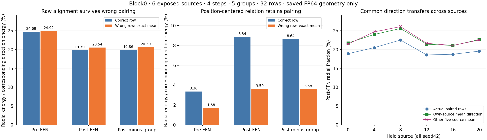

# E0 · 强径向对齐主要不需要 token 配对，去公共分量后仍有配对结构

**新认识：Block0 原始径向能量比例为19.794%，将组方向换给其他位置后仍为20.542%。因此，原先约19.82%的局部 LN 消去不能单独作为按 token 决策的依据。与此同时，去掉两个操作数的跨位置公共均值后，正确配对为8.839%，错配为3.590%；且写回前也已有3.361%对1.682%的差异。共享几何与位置相关结构同时存在。**

另外五个来源的固定公共 residual 方向与当前来源平均方向的 cosine 为0.99645，说明这一方向在这六个同 seed 来源之间可以迁移。它没有预测完整 FFN 输出，也没有证实可删掉公共分量。这是 E0 保存数据的机制辨别，未选择加速算子。

完成期间同步了 `main@3a8b7a7` 的[最新机制交接](E0_NEXT_MECHANISM_GUIDANCE_20261025.md)。本报告完成其中第二条并行探索；四臂距离不变量的独立复核仍为第一优先。本作者参与过原始四臂分析，不能以自己的重算代替外部独立评议。



## 这轮具体区分什么

独立作者在 [0bd9bbc 的竞争机制记录](../method_discussion/discoveries/E0/codex-01a171da-competing-mechanisms-20261025.md)提出：原始对齐可能来自 shared mean / anisotropy，而非同一 token 的功能性关系。本轮据此固定[配对计划](../../config/e0_radial_pairing_saved_20261025.json)，在新统计产生前声明全部对照。

- **位置专属关系主导：** 真实配对应明显优于其他位置的方向，控制时间、空间和幅度后仍如此。
- **共享几何主导大数值：** 即使打破配对，对齐仍高；一个公共 residual 方向也可保留相近或更大的投影。
- **两者叠加：** 原始量被公共分量主导，去公共分量后仍存在较小但明确的配对关系。

看到配对结果后另行冻结了[跨来源公共方向计划](../../config/e0_radial_template_saved_20261025.json)，才计算 source leave-out 统计。它区分“每个输入各自的公共方向”与“同 step/block 下可跨输入迁移的方向”。这是顺序开展的第二项检查，不伪称它在第一项结果前已经提出。

## 原始计算与数学对象

亲自重读当前 LightX2V 的 `infer_ffn` / `post_process` 及原采集器：当前操作数依次经过 norm2、AdaLN、Smooth/Q1、W1、GELU、Smooth/Q2、W2、原始 gate 及残差写回。源码的原始 SHA 见[几何来源绑定](E0_RESIDUAL_GEOMETRY.json)。本轮继续使用同一组定义：

`δ_(i,g) = diag(gate) W2_g Q2_i,g`，每组完整64通道，宽5120。

这是保存 BF16 操作数与 decoded 权重面板上的 **FP64 组方向**。它不包含原生 BF16 GEMM 累加、gate 乘法和残差写回的全部舍入；[40次原生诊断](E0_FOLLOWTHROUGH.md)已经说明这些差异不可忽略。

令 `P=I−11ᵀ/D`、`u_i=P x_i`、`v_j=Pδ_j`，`s_i=||u_i||²`，则 ideal epsilon-LN 切向投影的径向能量为

`R_ij = [(s_i+2Dε)/(s_i+Dε)²] · (u_iᵀv_j)²`。

真实配对统计是 `Σ_i R_ii / Σ_j||δ_j||²`。在 n=32 行之间均匀错配、禁止自身配对时，精确期望是

`R_wrong = [Σ_(i≠j) R_ij /(n−1)] / Σ_j||δ_j||²`。

不需要实际抽随机排列。分层错配在每层使用相同公式；singleton 保留自身并报告覆盖率。这里没有假定 token 是独立样本，也没有给 p 值。六个来源才是重复测量的聚类单位。

**两种“去均值”不同：** `P` 去每个位置的通道均值，是 LN 的操作；本轮额外减去32个位置的5120维平均向量，是表征诊断。后者改变了操作数与分母，不能说原生 LN 还会额外消去8.84%的完整状态。

## 结果：原始高值在错配后保留

以下是各组案例比例的等权均值，每个 block 包含六来源×四步×五组=120例；不是 pooled-energy ratio。只列径向部分，不含 LN 通道常量方向。旧报告的19.82%还包含约0.024个百分点的通道均值消去。

| Block0 residual 边界 | 正确配对 | 全位置错配 | 保留时间段错配 | 保留空间区错配 |
| --- | ---: | ---: | ---: | ---: |
| FFN 写回前 | 24.688% | 24.916% | 24.926% | 24.939% |
| 原生 FFN 写回后 | 19.794% | 20.542% | 20.523% | 20.543% |
| 写回后减 decoded 本组方向 | 19.862% | 20.589% | 20.571% | 20.591% |

时间段固定为 latent t 的[0,7)、[7,14)、[14,21)，空间区固定为 y=15、x=26 分割的四象限。使用实际 `[21,29,52]` FFN token 坐标；本批各层均能错配全部32行。未把额外邻接采样行混入这32个随机均匀坐标。

| 写回后 block | 正确配对 | 错配 | 去位置均值后正确配对 | 去位置均值后错配 |
| --- | ---: | ---: | ---: | ---: |
| 0 | 19.794% | 20.542% | 8.839% | 3.590% |
| 10 | 2.100% | 2.121% | 0.325% | 0.284% |
| 20 | 1.596% | 1.727% | 0.402% | 0.361% |
| 30 | 1.599% | 1.683% | 0.430% | 0.159% |

Block0 residual 的位置公共分量携带87.93%的中心化通道能量；五组 δ 的对应公共能量均值为37.57%。只保留 residual 的公共方向，径向比例为22.735%。**这些数值支持公共方向解释原始大对齐；不能将“可用公共方向解释”换算成计算可删除比例。**

幅度权重不是唯一原因：逐行等权、将两边都单位化后的平方 cosine，写回后仍为正确配对0.17006、错配0.17950。原始正确配对也并非每组都弱于错配：120例中42例相反，组161和215的聚合结果也有小幅正配对优势。

## 去公共分量后，配对关系仍然存在

| 来源 | 原始正确配对 | 原始错配 | 去位置均值后正确配对 | 去位置均值后错配 |
| --- | ---: | ---: | ---: | ---: |
| 0 | 18.888% | 19.555% | 9.313% | 4.616% |
| 4 | 20.494% | 21.790% | 6.283% | 1.507% |
| 8 | 22.519% | 23.262% | 7.129% | 1.593% |
| 12 | 18.561% | 19.289% | 9.903% | 4.994% |
| 16 | 18.737% | 19.002% | 10.497% | 4.831% |
| 20 | 19.565% | 20.352% | 9.910% | 3.996% |

去位置均值后，写回前的正确配对/错配为3.361%/1.682%，写回后为8.839%/3.590%，减本组方向后为8.639%/3.580%。这表明关系不全来自本组写回到 residual 的直接自相关；全 FFN 写回及其他组仍可能增强它。它也没有定位到某个具体神经元或语义属性。

写回后去位置均值的等权平方 cosine 为0.06623对0.03087；保留时间段/空间区的错配径向比例为3.794%/3.699%，结论在这两项描述对照下保留。

一个条件反例说明为何两张表不冲突：令 `x_i=μ+ξ_i`、`δ_i=−μ+ξ_i`，μ 与位置变化正交，`Σξ_i=0`。若公共 μ 足够强，正确配对的正局部关系会抵消部分负公共内积，使**原始平方内积反而小于错配**；去 μ 后却恢复强配对。测试用三点 regular simplex 精确实现了这个现象。真实数据 raw signed cosine 均值为−0.13175，去公共分量后为+0.17570，与这种叠加解释相容；尚未完成真实内积四项的因果归因。

## 公共方向能否跨来源迁移

对每个 held source，在同 step/block 上只平均另外五个来源的 residual 均值，保留写回前/后两套模板。当前来源的 residual、输出、gate 和组标签均不参与模板构建；评估时 δ 仍使用当前来源的实际 gate 和 post-Q2，因此仍是事后几何诊断。

| Block0 状态 | 当前与其他五来源公共方向 cosine | 自己的公共方向径向比例 | 其他五来源模板径向比例 | 逐例绝对差均值 |
| --- | ---: | ---: | ---: | ---: |
| 写回前 | 0.99775 | 26.130% | 26.194% | 0.170个百分点 |
| 写回后 | 0.99645 | 22.735% | 22.910% | 0.384个百分点 |

写回后的六个来源平均 cosine 范围为0.99443–0.99749。支持的是**相同模型、step、seed42 和这批来源中的方向迁移**；方向稳定不等于幅度稳定，更不等于完整输出可固定替换。所有来源同 seed，同一采样协议和蒸馏配置仍是竞争解释；没有跨 seed 或相机类别证据。

## 文献怎样改变了解释

2026-10-25 使用实时 Web Search，先检索 embedding anisotropy / random-pair baseline / common mean，再沿原论文追到 rogue dimensions、attention drift、massive activations、register neurons 和 diffusion token compression。以下内容亲自读到相应公式、干预或官方方法段；没有声称复现这些完整方法。

| 原始来源与实际阅读范围 | 对本问题的影响与边界 |
| --- | --- |
| [Ethayarajh 2019](https://aclanthology.org/D19-1006.pdf)，§3.2 的随机词对基线 Eq.4及§4 | 原始 cosine 应对比同一表征空间的错配基线；本轮改用与 LN 对应的平方投影，且在同来源/step/group 内控制，不直接移用语言模型结论。 |
| [All-but-the-Top v2](https://arxiv.org/html/1702.01417v2)，§2.1 Algorithm1 | 去公共均值之后仍可能有各向异性；本轮中心化错配值仍为3.59%，不能再拿1/5120当唯一基线。未做 PCA 截断或更改 Wan 表征。 |
| [Timkey & van Schijndel 2021](https://aclanthology.org/2021.emnlp-main.372.pdf)，§3.1 Eq.2–4、§5.3 | 少量通道可主导 cosine，而且去均值不保证消除它。这里保留原始度量并给错配基线；未把 Wan 的通道解释为已证明的 rogue dimensions。 |
| [Godey et al. 2024](https://arxiv.org/pdf/2401.12143)，§4.1–4.4、§5 | 官方原文用共同输入漂移研究未训练 Transformer，观察 query/key 均值和 attention sharpness；因此公共方向可能有计算功能。它未证明 Wan 的具体成因。 |
| [Sun et al. 2024 v2](https://arxiv.org/html/2402.17762v2)，§3、§5 的 zero/mean 干预，Tables3–4 | 提供最强反例：稳定、输入弱相关的大分量仍可能是必要 bias；置零与保留其均值不同。不能因公共方向可迁移就删掉它。 |
| [ViTs Don’t Need Trained Registers v2](https://arxiv.org/html/2506.08010v2)，§3.2 Algorithm1、§4及AppendixA.5–A.6 | 稀少 FFN 神经元和特定 decoder 方向可引出高范数/全局作用；任意高激活神经元并不等价。这是后续定位“谁产生公共方向”的机制来源，未证明 Wan 有同样 register。 |
| [RTI 官方方法页](https://eduardzamfir.github.io/rti/#method)，Read/Write 公式及消融/限制 | 另一条计算路线是保留个体 residual、压缩区域计算，再按 token 写回更新；其 learned pooling、per-token map、LoRA 和像素 T2I 对象与当前四步量化 Wan 不同。它提示共享与局部变化应分别建模，不意味着可直接替换。arXiv HTML 未取得，性能未独立核验。 |

这轮最关键的修正是：**“对齐大”需要先问“超过本表征自身的共享几何多少”；“公共”也需要先问“是否承载必要的偏置或全局信息”。** 后者阻止我们把第一个对照结果误读成删除许可。

## 对省算路线的具体影响

Q1/Q2：不能仅凭原始19.82%为昂贵的按 token 路由背书。共享方向的固定参考必须进入后续对照；位置中心化关系仍有信息，但目前全部 δ 依赖已算出的 Q2/W2 面板，尚不是廉价的前置决策器。

Q3：有价值的探索种子是把公共更新与位置变化分开解释，保留必要公共项，把真正昂贵的可变部分作为研究对象。精确分解 `V W2ᵀ = 1(μ_V W2ᵀ) + (V−1μ_V) W2ᵀ` 本身**不省 GEMM**；计算 μ_V 也已需要 W1/GELU/Q2。只有另有便宜的公共项生成或可变部分执行机制时，这个表示才可能改变实际成本。当前没有实现或选择该种子。

下一项有区别力的原生观察应同时保留“公共项可能必要”和“位置关系可能有价值”两个解释：在相同前缀、幅度匹配和原生写回下，对比保留公共项而改变中心化变化、以及改变公共项而保留变化，追踪完整四步后果；并用不同 seed 检查方向迁移。现有固定删组没有隔离这些因果边，新的模型范围需单独明确指令，当前没有排队作业。

## 复核、资产与复现

- 六个已暴露来源：3主体、3背景、0相机；96处非末层 FFN scope，每处五组共480例，三种 residual 状态共1440个旧径向值全部复现，最大绝对差`4.996e−16`。末层39没有 next-block norm1，按旧协议排除。
- [配对汇总](E0_RADIAL_PAIRING.json)约180KB；480例全部详细数值保存在 HF 缓存，公共 JSON 记录相对路径、字节数和 SHA。[跨来源结果](E0_RADIAL_TEMPLATE.json)保留960个状态/组案例及96处资产绑定。
- 新增原生模型/GPU/FFN/norm/训练/视频调用均为0；两项分析各480次小型 decoded 面板乘法属于保存数据 CPU 数学重算。
- 五项测试覆盖：精确分层错配期望、纯公共与纯配对反例、epsilon-LN 恒等式、公共项引发原始/中心化反转、整来源留出不泄漏。

```bash
OPENBLAS_NUM_THREADS=2 OMP_NUM_THREADS=2 .venv/bin/python tools/analyze_e0_radial_pairing.py \
  --raw-root "$HF_HOME/ffnds-derived/e0_observations_20261025" \
  --out /tmp/E0_RADIAL_PAIRING.json \
  --detail-out "$HF_HOME/ffnds-derived/e0_radial_pairing_20261025/reproduction_full.json"
OPENBLAS_NUM_THREADS=2 OMP_NUM_THREADS=2 .venv/bin/python tools/analyze_e0_radial_template.py \
  --raw-root "$HF_HOME/ffnds-derived/e0_observations_20261025" \
  --out /tmp/E0_RADIAL_TEMPLATE.json
```

HF_HOME 指已有 HF 缓存，脚本拒绝覆盖结果；第一项完整输出限制在当前用户的 HF 缓存内。本轮没有修改旧采集器、协议、结果、原生 driver、他人发现记录、研究阶段或模型授权。
