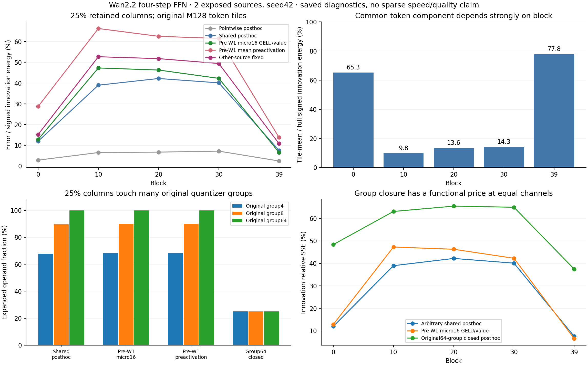

# E0：连续 token 共享通道的功能代价，以及 W1/W2 不同的依赖边界

这轮把上一轮“创新集中、原始 tile 却全满”的现象推进到两个可区分的原因：**中间层的创新主要是 token 各自的变化，所测共享列规则未能保留逐行稀疏的重建效果；首尾观测层存在较强共同变化，但任意列支持仍触及全部原始 HiF4 64 通道组，不能直接把 W2 的列预算当成 W1 的计算预算。** 这不是所有稀疏或缓存方法的否定；它定位了直接移植 shared-column delta 方法需要改变的具体运算。

数据：[共享列与前置观察](E0_SHARED_TILE_PRE_W1.json)、[原始量化组依赖](E0_SHARED_TILE_CLOSURE.json)、[原始 Python 量化参考的合成反例](E0_HIF4_COLUMN_DEPENDENCY_COUNTEREXAMPLE.json)。上轮：[完整 hidden 与原生支持](E0_INTRINSIC_FULL_HIDDEN.md)。本轮仍为 E0，未选定主算法，未建立稀疏速度或候选视频质量结论。

## 真实新增数据，不把随机32行当连续 tile

用户再次明确要求持续推进；在旧范围之外，分别冻结了 [连续采集](../../config/e0_contiguous_native_20261025.json)、[共享列诊断](../../config/e0_shared_tile_saved_20261025.json)、[依赖闭包跟进](../../config/e0_shared_closure_20261025.json) 三个具体范围。

- 两个已暴露来源：source0（主体）、source12（背景），seed42；各一次完整 dense 四步生成，双专家切换不改。
- 每来源四步 × Block0/10/20/30/39，保存三块原始连续 M128 token，即每处384行。起点为 `128*floor(floor(M/128)*k/6)`，k=1/3/5，M=31668；跨步坐标相同，不声称跟踪物体。原来的32个均匀随机位置另存作控制。
- 保存完整 Q1 后输入、W1 preactivation `a`、GELU、原生 BF16 Q2 后系数 `q`、W2 输出，以及 gate/bias；W1/W2/Smooth 使用原始完整缓存并逐 shard 验 SHA。
- 两次生成的8个 latent SHA、2个视频 SHA、2组原生调用计数与历史 dense 完全一致；40处各五个字段在旧32位置的逐元素数值相同。该字段检查不是 signed-zero 位模式检查。
- 两张空闲 A100 同时采集；其后单卡分析。共80种 layout/tile 描述、20个来源×专家内步对×block；第一诊断80次 W1、2020次 W2 投影；闭包跟进40次 W1、260次 W2 投影。没有额外原生 FFN/norm、训练、分解或官方质量调用；没有新模型下载。另执行原始 Python 参考的两次 CPU 合成量化调用，CUDA QDQ 调用为零。
- 原始连续张量和视频留在 HF derived cache；公开 JSON 只含标量、绑定 SHA 和相对数据索引，私有 worker 映射不入库。两个来源不是 fresh holdout；重排、tile 和层不增加独立样本数。

## 1. 从逐行集中到共享列，损失发生在哪儿

目标严格定义为当前 gate 下的同专家更新：

\[
 \Delta U_r=g_t\odot W_2(q_{t,r}-q_{t-1,r}),\qquad
 E(S)=\frac{\sum_r\|g_t\odot W_2(\Delta q_r\odot1_{j\notin S_r})\|^2}
 {\sum_r\|\Delta U_r\|^2}.
\]

偏置在专家内相同；旧 ungated 输出须用当前 gate，不假设 gate 跨步相同。对每种方法保留准确相同的1728/3456/6912列，即12.5%/25%/50%。逐行后验对角值能量排名与共享排名都不是有符号联合误差的全局最优解。

共享后验对角排名为 `mean_r(delta_q[r,j]^2)*||g*W2[:,j]||²`。前置观察只使用当前 Q1 后输入、静态 W1/bias/Smooth2 和旧均值；不读当前完整 W1/GELU/Q2 标签。它先将每16行平均再投影 W1，用 GELU 后的预测差平方乘值向量范数、在 M128 内平均后选列。它忽略动态 Q2 与 native BF16 的精确舍入，仅用于排名。另比较整块 preactivation 均值差、整块 GELU 均值预测、micro16 preactivation、真实共享均值、五个其他来源构成的固定支持。

**25%列、原始连续 M128；表中为四个来源×专家步对的相对创新 SSE 的算术平均：**

| Block | 逐行后验对角 | 共享后验对角 | 前置 micro16 GELU/value | 前置整块 preactivation | 其他来源固定 | 原始64整组共享对角 |
|---|---:|---:|---:|---:|---:|---:|
| 0 | 2.85% | 11.98% | 12.84% | 28.72% | 15.23% | 48.38% |
| 10 | 6.51% | 38.99% | 47.30% | 66.31% | 52.71% | 63.11% |
| 20 | 6.72% | 42.21% | 46.30% | 62.55% | 51.80% | 65.48% |
| 30 | 7.19% | 40.12% | 42.29% | 61.53% | 49.45% | 64.98% |
| 39 | 2.44% | 7.57% | 6.55% | 13.79% | 10.81% | 37.50% |

**因此两种失败同时存在：** 中间层即使读真实 delta 的共享对角描述仍差，不能只归咎于便宜观察器；preactivation 均值差又明显差于带 GELU/value 的前置描述，观察机制本身也影响结果。Block39 前置方法在该有限样本上优于共享后验对角方法，并不矛盾：对角目标不是联合函数误差目标。这不是调参后的“最佳固定/最佳动态”比较，没有对所有可能固定集合求最优。

共享 M16 的跨层平均 SSE 为21.47%左右，M64 为27.18%左右，M128 为28.18%左右；逐行相同约5.14%。将同一384位置打乱后 M128 约29.16%，说明这些原始 raster 连续邻近提供一定帮助，但不足以保留逐行集中效果。这里没有执行 Chipmunk 的 voxel/RoPE 重排，不能把原始 raster 结果扩大为所有空间分组的结论。

与当前完整 gated W2 输出能量相比，前置 micro16 方法的误差在 Block0/10/20/30/39 分别约2.35%/26.85%/14.89%/20.81%/1.97%；这仍是局部能量，不是后续 residual、全视频质量或可接受阈值。

## 2. 解释层间差异：共同变化与 token 自有变化

在每块 token 内，令 `mu=mean_r(delta_U_r)`、`e_r=delta_U_r-mu`，则有精确正交分解：

\[
 \sum_r\|\Delta U_r\|^2=T\|\mu\|^2+\sum_r\|e_r\|^2.
\]

连续 M128 的均值部分占创新能量：Block0 **65.3%**、Block10 **9.8%**、Block20 **13.6%**、Block30 **14.3%**、Block39 **77.8%**。这为首尾观察层较适合共享描述、中间观察层更依赖 token 细节提供了实际证据；这是相关机制解释，尚非对所有层或下游质量的因果证明。

均值还有明确的非线性盲点。对于真实数 tanh-GELU，旧 token preactivation `(-1,1)` 与新 `(-2,2)` 的均值都为0，但平均 GELU 改变；任何仅依赖完整块均值的观察器都不能区分该例与“没有改变”。这是已通过测试的合成反例，非 Wan 测量。micro16 会缩小盲区，但不普遍消除它。

进一步将保存的系数作**精确代数分解**：

\[
 \Delta q=\frac{\Delta a}{2s_2}+
 \frac{\Delta(h-a/2)}{s_2}+
 \left[\Delta q-\frac{\Delta h}{s_2}\right].
\]

三项分别是线性半项、保存的 GELU 余项，以及 Smooth/BF16/Q2 舍入差。保存的余项不声称在 native BF16 下严格为偶函数。投影 W2/gate 后，线性半项与余项的平均 cosine 为 **−0.64至−0.82**；各自能量常超过净创新。由此不能仅因为 `a` 的某个线性部分大就省略非线性余项；这与上一轮“按原神经元分解存在构造性叠加”不冲突，它们是不同分解下的有符号关系。完整当前输出连续重建的最大相对 SSE 为3.56e−6，确认字段/权重解释一致，不能据此宣称有限 native 干预等价。

## 3. 为什么选对任意列，仍未直接省掉 W1

检查实际 native 路径：`Q1 -> BF16 W1 -> tanh-GELU -> Smooth2/BF16 -> HiF4 Q2 -> BF16 W2`。HiF4 `hifx4` 原始实现使用64个系数的共同根尺度，内部还有8/4子组尺度；CUDA `hifx_quant_cuda_inner` 与 Python `quant_hifx` 都明确读取这些 max 层级。该 source 已由采集协议与跟进协议绑定。

对每块选出的列集合 S，定义**直接按原生组求值所需的操作数扩展**

\[
 C_{64}(S)=\bigcup_{j\in S}\operatorname{original64group}(j),\quad
 c=|C_{64}(S)|/H.
\]

三种任意列描述（真实共享对角、前置 micro16 GELU/value、前置 preactivation）在 **25%与50%保留率下，全部60个 M128 tile 都触及216/216个原始64组**。即使只留12.5%列，平均扩展仍为99.97%上下。4/8子组也显著扩展，详见闭包 JSON 与图。

所以，按现有 groupwise Q2 直接计算所选列时，W1 的候选操作数集合几乎仍为全宽。这个结论针对直接原生求值，不是任何算法都必须完整计算 W1 的下界；认证 max 上界、尺度缓存、表示变换仍是不同假说，需要单独证明其成本与误差。后 Q2 的 gather/W2 packing 仍可研究，但其省算边界不同。

为避免“这只是 group size 元数据”的解释，执行了原始 Python `quant_hifx` 的两次 CPU 合成参考调用：一个64组除了第0项为7，其余都为1.25；只将第0项改为14。**输出64项全部改变，未改变输入的第8项由1.25变为1.5。** 源码 SHA 与完整 changed-index 列表保存在反例 JSON。它不是 CUDA 核数值复现或 Wan 自然数据的频率结论，却直接反驳“只改一个 GELU 系数就只更新同一个 Q2 系数”的一般等价性。

反过来，强制选择54个完整原始64组，确实让 `c=rho=25%`。但同样对角规则的局部 SSE 上升到表中37.50%–65.48%。不能把这一规则的失败说成所有整组联合选择的下界。

## 4. 更准确的计算账本与可建设的下一步

需要分别记 `rho_W1` 与 `rho_W2`。若只在每个专家的第二次调用进行更新，共80/160处 FFN；两次投影等成本、前置观察额外 W1 比例为 `o`，理想投影 MAC 省量为

\[
 s_{proj}=(2-\rho_{W1}-\rho_{W2}-o)/4.
\]

这只是一种执行方案的理想投影账本，未含 QDQ、缓存、gather、值向量范数统计、topk/索引、其它网络操作和端到端延迟。对 native64 扩展近全宽的任意列方案，`rho_W1≈1`；在25% W2 与 micro16观察 `o=1/16` 下只剩 **17.19%** 的理想总投影 MAC 省量，理想投影速度上限约1.208x。若能实际让两次投影都缩到25%，这一账本才成为35.94%省量；不能从本轮后验局部误差直接取得这个收益。

这轮具体改变了下一步的研究对象：

1. **先改变联合函数/执行单位，而不是再调同一排名。** 首尾层的共同变化允许“共享共同更新 + token 特有校正”的表示；中间层共同能量少，必须比较不同单元或更合适的空间组织。仅从5个已观测 block 推广到全160处还没有依据。
2. **将尺度依赖作为选择动作的一部分。** 若缓存旧 GELU，只更新选中的输入并重新 Q2，未选中的 Q2 输出也可能改变。正确的 W2 差值支持应是 `T={j:Q2(u_new)_j != Q2(u_old)_j}`，不能直接写成 S。可探索 Q2 树节点/完整组与有符号函数贡献的联合表示，或明确近似旧尺度的误差；不得称为原生精确等价。
3. **把后 Q2 稀疏 W2 当有清楚上限的系统对照。** 它与“提前省 W1”的方案有不同成本；若做真实速度/视频测试，必须显示这两笔工作和缓存费用。当前未选择或执行候选算子。

连续张量、固定控制、数学工具和闭包复核现已齐备，后续无需再为同一字段重复生成 dense 视频。当前两个来源的普通 dense 视频不能替代未来候选 free-running 视频、计时与独立质量评估。

## 5. 本轮实际查证的最近机制和反例

检索日期2026-10-25，沿上一轮 Chipmunk 理论/算法追到作者真实模块与两次投影 kernel；另检索 spatial MLP linearization、GELU delta、diffusion temporal forecasting，追读 TaylorSeer 方法 §3.2，而非只收集标题。

- **Chipmunk，官方代码固定 revision `177fdefc4803e621fd8a02aad491812e9d1ecc94`：** [模块选择/缓存](https://github.com/sandyresearch/chipmunk/blob/177fdefc4803e621fd8a02aad491812e9d1ecc94/src/chipmunk/modules/mlp.py)、[投影调用](https://github.com/sandyresearch/chipmunk/blob/177fdefc4803e621fd8a02aad491812e9d1ecc94/src/chipmunk/ops/mlp.py)、[MM1](https://github.com/sandyresearch/chipmunk/blob/177fdefc4803e621fd8a02aad491812e9d1ecc94/src/chipmunk/triton/csp_mlp_mm1.py)、[MM2](https://github.com/sandyresearch/chipmunk/blob/177fdefc4803e621fd8a02aad491812e9d1ecc94/src/chipmunk/triton/csp_mlp_mm2.py)。实际读到 blockmean preactivation 差、topk 索引、GELU 后减旧激活、按索引取 W2 与 cache update；未导入、编译或基准复现其 kernel。源码核对使本轮加入真正前置观察和原始M128数据，而非只重复后 Q2 排名。我们的 micro16 连续池化不是其所有配置/rearrange、voxel 重排与索引缓存策略的复现。
- [Chipmunk 原始论文 v1](https://arxiv.org/html/2506.03275v1)、[作者 Part I](https://sandyresearch.github.io/chipmunk-part-I/)、[Part II](https://sandyresearch.github.io/chipmunk-part-II/) 提供 column packing 与缓存差值的最近竞争机制。原作者的 voxel 排序、完整系统重叠和多步配置仍可能优于本轮简单原始 raster 分组；本轮没有否定完整方法。
- [TaylorSeer v1 §3.2，式4–10](https://arxiv.org/html/2503.06923v1) 使用多个历史完整特征估计时间差分。这里每个专家的第二次调用前只有一次同专家历史，不能直接构成该原始一阶输出差分；本轮使用当前便宜输入观测，是不同信息时点。没有否定跨源校准或其它启动规则，也未复现 TaylorSeer。
- 本轮对均值的反例是非线性信息丢失，对 Q2 的反例是跨列依赖；两者分别由 GELU 原式和原始量化代码支撑，不能互相替代。独立外部 reviewer 仍待另行重构，当前不授予自我分析任何 peer-support 标签。

验证：连续行对齐、旧控制行保留、RNG隔离、匹配通道预算、前置排名不读取当前 hidden 标签、GELU 均值盲点，以及闭包散布反例；两次 native 完整身份控制均通过，闭包跟进重新构建三种选择的 SSE 与已冻结结果一致。
