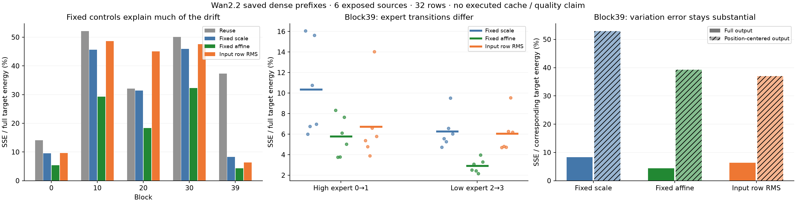

# E0 · 跨步漂移有可转移的共同分量，但整体误差掩盖了位置变化

**新的结构认识：末层跨步差异并不都需要当前真实 FFN 输出才能修正。** 六来源按整来源留出，固定缩放将相对平方误差从37.34%降到8.32%，固定“缩放＋通道偏移”降到4.35%。然而，约88.55%的当前输出能量是跨采样位置的共同分量；去掉这个分量后，固定仿射对位置变化的相对误差仍为39.25%。因此，可转移的共同漂移和输入相关的位置变化应分别解释。

这是用户“继续”指令下对**已有保存操作数**的分析：0新视频、0GPU/模型/原生 FFN/归一化调用，没有执行缓存。阶段仍为 E0，未选定算法。[结果 JSON](E0_TEMPORAL_CALIBRATION.json)、[分析前固定范围](../../config/e0_temporal_saved_calibration_20261025.json)和[可重算工具](../../tools/analyze_e0_temporal_calibration.py)包含逐来源、逐专家和全部对照。

## 问题、来源和真实计算位置

此前末层的同专家 gate 加权 cosine 为0.963，但直接复用相对 SSE 为0.373；使用当前目标的事后单标量可降至0.072。竞争解释为：

- **固定规律：** 步数/专家决定大部分幅度与共同分量漂移，从其他来源校准的固定变换应能转移。
- **输入条件：** 当前输入的变化决定漂移；固定方案不足，当前计算前可见状态应有额外信息。
- **表征混合：** 全输出高相似主要来自共同均值，位置之间的变化仍难预测。

采集来自已验收的[六来源被动原生观察](E0_NATIVE_OBSERVATIONS.json)，3主体、3背景、0相机；来源此前已暴露。每来源四步、blocks0/10/20/30/39、每位置32个冻结随机坐标。只比较0→1和2→3，分别属于高噪声和低噪声同一专家，共60个配对；每个 block 为六来源×两个专家配对，不是12个独立场景。不同来源的坐标由原始 source-hash 采样，各自跨步相同；不能解释为物体追踪。

逐个校验原始 RUN 和120份操作数 SHA；原有 reuse、oracle scalar、oracle current-mean 三类结果在60个配对全部重现。原记录不修改。

真实源 `WanTransformerInfer.infer_ffn` 先加 cross-attention、做 norm2/AdaLN，再调用 ffn_0→GELU→ffn_2。采集字段 `modulated_input` 在 ffn_0 原始入口取得，处于 Smooth1/Q1/W1之前；不是当前 FFN 输出的代理改名。固定源 SHA 为 `5fa53d102aed4e2793b4d639da65a71e1e63061d9b2c35574db1b4ac2256c225`。实际 [HiF4 runtime](../../upstream_audit/source_deltas/HiF4_Sp/files/HiFloat4/ptq/adapters/lightx2v_wan_distill.py)先 Smooth、QDQ，再带原始 bias 做完整 linear。保存的同专家 b2 逐值一致；current gate 来自该步调制，在当前 FFN 输出产生前已经存在。

## 对照及来源留出

令 `Y₀,Y₁` 为相同坐标的前/当前未 gate FFN 输出，`G=diag(g₁)`，`X₀,X₁` 为 modulated_input。统一损失为 `L=||G(Ŷ−Y₁)||²/||GY₁||²`，由 BF16 保存值按 FP64计算。没有模拟或执行候选 BF16写回，更没有自由传播标签。

每次留出整个来源；只用其他五来源在**相同 block、相同目标步**的标签做解析最小二乘，优化五来源相对 SSE 的均值。校准不是新的神经网络训练或 checkpoint 修改；没有优化器。所有八个预测器在新校准前固定并全部报告：

| 对照 | 构造与当前输出依赖 |
| --- | --- |
| 直接复用 | `Ŷ=Y₀` |
| 固定缩放 | `Ŷ=cY₀`，c只由其他五来源确定 |
| 保持 bias 的固定缩放 | `Ŷ=b₂+c(Y₀−b₂)`，不缩放原始 bias |
| 固定仿射 | `Ŷ=cY₀+v`，一个标量和5120维固定通道向量，均由其他来源确定 |
| 当前输入逐行 RMS | `Ŷ=c·[||X₁,r||/||X₀,r||]Y₀,r`；同时报告保持 b2 的版本 |
| 当前输入面板 RMS | 用32行整体 RMS 比，产生每个来源的一个当前标量 |
| 当前输入逐行投影 | `Ŷ=c·[〈X₀,r,X₁,r〉/||X₀,r||²]Y₀,r` |

后三类 c 也仅由其他五来源校准；当前标签不进入预测。固定仿射是更强的固定参考，有5121个校准参数；并不声称与单标量在参数量或原生耗时上完全匹配。当前输入对照与固定缩放具有相同的单个校准标量，但增加了观测/读取工作，尚无净耗时结论。

oracle scalar、oracle current mean、oracle affine和oracle per-row scalar全部单列，它们使用当前输出，只是表征上界。整来源留出是已暴露发现来源内的转移诊断，不是新来源独立质量验证。

## 固定规律确实可转移，输入信息的价值取决于专家

以下为各配对相对 SSE 的均值，百分号表示平方误差比，**不是RMSE、视频质量损失或省算比例**。

| block | 直接复用 | 固定缩放 | 固定仿射 | 当前输入逐行 RMS | 事后最佳单标量 |
| --- | ---: | ---: | ---: | ---: | ---: |
| 0 | 14.11% | 9.56% | 5.40% | 9.67% | 9.51% |
| 10 | 52.10% | 45.64% | 29.26% | 48.59% | 45.41% |
| 20 | 32.12% | 31.45% | 18.39% | 45.04% | 31.26% |
| 30 | 50.08% | 45.91% | 32.25% | 47.58% | 45.17% |
| 39 | 37.34% | 8.32% | **4.35%** | 6.40% | 7.19% |

block39 的固定仿射在六来源各自平均都优于固定缩放；逐来源损失为3.11%–5.82%。保持原始 b2 的固定缩放仅将8.3249%改成8.3135%，因此原始加法 bias 的错误缩放不是主因。

**输入不是完全没信息。** block39 的逐行输入 RMS 在六来源各自平均都优于固定缩放，但在全输出损失上仅一个来源优于固定仿射。它的算子族不同于全局单标量，所以6.40%低于事后全局标量的7.19%并不违反上界；逐行 oracle 是另一上界。

| block39 配对 | 直接复用 | 固定缩放 | 固定仿射 | 当前输入逐行 RMS | 事后最佳单标量 |
| --- | ---: | ---: | ---: | ---: | ---: |
| 高噪声 0→1 | 13.16% | 10.37% | 5.78% | 6.74% | 8.39% |
| 低噪声 2→3 | 61.53% | 6.28% | 2.91% | 6.05% | 5.99% |

低噪声末层的幅度漂移大，却相当可预测；高噪声的事后标量在来源间为0.696–1.050，低噪声为0.516–0.591。不能将二者合并成一个“统一常数”的规律。输入 RMS 对高噪声的六个来源逐一都改善固定缩放；在中间层则可能明显恶化，例如 block20 为45.04%对31.45%。这限制了当前信息原语的范围，没有否定其他输入表征。

## 真正变化的解释单位：共同分量与位置变化

这里的均值是**对32个采样时空位置求均值、保留5120个通道**，不是 LayerNorm 去每行通道均值，也不是“物体运动均值”。令 `μ=mean_r Y_r`、`C=Y−μ`，有严格 FP64关系：

`||G(Ŷ−Y)||² = n||G(μ̂−μ)||² + ||G(Ĉ−C)||²`。

block39 当前输出的共同分量平均占总能量88.55%；原始 b2 的 gate 加权能量比仅约0.00117%，不足以把共同分量解释成“只缓存了 bias”。输出 raw cosine 为0.963，去跨位置共同分量后为0.782。共同漂移占直接复用的归一化误差合计84.93%（各配对均值项相对 SSE 之和／总相对 SSE 之和）；不能由高 raw cosine 判断其相对变化很小。

固定仿射的总误差4.35%可分为0.86个百分点的均值误差和3.49个百分点的位置变化误差。**若改为对中心化目标自身能量归一化，位置变化相对 SSE 仍为39.25%**；高/低专家分别为60.54%/17.96%。这里先逐配对归一化再平均，不是两个平均数相除。

对这个位置变化对象，逐行输入 RMS 的相对误差为37.06%，在六来源中五个优于固定仿射；全输出损失中则只一个优于固定仿射。变化来自移除均值误差后的不同目标，不能解释为只换分母便产生同一案例的排序翻转。当前输入似乎提供了部分位置变化信息，但尚不能据此判断哪一种误差更有视频功能意义。

## 真正省算的上限和缓存费用

当前证据最好的 block39 若只在 step1和3复用，共少做2/160个 FFN，即**名义 FFN投影计算量上限1.25%**。这不是端到端加速率；attention、norm、gate、写回与预测/读取仍存在。block0 的低噪声固定仿射结果也有启发，但五个被观察 block 不足以推定其余35个层都能复用，更不能将全层50%的调用上限当实测收益。

按当前 full-M 31668×5120、BF16 未gate输出计算：

| 状态 | 解析大小或费用 |
| --- | --- |
| 一个完整 FFN 输出 | 324,280,320字节，约309.3MiB |
| 一个专家40层输出 | 12,971,212,800字节，约13.0GB；切专家可释放旧专家，不必同时存两份 |
| 逐行 RMS 所需旧统计 | 每行一个 FP32范数；40层约5.07MB，另需读取当前输入做归约 |
| 逐行投影所需旧输入 | 若保留完整 BF16 输入，会再增加约13.0GB/40层 |
| 面板 RMS | 当前原始采样的32行共163,840个值；保存一个旧面板范数即可，但面板只是当前样本上的描述 |

未执行缓存 kernel、没有测延时或总显存峰值。本分析支持改变误差的表征和强固定对照，尚不支持实现某个缓存算子或扩张模型运行范围。

## 与已有方法的关系和最有区分力的下一观察

2026-10-25 多轮检索量级规律、缓存幅度/均值修正、输入输出关系及轨迹校准，并核对以下原论文和原作者材料：

- [MagCache §3.2–3.3](https://arxiv.org/html/2506.09045v1)：幅度比跨提示可转移属于已有机制。另读官方 [Wan2.2代码固定版本](https://github.com/Zehong-Ma/MagCache/blob/df81cb181776c2c61477c08e1d21f87fda1cd938/MagCache4Wan2.2/magcache_generate.py)，文件 SHA `9455858d01a7ed55f6e6ba97358354f34ba9f0f5a8d03a967d9abb42d0c3d10d`。该版本用比值累计误差决定是否重用**整段 transformer residual**；重用分支是 `x + residual_x`，不是把比值乘到当前 FFN缓存上。其 CFG双分支索引、专家保留段与长步数默认量级不能直接套到四步无CFG路径。本轮既未复现完整 MagCache，也不将标量校准当新原理。
- [Cache Me if You Can §3.4](https://arxiv.org/html/2312.03209v2)：已用时间条件 scale/shift 对齐缓存，并在学生实际缓存轨迹上取 teacher目标。我们只是密集参考轨迹上的解析留出校准，没有学生闭环、可训练时间网络或15k迭代；这个先例尤其指出本轮密集前缀结果尚缺的轨迹证据。
- [Relational Feature Caching §3.2](https://arxiv.org/html/2602.19506v1)：输入变化与输出变化幅度关系也是已知原语。其命题需要局部线性和输入差分方向稳定，并结合历史输出差分；本轮一个旧输出的 RMS/投影对照不是完整 RFC。官方项目页已读，未取得并核对官方实现；不能借用其性能数字。
- 回查 [6Bit-Diffusion](https://arxiv.org/html/2603.18742v1)与此前 [SoftCache](https://arxiv.org/html/2610.22369v1)：双历史、刷新以及修改积分步长是不同的计算自由度。固定四步双专家每专家只有两次调用，保留原四步时不能默认具有长轨迹的历史和跳步空间。

Cache Me 的 CVPR/Oxford PDF 不可抓取，最终按 arXiv v2正文核对。MagCache实现使用官方 API解析出的固定版本和 raw源码。论文机制、作者结果和本项目新测数字分别归属；没有做穷尽新颖性认证。

**下一项真正区分功能解释的观察：** 在同一真实前缀、匹配原生 gate/写回误差能量后，分别改变共同分量与中心化变化，比较完整四步中的视频作用。若前者主要是可容忍的时间幅度漂移，固定修正是强参考；若它控制全局光照/结构而位置变化承载另一种敏感性，则不能靠总 FFN能量损失决定省算。当前保存资产可以证明分解和转移关系，不能完成这项因果观察；未登记或排队下一模型作业。

三项新测试检查整来源标签隔离、带 gate/目标能量权重的仿射恒等恢复，以及均值/中心化误差正交分解。既有原生协议、40次完成回执和上轮结果均保持原始字节；独立同行重建仍待不同作者完成。

完成本校准后同步到 `main@0bd9bbc` 的另一位 agent [竞争机制记录](../method_discussion/discoveries/E0/codex-01a171da-competing-mechanisms-20261025.md)，其中也提出增益／共同分量应与输入条件变化区分。该记录并未看过本校准结果，不登记为本结果的同行支持。本轮另按其共同参考反解释完成了[四臂完整距离与子空间补查](E0_SHARED_REFERENCE_MOMENTS.md)，未新增模型调用。
