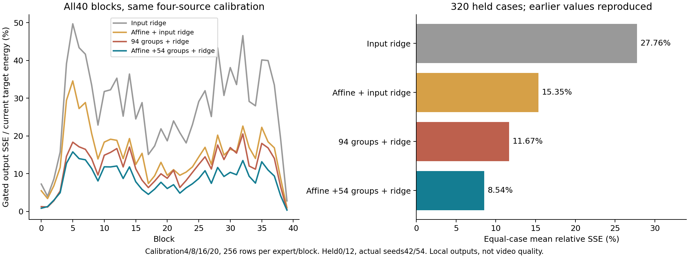

# E0 全40层匹配校准：线性修正能解释多少，非线性特征还剩多少价值

**新结果：** 在相同四来源、相同256训练行/标签及两个持出来源下，affine锚定输入ridge的平均输出SSE为 **15.35%**，保留真实54组非线性余项并重构输出为 **8.54%**；后者320/320个案例误差较低。因此“之前的差距完全只是单来源center校准覆盖不足”这一具体解释没有通过本次固定ridge对照。这个结论不等于全部线性函数的最优性下界，更不是完整视频质量结果。五层5.89%在全40层变为8.54%，明确显示以少数层概括全网会过于乐观。

[完整汇总、协议和原始RUN SHA](E0_ALL_BLOCK_RECONSTRUCTION.json) · [之前四项检查与实际局部原生实现](E0_FUNCTION_RECONSTRUCTION.md) · [独立混杂挑战](../method_discussion/discoveries/E0/independent-function-basis-results-audit-20261026.md)。本轮直接回应这项挑战，没有改变先前协议、标签或五层结果。

## 数据补齐与失败扣账

[被动数据核验](E0_MISSING_CALIBRATION_OBSERVATIONS.json)绑定四个校准来源4/8/16/20，实际seed46/50/58/62。仅补充原先缺失的35层，四步各保存原uniform32的postQ1、postQ2和ungated FFN输出，以及固定gate/bias。已有0/10/20/30/39五层直接复用；不重采它们，也不重复收集0/12已有的40层center128/random32。

共560份新payload，HF新增约0.844GiB，四条dense视频和16个scheduler latent SHA逐一与原始对应来源一致，原1600linear/1600QDQ次数不变。**实际峰值分配四张空闲A100**，未改变用户四卡上限。

最初四任务同时加载时，source16进程在开始生成前退出，原RUN未写最终完成状态、无Python异常。系统日志权限不足，**没有确认原因，也没有将OOM写成事实**。保留其原始RUN SHA及最后计数0；三个其它来源成功。随后在同一用户续推范围下另行冻结一次source16恢复，仅单GPU/单模型进程，加载前检查至少192GiB可用主机内存，实际一次生成通过。总计仍为4次实际生成，另有1次生成前进程失败；不是删除失败后的“全部首次成功”，也没有自动重试循环。历史12/40范围不变。

## 冻结的匹配比较

每个expert/block用四校准来源×该expert两个step×32行＝256行。held仅0/12的各四步，实际seed42/54；六组合均为历史已暴露来源。80个不同函数分别校准；高/低专家不混用。全部40层、四步、两来源共320案例，center128、uniform32和uniform_disjoint分别评价。本次uniform与center无重合。

对每个校准矩阵，λ固定为 `0.01 tr(F Fᵀ)/N`。闭式修正为 `D=Fᵀ(FFᵀ+λI)^−1 E`；其临时参数不返回网络。

- **直接输入ridge**：从中心化post-Q1输入X预测原native输出Y，截距是校准Y均值。
- **affine锚定输入ridge**：以相同的逐神经元Q2 OLS affine为原函数先验，拟合 `Y−affine(X)` 对X的线性校正；整体仍为固定线性/仿射映射，部署时可吸收进D×D矩阵。
- **原非线性组重构**：与之前五层完全同一 whole/affine-residual 评分、固定组数、均值补偿、ridge输出修正及原W2先验。
- 两种输入控制各有固定roll128标签错配。该错配保留校准step及uniform槽位并交换来源块，不是随机化显著性检验。

| 320案例，uniform_disjoint，当前gated输出SSE/能量 | 平均 | 最大单案例 |
| --- | ---: | ---: |
| 原逐神经元affine | 17.28% | 68.11% |
| 直接输入ridge | 27.76% | 104.62% |
| 直接输入ridge错配 | 69.17% | 481.89% |
| affine锚定输入ridge | 15.35% | 51.43% |
| affine锚定输入ridge错配 | 23.31% | 125.09% |
| 原67组＋ridge | 15.56% | 45.23% |
| affine＋27组＋ridge | 11.55% | 34.51% |
| 原94组＋ridge | 11.67% | 32.83% |
| affine＋54组＋ridge | 8.54% | 24.86% |

affine54胜过whole94的案例为305/320，层均值为38/40。两个持出来源的affine54均值分别9.84%/7.24%，锚定输入ridge分别17.69%/13.01%。这保留了独立来源的异质性，不以320作为独立样本数、不报伪精确置信区间。所有均值是case-level比值等权平均，不是把token能量混在一起求一个比值。

**复现校验：** 原五层40个案例的所有既有标量，和新全层RUN中的对应量最大绝对差 **0**；没有改用更好的旧支持或重拟合参数去覆盖先前报告。新增输入对照使用相同标签/样本，但输入特征与非线性特征的尺度、函数先验与实际执行成本不同；固定同一ridge比例不构成每个函数类独立充分调参后的最优风险比较。

## 数学意义与实际代价

源于[独立review的反预测](../method_discussion/discoveries/E0/independent-function-basis-results-audit-20261026.md)：若只是覆盖不足，匹配四来源的affine锚定输入映射应大幅逼近非线性重构；它确实改善了原affine的17.28%→15.35%，但仍高于8.54%。这支持“此训练覆盖与正则下，付费真实非线性特征有额外预测价值”，不证明无法用其它统计/条件/非线性廉价表示达到同样效果。

直接/锚定输入线性图可折为D×D（40/216原FFN两投影MAC）；affine54与whole94分别为 `(40+54)/216` 和 `94/216`，两者互相匹配，但与更便宜的全线性映射**不是同成本算子**。无需把便宜输入对照故意填充无用计算来制造公平。λ、训练函数类/先验和成本的实际范围应同时保留。

[本轮进一步亲读TARDIS v1 §5.1–5.4、§6](https://arxiv.org/html/2501.10054v1)已经有区间线性化、常量折叠、低精度W1预测和动态纠错。本项目借用固定函数分解/消费者补偿原理，不宣称发明常量折叠；当前方案校准的是实际HiF4后系数、整组静态支持及新BF16读出，不等于复现TARDIS完整动态系统。论文中的LLM token解码瓶颈不能替代Wan自然M31668的计时。此次未找到并验证作者完整运行实现，未借用其速度。

该诊断实际扣账：W1 960、W2 3120、Gram和solve各560、临时修正映射1280、affine校准80、组排序160；0新生成/原生FFN/QDQ/optimizer/SVD/持久化拟合权重。单张空闲A100，HF输出约7MiB，原始协议与执行快照一致。

## 下一步有界转化

本结果仍不能将8.54%SSE叫视频误差，也不能将之前两层52.69→20.77ms推广至全网。接下来按独立冻结范围构建两个固定全模型原型（whole94、affine54），比较原dense、相同预算whole94和affine54的完整四步视频。模型/新权重构建与视频运行各自扣账；原始归一化、modulation、gate/residual由原调用者继续执行。全部原权重/原型权重预载时间与生成时间分开；第一条fresh-process视频与第二条热态分开报告；质量与速度不自动验收。若全视频破坏，应该回到误差方向与下游作用解释，不能只继续降低局部平均SSE。
