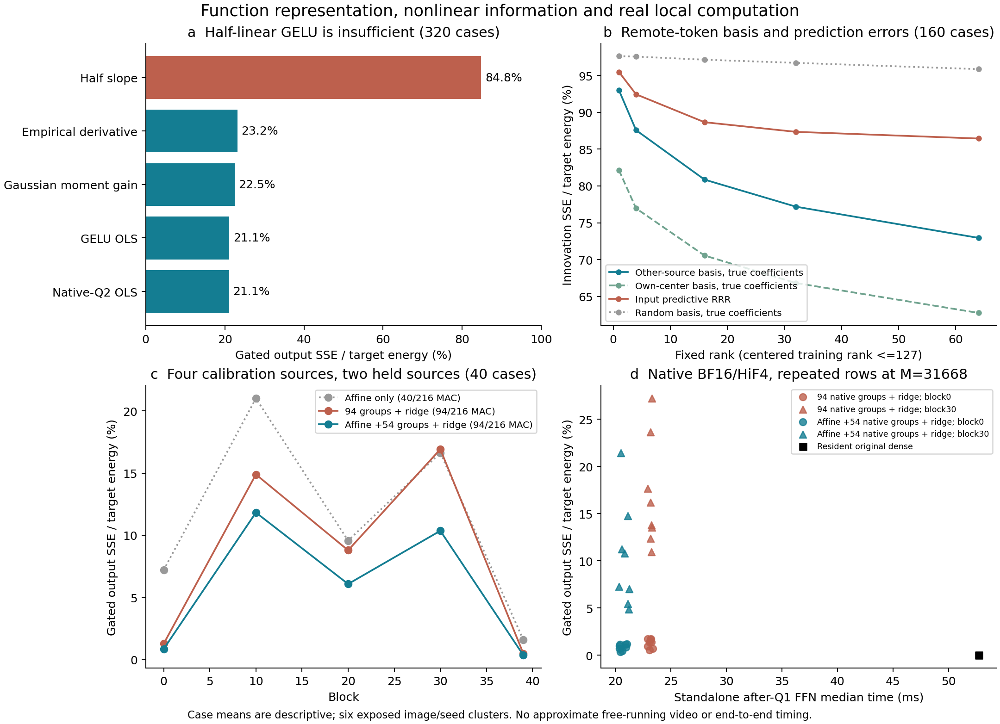

# E0：共享输出基的范围限制，与保留真实非线性的原生实现

**新结果：** 简单的跨来源共享输出基没有解释保存的空间远处创新；需要保留什么非线性计算，是比继续增加线性系数预测器复杂度更有信息量的问题。四来源校准的固定 affine＋54个原64组、再重构输出，在两个来源的五层/四步保存数据上平均输出SSE **5.89%**，优于相同理想投影MAC的94组重构 **8.47%**。两层的真实 BF16/GELU/HiF4-Q2 实现得到约 **52.69→20.77ms** 的孤立 after-Q1 FFN 形状计时，但中间层误差仍大，尚无近似算子的自由视频或整网时延结果。

本记录仍是 E0。完整标量汇总及每个冻结协议、原始RUN SHA、实际计数和GPU隔离验证见 [JSON](E0_FUNCTION_RECONSTRUCTION.json)；[绘图程序](../../tools/plot_e0_function_reconstruction.py)不加载模型。源基线为 `087893f`；六个image/seed组合均为历史已暴露来源。0/42、12/54作为本次持出组合，4/46、8/50、16/58、20/62作为另一路校准组合。这里的“持出”不构成新数据集或正式泛化验收。

## 1. 半线性奇部恒等式成立，但不足以解释实际输出

[先前连续GELU奇偶分解](../20261025/E0_AFFINE_FFN_DISCOVERY.md)给出 `φ(a)=a/2+e(a)`，`e(−a)=e(a)`。对称输入下带截距OLS斜率为1/2，这个条件恒等式不要求窄热区；它也没有断言实际Wan分布满足对称。

新范围 `E0_STATISTICAL_GELU_GAINS_20261026` 完成320个案例：两个来源、四步、40层；每次仅用另一来源的原uniform32拟合。所有模型使用该训练来源的**实际Q2均值截距**。当前数据仅用于评价；全精度W1投影用于诊断，不返回网络。

| 固定斜率/增益 | uniform32 平均 gated输出SSE/当前输出能量 |
| --- | ---: |
| `1/(2 s2)` 半斜率 | 84.80% |
| 原native-Q2逐神经元OLS | 21.07% |
| 保存GELU/s2 OLS | 21.15% |
| 训练token实际tanh导数均值/s2 | 23.16% |
| 高斯均值/方差下tanh导数期望/s2 | 22.47% |

更强的反证来自完整signed输出：uniform32上，奇部/净连续无bias输出能量比均值9.59，**偶部比6.14**，奇偶cosine均值 **−0.927**。偶部在W2之后并不小，而与奇部大幅抵消。因此“W2抹掉偶部，剩下半线性”这个简化解释在本范围失败；不能据此否定奇偶恒等式或所有affine表示。三项能量比/cosine分别作案例等权平均，不能把平均cosine直接代入平均能量重建恒等式。

连续GELU输出与实际Q2输出平均SSE约0.230%；连续decoded原Q2/W2与native输出的微小BF16差别另外保存。前者包含连续W1/GELU和Q2数值差，不单独归因于量化。

**统计线性化的竞争解释。** 本轮实际阅读 [Demir–Björnson 2020讲义§III–V](https://arxiv.org/pdf/2005.01597)：高斯输入的Bussgang/Stein关系把最优线性增益联系到非线性导数均值；余项不相关不意味着独立。将 `a=μ+σz` 中心化，可自行推出 `Cov(a,φ(a))/Var(a)=Eφ′(a)`，截距为 `Eφ(a)−κμ`。这提供“跨token统计增益”而非“每token窄区间”的解释。当前高斯模型仅以训练32行的均值/方差做32节点Gauss–Hermite近似；没有证明真实联合高斯，也没有做求积收敛研究。不能把约22%的剩余误差称为独立噪声。

沿这条来源继续阅读 [Burr等2024，§I及式1–8](https://arxiv.org/pdf/2408.13205) 的非高斯限制，以及 [Wright等AISTATS2024，§3.2–3.3](https://www.sei.cmu.edu/documents/6345/An_Analytic_Solution_to_Covariance_Propagation_in_Neural_Networks.pdf) 的高阶导数/协方差展开。它们改变了下一步：考察相关的真实非线性余项，而非默认其可由对角增益消掉。后者的erf-GELU闭式公式不等于本项目tanh-GELU；本轮未移植其算法。1952原文仅从讲义追溯，未冒称亲读。

## 2. 输出表示误差已经很大，RRR未解决迁移问题

`E0_OUTPUT_BASIS_PREDICTION_20261026` 完成320绝对输出＋160同专家创新案例。训练只使用另一来源center128，秩固定1/4/16/32/64，ridge比例0.01；另有自己center的后验基、固定随机基和训练标签循环错配。空间评价使用原uniform32剔除center重合位置；本次实际重合数全部0，但代码仍检查。128行中心化天然秩≤127，不将其称为全模型低秩。

| uniform_disjoint、rank64，案例等权 | 绝对输出SSE | 同专家创新SSE |
| --- | ---: | ---: |
| 另一来源均值 | 54.40% | 97.67% |
| 另一来源输出基＋读取真实当前系数 | 38.68% | 72.94% |
| 自己center输出基＋真实系数 | 29.55% | 62.75% |
| post-Q1 输入ridge＋输出PCA基 | 47.62% | 86.44% |
| 精确predictive reduced-rank ridge | 47.61% | 86.45% |
| 训练标签错配ridge | 61.92% | 108.73% |

创新指 `U_current−U_old`，仅steps1−0、3−2，乘当前gate；不等于两个不同gate残差更新的差。绝对/创新分母独立；上表不能用来直接比较两种误差的绝对大小。均值、中心化变化和相对于当前输出的误差均在JSON另列。

[独立推导](../method_discussion/discoveries/E0/independent-function-basis-prediction-20261026.md)给出固定正交基B的精确分解：`||Yc−P(X)Bᵀ||²=||Yc(I−BBᵀ)||²+||YcB−P(X)||²`。前项是基的表示尾部，后项是指定输入函数类的系数误差；本轮逐案例验证未门控欧氏分解到相对1e−10。一般对角gate不保持该正交恒等式，故该分解的未门控数据不能直接拼接上表门控比例。

RRR使用 [Mukherjee–Zhu原始§2式4–10](https://dept.stat.lsa.umich.edu/~jizhu/pubs/Mukherjee-SADM11.pdf) 对应的惩罚目标：`C=XᵀX+λI; A*=C^(−1/2)[C^(−1/2)XᵀY]_k`，不是对 `HλY` 再PCA。原理和实现均经独立检查及小矩阵目标测试；训练最优性不保证持出最优性。实际RRR与PCA-ridge几乎相同，且连读取真实系数的固定基也留下大误差，故本范围的主要困难已包含**表示覆盖及来源/位置迁移**，不能只怪系数预测器不够复杂。

邻近论文核验继续保留 [SVD-Cache v1 §3.2–3.5](https://arxiv.org/html/2601.07396v1) 的刷新投影与历史预测区别：有完整当前F时才能取真实系数；实际跳算依赖历史机制。[SpectralCache v1 §4.1–4.4](https://arxiv.org/html/2610.02660v1) 使用两次最近刷新及外推，不能直接移作四步双专家的一次同专家历史。没有复现两者源码或借用其速度。作者仓库可见性不足与CVF/OpenReview访问失败由独立记录如实保留。

## 3. 用真实非线性特征重构输出：已知原理，新的Wan有界检查

输出rank-one也可能需要多个非线性输入特征；后验低秩不能给出廉价系数。下一项 `E0_NONLINEAR_RECONSTRUCTION_20261026` 因此使用四个不同校准来源、每expert两个步骤×32行，共256行，在0/10/20/30/39层分别冻结一个支持/拟合。持出为0/12，每层四步，共40案例。两个expert的函数不同，分别拟合；同expert两个步骤池化意味着检验固定专家算子，不是逐步骤选最优参数。

最接近的原理是 [Model Preserving Compression，NeurIPS2022 §3–4式2](https://papers.nips.cc/paper_files/paper/2022/file/f8928b073ccbec15d35f2a9d39430bfd-Paper-Conference.pdf)：以真实激活列构成近似，再将重构吸收到下游权重。这里只迁移“保留真实非线性特征＋补偿消费者”的组件；没有复制其pivoted-QR、层宽搜索或完整系统，不主张新发明该原理。[FLAP v1式3–5](https://arxiv.org/html/2312.11983v1)及亲读作者 [prune.py metrics/compress](https://raw.githubusercontent.com/CASIA-LMC-Lab/FLAP/main/lib/prune.py)提供均值bias和波动×W2列范数控制；本项目额外按原64组闭包及校准gate列范数排序，ridge补偿是另一项新增拟合。

具体比较：`whole`用真实q_S、原W2_S及输出均值补偿；`affine_residual`先用校准 `q=κa+β+r`，保留真实r_S。各自固定支持，再从256校准行拟合输出余项的ridge修正，另以128行循环错配标签作负对照。仅存标量；临时闭式参数不是“没有拟合”，但未作optimizer更新、未保存部署权重。

| 40案例、uniform_disjoint | 仅均值/固定原映射 | 正确配对ridge | 错配ridge |
| --- | ---: | ---: | ---: |
| 直接67组 | 20.06% | 11.23% | 24.53% |
| affine＋27组 | 8.97% | 7.89% | 11.76% |
| 直接94组 | 14.55% | 8.47% | 17.56% |
| affine＋54组 | 7.14% | 5.89% | 8.23% |

全affine本轮11.20%，均值40.46%。不能把它与“另一来源单步32行”的21.07%作单一因素因果对照，因为校准来源、样本量、池化和五层/40层范围均不同。正确/错配对照支持真实特征配对有用，不是随机化显著性检验。组合分数仍为对角近似，未证明是最佳联合支持。

D=5120、H=13824时，D×D基项恰相当于40/216原两投影MAC。故 affine＋27 与直接67、affine＋54 与直接94为匹配投影预算；不把拟合、QDQ、布局与带宽称为免费。

## 4. 将余项真的折入权重：数值与局部成本边已走通

`E0_RECONSTRUCTED_NATIVE_20261026` 在**事前固定的0/30两层**执行，不从结果挑层。四来源重新校准、0/12全四步持出，共16案例。原dense、直接94组ridge、affine＋54组ridge均使用常驻权重；真实BF16 W1/GELU、Smooth2、原HiF4 CUDA Q2及W2。新输出V和基矩阵A保存于GPU临时张量，使用BF16，**未再量化成原HiF4 checkpoint权重**。

自包含折叠推导：设选组最终输出矩阵 `V=W2_S+ΔV`，`m=mean_cal(r_S)`，输出校正均值为d。连续目标为

`ŷ = W2(κ(W1x+b1)+β)+b2 + V(r_S−m)+d`。

代入 `r_S=q_S−κ_S(W1_Sx+b1_S)−β_S`，得到两条实际路径：

`ŷ=Ahat x+V q_S+Bhat`，

`Ahat=W2 diag(κ) W1−V diag(κ_S) W1_S`，

`Bhat=W2(κb1+β)+b2−V(κ_S b1_S+β_S+m)+d`。

矩阵合成在FP32进行后cast BF16；单元测试验证连续代数。运行时不重新执行全W1观察器，也没有额外输出修正GEMM；付费工作为D×D路径、选择后的W1/GELU/Q2/W2与加和。其数值并非原图逐位等价。

| 孤立原生实现 | 16案例的中位耗时再平均 | 与dense逐案例比再平均 |
| --- | ---: | ---: |
| resident原dense | 52.69ms | 1.00× |
| 直接94组＋新输出权重 | 23.16ms | 2.27× |
| affine＋54组＋新输出权重 | 20.77ms | 2.54× |

第一160行原dense与保存输出的SSE均为0；新实现对连续预测的相对SSE均值约3.62e−6/6.55e−6，说明这个范围的BF16实现没有消灭连续表示的收益。它不保证门控残差写回后的功能。

**未解决的困难明确存在：** affine54在block0各步平均输出SSE约0.60%—1.07%，block30约6.06%—18.10%。计时把160保存行重复成M31668，每方法/案例1次数值、2次warmup、6次计时；不是自然全M输入分布。144原dense＋288部分FFN，共432次nativeQ2。计时排除Q1、gate/residual、模型构建、校准、权重合成及完整视频；固定顺序，未锁CPU/PCIe全节点负载。准备时间和临时权重字节在原始收据另列，不能借用旧的1.49×全视频改善作为本近似方案的速度。

## 5. 边界、独立复核与下一动作

四项范围共0新视频、0optimizer更新、0模型权重分解、0持久化拟合权重；有1440次activation SVD、1600组统计参数、128项临时非线性ridge映射（68次求解）及432次原生FFN/Q2，均如实扣账。峰值同时两张空闲A100，资源上限四张；协议、执行快照、RUN SHA和HF输出上限全部核验。历史12/40生成范围、暂停和旧协议没有改写。

独立研究者先给出表示/预测正交分解、rank-one难预测反例和RRR目标；结果复核见 [独立结果审查](../method_discussion/discoveries/E0/independent-function-basis-results-audit-20261026.md)。独立复核特别指出：两来源/128行输入预测与四来源/256行非线性重构存在校准条件混杂，不能直接归因为非线性优势；[原claim](../method_discussion/graph_annotations/E0/E0_GRAPH_FUNCTION_RECONSTRUCTION_20261026.json)保留该挑战，[V2](../method_discussion/graph_annotations/E0/E0_GRAPH_FUNCTION_RECONSTRUCTION_20261026_V2.json)收紧到同范围匹配控制，并将四来源同256行的输入ridge列为竞争检验。原始P14提案保持原字节与PROPOSED身份；本次只约束“另一来源center128训练的固定≤64维基”这一构造，不排除条件基、不同空间覆盖或非线性系数。

**为何继续补数据：** 目前四来源的校准只覆盖五层；两个持出来源虽已有全40层，不能反过来训练再冒称持出。为辨别全层覆盖与中间层异质性，另行冻结四来源缺失35层的被动观测，仅保存uniform32三个必要字段，已有五层完全复用。它是当前用户续推指令下的独立范围，不是本报告自动授予下一模型实验。新的结果单独记录。之后应以全层分布决定是否值得测试固定算子的完整四步视频，同时对照已测相同输出的resident dense，并继续核对真实质量而非以SSE代替。
