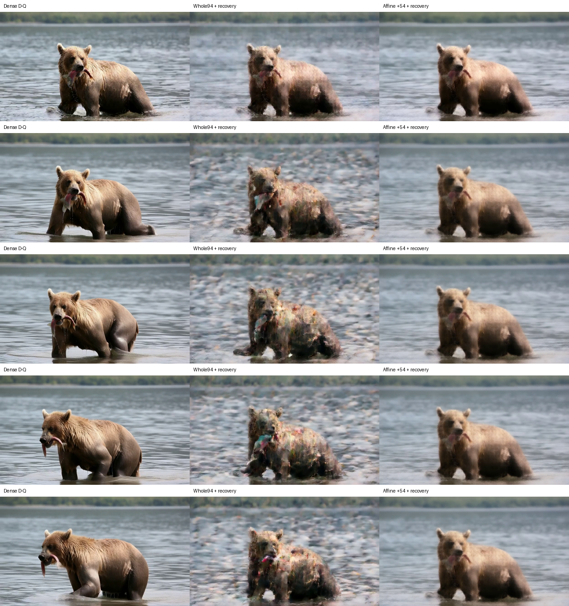
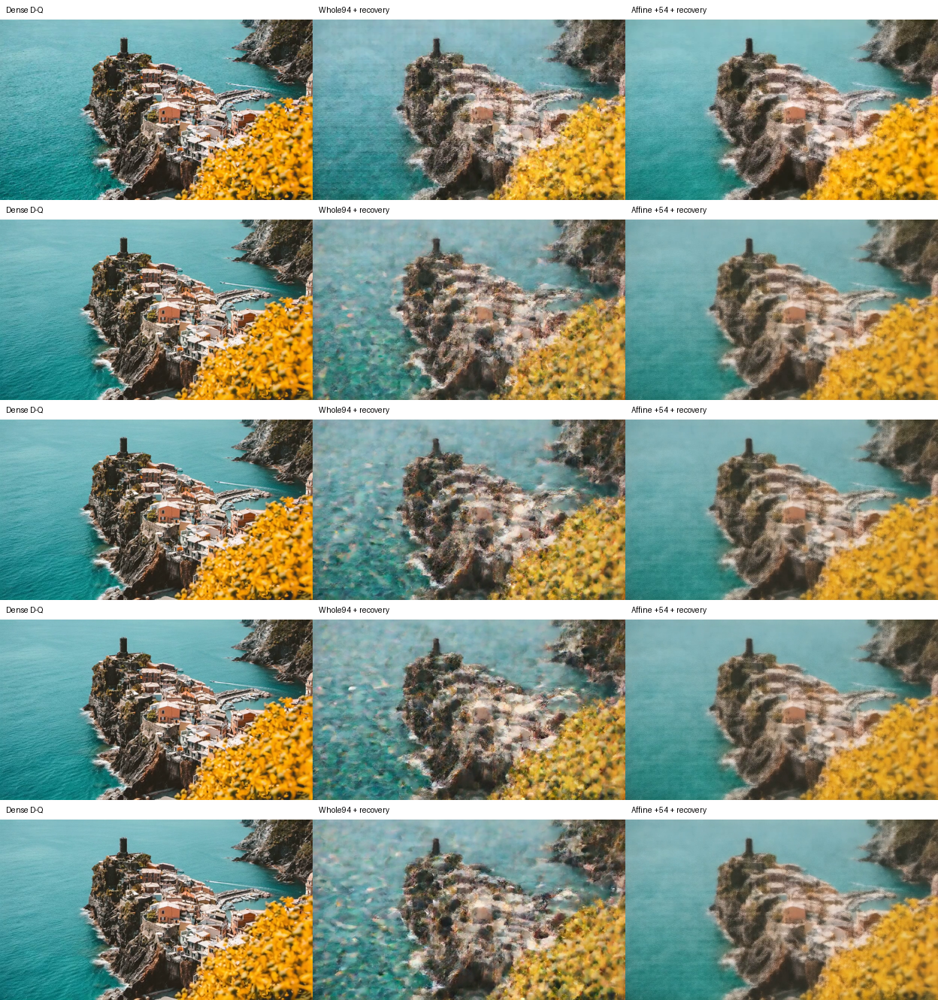

# 全模型固定重构：FFN确实省算，完整视频仍未保住

**新结果：** 两个固定重构原型已覆盖真实四步、全部160处FFN，三臂六条完整视频全部跑完。affine＋54组在热态将FFN边界9.707→4.449秒（2.182×）、生成50.750→45.313秒（1.120×）。但抽帧显示两来源明显模糊，熊的动作变化减弱；whole94则出现严重重影/纹理破坏。**当前原型不满足项目的完整视频质量目标**。这是一次真实实现与有信息量的失败，不是可用方法验收。

[逐项校验与全部81帧像素记录](E0_RECONSTRUCTED_VIDEOS.json) · [同四来源全40层控制](E0_ALL_BLOCK_RECONSTRUCTION.md) · [160个参数包核验](E0_RECONSTRUCTION_BANK.json) · [独立源码/数学/结果审查](../method_discussion/discoveries/E0/independent-matched-calibration-and-runtime-audit-20261026.md) · [新功能/轨迹问题推导](../method_discussion/discoveries/E0/transported-function-and-trajectory-target-20261026.md)。旧局部报告与冻结协议保留，不回写成成功视频。

## 实际实现与比较对象

训练仅使用历史校准来源4/8/16/20（实际seed46/50/58/62），每expert/block两步×32行×四来源＝256行。持出来源0/12（seed42/54）未用于拟合，但此前已暴露，不是独立新来源/seed。先补齐35个缺失层，再完成匹配输入ridge控制和两个固定bank；不是看本次视频后挑选组数。

whole94保留94个完整64组的真实W1/GELU/HiF4-Q2，用原W2先验与闭式ridge恢复输出。affine54保留54组真实非线性，加一个固定D×D仿射矩阵；两者理想投影MAC同为94/216＝43.52%。原norm/modulation、caller tanh-GELU、gate及BF16 residual writeback均继续由原调用者执行。没有付当前全W1观察器，也没有补回原完整FFN。

两个bank共160个pack、19,723,655,558字节，全部SHA/shape/dtype/有限值通过；其中新读出/仿射/bias参数5,977,702,400个标量。选中W1取原decoded权重，新V/bias以及FP32组合后cast的仿射矩阵是**新BF16参数**，没有再次HiF4量化。闭式拟合仍是参数估计，不能写“没有生成新权重”。0 optimizer、0模型权重分解。

原dense使用之前已证明逐位等价的全部decoded权重常驻方案，作为更强的同卡基线。三臂分别新进程，在同一张空闲A100串行运行，每臂固定source0再source12；一次尝试，无失败重试、无官方质量模型、无自动后续实验。执行前冻结 [六视频协议](../../config/e0_reconstructed_videos_20261026.json)，代码、输入/提示词、cache manifest、bank及源实现均绑定SHA。

## 原生校验与完整扣账

- dense两视频及8个scheduler latent SHA逐项等于历史对应来源；原1600linear/1600QDQ每视频、0 miss。
- 两候选各做四处48行完整宽度接线对照（steps0/2×blocks0/30），全部BF16位差为0。只验证该有限完整宽度路径，不能称为全模型中性等价或所有partial数值证明。
- 每候选视频原runtime为1280linear/1280QDQ；新hook up/down各160、Q1/Q2各160。affine另160次D×D应用。全部160个FFN计时位置、四步有限latent和真实视频通过执行检查。
- 六视频共960个FFN位置；neutral另16次FFN、32次QDQ。总计**9632 QDQ、9952线性GEMM**（包含320个affine应用），由实际分项累加并对照冻结预算。调用次数没少，矩阵/激活宽度真的缩小；不能将计数降低和MAC降低混写。
- 所有所需原权重在计时前显式预载；每视频的weight transfer增量严格为0。三个执行快照逐文件匹配，私有发射回执绑定同卡，采样区间不重叠、每次2秒采样未见分配卡上的外来进程。模型进程按固定串行调度；采样不是连续时间全系统证明。

## 实测时间、准备成本与Amdahl约束

单位秒，FFN边界包括原attn残差相加、norm/modulation及FFN；不包括后面的post_process gate/残差写回。生成wall覆盖完整generate、视频保存、共同latent hash和同步，不含前面的setup/预载/neutral/pack构建。

| 来源/状态 | dense wall / FFN | whole94 wall / FFN | affine54 wall / FFN |
| --- | ---: | ---: | ---: |
| 0/42，各新进程第一视频 | 52.270 / 9.658 | 46.692 / 4.848 | 46.219 / 4.422 |
| 12/54，共同热态第二视频 | 50.750 / 9.707 | 45.736 / 4.880 | 45.313 / 4.449 |

相同理想MAC也未给出相同实测：affine54保留的GELU/Q2宽度更小，但多了D²投影与加法。两者的kernel形状、量化和激活开销不同；单次总FFN差异不能唯一归因于其中一项。物理峰显存也有下降，但本次只在80GB卡上实测，不能据此承诺更小显存硬件的可用性。

source0虽然预载边界一致，但候选先做了neutral，内核/allocator热度不完全匹配，所以headline用source12，仍仅每臂一次观测，不报普适速度或置信区间。

source12的FFN边界占dense wall **19.127%**。在非FFN余量固定、串行分解适用的条件下，即使整个边界消失，上界也只有 **1.2365×**。实测 `R=T−F` 为dense41.043、whole40.856、affine40.865秒；大部分剩余时间确实仍在。因此2.182× FFN不能宣传成2.182×整网；实际whole/affine生成比为1.1096×/1.1200×。

| 真实准备/内存成本 | dense | whole94 | affine54 |
| --- | ---: | ---: | ---: |
| assets/pipeline/pack/neutral/预载setup秒 | 139.188 | 236.922 | 237.089 |
| 2秒采样物理显存峰MiB | 79,594 | 63,870 | 60,796 |

候选setup明显更贵，另有离线采集、拟合及19.7GB bank存储。生成时间优势不能当成一次性任务总成本优势。高显存dense本身约77.73GiB实际采样峰；不能忽略其80GB硬件条件，也不能拿旧未常驻75秒基线夸大当前原型的FFN收益。

## 画面与逐帧指标

下图每列依次dense、whole94、affine54，每行是视频帧0/20/40/60/80。**影片帧位置不是去噪step位置**。

source0中，whole有显著碎裂/重影；affine形体更连贯但纹理模糊，主体在各帧的姿态变化明显小于dense。降低局部误差确实改变了破坏形态，但没有保住原视频表现。

source12中，两候选的建筑/岩壁细节均明显丢失；whole的水面/岸线有明显纹理污染，affine仍存在模糊与时序偏差。这里只是明确抽帧观察；自动全81帧解码和像素核验**不能冒充人工完整观看或官方画质评分**。

| 相同输入的原始分辨率全81帧 | whole94 | affine54 |
| --- | ---: | ---: |
| source0，逐帧RGB RMSE均值，0–1 | .157897 | .154160 |
| source12，同口径 | .161645 | .130529 |
| source0，80个时间差RMSE均值 | .057577 | .056418 |
| source12，同口径 | .050784 | .065115 |

这些是编码RGB差，不是感知质量或排序准则；时间差定义为 `Δ(candidate−dense)`，恒定亮度偏移可完全消失。JSON还保留reference/candidate RGB均值、配对signed漂移和明确的BT.709权重**encoded-luma**（非线性光度）指标。source12的affine空间误差较低而时间差误差较高，本身就反对只靠一个平均局部或像素分数选方法。

两个三臂视频在HF相对目录 `e0_function_basis_20261026/prototype_comparisons_attempt1/`：`source00_dense_whole94_affine54.mp4`、`source12_dense_whole94_affine54.mp4`，SHA绑定在JSON。HF派生媒体共9,216,830字节；仓库只收两张对应联系图，参数/原始视频/私有操作信息不入Git。全部派生副本仍低于0.125GiB范围。

## 这个结果打开什么问题

全40层匹配数据已经反驳“差距完全来自校准来源/行数混杂”的具体解释；但8.54%局部输出SSE与305/320局部胜出，也没能给出可用视频。这里没有证据支持所有函数重构不可行；失败范围是本次固定支持、256行校准、固定正则、全160处同时替换的两个原型。

还保留一个前置竞争解释：8.54%是保存数据的连续诊断，全40层的部署bank尚未逐层测得same-input partial-native误差。全部pack的形状/有限值/SHA通过、四处full-width neutral和先前两层partial对照，仍不足以排除其它层的BF16折叠/读出数值差异；不能把画面失败唯一归因为传播或输入偏移。

下一科学动作应先核对部署bank的same-input原生误差，再区分：受扰前缀上的输入偏移、局部误差方向经过真实后缀的影响、以及跨步状态校准目标。新的 [源码与数学记录](../method_discussion/discoveries/E0/transported-function-and-trajectory-target-20261026.md)给出不要求QDQ可微的混合路径望远镜恒等式，以及当前Wan调度器的受扰状态目标；并核对BRECQ作者实现、CTEC正式论文与TCEC近邻的实际假设。[独立轨迹推导与原PDF反例](../method_discussion/discoveries/E0/independent-trajectory-error-and-correction-20261026.md)进一步给出有符号修复条件，区分层内/跨步离轨，并核实近邻展开的一处不闭合。训练/功能校准、时空条件表示和新的省算单元保持开放，不将当前affine或整组支持强行设为主路线。

六视频固定范围至此完成，GPU已释放。新实验不由本次结果自动触发，E0不升级、无算子选定、无质量/速度验收。当前有价值的工程资产是可复现的真实窄FFN路径、强dense参照、完整失败视频和精确成本账本；下一轮可以据此直接检验功能机制，而不用重新跑通基础链路。
