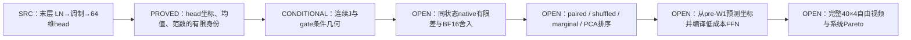

# B：门控与后缀敏感坐标，先从真实末层读出建立可检验机制

**2026-10-28 · v1 · METHOD_SNAPSHOT / ALG + SRC + LIT，新增 B 原生采集尚未执行。** 本轮首先交付 [B-first 任务](../agent_protocol/NEXT_AGENT_B_SENSITIVE_OUTPUT_FIRST_20261027.md)。原生对象为 LightX2V Wan2.2 I2V A14B 四步 D-Q；A0 普通6016维学生是匹配恢复基线，C 编码求值保留独立候选。本文件中的后缀数学、条件与采集计划分别登记，独立评议保留真实作者与版本，不把讨论支持写成实验通过。

**METHOD_OPERATION_FINGERPRINT**：按最新[五操作语法](FIVE_OPERATION_METHOD_LENS_AND_IFC_ROUTE_CROSSWALK.md)，本方案为 **M-B**，主操作 **O-B（替代函数坐标，OPEN）＋O-E（同状态响应/验证，B0待注册）**；B-FACTORED/FUSED 才额外讨论 O-D。O-A、O-C 当前为 NONE。实际边为 pre-W1 x→窄函数→pre-gate y→e5→LN/head/flow；从 x、合法 conditioning/residual 预测坐标，敏感度仅离线付费取得。数值类别为连续条件恒等＋待验证 BF16 学习近似；减少原 W1/W2 的物理工作只由第6节的实际部署形式决定。强基线为同输入/来源/训练成本的 A0、同 rank PCA/random/marginal；新增采集、拟合、第三 GEMM、QDQ/暂存均入账，首个区别由第7节分阶段实验判断。

**构造性起点**：真实 block39 的 FFN 写回之后没有另一层 attention，而是直接进入 final LayerNorm、时间调制和64维输出头。这个后缀允许分开研究三条通路：head 的线性读出、LayerNorm 的均值，以及依赖当前状态的范数。低能方向即使不落在 head 行空间，也可能通过归一化分母改变全部输出。先核对这一具体有限响应，再研究跨来源敏感坐标能否编译进低成本 FFN。

## 1. 问题结构、统计单位与读出

独立统计单位是 image/source cluster。seed、prompt、token、row、block、step 均嵌套于来源；同一个来源的256行不是256个独立来源。旧 CAL24、consumer20 和本轮拟用的来源均已开发暴露，当前诊断不作新盲确认。

| 符号 | 实际对象 / shape | 首次可得时点 |
| --- | --- | --- |
| s | source、seed、step、expert、block、整幅真实输入状态；必要时再含 token 坐标 | 原生条件与当前状态绑定后 |
| M,D,H | 31668、5120、13824=216×64 | 本模型与832×464、81帧配置 |
| x | post-Q1，M×D，BF16 | norm2/AdaLN、Smooth1 与原生 Q1 后，W1 前 |
| a,v | GELU(tanh) 后激活 / post-Q2，M×H | 原生 W1、GELU、Smooth2/HiF4 Q2 后 |
| y | W2+b2 的 pre-gate 输出，M×D，BF16 | 完整 teacher FFN 已付费后 |
| D_g | 原 caller e5 的逐通道门控算子；当前非 diffusion-forcing 路径跨 token 广播 | time modulation 已完成；具体 shape/dtype 由 capture 绑定 |
| r,u | FFN 残差基底 / gate 残差写回后的 pre-head 状态，M×D，BF16 | u 在 `post_process` 后、final norm 前 |
| o | 本轮主读出：block39 head 输出 M×64、unpatchify 后同一真实 flow | final LN、head modulation、DefaultMM 后 |
| J_s | 写回状态 u 到指定 o 的实数化局部导数 | 离线数学/敏感度采集；不是在线免费信息 |
| P=ΦΨᵀ | 作用于 pre-gate 通道的 rank-r 幂等投影，ΨᵀΦ=I | 离线拟合；部署系数必须从 pre-W1 合法输入计算 |

早层完整 suffix 的 J_s 作用于整个 M×D 状态，后续 attention 会混合 token，不能以逐 token 梯度平均替代。末层 head 是一个可控制的科学锚点，仅覆盖每 expert 的1/40 FFN；最终视频行为还包含后续去噪步与 VAE，head 有限响应不自动具有“运动”语义。

已完成的 [consumer20](UB1_CONSUMER_DISJOINT20_QUALITY_RESULTS_20261027.md) 在 fresh Dense 同噪声配对下连续 RAFT 6.894→1.152、dynamic degree 6/20→0/20，imaging 均值约−1.38%。这提出功能保持问题。[CAL24 四位置](../20261028/UB1_CAL24_SOURCE_ENERGY_PROFILE_RESULTS_20261028.md) 的 whole64 能量支持对单来源删除较稳定，且同位置24来源 gate 字节相同；它们分别约束“支持不稳”和“gate 自带来源适应性”的解释，尚未测到真实 suffix 敏感度。

## 2. MATHEMATICAL_MODEL：边际、联合与门控空间

冻结同一 source/state 的 gate，令 μ 为明确训练分布上的公共中心，R=I−P。单 token 的写回误差一阶为 D_g R(y−μ)。若同时改变 gate，另有 diag(y)δg；若从 pre-W1 输入扰动出发，还要包含 gate/前缀/残差的实际变化。

**B-MARGINAL** 保留成熟的平均比较器：

\[
E_m(P)=\operatorname{tr}[\bar G R\bar C R^\top],\quad
G_s=D_{g_s}^\top J_s^\top J_sD_{g_s},\quad
\bar G=\mathbb E G_s,\quad \bar C=\mathbb E[(y_s-\mu)(y_s-\mu)^\top].
\]

**B-JOINT** 保留相同状态与敏感度的配对：

\[
E_j(P)=\mathbb E_s\|J_sD_{g_s}R(y_s-\mu)\|^2.
\]

若用 conditional second moment C_s，必须定义为相对同一个 μ 的二阶矩；不能逐来源各自中心化后遗漏来源均值项。对于完整多 token 后缀，以上向量和投影应提升为 vec(y) 与 I_M⊗P，并保留 J_s 的跨 token 项。

**PROVED，固定度量**：对 G≻0、C⪰0 和全部 rank-r 幂等投影，令 U_r 为 G^(1/2)CG^(1/2) 的前 r 个正交特征向量，则

\[
P_*=G^{-1/2}U_rU_r^\top G^{1/2},\qquad
\min E_m=\sum_{j>r}\lambda_j.
\]

这是加权最佳子空间的代数结果；G 半正定时应在支撑上处理，零空间不使用不存在的逆。量化 Wan 的全视频误差界仍是另一命题。

**PROVED，条件配对项**：设 ΔG_s=G_s−Ḡ、ΔC_s=C_s−C̄，则

\[
E_j(P)=E_m(P)+\mathbb E\operatorname{tr}[\Delta G_sR\Delta C_sR^\top].
\]

G 固定、独立，或最后这个收缩对全部允许 P 为零时，两式相等；只知道 E[G_sC_s]=ḠC̄ 一般不足。若额外项对所有 P 是同一常数，可有相同排序但不同目标值。

[独立代数推导与全体斜投影反例](../method_discussion/discoveries/E0/conditional-sensitivity-pairing-and-balanced-projection-20261028.md) 给出等权两来源 C₁=diag(1,0)、C₂=diag(0,1)、G₁=diag(.1,1)、G₂=diag(100,10)。边际代理选择 e₁，真实配对损失5；联合目标全局唯一最优为 e₂，损失.05。交换 G 与 C 的来源配对而不改变边际，最优方向反转。这是 ALG 构造，未声称 Wan 已观察到100倍差距，也不反驳固定 gate-only consumer。

**B-GATE-SUBSPACE**：固定 pre-gate 基 Φ 的写回空间为 D_gΦ。若 gate 在同位置来源间相同，这种变换在该来源集合上就是同一个重参数化；不同 step 的 gate、state-conditioned suffix J_s 才可能改变有效几何。某通道 gate 为零还会降低秩。部署必须从 x、已可得 conditioning 或原 residual 预测系数，不能先求完整 y 再投影而省略 teacher 成本。

## 3. 末层的强构造：64个 head 坐标与两个归一化统计

[实际源码审计](../method_discussion/discoveries/E0/b-final-block-head-source-audit-20261028.md) 绑定 final norm、head、post-process 的源码。两个实际 checkpoint header 均为 head.weight BF16[64,5120]、bias BF16[64]、modulation BF16[1,2,5120]；高低 expert 权重分别保存，不假定数值相同。

固定此 step 的 head scale/shift。对单 token 的实数化模型，令

\[
P_0=I-\mathbf1\mathbf1^\top/D,\quad z=P_0u,\quad
\sigma^2=\|z\|^2/D+\epsilon,\quad
T=W_{head}\operatorname{diag}(1+scale),\quad \epsilon=10^{-6}.
\]

原代码先 LN，再乘 (1+scale)、加 shift、head；所以

\[
F(u)=Tz/\sigma+W_{head}shift+b.
\]

**PROVED，有限充分统计**：在这个实数化、固定条件的模型中，F(u) 只依赖 T u 的64个坐标、mean(u) 和 ||u||²，共至多66个标量。均值与范数是非线性读取所需统计；“head 只有64行”不等于只保留 head 行空间便可保持完整响应。

**PROVED，一阶结构**：

\[
J_u=\sigma^{-1}T\left(P_0-zz^\top/(D\sigma^2)\right),\qquad J_y=J_uD_g.
\]

J_y 的行空间包含于 span{D_gTᵀ,D_g1,D_gz}，每个给定状态至多66维，J_y 自身秩至多64。这里 g 是实对角算子。跨来源 z、modulation 或 g 改变时，这些空间的并集可很大，不能宣称存在一个全来源共同66维子空间。常数方向在 LN 中精确消去；ε>0 时径向 z 一般并非精确零方向。

**PROVED，有限差身份**：对 post-write 状态的任意有限 δ，记

\[
m=mean(\delta),\quad q=Tz,\quad d=T\delta-mT\mathbf1,\qquad
\sigma'^2=\sigma^2+[2z^\top\delta+\|P_0\delta\|^2]/D.
\]

则

\[
F(u+\delta)-F(u)=(q+d)/\sigma'-q/\sigma.
\]

若 Tδ=0、1ᵀδ=0、zᵀδ=0，一阶响应为零，但非零 δ 仍会增加方差，有限响应一般沿 q 缩放。更强的范数保持条件 2zᵀδ+||P₀δ||²=0 才使这组充分条件下的有限响应精确消失。这给出区分“线性 head 空间”与“归一化状态通路”的直接实验。

**CONDITIONAL / 数值边界**：实际 e5 乘法与 `x.add_`、LN 输出、调制乘加和 head GEMM 有 BF16 舍入，实数 Jacobian 不是离散程序的精确导数。源代码没有显式保证 LN 内部 reduction 的 FP32 身份，必须据实际 backend 校准。原生中 δ=fl(r+fl(g(y+Δy)))−fl(r+fl(gy))，一般不精确等于 gΔy。先验证 full-M 中性重放，再比较有限响应；δ 导出的实数模型与 native 误差分别报告。

**编译启发与真实障碍**：若 g 与 T 已知，可离线折叠 TD_gW2 来预测64个线性读出；但精确 ||r+D_g(W2v+b2)||² 含 residual 交叉项和 v 的二次项。计算这些项可能重新付出 D×H 乘法或 H² 二次代价。66个充分统计首先提供科学坐标，不自动给出一个免费跳过 W2 的算子。低秩近似这些统计、直接预测归一化修正或采用 B-FACTORED，是待区分的 OPEN 构造。

## 4. FLOW_LEDGER：实际生产、数值身份与可复用边界

| 阶段 | 真实工作 | 既有资产 / 本轮动作 |
| --- | --- | --- |
| image/prompt/seed→condition | 原 T5 正prompt、VAE encode；本合同 use_image_encoder=false，CLIP不执行；原 scheduler.prepare 噪声 | 新 capture 要计费并保存真实 condition/prepare SHA；不凭相同 seed 代替字节核对 |
| current latent→40 blocks | 原 wrapper 选 high/high/low/low；原 step_pre | s0 使用保存 initial；s3 使用 fresh Dense step2，FP32保存值精确还原 BF16；先核 no-op step_post |
| norm2/AdaLN→Smooth1/Q1 | 原生 BF16 后量化输入 M×5120 | CAL24 V1 有256个保存 row，teacher-state；不是新 student-state |
| W1+b1→GELU(tanh) | 原 BF16 GEMM 与 nonlinear | 重放不更换算子、不用旧 V2 代替学生自己的 Q2 |
| Smooth2→HiF4 Q2 | 原64→8→4，实际 fake QDQ 后 BF16 | 原格式和真正 packed FP4 分开；internal code/scale 原 API 未暴露时照实记录 |
| W2+b2→y | 原 BF16 GEMM，M×5120 | 捕获指定256 row V1/y/gate 与原 raw hash，不作全深度训练 |
| e5×y＋r→u | 原 caller 广播乘法、BF16 in-place add | 新缺失 producer：block39 完整 u；不能用旧 Y、V1 或 post-step latent 重建 |
| final LN→modulation→head | eps1e−6；原 dtype；DefaultMM，M×64 | 保存完整 u、head、实际 scale/shift/e、weight layout/stride 与 expert；给未来 full-M neutral replay |
| unpatchify→flow→step_post | patch(1,2,2)，16×21×58×104；flow 转 FP32，原 scheduler | head 到 flow 是布局重排；保存 flow 和 post-state SHA，和该来源历史 Dense 对应状态核对 |
| 后续 steps/VAE/video | 后续原生依赖、解码与81帧 | 首轮 capture 不运行；原 consumer20 视频留作独立历史证据 |

## 5. 竞争机制、原论文与可区分预测

| 机制 | 同状态预测 | 相反解释 / 最有辨识力的证据 |
| --- | --- | --- |
| B-MARGINAL | 跨来源平均 G/C 足以选共享基；打乱配对影响小 | 联合项明显时会改变 heldout 源级有限响应排序 |
| B-JOINT | 保留同 source/state 的配对优于同 rank shuffled/marginal | 敏感方向高度来源专有时没有共享基优势；先探索再冻结独立验证来源 |
| B-GATE-SUBSPACE | source/step 改变 gate 时有效空间旋转 | 已测四位置的来源 gate 相同；此处新的来源变化应来自 suffix/state，而非重复平均 g² |
| 末层归一化通路 | head-null、mean-zero 方向仍可能通过方差产生有限响应；随幅度呈二阶项 | BF16 rounding 可主导小扰动；必须记录有效 δ 与 native neutral noise floor |
| student-state 漂移 | teacher-state SSE 很低仍可在 rollout 累积偏差 | source-paired head 诊断不能单独排除；未来同预算完整学生轨迹才判别 |
| Q2 数值 / 观测偏差 | rank/量化、纹理变化可改变局部误差或 RAFT | 固定原 Q2、same-state finite flow 与完整视频语义分别验证 |

一手先例按其真实作用登记到 G14 与 [source ledger](../literature/20261028/B_SENSITIVITY_PRIMARY_SOURCE_LEDGER.json)：

- [CoBRAS，SIAM JSC2023](https://arxiv.org/html/2207.14387v4)：状态与梯度协方差平衡、斜投影降阶提供坐标构造先例。这里对变化 G_s/C_s 的配对反例针对本项目代理，不能当作对原论文定理的反驳；其全部误差定理条件未在此替换为 Wan 条件。
- [2ndMatch，CVPR2026，v2](https://arxiv.org/html/2506.05398v2)：对剪枝扩散模型进行 Jacobian 信息匹配与恢复训练；v1 IGSM 与 v2 的版本身份保留。它是敏感训练的强比较器，未提供当前 Wan 末层离散 head 的免费敏感基。
- [OBS-Diff，L11](https://arxiv.org/html/2510.06751v1)：时步加权二阶统计用于扩散剪枝。其统计、训练要求与压缩对象按原文登记，不能把作者其它模型成绩移植为本模型结果。
- [SVDtrunc，2026预印本](https://arxiv.org/html/2609.04646v1)：projection 低秩、模块级 rank 分配与蒸馏是实际压缩先例；作者 FLUX/图像对象与 Wan 四步 HiF4 数值路径分开。

以上均为原文阅读/构造借鉴；源码执行、训练与硬件成本保持作者自身身份。具体阅读节与尚未核对的代码见 ledger，不把摘要阅读标为完整审计。

## 6. B-FOLDED 与 B-FACTORED 的物理预算

固定 D=5120、h=6016。只计主投影：

| 部署形式 | MAC/token | 主 GEMM 次数 | 单 FFN BF16 主矩阵驻留 |
| --- | ---: | ---: | ---: |
| A0，普通6016 FFN | 2Dh=61,603,840 | 2 | 123,207,680 B |
| B-FOLDED，W2=ΦBc | Dh+Dh=61,603,840 | 2 | 同 A0；输出秩约束改善表示而非此项 MAC |
| B-FACTORED，h→r→D | Dh+r(h+D) | 3 | 2[Dh+r(h+D)] B |
| B-FACTORED，r=512 | 36,503,552（A0 的59.26%） | 3 | 73,007,104 B |

W2 单项降低的必要 rank 条件 r<Dh/(h+D)≈2766。r=512 的在线中间 M×r BF16 另需32,428,032 B，增加一次 GEMM/launch；实际 workspace、bias/smooth、QDQ/packing、暂存和80套权重另算。折叠与分解在实数中可等价，在 BF16/重数量化、不同 reduction 与 QDQ 插入点上须各自核数值。基的离线拟合、JVP/adjoint、source condition 与训练成本进入总账，不记成线上免费信号。

[A0 四位置实际 pilot](../20261028/COMPACT6016_RECOVERY_PILOT_RESULTS_20261028.md) 已完成：同预算 rank32 LoRA，train16 / 暴露 heldout8，energy94 最终四位置 gated SSE 约1.06%–2.55%，random94 约1.46%–3.65%，八个折叠 BF16 权重包已导出核回读。它证明强普通窄模型可以局部恢复，未测运动保持或完整80 FFN。full80 只是 CPU-ready 草案，本轮 B 首份方法不以启动该训练替代。

## 7. 最小原生判别与 PASS / FAIL / INCONCLUSIVE

**阶段 B0：缺失状态采集，固定范围另行冻结并登记 ACTIVE 后执行。** 两个已暴露来源 consumer20 source01/04、seed42，分别 step0/high 和 step3/low。调用原 `generate→input_encoder→prepare`，从保存的 fresh Dense initial / step2 状态执行指定 step，合计 **4次完整40-block Dense flow、160次原生 FFN**；另2次原 input encoder、2次 scheduler.prepare。无训练、拟合、分解、VAE decode、视频或官方评分。保留 full-M u/head/flow、256个同步 row、真实 modulation、条件与状态 hash；新增 HF≤2GiB。真实代码、源资产与数值控制冻结后才由该 scope 授权运行。

- **PASS_IDENTITY**：实际 initial/step2 字节核对、原 step_pre/expert 与 no-op step_post 对照通过；新捕获 head/unpatchify/flow 保持原函数同对象返回，4 case 的 shape/dtype、计数与 full u 保存可核验，launcher 实际 exit0。旧运行未保存 raw head/flow，因此历史 post-state 字节相同不写成旧 raw head/flow 逐字节复现。
- **FAIL_IDENTITY**：原生基线状态或 flow 不能重现、hook 改变原逻辑、资产绑定不符、计数/预算超限或实际异常。保留实际收费与失败，不自动重试。
- **INCONCLUSIVE_MECHANISM**：即使采集成功，本阶段只生产状态，不给“低能高敏”“motion 修复”或训练成功结论。

**阶段 B1：full-M 中性 head 重放与有限响应，当前 OPEN。** 原 shape/dtype/layout 的 no-op 应先逐字节恢复 native head；再固定有限幅度与 paid decomposition/finite-call 预算，比较 head-row、均值/范数状态方向及同范数随机方向。post-write δ 与 pre-gate Δy 为不同干预，分别记账。小幅 BF16 量化成零，或连续近似误差与方向差距同量级时为 INCONCLUSIVE，不能静默提高幅度/挑选 row。具体 paired / shuffled / PCA rank 比较需先生产同状态统计，再冻结 source-level 验证范围；两个来源不承担泛化结论。

**阶段 B2：候选编译，当前 OPEN。** 若 B1 确认稳定的区别，才比较同 rank / 同适配预算的 PCA、random、marginal、paired 与无低秩约束 A0，明确 B-FOLDED/B-FACTORED。局部读出排序与完整40×4自由视频、same-noise真实分维质量和系统成本各有独立验收。

## 8. REUSABLE_ASSET_PLAN 与 OPEN_BINDING

| 资产 | producer / 身份 / 存储 | 复用与失效条件 |
| --- | --- | --- |
| 原 CAL24 V1/V2/Y/gate/b2 | 原采集，24 source×160位置×256 row，teacher-input；HF 原 RUN | 当前 head u、time embed、完整 residual 缺失；不得同名替代 |
| 两 expert 原 head 六张量 | 只读实际 checkpoint 提取；HF `ffnds-derived/e0_source_views/b_terminal_head_assets_20261028`；manifest SHA `663dd9dbc71ab83c81b88ba96ead3709c98ab65475b23de2b478e265068a93af` | 1,352,632B，实际 CPU exit0、CUDA未初始化；parent 文件 SHA 继承旧全量核验，本轮核 header 与六张量字节；weight/head/time路径变更失效 |
| B0 full u / head / flow / conditions | 待冻结 capture，2来源×2step；u BF16[31668,5120] 每份324,280,320B，四份1,297,121,280B | 保留 token坐标、stride、dtype、u前后接口、source/seed/step/expert、源码/原权重SHA；完整2GiB上限 |
| B1 finite response / J surrogate | 待采集B0后独立冻结；方向、幅度、effective δ、native/real响应都保存 | 换读出、state、dtype、head、gate、token布局或 scale 即重绑定；token不作独立N |
| basis / projection / rank | 待拟合；Φ/Ψ或因子、center、train source、随机种子、量化路径和条件统计版本 | 禁止 heldout 回流；若使用当前state方向，在线获取它的成本另记 |
| 编译权重与数值控制 | 待产 B-FOLDED / B-FACTORED 各自导出/回读和无操作测试 | BF16 折叠、HiF4 和 packed FP4 各有独立身份，不能互换实数等价结论 |
| 自由视频与系统结果 | 待完整40×4原生实验；same-noise、每来源分维质量、冷/热 setup和显存 | 已暴露开发来源与正式隔离确认分别报告；当前无 B 视频 |

**下一动作**：先完成 B0 代码/实际资产绑定及独立审阅，再登记这4次 Dense flow 并运行；随后依据真实 u 和 neutral replay 冻结 B1。科学节点分别为 I19（条件配对 ALG）与 U28（末层归一化敏感坐标 ALG/SRC）。新机制的真假由有限响应决定，A0 的恢复效果保留为之后的强匹配比较器。
