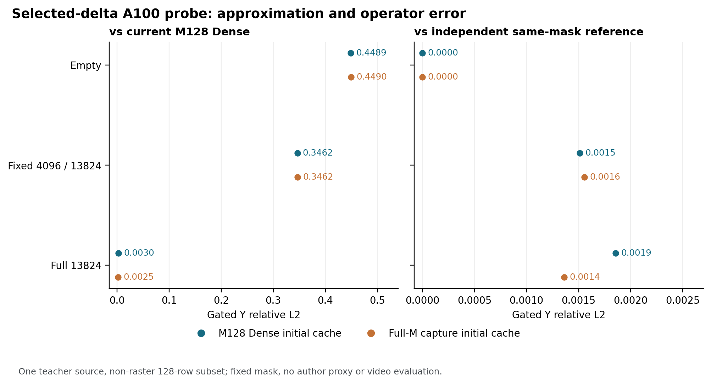

# Chipmunk 选择性差分：A100 单组受控移植结果（2026-10-29）

**[NATIVE-OBS]** 固定 source898、seed42、high expert 的 block20，step0→1 两个 teacher 状态，以首128条已捕获的非 raster 行构成一组。在初始 M128 Dense 缓存下，固定更新前 4096 / 13824 个隐藏通道时，门控输出相对当前 M128 Dense 的 L2 误差为 **0.34615**；相对同选集独立差分参考的误差为 **0.001513**。两者分别衡量固定子集带来的近似误差和该局部算子的参考差异。全通道更新相对当前 M128 Dense 的门控误差为 **0.002986**。本例说明两核完成了有界数值控制，而这个固定子集仍遗漏了大量当前状态变化。

| 初始缓存 | 选择 | 选中通道 | gate×Y 相对当前 M128 Dense | gate×Y 相对当前 full-M 捕获 | gate×Y 相对同选集独立参考 |
|---|---|---:|---:|---:|---:|
| M128 Dense | 空 | 0 | 0.448862 | 0.448937 | 0 |
| M128 Dense | 全 | 13824 | 0.002986 | 0.002554 | 0.001857 |
| M128 Dense | 固定前4096 | 4096 | 0.346155 | 0.346219 | 0.001513 |
| full-M 捕获 | 空 | 0 | 0.448961 | 0.449037 | 0 |
| full-M 捕获 | 全 | 13824 | 0.002496 | 0.002255 | 0.001361 |
| full-M 捕获 | 固定前4096 | 4096 | 0.346219 | 0.346284 | 0.001555 |

同选集参考从 M128 Dense 当前 h 和初始缓存构造 BF16 delta，用禁 TF32 的 FP32 matmul、旧 Y 和一次 BF16 写回计算，再应用当前 gate；它不是完整 Dense 的替代名称。全部六个条件的未选 h 的 `torch.equal` 检查通过，非空条件的核输出 delta 与实际新旧 h 构造的 BF16 delta 逐值相等；空集 h/Y 的 `torch.equal` 检查通过。该检查是数值逐元素相等，未验证符号零等编码位的逐字节相同。独立参考阈值、h/Y 误差、最大误差、signed cross、选集 SHA 和逐 case 计量保存在[结果 JSON](CHIPMUNK_A100_SELECTED_DELTA_PROBE_RESULTS_20261029.json)。

**[NATIVE-OBS]** 两种初始缓存的全选结果，其新 h 相对同坐标 step1 full-M 捕获 h 的最大绝对差均记录为 **0**。本次记录支持这些观测值数值相等；未专门记录这对 h 的逐字节比较。相比之下，M128 Dense 重算 h 与 full-M 捕获 h 的 relative L2 是 **0.002862**，对应 Y 为 **0.003261**、gate×Y 为 **0.002584**。因此应分别保留 M128 重算参考和原 M31668 捕获参考，不能把两者的差全部算作选择性更新误差；这个单组观察也不证明所有 shape 的舍入行为。

**[SRC]** 第一核按选集读取 W1、计算 bias 和 GELU，写 BF16 h 及 BF16 delta；第二核以 FP32 累加 delta×所选 W2，再向含一次 b2 的 pre-gate Y 缓存写回 BF16。空、全、固定前4096是固定控制集。作者的均值 W1 proxy、top/random 选择及参考更新在本次**没有执行**，所以固定集结果不评价作者选择器。按作者源码，proxy 本身还需支付 block mean、覆盖全部隐藏通道的 W1、选择和历史参考维护成本。

**[SYS，有限范围]** 实际预算账闭合：2次 payload hash、2次 packet load、1次 checkpoint hash、1次 checkpoint tensor load、2次 M128 Dense、6次选择、6次回散、6次独立参考，两核各4次 dispatch；物理 GPU kernel launch 总数及物理磁盘读取字节为 **UNKNOWN**。checkpoint 顺序 hash 实际读取 28,577,915,880 B，两个 payload 各 74,960,072 B；四个权重 tensor load 记逻辑 283,153,408 B，文件身份检查通过。worker wall 44.886 s、supervisor wall 45.736 s、GPU reserved 峰值 985,661,440 B，host RSS 高水位 1,302,777,856 B，分配卡采样隔离通过。单次组件 wall 含持久化、分配和可能编译；回散只写128行，其余全尺寸占位未初始化，不能据此声称公平端到端加速或完整输出。host RSS 是边界及最终高水位检查，并非连续硬上限。

独立初审要求修订后，经作者回应与独立复核，实际 child **EXIT0**、`verify-closed` **PASS**。RUN SHA `5cf6b138d5c1f385e253aa8d3cf9377211aeb62b03c495ca14430cff0ec2131f`，EXIT SHA `d9a800c2fc52df9504a12ffa4c8c4b35a5478aa1ebac1d592e0ca5eb230cfe5b`，closed 记录 SHA `1fbe9acbd9a6c2415220013beb7ec5c67782c99fba8b7fc480527caa68206fa8`。核验器自身的零 GPU/model 调用不代表测量运行未调用 GPU。

最有辨识力的下一项是另立经评审的同 count **作者式付费 proxy 与固定 seed 随机选集**比较，使用匹配的原 raster 行或明确说明重排组，并计入 block-mean W1、选择、缓存、pack/scatter 和两个核；比较误差及真实完整边界成本。它能区分“固定子集遗漏变化”与“作者 proxy 能否找到有价值通道”，但仍需扩展到多来源、全M及视频，才能评价 Wan2.2。当前结果不是作者 Hopper 忠实复现、full-M 算子或视频质量结论。
