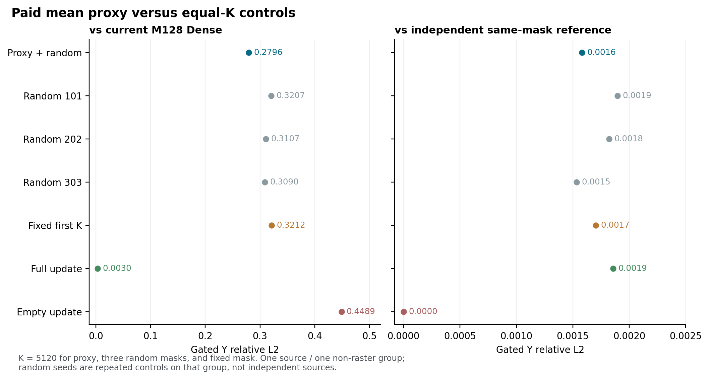

# Chipmunk 付费均值代理与等 K 对照：单组结果（2026-10-29）

**[NATIVE-OBS]** 在 source898、seed42、high expert block20 的 step0→1、一个非 raster 128 行 teacher 组上，作者启发的付费均值代理实际更新 **K=5120 / 13824** 个通道。其 gate×Y 相对当前 M128 Dense 的 relative-L2 为 **0.279554**，低于同 K 的三个随机集（0.320663、0.310707、0.309026）和固定前 K（0.321217）。同选集独立算子参考误差为 **0.001582**。均值代理在这个组上找到了比这些对照更有用的更新，但对当前 Dense 仍有明显误差。

| 选择臂 | 实际 K | gate×Y 相对当前 M128 Dense | gate×Y 相对同选集独立参考 |
|---|---:|---:|---:|
| 均值代理＋随机保底 | 5120 | 0.279554 | 0.001582 |
| 随机 seed 101 | 5120 | 0.320663 | 0.001897 |
| 随机 seed 202 | 5120 | 0.310707 | 0.001821 |
| 随机 seed 303 | 5120 | 0.309026 | 0.001532 |
| 固定前 K | 5120 | 0.321217 | 0.001702 |
| 全更新 | 13824 | 0.002986 | 0.001857 |
| 空更新 | 0 | 0.448862 | 0 |

三个随机 seed 是**同一个 source、同一个组、同一对状态下的嵌套对照**，不是三条独立来源。该范围不估计跨来源胜率或视频质量；同 mask 参考误差与相对完整 Dense 的近似误差回答不同问题。所有七臂的 h/Y/gate×Y、相对原 full-M 捕获的差、signed cross、tile、计时和精确 mask 见[结果 JSON](CHIPMUNK_PAID_PROXY_EQUAL_K_RESULTS_20261029.json)。`torch.equal` 检查是逐元素数值相等，并非对正负零等编码的专门字节比较。

**[SRC/NATIVE-OBS]** 代理以 step0 M128 Dense 的 BF16 pre-GELU 均值为历史缓存，计算 step1 输入均值的完整 W1+b1，比较两者的 BF16 差；采样前1024个分数后 cutoff 为 **0.205078125**。全通道中 4570 个满足阈值、433 个因随机保底加入，base 为 5003；安全补齐 117 个真实更新通道后 K=5120，cutoff ties 有30个。所有分数、真实索引、SHA与实际 K 均保存在结果 JSON，闭环核验重放了选择；完整当前 h/Y 在所有 mask 确定后才用于参考，不参与选择。

这是作者机制的**安全受控适配**：使用固定 seed 的 Python MT19937、顺序遍历和有界升序 padding，保留阈值与随机保底的定义，但不冒称作者 CUDA CURAND、atomic 顺序或 Hopper 系统实现。padding 加入的是实际更新列；本次不以 oracle 选 mask，也没有测量自由 student 或完整 M。

**[SYS，有限范围]** 实际账闭合：2次 payload hash/load、1次 checkpoint hash/load、2次 M128 Dense、2次组均值、1次完整 proxy W1、1次安全 selector、1次历史均值更新、1次控制集构造、7次 mask 复制、7次回散、7次独立参考，A/B两核各6次 dispatch。物理 GPU launch、HBM 事务和物理磁盘读取字节均为 **UNKNOWN**。checkpoint hash 逻辑读取 28,577,915,880 B、实际 wall **321.523 s**；两个 payload hash 各读取 74,960,072 B，四个权重 tensor load 记录逻辑 283,153,408 B。worker wall **353.263 s**，GPU reserved 峰值 979,369,984 B，host RSS 高水位 1,318,117,376 B。

代理均值、W1、选择、历史缓存更新和控制集构造分别有记录；代理付费阶段 wall **3.515 s**，它与各臂单次动作 wall 均包含账本、同步和可能的冷编译或分配。编译独立纯耗时 UNKNOWN；单次测量和 partial scatter 不构成公平 FFN 或系统速度比较，321.523 s 的完整 checkpoint hash 也应与算子开销分开解释。host RSS 是边界及最终高水位检查，不是连续硬限制。

独立初审 REVISE 后经作者修订、独立复核，实际 child **EXIT0**、`verify-closed` **PASS**。RUN SHA `de137a666e29191d0df6c2259727ac569c9a48d74425aed29d12e6c10df9ba21`，EXIT SHA `5abe567329132ef4d7e1ef395314f0b8274d31e8ce49e5713d87fefe0a626255`，closed SHA `c0ea8b7779d2a142474ff89121f249ba6096905fdc0ccc0079b2a7b795425664`。核验器自身零 GPU/model 调用不代表测量运行未调用 GPU。

下一项有辨识力的证据是按独立 source 与原 raster 组扩展同 K 对照，并保留代理选择、组构造、缓存、kernel 与回散的真实总成本；同时检查均值相互抵消、GELU曲率和 W2 有符号交叉能否预测代理失效。完整原作者系统、Wan2.2 全160位置的自由生成和视频质量仍需各自的独立范围与证据。
