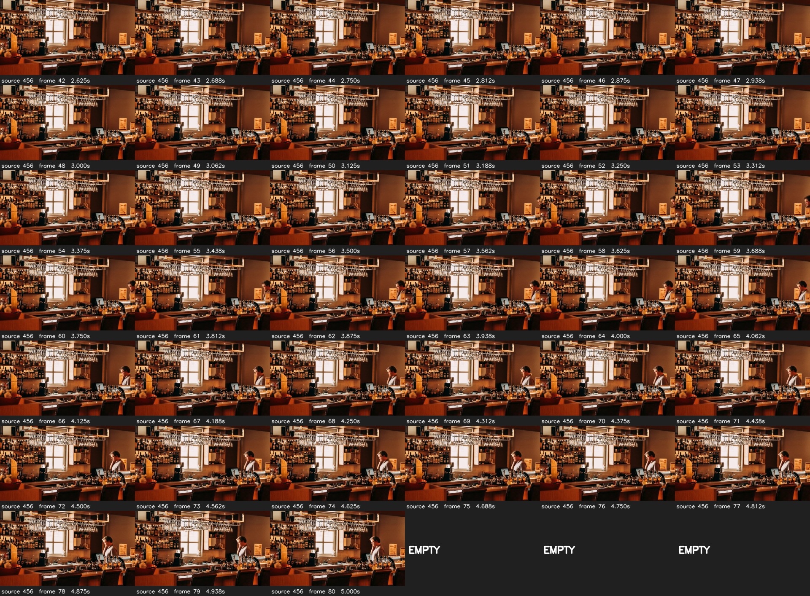
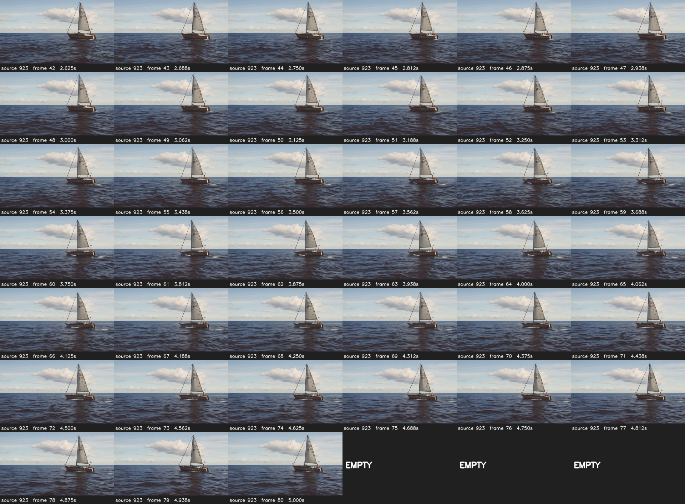

# 新12 Dense完整帧视觉证据

12个source的81帧全部按顺序解码，972成功帧、24张接触表，CPU实际退出码0；独立AI审阅者核SHA并实际查看全部24页。主协调者另查看912/616/923/456的后半页。

source456前段近静止，约58帧人物进入柜台区域；RAFT前8对0.154、末8对6.937，整段1.680。source923帆船位置仅小幅变化、海面纹理持续变化，RAFT整段28.789；source616山体布局大体稳定而云形变化，21.584。两类相反例提示比较完整事件、背景和静态结构，同时保留逐时间窗数值。

这些是缩图连续接触表的AI观察，不是完整视频播放人审，也没有对尚未测量的候选效果作判断。完整逐源竞争解释与全部GEN/JPEG SHA见[独立审阅](../method_discussion/discoveries/E0/s2-new12-dense-all81-independent-visual-review-20261029.md)。

完整protocol/RUN/EXIT/manifest及复制页SHA见[机器结果](S2_NEW12_DENSE_ALL81_VISUAL_RESULTS_20261029.json)。
