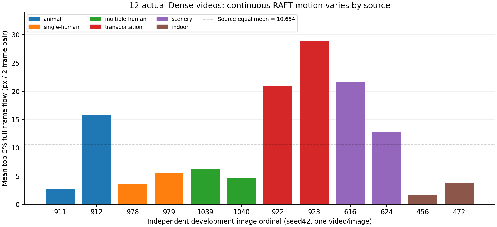

# 新12开发来源：真实Dense视频连续运动基线

2026-10-29 · VIDEO/METRIC · 3份实际独立EXIT0；12张独立开发图，每图seed42一次。全81帧解码972帧、RAFT480次forward、9600次迭代。生成是原BF16/A100，指标在同一套冻结RAFT/SM120执行；未生成新视频、训练或分解。

来源等权均值 **10.6540 px/2帧对**，来源中位数 5.8536，范围 1.6797–28.7888，最大/最小 17.14。每个帧对取全画面光流幅值最大的5%像素均值，40对再平均；不是主体mask内动作幅值。

| 来源ordinal | 输入场景类型 | 连续运动 px/2帧对 | 原版dynamic degree二值 |
|---|---|---:|---:|
| 911 | animal | 2.7205 | 0 |
| 912 | animal | 15.7976 | 1 |
| 978 | single-human | 3.5338 | 0 |
| 979 | single-human | 5.4805 | 0 |
| 1039 | multiple-human | 6.2267 | 0 |
| 1040 | multiple-human | 4.6271 | 0 |
| 922 | transportation | 20.8653 | 1 |
| 923 | transportation | 28.7888 | 1 |
| 616 | scenery | 21.5838 | 1 |
| 624 | scenery | 12.7755 | 1 |
| 456 | indoor | 1.6797 | 0 |
| 472 | indoor | 3.7688 | 0 |

这个结果揭示新来源的实际运动强度高度异质，允许用逐来源配对而非混合视频平均检验早段/晚段原W2策略。相邻的输入类型和静态画面也不能替代真实运动的观察；主体动作、相机、背景和静态结构将分别审阅。

本结果是已曝光开发来源的单seed运动基线；正式八轴、主体ROI因果与部署质量仍需各自实际证据。新的SM120生成对照会在该硬件上重新生成Dense，保持同硬件/同checkpoint/数值recipe配对，不把此A100生成基线直接改作跨硬件配对通过证据。

逐帧对40分数、五个8对窗口、源/视频/生成回执、三个协议/RUN/EXIT及精确SHA保存在[机器结果](S2_NEW12_DENSE_CONTINUOUS_MOTION_RESULTS_20261029.json)。

