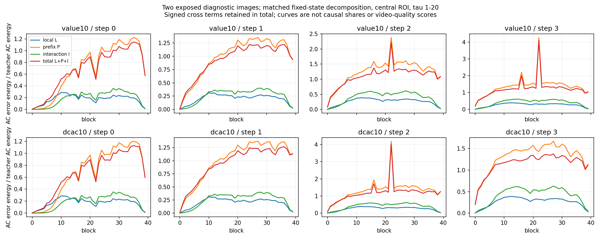

# S2 · 全160位置学生状态与同输入读出分解

2026-10-29 · NATIVE固定状态四角重放＋ALG解释。原生两路及标量汇总均实际EXIT0。[完整结果与HF绑定](S2_SPATIAL52_FULL160_LPI_REPLAY_RESULTS_20261029.json)。

当前最有价值的观察是：两个曝光诊断图上，真实学生输入造成的读出变化明显大于Dense输入下的局部压缩误差，但有很强的有符号抵消。这给出了研究学生状态与输出子空间的具体入口；不能将各项平方能量直接解释为运动损失的因果占比。

## 对象与实际执行

沿用[真实spatial52采集](S2_SPATIAL52_DENSE_STUDENT_CAPTURE_RESULTS_20261029.md)：来源898与96，原BF16、seed42、4步×40层、完整21个latent时间槽、52个固定xy，Dense/value10/dcac10各自正常自由生成状态。两来源都已曝光，最大流ROI亦包含背景；中央ROI不等于主体mask。

在每个已存Dense/Student的h上实际执行原W2和两个固定rank960候选，保留原b2、各轨gate/residual以及BF16写回。令T=D(hD)、S=D(hS)、Ct=Q(hD)、Cs=Q(hS)，则L=Ct−T、P=S−T、I=(Cs−S)−L，total=L+P+I。u与rowLN(u)分别重新构造并单独统计；rowLN是已存调制下的诊断视图，未执行实际下一Attention消费者。

共320个独立匹配位置（2图×160），每位置两候选，640条唯一四角记录。V3另做6个位置控制、12条候选记录。含原V2前缀及控制的实际总成本：978次原BF16 W2 GEMM、2608次factor GEMM、2282次BF16 postwrite、3260次gY及3260次rowLN、10432次rFFT。0次W1/完整模型/新视频/训练/分解/官方评分。

V2在19个完整block、76/160位置边界按协调者请求退出，实际EXIT1，原RUN/EXIT保留。V3先重放每expert三个固定控制，与已完成NumPy统计逐字段比较通过，再仅完成84个未执行位置；最终与不可变旧前缀合并。两路实际墙时1452.99s、1423.73s，EXIT0；统计CPU汇总17.83s、EXIT0。该过程没有把旧失败改成成功，也未重跑完整已完成范围。

## 来源等权观察

下表是每位置相对其Dense参考能量的比例，先在每图内等位置平均，再两图等权；没有把token/step/layer算成独立来源。视图为gY、τ1–20、中央25xy、时间AC。

| 候选 | L² | P² | I² | total² | 2〈L,P〉 | 2〈L,I〉 | 2〈P,I〉 |
|---|---:|---:|---:|---:|---:|---:|---:|
| value10 | 0.228947 | 1.073584 | 0.318454 | 0.984222 | +0.352395 | −0.352398 | −0.636759 |
| dcac10 | 0.228174 | 1.079516 | 0.320502 | 0.987198 | +0.353818 | −0.353883 | −0.640930 |

value10的P²由step0的0.68845到step3的1.36817；这说明两个已观察轨迹的差异随计算位置发生变化，尚不能称为闭环不稳定性。全21τ/52xy的总gY误差为0.33595/0.34244，时间AC较大；τ0自身只有一个时间点，其AC未定义，不以此推断条件槽的因果地位。

## 从交互项获得的结构解释

[SRC/ALG] 当前因子由共享gate RMS度量M下的输出basis编译：连续理想模型中Q(h)−b=(D(h)−b)MΠM⁺，Π为该度量坐标中的正交投影。因此在适用度量中，I可以是P中被投影滤除分量的取反。对任意Q，K=P+I=Q(hS)−Q(hD)都成立；K才是候选函数对两轨状态变化的完整响应。

根据上表，value10的K²=P²+I²+2〈P,I〉≈0.755278，2〈L,K〉≈−0.00000363；这与投影过滤解释相容。它不表示I产生额外放大，也不表示被该次Q滤除的方向对其他层、残差、Attention或视频无关。

真实step gate和共享RMS一般不满足投影正交所需的可交换条件，BF16两个factor GEMM亦引入数值余项。[独立评议](../method_discussion/discoveries/E0/s2-projected-prefix-interaction-independent-20261029.md)给出二维反例及逐位置尾部：value10中央AC的均值残差total²−L²−P²+I²≈0.000145，但某位置达0.00906；far2均值很小，单位置可达−0.06459。逐位置仍先对两源平均，不能据此排除单图更大偏差。

更直接的消费者反例是同一中央AC视图的真实u与rowLN(u)：该残差分别约0.05526、0.05180。u的P同时包含两轨真实残差差，rowLN另有非线性；gY的近似投影关系不可直接延伸到它们。

全M原生总差与小M重放的桥很小，例如value10全21τ/52xy的combined bridge²约8.79e−6、AC约3.54e−5，明显小于对应总体差。桥只锚定已观察总差，未独立锚定每个反事实角，也不保证每个位点的干预大于数值余项。

## 改变下一步的方法判断

当前证据支持同时研究“输出子空间滤除部分状态差”与“候选保留方向中的状态差继续作用于后缀”。二者可共存。连续理想正交情形中，当前同h恢复原D后相对Dense的误差变化是I²−L²，甚至可能变大；因此不按最大局部SSE简单挑层补算。

下一证据优先采用新来源、正常学生forward中的实际物理行动，配对同checkpoint/seed的完整Dense视频，并测下一消费者、flow和最终视频。七来源的真实连续截图诊断已从最新main同步，用于先区分主体冻结、相机幅度变小和闪烁；正常后缀设计及新增采集另行冻结有限ACTIVE范围。现有两个曝光图的固定状态分解属于机制证据，候选全视频质量仍沿用此前[40条失败视频](RAW_BF16_TEMPORAL_VALUE_DCAC_VIDEO20_QUALITY_RESULTS_20261029.md)的原始结论。
