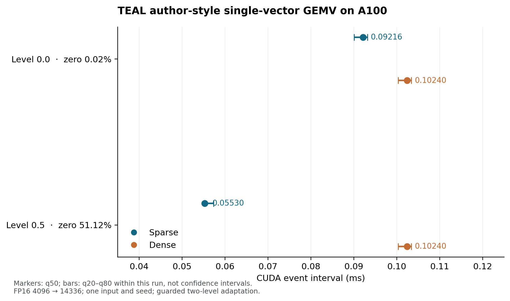

# TEAL 作者风格单向量 GEMV：实际运行结果（2026-10-29）

**[NATIVE-OBS]** 在 A100 80GB PCIe、FP16、batch 1、单 token、4096→14336、同一随机输入和权重的有限测试中，输入零比例 51.123% 时，稀疏路径的 q50 CUDA 事件区间为 **0.055296 ms**，Dense 为 **0.102400 ms**，两个中位数之比为 **1.85×**。零阈值下分别为 0.092160 ms 和 0.102400 ms（1.11×）。这是单次固定形状与输入上的事件区间比较。

图中的条线表示该次各自测量的 **q20–q80 分位区间，不是置信区间**。四个 arm 分开计时，速度比是两个 arm 的 q50 之比；一次 seed 和一个输入无法估计跨输入或跨运行的不确定性。完整 arm 计数和精确数值见[结果 JSON](TEAL_AUTHOR_BENCHMARK_PROBE_RESULTS_20261029.json)。

| 目标稀疏水平 | 实际输入零比例 | Sparse q20 / q50 / q80 (ms) | Dense q20 / q50 / q80 (ms) | Dense q50 / Sparse q50 | Sparse 对同输入阈值后 Dense 的相对 L2 |
|---|---:|---:|---:|---:|---:|
| 0.0 | 0.0244% | 0.090112 / 0.092160 / 0.093184 | 0.100352 / 0.102400 / 0.103424 | 1.11× | 0.0012522 |
| 0.5 | 51.1230% | 0.055296 / 0.055296 / 0.057344 | 0.100352 / 0.102400 / 0.103424 | 1.85× | 0.0012553 |

**[SRC]** 固定的作者 [benchmark_gemv.py](https://github.com/FasterDecoding/TEAL/blob/fb7373c93ac3594817c9ee64d4e08b47430a1822/scripts/benchmark_gemv.py) 使用 `triton.testing.do_bench`，没有在该脚本使用 `torch.compile` 或 CUDA Graph。这里按实际环境 Triton 3.0 的 `do_bench` 顺序，使用 256,000,000 字节 cache 清零、25 ms warmup 目标、sparse 1000 ms 与 dense 100 ms repeat 目标及事件分位数；守卫式实现只在计时循环外增加动态预算和预扣。两种方法共享输入与权重，取两个水平；作者脚本则有 101 水平、额外 provider，且按 benchmark 调用各自生成输入。因此本次是**有限作者风格适配**。两种稀疏水平的实际 autotune 配置均为 BLOCK_M 64、BLOCK_N 128、2 warps。

**[NATIVE-OBS]** 此前[带观测器的 eager V2](TEAL_AUTHOR_FP16_KERNEL_PROBE_RESULTS_20261029.md) 在相同目标水平的 sparse / dense q50 分别为 0.192000 / 0.146944 ms，顺序相反。两次测量的 harness、cache 清理、观测器及同步方式共同不同；这些结果不单独识别 Python、访存或 kernel 的因果成本，也不构成对作者性能的否定。更有辨识力的后续工作是固定输入和硬件，逐项改变这些测量条件，同时保留实际 kernel 配置和物理执行成本。

本次四个 arm 分别完成 4506、526、532、5363 次 benchmark 函数调用，共 **10927 次**；另完成两次 sparse 与两次 Dense 正确性调用。自动调优内部和其他物理 GPU kernel launch 数均为 **UNKNOWN**，不可把 Python 函数次数当物理 launch 次数。worker wall 为 19.725 s，峰值 GPU reserved 为 494,927,872 B，监控的单卡隔离通过。核验器的零 GPU/model 调用是核验成本，不是原实验的 GPU 调用计数。

本范围通过独立评审、作者修订与独立复核，实际 child EXIT0 且 `verify-closed` PASS；RUN SHA `50fe14fad4131497ac15badccf6c973e26306614ea45ea8cd771630c7fceed20`，EXIT SHA `7292ef326b56a18b26b12be8b4ca52bbe51cb23562cf129e357ab738daba279d`，实际 closed 记录 SHA `90cc11ce3b7e3f8c5bb04d6f2040bfb1d764cb1e02a60e8a85751586c1fb2da1`。原始 HF 相对路径、协议及 review SHA 均载于结果 JSON；最初 V1 审阅 REVISE 作为历史身份保留。

该观察对应作者 FP16 单向量核，不是完整作者 LLM、Wan2.2、全 FFN、系统端到端或视频质量的复现结论。独立的[CPU全160局部对照](TEAL_WAN_ALL160_CPU_LOCAL_RESULTS_20261029.md)也已实际EXIT0闭合，属于另一scope与证据对象。
