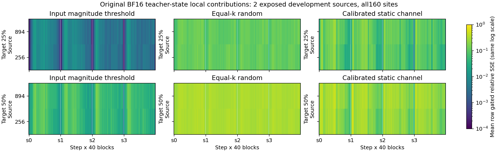

# Wan 全160位点：冻结幅值门限的局部对照（2026-10-29）

**[OBS · CPU局部]** 六个校准来源确定的 post-GELU 幅值门限，在两个已暴露开发来源、全部160处真实BF16 teacher状态上，均比逐行相同删除数量的随机和静态通道对照有更小的门后W2贡献误差。25%目标的来源等权相对SSE为 **0.005771**，随机为 **0.113019**，静态为 **0.103833**；50%目标为 **0.057950 / 0.312668 / 0.243413**。每个目标的320个 source×site 情况都保持该排序。

| 校准目标删除率 | 开发集实际平均删除率 | 幅值门限相对SSE | 等数量随机 | 校准静态通道 |
|---|---:|---:|---:|---:|
| 25% | 24.7981% | 0.005771 | 0.113019 | 0.103833 |
| 50% | 49.6312% | 0.057950 | 0.312668 | 0.243413 |

相对SSE是平方误差与参考能量之比。图中每列为实际 step×block，行分别为来源894和256；颜色采用同一对数标尺。两个来源独立，site和256行均为来源内的嵌套观测，不能当作数百个独立样本。

## 数据、阈值与数值对象

原始BF16全深度资产中，校准来源为897、896、240、899、288、304；开发来源为894、256。每个来源固定seed42、4步×40层、每处256个原生行。1280包和80个真实W2权重均按冻结身份使用。以上来源已有历史暴露，本次属于开发诊断。

每处分别以六个校准来源的1536行构造BF16正幅值CDF，按最近秩确定25%和50%门限，执行 `abs(h) <= threshold` 的包含等号规则。两个开发来源没有参与阈值选择。BF16 ties使校准集实际删除率均值为25.1059%和50.2836%；开发 source×site 的实际范围分别为20.5698%–28.5077%和42.6883%–52.8924%。冻结数值及真实CPU父证明见[阈值表](../../config/e0_teal_wan_all160_calibration_thresholds_20261029_v1.json)。

两种强对照逐行删除完全相同的k个元素。随机选择由完整source/step/block/row身份确定，两个稀疏率采用嵌套次序；静态对照按六个校准来源的 `mean(h²) × ||W2_column||²` 排序。结果同时保留每个方法实际删除的零、非零和门限tie数。原有零值的source×site均值仅0.01366%，所测差别主要涉及非零贡献。

对删除部分计算CPU FP32 `dropped_h @ W2.T`，再乘对应原生gate，以已存原生BF16 `Y × gate` 为参考，逐行相对SSE先在site内平均，再site等权、来源等权。b2在同输入的原/删分支代数差中抵消。这里测的是局部贡献诊断；BF16学生完整forward的舍入、后缀动力学与自由生成另行验证。全部方法的有效行覆盖完整，无零分母null。

## 可区分的机制与下一证据

**[OBS]** 在这两个来源全部位置，幅值比固定通道重要性更能预测可删除的门后贡献；单纯按通道能量选择也不能替代当前输入的幅值信息。25%门限的source×site相对SSE范围为0.000130–0.021590，50%为0.004527–0.176806，仍有明显位置异质性。

**[OPEN]** 小幅值可分散在许多通道并共同携带弱运动方向；逐处小误差也可能在学生轨迹中累积。另一机制预测这些扰动可被后缀吸收。下一项以固定六源门限，对四个已暴露且运动特征不同的来源做全部160处正常学生自由生成，与同机fresh Dense完整视频配对，直接判别人手动作、晚出现主体、潜水动作和水面变化。视频试验需独立复审及ACTIVE冻结。

post-GELU置零保留W1/GELU和完整Dense W2，属于质量诊断。作者FP16单向量核的[有限计时结果](TEAL_AUTHOR_BENCHMARK_PROBE_RESULTS_20261029.md)属于另一数值对象和执行范围；本CPU结果没有提供Wan稀疏核或系统加速证据。

## 实际执行与证据

该范围通过[独立评议及修订复核](../experiment_reviews/E0_TEAL_WAN_ALL160_CPU_LOCAL_20261029/v1.json)，实际child EXIT0，`verify-closed` 返回 `PASS_CLOSED_TEAL_CPU_LOCAL`。完成1280包读取、80次W2载入、320次CPU FP32矩阵乘及491520次row×method评估；没有GPU、训练或新视频。worker wall 862.786秒、outer wall 863.488秒，峰值RSS 1,584,943,104字节，处于冻结预算内。

RUN SHA：`0f6a717ec8d3ddeb99182876f25e683b0c9749953965d38026ce9a03571dfe90`；EXIT SHA：`c6c4706791ef48ba8272168201ca646b09e1ccb0a5063cc675e06a4c2de691c7`。[结果JSON](TEAL_WAN_ALL160_CPU_LOCAL_RESULTS_20261029.json)保留来源、step、block、真实支持计数、各对照误差、160份原始报告绑定与HF相对路径。
