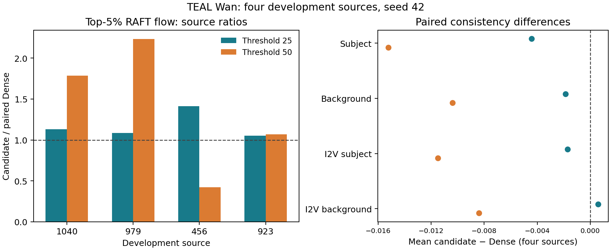

# TEAL Wan 全160：四开发来源真实质量与视觉观察

**四组RAFT、四组八轴、四组视觉接触表均实际 EXIT0 并通过目标端 closed。** 四个已暴露来源各一 seed42、三臂，共12研究视频；同来源新鲜 Dense 为对照。阈值25的四来源等权 RAFT 配对比为 **1.170**，50为 **1.376**；但50的来源比从 **0.423 到 2.231**，不能用均值判断主体动作保留或质量通过。独立AI缩图观察中，1040三臂均有可见潜水员肢体变化；923三臂保留帆船及水面变化；456的50臂仍有后段出现的人；979的50臂新增大量彩色碎片状内容，可能贡献额外全帧流，不能据此认定主体动作更好。以上是构造性局部证据，也保留时序、姿态和物体差异。

原BF16全160位置执行 W1→GELU→阈值置零→**完整 dense W2/bias**→gate/residual。两候选实测删零率、neutral与生成证据见[原生结果](TEAL_WAN_ALL160_VIDEO_V3_NATIVE_RESULTS_20261029.md)；这里没有物理稀疏W2省算，也没有速度通过。来源是统计单位，4个来源×1 seed不是盲测或5次独立采样；**置信区间未估计**。

## 连续RAFT：逐来源配对

RAFT是每隔2帧计算的40个两帧对，数值是原函数的top-5%流幅均值，单位为像素/两帧对；它不是主体速度或全图平均流。每来源先将候选均值除以自己的 Dense，再对四来源等权求均值，不用跨来源原始流量加权。

| 来源 | Dense | 25 | 50 | 25 / Dense | 50 / Dense |
|---:|---:|---:|---:|---:|---:|
| 1040 | 4.6274 | 5.2277 | 8.2521 | 1.1297 | 1.7833 |
| 979 | 5.4805 | 5.9369 | 12.2257 | 1.0833 | 2.2308 |
| 456 | 1.6796 | 2.3737 | 0.7112 | 1.4132 | 0.4234 |
| 923 | 28.7893 | 30.2820 | 30.7581 | 1.0518 | 1.0684 |

完整逐视频 **40对原值、五个固定8对窗口、视频与GEN SHA** 见[机器结果](TEAL_WAN_ALL160_FOUR_SOURCE_QUALITY_RESULTS_20261029.json)。979的50臂在约第15–20帧后出现大量彩色碎片状元素，与2.231的较高流比共存；碎片可能贡献流，**本次没有分割或因果量化其贡献**。456的50臂流比0.423，但接触表仍显示人物后段出现；人物本不在prompt要求中。923的全帧流接近Dense也不证明船轨迹、相位或细节相同。

## 八轴原始逐视频值

成像为原MUSIQ尺度，其余为相应原函数分数；动态为阈值二值，不等同连续RAFT流。I2V两轴为本次固定source-image配对，不标官方五独立采样。不同指标不能直接比较其数值尺度。

| 来源 | 模式 | 成像 | 美学 | 平滑 | 动态二值 | 主体一致 | 背景一致 | I2V主体 | I2V背景 |
|---:|---|---:|---:|---:|---:|---:|---:|---:|---:|
| 1040 | dense | 60.5250 | 0.4638 | 0.9911 | 0.0000 | 0.9478 | 0.9426 | 0.9808 | 0.9769 |
| 1040 | threshold25 | 58.9981 | 0.4826 | 0.9916 | 0.0000 | 0.9379 | 0.9402 | 0.9783 | 0.9742 |
| 1040 | threshold50 | 67.6212 | 0.5061 | 0.9920 | 1.0000 | 0.9245 | 0.9356 | 0.9550 | 0.9609 |
| 979 | dense | 58.4996 | 0.6675 | 0.9917 | 0.0000 | 0.9489 | 0.9398 | 0.9840 | 0.9816 |
| 979 | threshold25 | 60.5758 | 0.6585 | 0.9920 | 0.0000 | 0.9433 | 0.9383 | 0.9861 | 0.9883 |
| 979 | threshold50 | 58.9598 | 0.6558 | 0.9849 | 1.0000 | 0.9213 | 0.9196 | 0.9752 | 0.9794 |
| 456 | dense | 77.4218 | 0.6475 | 0.9924 | 0.0000 | 0.9870 | 0.9852 | 0.9939 | 0.9910 |
| 456 | threshold25 | 77.2841 | 0.6431 | 0.9924 | 0.0000 | 0.9842 | 0.9828 | 0.9909 | 0.9908 |
| 456 | threshold50 | 77.6785 | 0.6215 | 0.9915 | 0.0000 | 0.9780 | 0.9683 | 0.9885 | 0.9842 |
| 923 | dense | 76.0561 | 0.5839 | 0.9813 | 1.0000 | 0.9693 | 0.9722 | 0.9869 | 0.9902 |
| 923 | threshold25 | 76.2513 | 0.5867 | 0.9810 | 1.0000 | 0.9699 | 0.9710 | 0.9836 | 0.9886 |
| 923 | threshold50 | 76.5262 | 0.5854 | 0.9815 | 1.0000 | 0.9683 | 0.9748 | 0.9809 | 0.9816 |

四来源等权 `候选−Dense`：

| 指标 | threshold25 | threshold50 |
|---|---:|---:|
| imaging_quality | +0.151683 | +2.070802 |
| aesthetic_quality | +0.002033 | +0.001517 |
| motion_smoothness | +0.000128 | -0.001643 |
| dynamic_degree | +0.000000 | +0.500000 |
| subject_consistency | -0.004428 | -0.015232 |
| background_consistency | -0.001863 | -0.010392 |
| i2v_subject | -0.001704 | -0.011499 |
| i2v_background | +0.000582 | -0.008381 |

这些是描述性配对差，不是质量阈值或显著性判断。50组subject/background一致性下降相对25更明显，同时成像分数均值上升、动态二值多出两个来源，提示不同指标能对新增内容和时间变化作不同响应；不能单个平均量推断总体质量更好或更坏。保留静态结构和可见动作的解释，与生成轨迹/新增物体改变的解释可同时成立；要分辨须后续对完整播放做独立、按来源/事件区分的视觉或对象轨迹评估，并在真实FFN稀疏kernel下重新测算成本。

## 证据身份与限制

- RAFT parts0/2/3使用实际V2 EXIT0/closed，part1使用V3 EXIT0/closed（RUN SHA `84edcbfd4214fc00889b00f9d3761566b0c2022c644e281c784f082ea1bc7136`）；八轴四part为V3 EXIT0/closed，part1 RUN SHA `d123ed817974a7b75b3de57caf901816f4e836ad4a74fbe76f90db5d6ff393b7`。视觉四part均closed，本研究员独立实际查看全部24页；[1040/979](TEAL_WAN_ALL81_PARTS01_INDEPENDENT_AI_REVIEW_20261029.md)、[456/923](TEAL_WAN_ALL81_PARTS23_INDEPENDENT_AI_REVIEW_20261029.md) 是AI连续接触表观察，非人类完整播放或完整时间知觉。
- 每RAFT shard实际120 forwards/2400 iterations，四个成功shard合计480/9600；八轴每shard8维/24视频维结果，四shard合计32维调用、96视频维结果，其中另计RAFT 480 forwards/9600 iterations。每成功shard的已观察RAFТ checkpoint load为1；八轴每shard包装器观测到12次 checkpoint加载，合计48次。包装器未覆盖导入前alias、内存流、safe_open及内部loader，其他实际模型构造/内层forward计数 **UNKNOWN**，不把预算当观测。
- 成功质量和RAFT RUN记录 A100 80GB PCIe、SM80、Torch2.10.0+cu128；各输入、环境版本、checkpoint身份、预算与实际计数及四part RUN/EXIT SHA在机器结果。旧V1两个RAFT CPU预检因找不到Torch包metadata实际EXIT1、0模型/GPU；V2 part1曾在83次RAFT forward/1660 iterations后因临时NFS路径消失实际EXIT1，失败证据保留，V3为独立闭合结果。八轴V2仅CPU预检成功、未启动GPU，V3才是本报告的成功GPU范围。
- 同硬件、同scope内各source的fresh Dense是本次对照；旧跨硬件 r960 结果不作为本次数值因果比较。八轴原函数不构成官方完整五采样验收，不包含新人工审阅。没有任何视觉或指标结果自动授权下一实验。
