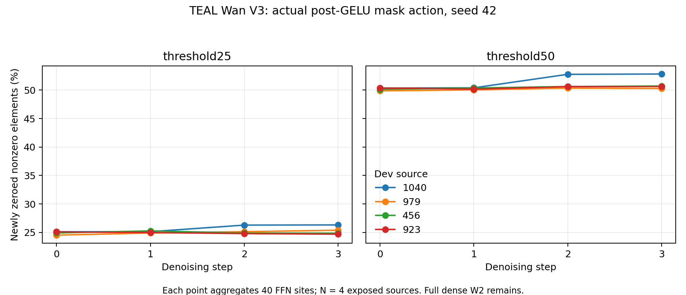

# TEAL Wan 全160位置 V3 原生视频结果（2026-10-29）

四个 part 已真实 EXIT0 并通过独立 closed 校验，共生成 **20 个完整视频**：8 个同设备 old/new dense neutral 视频及 12 个研究视频（4 个开发来源 × 3 模式），200 个状态文件，阈值模式中 1,280 个实际 FFN 掩码站点。每视频 81 帧、832×464、16 fps；seed 42。4 个来源曾暴露，统计单位是来源，单次 seed 并不形成独立重复或盲测确认。

路径为原 BF16 W1 → GELU → 按预先由六校准来源确定的阈值置零 → 原完整 dense W2/bias → gate/residual。threshold25/50 是阈值名称，实际动作由下表实测。**W2 仍为完整 dense 计算，没有物理稀疏省算。** 此处没有视频质量或速度通过结论。

每点汇总该步 40 个站点的元素计数；新增删除率为 selected_nonzero / total，原有零值和恰等阈值分别计数，后者是 selected 的子集，并非额外删除。详细计数与全部 1,280 条站点日志在配套 JSON。

| 来源 | 模式 | 步 | 原有零值 % | 阈值命中 % | 新删除非零 % | 阈值并列 % |
|---:|---|---:|---:|---:|---:|---:|
| 1040 | threshold25 | 0 | 0.0323 | 25.1279 | 25.0956 | 0.2186 |
| 1040 | threshold25 | 1 | 0.0221 | 25.1436 | 25.1215 | 0.2174 |
| 1040 | threshold25 | 2 | 0.0045 | 26.2833 | 26.2788 | 0.1988 |
| 1040 | threshold25 | 3 | 0.0034 | 26.3119 | 26.3085 | 0.1955 |
| 1040 | threshold50 | 0 | 0.0293 | 50.3833 | 50.3540 | 0.5656 |
| 1040 | threshold50 | 1 | 0.0182 | 50.4192 | 50.4009 | 0.5773 |
| 1040 | threshold50 | 2 | 0.0039 | 52.7749 | 52.7710 | 0.5271 |
| 1040 | threshold50 | 3 | 0.0031 | 52.8291 | 52.8260 | 0.5386 |
| 979 | threshold25 | 0 | 0.0253 | 24.5351 | 24.5098 | 0.2142 |
| 979 | threshold25 | 1 | 0.0130 | 24.9083 | 24.8953 | 0.2149 |
| 979 | threshold25 | 2 | 0.0038 | 25.1241 | 25.1203 | 0.1892 |
| 979 | threshold25 | 3 | 0.0029 | 25.3850 | 25.3821 | 0.1868 |
| 979 | threshold50 | 0 | 0.0255 | 49.8938 | 49.8682 | 0.5657 |
| 979 | threshold50 | 1 | 0.0114 | 50.0530 | 50.0416 | 0.5661 |
| 979 | threshold50 | 2 | 0.0036 | 50.3546 | 50.3510 | 0.5103 |
| 979 | threshold50 | 3 | 0.0034 | 50.2853 | 50.2819 | 0.5209 |
| 456 | threshold25 | 0 | 0.0304 | 24.9251 | 24.8947 | 0.2140 |
| 456 | threshold25 | 1 | 0.0143 | 25.2748 | 25.2605 | 0.2151 |
| 456 | threshold25 | 2 | 0.0048 | 24.8897 | 24.8849 | 0.1876 |
| 456 | threshold25 | 3 | 0.0047 | 24.8634 | 24.8588 | 0.1838 |
| 456 | threshold50 | 0 | 0.0294 | 50.1547 | 50.1254 | 0.5573 |
| 456 | threshold50 | 1 | 0.0129 | 50.3819 | 50.3690 | 0.5659 |
| 456 | threshold50 | 2 | 0.0045 | 50.6318 | 50.6272 | 0.5157 |
| 456 | threshold50 | 3 | 0.0045 | 50.7161 | 50.7116 | 0.5284 |
| 923 | threshold25 | 0 | 0.0327 | 25.1270 | 25.0943 | 0.2175 |
| 923 | threshold25 | 1 | 0.0149 | 24.9878 | 24.9729 | 0.2157 |
| 923 | threshold25 | 2 | 0.0046 | 24.7925 | 24.7879 | 0.1875 |
| 923 | threshold25 | 3 | 0.0036 | 24.6862 | 24.6825 | 0.1835 |
| 923 | threshold50 | 0 | 0.0299 | 50.4120 | 50.3821 | 0.5606 |
| 923 | threshold50 | 1 | 0.0131 | 50.1882 | 50.1751 | 0.5707 |
| 923 | threshold50 | 2 | 0.0042 | 50.6118 | 50.6076 | 0.5175 |
| 923 | threshold50 | 3 | 0.0034 | 50.6494 | 50.6460 | 0.5282 |

每来源四步总体新增删除率（分母为该来源全 160 站点的元素数）：

| 来源 | 模式 | 新删除非零 % | 原有零值 % | 阈值命中 % | 阈值并列 % |
|---:|---|---:|---:|---:|---:|
| 1040 | threshold25 | 25.7011 | 0.0156 | 25.7167 | 0.2076 |
| 1040 | threshold50 | 51.5880 | 0.0136 | 51.6016 | 0.5521 |
| 979 | threshold25 | 24.9769 | 0.0113 | 24.9881 | 0.2013 |
| 979 | threshold50 | 50.1357 | 0.0110 | 50.1467 | 0.5407 |
| 456 | threshold25 | 24.9747 | 0.0135 | 24.9882 | 0.2001 |
| 456 | threshold50 | 50.4583 | 0.0128 | 50.4711 | 0.5418 |
| 923 | threshold25 | 24.8844 | 0.0139 | 24.8984 | 0.2010 |
| 923 | threshold50 | 50.4527 | 0.0126 | 50.4653 | 0.5443 |

研究视频模式成本：4 来源算术均值，括号内为最小–最大，单位秒。总生成 wall 包含编码、解码和观测；FFN CUDA 事件包含原 FFN 与掩码；状态保存/D2H 是已单列的观测，掩码计数自身开销未独立计时。首次编译、缓存、插桩及运行顺序影响单次时间，不能视为公平系统速度比较。

| 模式 | 生成 wall | FFN CUDA | 状态保存 wall | 状态 D2H wall |
|---|---:|---:|---:|---:|
| dense | 48.509 (47.751–49.231) | 6.518 (6.383–6.726) | 2.353 (2.151–2.889) | 0.006 (0.005–0.008) |
| threshold25 | 51.676 (51.131–52.482) | 10.282 (10.139–10.438) | 2.185 (2.121–2.285) | 0.006 (0.005–0.009) |
| threshold50 | 53.948 (51.364–59.390) | 10.278 (10.152–10.415) | 2.395 (2.149–2.935) | 0.007 (0.005–0.008) |

逐视频 stage wall 和当前流 CUDA 事件、各阶段状态 SHA、视频 SHA、采样 GPU 峰值、全部操作限额与实账均保留于配套 JSON。CUDA 事件不是全系统隔离时间。每 part 的预扣与实际观测操作账一致：合计 video_generations=20, native_full_model_flows=80, native_FFN_calls=3200, native_FFN_linears=6400, mask_calls=1280, stage_CUDA_event_pairs=140, state_tensor_D2H=200, state_tensor_D2H_bytes=1216051200, neutral_state_byte_checks=40, neutral_video_byte_checks=4。各 part 原始预算为 1 GPU、4 CPU、GPU reserved 上限 40 GiB、运行 wall 上限 3600 秒、外层 3900 秒、新 HF 1 GiB；四卡会话上限及原两模型组约束见实际协议。

| part | 旧/新 neutral 来源 | RUN SHA-256 | EXIT SHA-256 | 外层秒 | 采样 GPU 峰值 MiB |
|---:|---:|---|---|---:|---:|
| 0 | 898 | `5c6243bfb8e056dcdd1370757300a0fea38adfeb642869bce0ee8df376e3dd7d` | `d412352f0897a1399fd3bbd8c6ce55c16466368d03cad8fd52b62527ae984bf7` | 403.60 | 29154 |
| 1 | 96 | `2e1cefed6a7c56e69400d6cc9dba5d40b06a4122ff4c58213330653949a32b98` | `af13c935017b5ce5e98ddbbdb58e20e8987dcf394f62477c2532b38c97fef7c6` | 577.91 | 29155 |
| 2 | 898 | `3494679aaecdcbb51ea88537235523d1f0711dbca61d5380008ece25898331a8` | `a34ab1bd8c7efdfbea5589af648cdc33eeee5a592e9e88f07d234674f06dcd7a` | 414.03 | 29155 |
| 3 | 96 | `08555fa3f9d5cdbc78f73d945b84e471a133a30fe2360c33893b8fbf4f4e013f` | `69d435115e6e726f933f0b5274de91b80827b61ea054bd734858f6ee6922a569` | 398.67 | 29153 |

四组 neutral 各有 10 对状态原始 tensor SHA 和完整视频 SHA 相同（合计 40 对状态、4 对视频）；各研究来源的三模式初始 FP32 noise SHA 相同。逐组 SHA 及 CPU preflight、协议和 prior V2 绑定见 JSON。GPU 峰值为物理设备采样值，逐视频 PyTorch reserved/allocated 峰值另见 JSON；进程 host RSS 峰值未记录，不能由系统可用内存代替。

V2 四个 part 实际 EXIT1，记录为 host/disk/wall budget 检查失败；保留其各自 RUN、EXIT 和协议哈希，V3 是新范围，不覆盖失败。视频质量尚未评测；原 RAFT shard 0/1 的 CPU 预检实际 EXIT1，原因是缺少 torch package metadata，模型和 GPU 调用均为零，V2 修复中。

[机器可读结果与完整账](TEAL_WAN_ALL160_VIDEO_V3_NATIVE_RESULTS_20261029.json)；原始 HF RUN 与退出回执路径及 SHA 在 JSON 内。原始闭合证明摘要经哈希绑定，未重新运行模型、视频或指标。
