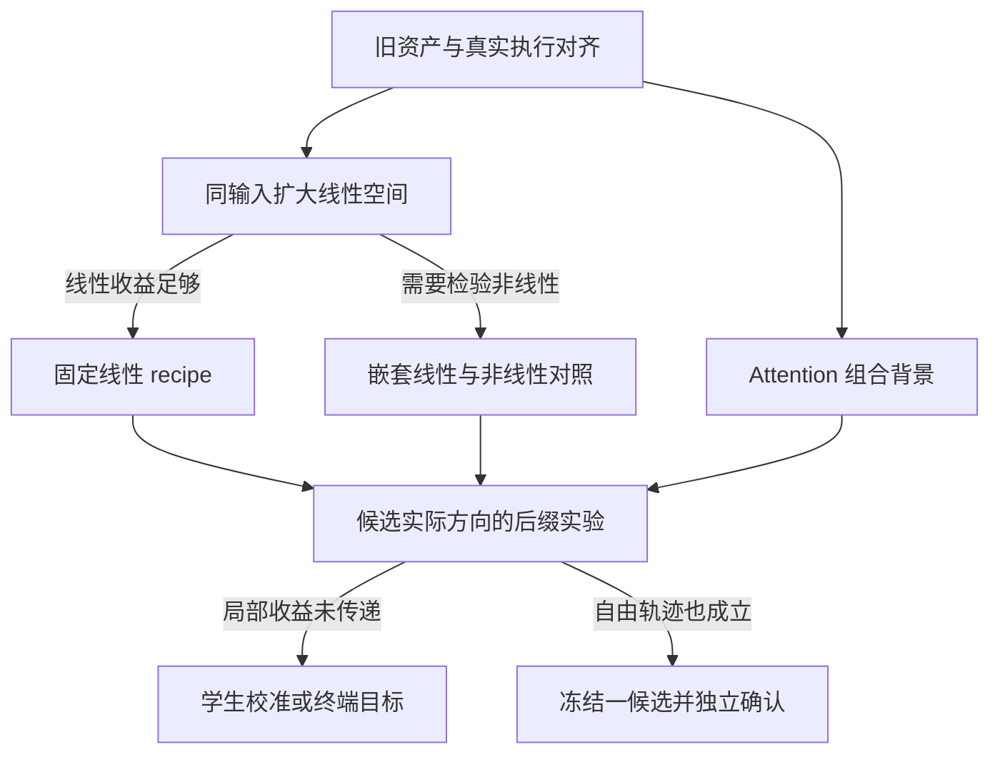

> **2026-11-12 已由[路线v3](../20261112/G20_EXPERIMENT_ROADMAP_V3_20261112.md)接替未来执行顺序。** R1与R1b已完成；v3明确CAL96/DEV48/CONFIRM96、12语义层、共享采集、核心判别、资产树及七臂确认。下文v2是当时设计，不再作为新的数据量、待办或自动运行依据。

# FFNDS 下一轮实验路线与判据

> 原始整理稿：[ChatGPT Space · FFNDS 下一轮实验路线与判据](https://chatgpt.com/space/page_9834f13b53e08191a175c189abe25c34)。本次迁移核对了研究状态表述；已有 G19 实测、G20 推导和原实验合同保持原始身份。

2026-11-11；修订设计 v2；DESIGN_ONLY；本方案尚未取得新实验 scope 的正式独立复审和 ACTIVE 运行授权，也未启动新模型、校准或视频实验。
依据 main@ab41d7389f949150c74131e03c8c2b2106e720ac。

## 研究决策

把 FFN 占生成总耗时比例小作为本轮既定前提，不重新调查该瓶颈。本轮最迫切的决策是：继续改善线性表示、引入廉价状态非线性、改变校准分布/终端目标，还是优先修正 ICC/Chipmunk 的具体实现。FFN 是机制验证对象；最终端到端加速需要后续 Attention/更大计算单元验证。

按“可复用旧数据 → 同输入函数筛查 → 小规模真实轨迹与后缀 → 只推进一个候选 → 新来源确认”组织，不把原 E0–E4 解释成全部矩阵必须同时运行。

| 阶段 | 首批范围 | 新生成预算及决定 |
| --- | --- | --- |
| R0 资产和接口 | 既有CAL/视频/代码，含Attention兼容性 | 0次生成；输出可复用/缺字段表 |
| R1 同输入筛查 | 全80站点廉价统计，6站点昂贵拟合 | 0次新完整生成；缺端点与R2合并采集 |
| R2 共享动态pilot | 3个旧DEV源×1seed×2参考臂 | 最多6次四步主干；先1源两臂，旧payload可复用 |
| R3 候选实际方向 | 2站点，1主方向，条件剂量/联合 | 最多9次后缀；按剩余Block数另计工作量 |
| 唯一候选自由运行 | 固定recipe构建80站点后，3源×1seed | 最多3次完整运行；捕获同时完成 |
| 条件支线 | 专家分组/同背景CAL/原轨迹补齐 | 只有对应歧义触发，不自动累加成必跑套餐 |
| 最终系统确认 | 目标Attention与候选都冻结后 | 五臂；若n=12则60次，实际n由来源级变异确定 |



当前两条研究线和最终组合基线依据：[G20双主线合同](https://github.com/Qesire/FFNDS/blob/ab41d7389f949150c74131e03c8c2b2106e720ac/research/20261111/G20_TWO_TRACK_OPERATOR_AND_DISTILLATION_ATTRIBUTION_20261111.md)。本方案把其中任务按信息价值和复用依赖重新安排。

## 1. 可识别的问题

定义 X=U_t-U_s，Y=F(U_t)-F(U_s)，G 是当前 gate。Q1 预测 XA，A 由 W1^T diag(alpha) W2^T 构造，不是已经识别的全自由线性最优。

```math
F(u)=\phi(uW_1^\top+b_1^\top)W_2^\top+b_2^\top,
\qquad \widehat{\Delta F}_{Q1}=\Delta u\,A_{Q1},
\qquad A_{Q1}=W_1^\top\operatorname{diag}(\alpha)W_2^\top.
```

真实执行与拟合定义见：[G19方法与结果](https://github.com/Qesire/FFNDS/blob/ab41d7389f949150c74131e03c8c2b2106e720ac/research/20261107/G19_METHOD_DERIVATION_AND_RESULTS_20261107.md)、[fit_core.py](https://github.com/Qesire/FFNDS/blob/ab41d7389f949150c74131e03c8c2b2106e720ac/reports/20261107/g19/source/fit_high_r2/fit_core.py)。

P1：放开线性基底能否改善来源外误差？竞争解释为 Q1 基底限制、校准覆盖不足、真正有限增量状态依赖。
P2：在相同投影和线性控制下，预定非线性有限增量表示是否改善自然端点预测？若要进一步识别新增状态信息，另与只依赖位移的非线性预测器比较。非线性有用不等于估计出条件风险下界。
P3：真实误差写回后是否改变最终 latent/运动方向？局部 MSE 改善、终端低敏感方向、学生状态漂移与跨层累积相互区分。
P4：三方法差距是权重、输入分布/间隔、预算还是实际选择器/数值路径？先复用已有原模型数据，不新开大规模 40 步视频网格。

## 2. 第一批任务 R0 和 R1

R0 只读一次性资产表：当前 ICC/Chipmunk 实现与 receipt；checkpoint、source/image/prompt/noise、矩阵、scheduler、BF16、gate、缓存与mask；每site两端token交集与THW覆盖。历史路径存在记录不代表服务器文件现在可用。同时检查一个强 Attention 方法的当前四步/BF16/backend/硬件兼容性，已有可信实现优先；没有实现时先限定移植成本，不把任意Attention方法假定为可用。

旧2048抽样若独立，则交集期望2048^2/31668=132.45；这是条件下数学估算，实际计数必须读ID。11/4已有跨层跨步固定2048+336tubelet采样器，已验证chip10_00/seed43，不能因名称含00就映射到canoe_static_00。原40步CAL为chip10_02/04，已有64行、40步同ID、双CFG的U/Z/H/Y与gate；02/09是另一批E1a结构采集。原/D同名来源仍待image/prompt/preprocess/noise交叉核验。旧O数据可用于探索性间隔与2x2回放，但不同来源、CFG或时间支持不能伪装成单一因素。

源代码证据：[跨步交集配对runner_fit.py](https://github.com/Qesire/FFNDS/blob/ab41d7389f949150c74131e03c8c2b2106e720ac/reports/20261107/g19/source/fit_high_r2/runner_fit.py)、[原40步CAL合同](https://github.com/Qesire/FFNDS/blob/ab41d7389f949150c74131e03c8c2b2106e720ac/reports/20261105/g19_evidence/browse/work/g19_original40_anchor10_20261104/build_template/cal_contract.py)、[64行输入验证与构建](https://github.com/Qesire/FFNDS/blob/ab41d7389f949150c74131e03c8c2b2106e720ac/reports/20261105/g19_evidence/browse/work/g19_original40_anchor10_20261104/build_template/runner_build.py)。

R1 使用现有CAL4训练，其他已暴露来源作开发评估。80个expert-layer站点做轻量同态统计；昂贵新拟合先仅high/low各第5/20/35层（1起始，共6站点）。允许一个预登记的补充站点用于解释全层与六站点不一致，不作事后普遍性声明。

六种功能身份：

1. Q1-r2。
2. A_Q1+D 的全自由 ridge 修正（同线上存储/计算形态，离线诊断）。
3. B_L(u)=uA_Q1+(uP)C_L Q^T。
4. B_N(u)=B_L(u)+phi(uP+b)C_N Q^T。
5. 实际 ICC 一个已冻结配置。
6. 实际 Chipmunk 一个已冻结配置。

Dense是共同目标；Rank0直接从Y算；不为Q0/Q2/每个rank新增完整视频。先运行1/2/5/6；只有需要检验状态信息才运行3/4，所有臂共享同一bank。

P/Q/b仅从训练源得到并在L/N间共享；N包含L。先固定投影，仅拟合线性读出，减少优化混淆。主配置先r=k=32；只有训练端点/特征覆盖明确不足时追加64，不能同时扫输入rank、输出rank、激活和宽度。自由A的识别看DeltaU行空间；状态P须看端点/非线性特征空间，不能仅按rank(DeltaU)截断。非线性相对linear-g多特征，须报告有效自由度/正则与自由ridge控制，不能声称严格等参数。

首轮直接用CAL4拟合一个预冻结主配置；全局或high/low各一档正则，按CAL量纲/条件数定尺度，第二档更强正则仅作稳健性诊断，不按pilot挑最佳。旧DEV用于明确标记的开发筛选，不能称盲测。只有结果依赖正则选择、且这一选择改变去留时，才做CAL4 source-LOSO；所有CAL生成先验（Q0/Q1/P/Q等）须fold内重建，不能带入全CAL4矩阵。统计量与warm start复用，不重跑生成。避免强制四次重建所有先验。

若N超过线性臂且准备声称新增状态信息，条件触发delta-only非线性诊断：Yhat_delta=DeltaU A+h(DeltaU P)Q^T；同训练与容量约束，采用有效非线性特征并按需约束反对称。它读取同bank，不新开视频。反例F(u)=u^3且U_s=0时，端点N虽优于线性但DeltaU已包含所有状态信息；没有此控制只主张非线性表示收益。

自由A报告训练数值秩、求解残差、训练/来源外误差与omega=||X_test(I-Pi_train)||^2/||X_test||^2。ridge唯一解不等于A被数据识别；泛化失败不能排除固定线性表示。

ICC保留两级低秩与中间GELU；分解 e=(dHhat-dH)B2^T+dH(B2-W2)^T，并保留交叉内积。只在分解指向具体原因时加一个同预算秩重分配配置。原四态版本扣除共同native anchor后，G19为2Nd²，ICC为N(r1+r2)(d+m)；两残差变体另算anchor成本。

Chipmunk必须有真实proxy分组、均值/状态/mask及有效尾行；散点样本不能替代块均值。优先复用真实mask；若缺失，只补实际所需分组统计。一个有限后验mask交换诊断，保证E_repair<=E_proxy；未改善不等于最优稀疏误差已达到。它不属于可部署臂，不叫最优oracle。

R1主读出：来源等权的当前门后绝对SSE/MSE及相对Q1配对变化；high/low分报；增量目标归一化与完整Y归一化辅报，避免小增量分母。数学lift与原生BF16缓存/门后/残差写回风险分表。

## 3. R2 最小共享动态pilot

使用三个已暴露DEV病例（canoe/guitar/bicycle，具体source/noise以hash验证），每源一个已冻结seed。它们是机制病例，不是新确认集。若旧资产缺端点，R1先完成CAL拟合，其来源外读出等待此处一次共享捕获，不为R1/R2各采一遍。

优先确定实际系统背景：若强Attention实现可用，记D_A=该Attention+原生FFN，G_A=相同Attention+Q1。先在一个病例跑这两臂，兼作采集/恢复pilot；通过后才补其余两源，总上限6次四步主干。原生Attention的D0/Q1视频按身份复用。新FFN候选在G_A背景验证；不要先为独立FFN做大确认、之后才发现Attention改变了输入分布。

若Attention尚不可用，六次上限改为原生Attention背景的Dense/Q1，研究范围只到机制pilot；Attention兼容性并行推进，最终系统确认等待目标配置冻结。若现有payload足够且身份匹配，直接复用相应轨迹。旧视频只有latent hash无法恢复状态，不把它当payload。新运行最终latent与既有身份一致时可复用MP4及指标。第一源就是pilot，不额外增加一轮重复pilot。

当前Q1-r2 runner的初始noise clone用于SHA核验后释放，final_latent字段记录摘要，未见保存可恢复latent payload：[runner_panel.py](https://github.com/Qesire/FFNDS/blob/ab41d7389f949150c74131e03c8c2b2106e720ac/reports/20261107/g19/source/q1_r2/runner_panel.py)。

一次共享采集：

- 每调用前latent、实际prediction、最终latent、scheduler可变状态、初始noise、条件和RNG payload。
- 逐字段补缺。若首轮仅有六站点用途，保存这六个expert-layer的12端点调用；若已确定需要全层学生校准/构建80张参数，则一次覆盖全160调用以免重采。主面板固定2048行U/Y_used，另336tubelet；G、THW与实际参数/缓存身份。均匀面板算主MSE，tubelet独立做时序诊断；落盘可去重，分析不得简单合并等权。
- Dense的Y_used才是F(U)；学生hit另标candidate output，不能偷称native target。
- 固定128审计行的native Z/H只在实际原生调用采集：Dense-FFN有160调用，Q1只有80个anchor。hit小M重算单列为sampled recomputation；少数R3 full-M反事实另记付费probe。保存实际G19 anchor C切片及必要UA切片。
- Chipmunk shadow只在冻结少数站点记录真实proxy统计、分组完整行和mask，共同历史下的诊断不等于Chip学生轨迹。不能隐含挂上全40层H/Y第二缓存（约44.70GiB）。
- 少数恢复点保存完整残差x、scheduler/RNG/条件、执行计数器、缓存内容及有效位。按source串行并尽量同会话分叉，仅维护当前被测专家的一份Q1 cache bank；必要的持久恢复包另计。
- R3若验证新B，只在两个干预站点保存完整anchor U_s/F_s，或当场构建候选C_B shadow；Q1自己的C不能替代候选anchor缓存。

恢复中性按实际恢复机制逐类验证（high/low、专家切换、不同缓存语义），不把第一源的一次成功推广到所有恢复点，也不逐source重复完全相同的工程验证。在Attention加速背景还须绑定其缓存/锚点有效性；扰动后未来Attention缓存按真实算法更新，不能冻结参考历史掩盖反馈。

逻辑体积：全160调用U/Y为160×2384×2×5120×2 bytes≈7.275GiB/轨迹上限；六站点12调用版为0.546GiB/轨迹。全覆盖六条U/Y约43.65GiB；128行native Z/H若Dense三条全160、Q1三条仅80anchor，额外约4.75GiB，合计约48.40GiB。六站点版更小。一个专家40层Q1残差cache约12.080GiB；三条Q1两专家全永久保存是72.48GiB，因此默认按source同会话分叉，不统一落盘。full-M x、candidate shadow、条件、运行暂存单列，不能塞进采样载荷数字。

若选定站点需要真实全站点干预，保存/重算完整31668行输出；2048样本只能支持样本集合干预，不能按比例解释全层效果。

## 4. R3 终端分支与停止逻辑

R1有胜出候选时，优先干预候选B相对Q1的真实写回方向。native correction只在需判断原误差可观测性时追加，不能用其成功替候选背书；若尚无候选，可用native方向作纯机制诊断。r1→r2仅在解释版本现象时使用其同输入、同anchor差。

参考轨迹为目标Attention背景的Q1，在相同当前U和anchor历史上分别构造Q1、候选B各自的cache和输出，执行真实gate与BF16 residual write后取d=FP32(x_B)-FP32(x_Q1)。eta=0必须neutral，eta=1直接使用核验过的候选写回值；中间剂量用Qb(FP32(x_Q1)+eta*d)。先eta=1，必要时补0.5。高噪声干预改变后续low anchor，须重建，不能加载参考low cache。此为共同历史上的局部参数效应；全候选自由轨迹另验。终端主读出采用同一Attention背景的原生FFN参考：令 r=Z_GA-Z_DA，q=Z_intervened-Z_GA，则平方误差改变量为 DeltaL_term=2<r,q>+||q||²；负值才表示更接近该参考，q非零只表示可观测。这里首先使用普通latent平方范数；未来更换度量需另冻结。整体视频质量仍对照原生Dense，接近D_A不自动等于视觉改善。

两站点：结构差异站点与稳定对照，选择在看终端结果前冻结。先一个辨识病例的两次eta=1后缀；必要时该病例再两次半剂量与一次联合，共5次上限。其余两源只复核关键eta=1，共4次，首轮总上限9次后缀，不机械重复所有剂量。分支依当前去噪prediction→末端latent→少量视频依次升级；当步小效应不等于末端零效应。病例选择带来的结果只作机制发现，来源一致性再报告。

后缀预算另记剩余Block/模型调用数：在第ell层（1起始）FFN后干预，high step1约需(40-ell)+80个后续Block，low step3仅40-ell个；不把二者各一次算成等成本。先按逻辑Block数筛预算，实际墙钟记真实日志。

若单点弱而整体视频差明显，转专家分组：同一Attention背景的Dense-FFN/Q1为00/11，先在该病例补high-only/low-only两配置；只有歧义需要才扩至其他两源，总上限6次四步运行。只作一次高低分组，不扫40层。归档同身份混合臂若已存在优先复用。分组效应用于定位，不自动证明线性或单层机制。

对末端变化q_i=Z_i-Z0，记录2<q_i,q_j>（有限扰动的加性预测交叉项）；另外I_ij=Z_ij-Z_i-Z_j+Z0测非加性。二者不同：I约0也可能有很大的能量交叉项。联合干预明确固定参考d与动态重算d两种含义，首轮仅固定参考d；真实算法反馈由自由轨迹补验。Z_ij必须从已受i干预的前缀继续到j，不能从参考j状态开始。

固定参考扰动的联合实验在第二处执行以下写回。这里的当前状态已经带有第一处干预的影响，不能直接覆盖为参考路径上的候选绝对值。

```math
x^+_{ij,j}=Q_b\!\left(\operatorname{fp32}(x^+_{i,j})+d_j^{\mathrm{ref}}\right).
```

先有限幅检查再决定是否引入JVP/VJP。eta=0.5/1显著不成比例，可排除相应范围的简单线性代理；比例相符仅通过有限剂量screen，不验证Jacobian。若要拟合终端二次代理，仍须实际JVP与真实后缀作少量投影校验；不显式形成全Jacobian/Hessian。

校准目标消融只在同一表示、相同local/prior/预算下增加终端项，再单独加path，最后才考虑temporal。每轮只改一个因素。非线性表示与终端目标不能同时改后归因。

传播数学与原实验框架见：[G20数学重审](https://github.com/Qesire/FFNDS/blob/ab41d7389f949150c74131e03c8c2b2106e720ac/research/20261110/G20_FFN_FUNCTIONAL_OPERATOR_REDERIVATION_20261110.md)、[E0–E4实验设计](https://github.com/Qesire/FFNDS/blob/ab41d7389f949150c74131e03c8c2b2106e720ac/research/20261110/G20_FUNCTIONAL_OPERATOR_EXPERIMENT_DESIGN_20261110.md)。

## 5. 权重与间隔支线共享R1输入

先在同mu_D、固定G_ref换W_D/W_O；优先用已存O-CAL的02/04的64行完成小规模2x2（先核source/prompt/preprocess/noise，尚不能认定已匹配）。原轨迹双CFG与四步无CFG差异属于mu整体，不称纯步数效应。02/09的E1a资产另列。

第一张固定参数迁移表：对每W用同一CAL recipe固定theta(W)，测两个mu。
第二张等预算重拟合表：每(W,mu)独立同预算拟合，按source隔离评价。

两个旧CAL来源不足以同时承担可靠拟合和新来源推断；可只做固定参数描述性回放，等预算表缺隔离数据就暂不填。

只有要正式回答权重×状态归因，才补足同source四格；mu_D阴性不能排除W×mu交互。为了当前四步改进，可以暂缓昂贵新O轨迹，保留归因未定。原40步已有端点支持同expert近邻与长窗口比较，不重跑每个窗口；按actual time gap和ΔU/中点描述覆盖，不将步数视为唯一原因。

## 6. 候选与确认

R1/R3结果只允许推进一条主候选：

- 线性即可解释：先线性修正/校准覆盖；
- 非线性源外且末端有效：推进该B；
- 同输入好而自由轨迹坏：学生状态校准；
- 局部排序不能解释末端：固定表示改目标/分组耦合；
- proxy/数值故障：修基线，不发明额外算子。

B部署使用单残差C_B=F(U_s)-B(U_s)，hit=B(U_t)+C_B；避免额外缓存anchor投影。全A加非线性会增加工作，必须明确它用于质量恢复还是换取降低A秩/减少native回退；第一阶段同成本不能虚称。宏观FFN小占比不再测因果，仅按anchor+hit和缓存账本筛明显不可行方案。

自然端点收益是筛选证据，不是视频非劣保证。胜出后先冻结一个recipe，用CAL一次性构建全部80个expert-layer，沿用相同超参并通过全层回放，再进入自由视频；只替换六站点的运行必须明确有限scope。若target Attention使训练覆盖明显变化，先补同背景CAL捕获/校准，不能用DEV偷偷拟合。三源每源先1seed；第二seed仅检查不稳定候选。最多一个新候选进入三源自由生成（3次），同时采学生U与状态，不为rank网格生成视频。

新来源确认等待方法及目标系统背景共同冻结。若仅确认FFN质量：{Dense,Q1,候选}三臂，n=12时36次，仅支持相对Q1。若目标是端到端新方法，沿用双路线合同五臂：Dense、Q1、Attention单独、Q1+Attention直接组合、新候选/联合方法；n=12时60次。推荐当前先不花36次确认独立FFN，把确认预算留到该五臂背景形成。实际n按旧DEV来源配对差、最小有用效应与边界确定，12不是功效保证。超过ICC/Chipmunk的全视频主张另需同cohort相应臂。

主要效应：先seed内/再source等权的配对差，n为source数。主运动读出采用对Dense共同坐标的RAFT cosine差；小运动/遮挡mask由Dense预定，norm仅辅报。I2V主体/背景与成像质量等预指定关键指标非劣，所有原8轴保留。CoTracker共同可见点跨臂一致，同时报告参考点总数、每臂有效覆盖、交集保留率与丢失；覆盖不足不静默删除。新来源不重选指标、阈值或停止点。系统确认另需关闭probe的同期平衡计时，比较新方法与直接组合的额外收益。

RAFT主指标有效像素不足的来源预先按Dense规则标不适用，仍保留全部质量结果；功效计算的n_motion是有效独立来源数，不直接用总12源。方向保真不自动证明文本动作完成，相关语义主张需独立验收。

样本量规划 n≈[(z_(1-alpha)+z_(1-beta))*s_source / (expected effect-boundary)]²，仅作近似；小样本与多保护终点需修正。正态近似不保证12源充分。事先规定主终点优效、关键质量非劣与区间跨界INCONCLUSIVE。若采用中途查看，只允许预登记无效停，不提前据重复显著性宣称成功。

开发筛选阈值与视觉非劣阈值分开。执行前必须从已有数值/重复结果冻结epsilon_num、最小资源值得投入的tau_screen、运动最小改善delta_motion及每质量margin；目前不伪造用户可接受画质阈值。原始3源结果全报，不使用token级p值。

## 7. Attention接续

Attention前移到R0兼容性和R2小规模直接组合基线；不用等待FFN的新源确认，也不要求先发明新的Attention算法。若唯一目标是总时间且FFN候选无质量/迁移价值，保留Q1并直接推进强Attention组合。若要研究新联合表示，其额外质量—时间收益须超出直接组合；DeltaO等式本身不构成新颖性。目标Attention尚未可用时，FFN机制研究可以继续，但不把独立FFN确认当成系统主张。

## 作者自审

最强反例1：少CAL下自由A没泛化但真实完整线性算子存在；用omega/训练秩限制结论。
最强反例2：nonlinear-g提高有效自由度而非证明曲率低维；用嵌套linear、自由ridge、source分离与固定P/Q，并限制机制主张。
最强反例3：Chip代理缺完整分组导致假失败；缺数据不打分、不以散点均值替代。
最强反例4：单层不敏感但80处误差累积；专家分组分支防止误停。
最强反例5：参考suffix cache复用掩盖反馈；扰动后重建后续anchor，恢复neutral先验收。
最强反例6：旧O/D源/CFG不等导致假蒸馏归因；共同源与支持检查，不足时描述性。
本草案是设计，不包含实际运行批准或结果；具体首轮RUN_SPEC还需绑定资产路径/hash、数值阈值和预算，通过仓库独立复审及有限scope冻结。

设计修订吸收的主要意见包括：将非线性表示收益与新增状态信息区分、优先检验候选实际干预方向、将 Attention 组合背景前移、逐项核对历史资产身份、按需恢复缓存，以及缩小重复拟合范围。原 Space 草案曾记录三路设计复核意见；本仓库中本次新实验的正式独立 reviewer、recheck 与 ACTIVE 许可均须按真实可核验凭证另行完成，本文件不充当批准记录。

执行绑定依据：[统一实验合同](https://github.com/Qesire/FFNDS/blob/ab41d7389f949150c74131e03c8c2b2106e720ac/research/20261107/ffn_baseline_reproduction/EXPERIMENT_CONTRACT.md)、[实验前独立复审规则](https://github.com/Qesire/FFNDS/blob/ab41d7389f949150c74131e03c8c2b2106e720ac/research/agent_protocol/EXPERIMENT_PREEXECUTION_INDEPENDENT_REVIEW_20261029.md)。

