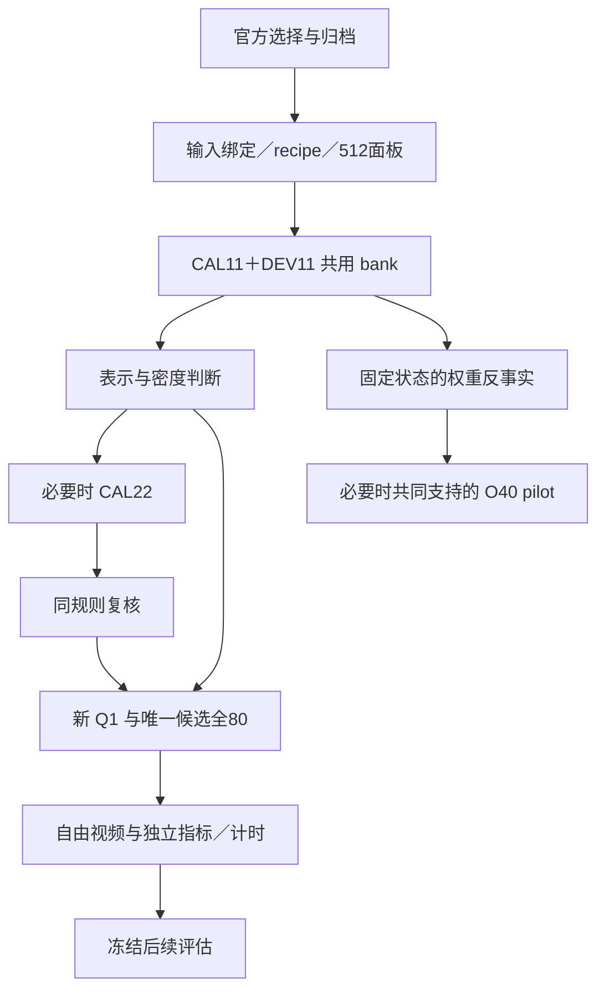

# G20 当前路线：统一 VBench，先判别机制，再投入完整轨迹

**2026-11-13 · v4 第 2 次设计修订 · DESIGN_ONLY · 本次没有新增计算作业。**

当前决定是：**保留 33 个已选官方图文条件，先用 CAL11＋DEV11 完成同输入表示与采样密度比较；只有来源广度仍会改变判断时才扩到 CAL22。** 新算子与方法差异归因作为两条可独立交付的研究线。历史曝光不再构成本轮 VBench 使用障碍，实际拟合祖先、开发用途和固定评估仍按原图／近重复簇隔离。

入口：[官方图文与角色](../../config/g20_vbench_restart_cohort_v1_20261113.json) · [资产树与执行队列](G20_VBENCH_ASSETS_AND_QUEUE_V4_20261113.json) · [判断台账](G20_VBENCH_DECISION_LEDGER_20261113.json) · [本次实际设计审阅](../experiment_reviews/G20_VBENCH_ROUTE_DECISIONS_20261113/README.md)。这次修订依据 main@84630899；前次设计审阅只覆盖该提交，新的审阅记录单列。旧 v3 配额、G0 冻结规则和 reports 下的证据原件不改。

## 1. 已经知道什么，下一步还要区分什么

### 1.1 数值疑点已经收窄，失败机制仍未识别

[R1b 冻结 SUMMARY](../../reports/20261112/g20_r1b_recheck/output/SUMMARY.json)（SHA256 `ef35bcd695578cee0343165daacb02b03e026969d6d80856395f55eef40dea9a`）与[原生复核记录](../../reports/20261112/g20_r1b_recheck/README.md)支持如下判断。范围为旧 CAL4／DEV5、seed42、high/low 各 4/19/34 六站点及已测正则；它们不是新 VBench 结果。

| 证据 | 当前判断 | 会改变判断的下一证据 |
| --- | --- | --- |
| 稳定 F64 重解后，main 的 DEV 平均逐源相对 Q1 风险仍增加 15.0809%–28.4494%；更强正则仍增加 14.6741%–26.9727% | 当前自由 ridge 的开发负结果真实存在；数值修复没有消除主要退化 | V1 分开方向与幅度；V4 检查受限线性及端点表示；必要时 V3 区分来源与行密度 |
| 原解与稳定 main 的最大净风险变化约 0.8273 个百分点；稳定秩为 high517／low523 | 原 FP32 秩伪影已确认，不再重复运行同一数值复核 | 新实现仍核对自己的求解与实际部署精度；不把“剩余净退化”解释成过拟合或覆盖的因果占比 |
| 旧 D 的行空间外 Frobenius **范数比例**为 0.4236%–0.8627% | 历史文字中的“能量比例”需更正；平方能量比例为 0.001794%–0.007442% | 用实际保存的 BF16 参数预测做方向分解；不能假装稳定 F64 数学 D 已归档 |
| ICC stage-2 native-h 分量为当前总误差的 64.27%–82.47% | 第二级值得优先诊断，分量占比不是可挽回收益 | 完成 native/surrogate 第一级×第二级四格，比较总风险及交互 |
| native-h＋当前 surrogate W2 在 low19/34 的来源等权 MSE 之比仍约为 Q1 的 1.2776／1.2691 倍 | 这个具体第一级修复不足以反超；其余第一级修改仍可能通过误差抵消改善 | 检查 surrogate-h＋native-W2 和四格交互，避免把单个修复当性能下界 |
| ICC high4 的来源等权绝对 MSE 略优于 Q1，但平均逐源相对差为 +1.7064% | 聚合对象会改变描述，六站点与各聚合分别保留 | 当前比较事先固定主要估计量，并保存绝对风险与全部逐源结果 |
| Chipmunk 忠实 full-M proxy 所需资产仍缺；旧 global-P64 有独立历史实测 | 不能据旧 P64 或缺失 proxy 判断 Chipmunk 整个方法族失败 | 只有相应比较影响主张时补真实 full-M 统计与匹配实施 |

对精确各向同性 ridge，若 `P_CAL` 为 CAL 输入行空间投影，则 `D=P_CAL D`，所以 `X_DEV,perp D=0`。高 omega 表示这部分方向**无法被该修正改变**；新增退化仍须从实际改变量与原误差的关系解释。5,632 行超过输入维数 5,120，也不保证良好条件数、健康谱或来源外泛化。覆盖不是检验非线性的前置门槛。

### 1.2 数据重分工，不重写历史

用户报告的 G0-A `C1_NOT_BINDABLE`、833 簇／827 已暴露／6 个自由簇，是旧未曝光规则下的容量结论。所核对 main@84630899 尚无完整 G0-A bundle；本次不补写其 RUN/EXIT 或证书。新周期直接允许历史 VBench 来源用于 CAL、DEV 和固定 benchmark 评估，保留 exposure 事件，另记 cycle_role。G0 inventory 如可用就复用；没有它也可从已固定 archive 绑定本轮 33 个输入，不重新开展全 833 簇曝光审计。

两条当前问题分别是：

- **A／算子与执行：** 在固定四步 Wan recipe 下，哪种增量表示能跨来源工作，并在真实自由轨迹中改善质量或取得有意义的质量—成本取舍？
- **B／方法差异归因：** Q1、ICC、Chipmunk 的差异如何依赖 FFN 权重、输入状态、端点间隔和实现？B 线不等待 A 线出现阳性候选；同样可以交付有界负结果、条件交互或未识别结论。

当前没有新 VBench bank、重拟合 Q1、候选收益或新视频结果。Wan 内的权重与状态比较也不能单独证明“Wan 架构是原因”。

## 2. 图文规模与分工保持紧凑

官方 [VBench-I2V 说明](https://github.com/Vchitect/VBench/blob/fd18b3d055cb0fc6f066ca90fe2c3c8cbb698490/vbench2_beta_i2v/README.md) 和 [full_info](https://github.com/Vchitect/VBench/blob/fd18b3d055cb0fc6f066ca90fe2c3c8cbb698490/vbench2_beta_i2v/vbench2_i2v_full_info.json) 对应 11 类、355 个 image_name、1,118 条条件。246 张主体图各 1 条，109 张背景图各 8 条；元数据 SHA256 `8cf4d34dc11779a336c216a1a71d482927cfa24a1bf736ab5c92425609f129f8`。名称数与独立原图簇数在实际绑定时区分。

| 官方类别 | 图像名称数 | CAL_A 首批 ID | CAL_B 预留 ID | DEV ID |
| --- | ---: | --- | --- | --- |
| single-human 单人 | 64 | vbi_1005 | vbi_1024 | vbi_1013 |
| multiple-human 多人 | 34 | vbi_1039 | vbi_1064 | vbi_1040 |
| animal 动物 | 46 | vbi_0895 | vbi_0901 | vbi_0886 |
| transportation 交通 | 31 | vbi_0937 | vbi_0922 | vbi_0947 |
| food 食物 | 38 | vbi_1094 | vbi_1107 | vbi_1109 |
| plant 植物 | 23 | vbi_1082 | vbi_0967 | vbi_1084 |
| other 其他主体 | 10 | vbi_0966 | vbi_0958 | vbi_0950 |
| architecture 建筑 | 40 | vbi_0304 | vbi_0152 | vbi_0176 |
| scenery 自然场景 | 40 | vbi_0648 | vbi_0760 | vbi_0800 |
| indoor 室内 | 21 | vbi_0456 | vbi_0448 | vbi_0392 |
| abstract 抽象 | 8 | vbi_0032 | vbi_0040 | vbi_0056 |
| 合计 | **355** | **11** | **11** | **11** |

完整 image_name、原始 prompt、record index、排序键仍在同一 cohort；这次不重选图。规则为每类按 `SHA256("G20_VBENCH_RESTART_V4_20261113|"+image_name)` 排序，前三依次 CAL_A、CAL_B、DEV，取官方非 camera-motion 原始条件。所有 22 个 CAL 从开始即预留，不把 CAL_B 放进最终评估池。

当前 33 张图关联 117 条官方条件；余下 **322 个名称／1,001 条条件**是保留池，不是立刻运行的配额。实际图像可读性、图文对应、原图/近重复簇还须绑定；冲突按同类排序顺延并版本化原因。所有同簇 prompt/crop/seed 同角色。看保留池输出前可以因明确问题调整用途，随后重算评估范围。历史曝光不影响使用资格，历史研究经验也不会因重划分被抹去。

CAL11／DEV11 每类各一源，足以启动跨类别开发和判别，不能宣称各类别已经统计充分。OpenS2V 暂留跨域扩展。本轮不继承 v3 的 240 对、CAL96/DEV48/CONFIRM96、194 次参考执行或七臂全展开。

## 3. 共用输入、参数祖先与采样合同

固定计算族为 Wan2.2-I2V-A14B-LightX2V-Distill-4step：HHLL、0/2 anchor、1/3 hit、无 CFG、832×464、81 帧、16fps、BF16/tanh-GELU、torch_sdpa、相同 block offload。高低权重、negative prompt、crop/resize、scheduler、实际 noise、代码和硬件在具体 scope 绑定。Strong Attention 背景尚未绑定，不能写成当前现成基线。

新 bank 在每个 source×seed 的全部 M 个 THW token 中，**均匀无放回抽取随机顺序的 512 个 ID**，4 步×40 层与全部比较臂共享；256 是随机顺序前缀，排序读取需保存逆置换。保存 U、真实 pre-gate Dense Y、gate、坐标、step/expert 和全部身份。端点必须同坐标；Y 不是 Q1 或任何代理的输出。旧 fixed-2048 pilot 的 21 latent-τ 分层采样与新规则不同，旧代码不能在未修订时冒充新 PANEL512 producer。

每个 source×row 配置都重新拟合自己的 Q1 alpha、P/Q、归一化、初始化、正则尺度、CD-SVD 或数据选定阈值与读出。`11×256` 不能借 `11×512` 或 CAL22 的统计，CAL-CV 每折从该训练折重建。不同配置固定学习规则、来源等权与损失归一化政策，记录拟合后的尺度和有效自由度。仅依赖相同权重的普通 SVD 可复用；旧 CAL4 Q1 不充当当前主比较 Q1。

所有 DEV 局部评价使用同一 512 行面板。先在来源内聚合，token／层／seed 不增加独立来源 n。六站点与全 80 站点分表，高低 expert 分报，完整保留逐源失败。

## 4. 实验顺序与具体判断分支

### 4.1 主链：V0 → V2 → V4，V3 按问题插入

| 阶段 | 实际问题与最小实验 | 输出如何决定下一步 |
| --- | --- | --- |
| **V0 输入绑定与接口准备** | 将已选 33 条记录绑定真实图像、簇、prompt、recipe；逐项审核图像／视频／张量／计时能否复用；实现当前用途 adapter 和 PANEL512 | 输出 BOUND_INPUTS、REUSE_MATCH 与 producer 版本。只修缺失身份或接口；历史 exposure、旧 C1、G0 bundle 缺失不单独阻断 |
| **V1 旧 bank 机制诊断，可与 V0 并行** | 用实际 BF16 预测拆修正方向/幅度；字段足够时补 ICC 四格 | 完成旧配置的解释即可结束，不要求修复成功，也不阻塞 V2/V4 |
| **V2 首批共享 bank** | CAL_A11＋DEV11，seed42；先在预定 DEV 两例检验采集对轨迹的中性，再完成匹配缺项 | 通过输入、坐标、真目标与数值验收后，进入 V4；错误先修，不能靠增加来源掩盖 |
| **V4 表示与密度首轮** | 同 bank 比较当前 Q1、稳定自由线性、L32、delta-N、endpoint-N；先 high/low 各 4/19/34；CAL11×256 和 ×512 | 先回答结构/状态信息及密度。若准备凭 N>L32 推进，必须补同 bank L64/Q32；N 同时超过 delta-N 也不能省略该容量控制 |
| **V3 可选来源扩展** | 仅当来源广度仍是决策性歧义时采 CAL_B11，完成 11×256／11×512／22×256／22×512 | 比较同方法绝对风险；更多来源有效、仅密度有效、结构约束有效或交互均可成为结果。CAL22 失败不自动扩 CAL48/96 |
| **V4D 全层产物与实际消费验收** | 冻结一个候选用途与确切 CAL×prefix；分别导出新 Q1 与候选全 80 参数，关闭后重新加载，用真实 consumer 验证 | 参数/坐标/缓存/数值/全80覆盖通过，并有明确视频验证问题，才进入 V5。六点失败可停止该变体；B线继续 |
| **V5 自由视频与真实成本** | DEV11：匹配 Dense 参考＋新 Q1＋唯一候选；最多新做 Q1/candidate 各 11 条 | 分别产出视频、原始指标、视觉审阅、无 observer 计时。局部好但视频差，转状态/传播诊断；质量好但更慢，记录质量—成本取舍 |
| **V6 固定后续评估** | 在任何保留池本轮方法输出前，冻结候选、来源、比较臂、指标、边界与判断规则 | 有明确实际价值才投入。边界未定义时可描述性评估，不能宣称已通过非劣或系统成功；不确定就明确保留 |

**V3 的触发原因必须写明。** 需要声称“来源扩展有效/无效”，或 CAL 好而 DEV 差仍可由来源广度与容量作不同解释，才值得补 CAL_B。DEV 均值被单源主导首先是评价异质性或精度问题，增加 CAL 不自动解决。数值/目标/缓存错误不触发扩容。新 Q1 已足够好，也可以保留简单方案。

V4 允许以下不同结论：受限线性比自由线性稳定，优先可折叠结构；N 胜 L32 却不胜 delta-N，只支持当前非线性特征有用；endpoint-N 同时胜 delta-N 和合适线性容量控制，才支持**所比较模型族**的额外端点信息。所有模型 CAL 也差时先检查表示偏差和目标；CAL 好而 DEV 差时才考虑来源或状态迁移。ICC 阴性不能替代这个对照。

### 4.2 V1 的方向与幅度读出

主读出固定为同输入实际 consumer 的**门后 FFN 贡献 z**，包括该边界的 gate/cast 舍入；它不冒充尚未采集的整站点 residual 写回。令 `e=z_Dense−z_Q1`、`c=z_stable−z_Q1`，使用归档 BF16 参数重放的实际 z，并以 F64 累加内积和平方范数，则

\[
a=\langle e,c\rangle,\quad b=\|c\|^2,\qquad
\Delta R(\eta)=\eta^2b-2\eta a.
\]

`a≤0` 时沿该方向的正收缩不能带来一阶改善；`a>0,b>2a` 是方向有利但单位幅度过冲；`b=0` 为无改变量。DEV 的 `a/b` 仅为诊断，部署幅度须由 CAL 或预先固定政策决定。若跨来源方向不稳定，转结构、来源或状态比较，不把每个 DEV 的最佳幅度变成选择器。该公式精确描述已观察 z 的线性混合；真正改参数后重新量化/写回的 BF16 路径仍须另验。若另算 `G⊙(Y−Y_Q1)` 和 `G⊙(Y_stable−Y_Q1)`，Y与预测明确为 pre-gate，所得是门后数学诊断，单列于含最终gate舍入的实际replay风险之外。

ICC 四格为 native/native、surrogate/surrogate、native/surrogate、surrogate/native。总风险交互 `R_ss−R_ns−R_sn+R_nn` 与既有误差分解的 cross 是不同量。只有具体修复改善总风险，才值得做一个对应的有限结构修改，不自动展开 rank 网格。

### 4.3 V4 的可解释表示及候选用途

首轮固定 P32/Q32 和凸读出：

\[
B(u)=uA_0+(uP)C_LQ^T+\tanh(uP)C_NQ^T.
\]

endpoint-N 使用 `B(u_t)−B(u_s)`；delta-N 使用 `XA0+(XP)CLQᵀ+tanh(XP)CNQᵀ`，`X=u_t−u_s`。两者参数数目相同，偏置 b=0，仅用对应 CAL 的列尺度，不引入破坏奇对称性的中心偏移。零位移归零、端点互换变号，实际 BF16/缓存路径另外验收。L64/Q32 使用 64 个线性输入特征与同一 Q32 输出，使读出参数量匹配；输入空间只按 CAL 规则扩展。相同参数量不等于相同在线成本。

进入 V4D 前登记一个用途：**QUALITY_REPAIR**（用额外状态信息改善质量）、**SPEED_TRADEOFF**（真实减少计算，检验可接受的质量代价），或 **MECHANISM_PROBE**（解释局部与轨迹矛盾）。不统一要求每个候选同时局部 MSE 更低且速度更快。质量修复应有超出数值漂移、非单源主导的局部改善；省算候选应有真实减少 W1/W2/投影动作的实现及明确待检验的误差问题。DEV11 只支持下一次有限实验的决策。

## 5. B 线：先固定状态比较权重，再决定是否需要原模型状态

### B-W：固定四步状态的 FFN 权重反事实

直接使用 V2 的 CAL11／DEV11、512 行、六站点 D4 bank。在完全相同的 pre-W1 U、expert、端点和共同 `G_ref` 上，分别回放原模型与蒸馏模型的 **FFN 参数 W1/W2 及实际 bias**。每个 W 的真目标与 anchor 都由该 W 的原生 FFN 回放得到，即 `Y_s^W=F_W(U_s)`、`Y_t^W=F_W(U_t)`；不能把 bank 中的 W_D 输出当作 W_O 的真目标。B-WS 的四格同样按各自 W/μ 重放目标和合法 anchor。原/蒸馏 checkpoint 的 expert、模块和 dtype 必须逐项对应；每种 W 用相同 CAL11×512 学自己的 Q1 和数据依赖基线，只有身份一致的 W_D fit 才能复用。

对方法 m，记录每格绝对风险以及

\[
d_m(W,\mu)=R_m(W,\mu)-R_{Q1}(W,\mu).
\]

固定 `μ_D` 时，主要权重对比为 `d_m(W_D,μ_D)−d_m(W_O,μ_D)`，使用共同 MSE 单位，比例为次级读出。它识别四步输入分布条件下的 FFN 权重依赖；不是原模型自由视频效果，也不是蒸馏过程的总因果作用。**新增完整轨迹为 0，FFN 原生回放与拟合仍需计算预算。** 队列先由 BW_PREPARE 绑定原/蒸馏模块身份，再执行 B-W；B-W 与 V4 并行，不等待候选胜出。先回答 Q1/ICC 的可测部分；Chipmunk 的缺失资产仅阻塞该方法的结论。

### B-WS：有共同支持时，最多六条原 40 步轨迹的机制 pilot

仅当 B-W 后的状态/间隔歧义仍会改变解释时准备本分支。复用已选三类输入：CAL `vbi_1005/0895/0648`，DEV `vbi_1013/0886/0800`（单人、动物、场景），不新增图文配额。由 BWS_PREPARE 先核对两 recipe 的实际 noise-level、expert、端点对和初始 noise/THW 身份，产出共同支持审计。共同支持规则在采集前冻结；不存在可合法比较的共同端点支持时标 **UNIDENTIFIED**，不靠事后最近匹配凑四格。

最多新增这六源的 O40 原生轨迹，保留原生 CFG；只保存预定 conditional 分支的六诊断站点（每步当前 expert 的 3 层）。O 的 CFG 与原生采样过程属于 `μ_O` 的组成部分，不能称纯步数效应。跨 W/μ 的评分共同使用预定 D4 参考 gate，保持目标单位一致。

每个 W 在 CAL3 的混合状态上**只拟合一次**：每源 D256＋O256，取同一冻结 THW 随机前缀，来源等权、每源两状态各 1/2。每个匹配端点/站点任务共 3×512＝1,536 个配对行观察；全部学习量仅用这些观察。然后以同一套参数在 DEV3 的 `μ_D/μ_O`、同 512 行及四格共同支持上评分。每个任务都分表；不能将多窗口合成更大的“来源数”，也不能拼入 B-W 的 CAL11 参数或结果。

四格主交互为

\[
[d_m(W_D,\mu_D)-d_m(W_O,\mu_D)]-
[d_m(W_D,\mu_O)-d_m(W_O,\mu_O)].
\]

逐源、每格绝对风险和方法差同时报告。三 DEV 源只给机制 pilot 的方向和反例。O-short/O-half/O-long 若有预定合法端点，可从同一 O40 bank 派生，不为每个窗口重生成；它们是次级诊断，不自动展开新网格。原模型旧两源 O40 也可先作其历史身份的辅助诊断，不能冒充本轮交叉实验。

## 6. 各阶段的估计量与推进精度

| 问题 | 主估计量 | 解释边界 |
| --- | --- | --- |
| **V3 来源/密度** | 同一方法族在同 DEV512 的来源配对**绝对门后 MSE 差**；来源对比 `R_m(22×256)−R_m(11×512)`，密度为固定来源下 512−256 | 四个配置的 Q1 会变化，不能用各自相对 Q1 的百分比代替主要学习曲线；共同固定分母可作补充 |
| **V4 同配置方法** | 对源 c、expert e，先平均预定层的 `SSE/(实际行数×5120)` 为 M，再计算 `(M_m−M_currentQ1)/M_currentQ1`；expert 等权，再来源等权 | 绝对 MSE、平均逐源相对差与均值之比全部保存；六站点和全80分表，不看结果后换主汇总 |
| **B-W/B-WS** | 共同 MSE 单位的 `d_m=R_m−R_sameW_Q1` 及配对权重/状态差、四格交互 | 同时保留各格原始风险；比例差只能作次级描述，不混训练预算 |
| **V5 速度** | 每源无 observer 的 `log(T_candidate/T_currentQ1)`，来源等权；匹配 Dense 计时另表 | 初次运行是开发读出；技术重复、profile 和统计范围另冻 |
| **V6 正式主张** | 输出前预定的质量、运动与时间估计量、具体边界及不确定性规则 | 缺具体原单位边界时只做描述；固定子集不自动等于完整官方协议 |

小分母的可测 floor 仅由 CAL 中性数值误差确定；低于 floor 时标相对量不可测，保留来源与绝对差，受影响的主相对结论不确定。DEV11 每类一源，不以层内来源 bootstrap 的退化区间作门槛；报告全部 11 个逐源差、范围、leave-one-source-out 敏感性和 expert 差异。某一来源主导或 expert 方向相反时，定位异质性或缩窄部署对象；不以挑聚合方式制造通过。

V6 的具体合同必须在保留池输出前写明：候选代码/参数、比较臂、来源/prompt/seed、主要指标与适用性、缺失/失败处理、质量非劣边界 `δ_j` 的数值/原单位/依据、实际提速边界、区间与多重性政策、PASS/FAIL/INCONCLUSIVE。DEV 可帮助估计波动和成本，不能只凭候选表现为可接受质量损失作依据；不默认继承 v3 的 2% 等阈值，也不宣称当前每类一源足以证明 80% 功效。

## 7. 视频、成本和条件分支

V5 采用相同 source/prompt/preprocess/noise、Attention、scheduler 和数值 recipe，自由运行完整 81 帧。报告 imaging、aesthetic、motion smoothness、dynamic degree、subject/background consistency、I2V subject/background 的真实读出和适用数，逐源光流/时间窗及动作、物体、拖影、新生内容视觉审阅。DEV 原始条件中主体/运动 7 源、背景 4 源、imaging/aesthetic 11 源、camera-motion 0 源；不适用与未测分开。额外 RAFT/视觉检查报告自己的实际覆盖。运动幅值下降不能由平滑度上升抵消。

生产速度用无 probe 的完整推理 wall time；scope 固定计时边界、warmup、同步、offload 与编码是否计入。FFN/projection/proxy/cache/gather 的 profiler 读出另列诊断身份，若额外执行完整推理照样计次。capture 视频可复用为质量参考，capture 的时间不充当生产速度。新 Q1 的参数和视频不能用旧 CAL4 Q1 代替。

| 观察到的缺口 | 最小分支 | 不自动拥有的资产 |
| --- | --- | --- |
| 局部好、候选自由状态上的误差恶化、视频差 | 只用 CAL 的候选自身状态和付费 native targets 检查/重校准；DEV不参与拟合 | 候选 CAL bank、shadow target，不从 V5 无 observer MP4 推定存在 |
| 候选自身状态局部也好，终端视频却差 | 有限同父轨迹完整站点干预/后缀回放，比较传播与功能指标 | 完整 site 写回、合法 anchor/cache、suffix 恢复包；512 抽样行不等于完整写回 |
| ICC 某级修复有帮助 | 做一个同预算结构替换，保留四格交互与实际成本 | native/surrogate 操作数；不默认全 rank 网格 |
| 论文主张需要胜过忠实 Chipmunk | 补被比较站点的真实 full-M 分组统计/mask/作者代码身份 | 散点均值不能替代 full-M proxy |
| 主张需要强 Attention 组合 | 先冻结实际背景及匹配 Dense/Q1/candidate；分开“FFN参数固定迁移”和“该背景CAL重新拟合” | 新背景视频/状态与计时；不把 torch_sdpa 写成已绑定强基线 |
| 质量已有、速度精度或 Dense 对照不足 | 只补匹配生产计时和必要技术重复，已有视频与指标继续复用 | 不把计时缺口变成整批质量视频重做 |

同父轨迹站点干预必须保持共同历史与 pre-FFN 状态，使用候选在该父轨迹合法 anchor 构造的缓存。两条已分叉自由轨迹的差不是单站点干预。局部误差、实际 typed residual 写回与终端视频是三个不同证据层。

后续评估仍排除本轮 CAL22／DEV11 的全部同簇条件。官方完整 suite 为每条 5 次真实采样，即 1,118×5＝5,590 条/臂；本轮固定子集和单 seed 开发无需承担该配额。若以后评全部 355 图，需分列包含 CAL/DEV 的全量描述与本轮留出结果。历史已曝光可以诚实比较，不能称历史独立盲测。

## 8. 预算按实际工作量分开登记

| 范围 | 最多新增完整四步执行（无有效复用时） | 说明 |
| --- | ---: | --- |
| V2 CAL11＋DEV11 capture | 22 | 512 配对行、全160调用 |
| V2 采集中性 plain 对照 | 2 | 固定 DEV `vbi_1013`、`vbi_0800`；先检查再继续采集 |
| V4 本地表示/密度、B-W | 0 | 有拟合/FFN回放成本，单列GPU时间 |
| V3 可选 CAL_B11 | 11 | 只填缺少的匹配 bank |
| V5 新Q1＋一个候选 DEV11 | 22 | 同时记录无 observer 首次生产计时 |
| **不扩 CAL 的参考＋视频基础链** | **46** | 24＋22；若没有候选进入V5则更少 |
| **扩 CAL 后的参考＋视频基础链** | **57** | 24＋11＋22；不是必须跑满的配额 |
| 全 DEV 三臂生产时间，如两条 neutral 可复用 | +9 → **66** | 其余9条 plain Dense |
| 全 DEV 三臂生产时间，如 neutral 均不可复用 | +11 → **68** | 技术重复/profile额外执行另计；只有一条合格时为67 |

每 D4 轨迹纯 U/Y 存储为 `160×512×5120×2×2 bytes=1.5625 GiB`；22 条 34.375 GiB，扩到 33 条 51.5625 GiB，另计 gate/坐标/视频/暂存/副本。不默认 2048 行、tubelet、全 M hidden 或 suffix 包。旧独立端点 2048 行仅约 130 行交集，不抵扣新 256/512 配对面板。

**B-WS 单列 O40 成本：** 最多 6 条，共 240 scheduler steps；若实际为 cond/uncond 两次等价前向，则约 480 branch-equivalent steps，步数级约等于 120 条无 CFG D4，不能作为 wall-time 估算。只存 conditional 的每步当前 expert 三层时，共120次采样调用/条，512行 U/Y 约1.171875 GiB/条、六条7.03125 GiB。真实 CFG batching、回放、拟合和指标时间必须实记。不要把它写成“57再加6次”。

V6、候选自身状态、后缀、额外候选、Attention 和技术重复均不包含在上述基础链。每次完整推理即使不编码新 MP4 也计执行；复用按确切条件逐项扣减。

## 9. 资产树、消费接口与实际下一步

机器资产树逐节点保存 producer、输入和消费方、身份约束、payload 状态、缺失项与下一动作。当前顺序的关键接口是：

1. **METADATA_SELECTED → BOUND_INPUTS → REUSE_MATCH。** 选择官方记录不等于持有图像/簇绑定；图像、MP4、配对张量、生产时间分开判定兼容。仅末端 latent hash 不抵扣 bank。
2. **RECIPE＋PANEL512＋CAPTURE_CODE＋NEUTRAL → DENSE22。** 对采样器、observer 中性和真实 target 给出独立身份；旧 fixed-pilot 或 capture 只按实测合同复用。
3. **精确 CAL×prefix fit → 两套全80产物 → close/reload/consumer。** 新 Q1 与唯一候选各有文件 URI、SHA、dtype、80条覆盖、实际读入预测和合法缓存收据；内存中拟合成功不能代替文件消费通过。
4. **RUN/视频 manifest → RAW_METRICS／VISUAL_REVIEW／RAW_TIMING → 判断。** 指标可以重算于已有视频；时间缺口只触发所需推理。诊断 profiler 不污染生产时间身份。
5. **共同 D4 bank → B-W；共同支持审计＋O40 → B-WS。** 两线共用输入而不共用不合法的拟合统计；归因不等待部署成功。

旧资产注册表仅以固定提交及 asset_id 引用其 **existing_assets**。不导入旧 planned_assets、fresh-only eligibility、CAL96 配额或默认调度；R1/R1b、旧 CAL4/DEV5、旧 Q1、ICC、旧 P64/O40 保留原 producer/角色/SHA。当前图像用途 adapter 明确保存历史 exposure，不伪写 exposure=false 来通过旧 preflight。

**下一步是准备 V0 的具体绑定与 producer scope，可并行准备 V1 的旧预测诊断。** `next_action_to_prepare` 与 `runnable` 分开；本次新增 runnable scope 为 0。后续实际 CPU/GPU 计算依现行逐 scope 自审、真正独立复审、作者答复、ACTIVE、guarded RUN/EXIT；设计审阅不替代执行批准，也不要求用户再选择新采集/目录裁决来解除旧容量门槛。
