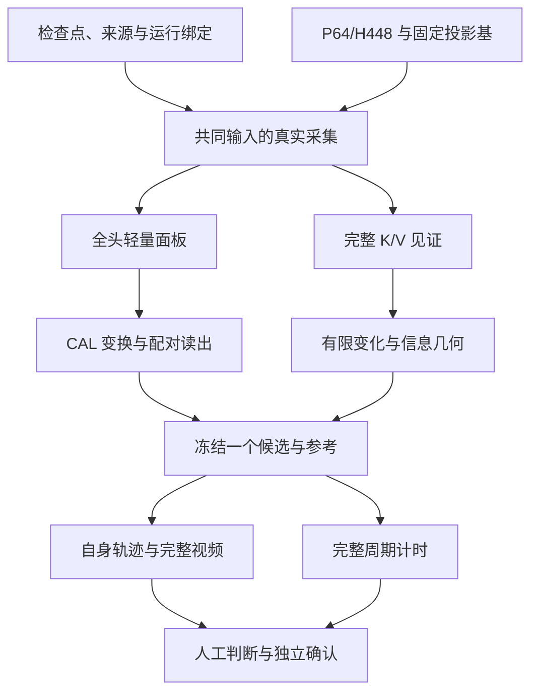

# 实验资产树与数据契约

此树按生产依赖组织。**PREPARED/COMPUTED** 表示本次已生成的静态资产；**TO_GENERATE/TO_FIT/TO_MEASURE** 表示由后续真实执行产生。已存在的说明与 schema 不代表对应模型结果已经生成。规范以 `EXPERIMENT_PLAN.md` 与 `protocol.json` 为准，三个 audit 文件提供核查依据。

## 1. 依赖关系

H448 的当前完整标签只连接评分、表示下限与精确见证。在线拟合从 P64 读取标签。当前所有 query 的 sparse 输出与廉价统计是可用输入，包含置乱 c 控制所需的方向。

## 2. 本次已经准备的目录

| 路径 | 内容 | 状态与用途 |
|---|---|---|
| `EXPERIMENT_PLAN.md` | 数学目标、主对比、采集、统计与推进规则 | 完整方案 |
| `ASSET_TREE.md` | 本文；依赖、字段与复用边界 | 完整资产契约 |
| `protocol.json` | 七拟合臂、两参考、范围与精度 | 可机读协议 |
| `sources_locked.json` | CAL3/DEV3，原始提示与图像 SHA | 已冻结身份；绝对路径待目标主机解析 |
| `attention_panel_index.json` | P64/H448、THW、224+224 邻边 | 已重建并验证 |
| `bases/P_v.npy`、`bases/P_k.npy` | 两个 128×128 正交基 | 已生成；原始投影方向由保存字节固定 |
| `bases/manifest.json` | 基矩阵 hash、算法、正交残差 | 已计算 |
| `c_direction_permutation.json` | 同帧循环置乱的固定 query 映射 | 只置换当前输入方向，保留标签 |
| `asset_registry.json` | 25 个资产节点、producer、依赖与状态 | 可用于自动执行编排 |
| `schemas/tensor_contract.json` | 命名轴、shape、dtype、归约和精度 | 采集字段契约 |
| `schemas/capture_record.schema.json` | 单个真实 site 的 provenance 契约 | 后续 producer 验收 |
| `schemas/metric_record.schema.json` | 输出、关系、观测与表示结果字段 | 后续分析验收 |
| `runtime/runtime_binding.template.json` | 原生模型/后端/实际路径绑定模板 | 待真实环境填充 |
| `execution/candidate_recipe.template.json` | 唯一 NEW/REF 的方法配方模板 | 待 DEV 完成后冻结 |
| `review/human_review_template.csv` | 完整视频的逐来源观察项 | 空白模板，尚无评分 |
| `confirmation_selection_recipe.json` | fresh 六源的确定性选择规则 | 已固定规则 |
| `freeze_confirmation.py` | 从真实历史/候选清单冻结确认集 | 已提供 CLI；实际确认源尚未选择 |
| `prepare_plan_assets.py` | 生成静态身份、基、协议、schema | 已执行 |
| `compute_asset_budget.py` | 形状整数预算与旧面板重建 | 已执行 |
| `validate_plan.py` | 数据角色、形状、依赖和数学资产一致性 | 已执行，结果见 JSON |
| `validation_results.json` | 本包静态核验结果 | 不含模型性能分数 |
| `asset_budget.json` | 每字段字节数、采集总量、部署状态 | 静态计算 |
| `repository_binding_audit.md/.json` | 旧 `fast512` 来源审计快照 | 已核查，仅作来源与历史证据 |
| `wide8192_binding.json`、`WIDE8192_MIGRATION.md` | 当前方法、BF16 / INT8 缓存语义、当前 SHA 和单独实测 | 本轮新增、元数据已核验 |
| `design_audit.md` | 机制与估计器的推导依据 | 设计审计 |
| `asset_budget_audit.md` | 资源与复算边界 | 资产审计 |
| `references/` | 现有 base identity、真实模型几何、上一轮数学报告 | 依据副本 |
| `RUN_STATUS.json` | 已完成、待执行和声明范围 | 实验状态 |
| `STAGE_HANDOFF.md` | 首次实现入口和执行顺序 | 下一步工作说明 |

## 3. 真实运行将产生的资产

下表的路径是生产契约。目录中只有实际写出的文件才进入 capture index；不为完成率创建虚构文件或得分。

| 层级与路径 | Producer / 输入 | 产物规模与目的 |
|---|---|---|
| `runtime/runtime_binding.frozen.json` | 目标主机的原生绑定 adapter | 实际 checkpoint、代码、attention kernel、归一化/RoPE、mask、scale、LSE 约定 |
| `captures/shared/{source}/{background}/trajectory.json` | 原生生成器，attention=Dense | 12 条共同输入轨迹的 source/seed/context/每步状态身份 |
| `captures/shared/{source}/{background}/tensors/` | 同次运行的原始 latent/flow writer | 可重放的实际 tensor；hash 与路径同时保存 |
| `captures/light/{module}/{source}/{background}/{expert}/layer_{L}.safetensors` | 原生 attention 端点观察与 fixed-width 归约 | 192 个 pairs；all 40 heads；两个端点 |
| 同路径 `.json` sidecar | capture producer | 具体 tensor 名、轴、dtype、支持 hash、模型输入身份 |
| `captures/support/{module}/{source}/{background}/{expert}/layer_{L}.safetensors` | anchor pooled top-k | 每 head/query-block 的 key-block IDs、最后块长度和 mask |
| `captures/witness/self/{source}/{background}/{expert}/layer_13.safetensors` | 预注册的八个 site | heads 0/13/26/39，完整有效 K/V，两端点 |
| `captures/conditions/{source}/{expert}/layer_{L}.safetensors` | 实际 cross context writer | 48 个固定 K/V 资产的预计上限；hash 相同才共享 |
| `captures/projections/{module}/{expert}/layer_{L}.json` | 原始 checkpoint 读取 | 实际 W_O 张量名/hash、gate 语义；可选择保留权重快照 |
| `captures/index.json` | capture 完成器 | 每个资产的 SHA、字节数、producer、依赖、字段与完成状态 |
| `calibration/{module}_{expert}/transform.npz` | CAL3 的 input-only RMS/SVD | 四套共享变换、原始谱、尺度和 CAL 来源列表 |
| `calibration/lambda_selection.json` | CAL 来源留一的 P64→H448 | 每个 arm 的固定预算选择；C0/C1/CP 共用 λ |
| `analysis/panel/{contrast}.jsonl` | 全部固定主 arm 的离线读出 | 点/空间/时间、质量/矩及交叉项 |
| `analysis/observability/{site}.json` | SVD、伪逆、Schur 与表示投影 | family floor、all-H 参考、P64 实得、谱/条件/增益 |
| `analysis/witness/{site}.json` | 完整支持 softmax/有限割线/JVP/HVP | 实际非线性余项、三通道 signed Gram、数值误差 |
| `execution/candidate_recipe.frozen.json` | DEV 综合判断 | 唯一 NEW 与 REF，全部执行语义、源码和变换 hash |
| `captures/student/{arm}/{source}/index.json` | 在线候选 + 独立 shadow 路径 | 候选自身输入与 anchor 上的诊断 |
| `videos/{arm}/{source}_s42.mp4` | 固定配方原生生成器 | 完整原分辨率视频；每个来源六臂 |
| `review/pairs.json` | 预注册随机顺序与 video hashes | 同步比较和盲化身份映射 |
| `review/human_reviews.csv` | 用户完整视频观察 | 具体问题的时间/区域、影响、偏好及原始条件响应 |
| `execution/timing.jsonl` | 关闭 capture/shadow 的平衡重复 | 完整 HHLL、denoise、端到端、峰值和组件耗时 |
| `confirmation/sources.frozen.json` | 已提供的确认集脚本 | 六个新 cluster，全部排除集合和输入/recipe hashes |
| `reports/attention_candidate_evidence.md` | 证据汇总 | 机制、真实运行和范围受限的研究判断 |

## 4. 轻量面板字段和含义

共同轴：endpoint=2，query=512，head=40，dk=dv=128。query 顺序以固定 panel index 为准；P64 另保存生产顺序。单个轻量 pair 的未压缩预算约 50.410 MiB。

| 字段 | shape / 类型 | 要保留的语义 |
|---|---|---|
| `q_effective` | `[2,512,40,128]`，原生 BF16 位 | 实际归一化/RoPE/scale 边界；不把 pre-norm 当作点积 Q |
| `o_native` | `[2,512,40,128]`，原生 BF16 位 | 逐头、W_O 前；所有 keys 的真实完整 query 输出 |
| `lse_native` | `[2,512,40]`，FP32 | 后端原始字段与自然对数规范值；记录换底与 softmax_scale |
| `o_selected`、`lse_selected` | 同上相应 shape | 当前固定 S 内归一化；有效 key 数与 mask 对应 |
| `feature_raw64` | `[2,512,40,64]`，FP32 | 全部六组端点统计；独立于后续 CAL 的 31 维压缩 |
| `mean_K/mean_V` | 各 `[2,40,128]`，FP32 | 实际有效 key 的均匀均值 |
| `cov_KK/cov_KV` | 各 `[2,40,128,128]`，FP32 | 用于几何/低成本矩诊断；注明 KV 两轴的方向 |
| `self_gate_s` | 当前实际广播 shape，预算 `[5120]` | self-attention 当前 gate；与 FFN gate 区分 |
| `selected_blocks` | self `[40,248,31]`；text-cross `[40,248,2]`，INT32 | anchor 生成、pair 固定；不存 N×N mask |

OUT 特征由已保存的两端 `o_selected` 重建，避免重复存储 ΔoS。主 FIN 只需端点统计，写出后即可释放当前全 K/V；见证四头按预注册规则另存。

W_O 评分先拼接全 40 heads，再应用权重和 gate，以保留跨 head 的交叉项。逐 head floor 的对应下游分数可复算，但联合下游最优 floor 需要另一套联合求解目标，结果名必须区分。

## 5. 每一类资产支持哪些复算

| 资产 | 可以复算 | 需要另有资产的计算 |
|---|---|---|
| all-head light | seven-arm fits、输出/质量/矩、P64 观测谱、三个误差层级、CAL 变换、BF16 cache 配对 | 全键概率分布和完整 K/V 导数 |
| light + 实际 W_O/gate | 主输出与空间/时间关系误差，跨 head 交叉项 | 完整生成轨迹质量 |
| self raw witness + 相应 Q | 全支持 p/LSE、有限 logmean、精确一阶作用、三通道分解、方向高阶作用 | 未保存 head/site 的精确 K/V 运算 |
| cross K/V + 各端点 Q | 固定 K/V 的精确 Jacobian/HVP/finite secant | 实际未捕获的独立 context 分支 |
| 实际 latents/flows + 配方/运行身份 | 轨迹状态差、接续运行或独立 shadow replay | 只有 hash 的旧索引不能替代原始 tensor |
| 完整 MP4 + 同步索引 | 整幅画面、运动、遮挡与条件响应的人工评价 | 从成片反推每层注意力状态 |
| 关闭诊断的 runtime traces | 当前完整实现的真实时间与内存 | 由 FLOPs 自动推出实际速度 |

## 6. 文件身份与重用规则

每个文件登记：路径、字节数、SHA-256、producer 源码 SHA、输入资产 SHA、tensor 名/shape/dtype/轴、所属 source cluster 和配方版本。大权重用已绑定的张量/文件身份引用；原始 source/prompt 可直接复用，不为同图不同 prompt 制造新的独立样本。

对相同条件的 cross K/V，只有实际字节和 mask 相同才去重。对旧视频，只有检查点、初始噪声、prompt、采样器、精度、几何和方法版本兼容才用作本次 paired baseline。历史视频的审阅信息仍然有价值，兼容性不同则登记为历史参考。

对存储精度，数学 FP64 重算、原生 kernel 输出和部署 cache 的舍入分别保留。BF16 数据用支持 BF16 的张量容器保存原位信息；以 FP32 读取时保留原始 dtype 标签。不能将十进制文本 round-trip 当作相同位模式。

## 7. 资源生命周期

默认采集按端点归约、按 site 落盘，writer 队列有界。主轻量数据约 11 GiB，原始 self K/V 只占约 0.966 GiB。完整概率矩阵与 N×N attention scores 均通过 query/key 分块作用计算。

在线部署每个专家只持有其 40 层的 u/rho/31 维 anchor feature 和支持；专家切换释放旧状态。15.241 GiB 是这组张量的静态容量。当前工作区、解算器、输出缓冲和实际分配器峰值由真实运行登记。

稳定可复用的事实、坐标、特征、标签和变换优先保留。拟合系数、分层误差与图表从同一 capture index 重算；这样一次模型采集可以支持后续估计器改进，而无需重新生成同一组轨迹。

## 7. wide8192 的缓存身份与可用内存

本轮主 FFN 背景为 BF16 `wide8192`（保留隐通道 2560/13824，P64、16 模态、最大 tile 8192 行）。原始已计的 192 个注意力 pair，仍是六源、两个背景、四层、两专家、两模块。INT8 是条件性部署对照，不增加主 CAL/DEV 机制面板数。

| FFN 背景 | FFN 锚点字节身份 | 已测独立峰值 GiB | 加本计划 self-attention anchor 15.241 GiB 后的静态相加 GiB |
|---|---|---:|---:|
| `wide8192` | u0、y0、z0k BF16 | 47.57 | 62.811 |
| `wide8192_all_int8_joined` | 三组 INT8 + BF16 组 scale、P64 原值 BF16 | 32.77 | 48.011 |

这是**两次独立运行峰值加一个静态张量预算**，用作资源配置估计。联合峰值、工作区、显存分配和跨模块峰值重叠以新真实运行计量。INT8 主路径原生权重、当前探针和大矩阵乘法仍为 BF16。

INT8 确认时额外登记 `videos/int8/...`、`execution/int8_matched_timing.jsonl` 与同源画质对照；详见 `wide8192_binding.json` 与 `EXPERIMENT_PLAN.md` §8.1。