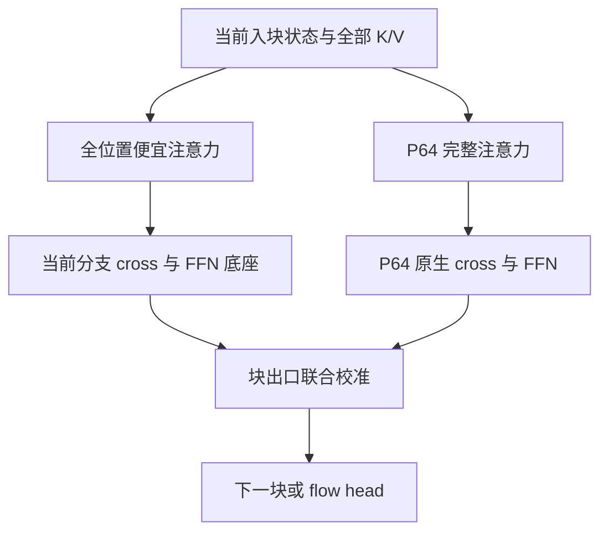

# 从注意力输出恢复到联合计算图恢复

日期：2026-11-24（Asia/Shanghai）。这是对研究目标和下一阶段优先级的更新。上一份 [局部结果复核](REVIEW_AND_NEXT_STAGE.md) 中的实测与复算结论继续保留；后续优先分析注意力、cross-attention、FFN、残差与 flow 读出的联合作用。正则和质量监督权重的选择放在联合对象确定后的求解层面。

现有模型证据固定于 Qesire/FFNDS@b1e15c2df4d1dad9a285798e552192ee4fca0bd8。本轮新增的是既有真实数据复算、生产源码核验、数学推导和明确标注的合成代数核验，新增模型/GPU执行数为0。

## 1. 当前最值得保留的研究判断

研究对象应提升为：**用少量完整 query 观测，恢复注意力经过后续计算后，对块出口与采样更新产生的联合贡献。**

这个表述开放了三个具体构造：

1. 将精确 P64 query 继续送过当前块的 cross-attention、归一化、FFN 和残差，得到整块的教师观测。
2. 将一次在线修正放到块出口，直接校准便宜注意力与 FFN 底座的联合缺陷。
3. 在最后一块将目标进一步移动到64维 flow patch；先研究完整后续读出，再考虑向更早的块扩展。

现有数据已经显示误差方向和位置关系对后续作用至关重要；真实源码则给出了联合观测能够闭合的范围。联合方案的模型效果由下一次有针对性的分叉执行来判定。

## 2. 从已有数据重新理解模块关系

### 2.1 同一个误差在 head 空间和写入空间中发生排序反转

在 high expert、layer0，FIN-C0 相对 OUT-ABS 的误差能量比（均为平方L2口径）：

| 来源 | head误差比 | W_O/gate后点误差比 | 空间边比 | 时间边比 |
|---|---:|---:|---:|---:|
| 0392 | 0.60215 | 1.54428 | 1.43929 | 2.18247 |
| 0800 | 0.59556 | 1.47372 | 1.44668 | 1.98308 |
| 1013 | 0.69194 | 1.63181 | 1.65127 | 2.37540 |
| 来源等权几何平均 | **0.62840** | **1.54859** | **1.50931** | **2.17441** |

head 误差下降37.16%，实际写入点误差增加54.86%。三个来源均发生同方向反转。两背景在此处完全相同，因此表中只统计一份，独立来源仍为3。

令 L 为真实 W_O 与当前 self gate 的复合。误差方向的能量增益为
\[
g(e)=\frac{\|Le\|^2}{\|e\|^2}.
\]
C0 相对参考的 g(e) 比为2.46436。这里已经出现了具体的目标几何差异：同样大小的 head 误差，实际写入作用随方向改变。

在 wide8192/high 的 H448 全标签估计器中，C0 的 head 误差比为0.89667，写入误差比仍为1.24902。观测增加之后，这种几何差异仍存在。head 最优系数的下游评分是该系数的表现，并不是下游目标的最优下限。

### 2.2 FFN会改变后续注意力面对的状态

逐字段核验发现，high/layer0 的两个背景在 self 与 text-cross 各144条记录、12个公开数值字段上完全相同。high 的后续观察层13/26/39开始不同，low/layer0也已不同。

它与当前 HHLL 计算路径吻合：step0建立原生锚点，step1从前面的FFN近似开始产生状态差异，差异继续进入后续 attention；high阶段的模型输出又通过采样更新改变low阶段的输入。观察层间隔较大，实际首次分歧可以早于layer13。

因此，某个注意力恢复器在 wide8192 上更有效，可能是前面 FFN 与采样过程共同塑造了更适合该恢复器的状态。当前结果测量各背景当前状态上的原生 attention 目标，还需分叉才能判断当前 attention 与后面 FFN 的补偿或放大。

### 2.3 共同误差与位置差分误差具有不同变化

固定 H448 的空间和时间边各224条，每类边恰好覆盖每个节点一次。定义
\[
e^+_{ij}=(e_i+e_j)/\sqrt2,\qquad
e^-_{ij}=(e_i-e_j)/\sqrt2.
\]
由已有标量可精确得到
\[
E^-=E_{\rm edge}/2,\qquad
E^+=E_{\rm point}-E_{\rm edge}/2.
\]

Dense/low 的 C0 相对 OUT-ABS，点误差下降10.19%，空间共同误差下降21.41%，空间差分误差增加20.68%；时间共同误差下降17.42%，时间差分误差增加3.27%。

这给后续研究一个具体对象：恢复器改变了位置之间误差的协调关系。该分解是固定边上的误差场诊断；动作、纹理与一体结构运动仍通过完整视频判断。

复算见 [joint_evidence_recomputed.json](joint_evidence_recomputed.json)，脚本见 [recompute_joint_evidence.py](recompute_joint_evidence.py)。

## 3. 实际运行的联合计算图

生产 Transformer 和 scheduler 的 SHA256 精确匹配 ModelTC/LightX2V@ed146db64d0b6130c669285fc1aa0b280a6a4823：

- [Transformer](https://github.com/ModelTC/LightX2V/blob/ed146db64d0b6130c669285fc1aa0b280a6a4823/lightx2v/models/networks/wan/infer/transformer_infer.py)
- [LayerNorm](https://github.com/ModelTC/LightX2V/blob/ed146db64d0b6130c669285fc1aa0b280a6a4823/lightx2v/common/ops/norm/layer_norm_weight.py)
- [四步 scheduler](https://github.com/ModelTC/LightX2V/blob/ed146db64d0b6130c669285fc1aa0b280a6a4823/lightx2v/models/schedulers/wan/step_distill/scheduler.py)
- [unpatchify](https://github.com/ModelTC/LightX2V/blob/ed146db64d0b6130c669285fc1aa0b280a6a4823/lightx2v/models/networks/wan/infer/post_infer.py)

当前配置 d=5120、40 heads、FFN hidden=13824，N=31668。固定层、采样步与文本条件，单query采用列向量：

\[
\begin{aligned}
a_i &=G_A(W_O\,o_i+b_O),\\
h_i &=x_i+a_i,\\
u_i &=h_i+C(\operatorname{LN}_3(h_i);c),\\
z_i &=D_s\operatorname{LN}_2(u_i)+b_s,\\
y_i &=u_i+G_FW_2\phi(W_1z_i+b_1)+G_Fb_2.
\end{aligned}
\]

G_A/G_F 是当前门控的对角作用；D_s 为1+FFN条件scale。门控、scale和shift来自固定时步与层调制，与当前x无关。本配置对所有视频query广播通道向量。LN1/LN2为无学习affine的LayerNorm，LN3有学习affine，eps=1e-6；FFN激活为GELU-tanh。

当前 use_image_encoder=false，cross只读取文本K/V。图像条件通过VAE条件通道进入patch embedding。固定context并不固定cross输出：self写入改变h，h改变cross的query，因此注意力近似也可能改变后续文本条件的读取。

从h_i到y_i的原生计算逐query独立；下一块self重新汇集全视频K/V。当前wide8192完整算法还包含P64拟合共享系数的依赖，只有固定这些系数后，其读出才逐行独立。

## 4. 注意力误差怎样经cross与FFN发生作用

将 self写入后的差记为 \(\delta h_i\)，固定同一块的时间条件。设
\[
U(h)=h+C(\operatorname{LN}_3(h);c),
\quad N(u)=D_s\operatorname{LN}_2(u)+b_s.
\]

对任一平滑映射K，用路径平均导数
\[
\overline J_K=\int_0^1 DK(q+\tau\delta q)\,d\tau
\]
描述实际两个端点，便有精确有限差分。令FFN隐藏端点的逐通道GELU割线为β，则

\[
\delta u=(I+\overline J_{C\circ\operatorname{LN}_3})\delta h,
\]
\[
\boxed{
\delta y=
\left[I+G_FW_2\operatorname{diag}(\beta)W_1\overline J_N\right]
\left[I+\overline J_{C\circ\operatorname{LN}_3}\right]\delta h.
}
\]

这给出了三层实际作用：直接残差、cross条件重读、FFN非线性响应。有限割线不是把完整anchor→hit变化强行等同于起点导数；它在相关端点定义下精确成立。计算这些精确作用可能仍需要原生端点，用于机制见证时应按实际成本执行。

对下一块self，块出口误差既改变Q，也改变所有query将读取的K/V。其logit有限变化包含
\[
\delta s_{ij}
=\frac{\delta q_i^\top\bar k_j+\bar q_i^\top\delta k_j}{\sqrt{128}},
\]
同时还有value更新。于是一个位置的误差能够通过K/V影响其他位置。当前块的逐query闭合范围不能直接延长到多个self块。

## 5. 两个近似模块应通过联合输出判别

固定当前入块X、条件和cache，定义四个反事实输出：

| 输出 | self attention | FFN |
|---|---|---|
| Y00 | 原生 | 原生 |
| Y10 | 候选 | 原生 |
| Y01 | 原生 | wide8192 |
| Y11 | 候选 | wide8192 |

cross始终按所在分支当前输入原生计算。令
\[
e_A=Y_{10}-Y_{00},\quad
e_F=Y_{01}-Y_{00},\quad
I=Y_{11}-Y_{10}-Y_{01}+Y_{00},
\]
则
\[
\boxed{Y_{11}-Y_{00}=e_A+e_F+I.}
\]

I测量有限的模块交互；输出平方误差还包含e_A、e_F、I之间的带符号交叉项。即使I很小，e_A与e_F仍可协同抵消或同向累积。

先冻结FFN共享读出系数，可以隔离固定读出的输入响应。当P输入、cache或拟合使用的全局统计改变时，正常重拟合还可能引入共享系数反馈。当前方案若在固定X下先对attention P64精确覆盖，两条attention臂的P端cross/FFN输入可以完全相同；仅依赖这些P输入与固定资产的拟合也应相同。需要先核对实际拟合输入，再判断反馈。冻结参数的局部实验与生产方法在自身输入上重拟合的验证分别标明。

这个分叉要区分的解释是：
- 后续计算使某些attention误差的终端作用较小；
- 后续FFN写入与attention误差有利抵消；
- cross/FFN非线性或共享读出反馈放大关系误差。

### 后置修正的可达性

若修正位置可写入的方向组成R，后续任务作用为T，则给定联合缺陷e，在线性局部模型中
\[
\theta_*=-\left(TR\right)^+Te,
\quad
T(e+R\theta_*)=
\left[I-(TR)(TR)^+\right]Te.
\]

这个投影直接量化后置修正能恢复的部分。R是原FFN gate之前的方向时，必须把G_F包括在TR中；gate小或为零时不能假定可逆。新联合校正若定义在最终残差之后，可直接写作 \(\widehat B=B^0+\mathcal R_\theta\)，无需除以G_F。

## 6. 一个全后缀成立的目标等价关系

当前所有原生残差分支都先读取逐token LayerNorm，且最终head也先作LayerNorm。对任意每token标量c_i，有
\[
\operatorname{LN}(x_i+c_i\mathbf1)=\operatorname{LN}(x_i).
\]
于是每个原生块B满足
\[
B(X+\mathbf c\mathbf1^\top)=B(X)+\mathbf c\mathbf1^\top.
\]
残差支路把该平移继续携带，而最终head将它消去。因此对当前原生后缀S，
\[
\boxed{S(X+\mathbf c\mathbf1^\top)=S(X).}
\]

这是实数算术下的有限不变性。它适用于门控后残差状态上的通道共同平移，且依赖已核查的pre-LN路径和末端head；BF16舍入的近似程度应另测。缩放方向不具有同样的后缀不变性，因为残差分支的写入不会随原状态同比缩放。

令 \(\Pi=I-\mathbf1\mathbf1^\top/d\)，则 \(\Pi e_i\) 消去了这个已知不可见方向。它是任务相关商空间的一个可构造部分；该方向只占每token的一维，不能仅凭维数推断当前误差中的占比或收益。当前公开标量表无法给出其真实能量份额。

在其余方向上，下游仍有状态相关的各向异性。若S表示实际关注的flow或后续输出，精确有限作用可写为
\[
S(Y+E)-S(Y)=\overline J_S(Y,E)E.
\]
在一阶近似中，局部任务敏感性由 \(G_Y=J_S(Y)^\top QJ_S(Y)\) 描述。对有限扰动，相应二次型为 \(G(Y,E)=\overline J_S(Y,E)^\top Q\overline J_S(Y,E)\)；它还随E变化，不能当成跨大步固定的度量。只需方向作用时使用JVP/VJP或有限分叉，无需物化整个雅可比矩阵。

## 7. 联合观测：把P64教师延长到块出口

固定同一当前入块X与完整当前K/V，从完整self P64继续执行原生cross、LN/AdaLN和FFN，即得到同输入下整块B(X)的P64行。因为这些后续原生计算在视频query轴上独立，64条教师行不需要为其他query执行完整self attention或完整FFN。

构造候选时：
\[
B_i^0=\text{便宜attention与FFN底座在第i行的联合输出},
\]
\[
r_P=B(X)_P-B_P^0,
\qquad
\widehat B_i=B_i^0+\mathcal R_\theta(\text{当前可算特征、锚点状态})_i.
\]

在P上拟合的是整个联合缺陷。有限特征、已有校准模态和核读出可以作为候选函数族；选择它们的依据变成块出口与flow恢复。对允许的联合变化族，一般的任务充分性条件为：相同观测应对应相同目标，
\[
\mathcal M_P(\theta_1)=\mathcal M_P(\theta_2)
\quad\Longrightarrow\quad
\mathcal T_H(\theta_1)=\mathcal T_H(\theta_2).
\]
在线性候选参数观测与线性目标下，它化为
\[
\ker\mathcal M_P\subseteq\ker(\mathcal T_H),
\]
其中两算子都限制在候选允许的联合变化族上，\(\mathcal T_H\)是目标读出。本文直接拟合块出口或flow的线性读出可使用这一版本；一般非线性后缀需要前述纤维条件。

已有有效秩32描述的是已测attention特征族。联合缺陷需重新检查可算特征在P64的谱、H448泛化与flow作用；各head的32维特征不会自动合并成整块的单个32维表示。末端输出变成64维降低了读出目标维数，跨query变化的复杂度仍由联合数据检验。

### P64覆盖时点是构造的一部分

原计划在P位置精确覆盖attention，wide FFN又在P返回精确FFN值。因此实际P路径可以已经是同输入下的原生块教师；其最终输出减教师的残差为零。

要观测attention近似进入后续模块的作用，需要同时保留“覆盖前便宜attention→便宜后续计算”的真实输出。只保留覆盖前attention向量，不能替代在该向量上执行非线性tail。

三种执行方式的成本不同：

1. **保留现有P覆盖和独立拟合，增加诊断影子支路。** 原FFN的P64原生计算可提供教师；另在覆盖前attention输入上执行原生cross(P)与FFN便宜读出(P)的影子支路（固定当前FFN读出系数），得到联合缺陷。额外tail与任何额外求解需要计入，第二次dense FFN并非必需。
2. **让独立FFN拟合使用未覆盖的attention输入。** 它需要原生 \(F(\widehat u_P)\)，联合教师另需 \(F(u_P^\star)\)。此时两次dense FFN有不同语义。
3. **一次块出口联合拟合。** 全行支路保留不依赖当前完整P标签拟合的便宜底座；P支路执行原生self→cross→FFN；在最终残差出口拟合一次联合修正，再覆盖P。这样可以把一次dense FFN P64用于联合教师，避免三套独立修正层叠。

上述构造教师针对学生当前输入的原生块；完整Dense轨迹的状态是另一个对象。实际cache、anchor、精度、观测位置与读出更新必须保持各自身份。

## 8. 从最后一块开始，直接恢复flow读取的内容

当前终端head为 LN→时间scale/shift→线性5120→64，unpatchify仅作重排。单query列向量写成
\[
v(x)=W_h[D_t\operatorname{LN}(x)+b_t]+b_h.
\]
令
\[
\Pi=I-\mathbf1\mathbf1^\top/d,\quad
q=W_hD_t\Pi x\in\mathbb R^{64},\quad
\nu=\|\Pi x\|^2/d,
\]
则
\[
\boxed{v(x)=q/\sqrt{\nu+\epsilon}+W_hb_t+b_h.}
\]

固定条件后，64个投影和1个中心方差足够描述该head读取的内容。这个恒等式不自动使q/ν的预测便宜或准确，但它明确了目标与hidden全坐标的区别。

最后一块有一个具体入口：把P64教师继续送到head，直接拟合64维flow patch的联合校正。相对恢复5120维hidden，目标输出维度减少80倍；这只是读出维度比例，教师计算和全模型成本仍按真实路径计入。当前观测层已经包含39，可以沿既有检查点定位所需原始状态。

从末端向前移动恢复边界时，遇到下一次self的全局K/V依赖，才加入相应的全局状态或后缀方向观测。这样按计算依赖决定抽象范围。

### 与四步采样连接

当前实数参考sigma为
\[
[1,15/16,5/6,5/8],
\]
正更新幅度为
\[
h=[1/16,5/48,5/24,5/8],
\quad z_{k+1}=z_k-h_k f_k(z_k).
\]
两个hit的直接flow→latent幅度权重相差6倍，平方相差36倍。整条轨迹还包含后续响应。若当前近似flow缺陷在学生状态上为e_k，则实数有限差分递推为
\[
\delta z_{k+1}
=(I-h_k\overline J_{f_k})\delta z_k-h_ke_k.
\]
实际FP32顺序更新和BF16 cast另有舍入项，应按native更新记录。

因此高/低专家的局部误差等权比较适合机制描述；推断成片影响时需要当前h、后续响应与跨步误差相关性。最终由完整视频检验空间结构、运动、纹理和条件响应。

## 9. 下一证据应改变研究对象，而不是扩大局部搜索

优先顺序：

1. **先打开末端的联合可观测范围。** 优先在已有观察层39、两个专家、少量现有DEV状态上，固定同一入块X，跟踪attention写入→cross残差→FFN残差→块出口→flow。沿用固定P64/H448。已有high/layer0的强反转可作为后续机制核查位置。完整块目标需要残差输入和tail资产；仅凭O/LSE面板不能重建这些状态。
2. **用四臂分叉辨别联合作用。** 原生/候选attention × 原生/wide FFN；先固定读出系数识别输入响应，再核对正常重拟合是否引入额外反馈及其输入原因。保留向量和signed Gram，以完整交叉项解释误差能量。
3. **优先验证末端联合flow恢复。** 在layer39利用P64完整教师和H448留出比较同预算的独立模块恢复与一次联合恢复，保持相同便宜底座和观测信息。小批完整视频检验末端效果，再决定向更早块推广。
4. **按证据选择路线。** 若原生tail对候选扰动的终端作用小，研究目标相关的误差保留；若联合修正有明显增益，研究共享观测与后置校正；若下一self的K/V传播主导，则研究源端信息保护与跨位置关系。
5. λ/μ、特征宽度和probe布局作为选定联合对象的内部求解选择。新的研究主张与执行方案在冻结后再进入独立确认和完整计时。

不必重新生成七臂大面板或重复全部静态核查。已经形成的真实数据可以选择干预位置；新资产集中在此前未观察的联合出口和信息时点。

## 10. 数学工具与执行记录

本次使用算子与张量分析的有限割线、链式作用、带符号Gram、伪逆与可达投影，以及主动抽象的任务充分表示、更新闭合和目标相关观测判据。

- [真实面板复算](joint_evidence_recomputed.json)与[脚本](recompute_joint_evidence.py)：真实模型已有数据，新增比较为探索性。
- [联合恒等式核验](verify_joint_identities.json)与[脚本](verify_joint_identities.py)：合成权重的小模型，核验LN/cross/GELU有限作用、四臂恒等式、后缀平移对称及可达投影；不作为Wan效果证据。
- [终端统计核验](verify_terminal_statistics.json)与[脚本](verify_terminal_statistics.py)：使用真实5120→64形状、合成权重，核验65统计和保持head输出的有限hidden变化。
- [真实维度与scheduler算术](model_joint_arithmetic.json)：P64比例64/31668≈0.2021%；dense self probe核20.754 GMAC、dense FFN probe9.060 GMAC，当前全K/V与固定context K/V可按实际路径复用；数值是算量，不是实测时延。
- [生产计算图审查](JOINT_GRAPH_AUDIT.md)：实际source、norm/gate、context、probe语义与闭合边界。
- [完整算子推导](JOINT_OPERATOR_DERIVATION.md)：补充闭式LayerNorm有限割线、固定K/V的cross有限输运和一次联合读出的构造条件。

可复算命令（NumPy、pandas；两份数学脚本只依赖NumPy与Python标准库）：

~~~sh
python recompute_joint_evidence.py --replay-dir /path/to/unpacked/replay_evidence --output joint_evidence_recomputed.json
python verify_joint_identities.py
python verify_terminal_statistics.py
~~~

本轮没有重跑原生模型、生成候选视频或测量联合方法的速度。

