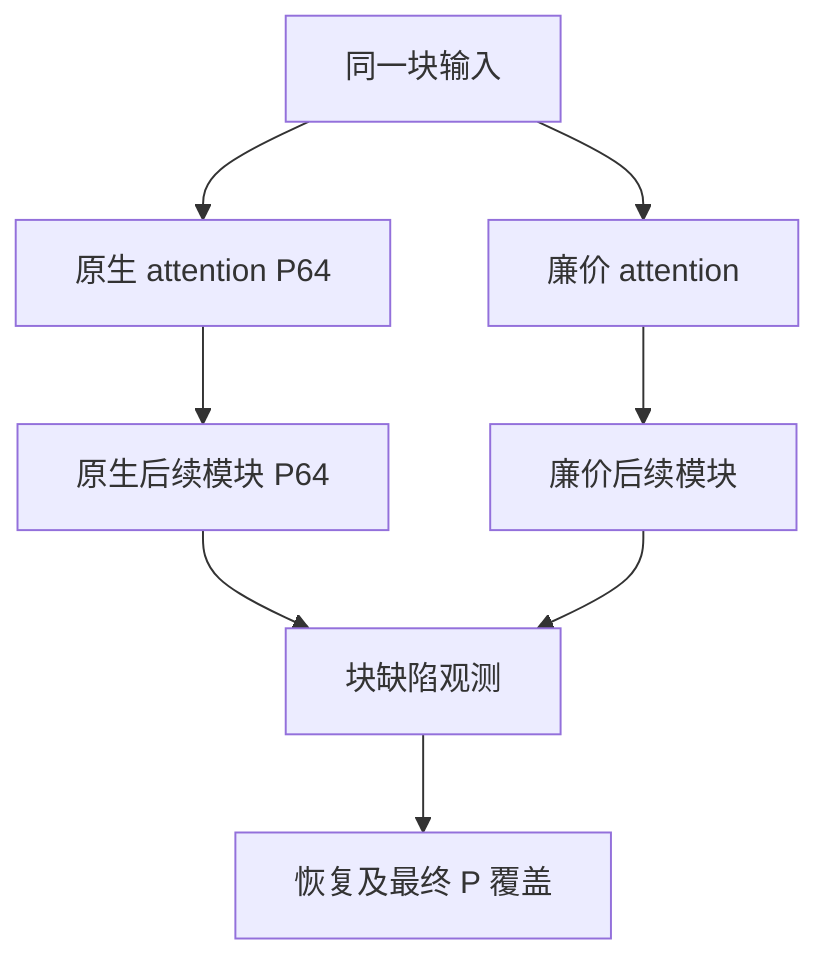

# 六源成片确认之后：当前交互、充分状态与联合缺陷

2026-11-25。证据基于 FFNDS `873e1a879b91d544fdae11894d68bbc6acc854d1`，新增用户反馈：“6源基本没有差别。现在就基于当前的信息，开始新的推导和论证。”[原话与范围](C_CONFIRM_HUMAN_REVIEW_20261125.json)保留为六来源 C/A 的整体人审，没有补造逐源分数。

使用 operator-tensor-analysis、active-abstraction 与 research-reasoning。本轮执行了真实历史 Gram 的正交分解、实际 CAL 矩阵分析、SymPy 恒等式和明确标记的合成张量验证；没有新增模型/GPU或成片运行。

## 1. 研究起点已经改变

冻结 C 在六个新来源上得到用户报告的视觉基本相当，同时四步 GPU 时间 C/A 为0.865241。完整请求 C/A仍为1.031752，保存长尾保留；峰值显存A/C为47.5671/65.4123GiB。这些结果共同使C成为有成片与计算证据的工作参照。[六来源回执与成本](CONFIRM_EVIDENCE_ANALYSIS.md)

接下来的问题是：能否用更明确的当前交互承担恢复负担，并按未来实际读取的作用重新组织历史状态。本文推进三个相互联系的结果：

1. 以当前K/V的分组响应丰富attention底座，将跨步缓存改成完整缺陷场；
2. 从未来读出推导哪些历史作用可以提前求值，以及哪些状态需要保留；
3. 对完整块定义联合缺陷，明确其真实教师、有限交互和构建成本。

主构造是第一个。第二个提供状态选择原则，并接续已有FFN研究；第三个把同一思想推进到attention和FFN共同作用的计算图。三者都已给出可计算定义与成立条件。

## 2. 统一恢复对象，并得到一个可用于设计的误差等式

固定模块、层、专家和输出空间。令当前原生响应为A_s，廉价当前底座为G_s，缺陷为E_s=A_s−G_s。在anchor保存完整字段E_a。当前底座为G_s+E_a，P64监督的目标是

\[
R_{s,P}=P(A_s-G_s-E_a)=P(E_s-E_a).
\]

取当前特征Ψ_s，定义线性ridge读出

\[
K_s=\Psi_s(\Psi_{s,P}^{\top}\Psi_{s,P}+\alpha I)^{-1}\Psi_{s,P}^{\top},
\]

其中P选择64个互不重复的query行，α是实际solve正则项；若沿用每样本λ=0.1、P64，则α=6.4。最后将P行覆盖为原生教师。若缓存存为E_a+ε，令M_H=I−PᵀP，有精确的实数域关系：

\[
\boxed{
\widehat A_s-A_s
=M_H(K_sP-I)(\Delta E_s-\varepsilon).
}
\]

这一等式同时说明了三件事。

**当前计算的作用。** 改变G，改变需要由P恢复的ΔE，而不只是改变求解器的坐标。

**教师的作用。** P观测通过K传播到未观测行。若α=0、Ψ_P满列秩，且ΔE−ε属于Ψ的列空间，就可精确恢复。一般情形下，表示剩余、观测几何与正则共同决定误差。维数只是其中一个条件。

**缓存的作用。** 缓存误差与未恢复的创新经过同一个补算子作用。固定当前特征时，仅改变additive cache产生

\[
\delta\widehat A=M_H(I-K_sP)\varepsilon.
\]

若P上的缓存保留原值，Pε=0，当前系数保持原值，非P新增误差就是各自ε。这给状态编码提供了具体的误差读出，而不必将原始缓存元素误差直接当作任务误差。

上述等式已用实际N31668、每头128维、P64的符号矩阵核验。[程序](verify_recovery_operator.py)、[结果](recovery_operator_verified.json)。它针对同一当前输入与固定特征；候选自身轨迹改变输入时，仍需沿真实联合图解释。

### 2.1 信息充分性由目标作用定义

固定当前已知底座、历史状态和条件，令允许的创新集合为𝒱。若要从P观测精确恢复创新场，必要且充分的条件是P在𝒱上单射：两个允许的创新只要P观测相同，就必须处处相同。若𝒱是线性子空间，这等价于

\[
\ker P\cap\mathcal V=\{0\}.
\]

因此，P64的意义取决于当前底座与历史状态共同留下了怎样的创新族。将场向量化，令U为𝒱的一组正交基、𝖯为对应的行选择算子（逐列向量化时为I_d⊗P），稳定性进一步由σ_min(𝖯U)决定：对𝒱内任意两个创新，其全场距离不超过P观测距离除以σ_min(𝖯U)。非零最小奇异值给可识别性，其大小给稳定性。

若目标是保留固定后缀𝒮的作用，可以使用更准确的有限条件。记已知底座为B=G_s+E_a，则只需对所有允许创新满足

\[
PE_1=PE_2\quad\Longrightarrow\quad
\mathcal S(B+E_1)=\mathcal S(B+E_2).
\]

这等价于后缀目标在每个观测纤维上为常数，因而可定义为P观测的函数。证明直接来自函数的良定义：同一观测若对应相同目标，就能给该观测赋予唯一目标值。这里𝒮包含固定的后续模型计算；若未来缓存更新也属于目标，须把相关状态和更新纳入𝒮。§6.3给出真实生产图中满足这一任务等价关系的一个精确方向。

## 3. 当前attention底座应读取什么新信息

固定一次调用、一个head。当前selected输出B只保留了选中交互归一化后的响应。我们将注意力先写成可加的未归一化对：

\[
w_{ij}=e^{q_i^\top k_j/\sqrt d},\qquad
Z_i=\sum_jw_{ij},\qquad N_i=\sum_jw_{ij}v_j,
\qquad A_i=N_i/Z_i.
\]

Z与N可按key集合相加，之后统一归一化。保留这一结构，可以让少量当前计算覆盖被selected支持遗漏的交互。

### 3.1 K/V共同变化给出一个明确的辨识例子

令selected keys和values均为零，因此所有query的B都为零；遗漏部分为(k,v)=(a,b)、(−a,−b)。则

\[
A(q)=\frac{2\sinh(t)}{n_S+2\cosh(t)}b,
\qquad t=q^\top a/\sqrt d.
\]

遗漏部分K/V均值都为零，真实响应却随query改变方向。只保留一个均值会合并这种区别；将两组分别保存，就能精确恢复该例。它指出需要保留的具体作用：**query通过K选择与其关联的V。**

使用真实归档P_k/P_v作为方向、明确合成的128维激活，在n_S=128、t=±3时，真实响应为±0.135253；两组构造最大绝对误差为1.39e−17。这是构造的数值核验，不是Wan成片实测。

### 3.2 两组正权摘要

对每个现有128-key block，以固定归档方向r对中心化K作符号二分。每组c保存有效数量n_c、当前均值k̄_c和v̄_c。空组跳过；末block使用实际52个有效keys。selected blocks仍逐key精算，同时排除它们的两个摘要，避免双计数。

定义

\[
\bar z_{ic}=n_c e^{q_i^\top\bar k_c/\sqrt d},\qquad
G_i=\frac{Z_i^SB_i+\sum_{c\notin S_i}\bar z_{ic}\bar v_c}
{Z_i^S+\sum_{c\notin S_i}\bar z_{ic}}.
\]

所有q/k都是norm、RoPE等操作之后实际进入attention的张量。该G直接读取当前遗漏交互，因此可以区分某些B相同的query。

有锚路径在anchor确定并冻结selected支持和两组标签，到hit只更新当前Q/K/V与组均值。这样ΔE表示同一分区下响应的有限变化。无锚调用只需临时分组。

### 3.3 已得到的保持性质

- 每组内K相同，V任意时，该组摘要的未归一化质量与响应精确。
- G是实际values的正权平均，保留凸包、value平移与线性映射关系。
- 由Jensen，分区细化使Z⁰单调增加且不超过完整Z。
- 两组保留K/V总协方差中的组间项：Cov(V,K)=E[Cov(V,K|c)]+Cov(E[V|c],E[K|c])。剩余组内关系仍明确进入误差。

对组内δk、δv，令t=qᵀδk/√d，a_ic=E_c[e^t]−1，c_ic=E_c[(e^t−1)δv]，有精确有限误差：

\[
A_i-G_i
=\frac{\sum_c\bar z_{ic}\{a_{ic}(\bar v_c-G_i)+c_{ic}\}}
{Z_i^0+\sum_c\bar z_{ic}a_{ic}}.
\]

因此，分组希望减少的对象是组内score波动和score/value相关作用。质量的单调性只约束Z，完整输出还受value方向影响。这里既保留了softmax归一化，也没有把有限变化近似成一次切线。

### 3.4 P64究竟能识别什么

定义a=Z/Z⁰−1、c=(N−N⁰)/Z⁰，则A=(G+c)/(1+a)。仅观测A时，质量a和响应c之间存在自由度；同时取得原生LSE后，两者可以分别确定。更有界的坐标为

\[
g=Z^0/Z\in(0,1],\quad
h=A-v_* -g(G-v_*),\quad
A=v_*+g(G-v_*)+h.
\]

当前P接口只返回O；同文件的native_flash锚点辅助函数已经返回O与LSE。扩展P接口有明确实现入口，q64形状/backend仍需实际核验。旧FIN-C1已经使用过质量标签，本轮新增信息在当前K/V分组底座，质量坐标用于解释和约束其剩余作用。

完整构造与有限界见 [当前交互推导](TWO_GROUP_CURRENT_INTERACTION.md)。

## 4. 将新底座接入锚点：保留完整场，减少历史字段

在原生anchor计算A_a及上述G_a，保存

\[
E_a=A_a-G_a.
\]

hit采用G_s+E_a，以P上的ΔE标签恢复剩余创新。当前特征可以由q、粗细响应差G−B及selected质量构成；详细报告给出保持32列的具体接口。它改变了当前OUT-D的底座和特征族，保持完整逐位置响应场。

在完整输入与条件回返anchor时，E_s=E_a，理想缓存下创新为零。更一般地，只要缺陷保持不变，底座就精确。恢复器因此可以集中处理新底座未覆盖作用的变化。

当前真实尺寸为N31668、H40、d128、248块、selected31块。静态预算为：

| 项 | 结果 |
|---|---:|
| 两组×217遗漏块QK/PV成对项 / 完整attention | 1.37047% |
| 当前层两组K/V均值，FP32 | 19.375 MiB |
| 40层单E_a字段，BF16 | 12.08038 GiB |
| 40层冻结二值标签，简单uint8 | 48.32153 MiB |
| E_a与标签合计 | 12.12757 GiB |
| 当前low的u_a、ρ_a、φ_a合计 | 15.19486 GiB |
| 两种状态净载荷之差 | 3.06728 GiB |

分组、归约、稳定归一化、mask和工作区都有执行成本；anchor新增G_a计算也需偿还。这里给出了可行的预算对象，没有把净载荷直接换算成新峰值或把成对项比值当作实际延迟。

这条构造的研究价值是同时改变当前信息和剩余目标：让底座承担更多真实交互，历史只保留它尚未覆盖的完整位置场。

## 5. 未来读出决定充分状态：已有FFN原理如何进入当前组合

当前wide8192中，历史输入U_a只经固定A0和J两个线性读出进入；选中预激活Z_a另外保存。实数域可定义

\[
C_a=Y_a-U_aA_0,\qquad J_a=U_aJ,
\]

并改写

\[
B_s=C_a+U_sA_0+D_HW_K,
\qquad Q_s=D_HZ-U_sJ+J_a.
\]

这样保留完整非线性核与当前16方向增益，同时由(C_a,J_a,Z_a)回答未来读出。P64保留原U_a/Y_a，可在同一当前输入下保持原拟合路径；实际BF16重排误差在预cast输出中明确为δB+δQ diag(γ)V。

按BF16 C/Z、FP32 J及P原值计算，字段净载荷由30.20096降至18.24491GiB；直接构建额外增加每片133.24030TFLOP，为当前anchor+hit主GEMM算术的13.56%。它是一个明确的容量—计算取舍。

这个折叠原理在SICR、历史40步缓存推导和skill中已经存在；更接近的真实端点重写也有历史局部证据。本轮价值是把它落实到当前wide8192的完整读出、BF16顺序与P保护，而非重新命名已有发现。已有INT8缓存也提供了现成容量选择，因此当前主线仍放在新的attention信息入口。

low OUT-D的情况不同：其未来W_s直到P拟合后才知道，历史φ_a需回答整个W_s族，不能在anchor把u_a−φ_aW_s预先算成一个固定向量。对照说明**可以提前求值的是已知未来作用；未来变化的作用需要相应的充分坐标。**

[完整状态推导、历史对应及预算](SUFFICIENT_STATE_DERIVATION.md)。

## 6. 联合计算图给出的新数学证据

从历史第39层四臂原始Gram重新计算，定义

\[
E_A=Y_{10}-Y_{00},\quad E_F=Y_{01}-Y_{00},\quad
I=Y_{11}-Y_{10}-Y_{01}+Y_{00}.
\]

将I投影到两个完整误差场span(E_A,E_F)，得到I⊥。BF16 wide8192背景的flow读出结果为：

| 历史站点 | I⊥能量 / I能量 | I⊥能量 / 总联合误差能量 |
|---|---:|---:|
| 0392 high | 94.02% | 6.25% |
| 0392 low | 71.02% | 13.01% |
| 1013 high | 85.56% | 9.77% |
| 1013 low | 72.31% | 8.76% |

这表明真实联合过程产生了两条单模块误差场的全局标量重配之外的作用，而且大小具有实质性。该结论限定在这组历史四臂H448数据，包含tail/head及固定恢复器的有限交互；它不是本轮C六源的机制实测，也不等于纯FFN二阶导数。

### 6.1 完整块缺陷是一个可定义的下一层对象

令F_s为完整原生块，G_s为真正执行的廉价attention→cross/LN→廉价FFN复合块。保存

\[
D_a=F_a(X_a)-G_a(X_a),
\qquad \widehat Y_s=G_s(X_s)+D_a+\mathcal R_s(P\Delta D).
\]

最终P覆盖前，误差精确为R_s(PΔD)−ΔD；覆盖后的误差为M_H[R_s(PΔD)−ΔD]。它保留全位置5120维联合字段，并恢复其变化，和历史D176从当前字典及64维flow标签直接恢复输出的对象不同。

### 6.2 真实教师必须对应未覆盖的廉价路径

若在形成标签前执行G_P←F_P，所需的块缺陷会在P上被人为清零。联合恢复必须分别取得原生P链和未覆盖cheap路径的块出口，再形成差。

当前C在attention P覆盖后计算FFN教师；构造新的未覆盖复合块时，需要实际计算cheap shadow tail。anchor处也需额外执行G_a，其FFN输入与原生路径不同。四步HHLL每个anchor只有一次hit来偿还这项成本。因此，联合缺陷已是清楚的数学对象，其执行价值还取决于新ΔD结构和shadow成本。

### 6.3 一个与整个后缀相容的精确等价方向

当前普通Wan生产图的残差分支都先沿通道LayerNorm，时间门控不读取原hidden值，末端head也先LayerNorm。在固定这些图条件、无额外读取raw hidden的adapter时，对逐位置E_i=c_i·1有

\[
F_s(X+E)=F_s(X)+E.
\]

原生后缀持续保留这个差，最终LayerNorm将其消去。按同样归一化结构构造的G也满足此性质，所以D对这种平移不变。若采用近似后缀，近似器及其缓存更新也须保持同一平移关系，才能沿用这一结论。由此可在通道中心化的商空间中描述联合缺陷。

此处是完整块出口全部5120通道的共同平移，发生在各投影、门控和块内残差之后；每个attention head的128通道平移不自动具有这一性质。

这给出了一个有限、精确、与整条后缀一致的目标等价关系；无需假定全部误差都会被后续模块收缩。每位置只有一个这样的通道方向，其意义主要是厘清合法等价关系，容量收益很小。BF16和缓存更新另需遵循真实舍入路径。

[联合缺陷推导与原始Gram复算](JOINT_DEFECT_DERIVATION.md)。

## 7. 方法定位与本轮选择

本轮检索取得了更直接的先例ClusterAttention（arXiv:2608.26965）的原始摘要：它已经包含当前聚类以及对未选簇用centroid补偿。Scatterbrain也在未归一化空间组织全局近似与稀疏修正。这些是可以借用并比较的当前信息底座；本轮不将centroid合并本身作为首创主张。

值得继续发展的具体过程是：**当前分组交互承担底座，完整逐位置缺陷承担历史状态，P64真实观测承担有限创新恢复，联合计算图决定教师边界和完整成本。** 这一对象既可以在有锚阶段更新，也给无锚阶段提供更丰富的当前信息；两者分别恢复ΔE和E，负担保持清楚。

本轮把两组当前交互＋完整缺陷锚点作为优先发展的构造。FFN充分状态折叠接续已有成果，用作容量与数值路径的对照。完整块联合缺陷作为更高层的候选，已有明确数学定义与观察条件，后续价值由shadow成本和其实际变化结构决定。

这次交付是新的推导、可执行定义、数学核验与真实资产的新计算。当前C继续作为有成片证据的参照；没有追加P/rank/λ扫描或自动启动新GPU作业。

## 8. 复算入口与来源

- [用户六源人审](C_CONFIRM_HUMAN_REVIEW_20261125.json)。
- [两组当前交互](TWO_GROUP_CURRENT_INTERACTION.md)、[程序](verify_two_group_attention.py)、[结果](two_group_attention_verified.json)。
- [充分状态](SUFFICIENT_STATE_DERIVATION.md)、[程序](verify_sufficient_state.py)、[结果](sufficient_state_results.json)。
- [联合缺陷](JOINT_DEFECT_DERIVATION.md)、[程序](verify_joint_defect.py)、[结果](joint_defect_verified.json)。
- [恢复误差算子核验](verify_recovery_operator.py)、[结果](recovery_operator_verified.json)。
- [ClusterAttention原始摘要](https://arxiv.org/abs/2608.26965)、[作者实现](https://github.com/SpoketKasper/ClusterAttention)。本轮全文访问受限，机制比较限定在摘要支持的构造。
- [Scatterbrain原论文](https://proceedings.neurips.cc/paper_files/paper/2021/file/9185f3ec501c674c7c788464a36e7fb3-Paper.pdf)。
