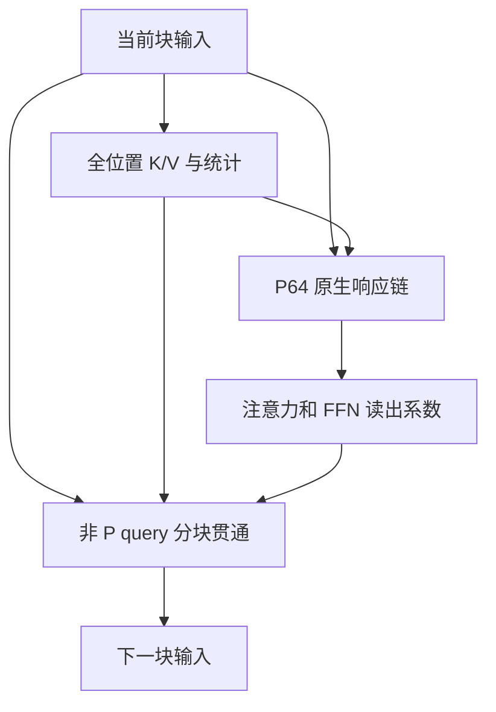

# 当前方法的极限、表示与缓存：从完整计算图重新推导

2026-11-28（北京时间）。证据起点：FFNDS `9bf7eceba0b5af483625886e8965351110b9d125`，当前冻结方法及 job 206224 的已上传评分和计时。本轮遵循用户“先推导，不立即进入消融”的要求：只读源码、真实冻结 CAL 资产及历史回执，执行 CPU 数学核验；没有模型生成、GPU 作业、评分或生产实现变更。

使用 operator-tensor-analysis 与 active-abstraction，具体应用任务读出状态证书、完整锚点—命中周期的资源账本、收缩重排、可合并 softmax 统计、恢复算子的线性作用和计算图的行依赖。真实 CAL 投影与合成算子见证分别标注。

## 1. 当前已利用主要算量空间，仍有明确的表示空间

**在保留两个原生锚点、所有 QKV/输出投影和 cross-attention 的范围内，当前方法已利用约 75% 的乐观可删主算量。它还保留了可以合并的重复计算、可以延后展开的中间状态，以及能与未来读出共同设计的缓存。**

本轮得到三类具体成果：

1. **相同实数目标的图重排**：低噪锚点共享 full/selected 的一次分区归约；P64 前置到两模块读出之前，非 P 行按 query tile 贯通完整块。
2. **同时缩减算子与历史的构造**：对 FFN 线性底座因子化，并只保存旧输入在该因子及窄 J 上的投影；建立包含建锚费用的盈亏条件和恢复后误差等式。
3. **按未来实际作用编码历史**：将 low attention 的 centered 历史和锚点特征合成一个159维状态，保留精确 P64，直接解码其当前输出作用。

当前 P64 核分支已有很经济的收缩顺序；新推导把重点放在重复主乘法、锚点成本和状态消费者上。这里建立的是可构造关系及预算，新的数值配置尚未获得模型质量或速度实测。

## 2. 把“理论极限”绑定到允许改变的计算图

真实形状为 $N=31668,d=5120,m=13824,K=2560,H=40,d_h=128,L=40,P=64$。一个乘加记2 FLOPs；沿用已有512个文本 key 的主矩阵账本。四步 HHLL 含两个锚点和两个命中。

| 对象 | 主矩阵账本 |
|---|---:|
| Dense 四步、40层 | 6.37631 PFLOP |
| 当前列明主矩阵节省 | **27.807%–27.900%** |
| 将 hit FFN/self core 与附加状态构建置零、保留其余节点的参照 | **37.017%** |
| 当前已移除的该范围可删份额 | **75.12%–75.37%** |
| 与该参照间隔 | **9.12–9.21 个 Dense 百分点** |

37.017% 由选定的保留节点决定。扩大到 QKV、输出投影或跨模块表示后，应重新计算参照；它不是整个模型函数的复杂度下界。剩余份额中，三次 selected attention 约占 Dense 全图4.75%–4.84%，两次 FFN 的 $\Delta U A_0$ 占2.083%，selected W1/W2 再占2.083%，已列特征和读出 GEMM 仅约0.149%。

因此，继续改变几个恢复列触及的算术体量较小。更有价值的对象是“为何一个低噪锚点要做两遍重叠注意力”和“为何命中仍需一个5120×5120线性作用”。

最新实测 M 请求34.95769秒中，两锚点16.92099秒，占48.40%；两个命中8.76491秒，占25.07%；step事件外9.27180秒，占26.52%。若只把命中再缩短25%，并固定其余时间，完整请求只缩短6.27%。锚点已经成为值得直接改写的主要对象。

算量与时间可以建立条件参照：假设所有列明 GEMM 都达到 Dense 整个去噪器的平均有效 FLOP/s，且事件外时间固定，则当前算量对应约31.98–32.01秒，37.017%参照对应约29.10秒。这是均匀吞吐假设的结果，不能把它与实测的差异全部归为可消除开销。完整推导见 [理论上限与状态账本](limits/THEORETICAL_LIMITS_AND_STATE.md)。

## 3. 确定的重复计算：让锚点只扫描一次 QK/AV

固定一个 query/head，将 key 集分成选中支持 $S$ 与补集 $U$。令 $\ell_j=q^\top k_j/\sqrt{d_h}$，定义

\[
Z_S=\sum_{j\in S}e^{\ell_j},\quad M_S=\sum_{j\in S}e^{\ell_j}v_j,
\qquad
Z_U=\sum_{j\in U}e^{\ell_j},\quad M_U=\sum_{j\in U}e^{\ell_j}v_j.
\]

当前 low anchor 需要的四个量都可由这组统计直接读出：

\[
S_a=\frac{M_S}{Z_S},\qquad
O_a=\frac{M_S+M_U}{Z_S+Z_U},\qquad
\rho_a=\frac{Z_U}{Z_S+Z_U},
\]

\[
\boxed{C_a=\rho_a\left(\frac{M_U}{Z_U}-\mu_a\right)D_{\sigma_a}^{-1}.}
\]

尺度失活的通道沿用冻结实现的掩码逆；该式在有效尺度通道按通常的逆读取。

实际执行时分别维护两个分区的稳定 online-softmax 状态 $(m,\ell,z)$。每个 key block 只算一次局部 QK 和加权 V，再按照 frozen route 放入对应分区。这里 route 在原生 attention 前已经能由 Q/K 的块统计得到。

这把当前“先算 native，再单算 selected，再相减编码历史”改成“同一遍分区归约，读出 native/selected/质量/历史”。其依据是 softmax 未归一化统计的可合并性，沿用了 [FlashAttention 的分块归约原则](https://arxiv.org/html/2205.14135v2)，分区状态用于当前方法所需的多种读出。

静态可删除的重复主乘法为每层2.524–2.573 TFLOP，全40层100.968–102.940 TFLOP，即 Dense 全图的 **1.583–1.614 个百分点**。列明 GEMM 节省据此变为 **29.421%–29.483%**。新增向量合并、双累积状态和寄存器压力需独立计入实现成本。

CPU 分区恒等核验误差在 $10^{-15}$ 内。当前程序的两个后端归约与 BF16 写回顺序会改变，因此这一结果属于实数算子等价；同时，遗漏质量可以直接由补集统计得到，消除双后端 LSE 相减的数值不一致来源。详见 [attention 推导](attention/ATTENTION_STATE_AND_BYPASSES.md)。

## 4. 从模块串行改成“P64 定系数，非 P 行贯通完整块”

### 4.1 真实图中的依赖切口

当前方法在 self-attention 和 FFN 使用同一组 P64，并在各自输出处覆盖为当前原生响应。两者之间的输出投影、门控、残差、cross-attention（固定文本 K/V）、LayerNorm 均在视频 query 轴上逐行。

因此，在同一当前块输入 $X_t$ 上，P64 的 FFN 输入可以直接由 P64 原生 self-attention 响应经过这些逐行操作获得。它不必等待非 P 行的 attention 恢复，更不依赖该恢复器的拟合系数。这里的教师始终是候选当前输入上的原生块作用。

本节调度具体针对命中步1/3，复用已经缓存的route。P64和各query tile保留原全局token的RoPE位置、调制行与路由行，cross-attention的文本K/V按层预先固定复用；当前冻结执行没有启用会改变此依赖的序列并行或图像编码器分支。

这开放了如下调度：

具体过程是：先生成全位置 K/V 与必要统计；仅计算 P64 的当前 Q、原生 attention、selected 响应及其后继原生 FFN，确定两套读出系数；随后非 P query 每块执行 Q投影→selected attention→恢复→输出投影→cross-attention→归一化→FFN恢复→门控残差。全部 tile 完成后进入下一层。

下一层 self-attention 的全位置 K/V 是新的全局依赖点。层内这段计算不需要为每个阶段建立全 N 响应；也可以不物化完整 N×d 的 Q。输入 residual 可逐 tile 读取，当前 K/V 已预先固定，逐 tile 写出不会影响本层其他 query 的 key/value。锚点还需要Q的块均值建route；若锚点也不保存全Q，则先求块均值、再重算Q的新增投影应另计。

### 4.2 具体省在哪里

真实形状下一份 N×d BF16 为0.30201 GiB，FP32为0.60402 GiB；8192行 FP32 tile 为0.15625 GiB。一份全场40头×32维 FP32设计为0.15100 GiB。流式图可避免或缩小这些中间物化，持久历史45.40 GiB本身保持原定义。当前实际峰值还取决于编译器生命周期、别名及 GEMM 工作区，不能把所有临时字段大小直接相加当峰值节省。

这比旧 P64-first decode 更深入：旧推导已有全场 selected 后再先解码 P64；本轮把 selected 本身和后继 FFN 的系数依赖一起前置。它利用相同 P64 覆写形成的闭合教师路径。

### 4.3 LayerNorm 可以继续用矩来延后展开

若某一行场写为 $R=B+FU$，其中 $F\in\mathbb R^{N\times r},U\in\mathbb R^{r\times d}$，均值与二阶矩可由

\[
\mu_i=\frac{B_i\mathbf1+F_iU\mathbf1}{d},
\]

\[
\nu_i=\frac{\|B_i\|^2+2F_i(UB_i^\top)+F_iUU^\top F_i^\top}{d},
\qquad s_i=\sqrt{\nu_i-\mu_i^2+\varepsilon}
\]

得到。接一个线性读出 W 时，有

\[
[\operatorname{LN}(R_i)\odot\gamma+\beta]W
=\frac{(B_i\odot\gamma)W+F_i[(U\odot\gamma)W]-\mu_i(\gamma W)}{s_i}+\beta W.
\]

因此低秩修正可以推到实际线性消费者，不必先展开整个修正场。该式仍包含底座的主要线性作用；计算交叉矩和小基投影也有费用。softmax/GELU等后续非线性可在必要的 tile 上执行，不据此假设全程低秩闭合。

本轮用真实冻结 CAL 投影，以及明确合成的其他权重/hidden，核验 P64-first 完整块；两套系数、P64 FFN 输入和完整块输出的 CPU 差为0。LayerNorm后线性读出的恒等误差为 $5.77\times10^{-15}$。见 [程序](verify_block_streaming.py) 和 [结果](BLOCK_STREAMING_VERIFIED.json)。这些是代数见证；GPU分块会改变部分kernel形状，有限精度与运行时间另属执行问题。

## 5. FFN：把线性底座和它读取的历史一起缩小

### 5.1 保留当前恢复器，重新定义底座压缩误差

行批量下，真实 FFN 实数参考式是

\[
b_t=Y_a+\Delta U A_0+\Delta h B,
\qquad Q=\Delta hZ-\Delta UJ,
\]

\[
\widehat Y=b_t+\mathcal R_F[P(Y-b_t)],
\qquad \widehat Y_P\leftarrow Y_P.
\]

这里 B 是selected W2，$\mathcal R_F$ 是当前16增益＋P64核的GLS读出。固定当前 Q/X/V/metric 时，它对残差标签是线性的，且 Q/X 的定义不读取 A0。

将 $A_0$ 替换为 $A_r$ 并重新使用原生 P64 拟合，得到精确的实数关系：

\[
\boxed{\delta\widehat Y=M_H(I-\mathcal R_FP)[\Delta U(A_r-A_0)].}
\]

这给出更合适的压缩对象：底座舍弃的作用经过当前观测恢复后，还剩下多少。相应目标保留对来源、当前特征和增量的联合期望，而非仅优化 $\|A_r-A_0\|_F$。

### 5.2 一个精确可移动的成分族

对于任意固定 $c\in\mathbb R^{16}$，令

\[
A_c=A_0+J\operatorname{diag}(c)V,
\qquad B_c=B-Z\operatorname{diag}(c)V.
\]

只改变近似分支的这两个矩阵，原生教师保留原模型权重。此时

\[
b_c=b-Q\operatorname{diag}(c)V,
\qquad g_c=g+c,\qquad C_c=C,
\]

所以最终实数输出相同。这精确刻画了底座、selected分支与在线增益之间能转移的16模式成分。可在该等价类中选择更适合因子化或编码的表示。它只有16个标量自由度、矩阵更新秩至多16；大幅低秩化仍属于下面的受控近似。

### 5.3 因子化与缓存形成同一个构造

本节默认 $c=0$。若先选取上一节的等价表示，则将 $A_0,B$ 同时替换为配对的 $A_c,B_c$，令 $A_r$ 逼近 $A_c$，相应恢复后误差使用 $\Delta U(A_r-A_c)$。

若 $A_r=L_rR_r$，anchor保存

\[
\boxed{Y_a,\quad z_{a,K},\quad a_a=U_aL_r,\quad j_a=U_aJ.}
\]

hit使用

\[
b_t^{(r)}=Y_a+(U_tL_r-a_a)R_r+\Delta hB,
\qquad Q=\Delta hZ-U_tJ+j_a.
\]

旧输入5120列因此被 r+16 列实际未来读出的坐标替代；GELU所需的2560列锚点预激活仍保留。这区别于旧的截距折叠：无需每个anchor先展开一次完整 $U_aA_0$ 再保存差值。

| 因子秩 r，静态示例 | FFN历史，BF16投影＋FP32 J | 当前历史 | 全片净省主算量，含建锚 |
|---:|---:|---:|---:|
| 512 | **19.404 GiB** | 30.201 GiB | **92.563 TFLOP** |
| 1024 | **20.612 GiB** | 30.201 GiB | **52.715 TFLOP** |
| 1536 | 21.820 GiB | 30.201 GiB | 12.867 TFLOP |

若投影也用FP32，r512/r1024历史分别20.612/23.028 GiB。保留P64原输入以维持原 Q_P 数值路径另需0.0244 GiB。表内秩是资源示例，现有本地资产没有完整 A0/DeltaU，尚未据真实恢复后谱选择可用秩。

每个anchor只服务一个hit，完整线性路径成本为 $6Ndr+2Nd\cdot16$，原路径为 $2Nd^2$，因此

\[
\boxed{r<(d-16)/3\simeq1701.3}
\]

才节省这一完整周期的主乘法。这个条件比只看命中的 $r<2560$ 更准确。它同时说明 r2048虽节省状态，完整周期算量会增加。

当前 BF16 差分、GEMM输出、投影编码和加法顺序形成的缺陷需加入上述作用误差。若 Q_P/X_P 保持，输出对实际底座误差仍由相同线性恢复器作用；非 P 的 Q 数值变化另有 $\delta Q\operatorname{diag}(g_{\mathrm{new}})V$，其中增益是在新底座上重新拟合的值。完整证明、规范变换及16项CPU核验见 [FFN 推导](ffn/FFN_GRAPH_AND_CACHE_DERIVATION.md)。

## 6. Attention：保存未来会读取的联合历史

当前 low hit 每头保存 $C_a\in\mathbb R^{N\times128}$、$A_a\in\mathbb R^{N\times31}$ 和 $\rho_a$。将当前读出系数分成偏置 $\Gamma_0$ 与斜率 $\Gamma_1$，历史只通过

\[
C_aD_{\sigma_t}-A_a\Gamma_{1,t}
=\underbrace{[C_a,A_a]}_{Z_a\in\mathbb R^{N\times159}}
\underbrace{\begin{bmatrix}D_{\sigma_t}\\-\Gamma_{1,t}\end{bmatrix}}_{G_t\in\mathbb R^{159\times128}}
\]

进入输出。这给出一个比独立压两个字段更直接的表示。

保留 $\rho_a$ 和 P64 的 C/A 原值；只对非 P 行保存 $U_a=Z_aE$，解码表示为 $\widetilde Z_a=U_aD$。命中时直接计算

\[
U_a(DG_t),
\]

不重建两份全场历史。在固定当前 Q/K/V 下，P64 的设计、底座和教师不变，因此拟合系数 $\Gamma_t$ 不变，最终BF16写回前的实数输出误差恰为

\[
\boxed{\delta O_{\bar P}=(\widetilde Z_a-Z_a)G_t
=\delta C_aD_{\sigma_t}-\delta A_a\Gamma_{1,t}.}
\]

这是一条可直接操作的任务误差。若跨 head 连接输出投影，准确的配对目标是

\[
\mathbb E_{(a,t)}\left\|\sum_h
Z_{a,h,\bar P}(I-E_hD_h)G_{t,h}W_{o,h}\right\|_F^2.
\]

历史与当前读出来自同一轨迹，head间也有交叉项；只有读出固定或联合矩可分离时，才能进一步化为两个平均Gramian的加权SVD形式。选择固定读出度量也可形成一个明确的替代目标。

| 编码宽度 k，静态示例 | low主要状态，含rho、精确P64及编码基 | 相对当前周期新增算术 |
|---:|---:|---:|
| 64 | 6.277 GiB | +1.454 TFLOP |
| 96 | 9.307 GiB | +2.385 TFLOP |
| 128 | 12.336 GiB | +3.316 TFLOP |
| 当前独立C/A | 15.195 GiB | 基准 |

表中采用正交编码 $E=R,D=R^\top$，只保存一份基；一般独立的E/D需另计解码基。编码与基的量化可纳入 $\widetilde Z-Z$，最后的输出cast与GEMM舍入缺陷另计。该表示减少持久状态，增加编码/解码主乘法。它能否同时减少延迟，要看所替代的HBM流量、融合及GEMM效率；当前没有把k示例写成已经通过质量的配置。

本轮实际读取冻结CAL，high/low的128×31投影均满列秩，条件数约1.068/1.066。low归一化64维特征相关谱的前31项占53.17%；它没有给出历史联合状态的压缩谱。因此这里明确把后续数学对象定位为 Z 与 G 的配对作用，而不是拿已有特征谱替代新对象。见 [真实CAL计算](ACTUAL_CAL_READER_ANALYSIS.json) 和 [attention 读出推导](attention/ATTENTION_STATE_AND_BYPASSES.md)。

## 7. 哪些部分已经经济，哪些表示自由度仍值得保留

当前FFN核项采用

\[
(XX_P^\top/K)C:\quad N\times K\to N\times64\to N\times d.
\]

先展开成 $X_P^\top C\in\mathbb R^{K\times d}$ 会使该核项主乘法增加26.72倍。N×80的联合读出已经利用了16模式与P64的低维结构，值得保留。

high OUT-ABS 的共享仿射修正则可继续吸收进当前输出投影：

\[
W_{h,\mathrm{eff}}=W_h+B(\Gamma_{1,h}W_h).
\]

这减少恢复特征及中间输出的物化，主 N×5120 的 W_o GEMM 仍在。每层动态权重与偏置准备约3.303 GFLOP，当前特征和恢复两部分约36.157 GFLOP；固定投影预合成、动态W_o折叠与P64额外输出投影不能重复计收益。该式与冻结BF16特征及最终attention cast之间有明确舍入缺陷，因此本轮把它保留为收缩路径选择。

当前30.20 GiB的FFN三缓存也不是信息下界：固定模型下，u_a决定y_a和z_a。只存u_a仅12.08 GiB，但每片需额外717.26 TFLOP来重算anchor FFN。更极端地，先获得下一步输入，再将anchor重放与hit逐层交错，可以把主要历史缩到单层约1.135 GiB，代价是整片多约50% Dense主算量。它们明确展示时间—空间曲线；本轮的新联合因子化则寻找能同时改善两个资源的条件。

从数学上，若线性编码为 $z=Es$，未来读出族为 $G_\theta s$，精确恢复所需条件为

\[
\ker E\subseteq\bigcap_\theta\ker G_\theta.
\]

P64描述新增观测接口；缓存要保留的是未来读出能区分的历史作用。实际可达状态、允许误差及下游任务共同决定近似可压缩性。本轮所有具体缓存构造都围绕这一点展开。

## 8. 本轮形成的研究判断

**已有方法已经利用当前局部替换框架中的主要收益，计算图与状态表示仍有具体空间。** 可以按作用区分：

| 构造 | 主要收益 | 数学身份 |
|---|---|---|
| low anchor一次互补归约 | 删除确定的重复selected主乘法 | 实数等价；归约数值路径改变 |
| P64先行、非P贯通完整块 | 延后展开、减少中间物化、缩短状态生命周期 | 同一当前输入下的依赖重排 |
| FFN规范变换 | 精确转移16模式成分 | 实数输出等价类 |
| A0因子化＋输入投影缓存 | 同时降低线性计算与历史 | 带恢复后误差的近似；有全周期盈亏界 |
| C/A联合历史＋动态读出 | 减少持久状态，直接读出作用 | P64保真下局部误差可精确表达 |

方法核心因此可以进一步收紧：当前廉价计算给出底座，精确P64确定尚未解释的作用，历史只保存下一次读出真正需要的状态；恢复在实际消费者处展开。这里没有要求所有模块都使用同一个近似器，而是让它们共享同一种信息与执行组织原则。

本轮没有创建新的消融、生成或调参任务。尚待真实资产回答的理论量已被具体化为：FFN线性作用经过现有恢复后的可压缩谱，以及attention历史和未来读取的配对作用谱。它们决定近似表示可取的维数；已经证明的图重排和资源条件独立成立。

## 可复算资产与证据范围

- [limits/](limits/)：真实形状整数算量、时间敏感度、状态证书。
- [ffn/](ffn/)：真实GLS结构、规范变换、因子化状态及误差；合成CPU操作数。
- [attention/](attention/)：真实冻结CAL矩阵、单遍分区、历史联合读出及有限精度缺陷。
- [verify_block_streaming.py](verify_block_streaming.py)：完整块依赖重排和LayerNorm后线性读出的CPU见证。
- [RESEARCH_STATUS.json](RESEARCH_STATUS.json)：本轮范围、固定证据、用户方向与未执行事项。

CPU恒等核验误差约 $10^{-14}$ 或更低；真实CAL矩阵哈希与冻结方法完全一致。其余数值见证使用明确合成的操作数，不将这些误差解释为真实Wan成片误差。完整模型质量与速度继续引用已经完成的50源与108次计时，本轮不更新那些实测值。
