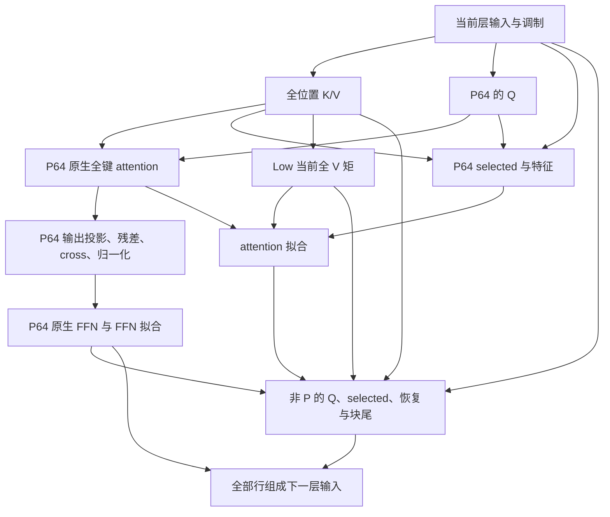
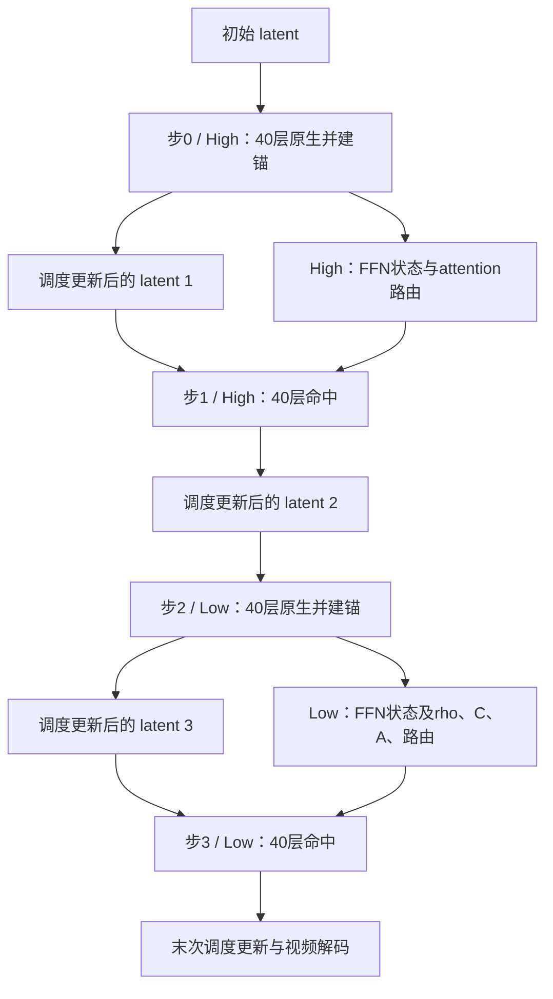

# FFNDS 当前方法：数学定义、信息覆盖与时间因果图

2026-11-28（北京时间）。研究分支证据起点：`72280c1a264bf018343e746a2df2993dafe89149`；最近五源试验原始证据：`5f83e1c590b6cb93b81dbe88a21101ca1b9260a6`。

本稿整理当前冻结的 **BF16 wide8192 + high OUT-ABS + low mass-centered OUT-D**，并将已测试的图重排、状态压缩作为有独立身份的变体。使用 operator-tensor-analysis 与 research-reasoning，具体应用割线分解、观测算子、GLS 的张量原子 Gram、未来读出的充分状态、计算图合法调度和误差沿图传播。计算证据包括真实 P64 几何、真实冻结 CAL 小资产，以及明确标注的合成代数见证；本轮没有模型前向、GPU 作业、成片或评分。

## 1. 一个统一的数学对象，三种具体模块实现

固定去噪步 s、专家 e、层 ℓ，当前方法可写为

\[
\widehat F_s(U;M_a)=B_s(U;M_a)+\mathcal R_{\Phi_s}\{P[F_s(U)-B_s(U;M_a)]\},
\qquad P\widehat F_s\leftarrow PF_s.
\]

其中 M_a 是同一专家、层、原位置上的锚点状态，B 是利用当前输入计算的底座，P 提取64个固定位置，Φ 是生成时已经取得的当前特征，恢复算子 R 的系数由当前原生教师确定。全量输入和模型权重在推理时仍可用；这里讨论的“可观测性”针对所选廉价特征和恢复器，而非宣称原模型缺少计算真实输出的信息。

这个形式容纳三个不同机制：FFN 保存逐位置原生起点，显式更新选中非线性通道和未选通道的固定斜率；高噪声注意力只保存路由，使用当前 selected 响应及绝对特征读出；低噪声注意力还保存遗漏部分的标准化贡献和锚点特征，以当前 V 的均值、标准差搬运历史。三者共享观测协议，底座和被恢复的残差各有定义。

### 1.1 轴与真实配置

| 符号 | 轴或对象 | 当前绑定 |
|---|---|---|
| s | 去噪调用序号 | 0、1、2、3，专家 H、H、L、L |
| ℓ | 专家内层号 | 0…39 |
| p=(f,y,x) | latent 视频时空位置 | 21×29×52，N=31,668 |
| f | latent 视频帧轴 | 与去噪步 s 不同；生成视频为81帧 |
| τ | 图中执行提交顺序 | 由源码顺序导出的偏序扩展，不是 GPU 时间戳 |
| σ_s | scheduler 噪声尺度 | 依当前运行配置；最新 pilot 未附数值表 |
| d、m、k | 模型宽度、FFN隐藏宽度、选中通道数 | 5,120；13,824；2,560 |
| H、d_h | attention头数、每头宽度 | 40；128 |
| P、r | 原生教师位置数、FFN共享模式数 | 64；16 |
| wide8192 | FFN命中执行tile最大行数 | 8,192，独立于 attention 支持大小 |

注意力的冻结路由按128行分块，从248个 key block 中选31个；最后一块仅52行，所以每个 query/head 读取3,892或3,968个有效 selected key，占全键12.29%–12.53%。源码没有额外并入 local block。P64占token位置的0.2021%，每个位置都提供完整输出向量，不能把它误记为64个标量标签。

来源：[冻结方法绑定](../../20261127/centered_medium_eval/FROZEN_METHOD_BINDING.json)。具体原始文件及SHA见各附录。固定版本：[绑定](https://github.com/Qesire/FFNDS/blob/72280c1a264bf018343e746a2df2993dafe89149/research/20261127/centered_medium_eval/FROZEN_METHOD_BINDING.json)、[attention路由与执行](https://github.com/Qesire/FFNDS/blob/72280c1a264bf018343e746a2df2993dafe89149/research/20261124/attention_wide8192/results/joint39/attention_online_structured.py)。

## 2. FFN：明确已经覆盖的非线性与待恢复的余项

采用行向量约定，W₁∈R^{d×m}、W₂∈R^{m×d}，

\[
F(U)=\phi(UW_1+b_1)W_2+b_2,
\]

φ 为当前原生 tanh-GELU。设选中隐藏通道集合 K 的大小为 k=2560，未选集合为 J。定义 ΔU=U_s−U_a、Δφ_K=φ(z_{s,K})−φ(z_{a,K})。离线编译器把选中通道的 β 置零，因而

\[
A_0^*=W_{1,J}\operatorname{diag}(\beta_J)W_{2,J},
\]

\[
F(U_s)-F(U_a)=\Delta U A_0^*+\Delta\phi_KW_{2,K}+R_J,
\]

\[
R_J=[\Delta\phi_J-(\Delta U W_{1,J})\odot\beta_J]W_{2,J}.
\]

这是实数代数恒等分解。**在实数参考图中，当前底座保存全部位置的原生起点，精确保留 selected 通道的真实激活变化，并对未选通道加入固定斜率作用；恢复器面对的是 R_J。** 选中通道占隐藏宽度18.52%，这个比例不等于已恢复信息或成片质量的比例。

部署使用的矩阵为A₀^dep=BF16(fl₃₂(A₀*))；BF16差分、selected预激活、激活查表及写回也带有具体舍入。实际恢复器承担的残差还包括这些数值缺陷，不能把此恒等式中的理想中间量直接等同于部署字节。

实际缓存是 M_a^F=(U_a,Y_a,z_{a,K})，其中 Y_a=F(U_a)。底座

\[
B=Y_a+\Delta U A_0^*+\Delta\phi_KW_{2,K}.
\]

线上还计算16列模式特征

\[
Q^F=\Delta\phi_K Z-\Delta U J_F\in\mathbb R^{N\times16},
\]

以及由 selected 割线/激活差构造的核特征 Ξ∈R^{N×2560}。Z、J_F、输出方向 V_F∈R^{16×d} 和核标度在离线固定；它们的源码定义、查表误差与dtype见 [FFN完整推导](ffn/FFN_FORMAL.md)。

### 2.1 P64 怎样确定16模式和核读出

令 E_P=P(F(U_s)−B)、K_PP=Ξ_PΞ_Pᵀ/k。冻结P64上的同帧邻边关联矩阵记为 D_E∈R^{42×64}，点边度量和协方差为

\[
M=I+\frac{64}{42}D_E^\top D_E,
\qquad S=K_{PP}+M^{-1}.
\]

当前程序先解

\[
G=(Q_P^{F\top}S^{-1}Q_P^F)\odot(V_FV_F^\top),
\]

\[
g=G^{-1}b,\qquad
b_j=\sum_p(S^{-1}Q_P^F)_{pj}(E_PV_F^\top)_{pj},
\]

再解 C=S^{-1}(E_P−Q_P^F diag(g)V_F)，读出为

\[
\boxed{\widehat Y=B+Q^F\operatorname{diag}(g)V_F+\tfrac12K_{NP}C},
\qquad \widehat Y_P\leftarrow F(U_s)_P.
\]

这里80是16列模式加64列核的设计宽度。用真实P64重建的42条边全在同一latent帧内；[I₆₄;D_E]有106行、秩仍64。边度量强调已观测位置间的差分，提供的是拟合偏好，不新增教师信息，也没有显式跨视频帧的边标签。实际P64覆盖19/21个latent帧，未直接取点的帧是7与15。

### 2.2 两条精确的能力边界

**16模式的可辨识性来自位置与输出方向共同作用。** G 是张量原子 (S^{-1/2}q_j)⊗v_j 的Gram。G可逆等价于这些原子的线性独立，并不要求rank(Q_P^F)=16。若V_F行正交，各模式只需其q_j在P上非零即可独立辨识。若真实R_J属于Q^F diag(g*)V_F、G可逆且按实数计算，那么g=g*、C=0，全部位置的该类残差都能恢复。

**核分支扩展了可表达的输出方向，但采用收缩读出。** C包含完整d维教师残差，故方法的输出校正能力并非只限于16个输出方向。当前代码在联合求解后把核贡献乘1/2；一般核残差不能据此获得全场精确插值，P上的精确性由最后覆写实现。G没有增益正则，运行路径要求G可逆；在U_s=U_a使Q=Ξ=0的形式情形，通用求解会奇异。这个代数边界说明需要可辨识性条件，不代表当前视频已出现该故障。

## 3. Attention：当前信息、历史信息与剩余变化

每头 q、k、v 的位置轴均为N。当前hit仍计算完整Q/K/V、QK归一化与RoPE，只在attention核心的配对收缩中缩小key支持。设由anchor选择的固定支持为 S_a(p)，

\[
O_{s,p}=\sum_j a_{s,pj}v_{s,j},\quad
a_{s,pj}=\operatorname{softmax}_j(q_{s,p}^\top k_{s,j}/\sqrt{128}),
\]

\[
S_{s,p}=\sum_{j\in S_a(p)}\frac{a_{s,pj}}{\sum_{i\in S_a(p)}a_{s,pi}}v_{s,j}.
\]

S是当前Q/K/V上的selected条件均值，并非原生softmax下已带完整概率质量的部分和。更新路由发生在s=0、2；s=1、3沿用对应专家anchor的支持。

### 3.1 High：当前稀疏输出＋绝对特征恢复

高噪声anchor只缓存route。高噪声hit的底座 B_H=S_s，31列投影特征来自当前selected输出；加截距形成X_H∈R^{N×32}。逐头以64个**当前全key原生子查询**拟合遗漏响应。

### 3.2 Low：标准化遗漏贡献的跨步搬运

定义当前真实遗漏质量 ρ_s=1−Σ_{j∈S_a}a_{sj}、当前全V通道均值μ_s和标准差σ_s，D_s=diag(σ_s)。在有效尺度通道可写

\[
O_s=(1-\rho_s)S_s+\rho_s\mu_s+C_sD_s.
\]

冻结实现保存的质量记为 \(\widetilde\rho_a\)，与理想ρ区分：它主要由两种后端的LSE差获得，只在触发条件下重算遗漏质量，未对所有行全局clamp。历史编码为

\[
\widetilde C_a=\operatorname{BF16}\{[O_a-(1-\widetilde\rho_a)S_a-\widetilde\rho_a\mu_a]D_a^\dagger\},
\]

低噪声hit使用当前全V的矩，

\[
\boxed{B_L=(1-\widetilde\rho_a)S_s+\widetilde\rho_a\mu_s+\widetilde C_aD_s.}
\]

尺度小于阈值1e−12的通道沿用源码的置零/掩码逆语义。它与含31列的BF16 anchor投影A_a一起缓存，hit使用X_L=[1,A_s−A_a]。

将当前真实表达减去底座，得到

\[
\boxed{O_s-B_L=(\rho_s-\widetilde\rho_a)(\mu_s-S_s)
+(C_s-\widetilde C_a)D_s.}
\]

这使缺口具体化：当前V的均值、逐通道尺度已更新；遗漏质量变化与标准化遗漏加权贡献的变化留给P64读出。冻结路由迁移、相关结构改变和编码舍入都会进入这些量。

相应的正面保证是：若attention权重不变，V只经历逐通道正比例缩放与平移，且尺度有效、忽略有限精度，ρ与C保持不变，当前底座就能准确搬运这类变化。它有明确的变换覆盖，不只依赖“相邻步输出接近”的经验判断。

### 3.3 P64 attention恢复的准确形式

将程序的固定输出标度吸收到系数Γ后，两种读出均为

\[
\Gamma=(X_P^\top X_P+\alpha I)^{-1}X_P^\top(O_P-B_P),
\quad\alpha=64\times0.1=6.4,
\]

\[
\widehat O=B+X\Gamma,\qquad\widehat O_P\leftarrow O_P.
\]

截距同样受正则。即使真实残差恰为XΓ*，也仍有

\[
\Gamma-\Gamma^*=-\alpha(X_P^\top X_P+\alpha I)^{-1}\Gamma^*.
\]

因此“残差位于特征空间”和“当前正则恢复器全场精确”是两个不同条件。ridge提供稳定求解，并引入收缩偏差；P覆写只在64行消去该偏差。

真实冻结CAL数组的两套128×31合成投影均秩31、条件数约1.068与1.066；这支持离线投影本身的数值良态。实际运行X_P的秩、条件数和对遗漏残差的覆盖仍需当前激活才能判断。详见 [attention推导与实算](attention/ATTENTION_FORMAL.md)。

## 4. 真实块计算图：P64能闭合一层，误差会通过下一层重新进入

用\(\mathcal W_o\)表示原生输出投影（含原生偏置语义），一块的实数计算为

\[
R=X+g_A\odot\mathcal W_o(O),\quad
T=R+\operatorname{CrossAttn}(\operatorname{LN}_3(R),c),
\]

\[
U=\operatorname{Mod}_F(\operatorname{LN}_2(T)),\qquad
Y=T+g_F\odot F(U).
\]

self-attention之前还有LN₁、时间调制、Q/K/V投影、QK norm与原位置RoPE。调制字段须按原始token行广播/索引，不能在图重排中将位置轴和batch轴混合。cross-attention的query依赖当前R，文本K/V由固定条件与当前专家/层权重决定。

### 4.1 信息依赖图：可合法前置的P链

这是信息图。anchor状态、固定参数和原坐标是相应节点的另外输入，完整机器图逐项列出。P64原生attention经过逐行的后继操作，可确定P64的真实FFN输入；这条教师尾链在信息上不依赖attention拟合系数Γ。当前某些prepare接口仍先完成Γ拟合再返回，这是实现次序边，可以和必要的信息边分别标记。

在实数原生算子语义下，同层两个P覆写给出

\[
P\widehat{\mathcal B}(X)=P\mathcal B(X).
\]

该等式固定的是同一当前输入X。实际BF16运行以指定的原生P子调用作为教师；不同后端或batch形状的舍入差另计，不能凭实数等式声称与全N原生调用逐位相同。

### 4.2 下一层会重新混合非P误差

即使某层P位置输入相同，下一层P query仍读所有位置K/V。对一头attention作一阶变化，

\[
\delta o_p=\sum_j a_{pj}\delta v_j+
\sum_j a_{pj}(v_j-o_p)\delta s_{pj},
\quad
\delta s_{pj}=\frac{\delta q_p^\top k_j+q_p^\top\delta k_j}{\sqrt{d_h}}.
\]

当P上的输入没有变化时，δq_p可为零，但非P位置的δk_j、δv_j仍会改变o_p。因此固定P64保证的是每次调用的局部教师边界，不能保证这64个位置沿完整深度与Dense轨迹一致。反过来，attention误差通过输出投影、门控、cross与归一化改变当前FFN输入；FFN误差经下一层K/V和下一去噪步返回attention。二者由这些实际边耦合。

## 5. 跨步时间图：锚点刷新保留先前轨迹差异

本绑定的Wan22StepDistillScheduler没有UniPC多步历史。实际代码先转FP32，依次算 z_s−σ_s v_s，再于非末步加σ_{s+1}v_s，最后cast回latent原dtype；约定σ₄=0时，实数参考可统一写 z_{s+1}=z_s−h_s v_s，其中h_s=σ_s−σ_{s+1}。程序末步实际没有第二次加法，合并实数公式不意味着可以改变浮点执行顺序。高低专家切换不额外重加噪。

**整个带缓存方法的充分状态是 Z_s=(z_s,M_s,执行上下文)，不只是z_s。** scheduler自身不读历史，FFNDS命中读同专家的anchor历史。s=2用的是s=1更新后的候选latent；即使s=2所有被加速模块都执行原生，也会将已有状态差异带入新的Low锚点。刷新使后续历史与当前轨迹对齐，没有执行Dense轨迹重置。

### 5.1 生命周期与可计算时点

| 状态或量 | 最早获得 | 读取者 | 最后语义使用 |
|---|---|---|---|
| CAL矩阵、投影、P64、层权重 | 生成前 | 对应专家/层 | 多请求复用，版本绑定 |
| High route | s0同层Q/K完成后 | s1 selected和教师配对特征 | s1同层输出形成后 |
| FFN U_a/Y_a/z_aK | s0或s2该层原生FFN | 相应s1或s3同层FFN恢复 | 此次命中读出结束 |
| Low route、ρ_a、C_a、A_a | s2原生/selected、V矩与编码完成后 | s3同层底座、设计与P64拟合 | s3同层读出结束 |
| 当前全V矩μ_s、σ_s | 当前全V完成或等价全量归约完成后 | Low底座与读出 | 当前层 |
| attention Γ_s | 当前P64原生全键响应和X_P、B_P完成后 | 当前层所有非P恢复 | 当前层 |
| FFN g_s、C_s | P64真实FFN输入、教师、底座/特征完成后 | 当前FFN非P行 | 当前层 |

FFN两个专家分时复用40个物理槽；80套专家/层固定参数是另一种数量。逻辑take/pop、最后一次读、物理内存可复用和allocator释放分别处理。一次anchor在HHLL里只有一个后续hit，因此缓存构建和布局转换只摊到一次复用。

下一层P原生全键输出在逻辑上依赖全部key贡献。当前kernel API要求完整K/V数组就绪。online softmax允许分批累计贡献，所以该依赖不等于数学上必须把完整K/V长时间物化；跨层流水仍需遵守query就绪、每个key贡献及归约完成的次序，本轮没有将其登记为已实现的加速。

## 6. 状态压缩的时间约束：未来读出何时已知

FFN中旧U的消费者包含固定A₀与J_F，因而可以在anchor时分析其联合读出空间；将它们因子化或折叠有明确的代数条件，同时增加建锚计算并改变可能的舍入边界。

Low attention的联合历史则为

\[
Z_a=[\widetilde C_a,A_a]\in\mathbb R^{N\times159},\quad
G_s=\begin{bmatrix}D_s\\-\Gamma_{1,s}\end{bmatrix}\in\mathbb R^{159\times128},
\]

历史只通过Z_aG_s进入当前输出，但G_s要到hit的当前V矩、P64教师与拟合结束后才确定。若anchor时采用固定线性编码E并要求对任意全空间历史、全部允许的未来读出都精确，必须有

\[
\operatorname{col}(G_s)\subseteq\operatorname{col}(E)\quad\text{对全部允许未来 }s.
\]

在D_s可逆时，令M_s=Γ_{1,s}D_s^{-1}。单次G_s秩128；两种可能未来读出的联合秩满足

\[
\boxed{\operatorname{rank}[G_1,G_2]=128+\operatorname{rank}(M_2-M_1),}
\]

可达159。这里的“两个未来”是编码时必须适用的两种可能情形，并非声称本HHLL每个anchor复用了两次。因而单次输出128维不能推得固定128维编码普遍无损；rank64在此精确标准下属于受状态分布约束的近似。实际轨迹是否拥有更低任务秩，需要真实成对状态判断，本轮没有用合成满秩见证替代这个数据问题。

若P64原历史保留精确侧存，则局部拟合Γ可保持不变，非P压缩误差为

\[
\delta O_{\bar P}=(\widetilde Z_a-Z_a)G_s.
\]

侧存保护了拟合边界；非P丢失分量没有新教师标签，因此同一P读出不会自动识别这些额外缺陷。后续真实影响还要乘Wo、门控并经过cross/FFN等算子。

最近rank64资产的配对目标使用每层3个CAL源各128个非P行的Z/G，实施8步优化；该次capture没有保存Wo，所以使用的是head输出能量目标，没有覆盖后继完整块、scheduler或在线BF16 code量化。这个覆盖范围由实际编译路径确定，不能称为整个后继计算图上的最优缓存。

## 7. 用联合误差目标把数学覆盖与成片影响接起来

### 7.1 局部恢复覆盖

固定当前底座、特征与可解性，恢复算子R对P标签是线性的。设r=F(U)−B，H=I−PᵀP为非P掩码，则

\[
\boxed{e=\widehat F(U)-F(U)=-H(I-RP)r.}
\]

RP r=r是准确恢复的充分条件；包含P硬覆写后的准确条件是H(I−RP)r=0。P不可见的自由残差无法仅靠标签改变系数。这里讨论的是采用给定特征后的残差类，不是对固定完整输入另造一个不同的原生输出。

若原生P子调用与指定全场目标之间有数值差ε_P，上式还应加入HRε_P+Pᵀε_P，并保留读出写回误差。教师覆写严格保持该次子调用返回值，实数参考与指定后端数值目标因此有清楚的分界。

如只改变底座b→b+δb，同时保留相同特征/教师并重新拟合，则

\[
\delta\widehat F=H(I-RP)\delta b.
\]

因此底座压缩应评价**恢复后**仍存在的作用误差。若特征、数值路径或拟合条件也变了，还必须加上这些变化的项；最近FFN因子化含投影编码与BF16差分路径变化，不能把所有实测差异都归到单个A₀残差。

### 7.2 沿图的误差传播

比较当前冻结图与一个变体时，先将两图对齐到相同的张量语义空间。rank64缓存与159维历史不能直接互相代入；需要将编码加解码合成同输入输出语义的子图，或显式定义共同状态空间中的嵌入。在此基础上，把状态作用、读出、残差和scheduler作为节点。对参考节点f_v、变体节点\(\widetilde f_v\)，令同一候选父输入上的局部缺陷为

\[
e_v=\widetilde f_v(\widetilde x_{pa(v)})-f_v(\widetilde x_{pa(v)}).
\]

固定分支并满足可微条件时，沿父输入连线积分Jacobian，可得

\[
\delta x_v=\sum_{u\in pa(v)}\overline J_{vu}\delta x_u+e_v.
\]

缓存节点使跨步的历史路径也进入图。递归展开后，末端差异是一组沿有向路径传播的局部项之和。若参考是Dense，则其不读取近似缓存，相关差异归入命中模块自身的局部缺陷；不能同时把它重复计作另一条独立Dense缓存路径。top-k支持切换、BF16量化和硬分支应显式留作有限变化项，不能套用光滑Jacobian忽略。

在固定轨迹的一阶近似中，记传播到最终latent/指定读出的线性作用为L_v，

\[
\delta z_{final}\approx\sum_vL_ve_v,
\]

\[
\|\delta z_{final}\|^2\approx\sum_v\|L_ve_v\|^2+
2\sum_{u<v}\langle L_ue_u,L_ve_v\rangle.
\]

它说明联合目标需要包含后继敏感方向与误差交叉项。局部输出Frobenius误差、attention与FFN各自的压缩误差之和，均不能直接替代这个目标；VBench又是另一个非线性评价对象。现有五源分数的非加性可作为观察，未辨识出内部误差相关项的数值或因果归属。

## 8. 覆盖与缺口的当前边界

| 层面 | 已有明确覆盖 | 当前缺口或尚未取得的证据 |
|---|---|---|
| FFN非线性 | 原生逐位置起点；selected真实激活差；omitted固定斜率；可辨识的16模式；核残差传播 | 当前omitted非线性余项只有P64直接标签；真实站点G条件数未随pilot提供 |
| attention当前信息 | 当前全Q/K/V、selected响应；P64当前全key响应；Low当前V均值/尺度 | 非P当前遗漏质量和标准化遗漏贡献未直接更新；ridge有明确收缩偏差 |
| 位置/视频帧 | anchor覆盖全部31,668位置；P64分布于19个latent帧 | 当前新标签只在64位置；42条边只在同帧内，未提供显式跨帧边观测 |
| 后继模块 | 原生Wo、门控、cross、LN、残差作用；P教师链在同层闭合 | 读出与最新缓存资产目标没有整体优化这些后继敏感方向 |
| 时间 | HHLL的同专家anchor→hit绑定；每层生命周期可展开 | s2刷新继承先前latent差；数值sigma表在最新pilot仍是OPEN_BINDING |
| 状态表示 | 已明确固定读出与未来读出的充分性条件；P侧存隔离局部拟合 | 任意历史的秩下界不等于实际数据任务秩；实际可用秩不能由FLOP或缓存尺寸决定 |
| 执行 | 源码导出的全图无环、无未来读取、槽不跨专家误用；已有真实四步计时 | τ不是GPU profiler时间；kernel重排的吞吐、同步与占用不能从拓扑直接推出 |

五源结果给执行部分的约束是具体的：01接口整理保持轨迹/视频一致、速度比0.9986；09组合图速度比0.8160，耗时增加22.55%；其Low anchor多4.90秒，贡献四步额外GPU时间约64.5%。07/08分别减少约13.90/7.51 GiB峰值，同时出现已报告的质量代价；10组合状态降低约23.62 GiB峰值，耗时增加25.95%，成像/美学平均下降6.43/3.33个百分点。这些结果约束的是已执行版本，不能外推为所有同目标表示的理论最优或理论不可能。计时与分数的完整身份和五源选择边界见 [已发布复算](../graph_state_implementation/five_source_pilot/review/REASSESSMENT.md)。

## 9. 本轮已经完成的数学计算与执行图验收

| 核验 | 输入身份 | 所支持的结论 |
|---|---|---|
| P64、同帧邻边及秩 | 冻结真实observer_ids | E=42，rank(D_E)=42，rank([I;D_E])=64；19/21 latent帧 |
| FFN16项代数证书 | 真实P64几何＋明确合成矩阵 | 割线分解、GLS张量Gram、模式可辨识、半核系数、恢复后误差恒等式 |
| attention CAL投影 | 三份冻结CAL字节与SHA | 两套合成投影均rank31，条件数约1.068/1.066 |
| attention读出/搬运/未来秩 | 真实CAL投影＋明确合成其余操作数 | ridge偏差、质量/历史缺陷等式、未来联合读出128→159秩见证 |
| 误差沿图传播 | 明确合成attention与线性扩展状态图 | P局部精确仍可读入非P误差；原生新anchor仍继承状态差；交叉项闭合 |
| 全四步DAG | 绑定源码、真实P64与已有step计时 | 冻结图与已测09图的拓扑、缓存生命周期、全key依赖和步骤身份一致 |

真实CAL feature spectrum的方差占比应对奇异值平方求和：31/64维标准化feature能量占比为59.89%/58.01%。早先对奇异值直接求和的53%/54%不能称方差保留率；这两种数值都不是attention残差、缓存历史或成片信息的保留比例。

发布资产保留四种证据等级：源码绑定、实数推导、CPU数学核验、既有GPU端到端结果。完整展开图的每个节点带s/e/ℓ/τ、信息依赖、张量作用、状态读写与来源；时长只挂到原收据已有的step宏节点。展开图和生成器可复核“什么时候有什么信息、谁读取它”，不将推导中的合法重排自动提升为速度结论。

当前最合适的研究对象由此收敛为：**在给定在线信息与建锚预算下，保留对后续实际计算有作用的变化，并让恢复后的误差经过完整图仍受控。** 方法的成熟核心、压缩所删的作用、跨模块耦合与执行费用都有了分别可检查的对象；后续选择应对应这张图上的具体覆盖缺口或实测费用。
