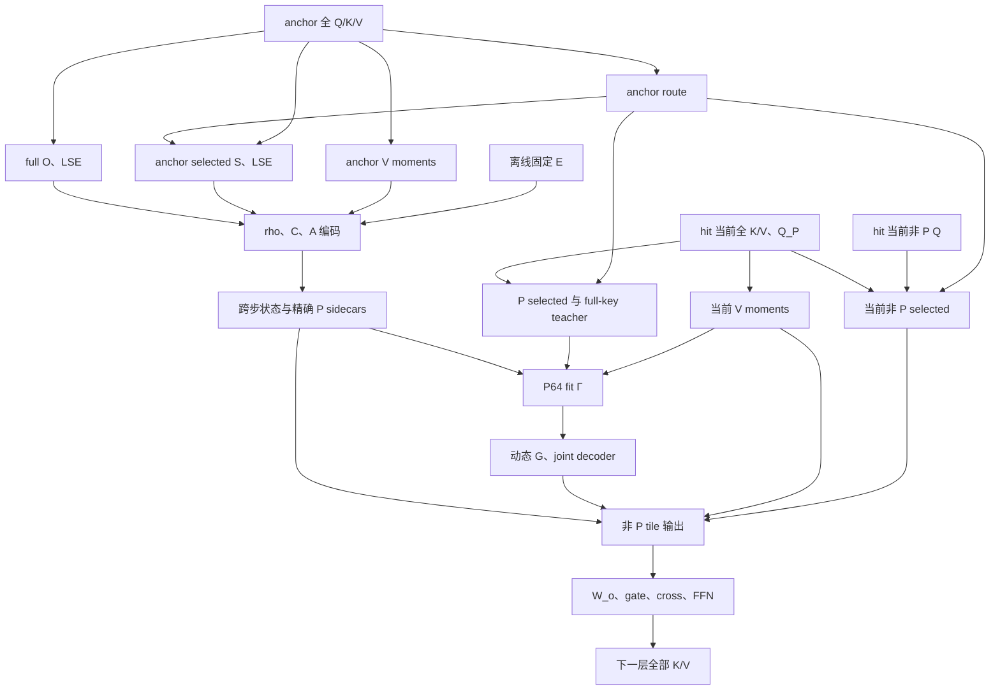

# Attention：带时间、信息可用性与数值语义的形式化

证据基准：`72280c1a264bf018343e746a2df2993dafe89149`；对象为已冻结的 high `OUT-ABS`、low mass-centered `OUT-D`，以及 round21 中分别实现的读出重排与联合缓存。本文完成源码恢复、数学推导和 CPU 代数核验，模型生成次数为 0。

核心判断：现有 attention 方法已经形成了清楚的两条恢复机制。High 用当前稀疏输出建立逐头低维校正场，再由当前 P64 全键教师确定系数；low 在此基础上运输锚点遗漏贡献，并用当前全 V 的均值、尺度校正全局值变化。这两条机制都按当前输入重算 selected attention。进一步优化必须同时尊重三个条件：新信息在哪个时点可得、已有状态能够支持哪些未来读出，以及误差如何进入后继模块。

## 1. 对象、轴与真实执行范围

去噪步记为 \(t\in\{0,1,2,3\}\)，层为 \(\ell\in\{0,\ldots,39\}\)。\(t\) 是去噪计算次序，视频时空位置属于 token 轴；两者不共用一个时间符号。以下公式固定一个 \((t,\ell,h)\)，仅在必要处恢复 head 轴。

| 对象 | 形状／数量 | 语义 |
|---|---:|---|
| 当前 \(Q,K,V\) | 外部 `[N,H,d]` = `[31668,40,128]` | 由当前层当前输入计算；模型宽度为 5120 |
| 内部 \(O,S,C\) | `[H,N,d]` | head-first 的全注意力、selected 输出、中心化遗漏状态 |
| query/key block | 128 tokens | 共 248 块；末块 52 tokens |
| route | `[H,248,31]`，int32 | 锚点 pooled QK 每个 query block 的 stable top31 |
| 每 query 有效 selected keys | 3892–3968 | 尾块入选时 3892，否则 3968；全键比例 12.2900%–12.5300% |
| 固定 probe 行集合 \(\mathcal P\) | 64 | 保持原始 production token ID 和顺序 |
| \(P_v\), \(T_H,T_L\) | `[128,64]`, `[64,31]` | 冻结 CAL 资产，当前运行不更新 |
| 特征 \(\phi\)；设计矩阵 \(X\) | `[H,N,31]`；`[H,N,32]` | 32 列包含截距 |
| 校正系数 \(\Gamma\) | `[H,32,128]` | 每个 hit 的每层、每头由当前 P64 重新拟合 |
| \(\tilde\rho_a\) | `[H,N,1]` FP32 | 已存 anchor mass；需与数学概率质量 \(\rho_a\) 区分 |
| \(C_a,A_a\) | `[H,N,128]`, `[H,N,31]` BF16 | low anchor 的两类历史字段 |
| 联合历史 \(Z_a=[C_a,A_a]\) | 每行 159 维 | 不把 channel 轴与 token 轴合并压缩 |

`wide8192` 表示 FFN 的 token tile 大小。它不改变 attention 的 128 维 head、128 token 路由块、31 selected blocks 或 P64 观测数量。

实际 `route()` 只取 stable top31，没有额外并入 local block。新 partition/selected kernels 消费同一 route_indices，因而不能以 top31+local 计算支持数量。

源码定位：`attention_online_structured.py:24–28,31–34,50–91,200–301`；`ffnds_optim/attention.py:1–45,349–398`；`ffnds_optim/attention_runtime.py:155–212`。

## 2. 路由和遗漏项的精确分解

在 anchor \(a=0\) 或 \(2\)，对每个 head、query block \(b\)，用块平均 Q/K 形成

\[
\mathcal R_{a,h,b}
=\operatorname{Top31}_{b'}
\left(\bar q_{a,h,b}^{\mathsf T}\bar k_{a,h,b'}/\sqrt d\right).
\]

对同一 expert 的下一次 hit，high 为 \((a,t)=(0,1)\)，low 为 \((2,3)\)，复用 \(\mathcal R_a\)。hit 不使用未来路由，也不重建当前全块路由。当前 logits 仍为 \(l_{t,ij}=q_{t,i}^{\mathsf T}k_{t,j}/\sqrt d\)，当前 values 仍为 \(v_{t,j}\)。

对 query \(i\)，令 \(R_i\) 为 anchor route 选出的有效 key 集。定义当前完整概率、质量和两个条件输出：

\[
p_{t,ij}=\frac{e^{l_{t,ij}}}{\sum_k e^{l_{t,ik}}},\qquad
\rho_{t,i}=\sum_{j\notin R_i}p_{t,ij},
\]

\[
S_{t,i}=\frac{\sum_{j\in R_i}p_{t,ij}v_{t,j}}{1-\rho_{t,i}},\qquad
U_{t,i}=\frac{\sum_{j\notin R_i}p_{t,ij}v_{t,j}}{\rho_{t,i}}.
\]

在对应质量非零处，有精确恒等式

\[
O_{t,i}=(1-\rho_{t,i})S_{t,i}+\rho_{t,i}U_{t,i}.
\tag{1}
\]

实现的 selected attention 在 \(R_i\) 内独立 softmax，因此它是条件输出 \(S_t\)，并非 full softmax 中已经乘上选中质量的贡献。由此 high 校正的精确对象为

\[
O_t-S_t=\rho_t(U_t-S_t).
\tag{2}
\]

这给出了 high 的具体含义：利用当前 selected 输出作为跨 token 共享校正场的特征，估计当前遗漏导致的整行差值。

### 2.1 理想概率与存储的 mass

代码先用 selected/full LSE 得到

\[
\tilde\rho_a=-\operatorname{expm1}(LSE_{sel}-LSE_{full}).
\]

只有 `difference > 5e-5` 或非有限行触发全键 logits 的直接遗漏求和，并在该 fallback 内 clamp 到 `[0,1]`。普通路径没有全局 clamp，因两个 fused backend 的归约差异，可能保留极小负值。因此本文将数学遗漏质量记为 \(\rho\)，已存字段记为 \(\tilde\rho\)，不把有限精度字段自动视为精确概率。

该差异不破坏后文以“任意已存字段”为基点的缺陷恒等式；它改变了缺陷的数值来源。源码：`attention_online_structured.py:123–149`。

## 3. High 与 low 的共同恢复器

特征函数保留真实舍入位置：

\[
\phi_e(S)=\operatorname{BF16}\big((S_{FP32}P_v)T_e\big)\quad
\text{随后转回 FP32 参与差分和拟合}.
\tag{3}
\]

设基础输出为 \(B_t\)，设计矩阵为 \(X_t\)。实际两种方案为

\[
\begin{array}{c|c|c}
&B_t&X_t\\\hline
\text{high}&S_t&[\mathbf1,\phi_H(S_t)]\\
\text{low}&(1-\tilde\rho_a)S_t+\tilde\rho_a\mu_t+C_aD_t
&[\mathbf1,\phi_L(S_t)-A_a]
\end{array}
\tag{4}
\]

这里 \(D_t=\operatorname{diag}(\sigma_t)\)，

\[
\mu_{t,h,d}=\frac1N\sum_jv_{t,j,h,d},\qquad
\sigma_{t,h,d}=\sqrt{\frac1N\sum_j(v_{t,j,h,d}-\mu_{t,h,d})^2}.
\]

实现采用 population variance `correction=0`、FP32 计算，并将 \(\sigma\le10^{-12}\) 的通道置零；倒数在这些通道同样置零。统计量来自当前**全 V**，不是 selected V 或 P64 V。

令 \(P\in\mathbb R^{64\times N}\) 为行选择矩阵，\(X_P=PX_t\)。当前教师为

\[
O_{t,P}^{\star}
=\operatorname{SDPA}(Q_{t,P},K_t,V_t),
\tag{5}
\]

因此教师虽只返回 P64 行，仍依赖全部当前 K/V。这里的“精确”是对当前近似轨迹已经产生的 Q/K/V 精确调用 native attention；当前输入可以已经受到此前层或此前去噪步的误差影响。

代码以冻结 \(s_R\) 归一化目标，拟合

\[
C_t^{fit}=(X_P^{\mathsf T}X_P+\alpha I)^{-1}X_P^{\mathsf T}
\frac{O_{t,P}^{\star}-PB_t}{s_R},\qquad
\alpha=64\lambda=6.4.
\]

令 \(\Gamma_t=s_RC_t^{fit}\)，在实数图上

\[
\Gamma_t=(X_P^{\mathsf T}X_P+6.4I)^{-1}X_P^{\mathsf T}(O_{t,P}^{\star}-PB_t),
\quad
\hat O_t^{pre}=B_t+X_t\Gamma_t.
\tag{6}
\]

最后输出转回 BF16，并将 P64 行覆盖为 native teacher。`scale_r` 的两次缩放在实数公式中消去，实际保留其浮点运算次序。正则化同样作用于截距，不能把截距视为未惩罚自由均值。

源码：`attention_online_structured.py:167–197`；`attention_mass_centered_low.py:20–34,80–110`；`attention_panel_fit.py:49–70`；`ffnds_optim/attention.py:365–435`。

## 4. P64 到底能恢复什么

条件于当前 \(X_t\) 和 \(B_t\)，定义真实残差 \(r=O_t^{\star}-B_t\)、

\[
K=X_t(X_P^{\mathsf T}X_P+\alpha I)^{-1}X_P^{\mathsf T},\qquad
M=I-P^{\mathsf T}P.
\]

忽略最终舍入，覆盖 P64 后的精确误差为

\[
\boxed{O_t^{\star}-\hat O_t=M(I-KP)r.}
\tag{7}
\]

这给出可直接检查的恢复条件：目标残差必须落在 \(\ker M(I-KP)\) 中。P64 的作用是在当前 32 列特征所确定的校正场中估计 128 个输出通道的系数。64 大于 32，为拟合提供冗余观测；是否稳定仍取决于当前 \(X_P\) 的谱和残差对该场的适配。

若 \(\alpha=0\)、\(X_P\) 列满秩且 \(r=X_t\Theta\)，则可以精确恢复。实际 \(\alpha=6.4>0\)，即使 \(r=X_t\Theta\)，仍有

\[
O_t^{\star}-\hat O_t
=M X_t\alpha(X_P^{\mathsf T}X_P+\alpha I)^{-1}\Theta.
\tag{8}
\]

这是由稳定化带来的有条件偏差，不应用“32 个自由度、64 个观测足够”替代其误差分析。

进一步，\(I-KP\) 可逆：由矩阵行列式引理，

\[
\det(I-KP)
=\det\left(\alpha(X_P^{\mathsf T}X_P+\alpha I)^{-1}\right)>0.
\]

所以 \(\operatorname{rank}M(I-KP)=N-64\)。若某个残差创新 \(u\) 在 P64 上为零，当前 fit 的右端完全看不到它；覆盖 P64 也不会改变该非 P 创新。这个结论针对固定 readout 的观测结构。**原始当前全 Q/K/V 已经包含计算完整 attention 所需的信息**；增加计算或换一套可执行读出可以提取更多信息，因此这里不是对完整原始输入的信息不可能性结论。

式 (7)–(8) 以同一目标的 P64 观测精确、线性代数按实数计算为条件。若指定完整目标 \(O^{ref}\)，实际 P64 teacher 为 \(PO^{ref}+\varepsilon_P\)，则还需加入

\[
O^{ref}-\hat O
=M(I-KP)(O^{ref}-B)-MK\varepsilon_P-P^{\mathsf T}\varepsilon_P
\tag{7b}
\]

及 solve、乘法、最终 BF16 转换的相应数值误差。不同 query shape 的 native kernels 是否逐位一致，需要实际比较；概率恒等式和式 (7) 的理想观测模型不自动提供该保证。

CPU 核验使用真实 high CAL 特征矩阵、合成当前行，验证式 (8) 最大绝对误差 \(2.71\times10^{-14}\)，验证误差算子秩 \(193-64=129\)。这些数值检验恒等式，不是 Wan 质量测量。

## 5. Low 中心化历史覆盖的变化与剩余缺陷

理想 active channel 定义标准化 values：

\[
z_{t,j}=(v_{t,j}-\mu_t)D_t^{-1},\qquad
\mathcal C_{t,i}=\sum_{j\notin R_i}p_{t,ij}z_{t,j}.
\]

由式 (1) 有

\[
O_t^{\star}=(1-\rho_t)S_t+\rho_t\mu_t+\mathcal C_tD_t.
\tag{9}
\]

实际 anchor 编码为

\[
C_a=\operatorname{BF16}\left[
\left(O_a^{\star}-(1-\tilde\rho_a)S_a-\tilde\rho_a\mu_a\right)
D_a^{\dagger}\right],\qquad
A_a=\phi_L(S_a).
\tag{10}
\]

\(D_a^{\dagger}\) 表示代码的逐通道 reciprocal-or-zero，不是跨通道白化。对任意已经存储的 \(\tilde\rho_a,C_a\)，在当前 active channels 上都有

\[
\boxed{
O_t^{\star}-B_t
=(\rho_t-\tilde\rho_a)(\mu_t-S_t)
 +(\mathcal C_t-C_a)D_t.
}
\tag{11}
\]

式 (11) 已经容纳 anchor mass 的浮点偏差和 BF16 历史。若需要把物理变化与数值误差分开，写 \(\tilde\rho_a=\rho_a+\delta\rho_a\)、\(C_a=\mathcal C_a+\delta C_a\)，则基础残差由质量漂移、标准化遗漏贡献漂移及相应存储误差构成。因为式 (10) 使用同一个 \(\tilde\rho_a\)，mass 误差和中心化历史误差在 anchor 处有相关抵消；不能分别取两个粗上界后把它们解释成独立真实误差。

在 active channels，标准化遗漏贡献的变化还能精确拆成

\[
\mathcal C_t-\mathcal C_a
=\sum_{j\notin R_i}(p_{t,ij}-p_{a,ij})z_{a,j}
 +\sum_{j\notin R_i}p_{t,ij}(z_{t,j}-z_{a,j}).
\tag{12}
\]

第一项记录遗漏区域当前注意力权重变化，第二项记录无法由全局逐通道均值／尺度运输解释的值结构变化。这些变化再由 low 的当前特征差 \(\phi_L(S_t)-A_a\) 与 P64 校正场共同补偿。

一个肯定的充分条件是：若概率分布保持不变，且全部 values 发生同一个正对角仿射变换 \(V_t=V_aD+b\)，则标准化 values 不变，理想 centered transport 精确重建当前 full output。它因此覆盖了有明确群结构的跨步变化。实际 Q/K 和标准化 V 同时变化时，式 (11)–(12) 给出准确的缺口，而不是笼统归因于“缓存过时”。

若当前或锚点通道被阈值置零，须把该通道的遗漏贡献作为额外边界项保留。确切常量 V 通道的 centered 项为零；小于阈值的非零方差与此后新出现的通道变化则需要由当前 teacher/readout 处理。

概率恒等式的精确性首先作用于实数 softmax 图。为将它接到实际 backend，记当前 selected 输出 \(\tilde S_t=S_t+\varepsilon_S\)、native 完整目标 \(\tilde O_t=O_t+\varepsilon_O\)，以当前已计算的 \(\tilde\mu_t,\tilde D_t\) 定义遗漏中心量。在 active channels，实际 decode 误差是

\[
\tilde O_t-\tilde B_t
=(\rho_t-\tilde\rho_a)(\tilde\mu_t-S_t)
 +(\mathcal C_t-C_a)\tilde D_t
 +\varepsilon_O-(1-\tilde\rho_a)\varepsilon_S
 +\varepsilon_{decode}.
\tag{11b}
\]

其中 \(\varepsilon_{decode}\) 收集实际 base 的逐项乘加舍入；由此明确区分质量／历史运输缺陷、native/selected backend 差异和 decode 数值误差。本文不将任何一个 backend 的 BF16 输出直接等同于精确 softmax 值。

CPU 核验：式 (11)（精确当前 softmax、含扰动存储 mass 和 BF16 历史）误差 \(7.22\times10^{-16}\)，式 (12) 误差 \(4.72\times10^{-16}\)，正对角仿射值运输误差 \(3.55\times10^{-15}\)。全部 Q/K/V 为显式合成操作数。

## 6. 联合缓存的简洁表示与因果维数

分解 \(\Gamma_t=[\gamma_{0,t};\Gamma_{1,t}]\)。low 的预覆盖输出写成

\[
\hat O_t^{pre}
=(1-\tilde\rho_a)S_t+\tilde\rho_a\mu_t+\gamma_{0,t}
 +\phi_L(S_t)\Gamma_{1,t}+Z_aG_t,
\tag{13}
\]

\[
Z_a=[C_a,A_a]\in\mathbb R^{N\times159},\qquad
G_t=\begin{bmatrix}D_t\\-\Gamma_{1,t}\end{bmatrix}
\in\mathbb R^{159\times128}.
\tag{14}
\]

这是正确的任务状态：历史仅通过当前动态读出 \(G_t\) 作用到输出。新实现存 \(\operatorname{BF16}(Z_aE)\)，读出 \(E^{\mathsf T}G_t\)，P64 的原始 \(C_a,A_a\) sidecars 保留精确 BF16 字段。因此在固定当前 Q/K/V 和 sidecars 时，局部 P64 fit 不受非 P 历史编码变化影响。

如果 \(\tilde Z_a=\operatorname{BF16}(Z_aE)E^{\mathsf T}\)，则实数读出误差严格为

\[
\Delta O_{nonP}=(\tilde Z_a-Z_a)G_t.
\tag{15}
\]

已存 basis 的有限精度、投影截断、code BF16 量化，都包含在 \(\tilde Z_a-Z_a\) 中；不同 FP32 contraction 次序还有单独的算术舍入项。P64 sidecars 保持本层 fit，相应误差仍会在非 P 输出进入下游后改变以后层的当前输入。

### 6.1 固定 encoder 的线性资源证书

明确量词：对任意可独立变化的历史行 \(z\in\mathbb R^{159}\)，采用固定线性编码 \(zE\in\mathbb R^k\)，要求所有允许未来读出 \(zG_t\) 都能精确恢复。必要且充分条件为

\[
\forall t,\quad G_t=EF_t,
\quad\Longleftrightarrow\quad
\operatorname{col}G_t\subseteq\operatorname{col}E.
\]

因此

\[
k_{min}=\operatorname{rank}[G_{t_1},G_{t_2},\ldots].
\tag{16}
\]

该结论是 skill 中“任务读出线性资源证书”在当前行向量约定下的应用。它区分单个算子的秩与未来读出族的联合秩。

若 \(D_t\) 全部对角项正，定义 \(M_t=\Gamma_{1,t}D_t^{-1}\)。则

\[
G_t=\begin{bmatrix}I\\-M_t\end{bmatrix}D_t,
\quad\operatorname{rank}G_t=128,
\]

并有更明确的两时点公式：

\[
\boxed{
\operatorname{rank}[G_{t_1},G_{t_2}]
=128+\operatorname{rank}(M_{t_2}-M_{t_1})\le159.
}
\tag{17}
\]

证明：分别右乘可逆 \(D_t^{-1}\)，再将第二组列减去第一组，得到对角块为 \(I\) 和 \(M_{t_2}-M_{t_1}\) 的分块矩阵。多个未来读出的版本将所有相对 \(M_{t_1}\) 的差横向连接。

于是固定 128 维无损编码成立的一个条件是归一化读出 \(M_t\) 在所有允许未来保持相同；多个未来 \(M_t\) 的差可以提供额外 31 个必要维度。rank64 编码可以利用真实状态分布和误差容忍获得压缩，它的数学性质是受分布约束的近似，而非由输出为 128 维推出的无损删除。

上述下界的量词是任意独立历史行。真实模型的 \(C_a,A_a\) 来自同一 Q/K/V，有可达状态约束；若历史只在更低维子空间 \(z=z_0+uU^{\mathsf T}\) 变化，应把证书改为相应受限读出的秩。当前可得的冻结 \(P_v,T_e\) 不能确定真实 \(C/A\) 状态流形，也不能确定未来 \(G\) 族的实测联合秩。合成双读出数值证书验证了单读出 rank128、双读出 rank159 和式 (17)，用于确认量词，不作为 Wan 的秩测量。

### 6.2 为什么时间条件改变可执行压缩

\(E\) 必须在 anchor 删除原始历史以前确定。\(G_t\) 需要当前全 V 的尺度与当前 P64 fit，后者又依赖当前 Q/K/V 和完整 P64 teacher。它直到 hit 的 prepare 阶段才可得。

因此“先看当前 \(G_t\)，再只缓存它需要的方向”若用于减少 anchor→hit 之间的持久状态，必须额外保留完整旧状态到那时、重算旧状态，或事先证明某个未来共享子空间；这些额外动作应出现在图和成本中。等到 fit 后选择读出方向可以缩减后续临时量，但不能追溯性地缩减此前已经存活的状态。

源码：`LowHistory.encode_joint/fields/dynamic_reader/historical_action`（`ffnds_optim/attention.py:245–320`）；`AttentionSession.anchor`（`attention_runtime.py:155–202`）。

## 7. 带时间和因果的执行图

### 7.1 信息可用性表

| 时点 | 已可用的信息 | 形成的对象／动作 | 仍需等待的依赖 |
|---|---|---|---|
| 离线 CAL 后 | \(P_v,T_H,T_L\)、固定 P64、λ、模型权重；可选每层每头 \(E\) | 固定特征空间、观测行、缓存编码器 | 当前样本的 route、状态、教师与系数 |
| anchor 当前 Q/K/V 完成 | 当前全 Q/K/V | pooled QK→route；native full attention | low 的中心化历史需 full/selected/moments 完成 |
| low anchor 编码 | full \(O_a\)、selected \(S_a\)、LSE、\(\mu_a,\sigma_a\) | \(\tilde\rho_a,C_a,A_a\)；可选 \(Z_aE\)+P sidecars | 未来 \(\mu_t,\sigma_t,\Gamma_t,G_t\) |
| anchor→hit 区间 | 当前 expert 各层已经形成的 route/history | 状态持续存活；下一次同 expert 同层消费 | 完整剩余层、采样器更新、下一去噪步前缀 |
| hit 当前层 Q/K/V 完成 | 全 K/V；原始 token ID；anchor route/history | 当前 \(\mu_t,\sigma_t\)；selected P64 和 native P64 | 当前 \(\Gamma_t\) 需要二者和 P 历史 |
| P64 fit 完成 | \(\Gamma_t\)，因而 \(G_t\) | 建立 joint decoder；非 P query tiles 可逐批读出 | 本 tile 的 selected attention |
| attention tile 输出 | 本 tile 的 attention 输出 | \(W_o\)、gate/residual、当前 cross-attention、FFN tail | 下一层的完整 K/V 仍依赖所有上一层 token 输出 |
| hit 层结束 | 所有 token 的层输出 | 消费并释放本层缓存；下一层 | 后续状态由这次输出决定 |

### 7.2 Low attention 局部图



图中的关键 barrier 是 **当前全 K/V→P teacher→fit→非 P 修复**。图中不存在“未来 G→过去 encoder”的边。P64 的原始 ID 同时决定 Q 行、route 的 query block 和后续恢复位置，切片后不得重新编号。

原始冻结 `approximate()` 先计算全部 selected，再取 P64 拟合。新 `HitAttention.prepare/read` 将 P64 prepare 提前，然后读取非 P tiles；两者在理想公式上使用相同当前数据。行可分性在当前全 K/V 已固定之后成立，不能由此推出跨层任意 token 先行。

## 8. 后继模块与当前联合缓存资产的覆盖边界

令 \(\Psi_t\) 是从本层 attention output 到本层输出的真实 tail：concat/head projection、残差门控、cross-attention、FFN 输入归一化／调制、FFN、最终残差。对有限变化有

\[
\Psi_t(O+\Delta O)-\Psi_t(O)
=\int_0^1D\Psi_t(O+s\Delta O)[\Delta O]ds
\tag{18}
\]

（在相应可微分段内；BF16、分支变化须按实际执行另列）。联合缓存的 \(\Delta O=(\tilde Z-Z)G\) 经这个实际 tail 进入下一层；仅控制 \(\|\Delta O\|\) 不等于控制最终视频指标。当前 Q/K/V、P teacher 和后继状态也会随以前层输出变化，因而局部固定输入推导不能替代整轨迹证据。

当前 pilot 的 joint attention CAL 构建做了两件确定的事：从三个真实 CAL 轨迹分别提取 128 个非 P 行的成对 \((Z,G)\)，保留其同源关系；以 rank64、8 个优化步拟合统一 basis。当前 capture 没有保存 `output_weight`，故实际目标为

\[
\frac{\sum_s\|(Z_sE)E^{\mathsf T}G_s-Z_sG_s\|_F^2}
 {\sum_s\|Z_sG_s\|_F^2},
\tag{19}
\]

其中按 head 能量相加。编译器支持可选 \(W_o\) 目标，但该轮资产走的是 `paired_joint_sum_head_energy`；它覆盖成对历史动作，不覆盖 \(W_o\) 后跨 head 相关项和式 (18) 的完整 tail。`basis_storage_loss` 计入 basis 保存精度，metadata 明确 `code_quantization_in_calibration_loss=false`，所以在线 BF16 code 量化也有独立误差来源。8 步下降记录提供该 CAL 目标的优化证据，不能替代全图最优证书。

源码：`build_pilot_attention_assets.py:13,32–35,49–80,83–91`；`compile_attention.py:38–73,85–151,163–190`；真实后继位置见 `joint_graph/native_transformer_infer.py:171–194,307–424`。

## 9. 覆盖与缺口总表

| 环节 | 当前机制已覆盖 | 条件／剩余缺陷 | 最早可用时点 |
|---|---|---|---|
| selected 域内动态 | 当前 Q/K/V 重算 logits、softmax 和 values | 支持仍为 anchor top31 | 当前 Q/K/V 后 |
| high 遗漏贡献 | 当前 \(S_t\) 的 31 维特征场 + P64 教师 | 式 (7) 的 readout 残差、ridge 偏差、舍入 | hit fit 后 |
| low 全局 value 变化 | 当前全 V 的逐通道均值／尺度运输 | 标准化 value 结构变化和遗漏权重变化，见式 (12) | 当前全 V 后 |
| low mass | anchor 全／selected LSE 与异常行直接遗漏求和 | 当前 \(\rho_t\) 的变化由间接 readout 处理；已存 mass 有有限精度语义 | anchor 形成，hit 复用 |
| low 增量校正 | 当前 selected feature 与 anchor feature 的差 + P64 | 特征差只能表示部分遗漏残差；正则导致偏差 | hit fit 后 |
| P64 输出 | 以 native full-key teacher 覆盖 | 对当前候选轨迹输入的局部精确；不是全参考轨迹校正 | full当前 K/V 与 Q_P 后 |
| 联合 C/A 编码 | 精确 P sidecars、固定 E、动态 G 直接读出 | \((\tilde Z-Z)G\)、在线 code 舍入；未来 G 可用时间限制 | E 在 anchor；G 在 hit fit 后 |
| 图重排 | 当前 K/V 固定后，P prepare 和非 P tiles 解耦 | 完整 KV barrier、下一层全 token 依赖、实际 kernel 开销 | 每层分阶段 |
| high 输出投影折叠 | 条件于 fit 后 Γ 的线性 contraction 等价 | 特征 BF16、attention 输出 cast、weight 存储舍入；不是 bitwise 等价 | high hit fit 后 |
| 当前 joint CAL 目标 | 成对真实 \((Z,G)\) 的局部 action loss | 完整 tail、轨迹闭环、在线 code 量化仍属独立目标 | 离线 CAL |

## 10. 已执行的静态核算与边界

真实 CAL 的有效特征投影 \(P_vT_H,P_vT_L\) 均为 rank31，条件数分别为 1.06786168、1.06592099。其自身具有良好列几何。当前 P64 设计 \(X_P\) 的条件数仍取决于实际 selected 行，不能由此资产条件数代替。

CAL 保存的 `spectrum` 是标准化 feature Gram 特征值的平方根。因而前 31 个方向的方差份额应使用平方和，high 为 59.8859348%，low 为 58.0111159%。这个比例只描述标准化 64 维 feature 的 CAL 分布；它不表示 residual、159 维历史或视频质量的保留比例。

以真实生产形状计算，原始 low `rho+C+A` 的 payload 为每层 407,883,840 B，40 层为 15.194857 GiB。rank64 联合表示包含非 P code、精确 P C/A sidecars、BF16 basis、rho、probe IDs 时为每层 168,508,032 B，40 层为 6.277413 GiB。这是字段容量核算，排除了 route、Q/K/V、权重、临时 tensor、allocator 与实际并发存活变化。

若仅以 QK/AV 的乘加数计 attention core，相对于 160 次 full attention，冻结四步图包含 80 full anchors、120 selected 调用（40 low anchors + 80 hits）、80 次 P64 全键教师。对应理想工作比为 59.3186%–59.4985%；单扫描 partition 若共享 low anchor 的 full/selected 归约，变为 56.2461%–56.3660%。这两个数只刻画所指定 core 运算图，不包括 QKV 投影、route、特征、fit、缓存构建、后继模块及设备执行效率，因此不作为加速测量。

复核脚本：`verify_attention_causal.py`。机器可读结果：`ATTENTION_CAUSAL_CERTIFICATES.json`。输入指纹及已核验 recipe 常量：`ATTENTION_INPUT_MANIFEST.json`。所有实际 CAL 和源码 SHA256 均在结果内；合成代数见证与真实资产计算分开记录。脚本可从原仓库的可携带 CAL bundle 直接读取字节，不需要 scratch 路径或模型运行：

```bash
OPENBLAS_NUM_THREADS=1 OMP_NUM_THREADS=1 python verify_attention_causal.py \
  --cal-assets ../../graph_state_theory/CAL_ASSETS.json
```

`--cal-root` 可改为已解包的 CAL 目录；`--source-root` 可选地重新检查仓库源码指纹。代数复核默认使用 manifest 已记录的源码身份，不导入运行器或重新执行模型。

## 11. 本次推导形成的可执行认识

1. 方法核心可以统一成“当前廉价基础场 + 因果历史运输 + 当前少量全计算观测拟合的校正场”；attention 的当前 selected 域与 FFN 的逐行算子仍需分别保留其真实依赖。
2. 精确性的判据已经从直觉上的“信息够多”收紧为式 (7)、(11)、(15)：分别刻画观测读出、运输缺陷和状态编码误差。它们回答不同问题，不能合并为一个低秩解释。
3. 可执行旁路以信息可用性为边界。P64 prepare 可以合法前移到全 K/V 形成之后；G 可以在 fit 后参与临时读出；固定 encoder 必须在 anchor 删除状态之前存在。
4. 当前最清楚的进一步结构问题，是归一化未来读出族 \(M_t=\Gamma_{1,t}D_t^{-1}\) 与可达历史变化的联合几何，以及该历史动作经过真实 tail 后的敏感方向。式 (17) 给出精确的维数判据，式 (18) 给出正确的下游目标。它们为覆盖缺口提供了数学位置，并未预先承诺更低 rank 或更高实测速度。

### 本文引用源码路径

- `round21_impl/source/research/20261124/attention_wide8192/results/joint39/attention_online_structured.py`
- `round21_impl/source/research/20261124/attention_wide8192/results/joint39/analysis_20261126/joint_action_review/mass_centered_runtime/attention_mass_centered_low.py`
- `current_review_math/attention_panel_fit.py`
- `round21_impl/repo/tools/ffnds_optim/attention.py`
- `round21_impl/repo/tools/ffnds_optim/attention_runtime.py`
- `round21_impl/repo/tools/ffnds_optim/runtime.py`
- `round21_impl/repo/tools/ffnds_optim/compile_attention.py`
- `round22_review/source/research/20261128/graph_state_implementation/five_source_pilot/build_pilot_attention_assets.py`
- `joint_graph/native_transformer_infer.py`

应用的 skill 数学工具：带语义轴的张量恢复、固定与动态算子族区分、岭回归误差算子、任务读出核空间／联合秩证书、受限状态子空间、有限变化链式作用、数值格式和生命周期成本。主要参考 `operator-tensor-analysis/references/certificates-and-computational-models.md` 的 C02–C03。
