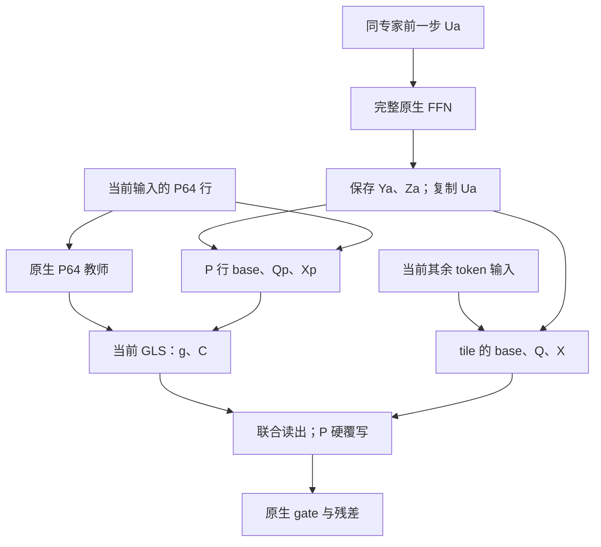

# FFN：冻结 wide8192 的数学对象、观测充分性与因果状态

2026-11-28。当前研究 HEAD：`72280c1a264bf018343e746a2df2993dafe89149`。本报告重构生产基线中的 BF16 wide8192 FFN；staged API 用于显露既有依赖，factor/gauge 作为已实现的不同表示另行注明。本轮执行源码读取、实际 P64 图计算与合成 CPU 代数证书；没有模型推理、GPU 作业、消融或计时。

## 1. 核心判断与维度消歧

**当前 FFN 方法是一套“保留上次完整输出、更新全部输入方向、精算选中非线性、用当前小样本恢复遗漏作用”的因果算子。** 它将全部 token 的当前输入、锚点和选中非线性作为结构信息，再由 P64 当前完整输出标定遗漏作用。恢复所依靠的先验，已具体落实为遗漏通道的固定斜率底座、从选中非线性构造的 16 个共享模式，以及当前 P64 定义的核延拓。[S1–S4]

| 量 | 数值与轴 | 实际含义 |
|---|---:|---|
| 去噪步 $s$ | $0,1,2,3$ | HHLL；$s=0,2$ 建锚，$s=1,3$ 命中 |
| 专家 $e$ | high / low | 与同层缓存匹配；两专家参数及原生 FFN 不同 |
| 层 $\ell$ | 0…39 | 每专家 40 层，逻辑 site 为 $(e,\ell)$ |
| token $n=(f,y,x)$ | $N=21\times29\times52=31668$ | $f$ 是视频 latent frame，**不是**去噪步 $s$；展平 $n=(f\cdot29+y)\cdot52+x$ |
| 输入／输出通道 $i,o$ | $d=5120$ | 两端同宽但属于不同计算槽 |
| FFN 隐藏通道 $h$ | $m=13824$ | 原生完整 W1–GELU–W2 |
| 选中隐藏通道 $k\in\mathcal K$ | $K=2560$ | 隐藏轴的 18.5185%；每个 token 都计算这些通道 |
| 遗漏隐藏通道 $h\in\mathcal O$ | $m-K=11264$ | 其固定斜率作用由 $A_0$ 覆盖，剩余非线性由在线恢复处理 |
| 模式 $j$ | $r=16$ | 16 个跨所有 token 共享的当前增益 $g_j$，每个模式有固定输出方向 $V_{jo}$ |
| 原生观测行 $p\in P$ | $P=64$ | 64 个当前 token 的完整原生 FFN，输出为 $64\times5120$ |
| 同帧边 | $E=42$ | 从上述点的值相减构造；没有额外 FFN 调用 |
| 联合 design 宽度 | $r+P=80$ | $[Q,\,K_{NP}]$ 的列数；**不是 80 个点或边教师** |
| wide8192 | 8192 行／tile | 执行分块尺寸，既不是隐藏宽度，也不是状态或观测维数 |

冻结 P64 图实际共有 64 点、42 条无向去重边、22 个连通分量。边 incidence 矩阵 $D\in\mathbb R^{42\times64}$ 的秩为 42；堆叠点值与边差的矩阵 $[I_{64};D]$ 有 106 行、秩仍为 64。它覆盖 21 个 latent frame 中的 19 个，$f=7,15$ 没有直接 probe；所有边均在同一 $f$ 内。因此同帧边度量强化了已观测点之间的空间差别，**没有新增观测秩或跨视频帧教师信息**。未采样帧仍可经共享模式和核特征接受预测，这属于结构性延拓，不等于直接观测。[S4,S9；本轮实际 IDs 计算]

## 2. 从原生函数得到精确余项

固定专家、层及权重，采用行批量记号：

\[
F(U)=\phi(UW_1+b_1)W_2+b_2,
\quad W_1\in\mathbb R^{d\times m},\ W_2\in\mathbb R^{m\times d}.
\]

这里 $U$ 是实际 `norm2_out`：当前 attention 残差已经加入，随后经过 norm2 和当前条件 scale/shift。FFN 输出 $Y=F(U)$ 位于 gate **之前**；原生 post 为 $R_{\rm out}=R+Y\odot\gamma_{s\ell}$。本方法替换的是 pre-W1 到 pre-gate 的 FFN body，保留前面的归一化／调制与后面的 gate／残差。[S8]

令 $a=s-1$ 是同专家的锚点步，$U_a,Y_a,Z_a$ 分别是其输入、完整输出与选中预激活。写

\[
\Delta U=U_s-U_a,\quad
\Delta Z=\Delta U W_1,\quad
\Delta H=\phi(U_sW_1+b_1)-\phi(U_aW_1+b_1).
\]

逐 token 的真实割线系数为

\[
\beta_{nh}=\frac{\Delta H_{nh}}{\Delta Z_{nh}}
\quad(\Delta Z_{nh}\ne0),
\]

零分母时可选导数值；乘回零增量不改变恒等式。故

\[
F(U_s)-F(U_a)=(\Delta Z\odot\beta)W_2.
\]

这描述的是有限变化，不需把当前变化限制为无穷小。实际冻结 compiler 从 CAL 端点拟合固定斜率 $\alpha_h$，然后对 selected 支持将该斜率置零来构建底座：[S3]

\[
\boxed{A_0^*=W_{1,\mathcal O}\operatorname{diag}(\alpha_{\mathcal O})W_{2,\mathcal O}.}
\]

定义 $B=W_{2,\mathcal K}$、$W=W_{1,\mathcal K}$。理想实数图的 base 与遗漏余项为

\[
B_s=Y_a+\Delta U A_0^*+\Delta H_{\mathcal K}B,
\]

\[
\boxed{R_s=F(U_s)-B_s=
[\Delta H_{\mathcal O}-\Delta Z_{\mathcal O}\odot\alpha_{\mathcal O}]W_{2,\mathcal O}.}
\tag{1}
\]

等价地，$R_s=[\Delta Z_{\mathcal O}\odot(\beta_{\mathcal O}-\alpha_{\mathcal O})]W_{2,\mathcal O}$。由此得到清楚的覆盖边界：**全部锚点输出被保留；选中 2560 通道的当前有限非线性被显式重算；遗漏 11264 通道的固定斜率作用被 $A_0$ 完整计入；在线恢复只承担剩余的遗漏非线性及实际数值缺陷。** 不能把 $A_0$ 与 selected 路径都解释为覆盖同一批通道。

选通道的 CAL score 使用非线性残差能量乘以对应 $W_2$ 经 FFN gate 加权的输出能量，已包含立即下游 gate 的信息；在线 GLS 仍拟合 pre-gate 输出，未将下一层 attention、后续去噪步或最终视频指标纳入当前目标。[S3,S4]

## 3. 16 个模式和 P64 核各自恢复什么

冻结参数的轴为

\[
Z\in\mathbb R^{K\times r},\quad J\in\mathbb R^{d\times r},\quad
V\in\mathbb R^{r\times d},\quad
\beta_k,s_k\in\mathbb R^K.
\]

源码中的 `zmap/jmap/v` 对应 $Z/J/V$，`kernel_beta/kernel_scale` 对应 $\beta_k/s_k$。当前特征为

\[
Q_{nj}=\sum_k\Delta H_{nk}Z_{kj}-\sum_i\Delta U_{ni}J_{ij},
\tag{2}
\]

\[
X_{nk}=\frac{\Delta H_{nk}-\Delta Z_{nk}\beta_{k,k}}{s_{k,k}}.
\tag{3}
\]

compiler 的实数关系为 $J=W\operatorname{diag}(\alpha_{\mathcal K})Z$，因此

\[
Q=(\Delta H_{\mathcal K}-\Delta Z_{\mathcal K}\odot\alpha_{\mathcal K})Z.
\tag{4}
\]

这使其机制非常具体：**用选中通道的当前非线性残差预测遗漏通道的输出残差**。$Q$ 是每个 token 自己的 16 维特征；$g\in\mathbb R^{16}$ 是当前 site 共用的增益；$Q\operatorname{diag}(g)V$ 是由两者形成的全场输出修正。

$\alpha_{\mathcal K}$ 与 $\beta_k$ 来自不同数值 CAL 路径，源码中确实不同。于是正确关系是

\[
Q=X\operatorname{diag}(s_k)Z+
\Delta Z_{\mathcal K}\operatorname{diag}(\beta_k-\alpha_{\mathcal K})Z.
\tag{5}
\]

直接写 $Q=XZ$ 会丢掉一个实际存在的斜率差分项。实际冻结 $J$ 和预激活还含编译／运行舍入，式 (4–5) 是实数编译关系；部署以式 (2–3) 的具体路径为准。

令选择算子 $P:\mathbb R^{N\times d}\to\mathbb R^{64\times d}$ 保持原始 probe 顺序，原生当前教师为

\[
Y_P=F(U_s[P]),\qquad T=Y_P-PB_s.
\]

定义同帧点边度量及核矩阵

\[
M=I+\frac{64}{42}D^TD,\quad
K_{PP}=X_PX_P^T/K,\quad
K_{NP}=XX_P^T/K,\quad S=K_{PP}+M^{-1}.
\]

实际求解为

\[
G=(Q_P^TS^{-1}Q_P)\odot(VV^T),
\quad
b_j=\sum_{p,o}(S^{-1}Q_P)_{pj}T_{po}V_{jo},
\]

\[
g=G^{-1}b,\qquad C=S^{-1}(T-Q_P\operatorname{diag}(g)V),
\tag{6}
\]

\[
\mathcal R_F(T)=Q\operatorname{diag}(g)V+\tfrac12 K_{NP}C.
\tag{7}
\]

令 $M_H$ 将 P 行置零，最终实数参考输出为

\[
\boxed{\widehat Y=M_H[B_s+\mathcal R_F(T)]+P^TY_P.}
\tag{8}
\]

代码将式 (7) 收缩为一次 $N\times80$ 与 $80\times d$ 的联合读出。其中前 16 行 readout 被约束为 $g_jV_{jo}$，后 64 行为 $C/2$，不是任意 80 个独立完整输出方向。[S1,S2,S5]

### GLS 的准确优化含义

式 (6) 的 $g$ 最小化

\[
\operatorname{tr}\{(T-Q_P\operatorname{diag}(g)V)^TS^{-1}
(T-Q_P\operatorname{diag}(g)V)\}.
\]

它也可由联合目标消元得到：

\[
\min_{g,H}\ \|M^{1/2}(T-Q_P\operatorname{diag}(g)V-X_PH/\sqrt K)\|_F^2+\|H\|_F^2.
\tag{9}
\]

最优 $H=X_P^TC/\sqrt K$。当前代码在完成该求解后，将核预测再乘 **$1/2$**。所以核分支是带正则且经过半幅收缩的延拓；并不保证对一般核残差完整插值。P 行的最终精确性由式 (8) 的显式原生覆写保证。

若白化核为 $\widetilde K=M^{1/2}K_{PP}M^{1/2}$，其特征值 $\lambda\ge0$ 经 $K_{PP}S^{-1}$ 对应的滤波系数为 $\lambda/(1+\lambda)$；再乘半幅系数后为 $\lambda/[2(1+\lambda)]$。该关系说明正则化／半幅是在明确地限制核恢复强度，不应把 P 上的硬覆写误读为非 P 恢复器已经成为插值逆。

## 4. 观测何时足够：可辨识性、可恢复性与稳定性

### 4.1 16 模式的充分性由张量原子决定

第 $j$ 个模式在 probe 上形成输出原子

\[
\Psi_j(p,o)=Q_{P,pj}V_{jo}.
\]

$G$ 是这些原子在 $S^{-1}$ 加权内积下的 Gram。因此 $G\succ0$ 当且仅当 16 个 probe 输出原子线性独立。**需要的不是 $\operatorname{rank}(Q_P)=16$。** 编译器将 $V$ 行方向正交化；在理想 $VV^T=I$ 情况下，

\[
G_{ij}=\delta_{ij}\,q_i(P)^TS^{-1}q_i(P).
\]

每个模式只需 $q_j(P)\ne0$，便可用其不同输出方向辨识。实际 FP32 的 $V$ 只近似正交，代码保留完整 $VV^T$ 和完整 $G$ 求解。CPU 证书构造了 $\operatorname{rank}(Q_P)=1$、16 个输出方向正交的例子，16 个张量原子仍满秩，16 增益均被精确恢复。

当真实遗漏余项恰为

\[
R_s=Q\operatorname{diag}(c)V
\]

且 $G$ 可逆，式 (6–7) 给出 $g=c,C=0,\mathcal R_F(PR_s)=R_s$。这是一条明确的肯定性覆盖结论：**模式子空间内的遗漏作用可以由 P64 恢复到全体 token，所需条件已经能写成一个可检验 Gram 矩阵。**

在该子空间外，令 $R_s=Q\operatorname{diag}(c)V+E_s$。固定当前 $Q,X,V$ 时，恢复器对 $T$ 线性，故

\[
\boxed{F(U_s)-\widehat Y=M_H(I-\mathcal R_FP)E_s.}
\tag{10}
\]

这把误差精确定位到模式表示未覆盖、且未被核延拓补足的部分。其稳定性同时依赖表示余项大小和 $G$ 的条件性；仅有求解成功并不给出统一的小误差保证。$S$ 因 $M^{-1}\succ0$ 而正定；$G$ 另需模式可辨识。

### 4.2 P64 对一般残差的可见边界

对任意非 P 残差 $E$ 满足 $PE=0$，有 $\mathcal R_F(PE)=0$。这种方向无法由当前教师数值区分。对给定候选残差线性子空间 $\mathcal E$，存在解码器精确恢复指定线性读出 $L E$ 的必要且充分线性条件是

\[
\ker(P|_{\mathcal E})\subseteq\ker(L|_{\mathcal E}).
\tag{11}
\]

这直接采用 operator-tensor-analysis 的任务读出状态证书。对于要求全场 FFN 输出，$L=I$；对于下游最终量，$L$ 是已明确的后缀作用或局部 Jacobian。式 (11) 是信息存在性条件；现有固定 GLS/kernel 解码器恰好实现该逆，还要单独检查。

由于当前保留全部 $U_s$、2560 个新预激活与锚点状态，不能把方法的信息输入只数成 64 个点。P64 提供完整算子当前值，$Q,X,B_s$ 提供已计算的全场结构。真正要论证的是：**剩余未计算的通道作用在条件化于这些结构后，是否落在可由 P 区分并稳定延拓的集合内。** 当前源码给出了其具体结构假设，而非对任意残差的恢复定理。

完整输入与原始权重在确定性上已经决定了原生 FFN 输出。这里的充分性分析明确约束于现有低成本特征和 teacher 解码接口：它判断省去通道计算之后，哪些剩余作用可经该接口恢复。允许重新运行完整 FFN 时，执行动作集合与成本已经改变，不能再用 P64 的秩单独给出整个计算问题的信息下界。

### 4.3 零增量与数值边界

若 $U_s=U_a$ 且采用一致实数路径，$B_s=Y_a,Q=X=0$，目标输出直接已知。当前代码没有专门的零增量分支；若其数值路径给出 $Q_P=0$，仍会进入未加正则的 gain solve，$G=0$ 将触发奇异检查。因此“回到锚点”是实数预测式的直接结果，当前通用 hit 实现的定义域仍受 $G$ 可逆约束。实际 full/selected W1 的数值差异也可能使同输入产生微小特征差；本轮没有据此报告真实失败或条件数。

## 5. 当前原生教师的准确对象

FFN 教师计算的是 **当前候选分支的 $U_s[P]$**。记当前分支输入为 $\widehat U_s$，完整 Dense 轨迹在同处的输入为 $U_s^{D}$。教师可确定

\[
F(\widehat U_s[P]),
\]

而整体误差分解为

\[
\widehat F(\widehat U_s)-F(U_s^D)
=\underbrace{\widehat F(\widehat U_s)-F(\widehat U_s)}_{\text{当前 FFN 近似误差}}
+\underbrace{F(\widehat U_s)-F(U_s^D)}_{\text{上游输入偏移经过 FFN 的作用}}.
\tag{12}
\]

P64 硬覆写消去第一项在 P 上的差值；第二项仍由当前分支已经发生的 attention、残差、跨层／跨步输入变化决定。同理，anchor 原生完整 FFN 是在该分支当时的实际锚点输入上精算。对于当前联合 attention+FFN 方法，锚点也不能自动称为整条 Dense 轨迹上的锚点。

设 FFN 前残差为 $R$，输入调制为 $U=\mathcal N(R;s,\ell)$，且本步条件 gate $\gamma$ 固定。则两分支 block 输出差有精确分解

\[
\delta R_{\rm out}=\delta R+
[F(\mathcal N(\widehat R))-F(\mathcal N(R))]\odot\gamma+
[\widehat F(\widehat U)-F(\widehat U)]\odot\gamma.
\tag{13}
\]

这是 FFN 与 attention 联合分析的接口：当前局部 teacher 校正最后一项；前两项必须沿真实后续计算图分析。不能仅由 P64 当前局部误差小，推断完整轨迹误差已经被重置。

部署更精确的保证是：P 行逐位等于该次 **64-row native FFN 调用**返回的 BF16 值。64-row 和完整 N-row GEMM 的硬件选型可能不同；本轮没有声称它们逐位等同。数学模型层面，两者定义同一逐 token 的原生函数。

## 6. 带时间的状态：何时可计算、何时可丢弃

### 6.1 一个 site 的因果图



| 时点 | 刚获得的信息 | 可执行工作 | 尚不可提前得到的量 |
|---|---|---|---|
| CAL／冻结参数后 | $A_0,Z,J,V,\beta_k,s_k,\mathcal K,P,M^{-1}$ | 准备各专家／层静态 selected 权重、LUT、Gram 常量 | 本请求 $U_a,U_s,g_s,C_s$ |
| 锚点当前 norm2 后 | $U_a$ | 完整 W1；在 in-place GELU 前保存选中 $Z_a$；完整 W2 得 $Y_a$ | 下一步当前 P64 输入 |
| 锚点 FFN 输出就绪 | $U_a,Y_a,Z_a$ | 存入本层槽；$Y_a$ 同时供当前 gate/residual | 下一步 $g_s,C_s$；它们不能在此静态折叠 |
| 命中当前 P64 输入就绪 | $U_s[P]$、对应 anchor P 行、当前原生权重 | 同时可算 P64 教师与 $B_P,Q_P,X_P$ | 仍需完成 solve 才有当前 readout |
| solve 完成 | $g,C,X_P,Y_P$ | 建立 80 行 FP32 readout；任意已就绪 row/tile 可完成输出 | 尚未获得的 row 输入仍需其上游 producer |
| 命中 row 输入就绪 | $U_s[I]$ 与缓存对应原始行 | 计算本 tile 的 base/Q/X，做联合读出并 gate/residual | 无需其他 FFN 非 P 行的当前输入 |
| 此 site 最后读缓存完成 | 本层状态不再有消费者 | 允许物理覆盖；已分配 buffer 可继续复用 | 不能把逻辑 owner 清空当作 GPU 消费已经完成 |

FFN 本体逐 token，P64 教师一旦获得 **当前 P64 输入**就能计算；其依赖不含当前其他 FFN token。注意力的 P 行输入如何就绪由上游图决定，不能在 FFN 子图中假定已经免费获得。staged `fit` / `apply_rows` 正好暴露这一边界；原 frozen `full` 顺序是先 fit，再四个最多 8192 行 tile，最后 P 覆写。[S1,S5]

### 6.2 HHLL 的槽所有权

| 去噪步 | 专家 | 每层动作 | 该层持有状态的逻辑所有者 |
|---|---|---|---|
| $s=0$ | high | 原生建锚 | high，等待 $s=1$ 同层 |
| $s=1$ | high | 消费锚点，当前 P64 拟合，完整命中输出 | `take` 后清空；GPU 读取仍由串行 stream 顺序保护 |
| $s=2$ | low | 在已消费槽中建立 low 原生锚点 | low，等待 $s=3$ 同层 |
| $s=3$ | low | 消费 low 锚点，完成最后命中 | 清空 |

全请求 160 个 FFN site 调用 = 80 次原生 anchor + 80 次 hit；两个专家共享 40 层 resident 槽，逻辑生命周期不重叠。默认没有 anchor D2H/H2D。`trajectory` 检查所有 site 次序和所有者，成功／异常退出都清空 owner，并以 stream/event 保证后续请求复用安全。静态 selected 参数可跨串行请求复用，但权重、选通道、层／专家、token 顺序／grid 或数值配置改变时，必须重新绑定对应表示。[S6,S7]

物理状态是 BF16 的 $U_a\in\mathbb R^{N\times d}$、$Y_a\in\mathbb R^{N\times d}$、$Z_a\in\mathbb R^{N\times K}$，40 槽容量

\[
2LN(2d+K)=32{,}428{,}032{,}000\text{ bytes}=30.20096\text{ GiB}.
\]

这是现行缓存布局容量，含义不同于整进程峰值。`anchor_direct` 将原生 W2 直接写入既有 $Y_a$ 槽，省去同值复制；它已经属于 wide8192 的现行 baseline。selected $Z_a$ 必须在 GELU in-place 覆写前捕获，不能为了简化状态而把捕获时点移到之后。[S7]

## 7. 缓存表示的充分性与真正的缺口

三缓存是为了节约重算而保存的多个函数值。固定原生权重与执行数值路径时，$U_a$ 已决定 $Y_a,Z_a$，所以三缓存不是信息维数下界。仅保留 $U_a$ 可以通过额外原生完整 FFN 恢复另外两项，但需要支付一次额外原生调用；本次不据此声称吞吐改进。

在实数图中，给定 $Y_a,Z_a$，旧输入只经 $U_aA_0$ 与 $U_aJ$ 被未来读取。如果用线性编码 $U_aE$ 精确回答这些读出，条件为

\[
\operatorname{col}([A_0,J])\subseteq\operatorname{col}(E).
\tag{14}
\]

允许改变保留变量时，已有精确折叠 $Y_a-U_aA_0,Z_a,U_aJ$；它要在 anchor 计算新的 $U_aA_0$。已有 factor 实现令 $A_0\approx LR$，保留 $U_aL$ 与 $U_aJ$，把完整输入历史换为低维投影；其输出变化在**固定原有 Q/X、相同当前输入且实数算术**下为

\[
\boxed{\delta\widehat Y=M_H(I-\mathcal R_FP)[\Delta U(LR-A_0)].}
\tag{15}
\]

现有 `recovery_filter` 实现的正是式 (15)，包括半幅 kernel 与 P 掩码；普通 SVD 优化的权重 Frobenius 误差与这个真实恢复后作用误差不同。实际 projected cache 还改变 BF16 差分与求和路径，应另外计入 $E_{\rm num}$ 及可能变化的 $Q$，不能把式 (15) 当作未经条件限定的部署逐位公式。[S5]

当前 gain 与核 readout 在命中 P64 后才知道。对于 anchor 特征 $h_a\in\mathbb R^K$，若未来读出为 $h_aT_s$，预先压缩为 $h_aE$ 要精确回答整个未来查询族，必须有

\[
\operatorname{span}_s\operatorname{col}(T_s)\subseteq\operatorname{col}(E).
\tag{16}
\]

每次 $T_s$ 的秩不超过 64，不表示未来查询族的联合维度只有 64。这里未知的是未来当前 $X_P,C$ 形成的读出方向，因而“80 个读出列很小”本身不是 anchor 能压缩成 80 列的证明。

另外，已有静态配对 gauge

\[
A_c=A_0+J\operatorname{diag}(c)V,\quad
B_c=B-Z\operatorname{diag}(c)V
\]

在固定 Q/X、教师且 $G$ 可逆的实数图满足 $B_{s,c}=B_s-Q\operatorname{diag}(c)V$、$g_c=g+c$、$C_c=C$、最终输出不变。它给出可证明的表示自由度。当前 $g_s$ 要等在线观测才能获得，故把当前增益吸收到大矩阵的代数式，并不等于能在锚点时无代价准备该矩阵；生产 BF16 也不自动保留该实数恒等。

## 8. BF16 执行合同：哪些恒等只属于实数参考图

现行 hit 有意保留下列精度边界：[S1,S2,S4,S5]

| 阶段 | 实际存储／运算路径 |
|---|---|
| 当前／锚点输入 | BF16 存储；`du` 为 FP32 差，`dub` 是差再舍入为 BF16 |
| A0 分支 | 冻结 $A_0$ 是 BF16；`dub @ A0` 的结果再存 BF16 |
| selected W1 | 当前 BF16 输入、selected 原生 BF16 权重／偏置，输出 BF16 预激活 |
| 激活有限差 | LUT 对应 BF16 tanh-GELU；两个 BF16 激活值作 FP32 差，再舍入 BF16；`dh32` 升格的是该舍入后的差 |
| selected W2 | BF16 操作数 GEMM，直接产出 FP32 selected 项 |
| base | 按 $(\mathrm{float}(Y_a)+\mathrm{float}(linear))+selected$ 的原次序 FP32 加和 |
| Q/X | FP32；Q 使用 FP32 du，而非 dub |
| solve | $X_PX_P^T/K$ 先由 FP32 contraction 产生再升 FP64；GLS 与 Cholesky solve 使用 FP64 |
| 全场读出 | $g,C$ 降至 FP32，FP32 design/readout/addmm，最后写 BF16 输出 |
| P 行 | 由当前原生 P64 BF16 教师逐位覆盖 |

因此 $\mathrm{BF16}(U_s-U_a)A_0$、$U_sA_0-U_aA_0$ 与 $(U_sL-U_aL)R$ 是不同数值程序。合并 A0/selected GEMM 的 direct 候选还删除原 linear 的中间 BF16 舍入；它与默认 split wide8192 是独立表示。不能只凭实数乘法分配律把这些路径归为逐位等价。

## 9. 本轮完成的数学计算与来源

`verify_ffn_formal.py` 实际执行 16 项 CPU 代数检查：遗漏残差恒等、selected 模式因子关系、两套斜率桥接、点边 metric 等价、GLS normal equations、kernel primal/dual 等价、恢复器线性、模式精确恢复、rank-one Q 的 16 模式可辨识、P-null 残差、扰动经恢复传播、配对 gauge 等。最大绝对误差 **8.61e−14**。该证书使用合成数值数组；实际 P64 IDs 只用于真实观测图／秩／frame 覆盖计算。另以 NumPy 实现 round-to-nearest-even BF16 舍入，构造重排不等价例子；它不是模型误差估计或 CUDA 验收。

数学工具实际采用了算子 skill 的有限割线、任务读出核包含证书、张量原子 Gram 与正规方程、岭回归消元、状态读取时点与全周期资源语义。完整数值、实际 probe 图、源码 SHA-256 在 `FFN_FORMAL_VERIFIED.json`。

### 现有证书与真实模型数据的边界

| 对象 | 本轮已建立 | 本轮实际数据状态 |
|---|---|---|
| P64 同帧图 | 用原始 IDs 计算 E、秩、连通分量、frame 覆盖 | 已得实际数值 |
| $J=W\operatorname{diag}(\alpha)Z$ | compiler 的构造关系及实数推导 | **MISSING**：本轮未加载真实各 site 的 J 数组、因子缺陷或谱 |
| V 的输出方向 | compiler 有正交化及容差检查 | **MISSING**：本轮未重新测量真实 V 的正交误差／谱 |
| 当前 G 的可辨识性 | 充要条件及 CPU 满秩／奇异构造 | **MISSING**：本轮未取得真实在线 $Q_P,X_P$，不报告实际条件数 |
| 遗漏余项的恢复 | 精确误差算子 (10)、(15) | **MISSING**：本轮未生成当前完整 native FFN 面板，不报告真实恢复误差 |

复算只需 NumPy 和相邻的 `FFN_OBSERVER_METADATA.json`、`FFN_SOURCE_BINDING.json`：

```bash
python verify_ffn_formal.py
```

可通过 `--observer-json` 指定同结构的观测元数据，通过 `--output` 指定结果文件。默认从不可变 SHA 清单读取来源绑定；如需重新校验原始源码字节，传入 `--source-root`，其下必须具有清单记录的原始相对路径。脚本没有固定工作区绝对路径，也不依赖仓库目录层数。这里交付的结果已在本次原始 workspace 上校验全部来源 SHA；将证书复制到仓库后，独立运行不要求再复制生产代码。

### 源码定位

- **S1** `round21_impl/source/tools/ffnds_fourstep/fourstep_hit.py`：默认 split wide hit、完整当前教师、GLS、半幅核、P 覆写。
- **S2** `joint_graph/exact_port.py` 与 `round21_impl/source/tools/ffnds_fourstep/fourstep_backend.py`：精度常量、`wide8192` 的选择、anchor direct 的绑定。
- **S3** `evidence/compile_sites.py`：CAL 斜率、gate 加权选通道、遗漏通道 $A_0$、J 因子关系、V 正交化、BF16 kernel slopes。
- **S4** `evidence/native_joint.py`：probe 同帧图、metric、原始 readout 的直接可读表达。
- **S5** `round21_impl/repo/tools/ffnds_optim/ffn.py`：staged fit/apply/full、因子缓存、gauge、`recovery_filter`。
- **S6** `round10_review/dense_audit/source/resident_historical.py` 与 `round21_impl/repo/tools/ffnds_optim/ffn_runtime.py`：同专家状态、40 槽复用、请求边界／stream 依赖。
- **S7** `round20_theory/ffn/fourstep_anchor_snapshot.py`：原生 W2 直接写 Ya，selected 预激活捕获时点和有限布局／权重所有权合同。
- **S8** `joint_graph/transformer_infer.py` 与 `round14_compare/evidence/source/research/20261107/ffn_baseline_reproduction/strict_reproduction_20261116/wan_ffn_port.py`：实际 norm/modulation、pre-W1 hook、gate/residual 边界。
- **S9** `evidence/base_identity.json`：原始 P64 顺序及绑定标识，SHA-256 `e54bd777d957f53012833c0e70870df445f9e52d1e0bb9dfa51d9235dbe8c630`。

这些文件中一部分是当前工作树的已保存源码快照；本报告对其实际字节做了摘要。没有假定本地存在完整模型权重，也没有用合成检查替代真实任务质量证据。
